# SEG-14　Script Track の別文書への貼り付け

2026-11-12。DirectMusic Producer 5.3.0.900 の作業コピーで、同じ Project の **BGPredawn** から **BGDawn** に Script のルーチンをコピーした。第8小節の既存項目に Merge と Overwrite を適用し、Undo と Redo の結果を保存ファイルで照合した。撮影時は1280×752 px。122枚の記録から23枚を掲載する。青い光と黒い矢印は操作ツールの表示。 [入力・実行ファイルの記録](../../../work/original-gui/SEG-14-script-cross-document/20261112T012349480258Z/run.json) · [画像の出典、寸法、ハッシュ](../../../work/original-gui/SEG-14-script-cross-document/20261112T012349480258Z/published-figures.json)

## グループ割り当ての読み込み

入力は前回の BGPredawn と同じ Project のコピー。両 Segment は100 BPM、1/4、38小節。比較のため、SGP の Script Track の `trkh` を **BGPredawn は 0x00000001（1）**、**BGDawn は 0x00000002（2）** にした。原版に読み込むと、双方のヘッダーは **1-32: Script**。ヘッダーをクリックして **F11** で開く **Track Group Assignment** は4行8列、32項目がチェック済みで灰色。BGDawn のグループ1のチェック欄をクリックしてもチェックは残った。貼り付けと Undo 後に保存した BGDawn の `trkh` はすべて **0xFFFFFFFF**。今回の貼り付け比較は原版上で両方が1〜32になった状態で行った。 [入力を作ったコード](../../../work/original-gui/SEG-14-script-cross-document/20261112T012349480258Z/prepare.py) · [保存されたグループ、項目、参照の照合](../../../work/original-gui/SEG-14-script-cross-document/20261112T012349480258Z/paste-audit.json)

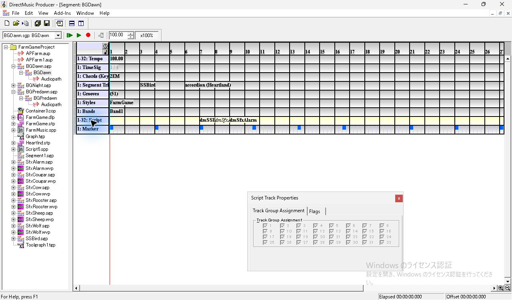

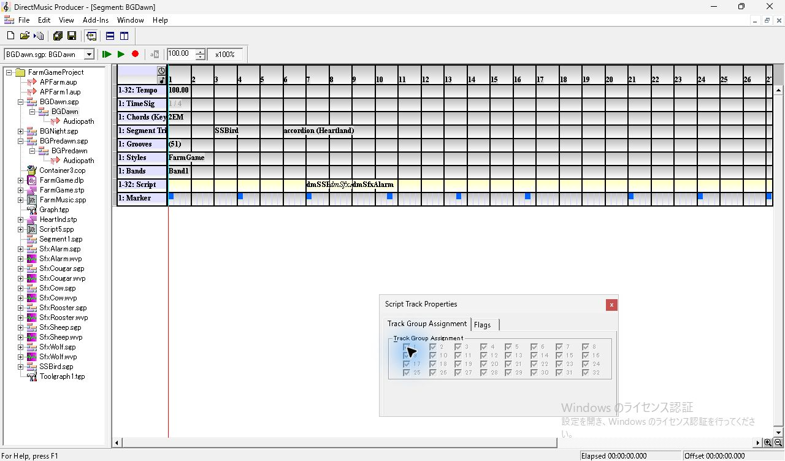

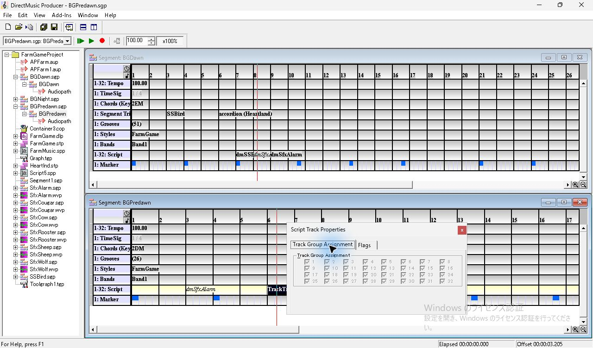

**Flags** タブでは **Enable Play** にチェック。**Use Clocktime** と **Audition (Design) Only** は空欄で、クリック可能な外観。Enable Control、Send Notifications、Compose と Control の各欄は灰色。今回の試験では Flags の値を変えずに撮影した。

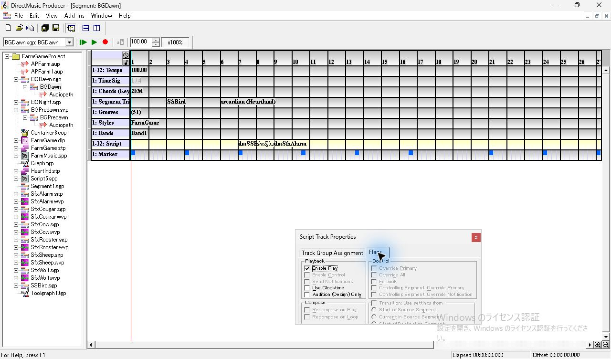

## コピー元と貼り付け先

**Window > Tile Horizontally** で BGDawn を上段、BGPredawn を下段に並べた。縦罫線の間隔は上段が約38 px、下段が約59 pxで、小節番号を頼りに位置を選ぶ。BGPredawn の第6小節の **Script5.TrackTrace** は **Quick response**、**Start Time 6:1:0、Belongs To 7:1**。下段の TrackTrace から上段の第10小節へ通常ドラッグしても、下段の選択が残り、上段に項目は追加されなかった。ドラッグの写真はボタンを離した後。 [同じ行内のドラッグと時刻編集](seg-14-script-track-gestures.md)

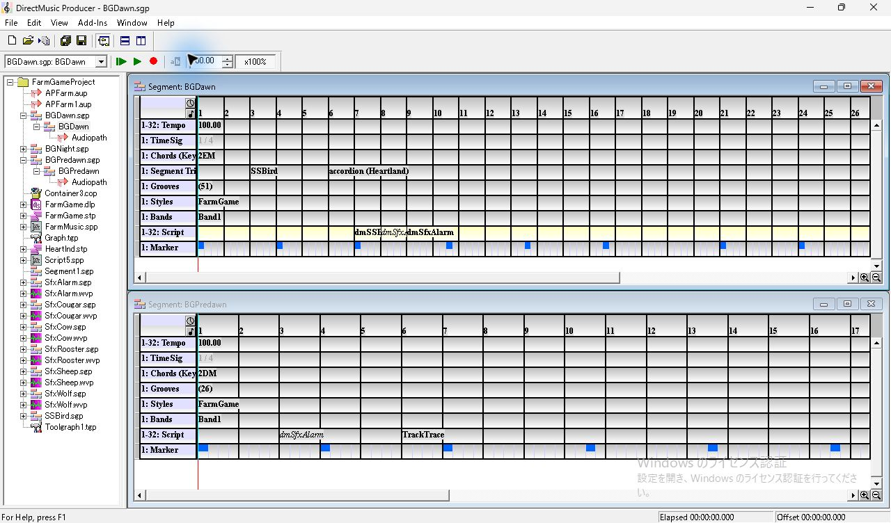

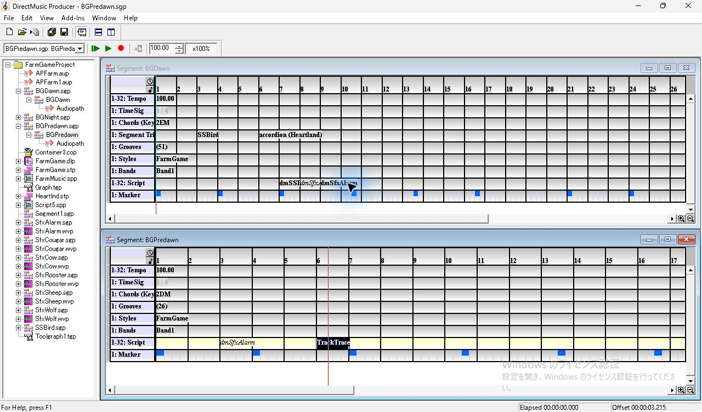

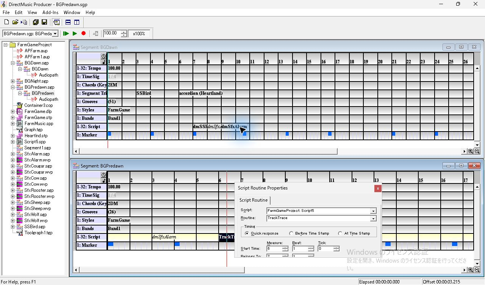

BGDawn の第7〜9小節に以下の4件を置いた。第8小節の2件は名前が斜体で、右クリックの **Cycle Routines** で切り替えられる。横ズームが小さい上段では名前が次のセルにかかる。項目の有無はラベルの開始位置と Properties で照合した。

| BGDawn の試験入力 | Start Time | Timing |
| --- | --- | --- |
| FarmMusic.dmSSBird | 7:1:0 | At Time Stamp |
| FarmMusic.dmSfxAlarm | 8:1:0 | Before Time Stamp |
| FarmMusic.dmSSBird | 8:1:1 | At Time Stamp |
| FarmMusic.dmSfxAlarm | 9:1:0 | Before Time Stamp |

## 1件の Merge と Overwrite

下段の TrackTrace を選択して **Ctrl+C**。上段の第8小節をクリックすると、上段のタイトルバーと Script 行がアクティブになり、Transport の対象が BGDawn に切り替わる。下段には選択と赤い位置線が残る。第8小節を右クリックし、**Paste** を開くと **Merge** と **Overwrite** が選べる。

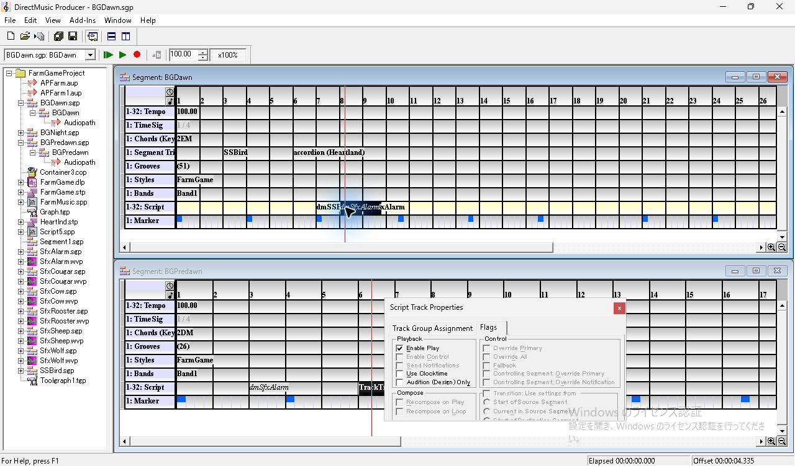

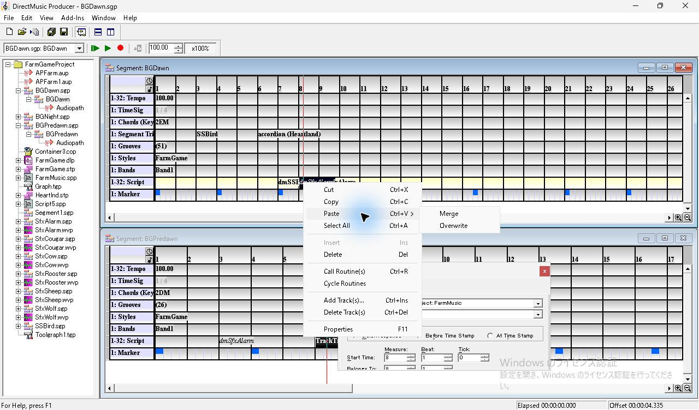

**Merge** を選ぶと、同じ物理 Tick の **8:1:0** の Alarm が TrackTrace に置き換わり、**8:1:1** の Bird は残った。貼り付けた TrackTrace が濃紺に選択され、斜体で表示された。Cycle Routines を選ぶと、同じセルで **dmSSBird、At Time Stamp、8:1:1** が表示された。 [Merge 後の SGP](../../../work/original-gui/SEG-14-script-cross-document/20261112T012349480258Z/captures/27-save-merge-BGDawn.sgp)

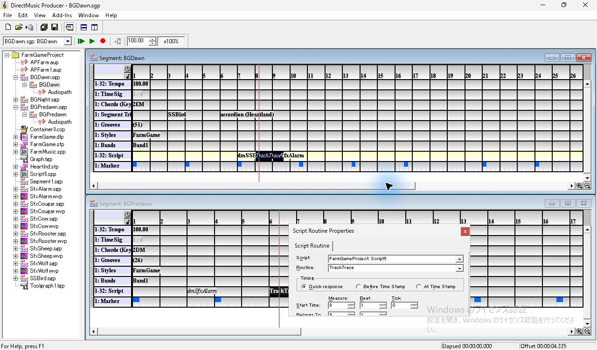

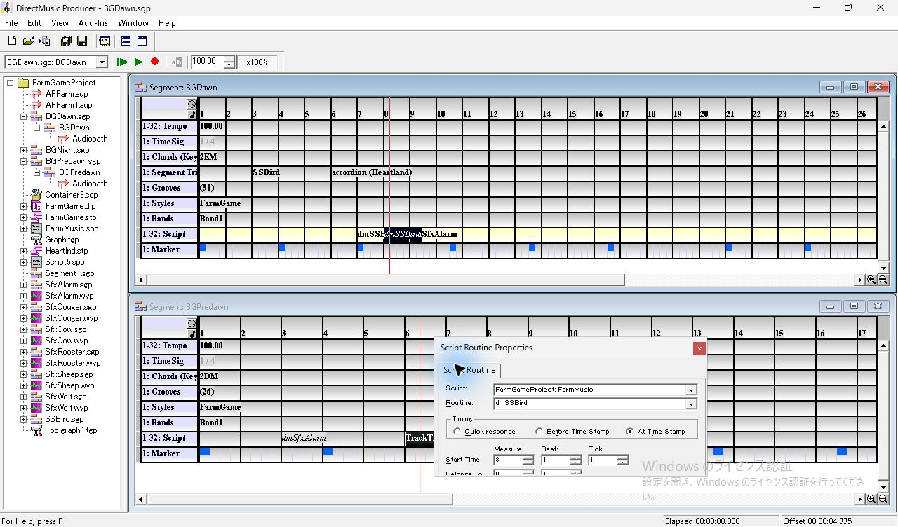

BGDawn の **Edit > Undo Paste Routine(s)** で4件を復元してから、同じ第8小節で **Overwrite** を選んだ。第8小節は TrackTrace 1件になり、文字は正体、**Cycle Routines** は灰色。第7小節と第9小節は残った。両方式で TrackTrace は小節の先頭 **8:1:0** に入り、物理5376／論理6144。コピー元にあった1小節差、Quick response、Script5 の参照 GUID を維持した。 [Overwrite 後の SGP](../../../work/original-gui/SEG-14-script-cross-document/20261112T012349480258Z/captures/36-save-overwrite-BGDawn.sgp)

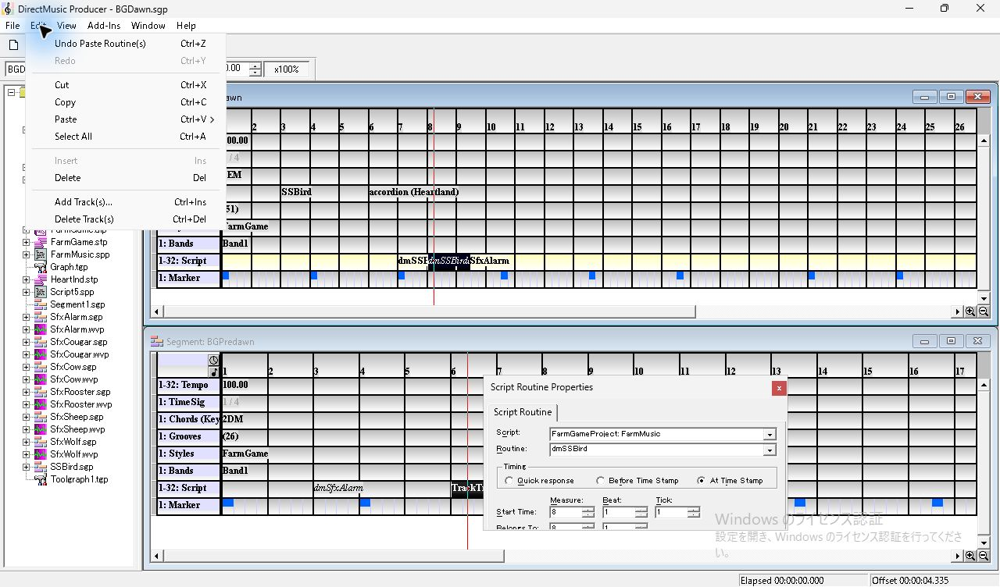

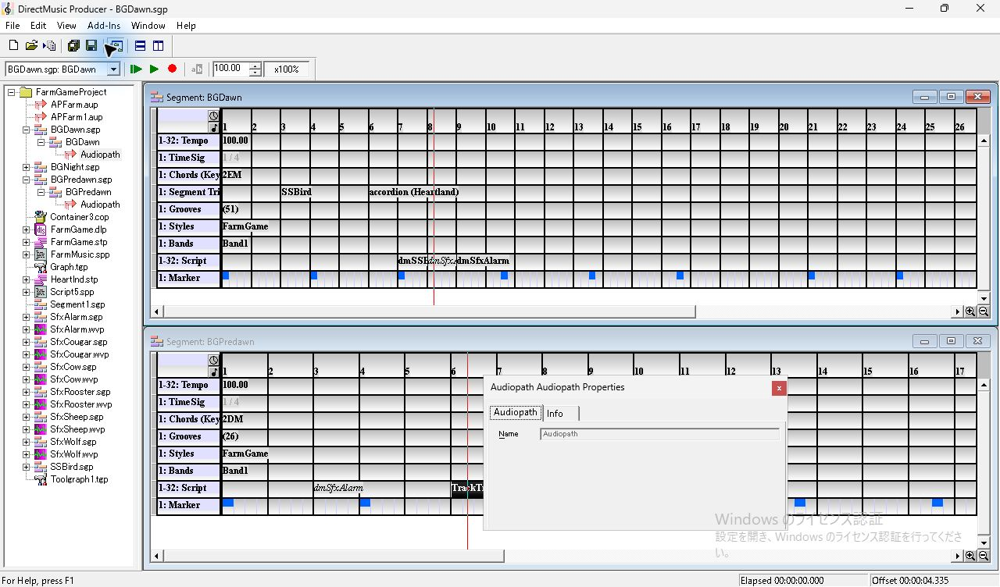

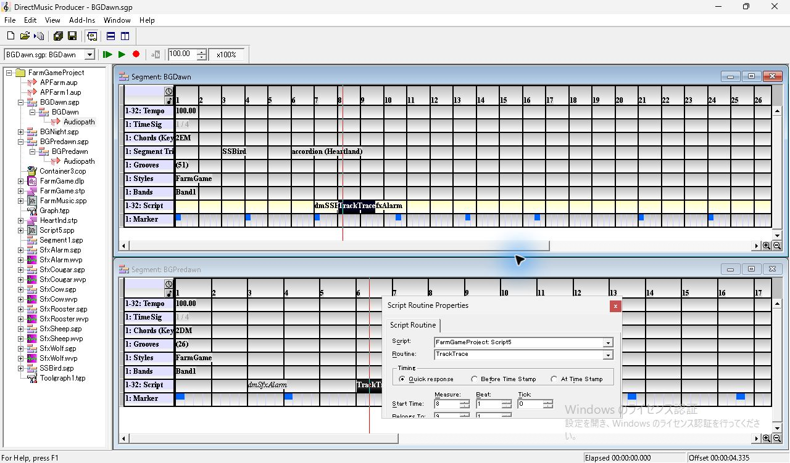

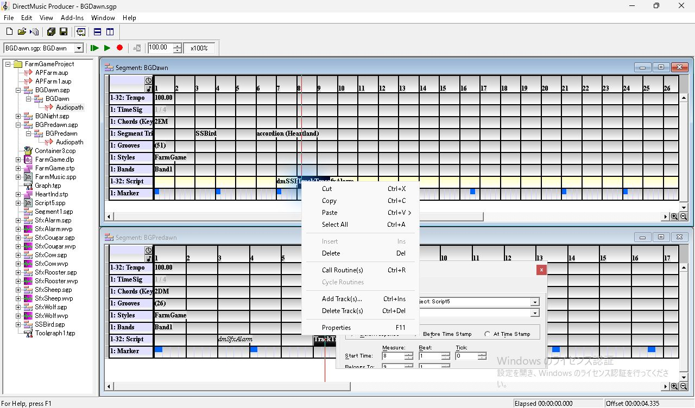

| BGDawn の位置 | Merge 後 | Overwrite 後 |
| --- | --- | --- |
| 7:1:0 | dmSSBird | dmSSBird |
| 8:1:0 | TrackTrace | TrackTrace |
| 8:1:1 | dmSSBird | 空 |
| 9:1:0 | dmSfxAlarm | dmSfxAlarm |

Overwrite 後に上段で **Ctrl+Z** を押すと元の4件が戻った。Undo 直後は上段のセル選択が外れ、Properties は Audiopath。続けて保存し、その状態で **Ctrl+Y** を送った試行では表示に変化がなかった。**Edit > Redo Paste Routine(s)** は有効で、クリックすると第8小節の TrackTrace が戻った。両 Undo の保存ファイルは SHA-256 が一致。Redo 後は Script の項目とマスクが Overwrite 直後に一致し、Marker Track にファイル差分があった。最初の編集保存にも Chord と Marker の差分がある。 [Undo・Redo を含む保存値の照合](../../../work/original-gui/SEG-14-script-cross-document/20261112T012349480258Z/paste-audit.json)

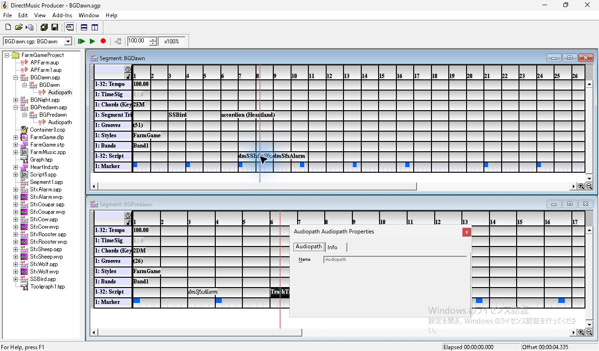

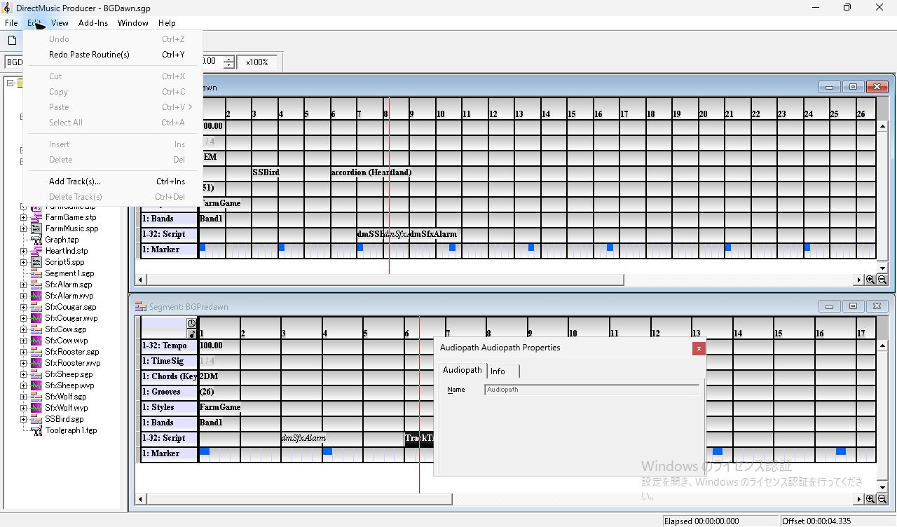

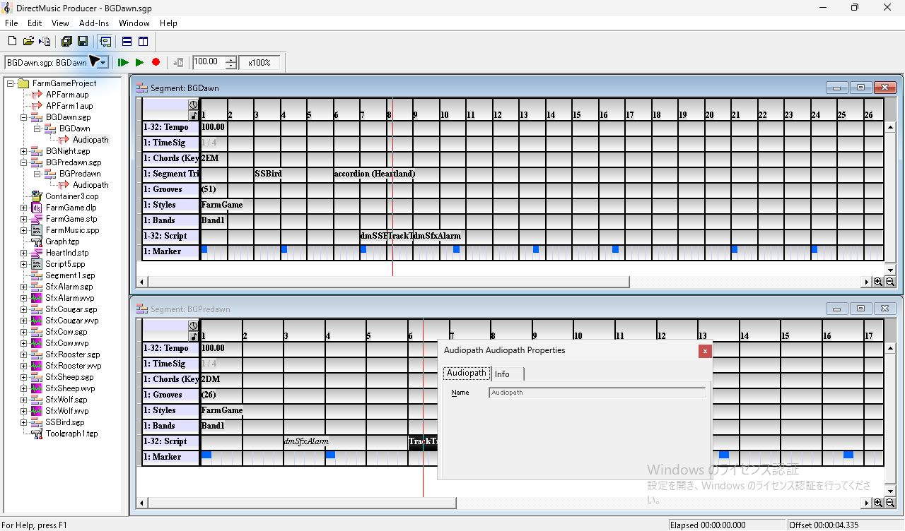

## 3件の Overwrite と間の空セル

上段を再度 Undo で4件に戻した。下段の Script 行にフォーカスして **Ctrl+A → Ctrl+C**。第3小節の2件と第6小節の1件に加え、画面上は空セルも濃紺になる。Properties は **Multiple Routines Selected**。上段の第8小節を右クリックして Overwrite を実行すると、コピー元の最初の項目が第8小節に揃い、TrackTrace は3小節後の **第11小節** に入った。第9小節にあった Alarm は消え、第7小節の Bird は残った。第8小節の2件の物理時刻は1 Tick 差、TrackTrace は Start Time **11:1:0**、Belongs To **12:1**。保存された両 Script の参照 GUID は Project の各 Script 文書と一致した。 [3件の Overwrite 後の SGP](../../../work/original-gui/SEG-14-script-cross-document/20261112T012349480258Z/captures/55-save-overwrite-all-BGDawn.sgp)

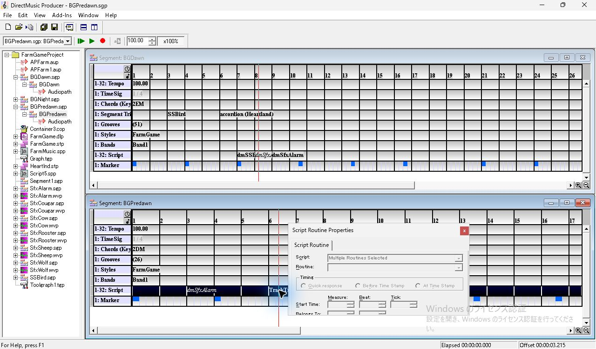

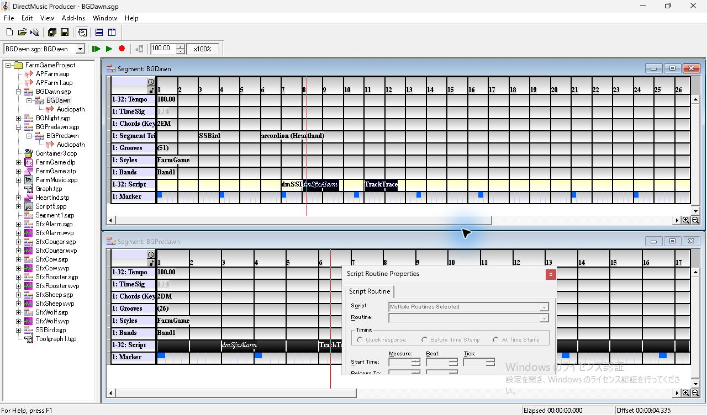

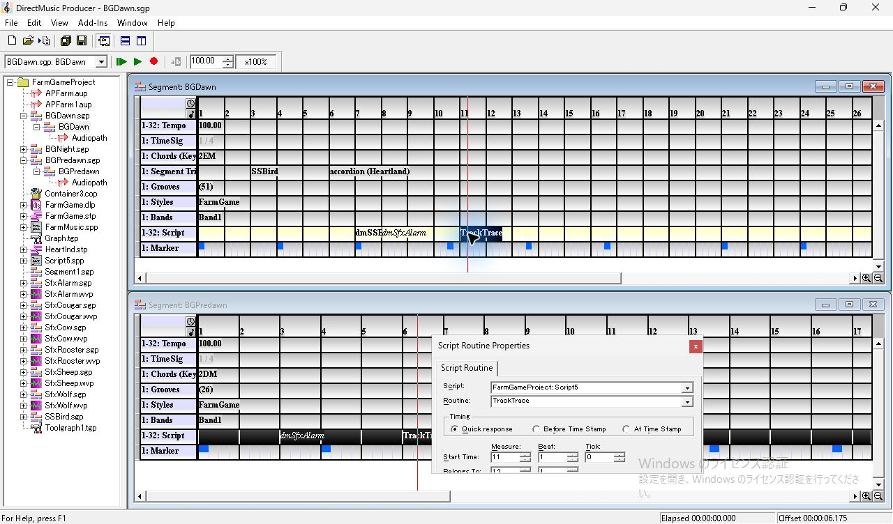

## 開き直しと確認範囲

保存後、BGDawn の子ウィンドウだけを閉じ、Tree の文書ノードから同じ Producer 内で開き直した。上段に第7・8・11小節の項目が表示され、第9小節は空。作業コピーの保存先は BGDawn.sgp と Project の .pro。コピー元の BGPredawn と凍結した28ファイルは開始時の SHA-256 に一致した。 [照合コード](../../../work/original-gui/SEG-14-script-cross-document/20261112T012349480258Z/audit.py) · [最終ウィンドウ一覧](../../../work/original-gui/SEG-14-script-cross-document/20261112T012349480258Z/captures/final-windows.json)

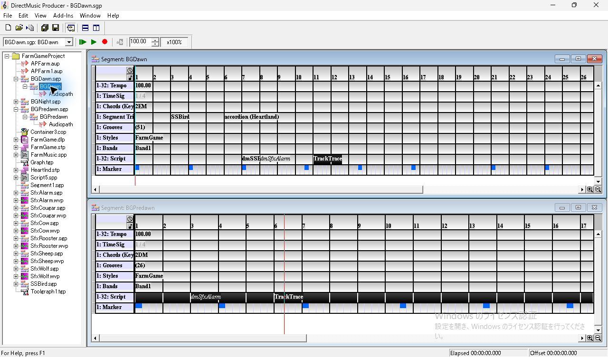

複数選択の Merge と Overwrite の消去端は、境界の前後に既存項目を置いた後続試験で照合した。 [複数ルーチンの貼り付けと範囲端](seg-14-script-paste-range.md)

同じ Segment に Script Track を2本置く場合は、別行への通常ドラッグと Ctrl+V、2本に個別指定したグループの読み込みを後続試験で照合した。 [同じ Segment 内の2本の Script Track](seg-14-script-cross-track.md)

終了時は Project を閉じ、同じ Producer 1件で **Project Tree、Standard Toolbar、Status Bar、Transport Controls** を表示した。

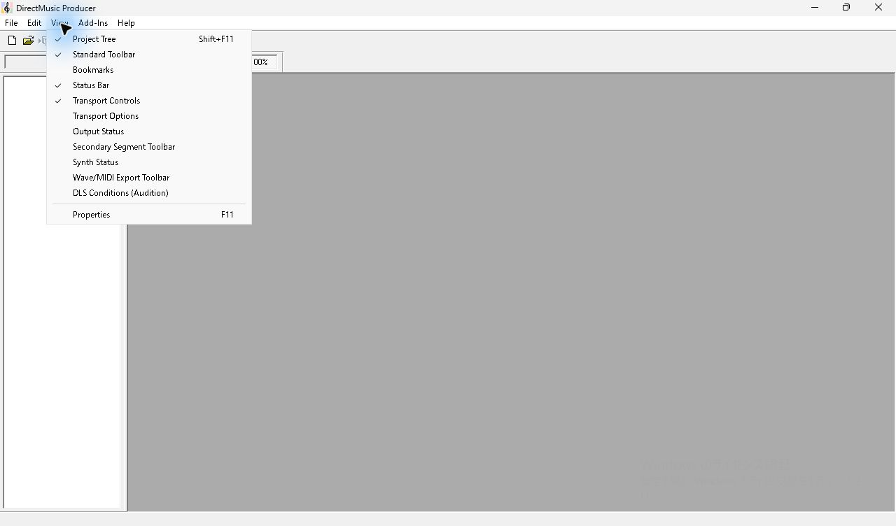

別 Project への貼り付けは、同名 Script の参照解決とファイル指定をキャンセルした場合を後続試験で照合した。 [別 Project への貼り付けと参照解決](seg-14-script-project-reference.md)

同じ Project の別 Segment と別 Project で、解決済みの単独 Routine の手動呼出しと先頭再生を後続試験で照合した。 [貼り付け後の発音と Trace](seg-14-script-paste-audio.md)
