# SEG-14　Script Track の複数選択、負の Tick、別起動後の復元

2026-11-11。DirectMusic Producer 5.3.0.900 で、[前回の Script Track を含む BGPredawn](seg-14-script-track.md) の Project を28ファイルまとめて複製した。撮影時の親ウィンドウは1280×752 px。View は **Project Tree、Standard Toolbar、Status Bar、Transport Controls** の4項目を表示。呼び出しの試験中だけ Add-Ins の Message Window を追加した。画面122枚から28枚を掲載する。青い光と黒い矢印は操作ツールの表示。 [凍結入力](../../../work/original-gui/SEG-14-script-followup/20261111T134637897812Z/run.json) · [掲載画像の出典、寸法、ハッシュ](../../../work/original-gui/SEG-14-script-followup/20261111T134637897812Z/published-script-followup-figures.json)

## 開き直しとアクセス違反

SSBird を表示していた Producer で以前の Project を閉じ、Ctrl+O で追試用コピーを開いた。Tree の **BGPredawn.sgp** をダブルクリックした直後の画像では Tree が白くなり、次のウィンドウ一覧から Producer が消えた。Windows の Application Error（イベント1000、22:47:50 JST）に **SegmentDesigner.ocx 5.3.0.900、例外 0xc0000005、オフセット 0x0002b8a5** が記録された。

Producer のプロセスが0件になったあと、同じ EXE を1件起動し、同じ追試用 Project と BGPredawn を開くと表示できた。再起動前のアプリ状態と例外の関係は未確認。 [エラーイベントとプロセスの確認](../../../work/original-gui/SEG-14-script-followup/20261111T134637897812Z/captures/first-close-process-check.json) · [再起動時の EXE と PID](../../../work/original-gui/SEG-14-script-followup/20261111T134637897812Z/captures/fresh-launch.json)

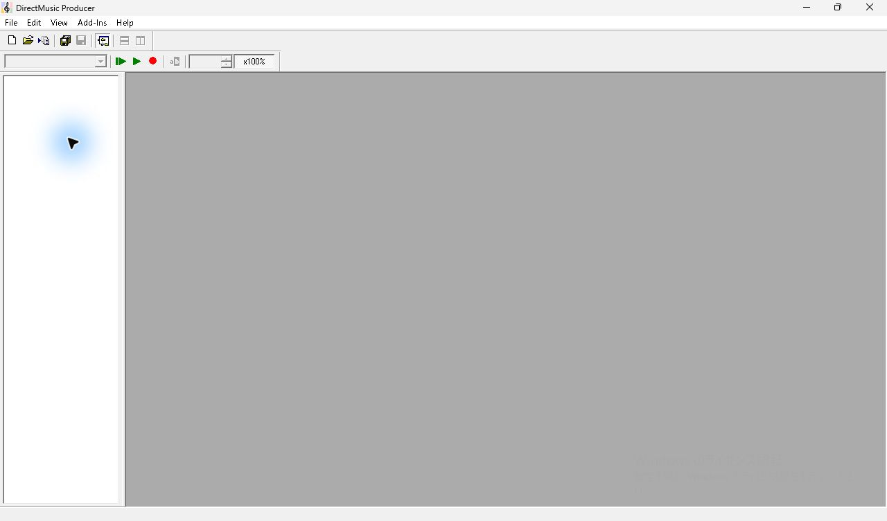

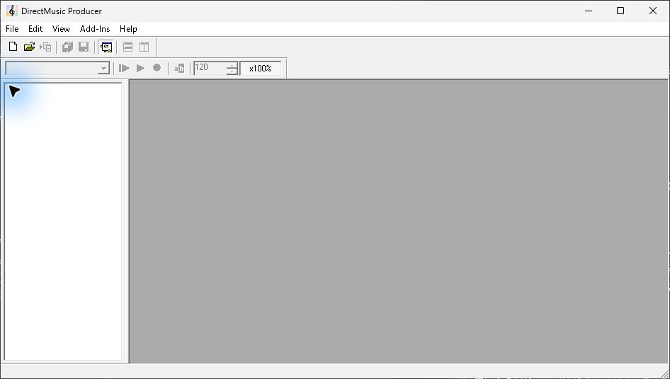

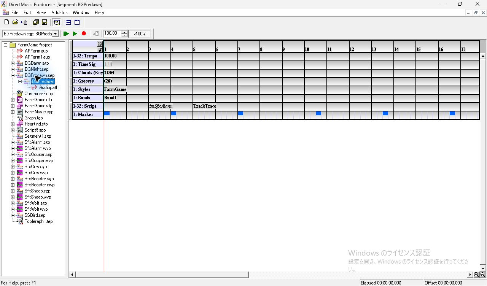

## 単独と複数の選択

Script 行の **TrackTrace** をクリックすると、アクティブな行が薄黄色になり、第5小節のセルだけが濃紺、選択名が白になる。**Ctrl+A** では表示範囲内の Script 行が空セルも含めて濃紺になった。右クリックで **Properties** を開くと **Script** 欄に **Multiple Routines Selected** が表示される。Routine と Start Time は空欄で、Script、Routine、Timing、時刻の各入力は灰色になる。

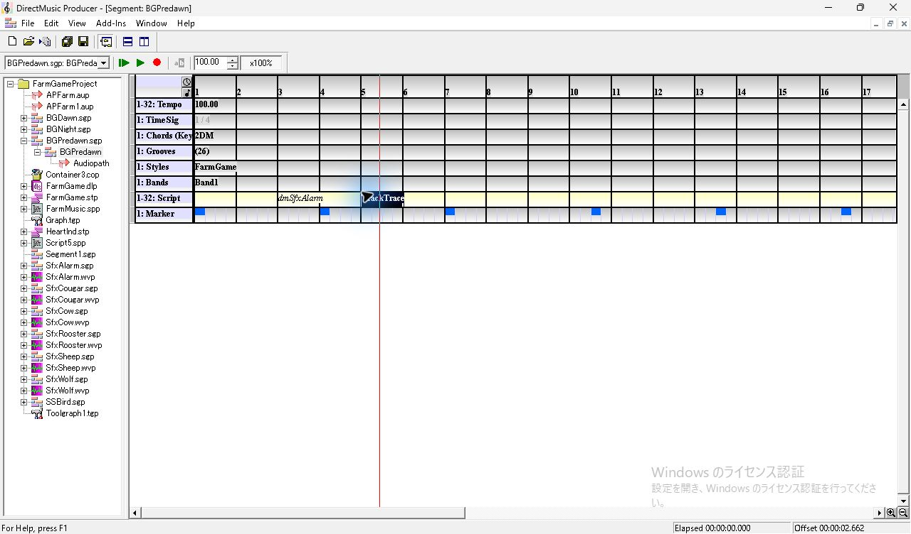

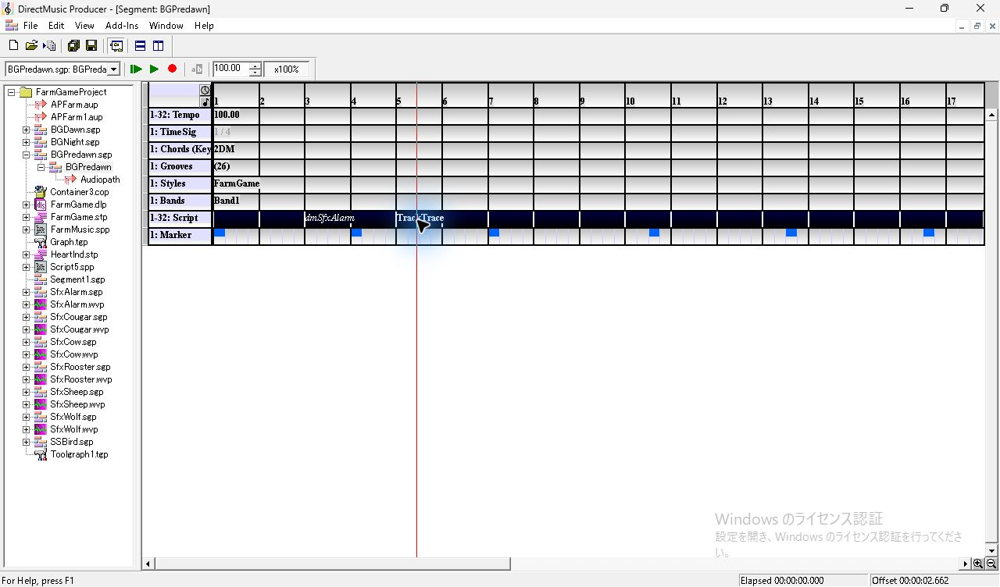

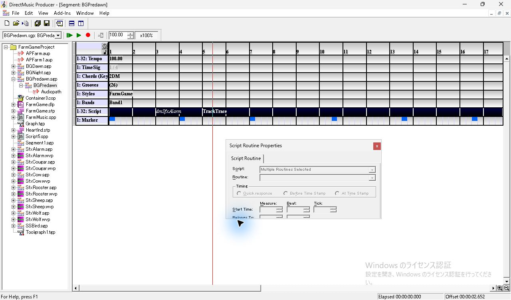

全選択のまま右クリックした場合、**Call Routine(s)** は第3・第5小節とも有効。**Cycle Routines** は同一拍に2件ある第3小節で有効、第5小節では灰色。第3小節で Cycle Routines を選ぶと斜体の名前が **dmSfxAlarm → dmSSBird** に変わり、行全体の選択は第3小節の1セルに戻った。Properties も単独の **At Time Stamp、3:1:1** に切り替わった。

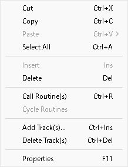

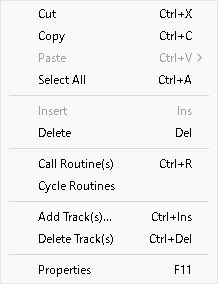

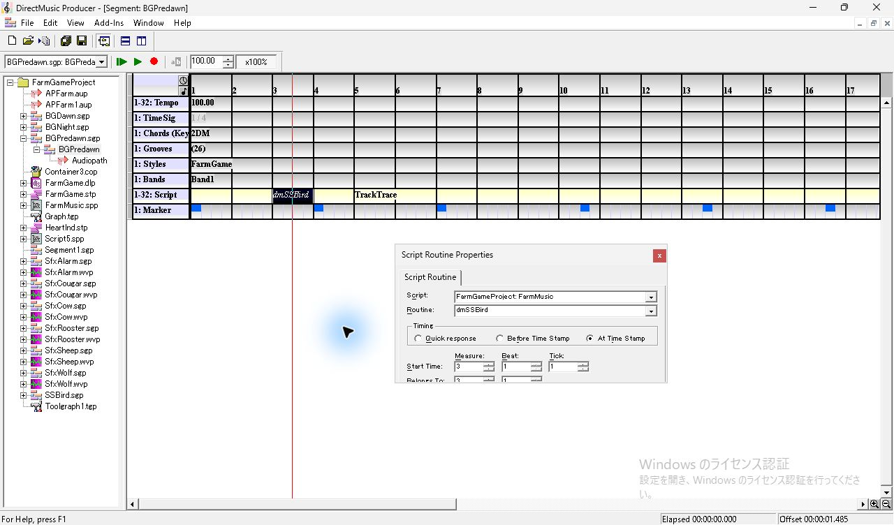

## ドラッグと範囲

| 操作 | ボタンを離したあとの状態 |
| --- | --- |
| 第3小節の選択済み dmSSBird から第7小節の空セルへドラッグ | 選択、斜体ラベル、Properties の 3:1:1 は第3小節に残った |
| 第5小節の選択済み TrackTrace から第7小節の空セルへドラッグ | 選択、ラベル、Properties の 5:1:0 は第5小節に残った |
| ルーラー上で第2小節途中から第4小節途中へドラッグ | ルーラーの区間が濃色になり、Script 行の項目選択は外れた |
| Script 行の第2小節の空セルから第6小節の空セルへドラッグ | Script 行が薄黄色になり、開始側の第2小節の空セルだけが濃色になった |

マウスボタンを離した画面を比較した。後続試験では、未選択のラベル、選択項目の左端と下端、Tree の2種類のノードからの通常ドラッグと、Properties での移動を照合した。押下保持中のポインター形状は追試対象。 [ドラッグと時刻編集](seg-14-script-track-gestures.md)

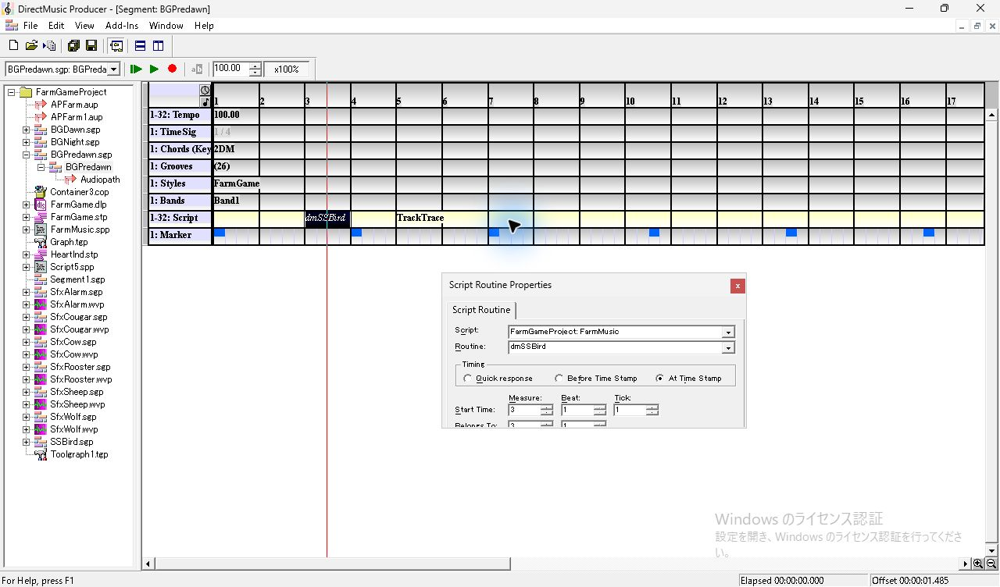

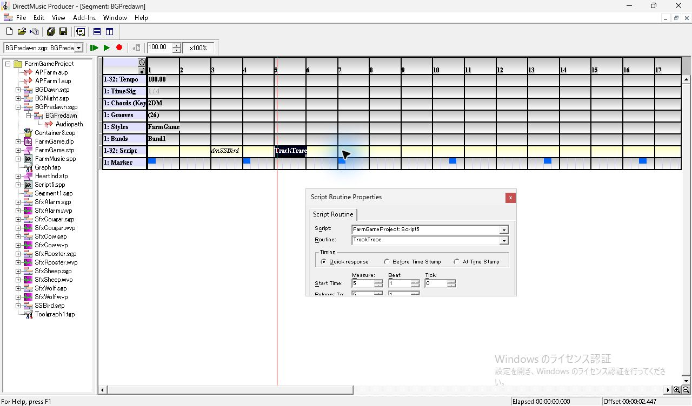

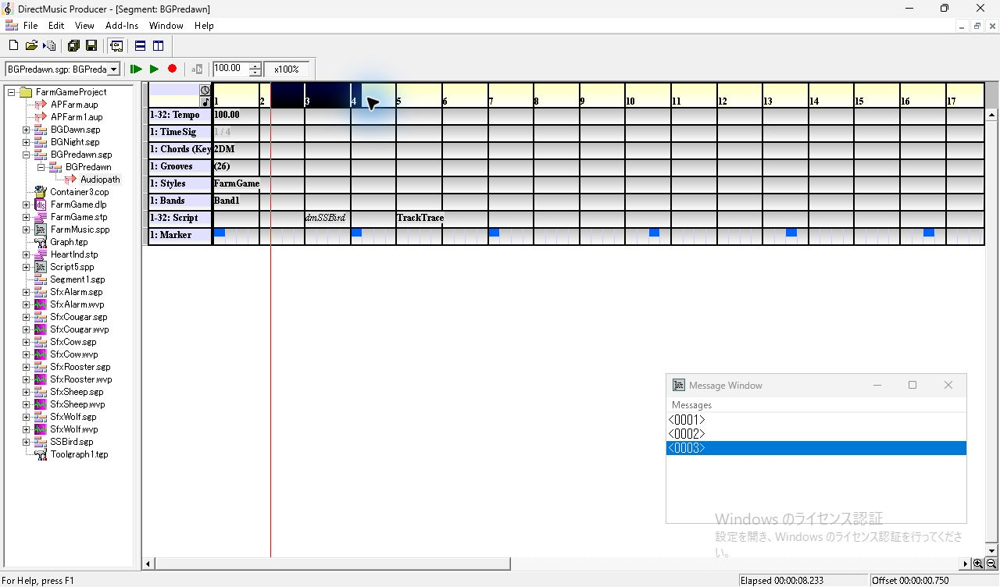

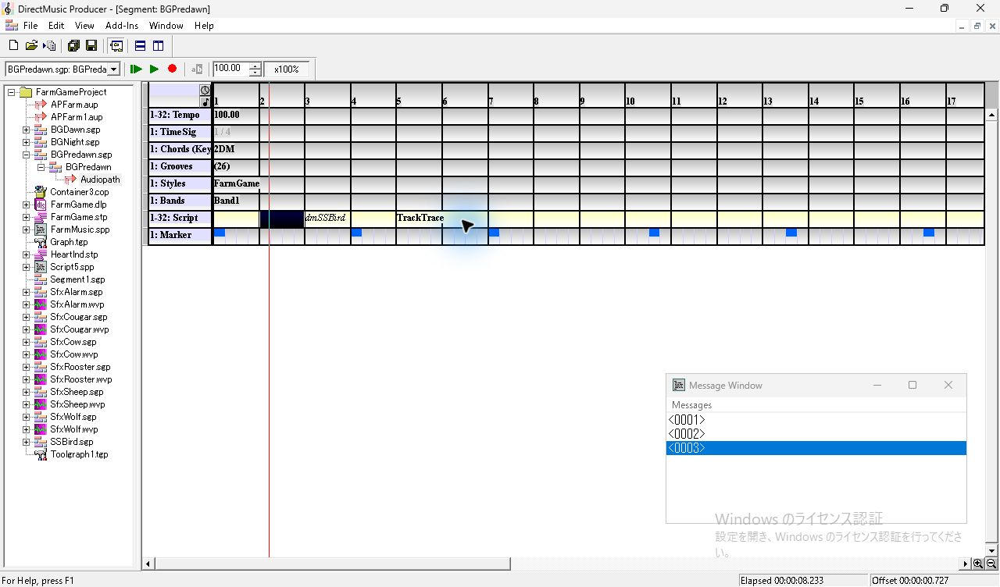

## Tick −1 と履歴

TrackTrace を選び、**Start Time** の **Tick** の下矢印を1回クリックすると **5:1:0 → 5:1:−1** になった。第5小節の表示は維持され、ラベルは第4小節へ移らない。Script 行をクリックしてフォーカスを戻してから Ctrl+Z を押すと、選択が外れ、開いていた Properties が埋め込み AudioPath に切り替わった。第5小節を選び直すと Tick は **0**。行にフォーカスした状態で Ctrl+Y を押すと再び Properties の対象が替わり、TrackTrace を選び直すと **−1** に戻った。

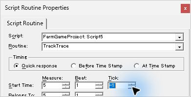

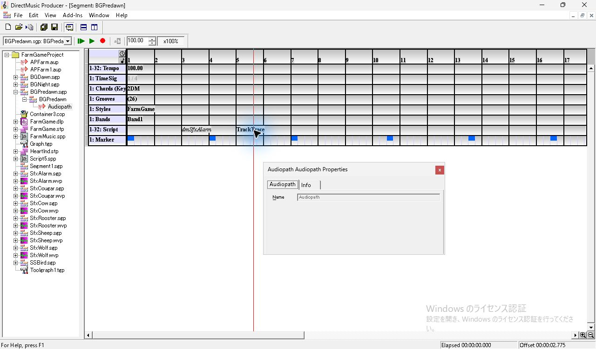

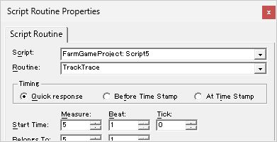

## メニューの呼び出しと録音

**Add-Ins > Message Window** を開き、Timeline を隠さない右下に移した。次の比較は Transport を停止した状態で行った。メニューに **Ctrl+R** と表示されるが、Script 行で直接押した4試行（Alarm、Bird、全選択、TrackTrace）では、操作後2秒の録音は左右ともゼロで、Message Window の行も増えなかった。右クリックメニューの **Call Routine(s)** は結果が出た。 [150秒の WASAPI ループバック録音](../../../work/original-gui/SEG-14-script-followup/20261111T134637897812Z/captures/audio-manual/output.wav) · [操作時刻、RMS、波形照合](../../../work/original-gui/SEG-14-script-followup/20261111T134637897812Z/captures/audio-manual/analysis.json)

| 右クリックメニューからの操作 | 録音内の操作位置（秒） | 操作後2秒の RMS | Message Window |
| --- | ---: | ---: | --- |
| 全選択で Call Routine(s) | 49.118 | 0.07117 | 少し待つと1行目が増える |
| dmSfxAlarm を単独選択して Call Routine(s) | 76.677 | 0.05138 | 1行のまま |
| dmSSBird を単独選択して Call Routine(s) | 97.038 | 0.03851 | 1行のまま |
| TrackTrace を単独選択して Call Routine(s) | 117.486 | 0 | 2行目が増える |

全選択時の録音では、Alarm 単独の冒頭380 msとの正規化相関が **0.657**。Bird 単独との交差対照は **0.164** で、振幅の推定倍率は約0.002だった。Alarm 単独で音が終わったあとに相当する操作後1.8〜2.55秒の RMS は全選択で **0.02775**、Alarm 単独で **0**。この試行で Alarm と TrackTrace の出力を確認し、残った音のうち Bird の波形の同定は保留した。

続けて **Play From Start** で BGPredawn を再生した。Elapsed **1.301秒** の画像では Message Window は2行、**3.856秒** の画像では3行だった。第5小節を通過する再生でも TrackTrace の行が増える。BGPredawn の背景音を含むため、再生中に重なった2件の音と Timing 3方式の実行時刻はこの録音から確定できない。Message Window のツリーには行番号が出ており、Trace 本文は確認できなかった。 [Message Window の取得結果](../../../work/original-gui/SEG-14-script-followup/20261111T134637897812Z/captures/69-message-final-tree.txt)

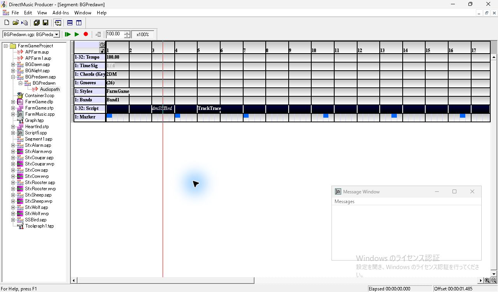

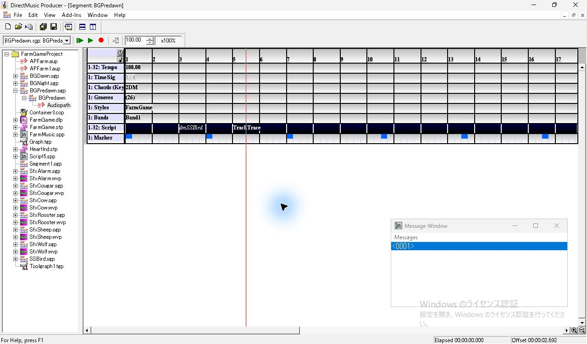

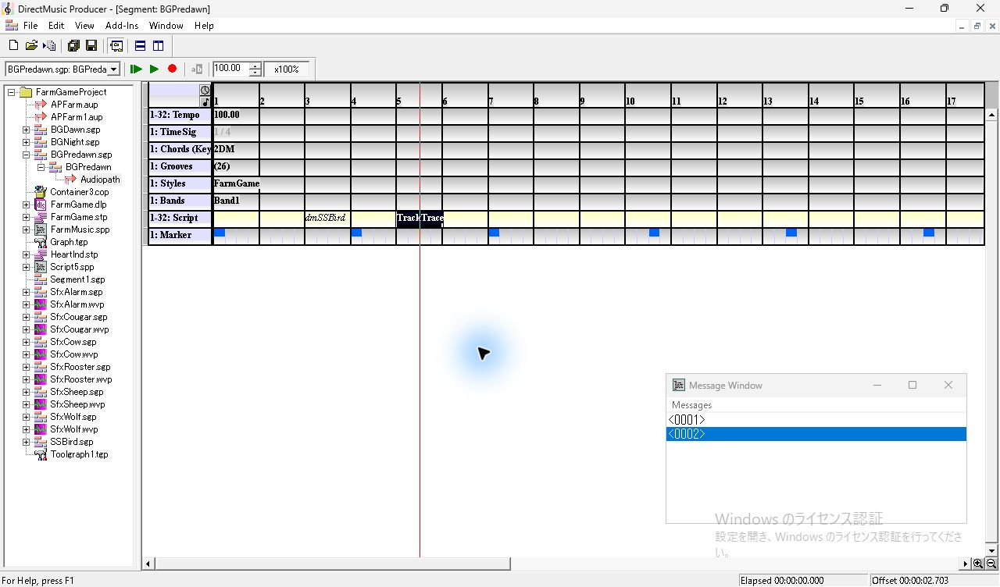

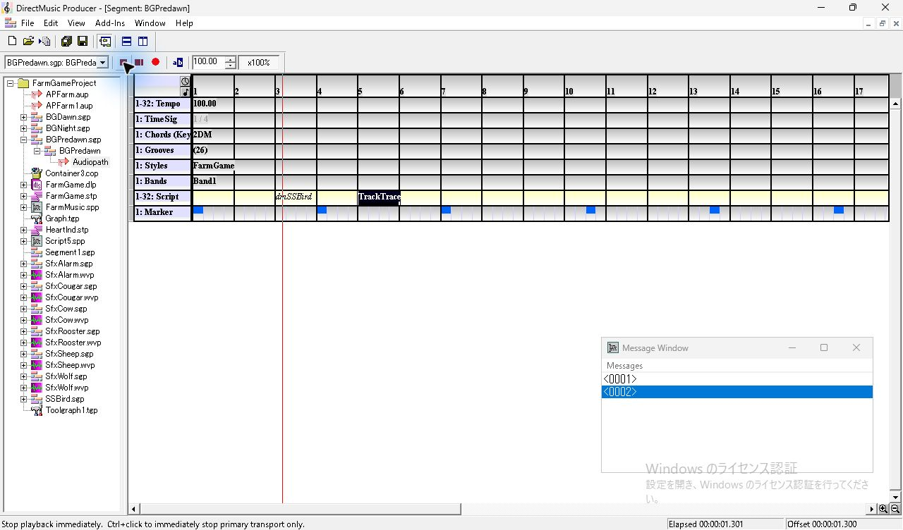

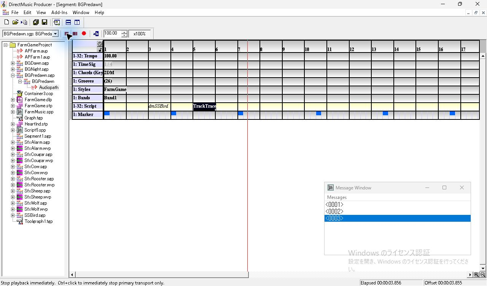

## 別プロセスでの復元

Ctrl+S で保存したあと、Message Window を閉じ、Producer を Alt+F4 で終了した。PID **12116** が終了し、Producer が0件であることを確認して同じ EXE を1件起動した。新しい PID は **10404**。Project は自動で開き、Tree から BGPredawn を開くと第3小節の斜体と第5小節の TrackTrace が復元された。F11 で選択ごとの Properties を照合した。 [終了と再起動のプロセス照合](../../../work/original-gui/SEG-14-script-followup/20261111T134637897812Z/captures/reopen-launch.json)

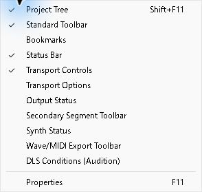

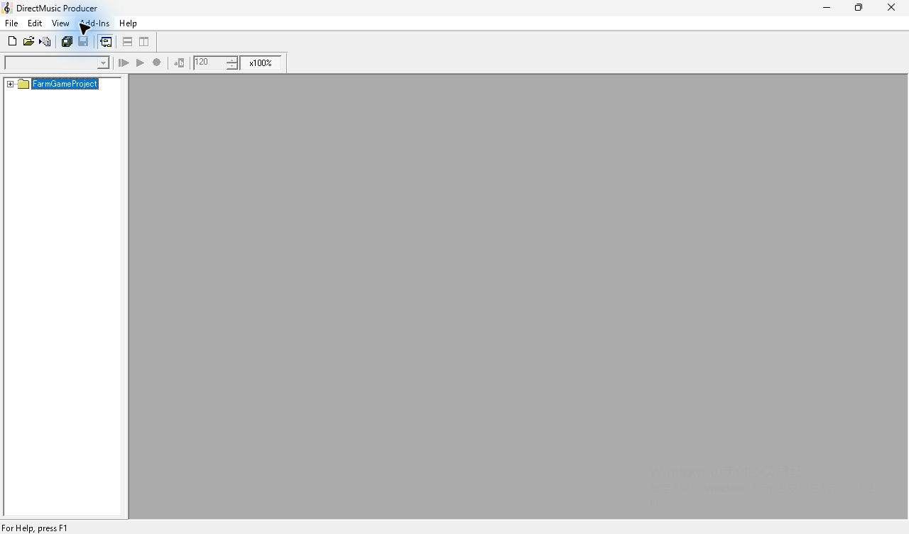

| Routine | 復元した Timing | 画面の Start Time | 保存された論理クロック | 保存された物理クロック |
| --- | --- | --- | ---: | ---: |
| TrackTrace | Quick response | 5:1:−1 | 3072 | 3071 |
| dmSfxAlarm | Before Time Stamp | 3:1:0 | 1536 | 1536 |
| dmSSBird | At Time Stamp | 3:1:1 | 1536 | 1537 |

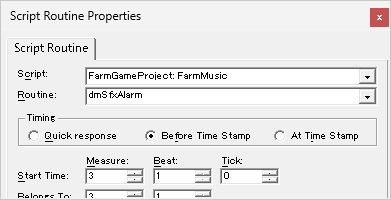

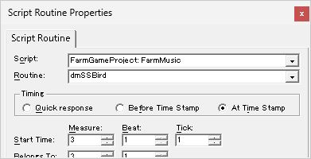

保存直後と別プロセスで開き直した **BGPredawn.sgp** は同じ SHA-256。Script Track の差分は TrackTrace の物理クロック **3072 → 3071**。参照 GUID は各 Script と一致した。Script 以外では **Marker の play チャンクが2つ増え、Chord の crdb の内容に差が出た**。これは今回の保存で同時に生じた差分で、発生条件は未確定。凍結入力28件は元のハッシュと一致した。以前開いていた Project を閉じた際は、その作業コピーの .pro が更新された。終了時点では BGPredawn を開いた Producer が1件、録音器と Message Window は終了済み。 [保存値とファイルの照合](../../../work/original-gui/SEG-14-script-followup/20261111T134637897812Z/script-followup-audit.json)

続く追試では同じ位置とルーチンで Timing だけを切り替え、再生の基準音からの発音時刻と Message Window の行が増えた区間を照合した。 [Timing 3方式の発音時刻](seg-14-script-track-timing.md)
