# SEG-14　Script Track のドラッグと時刻編集

2026-11-12。DirectMusic Producer 5.3.0.900 の作業コピーで、BGPredawn の Script 行を確認した。第3小節に **dmSfxAlarm** と **dmSSBird**、第5小節に **TrackTrace** がある。表示は 100 BPM、1/4。親ウィンドウは1280×752 px。View は Project Tree、Standard Toolbar、Status Bar、Transport Controls の4項目。105枚の記録から24枚を掲載する。青い光と黒い矢印は操作ツールの表示。 [凍結した試験用 Project と実行ファイル](../../../work/original-gui/SEG-14-script-gestures/20261112T010128154777Z/run.json) · [元の複数選択試験](seg-14-script-track-followup.md) · [掲載画像の出典とハッシュ](../../../work/original-gui/SEG-14-script-gestures/20261112T010128154777Z/published-figures.json)

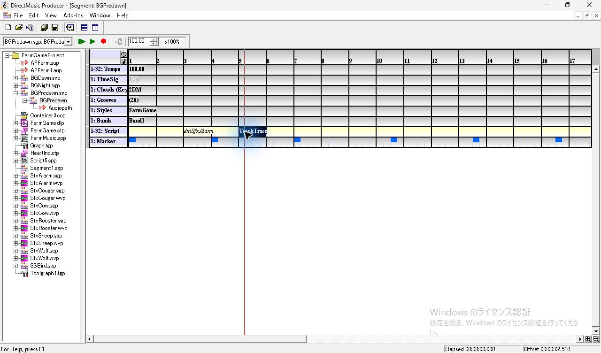

## 通常ドラッグ

どの試行も左ボタンを使った。第3小節の斜体ラベルは同じ拍に複数ルーチンがある状態。右クリックの **Cycle Routines** で表示対象を切り替えられる。

| 開始と終了 | ボタンを離した後 |
| --- | --- |
| 第3小節を選択した状態から、未選択の TrackTrace の文字上 → 第7小節の空セル | 第5小節の TrackTrace が濃紺で選ばれ、赤い位置線は第5小節の押下位置。第7小節は空 |
| 選択済み TrackTrace の左端（第5小節の縦罫線から約3 px） → 第3小節の既存2件 | 第5小節の選択が残り、第3小節は元の斜体ラベル。赤い位置線は第5小節の左寄り |
| 選択済み TrackTrace の下端の余白 → 第7小節の空セル | 第5小節の選択が残り、第7小節は空。赤い位置線は第5小節の押下位置 |
| Project Tree の **FarmMusic.spp** のファイル行 → 第7小節の空セル | 第7小節は空。既存のルーチンと選択はそのまま |
| 展開した子の **FarmMusic** → 第7小節の空セル | 子が Tree で選択され、第7小節は空 |

各試行後も項目の追加・移動を観測しなかった。**Edit** の Undo・Redo は灰色。Ctrl+S の後に採取した SGP は、試験開始時のファイルと SHA-256 が一致した。撮影はボタンを離した後。押下保持中のネイティブカーソルは未確認。 [ドラッグ後の SGP](../../../work/original-gui/SEG-14-script-gestures/20261112T010128154777Z/captures/31-save-after-drags-BGPredawn.sgp) · [保存値の照合](../../../work/original-gui/SEG-14-script-gestures/20261112T010128154777Z/script-gesture-audit.json)

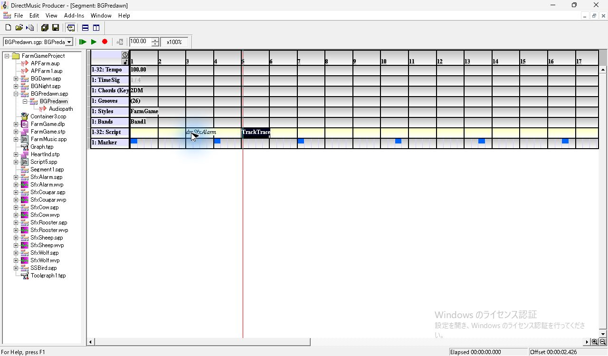

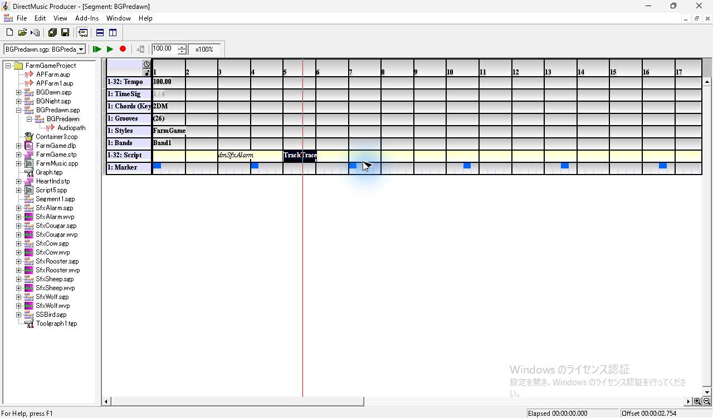

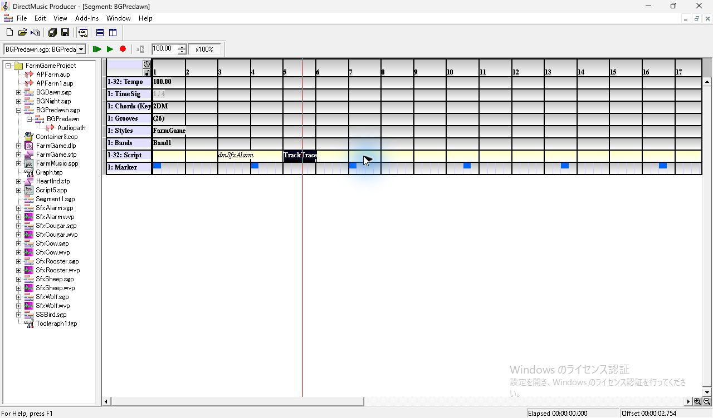

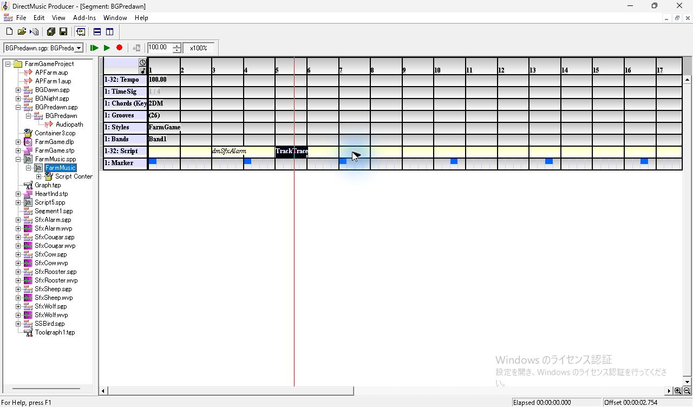

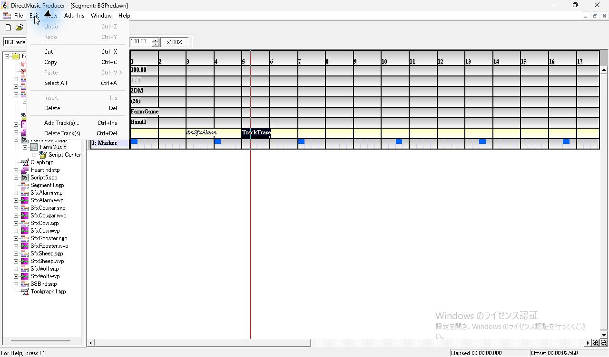

## Start Time と Belongs To

TrackTrace を選んで **F11**。浮動する Script Routine Properties の下端では **Belongs To** の文字と欄が一部切れる。枠の下端付近を57 px下にドラッグするとウィンドウ全体が同じ距離だけ移動し、縦の寸法と切れ方は維持された。見えている Measure の上矢印は操作できる。

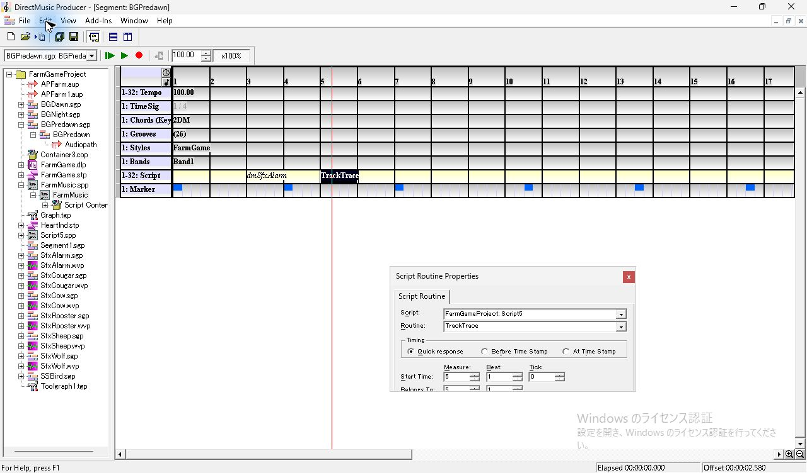

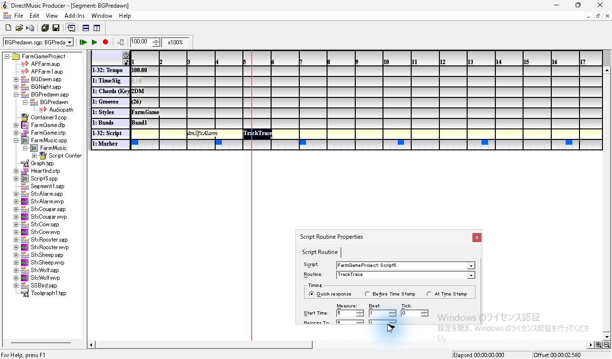

**Start Time** の Measure の上矢印を1回ずつ押すと **5→6→7**。濃紺の選択と白い TrackTrace が第6、第7小節へ移り、Belongs To も同じ値に変わった。赤い位置線と Status Bar の Offset は、タイムラインを再クリックするまで元のまま。**Belongs To** の Measure を **7→8** にすると、項目の表示と Start Time は第7小節に残った。その状態で Start Time を **7→6** にすると、Belongs To は **8→7**。1小節の差が保存された。

| 状態 | 表示小節 | Start Time | Belongs To | 保存された物理クロック | 保存された論理クロック |
| --- | ---: | --- | --- | ---: | ---: |
| 通常ドラッグ後 | 5 | 5:1:0 | 5:1 | 3072 | 3072 |
| Start Time の Measure を7へ | 7 | 7:1:0 | 7:1 | 4608 | 4608 |
| Belongs To の Measure を8へ | 7 | 7:1:0 | 8:1 | 4608 | 5376 |
| Start Time の Measure を6へ | 6 | 6:1:0 | 7:1 | 3840 | 4608 |
| Start Time の Measure を3へ | 3 | 3:1:0 | 4:1 | 1536 | 2304 |

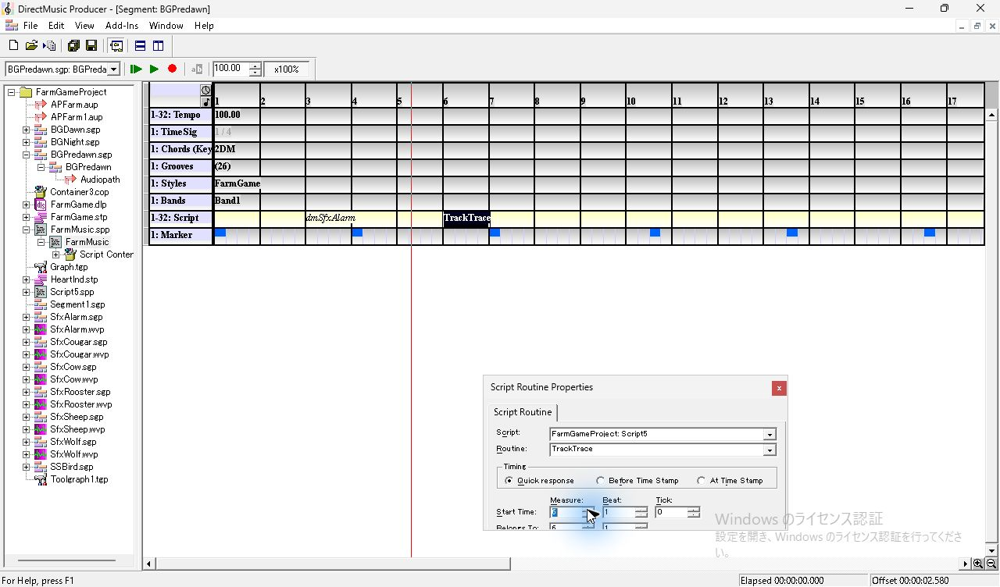

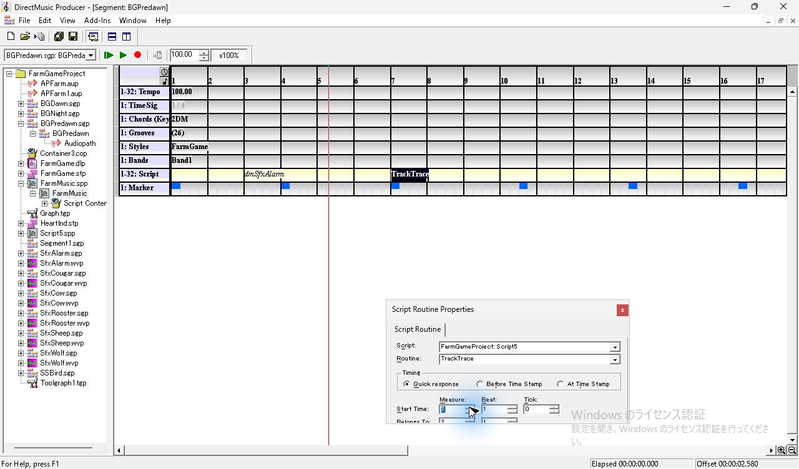

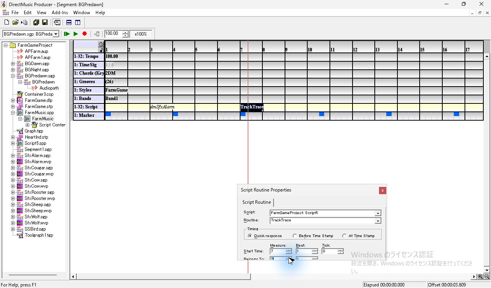

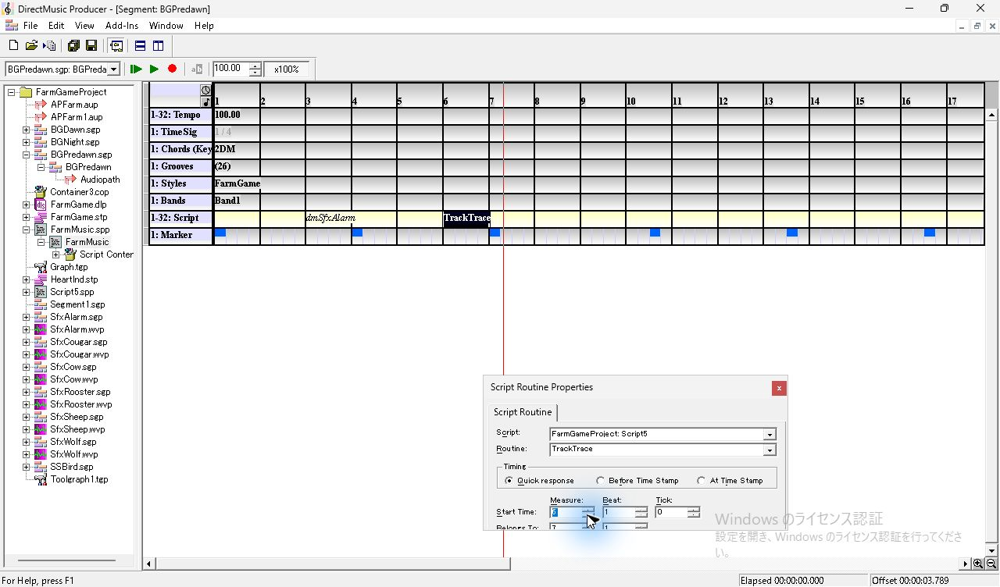

## 既存の2件と同じ拍へ移動

Start Time の Measure 欄で **Home → Shift+End → 3**。欄に **3** が表示された時点では、TrackTrace は第6小節にある。**Tab** で Beat 欄へフォーカスを移した時点で確定し、第3小節へ移った。第3小節の表示は選択中の **TrackTrace** の斜体に切り替わり、Belongs To は **4:1** になった。

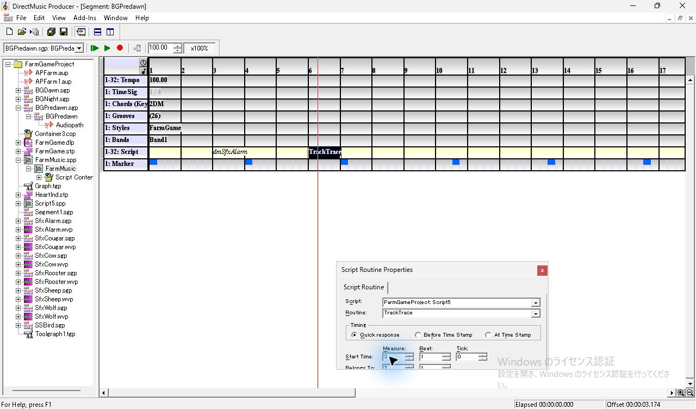

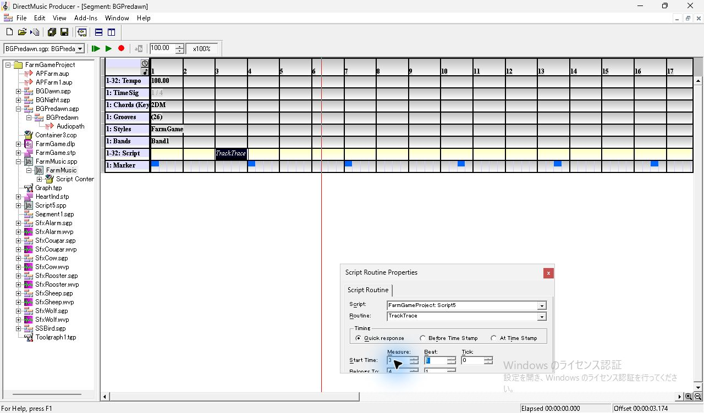

第3小節の右クリックメニューで **Cycle Routines** を3回使うと、**TrackTrace → dmSSBird → dmSfxAlarm → TrackTrace** と一巡した。小節は第3のまま。ルーチンの名前、参照 Script、Timing、Start Time、Belongs To が選択された項目に応じて切り替わる。保存された3件の順序は **dmSfxAlarm、TrackTrace、dmSSBird**。dmSfxAlarm と TrackTrace の物理クロックはどちらも1536、dmSSBird は1537。最初の時刻編集を保存した際は、Script のほかに Chord と Marker のトラックにもファイル差分が出た。それ以降の時刻編集の保存では、最初の編集保存を基準に Script Track のみが変わった。 [同じ拍に3件ある SGP](../../../work/original-gui/SEG-14-script-gestures/20261112T010128154777Z/captures/53-save-three-routines-BGPredawn.sgp) · [3件の順序、参照、保存ハッシュ](../../../work/original-gui/SEG-14-script-gestures/20261112T010128154777Z/script-gesture-audit.json)

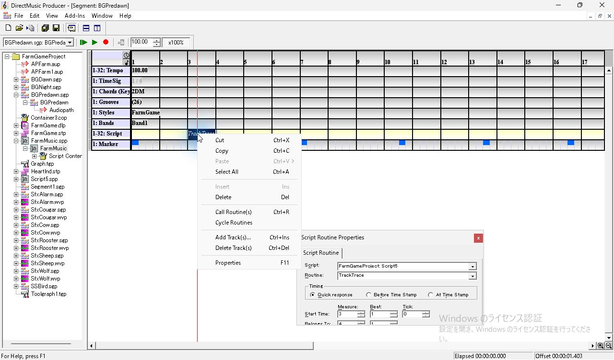

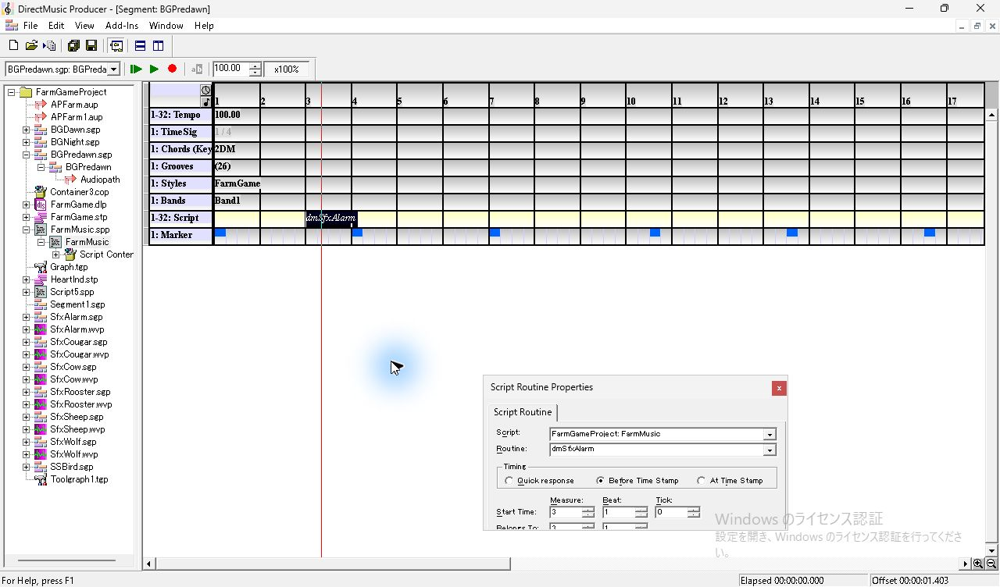

## 別起動での復元と確認範囲

Producer を終了し、ウィンドウが0件になった後で同じ EXE を1件起動した。自動で開いた Project の BGPredawn を開くと、初期表示は第3小節の **dmSfxAlarm** の斜体。終了前に表示していた TrackTrace は、再起動後の **Cycle Routines** 1回目で現れた。続けて dmSSBird が現れ、3件の時刻と参照が復元された。作業ファイルの SHA-256 は再起動前の採取物と一致。凍結入力28件も開始時の SHA-256 と一致した。 [再起動直前の0件](../../../work/original-gui/SEG-14-script-gestures/20261112T010128154777Z/captures/55-before-restart.json) · [再起動直後の1件](../../../work/original-gui/SEG-14-script-gestures/20261112T010128154777Z/captures/56-after-restart.json) · [照合コード](../../../work/original-gui/SEG-14-script-gestures/20261112T010128154777Z/audit.py)

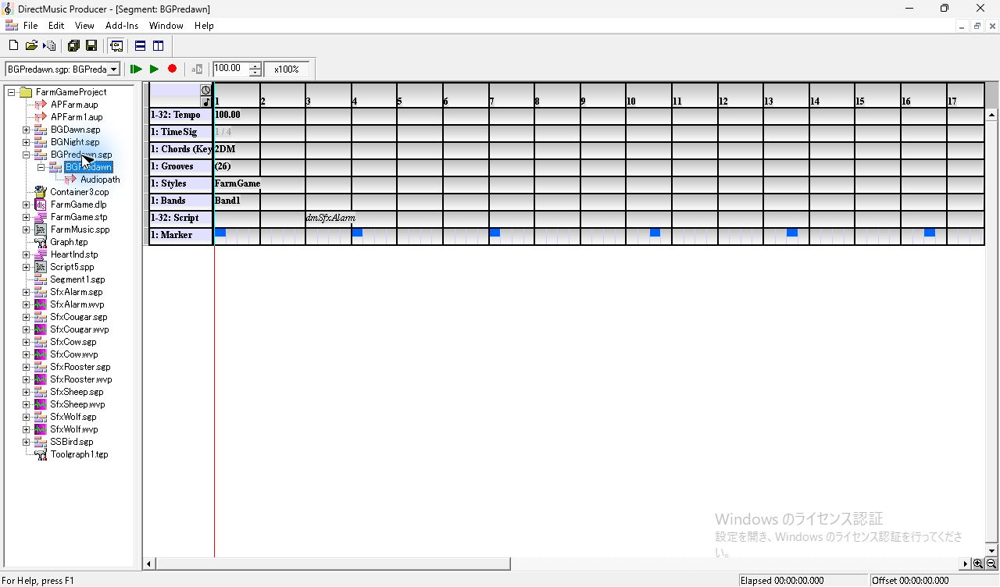

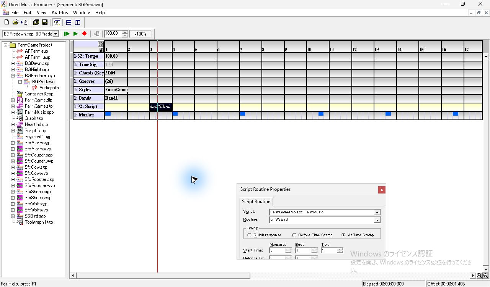

Windows で修飾キーを保持したままクリックする操作は、今回使った Computer Use API の入力範囲外。スクリーン キーボードでは Ctrl の保持を確認できなかった。固定キーを一時的に有効にして Ctrl と A を順に送っても単独選択のまま。通常の **Ctrl+A** を同じ Script 行に送ると空セルまで濃紺になった。Ctrl・Shift を押しながらの追加選択とドラッグは追試対象。Start Time を固定して Belongs To だけを1小節後にした場合は、後続試験で発音と Trace を照合した。 [Belongs To と発音・Trace](seg-14-script-belongs.md)

別文書と同じ Segment 内の別行への通常ドラッグと貼り付けは後続試験で照合した。 [別文書への貼り付け](seg-14-script-track-cross-document.md) · [同じ Segment 内の2本の Script Track](seg-14-script-cross-track.md)

固定キーは元のオフへ戻し、Producer は Project を閉じた状態で1件、View は標準4項目にした。 [最終ウィンドウ一覧](../../../work/original-gui/SEG-14-script-gestures/20261112T010128154777Z/captures/final-windows.json)

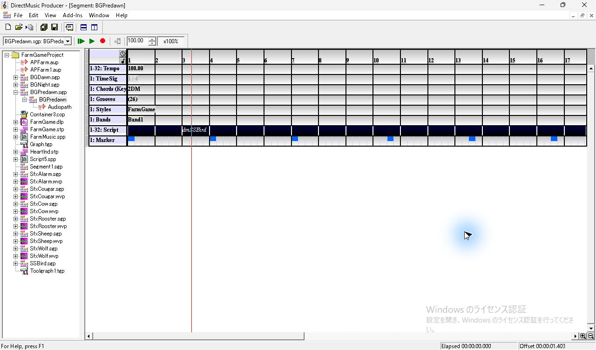

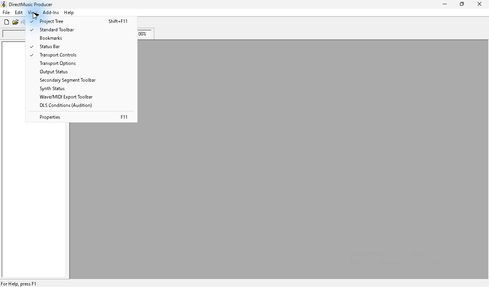

同一拍の単独コピーとルーラー範囲を比較した後続試験では、全選択から同じ行の1小節後へ5件が移動した例を保存、Undo/Redo、再読込で確認した。同じ座標で移動しなかった再試行も記録した。 [同一拍の選択、ルーラーとドラッグ](seg-14-script-selection-drag.md)
