# SEG-14　Script Track の Timing と発音時刻

2026-11-11。DirectMusic Producer 5.3.0.900 の作業コピーで、Script Routine Properties の **Quick response、Before Time Stamp、At Time Stamp** を比較した。撮影時の本体は1280×752 px。View は **Project Tree、Standard Toolbar、Status Bar、Transport Controls** の4項目。Trace の試験中は Add-Ins の **Message Window** を右下に置いた。撮影194枚から22枚を掲載する。青い光と黒い矢印は操作ツールの表示。 [入力と実行ファイル](../../../work/original-gui/SEG-14-script-timing/20261111T141056801129Z/run.json) · [掲載画像の出典、寸法、ハッシュ](../../../work/original-gui/SEG-14-script-timing/20261111T141056801129Z/published-timing-figures.json)

## 同じ位置と同じ音を使う試験素材

[前回の BGPredawn](seg-14-script-track-followup.md) と同じ Project を28ファイルまとめて複製した。試験用 **BGPredawn.sgp** は12小節、100 BPM、1/4、リピート0回。既存の Tempo、Time Sig、Script、埋め込み AudioPath を使い、Chord、Grooves、Styles、Bands、Marker を外した。**SfxCougar.sgp** の Wave Track を複製し、先頭 **1:1:0** の Cougar を基準音にした。Script 行には **8:1:0** に1件を置いた。12小節は7.2秒で、第8小節の先頭は基準音から4.2秒。

各試行では Transport の左側の **Play From Start** を押し、自然終了まで待った。Timing は同じ Script 行の項目を選び、F11 で開いた Properties のラジオボタンで変更した。Script、Routine、Measure、Beat、Tick の表示を維持したまま Timing の選択とフォーカス枠が移る。 [試験用 Segment と Script の入力](../../../work/original-gui/SEG-14-script-timing/20261111T141056801129Z/inputs/prepared/) · [原版ヘルプの Timing](../../../../../work/analysis/original-manual-session/20261010T031624075Z/help-extracted/htm/scriptroutineproperties.htm)

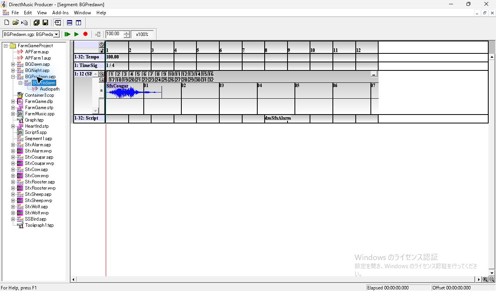

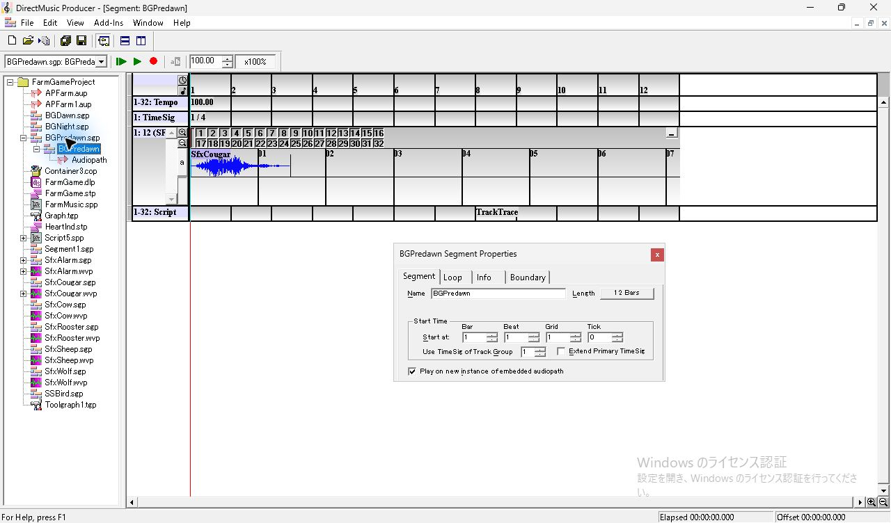

## FarmMusic の試行と再生経路の切り分け

最初に同梱の **FarmMusic.dmSfxAlarm** を使った。作業コピーの VBScript の `SfxAlarm.Play(IsSecondary)` の直後に `Trace "Timing probe"` を追加した。Before Time Stamp 3回、Quick response 2回、At Time Stamp 2回を再生したところ、7回とも Cougar の基準音が出た。基準音の2.75〜6.15秒後の RMS は最大 **0.0000553** で、Alarm は検出されず、Message Window も空のままだった。停止中に同じセルの右クリックから **Call Routine(s)** を選ぶと Alarm が鳴り、1行目が増えた。 [FarmMusic の録音](../../../work/original-gui/SEG-14-script-timing/20261111T141056801129Z/captures/audio-compare/output.wav) · [操作時刻と音声の照合](../../../work/original-gui/SEG-14-script-timing/20261111T141056801129Z/captures/audio-compare/analysis.json)

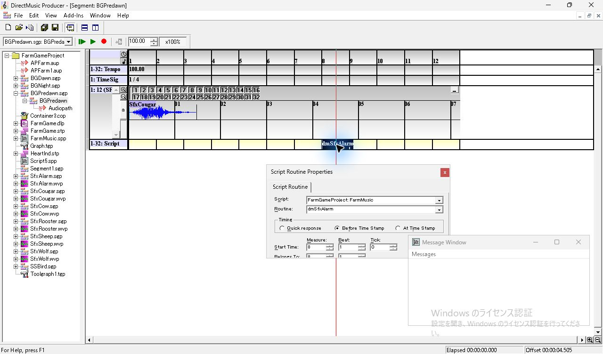

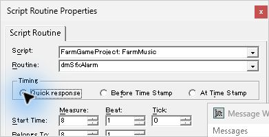

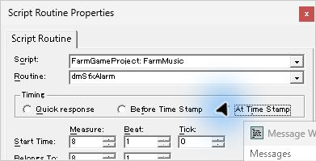

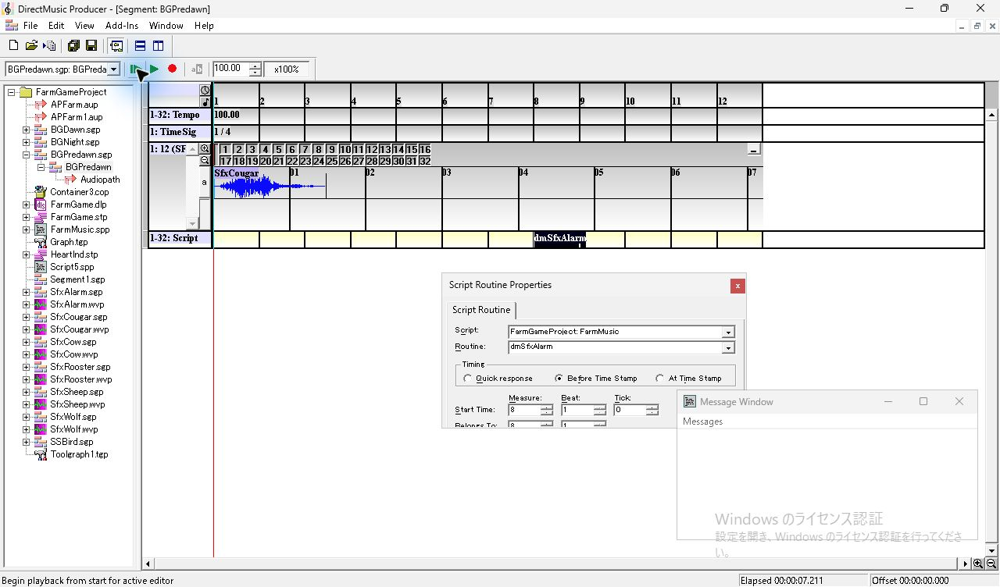

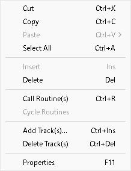

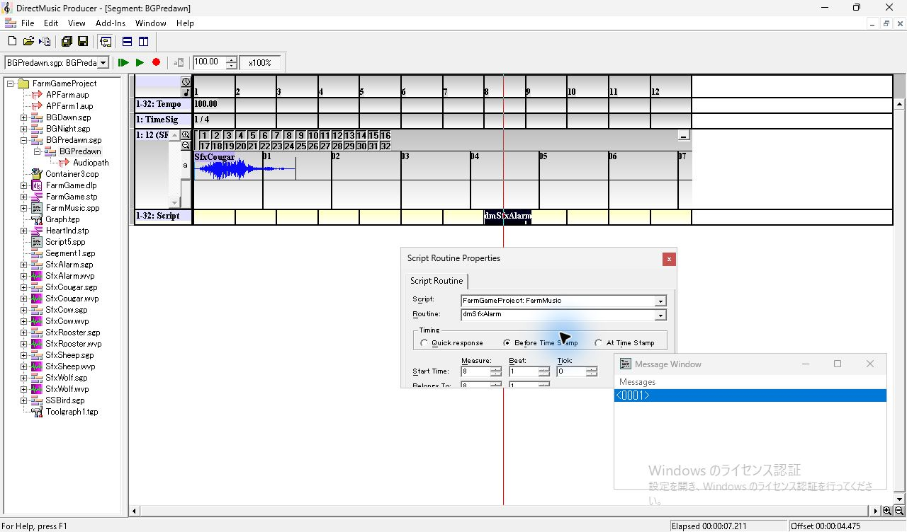

同じ Segment の同じセルを **Script5.TrackTrace** に替えると、Before Time Stamp の再生で2行目が増えた。作業コピーを終了してから Script5 の Container に **SfxAlarm.sgp** を1件参照し、TrackTrace の先頭に `SfxAlarm.Play(IsSecondary + AtImmediate)` を加えた。Trace の行と 8:1:0 はそのまま使った。最初の FarmMusic 試行と後続の AudioVBScript 試行では、スクリプトと Play の指定が異なる。後続の試験では、同じタイムラインで VBScript の FarmMusic と AudioVBScript の Script5 を比較し、さらに言語指定と構文を替えた場合の Trace と発音を照合した。 [FarmMusic とスクリプト言語の追試](seg-14-farmmusic-playback.md) [AudioVBScript の作成記録](../../../work/original-gui/SEG-14-script-timing/20261111T141056801129Z/inputs/audio-vbscript/preparation.json) · [再起動時のプロセス照合](../../../work/original-gui/SEG-14-script-timing/20261111T141056801129Z/captures/45-launch-audiovb.json)

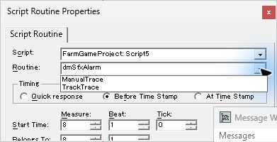

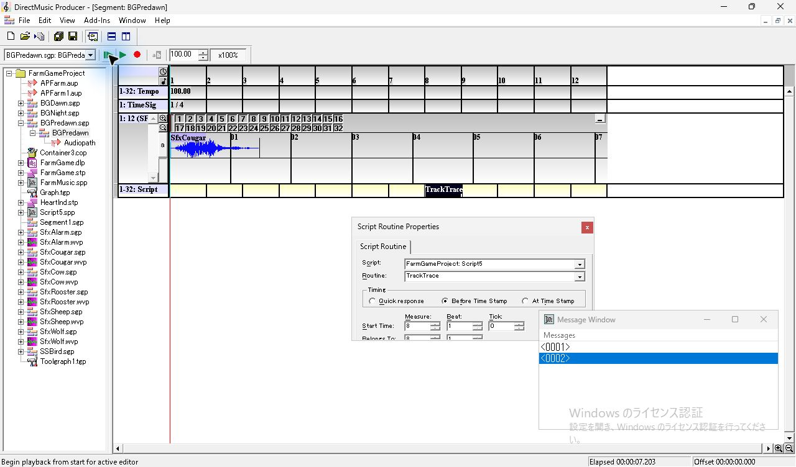

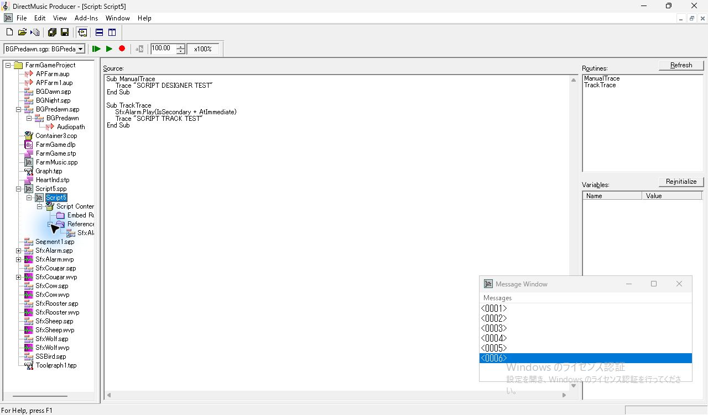

## AudioVBScript の発音時刻

Producer が終了して0件であることを確認してから、同じ EXE を1件起動した。TrackTrace の 8:1:0 で **Before → Quick → At** の順に各2回、合計6回の有効な再生を録音した。各回の Cougar と Alarm の開始は、元の Wave 文書の冒頭130 msを録音の48 kHzに合わせ、左右の平均波形で照合した。正規化相関は **Cougar 0.9936〜0.9968、Alarm 0.9854〜0.9931**。全回で音の一致と Message Window の1行追加を確認した。 [比較の録音](../../../work/original-gui/SEG-14-script-timing/20261111T141056801129Z/captures/audio-vbscript/output.wav) · [録音内のフレーム位置と相関](../../../work/original-gui/SEG-14-script-timing/20261111T141056801129Z/captures/audio-vbscript/analysis.json) · [照合に使ったコード](../../../work/original-gui/SEG-14-script-timing/20261111T141056801129Z/measure.py)

| Timing | 録音内の基準音の開始（秒） | 基準音から Alarm まで（秒） | 8:1:0 の4.2秒との差 |
| --- | ---: | ---: | ---: |
| Before Time Stamp、1回目 | 41.229 | 4.1998 | −0.2 ms |
| Before Time Stamp、2回目 | 58.449 | 4.2000 | 0.0 ms |
| Quick response、1回目 | 80.238 | 4.2000 | 0.0 ms |
| Quick response、2回目 | 99.669 | 4.1996 | −0.4 ms |
| At Time Stamp、1回目 | 127.868 | 4.3110 | +111.0 ms |
| At Time Stamp、2回目 | 145.868 | 4.3202 | +120.2 ms |

この素材では **Quick response と Before Time Stamp の発音間隔はいずれも約4.200秒**。**At Time Stamp は基準の4.2秒から約111〜120 ms後**に鳴った。録音は既定出力の WASAPI ループバック、48 kHz、32-bit 浮動小数点、ステレオ。基準音と Alarm は同じ録音内で比較しており、表はこの設定とルーチンで観測した出力の時刻を示す。Timing の説明はコマンドを処理する時点に関するもので、発音には再生経路の時間も含まれる。

最初の操作1回は、Message Window からフォーカスを移した際に本体が通常サイズへ戻り、再生が始まらなかった。録音に両方の音がなく、Elapsed は0だった。最大化し、Script 項目と緑の **Play From Start** を再確認してから行った6回を集計した。 [除外した操作と採取状態](../../../work/original-gui/SEG-14-script-timing/20261111T141056801129Z/captures/53-vb-before-a-start.json)

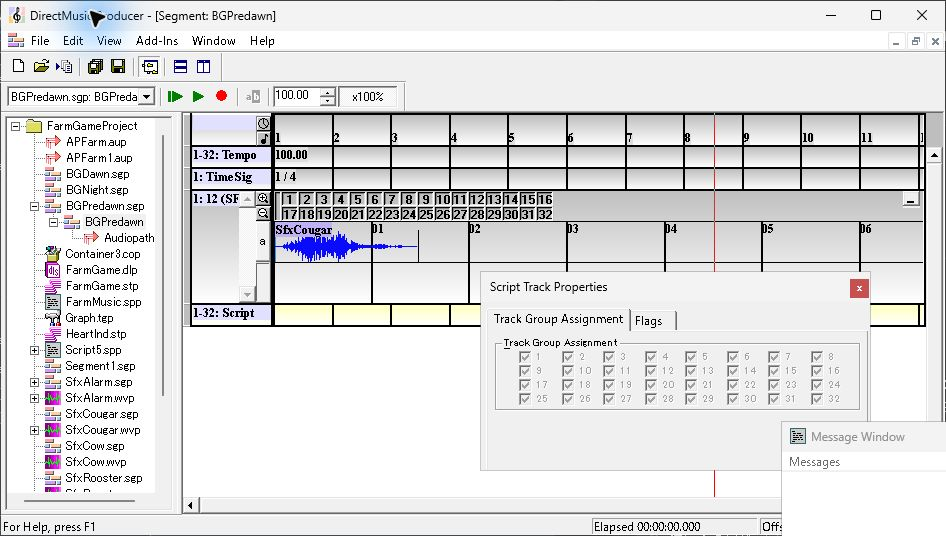

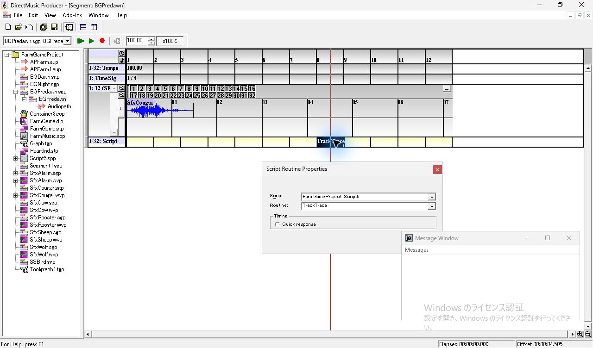

## Trace の表示と Timeline の位置

各方式の1回目の撮影から、新しい行がまだない画像と、行が増えた画像の **Elapsed** を読んだ。第8小節先頭は4.2秒。Quick response では位置線がまだ第7小節に入る前に行が増えた。発音間隔の表と同時に照合すると、**Quick response は早い Trace 表示と指定位置付近の発音が同じ試行で起きる**。この画面から分かる時刻は、行の更新を挟む2枚の範囲。Message Window には行番号が表示され、Trace に渡した本文は表示上確認できなかった。 [6行のアクセシビリティ記録](../../../work/original-gui/SEG-14-script-timing/20261111T141056801129Z/captures/75-final-message-tree.txt)

| Timing | 行が増える前の Elapsed | 行が増えたあとの Elapsed |
| --- | ---: | ---: |
| Before Time Stamp | 4.058秒、0行 | 4.863秒、1行 |
| Quick response | 2.957秒、2行 | 3.528秒、3行 |
| At Time Stamp | 4.329秒、4行 | 5.027秒、5行 |

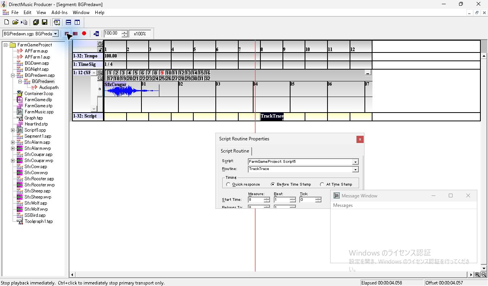

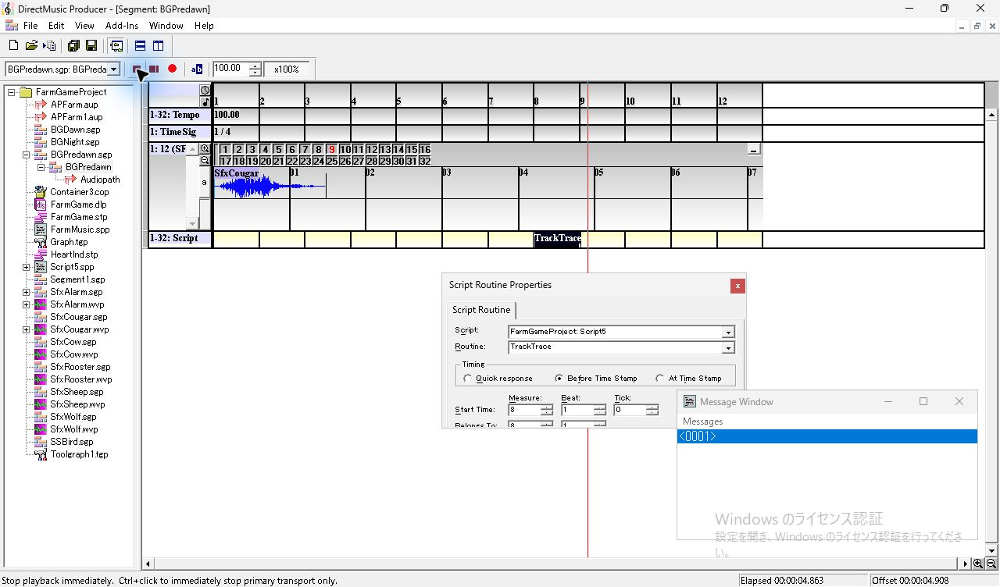

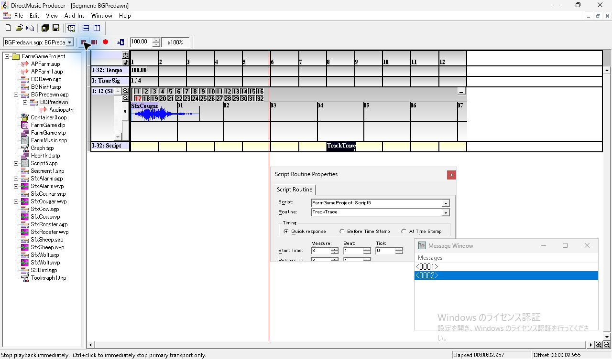

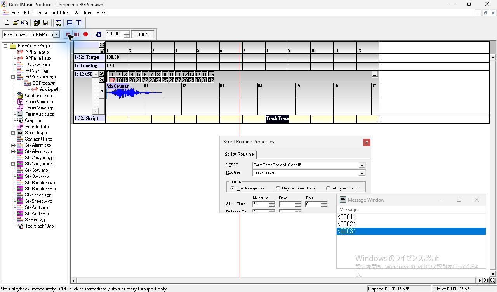

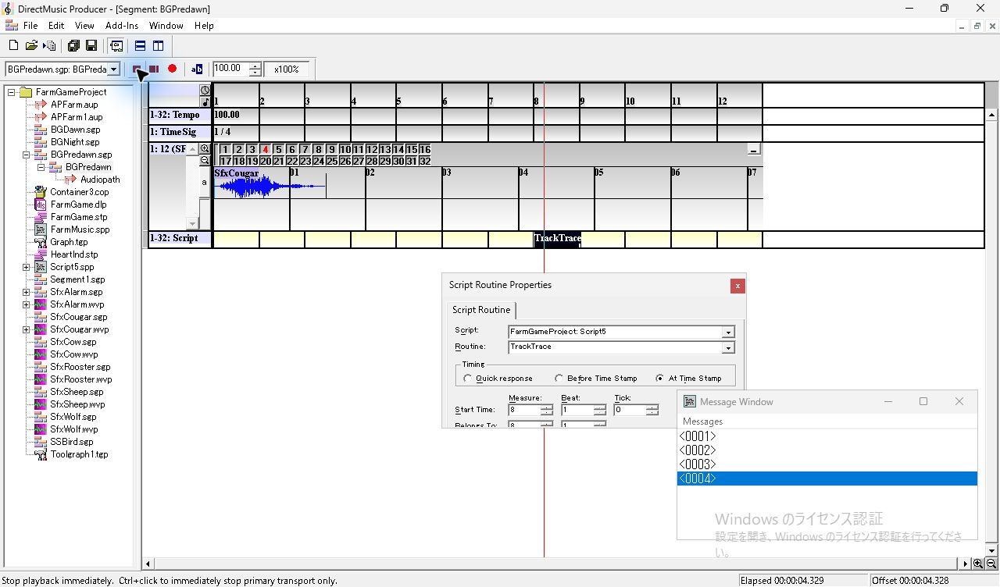

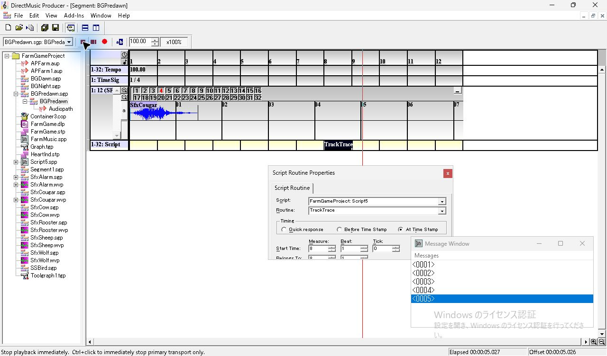

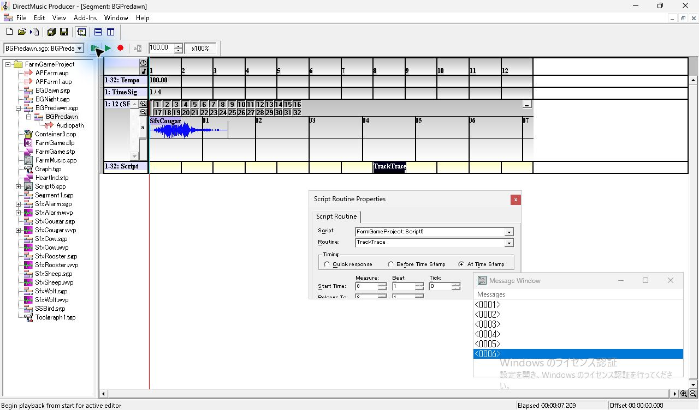

Start Time を第8小節で固定し、Belongs To を第9小節へ進めた場合は、同じルーチンを使った後続試験で発音と Trace を比較した。 [Belongs To と発音・Trace](seg-14-script-belongs.md)

## 保存値と終了状態

FarmMusic 版と AudioVBScript 版それぞれで、原版の保存操作から各 Timing の SGP を採取した。各組の3ファイルを比較すると、バイト位置 **1174**（先頭を0とする）の `scrh` Timing 値だけが **Quick 0x01、Before 0x02、At 0x04** に変わった。論理クロックと物理クロックは全設定で **5376**。凍結した28ファイルは SHA-256 が一致した。作業コピーでは BGPredawn.sgp、FarmMusic.spp、Script5.spp、FarmGameProject.pro が更新された。

試験後は Before Time Stamp を保存し、Properties、Script Designer、Message Window を閉じた。View は標準4項目。本体は1件、録音器は0件で、BGPredawn を停止している。 [保存値とファイル差分](../../../work/original-gui/SEG-14-script-timing/20261111T141056801129Z/timing-audit.json) · [最終プロセス確認](../../../work/original-gui/SEG-14-script-timing/20261111T141056801129Z/captures/80-final-processes.json)

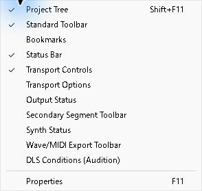

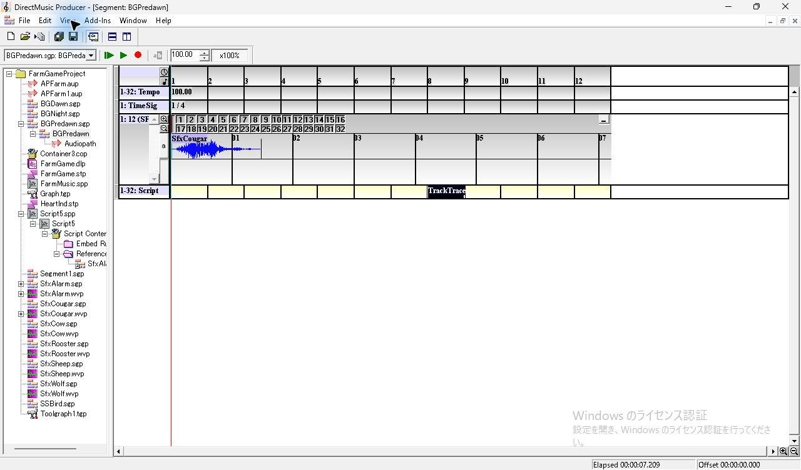
