# SEG-14　Script Track のルーチン、時刻、実行

2026-11-11。DirectMusic Producer 5.3.0.900 の調査用コピーで、FarmGameProject の **BGPredawn.sgp** を使った。すでに開いていた Producer を再利用した。親ウィンドウの最大化時は1280×752 px。View の基準表示で操作し、実行の観測時だけ Add-Ins の Message Window を開いた。画像の矢印と青い光は操作ツールの表示。 [実行記録](../../../work/original-gui/SEG-14-pattern-style/20261111T074828536163Z/run.json) · [原版画像38枚の対応表](../../../work/original-gui/SEG-14-pattern-style/20261111T074828536163Z/published-script-figures.json) · [同梱ヘルプの図](seg-14-control-triggers-script.md#script-track-の呼び出しと時刻)

## 空のトラックと参照の割り当て

拍子1/4、テンポ100.00の BGPredawn を開き、Marker のヘッダーにフォーカスして **Ctrl+Insert**。**Add New Tracks** で **Script Track** を追加した。Bands と Marker の間に `1-32: Script` の空行が入り、ヘッダーに展開ボタンはない。横ズームを2段上げ、第3小節の空セルを右クリックすると **Insert** が有効で、**Call Routine(s)** と **Cycle Routines** は灰色だった。

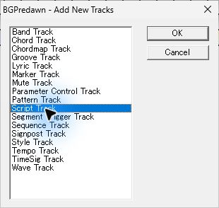
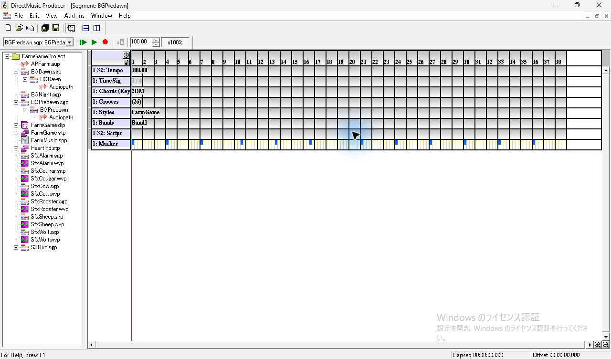
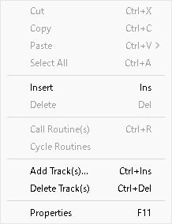

**Insert** を選ぶと、選択された濃色のセルに白い **&lt;None&gt;** が入り、391×200 px のモデルレス **Script Routine Properties** が開いた。Script は空欄、Routine は `<None>`、Timing は **Before Time Stamp**、Start Time は **3:1:0**。下端で Belongs To の一部が途切れた。

Script の候補は、この時点で **FarmGameProject: FarmMusic** の1件。選んだ直後も Routine とセルは `<None>` のまま。Routine を開くと名前順の12件が並び、末尾の **dmSSBird** を選ぶとセルに名前が出た。Routine リストを開いた際には Transport の対象表示が BGPredawn から SSBird へ変わり、編集面は BGPredawn のままだった。Transport の切替条件は追試する。

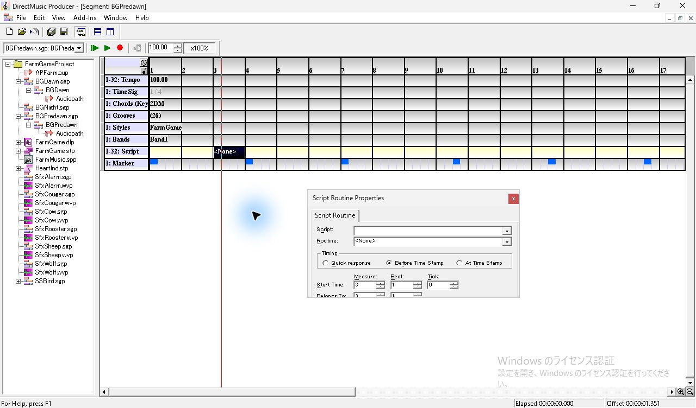
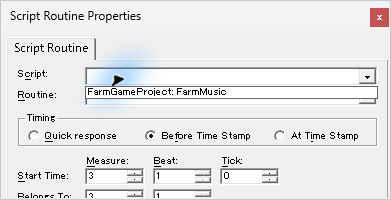
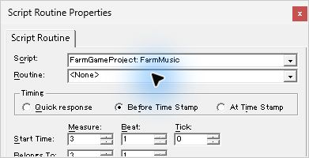
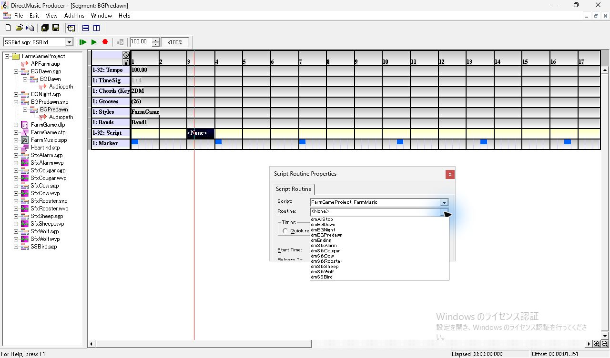
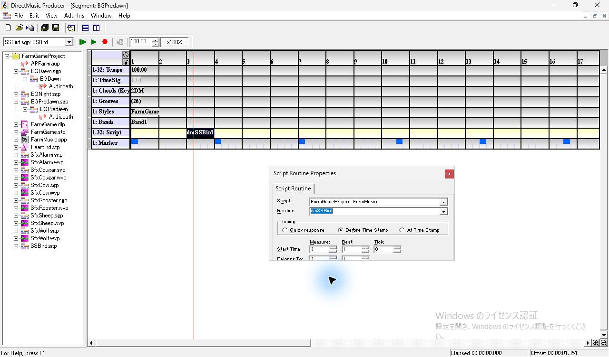

## Timing、開始位置と同じ拍の切替

Timing のラジオは **Quick response**、**Before Time Stamp**、**At Time Stamp** の3つ。dmSSBird で Quick response を選んでから At Time Stamp に切り替え、Tick の上矢印を1回押すと Start Time が **3:1:1** になった。プロパティを開いたまま空セルをクリックすると同じ枠の項目が空になり、入力欄が灰色になった。

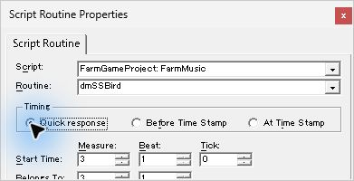
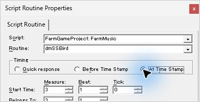
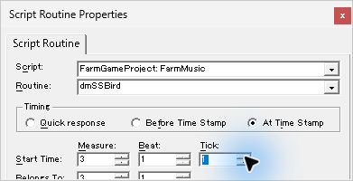
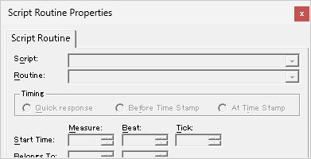

第4小節にも挿入し、FarmMusic の **dmSfxAlarm** を既定の Before Time Stamp で割り当てた。Measure の下矢印で **4:1:0 → 3:1:0** とすると Belongs To の Measure も3に変わった。第3小節の選択セルには表示中の **dmSfxAlarm** が斜体で出る。セルのメニューは **Insert** が灰色、**Call Routine(s)　Ctrl+R** と **Cycle Routines** が有効。**Cycle Routines** を選ぶと、斜体のラベルが **dmSSBird** に替わり、開いていたプロパティも **At Time Stamp、3:1:1** に切り替わった。

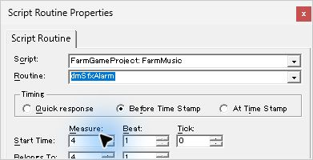
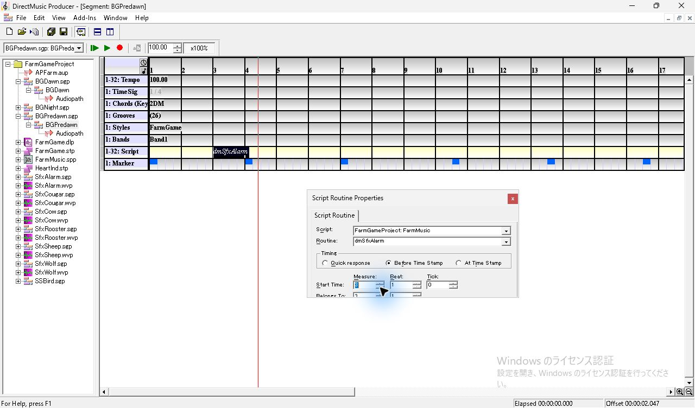
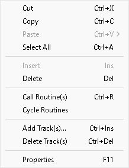
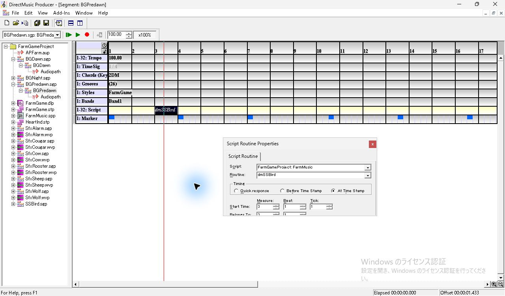

**Ctrl+Z** でラベルが第3・第4小節に分かれ、Properties が埋め込み AudioPath の表示に切り替わった。直後の **Ctrl+Y** では変化が見えず、Script 行の第4小節をクリックしてから **Ctrl+Y** を押すと第3小節で再び重なった。

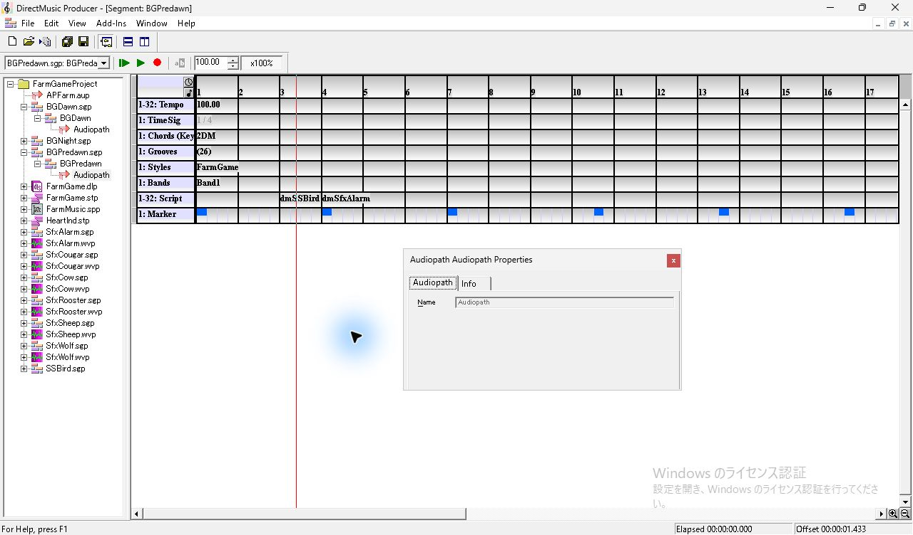
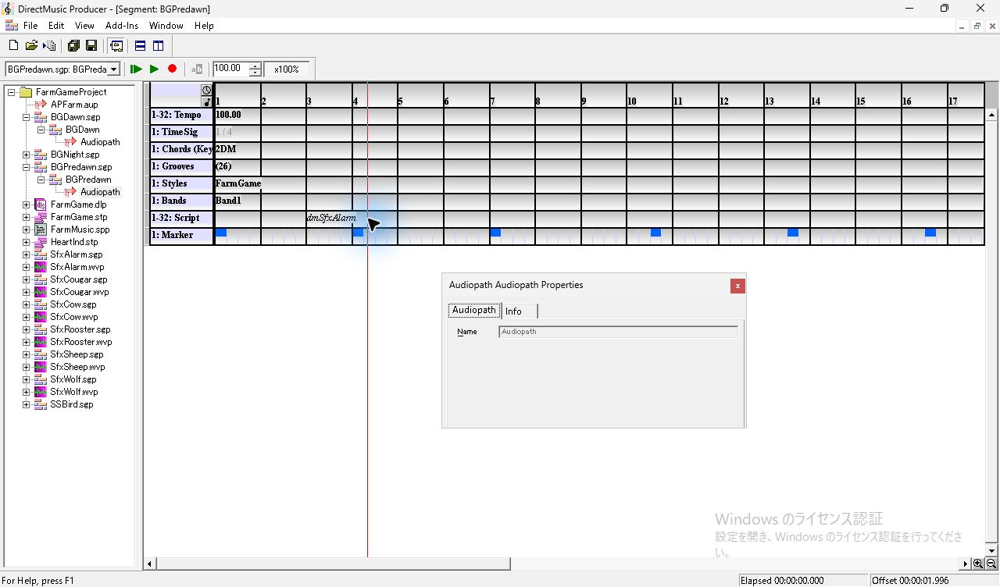

ヘッダーを選んだときの Properties は **Track Group Assignment** と **Flags**。Track Group Assignment では1〜32がすべてチェック済みの灰色表示。Flags では **Enable Play** がオン、**Enable Control** と **Send Notifications** は灰色だった。

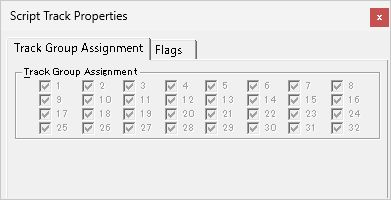
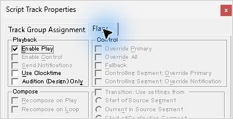

## メニューからの呼出しと再生

小さい試験用 Script の **Script5.spp** を GUI で作成し、手動用の `ManualTrace` とトラック用の `TrackTrace` を登録した。空の Message Window を開き、Script Designer で `ManualTrace` をダブルクリックすると1行増えた。 [Script の作成と Message Window](ui-10-script-designer.md#script-の作成と-message-window-の実測)

第5小節の Script 行に項目を挿入すると、Script の候補に FarmMusic と Script5 が並んだ。Script5 の **TrackTrace** を選び、**Quick response、5:1:0** を設定した。単独項目のメニューでは **Call Routine(s)** が有効、**Cycle Routines** は灰色。メニューから呼び出すと Message Window に **&lt;0002&gt;** が増えた。先頭からの再生で第5小節を通過すると **&lt;0003&gt;** が増えた。停止後、横追従で表示範囲が右に移ったままになり、範囲より前の最後のラベル **TrackTrace** が Script 行の左端に灰色で残った。

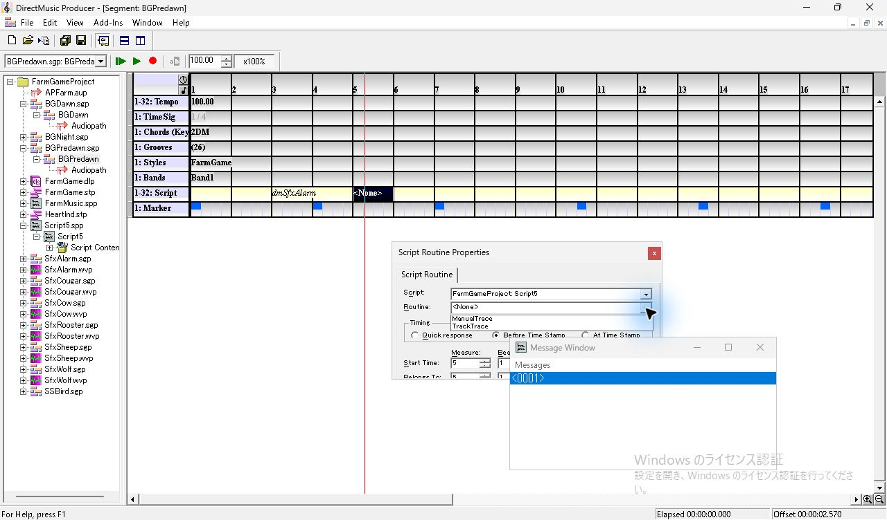
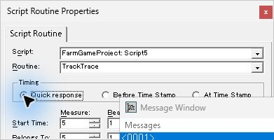
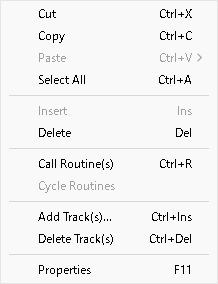
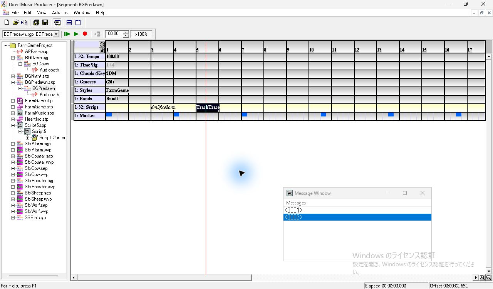
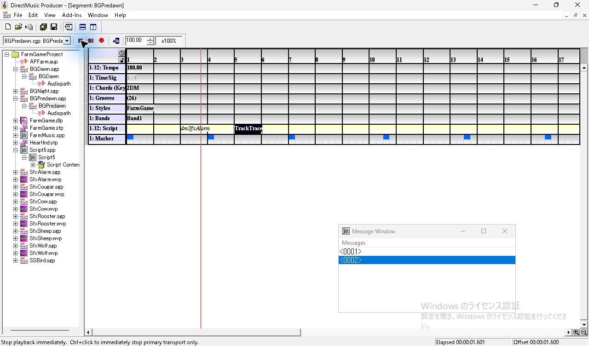
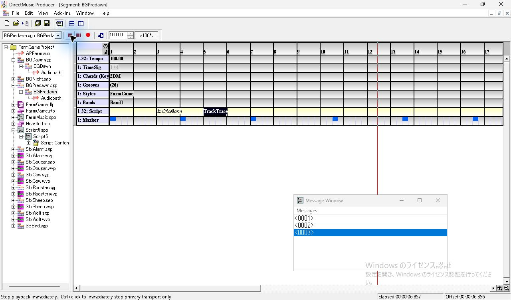
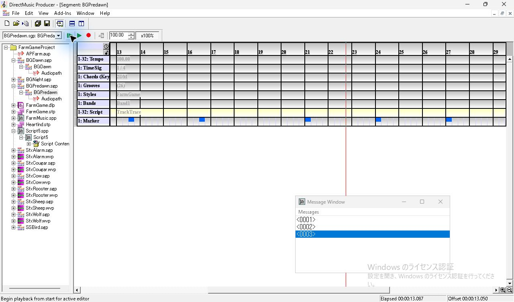

この環境では3行とも行番号だけが見え、Trace に渡した文字列は画面とアクセシビリティツリーのどちらにも現れなかった。再生試験で確認したのは行が増える区間まで。Timing 3方式の実行時刻の差と FarmMusic のルーチンが鳴らす音は追試する。 [Message Window のツリー](../../../work/original-gui/SEG-14-pattern-style/20261111T074828536163Z/captures/scr-message-final-tree.txt)

## 保存、再読込とファイル照合

**Ctrl+S** のあと Project を閉じ、同じ Producer の File メニューの最近使った項目から開き直した。BGPredawn では第3小節の斜体と第5小節の TrackTrace が復元された。各セルを選び直して Timing と Start Time を照合し、第3小節は再読込後も **Cycle Routines** で選択項目が切り替わった。

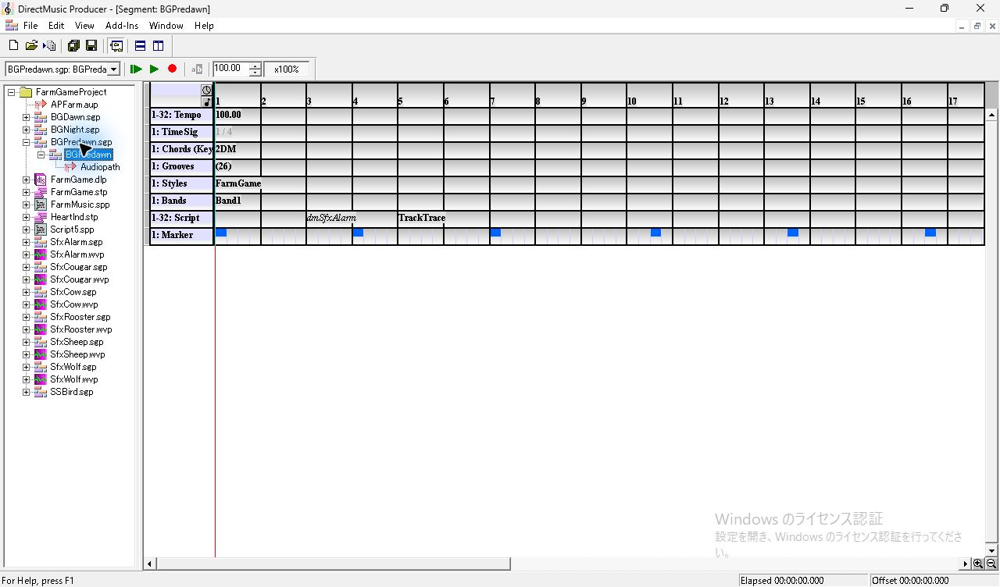
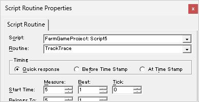
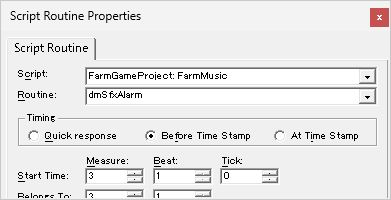
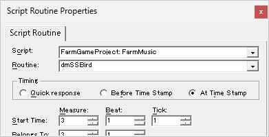

保存後と再読込後の BGPredawn.sgp は SHA-256 が一致した。Script Track の `trkh` はグループマスク `0xFFFFFFFF`。各 `scrh` の時刻は DirectMusic のクロック値で、`DMRF` のファイル名と GUID は参照先の Script と一致する。

| Routine | Script ファイル | Timing | 開始 | 論理クロック | 物理クロック |
| --- | --- | --- | --- | --- | --- |
| dmSfxAlarm | FarmMusic.spp | Before Time Stamp (`0x02`) | 3:1:0 | 1536 | 1536 |
| dmSSBird | FarmMusic.spp | At Time Stamp (`0x04`) | 3:1:1 | 1536 | 1537 |
| TrackTrace | Script5.spp | Quick response (`0x01`) | 5:1:0 | 3072 | 3072 |

作業コピーで更新されたのは BGPredawn.sgp と FarmGameProject.pro。Script5.spp が新規に加わり、凍結入力21ファイルはハッシュが一致した。続く追試では別プロセスでの再読込、項目をドラッグした結果、Tick −1 と Undo/Redo、全選択からの呼び出しを記録した。 [保存値とハッシュの照合](../../../work/original-gui/SEG-14-pattern-style/20261111T074828536163Z/script-track-audit.json) · [Script Track の追試](seg-14-script-track-followup.md)
