# SEG-14　Segment Trigger の重なり、発音境界、Primary

2026-11-11。DirectMusic Producer 5.3.0.900 の作業コピーで、[前回の BGDawn](seg-14-segment-trigger.md#プロジェクト再読込と保存値) を使った。1/4、100 BPM、1拍768クロック。ウィンドウは1280×752 px、View の標準4項目。採取171枚から29枚を掲載する。座標の原点は画像左上。画像の青い光と黒い矢印は操作ツールの表示。 [作業コピーと凍結入力28件](../../../work/original-gui/SEG-14-trigger-followup/20261111T150559451685Z/run.json) · [画像の出典と寸法](../../../work/original-gui/SEG-14-trigger-followup/20261111T150559451685Z/published-trigger-followup-figures.json)

## 同じ拍での表示と選択

最初は第3小節の **SSBird** と第6小節の **accordion (Heartland)** がそれぞれ通常の太字で表示された。第3小節の SSBird を (361,213) で右クリックするとセルが選択され、**Insert と Cycle Items は灰色**、Delete と Properties は有効だった。赤い位置線は右クリックした位置へ動いた。

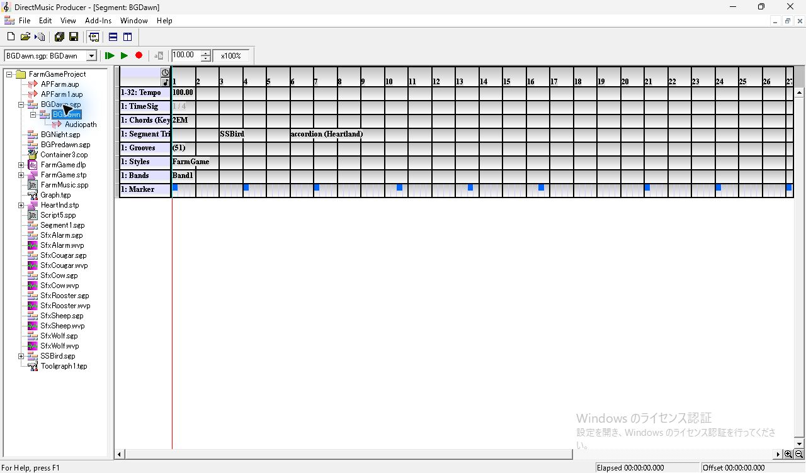

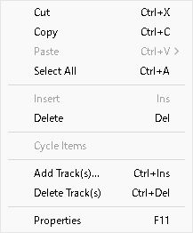

accordion を選んで F11 を押し、Segment タブの **Start Time > Bar** の下スピンを3回押した。accordion は **6:1:0 → 3:1:0**、SSBird は **3:1:1**。同じ拍に入るとラベルは手前の1件だけになり、斜体になった。選択中は濃い背景に白い文字。重なった第3小節を右クリックすると、**Cycle Items は有効**、Insert は灰色だった。

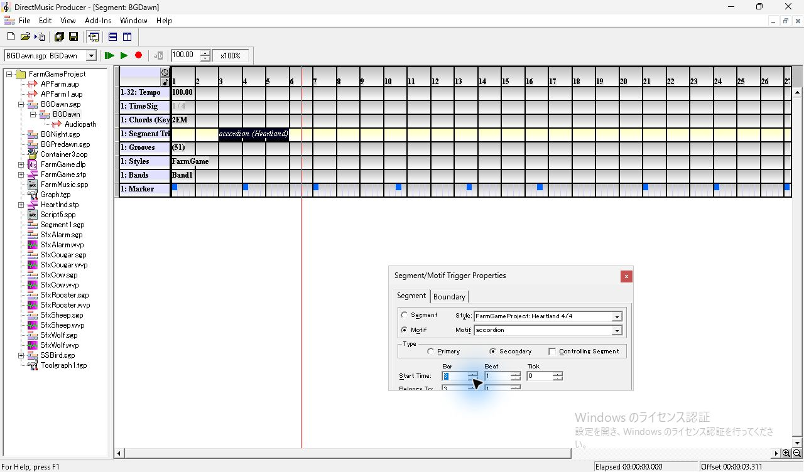

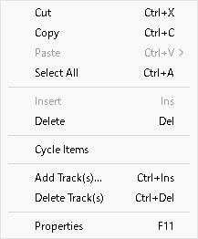

**Cycle Items** を選ぶと、手前のラベルと選択対象が **accordion → SSBird** へ切り替わり、開いたモデルレスも Segment 参照、Secondary、Controlling Segment オン、Tick 1 に替わった。Boundary タブを開くと **Align to Beat / on any Grid**。同じセルで再び Cycle Items を選ぶと **accordion** に戻り、Boundary タブを開いたまま **Immediate** を表示した。選択項目ごとの設定が同じパネルに表示される。

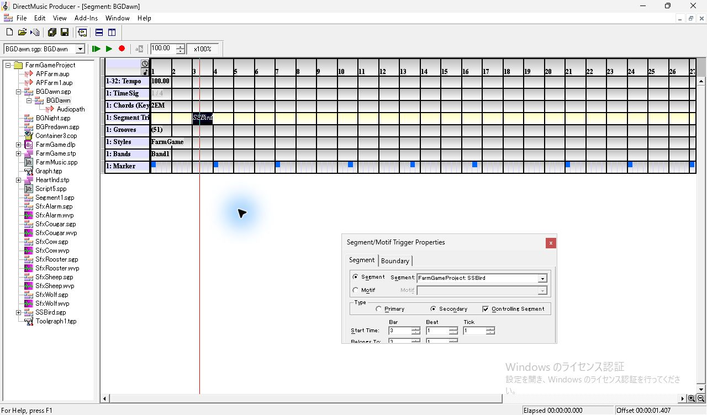

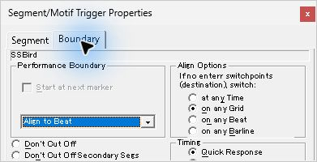

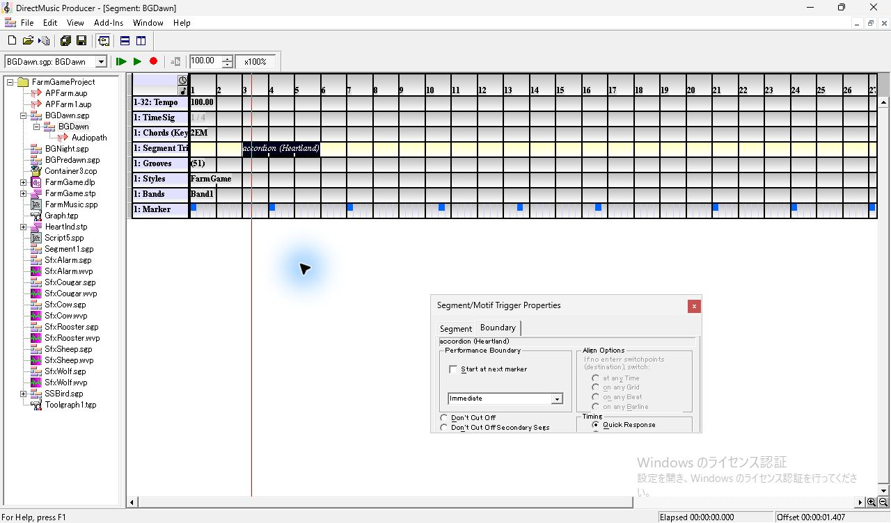

## 同じ Tick の保存、再起動、ドラッグ

accordion の Tick 上スピンを1回押して **3:1:1** にそろえ、ツールバーの Save を押した。保存した Segment Trigger の **2件は所属1536、実時刻1537クロック**。参照 GUID は SSBird.sgp と Heartlnd.stp に一致し、後者の Motif 名は accordion。保存直前の手前は accordion だった。Producer を通常終了し、0件を確認して同じ EXE を1件起動した。Project が自動で開いたので BGDawn を開き、再読込直後は未選択の斜体 **SSBird** が手前だった。Cycle Items は有効で、accordion を選ぶと Tick 1 を復元していた。 [同時刻の保存ファイル](../../../work/original-gui/SEG-14-trigger-followup/20261111T150559451685Z/captures/overlap-BGDawn.sgp) · [再起動時のプロセス確認](../../../work/original-gui/SEG-14-trigger-followup/20261111T150559451685Z/captures/23-relaunch.json) · [保存値と参照 GUID](../../../work/original-gui/SEG-14-trigger-followup/20261111T150559451685Z/trigger-followup-audit.json)

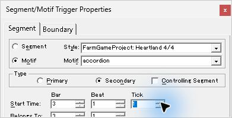

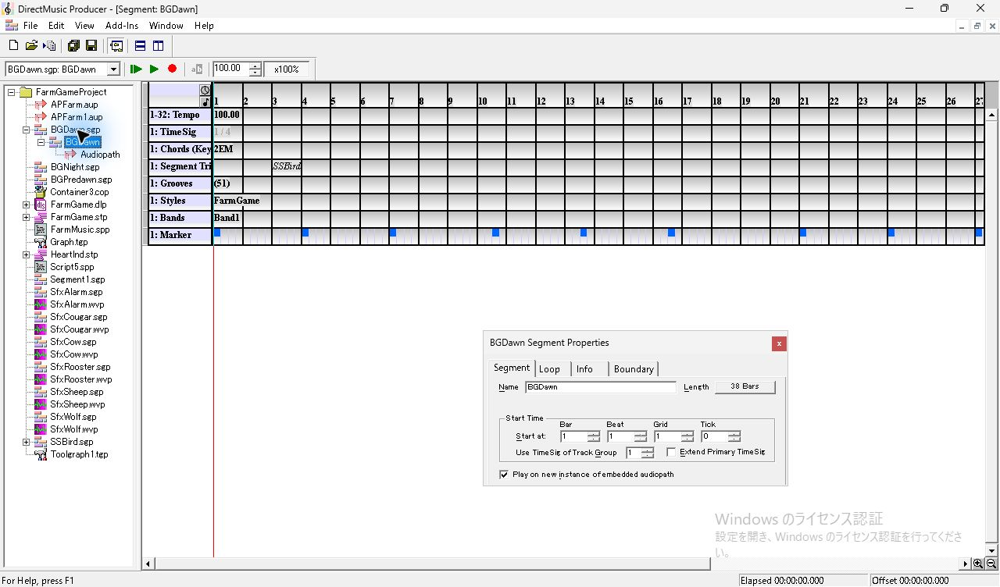

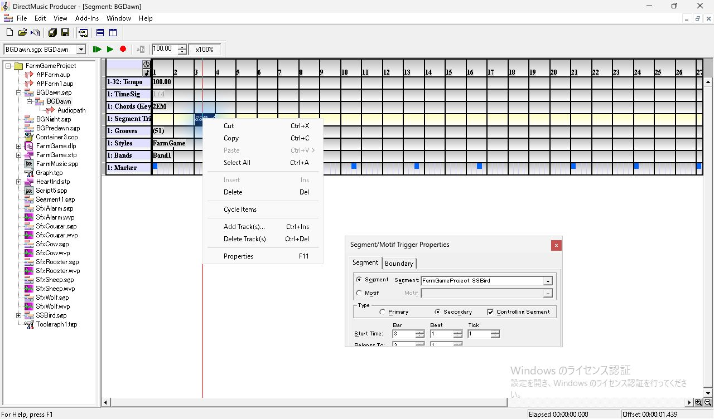

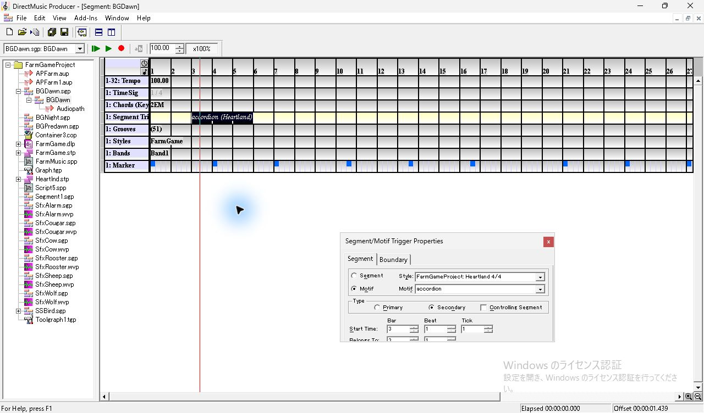

accordion を選んだまま、先頭文字付近 (353,213) から第6小節の (473,213) へ左ドラッグした。解放後のラベル、選択対象、Start Time **3:1:1** は同じ。赤い位置線は押下位置へ動いた。今回の操作 API はドラッグへの修飾キー指定を持たず、押下中のカーソルも記録できていない。

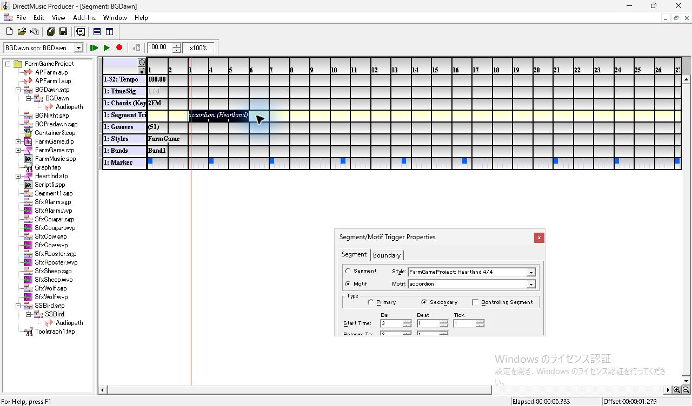

## 録音で比べる Immediate、Beat、Primary

時刻をソース波形と照合できるよう、上の保存を別名で保管し、作業中の第3小節の参照を **SSBird → SfxCow** に変更した。accordion は **6:1:0 / Secondary / Immediate** に戻した。SfxCow は **3:1:300**、所属1536、実時刻1836クロック。Secondary の **Controlling Segment はオフ**。Boundary は **Quick Response**、Start at next marker はオフ。Timeline のトリガー行をクリックして Transport の対象を **BGDawn.sgp: BGDawn** に戻し、各条件で **Play From Start** を押した。開始指定 **3:1:300** はこのテンポで1.434375秒、次の拍は1.800秒。

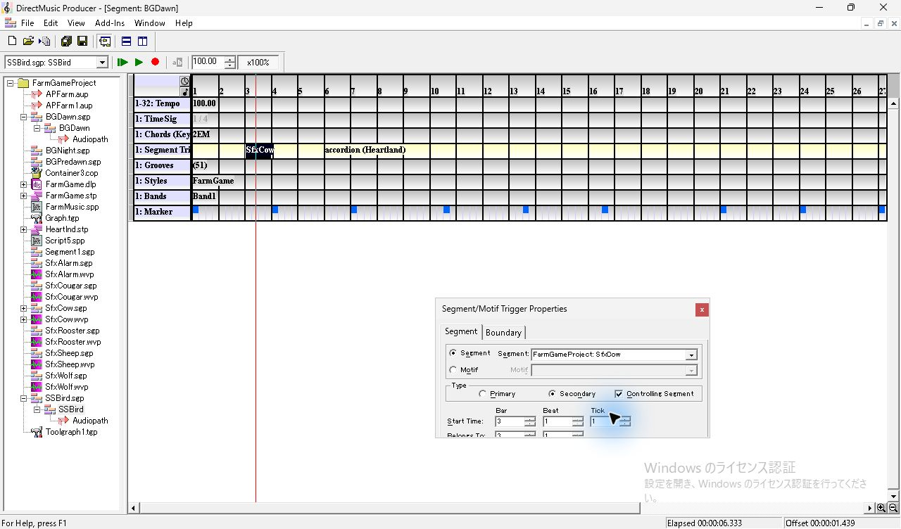

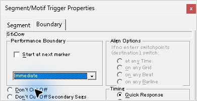

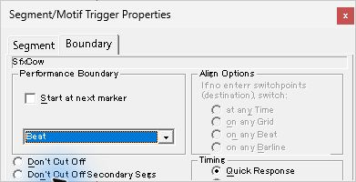

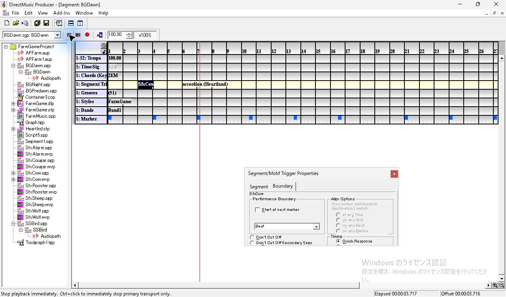

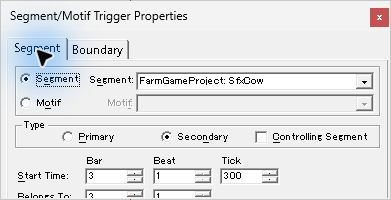

録音は既定出力の WASAPI ループバック、48 kHz、32-bit 浮動小数点、ステレオ。各回で BGDawn の冒頭の音を起点に、SfxCow.wvp の **冒頭0.130秒** と **0.380〜0.530秒の差分波形** を探した。表の発音時刻は後者の一致からソースの開始に換算した値。冒頭で求めた開始値との差は各回で1サンプル以内。Enable Play オフの対照では両方に対応する一致が得られなかった。 [境界比較132秒の録音](../../../work/original-gui/SEG-14-trigger-followup/20261111T150559451685Z/captures/audio-boundary/output.wav) · [対照105秒の録音](../../../work/original-gui/SEG-14-trigger-followup/20261111T150559451685Z/captures/audio-control/output.wav) · [解析結果](../../../work/original-gui/SEG-14-trigger-followup/20261111T150559451685Z/captures/trigger-audio-analysis.json) · [解析コード](../../../work/original-gui/SEG-14-trigger-followup/20261111T150559451685Z/measure-triggers.py)

| 設定（各2回） | SfxCow の発音（秒） | 差分波形の正規化相関 | 開始から4.20〜4.30秒の音量 RMS | BGDawn の画面 |
| --- | ---: | ---: | ---: | --- |
| Secondary / Immediate | 1.4357、1.4367 | 0.497〜0.499 | 0.0766〜0.0816 | 2つのトリガーを過ぎて進行 |
| Secondary / Beat | 1.8002、1.8007 | 0.508〜0.530 | 0.0688〜0.0808 | 2つのトリガーを過ぎて進行 |
| Primary / Beat | 1.8024、1.7992 | 0.892〜0.902 | 0.000025〜0.000026 | 第4小節の境界で停止 |
| トラックの Enable Play オフ | — | 探索範囲の最大0.063〜0.065 | 0.0617〜0.0660 | 2つのラベルを残して進行 |

Secondary で Beat にすると、同じ Start Time で SfxCow は Immediate より **約364 ms後**、次の拍で鳴った。Primary へ変えると **Controlling Segment は灰色**。Beat の境界で BGDawn の位置線が第4小節の先頭に止まり、Elapsed は **1.800秒 / 1.807秒**。Transport の選択表示は BGDawn のままで、SfxCow の発音中には停止ボタンが表示され、自然終了後に緑の再生ボタンが戻った。録音では SfxCow の後に続く音量が対照条件より小さく、4.20秒時点で無音区間と同程度だった。Enable Play をオフにしてもラベルは残り、BGDawn は第4・第6小節を通過した。

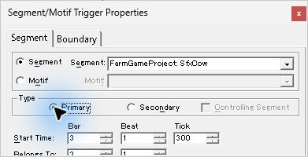

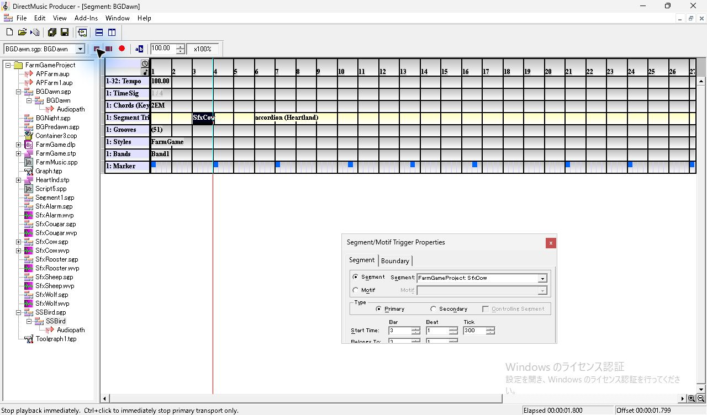

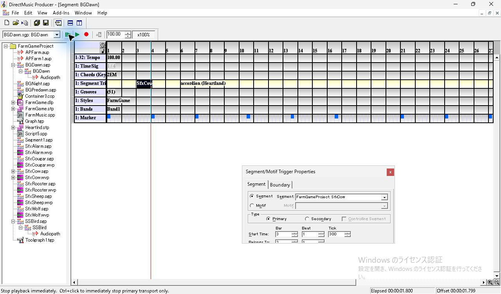

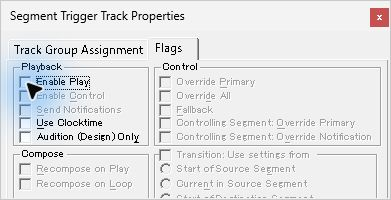

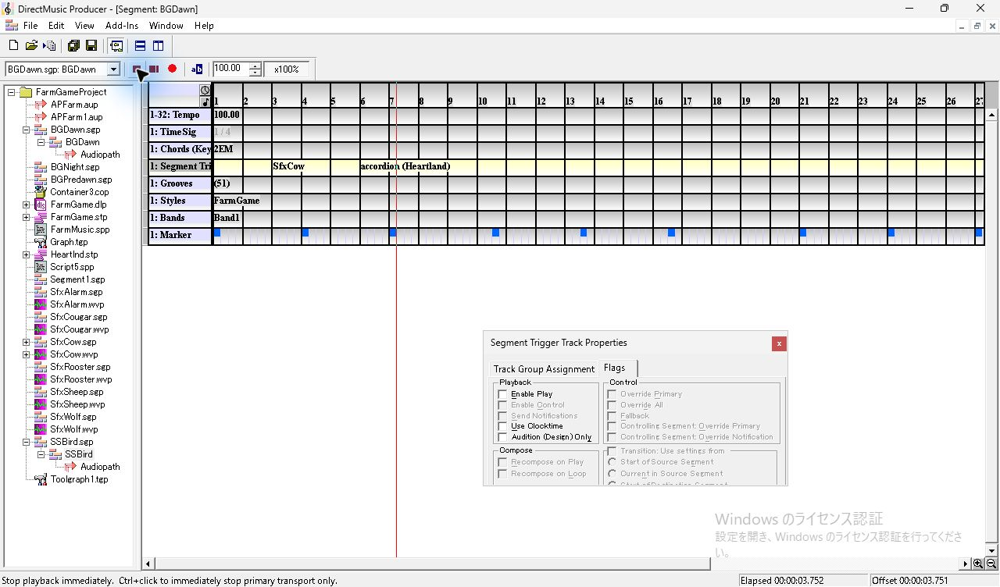

| 保存条件 | 第3小節の項目 | 再生フラグ | Track Flags |
| --- | --- | --- | --- |
| 同一 Tick の保存 | SSBird / 3:1:1 | 0x00051280 | 0x00000010 |
| 同一 Tick の保存 | accordion / 3:1:1 | 0x00000080 | 0x00000010 |
| Secondary / Immediate | SfxCow / 3:1:300 | 0x00000080 | 0x00000010 |
| Secondary / Beat | SfxCow / 3:1:300 | 0x00001080 | 0x00000010 |
| Primary / Beat | SfxCow / 3:1:300 | 0x00001000 | 0x00000010 |
| Enable Play オフ | SfxCow / 3:1:300 | 0x00001000 | 0x00000000 |

比較した4条件で accordion の所属・実時刻は3840クロック、再生フラグは 0x00000080。RIFF の差分では、Secondary / Beat から Primary / Beat は項目の再生フラグの1バイト、そこから Enable Play オフはトラック側の1バイトだけが変わった。表の再生フラグは項目の `sgih`、Track Flags は `trkx` の値。 [6版の保存値と差分](../../../work/original-gui/SEG-14-trigger-followup/20261111T150559451685Z/trigger-followup-audit.json)

## SSBird と accordion の混合音、単独試聴

同一 Tick の保存を別プロセスで読み直した状態で、2回再生した。親の位置線は第3小節を通過。さらに Tree で **SSBird**、別の録音で **Heartland > Motifs > accordion** を選んで単独試聴した。画面は BGDawn のまま、Transport と Properties はそれぞれの対象へ切り替わる。混合録音では SSBird 単独試聴の断片との相関のピークが試行ごとに異なり、同一 Tick で2件が個別に鳴ったかはこの録音から確定できなかった。accordion 単独のテンポ表示は112.00。BGDawn の100.00とは条件が異なる。 [同一 Tick と SSBird 単独の66秒録音](../../../work/original-gui/SEG-14-trigger-followup/20261111T150559451685Z/captures/audio-overlap/output.wav) · [accordion 単独を含む録音](../../../work/original-gui/SEG-14-trigger-followup/20261111T150559451685Z/captures/audio-control/output.wav)

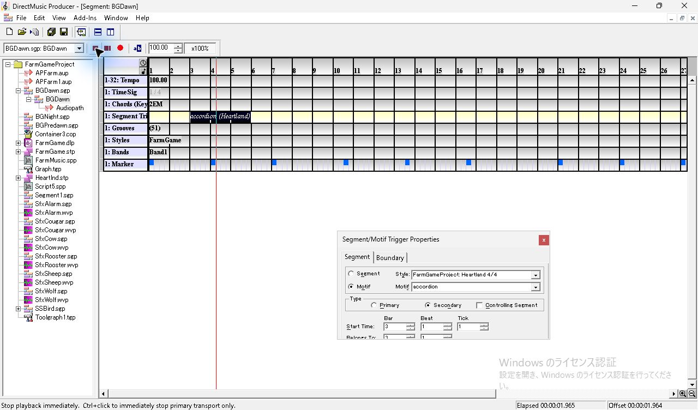

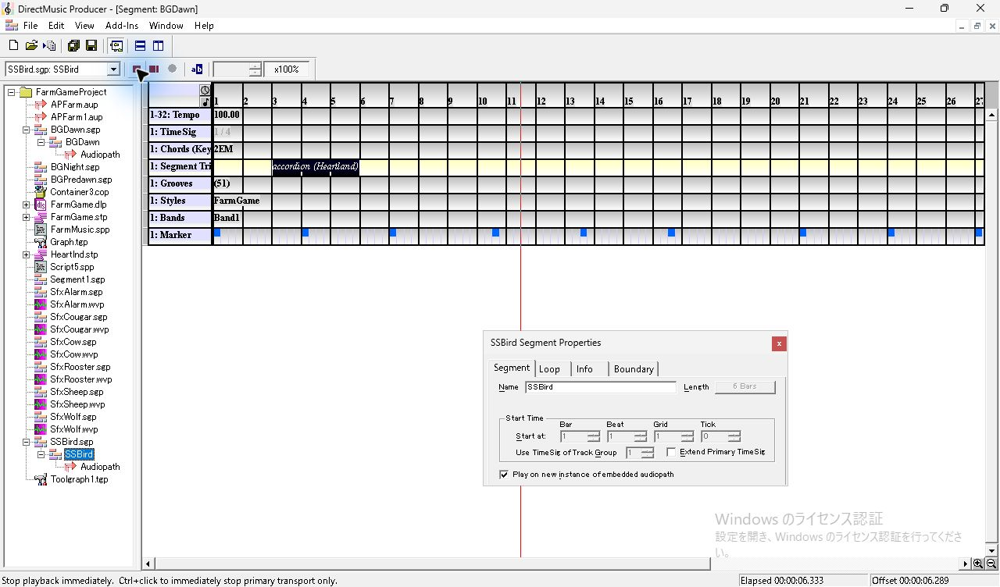

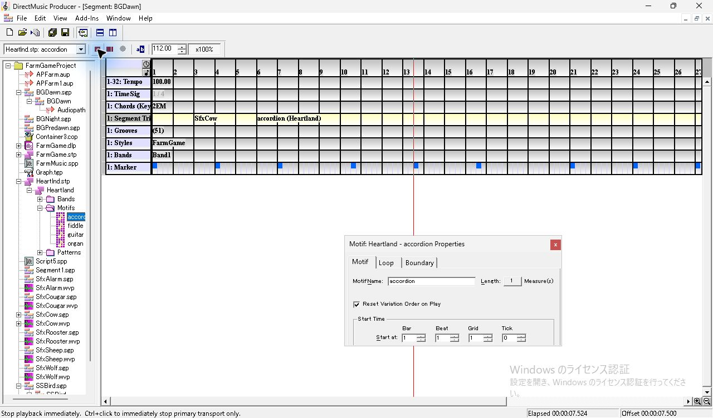

accordion の試聴中に Close Project を選ぶと、数秒後の録音は無音時の水準になった。Transport は対象欄が空になり、赤い停止アイコンは Stop Immediately を押した後にも残った。通常終了して1件起動し、空の作業領域と灰色の Transport を確認した。調査中に更新された Project 内のファイルは作業コピーの **BGDawn.sgp、FarmGameProject.pro**。凍結入力28件はハッシュ一致。View は標準4項目。 [終了時のウィンドウ](../../../work/original-gui/SEG-14-trigger-followup/20261111T150559451685Z/captures/94-clean-final-windows.json)

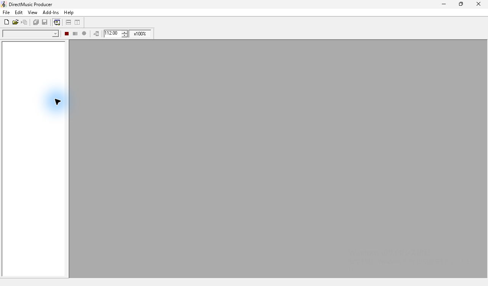

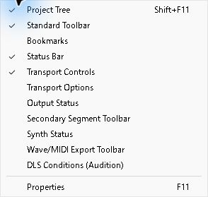

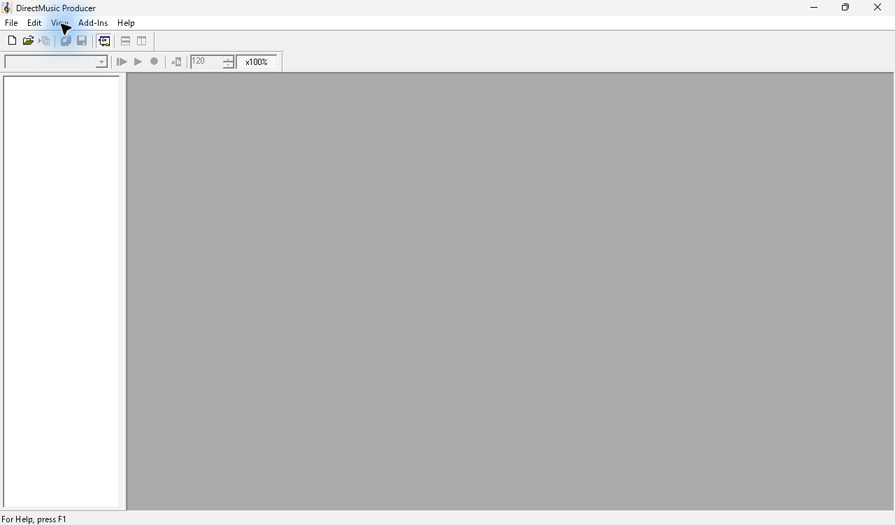

後続の調査では、識別用 Sequence を参照する2つの Segment を同じ Tick に置き、単独・同時・トラック無効・保存順の逆転を MIDI と WAV で照合した。子を Sequence にした別の試験では Align と Start at next marker の発音境界を照合し、Primary、Secondary、Controlling Segment の親子の音とテンポも MIDI で比較した。比較用の Sequence と3音にした Motif でも、同じ Tick の単独・同時・トラック無効・逆順再読込を MIDI で照合した。元の SSBird の内蔵 Pattern と加工前の accordion は、同じ親で単独と混合を再生し、音声出力の重なりを確認した。親側のコード変更と Enable Control が子の条件付き Variation Enter に及ぼす影響も照合した。通常の左ドラッグをラベル内外から試し、押下した拍の選択と保存時刻を照合した。貼り付けでは同じ Tick と同じ拍の異なる Tick を比較した。修飾キー付きドラッグと押下中のカーソルは追試に残る。 [ドラッグの押下位置と Paste の比較](seg-14-trigger-drag.md) [同一 Tick の発音](seg-14-trigger-simultaneous.md) · [Align と Start at next marker](seg-14-trigger-alignment.md) · [子の Marker トラックに Enter がある場合](seg-14-trigger-enter.md) · [子の Pattern Part に Variation の Enter がある場合](seg-14-trigger-variation-enter.md) · [Primary と Controlling Segment](seg-14-trigger-primary-control.md) · [同じ Tick にある Segment と Motif](seg-14-trigger-motif-overlap.md) · [元の SSBird と accordion の同時発音](seg-14-trigger-original-audio.md) · [親の Chord と子の条件付き Variation Enter](seg-14-trigger-parent-chord.md)
