# SEG-14　Segment Trigger Track の参照・時刻・境界

2026-11-11。DirectMusic Producer 5.3.0.900 の調査用コピーで、FarmGameProject の **BGDawn.sgp** を使った。同じ Producer のウィンドウを再利用。親ウィンドウは1280×752 px、ツールバーは2段。BGDawn の拍子表示は1/4、テンポは100.00。画像の原点は左上。青い光と黒い矢印は操作ツールの表示。 [実行記録](../../../work/original-gui/SEG-14-pattern-style/20261111T074828536163Z/run.json) · [原版画像33枚の対応表](../../../work/original-gui/SEG-14-pattern-style/20261111T074828536163Z/published-trigger-figures.json)

## 空のトラックと Segment の割り当て

Marker のヘッダーを右クリックし、**Add Track(s)... > Segment Trigger Track** を確定した。グループ1の折りたたみボタンのない1行が、Chords と Grooves の間に入った。トラック名は左の固定幅で途切れる。横ズームで小節を広げ、第3小節の空セルを右クリックすると、小節全体が濃く選択され、**Insert** は有効、**Delete** と **Cycle Items** は灰色だった。

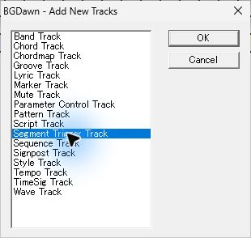
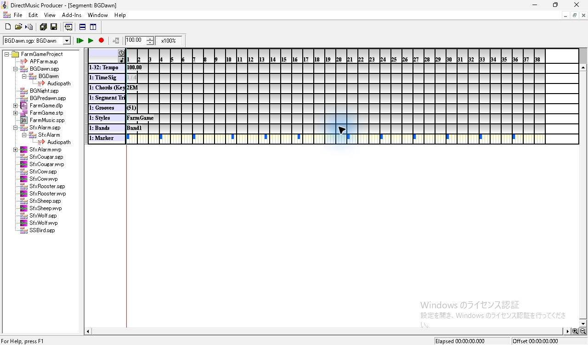
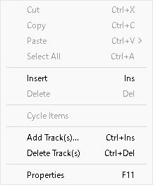

**Insert** を選ぶと、第3小節の先頭に **Empty** が入り、391×200 px のモデルレス **Segment/Motif Trigger Properties** が開く。**Segment** と **Secondary** が選択済み、Controlling Segment はオフ。開始は **3:1:0**。パネルの下端では Belongs To の一部が途切れた。Segment 一覧にはプロジェクト名を付けた10候補が並び、挿入先自身の BGDawn も含まれた。末尾の **FarmGameProject: SSBird** を選ぶと、確定ダイアログを介さず Timeline のラベルが **SSBird** に変わる。

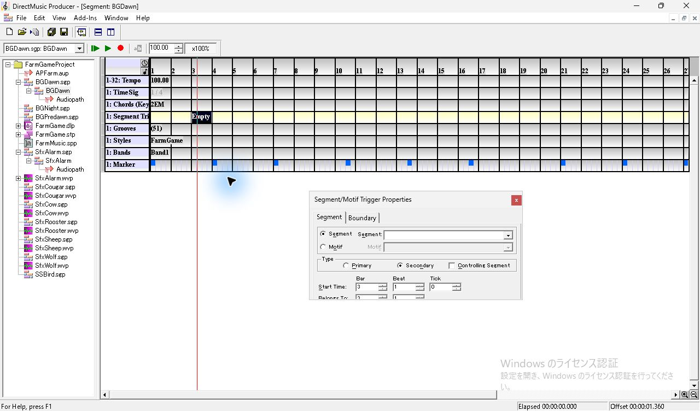
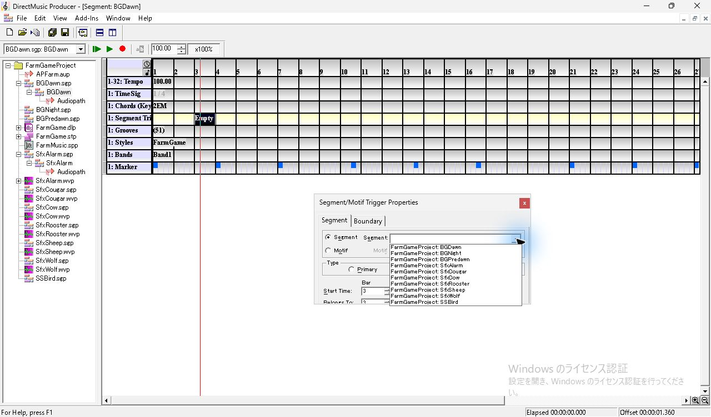
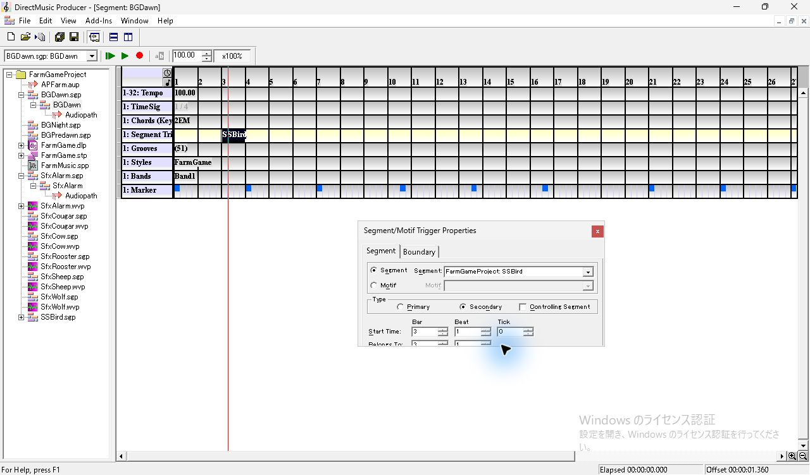

Secondary のまま **Controlling Segment** をオンにできる。**Primary** を選ぶと Controlling Segment のチェックが外れて灰色になり、**Secondary** に戻すと操作可能な未選択状態になった。

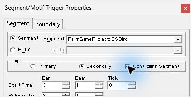
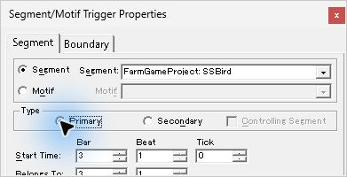
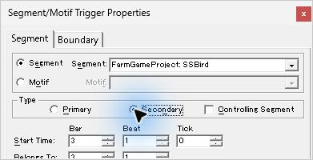

## Boundary と Tick

SSBird の **Boundary** タブは、最初に **Immediate**、**Start at next marker** はオフ、右側の **Align Options** は灰色。上部に参照名 **SSBird** が出る。Performance Boundary の一覧は **Segment's Default**、**Immediate**、**Grid**、**Beat**、**Barline**、**Align to Beat**、**Align to Barline**、**Align to Segment**、**End of Segment**、**End of Segment Queue** の順だった。

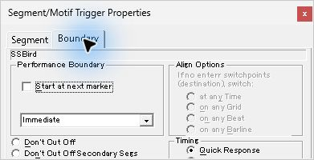
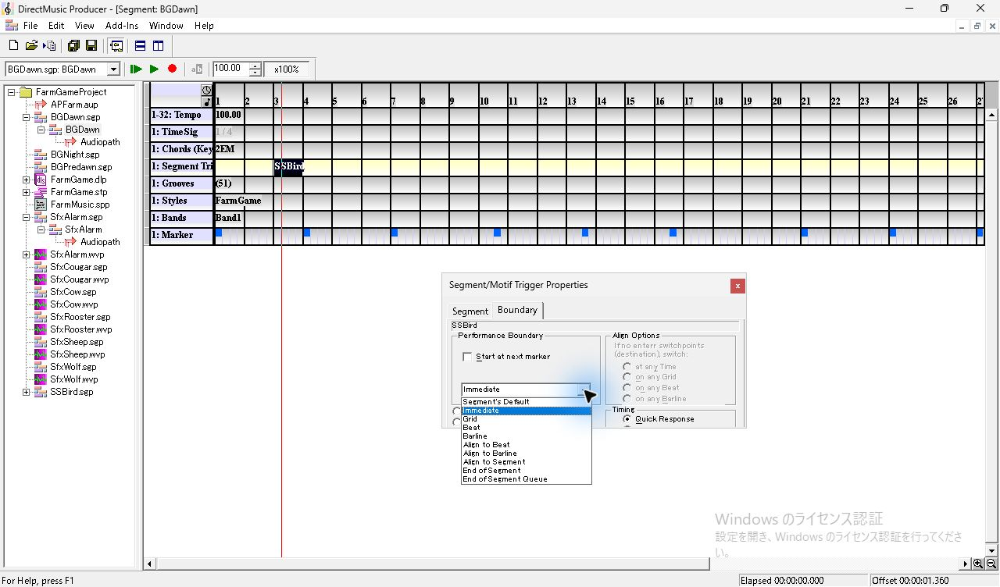

**Align to Beat** を選ぶと右側が有効になり、初期選択は **at any Time**。左の **Start at next marker** は灰色に変わった。右側を **on any Grid** に設定した。Segment タブに戻って Tick の上スピンを1回押すと **3:1:0** が **3:1:1** に変わり、SSBird のラベルは第3小節に残った。最後に Secondary の Controlling Segment をオンにして、BGDawn を Ctrl+S で保存した。

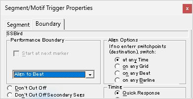
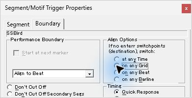
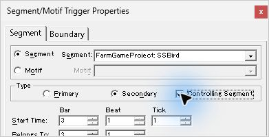

## Motif の未設定と設定済み

第5小節に2件目を挿入し、**Motif** に切り替えた。上の欄が **Style** に変わり、Motif 欄は `<Select Style Above>`。Timeline は `<None> (Empty)`。**FarmGameProject: FarmGame 1/4** を選ぶと `<None> (FarmGame)` になった。この Style には Motif 候補がなく、一覧は `<None>` だけ。Esc で閉じると選択値を保った。

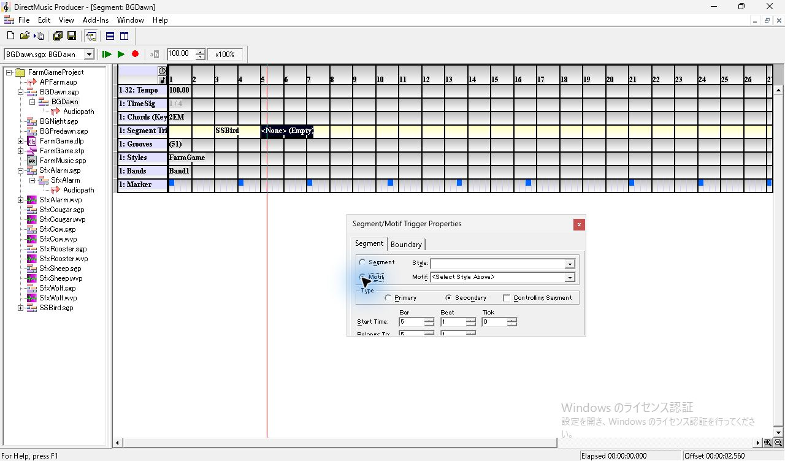
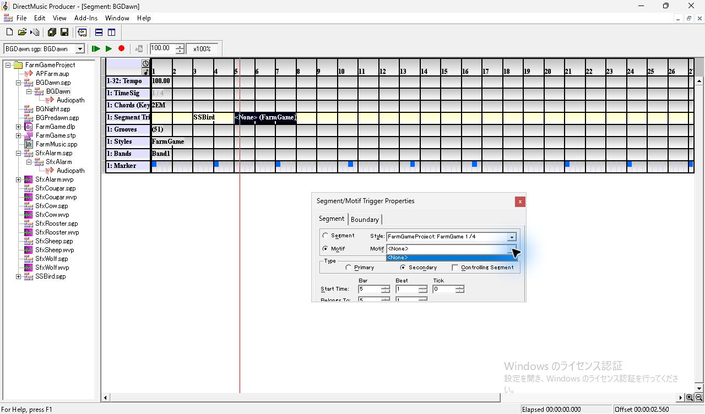

Motif がある場合の確認には、QuickStart 同梱の **Heartlnd.stp** を使った。作業領域に複製したファイルを **File > Insert Files into Project...** から FarmGameProject へ挿入すると、Project Tree に **Heartlnd.stp > Heartland** が加わった。第5小節のトリガーを選んで F11 を押し、Style 一覧の **FarmGameProject: Heartland 4/4** を選択。Motif 一覧は `<None>`、**accordion**、**fiddle**、**guitar**、**organ** の順。accordion を選ぶと **accordion (Heartland)** が表示された。

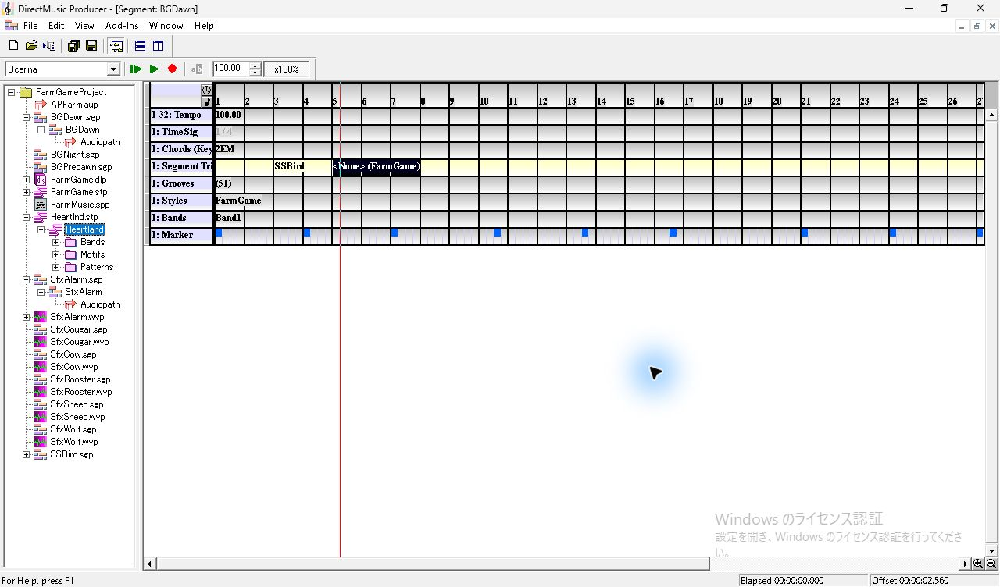
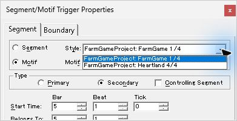
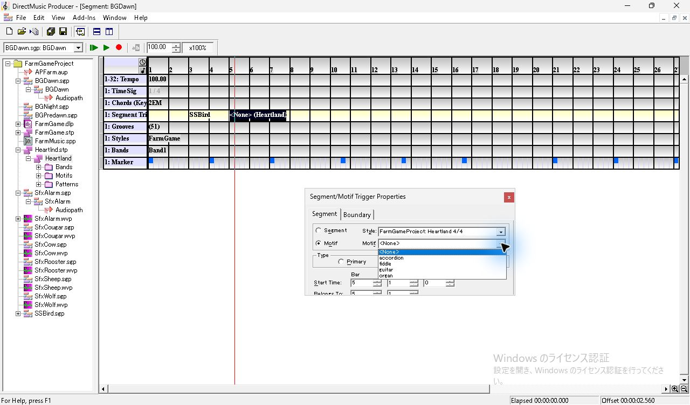
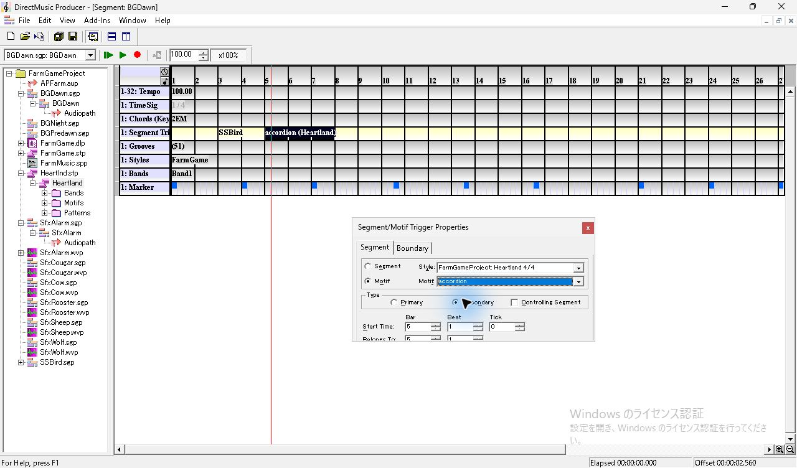

## 位置の変更とトラック側の Properties

選択中の accordion ラベル付近 (438, 211) から第7小節 (509, 211) への左ドラッグを1回試した。解放後も Start Time は **5:1:0**。Start Time の **Bar** 上スピンを1回押すと **6:1:0** に変わり、ラベルも第6小節へ移った。下端に見える Belongs To の Bar も6になった。

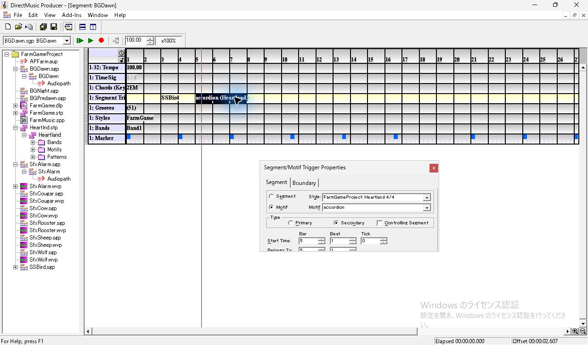
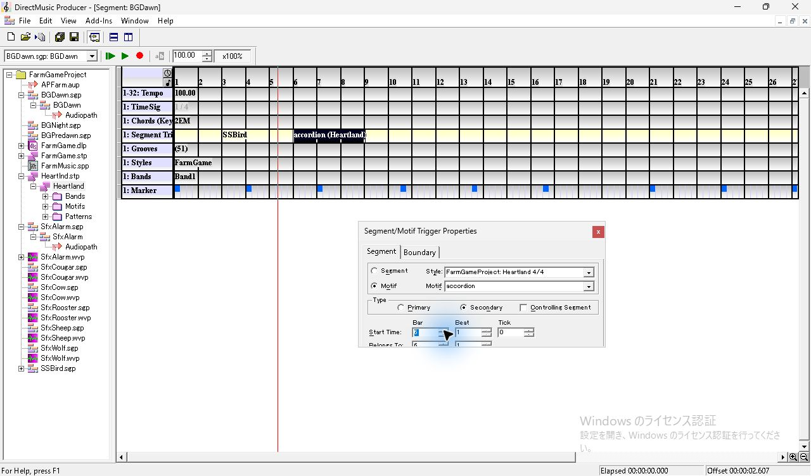

モデルレスを開いたままトラックのヘッダーを選ぶと **Segment Trigger Track Properties** に切り替わる。**Track Group Assignment** は1〜32のチェック欄で、1だけオン。**Flags** は Enable Play がオン、Enable Control と Send Notifications は灰色。プロパティを閉じて Timeline で Ctrl+Z を押すと accordion は第5小節、Ctrl+Y で第6小節に戻った。第3小節の SSBird は両方の操作で残った。

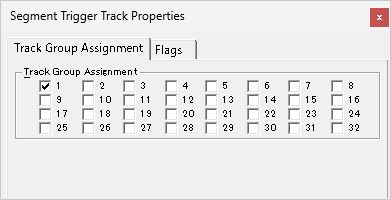
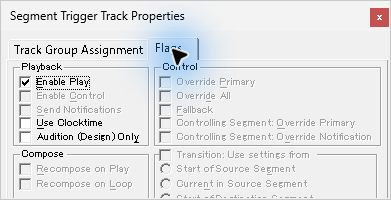
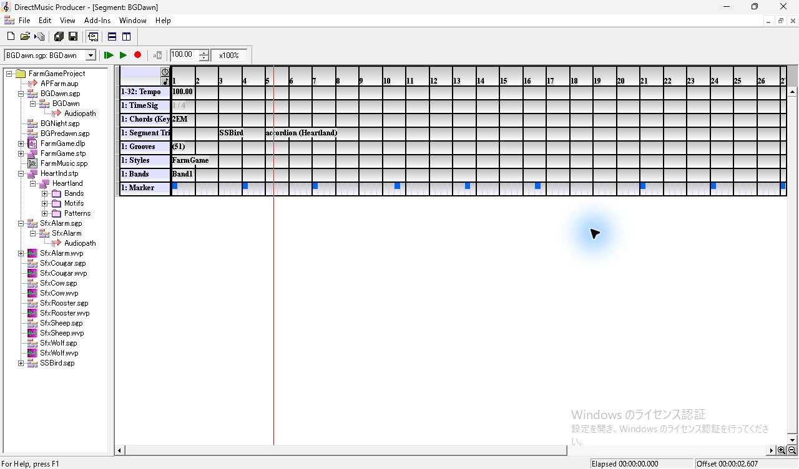

## 再生中の表示

**Play From Start** を押すと BGDawn の Transport が再生表示に切り替わった。最初のフレームは Elapsed 1.131秒で、カーソルは第3小節の直前。次のフレームは6.869秒で、カーソルは第12小節にあり、両方のトリガー位置を通過していた。Transport 対象は BGDawn。**Stop Immediately** で停止表示に戻した。ここで観測したのは親 Segment の表示上の進行。トリガーごとの発音と境界での発音時刻は音声で追試する。

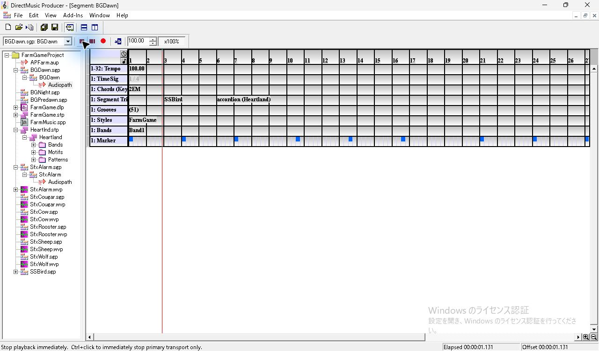
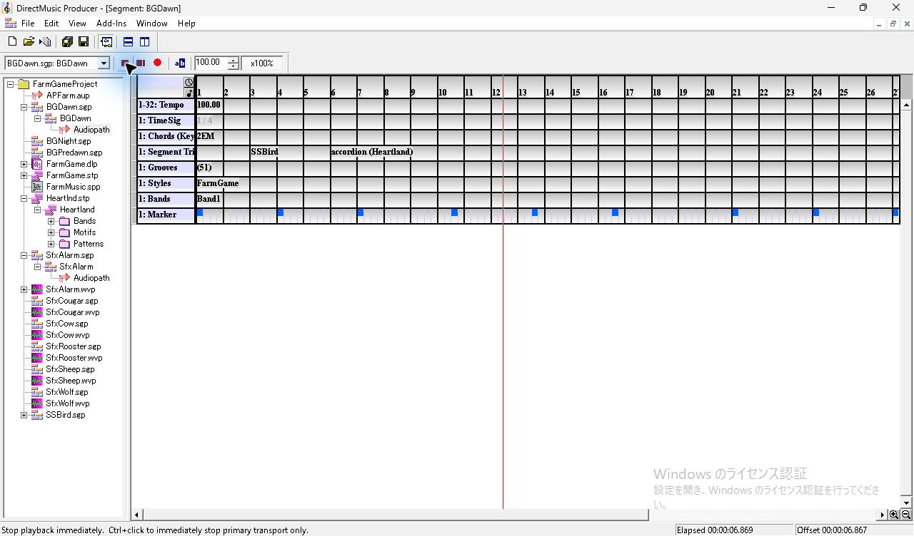
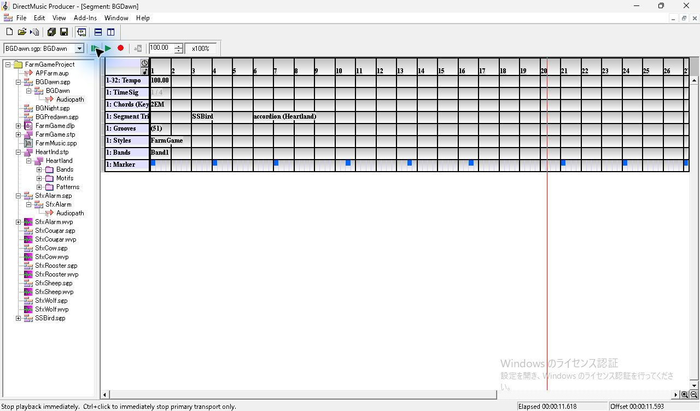

## プロジェクト再読込と保存値

2件を保存して FarmGameProject を閉じ、同じ Producer の File メニューから開き直した。BGDawn.sgp を開くと第3小節の SSBird と第6小節の accordion が復元された。F11 で SSBird の Secondary、Controlling Segment、Tick 1、Boundary の Align to Beat と on any Grid を確認した。モデルレスの Boundary を表示したまま accordion を選ぶと、見出しが **accordion (Heartland)**、境界が **Immediate** に替わった。Segment タブでは Heartland、accordion、開始6:1:0 を確認した。

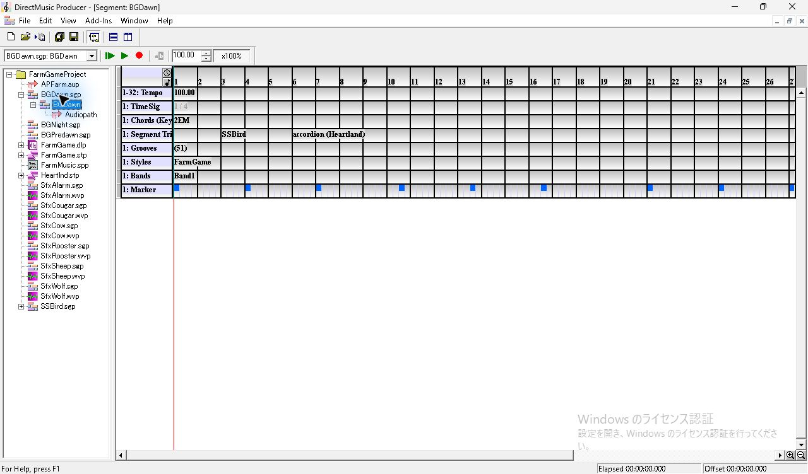
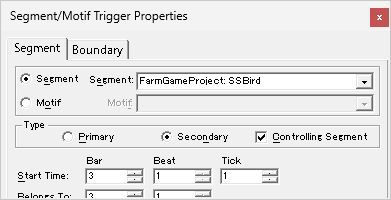
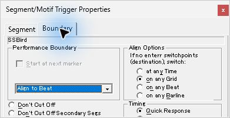
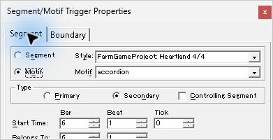

| 保存したトリガー | 所属位置 / 実時刻 (clocks) | 再生フラグ / 項目フラグ | 参照 |
| --- | --- | --- | --- |
| SSBird | 1536 / 1537 | 0x00051280 / 0 | SSBird.sgp と GUID 一致 |
| accordion | 3840 / 3840 | 0x00000080 / 1 | Heartlnd.stp と GUID 一致。Motif 名は accordion |

最初の1件を保存した時点と2件保存後で、SSBird のトリガー値は一致した。プロジェクト再読込後の BGDawn.sgp も2件保存時と全バイト一致。参照先 SSBird.sgp は入力と一致した。Heartland は挿入元と GUID が一致し、挿入先のファイルは **ptnu** 20件のサイズが20→48 bytes になった。入力の FarmGame 21ファイルと QuickStart の挿入元をハッシュ照合した。 [保存値と参照先の照合](../../../work/original-gui/SEG-14-pattern-style/20261111T074828536163Z/segment-trigger-audit.json)

別の試行で、同一 Tick の2件の Cycle Items と別プロセスでの復元、Immediate・Beat の発音差、Primary での切替を照合した。識別用 Sequence を使った追試では、同時刻に重なる項目の個別発音、Align と Start at next marker の発音境界、Controlling Segment のテンポを照合した。親側のコード変更と Enable Control が子の条件付き Variation Enter に及ぼす影響も照合した。通常の左ドラッグをラベル内外から試し、押下した拍の選択と保存時刻を照合した。貼り付けでは同じ Tick と同じ拍の異なる Tick を比較した。修飾キー付きドラッグと押下中のカーソルは追試に残る。 [ドラッグの押下位置と Paste の比較](seg-14-trigger-drag.md) [Segment Trigger の重なり、発音境界、Primary](seg-14-segment-trigger-followup.md) · [同一 Tick の発音](seg-14-trigger-simultaneous.md) · [Align と Start at next marker](seg-14-trigger-alignment.md) · [子の Marker トラックに Enter がある場合](seg-14-trigger-enter.md) · [子の Pattern Part に Variation の Enter がある場合](seg-14-trigger-variation-enter.md) · [Primary と Controlling Segment](seg-14-trigger-primary-control.md) · [親の Chord と子の条件付き Variation Enter](seg-14-trigger-parent-chord.md)
