# SEG-14　Style Track の Seed Variations

2026-11-12。DirectMusic Producer 5.3.0.900 の作業コピーで、Segment2 の **Styles** 行が参照する **Style1** を再生した。Seed の有効・無効、手入力、自動生成、別起動と Project 再読込を比較。1280×752 px の撮影475枚から36枚を掲載し、MIDI 17本を照合した。青い光と太い黒矢印は操作ツールの表示。 [Style Track の追加と参照](seg-14-pattern-style.md) · [凍結入力5件と実行ファイル](../../../work/original-gui/SEG-14-style-seed/20261111T180835698272Z/run.json) · [画像の出典とハッシュ](../../../work/original-gui/SEG-14-style-seed/20261111T180835698272Z/published-style-seed-figures.json)

## 比較素材

[前回の Project2](../../../work/original-gui/SEG-14-chord-path/20261111T163112782207Z/inputs/chord-path-observed/manifest.json) を複製。Segment2 を **8小節・4/4・240 BPM・Repeat 0** に設定し、Tempo、TimeSig、Chords、Styles、Bands を残した。第1小節先頭にコード **2CM**、Style1 の参照、Band1。Style1 の **Pattern1** は1小節、PChannel 1の1 Part、**in random order**、Lock ID **None**。Variation 1〜4 に **C 4、C 5、C 6、C 7** をそれぞれ第1・第3拍へ置いた。5〜32は再生を無効にした。前回のコード生成を外し、コードとテンポを全試行でそろえた。 [素材作成のスクリプト](../../../work/original-gui/SEG-14-style-seed/20261111T180835698272Z/prepare-fixture.py) · [Style1 の凍結版](../../../work/original-gui/SEG-14-style-seed/20261111T180835698272Z/inputs/Project2/Style1.stp) · [Segment2 の凍結版](../../../work/original-gui/SEG-14-style-seed/20261111T180835698272Z/inputs/Project2/Segment2.sgp)

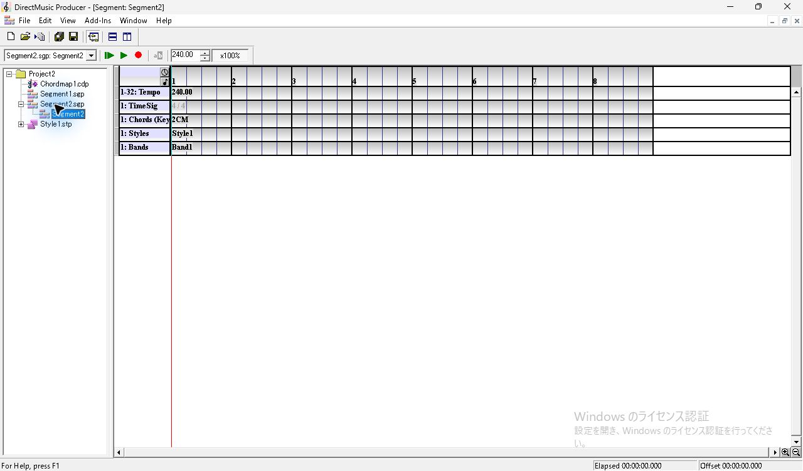
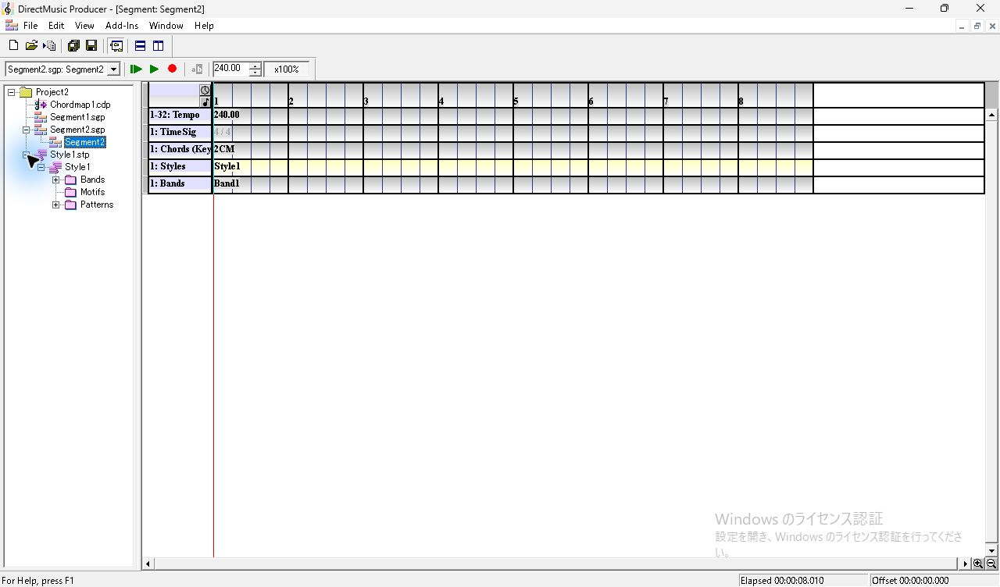
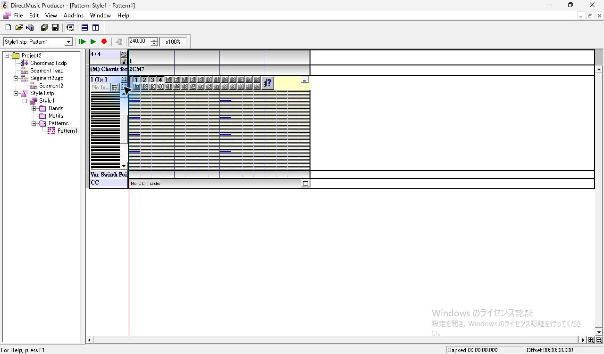
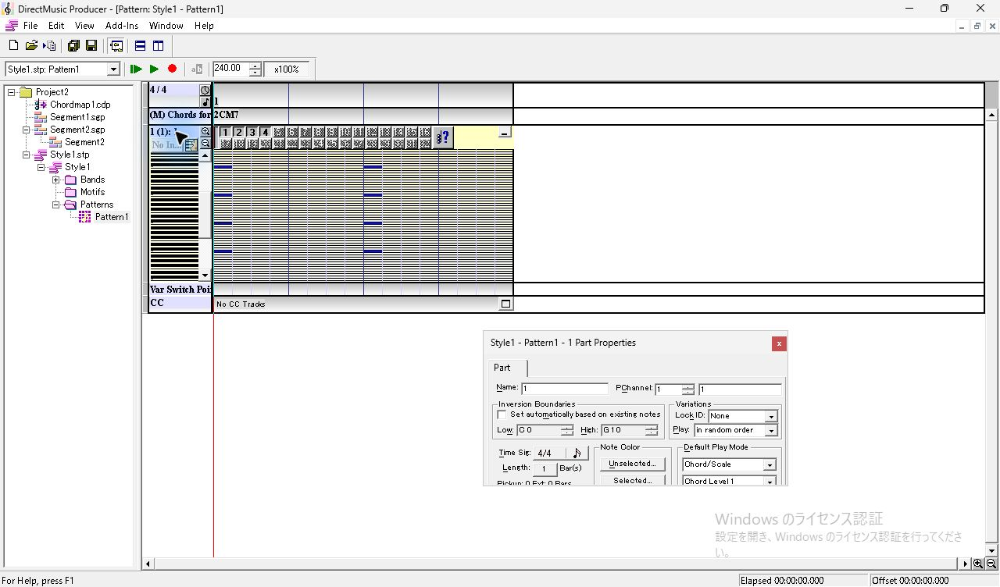

Pattern1 の各ノートを選んで **Pattern Note Properties > Variations/Flags** を開くと、クリックした音高と所属が同じウィンドウに表示された。音高と所属は RIFF のノートレコードでも照合した。

| Variation | Properties の音名 | Segment 再生時の MIDI キー |
| ---: | --- | ---: |
| 1 | C 4 | 48 |
| 2 | C 5 | 60 |
| 3 | C 6 | 72 |
| 4 | C 7 | 84 |

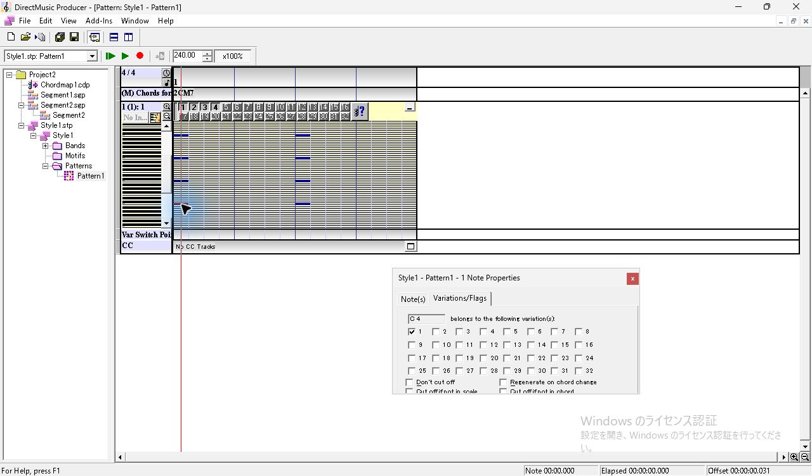

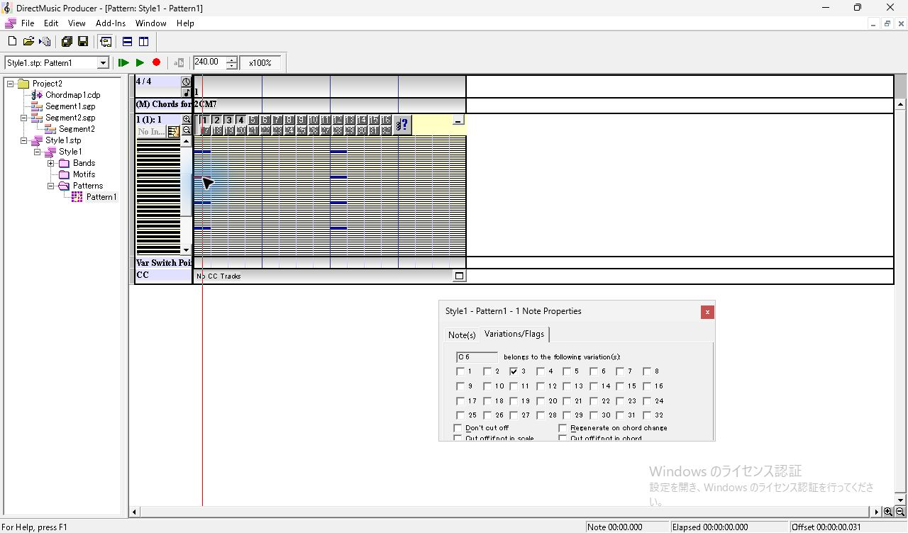
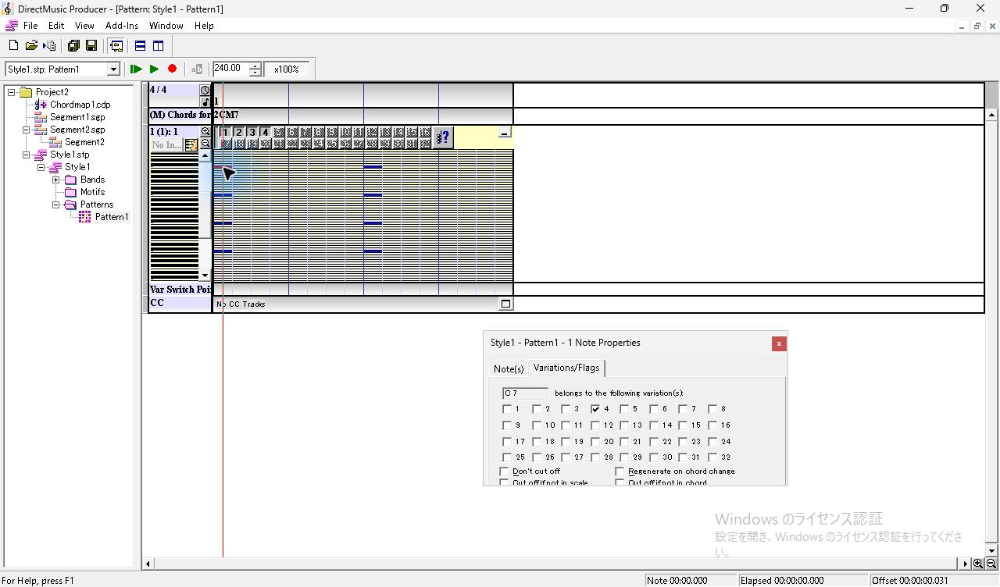

## Seed の入口と有効・無効

Segment2 の **Styles** ヘッダーを選んで F11。**Style Track Properties** は **Track Group Assignment、Flags、Seed Variations** の3タブ。**Seed Variations for Audition** の **Enable** がオンのとき **Generate New Seed** と **Edit Seed...** を押せる。オフにすると両ボタンの文字が灰色になる。Seed の数値は **Edit Variation Seed** で確認し、開いた時点で入力値全体が選択されていた。親の Properties はモーダルを閉じるまで操作不可。凍結版を開いた時点の値は0で Enable はオンだった。最初の再生比較は Enable をオフにして Ctrl+S した状態から実施した。 [同梱ヘルプ](../../../work/original-gui/SEG-14-pattern-style/20261111T074828536163Z/help/styletrackproperties.htm)

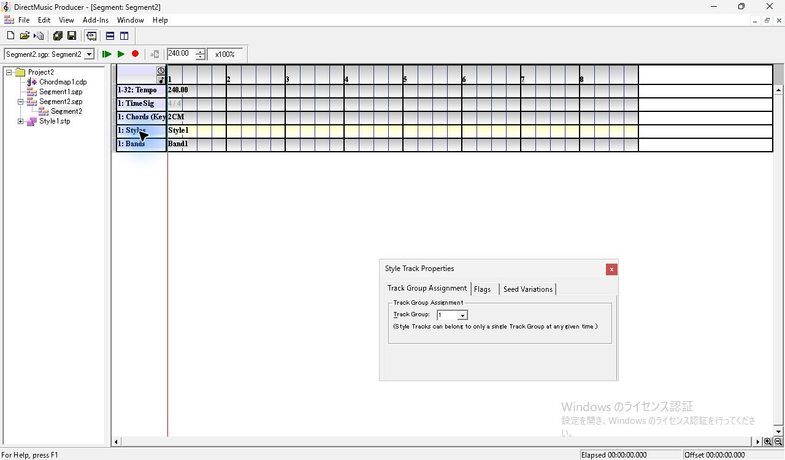

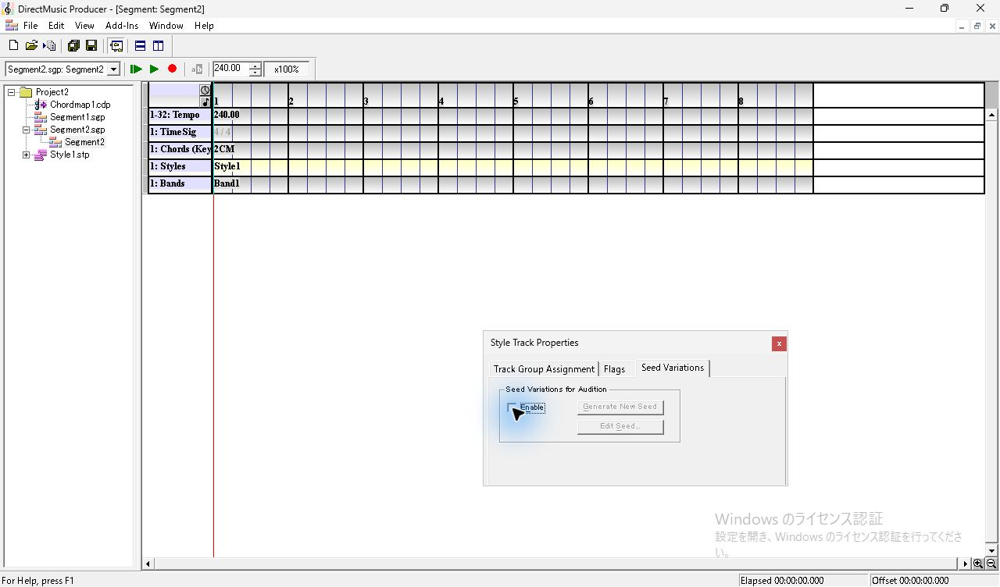
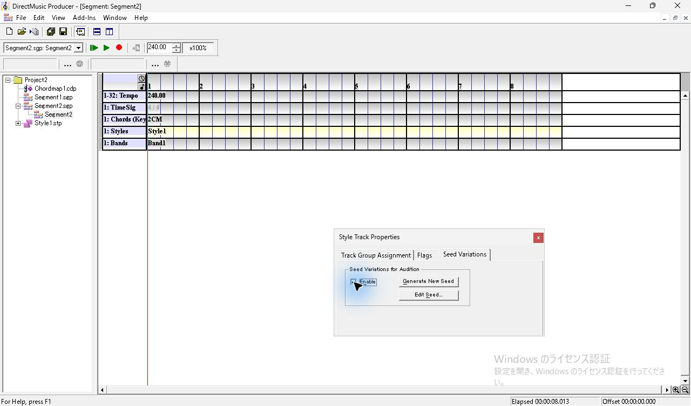
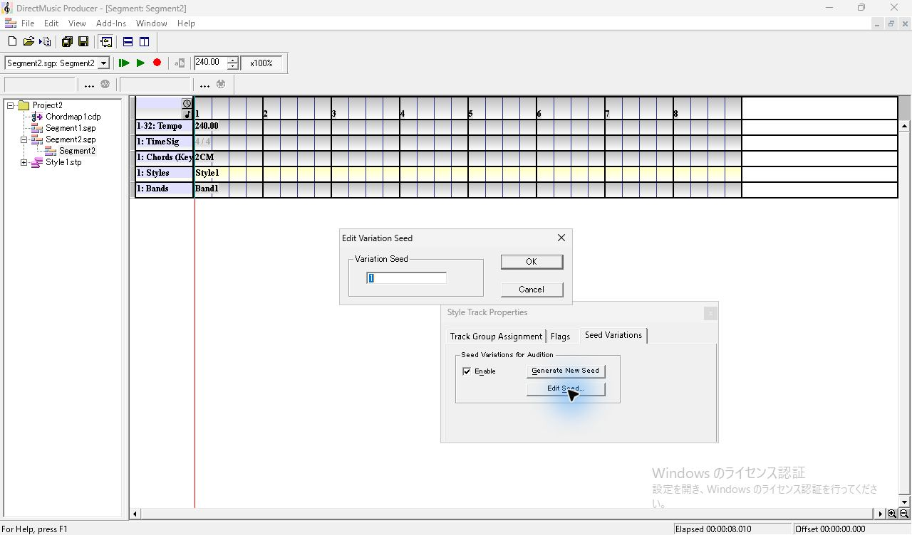

MIDI の記録中だけ **View > Wave/MIDI Export Toolbar** を表示。右側の **…** で名前を指定し、隣のボタンで記録待機にして **Play From Start**。自然終了まで各約8秒。全17本が **768 ticks/拍、テンポ250,000 µs/拍、チャンネル1**。各小節の **0 と1536 ticks** 相当の位置に同じ音高が1音ずつ出たので、以下の表は第1拍のキーだけを記す。 [全17本のイベントと比較](../../../work/original-gui/SEG-14-style-seed/20261111T180835698272Z/style-seed-audit.json)

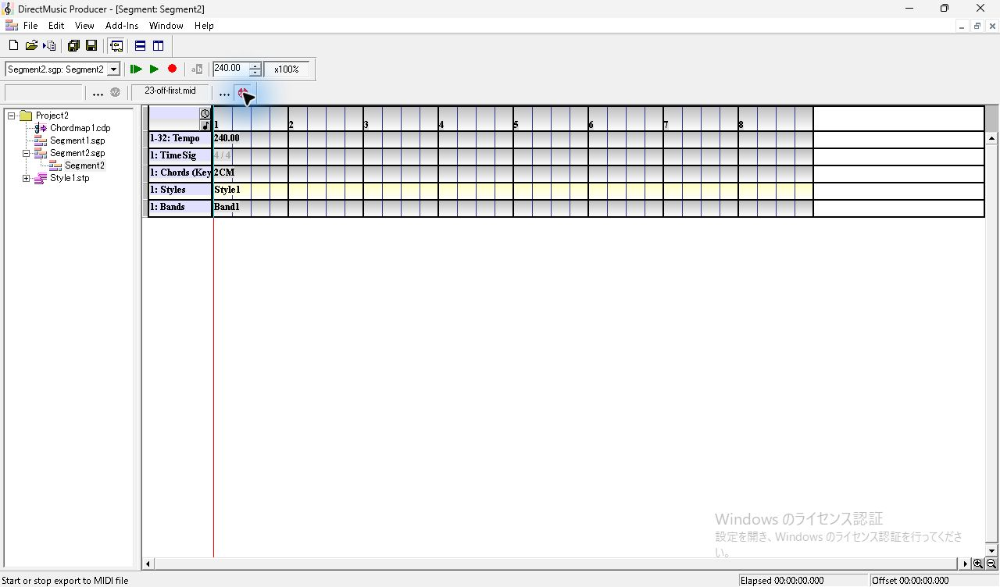

## 手入力と自動生成

| 設定 | 第1〜8小節の MIDI キー | 記録 |
| --- | --- | --- |
| Enable オフ・1回目 | 84, 48, 72, 48, 72, 72, 84, 60 | [MIDI](../../../work/original-gui/SEG-14-style-seed/20261111T180835698272Z/captures/23-off-first.mid) |
| Enable オフ・2回目 | 60, 60, 60, 60, 72, 48, 60, 72 | [MIDI](../../../work/original-gui/SEG-14-style-seed/20261111T180835698272Z/captures/24-off-replay.mid) |
| Enable オフ・3回目 | 72, 84, 84, 72, 72, 72, 60, 48 | [MIDI](../../../work/original-gui/SEG-14-style-seed/20261111T180835698272Z/captures/25-off-third.mid) |
| Seed 1 | 72, 84, 84, 60, 72, 60, 48, 84 | [初回](../../../work/original-gui/SEG-14-style-seed/20261111T180835698272Z/captures/36-seed1-first.mid) · [再生し直し](../../../work/original-gui/SEG-14-style-seed/20261111T180835698272Z/captures/37-seed1-replay.mid) |
| Seed 777 | 48, 72, 48, 72, 84, 48, 84, 84 | [初回](../../../work/original-gui/SEG-14-style-seed/20261111T180835698272Z/captures/46-seed777-first.mid) · [再生し直し](../../../work/original-gui/SEG-14-style-seed/20261111T180835698272Z/captures/47-seed777-replay.mid) |
| 生成した Seed 351406504 | 84, 84, 84, 84, 72, 84, 48, 60 | [初回](../../../work/original-gui/SEG-14-style-seed/20261111T180835698272Z/captures/65-generated-first.mid) · [再生し直し](../../../work/original-gui/SEG-14-style-seed/20261111T180835698272Z/captures/66-generated-replay.mid) |
| Seed 1 を再入力 | 72, 84, 84, 60, 72, 60, 48, 84 | [MIDI](../../../work/original-gui/SEG-14-style-seed/20261111T180835698272Z/captures/78-return-to-seed1.mid) |

Seed 無効の3回はすべて異なる列だった。**Edit Seed...** で1と777を入力し **OK** を押した場合は、値ごとの2回が一致した。777の状態から12345を入力して **Cancel** を押すと、再度開いたときの値は777だった。

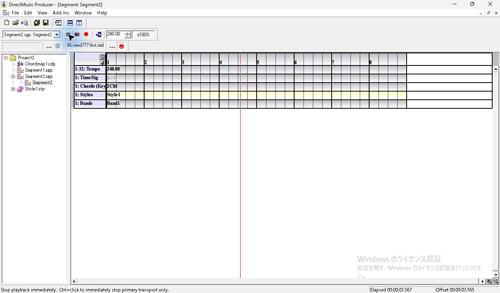

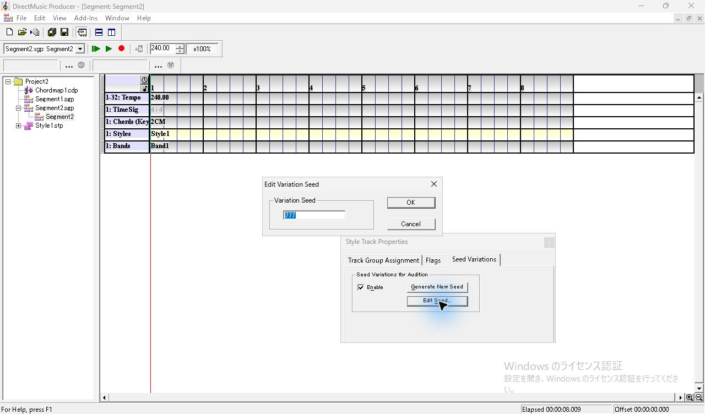

**Generate New Seed** を押すとフォーカスはボタンに残り、確認ダイアログは出なかった。直後に **Edit Seed...** で **351406504** を確認。このダイアログを Cancel で閉じて保存しても、自動生成値は保存ファイルに入った。この値で2回再生すると同じ列になった。Enable をオフ、オンの順に押し直すと、同じ生成値が残っていた。1を再入力した回は最初の Seed 1 と16件の Note On が一致した。

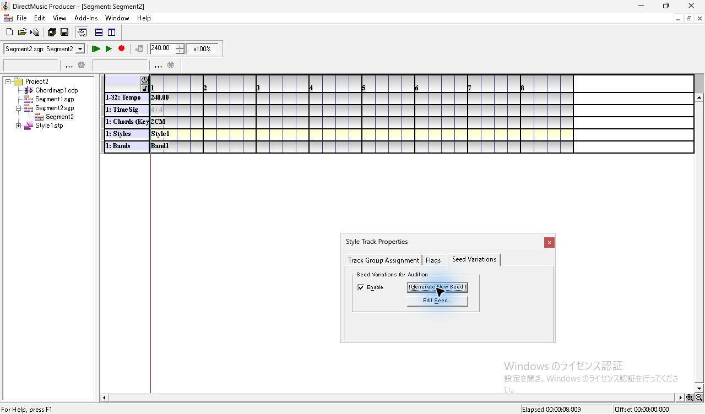

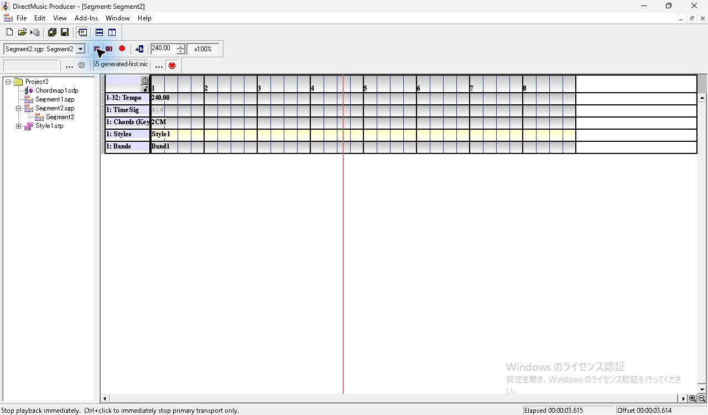
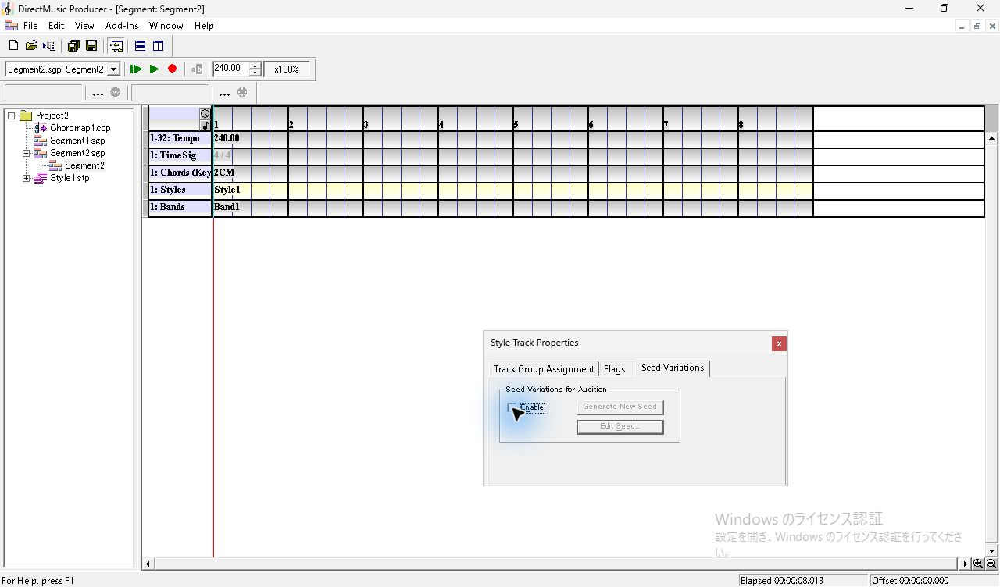
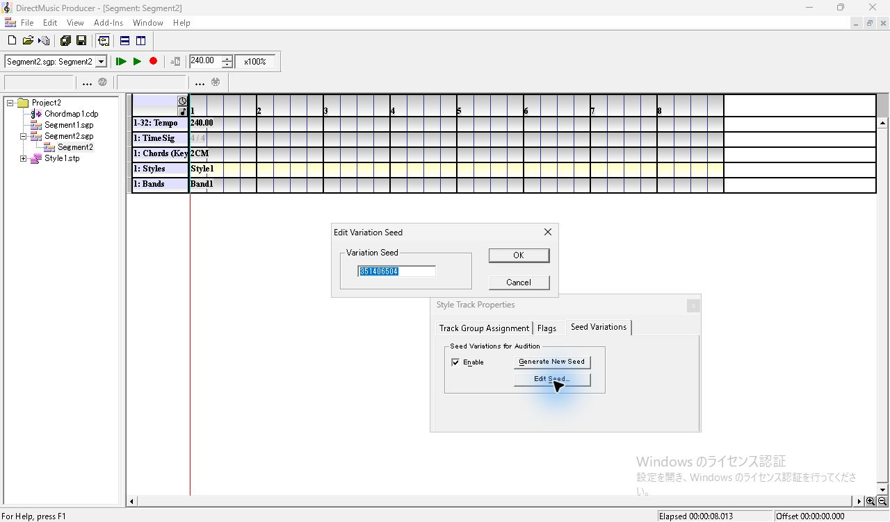

| 保存版 | RIFF の `psrd` にある2つの32-bit 値（Seed、Enable） |
| --- | --- |
| [無効](../../../work/original-gui/SEG-14-style-seed/20261111T180835698272Z/captures/seed-off-Segment2.sgp) | 0、0 |
| [Seed 1](../../../work/original-gui/SEG-14-style-seed/20261111T180835698272Z/captures/seed-one-Segment2.sgp) | 1、1 |
| [Seed 777](../../../work/original-gui/SEG-14-style-seed/20261111T180835698272Z/captures/seed-777-Segment2.sgp) | 777、1 |
| [自動生成値](../../../work/original-gui/SEG-14-style-seed/20261111T180835698272Z/captures/seed-generated-Segment2.sgp) | 351406504、1 |
| [Seed 1 再入力](../../../work/original-gui/SEG-14-style-seed/20261111T180835698272Z/captures/seed-one-restored-Segment2.sgp) | 1、1 |

上の5保存版は、`psrd` 以外のRIFFの内容が一致した。最初と再入力後の Seed 1 はファイル全体が一致。Style1 は試行の前後で同じハッシュだった。 [保存内容の照合](../../../work/original-gui/SEG-14-style-seed/20261111T180835698272Z/style-seed-audit.json)

## 別起動と同じプロセスでの Project 再読込

Seed 1 を保存して **File > Exit**。Producer が0件になったことを確認して同じ作業コピーを起動した。Project2 はツリーに戻り、Segment2 は開き直した。**Seed Variations** では Enable がオン、**Edit Seed** の値は1。Cancel で確認を閉じて記録した3回は、すべて異なる列で、再起動前の Seed 1 とも異なった。 [終了・再起動の記録](../../../work/original-gui/SEG-14-style-seed/20261111T180835698272Z/captures/116-relaunch.json)

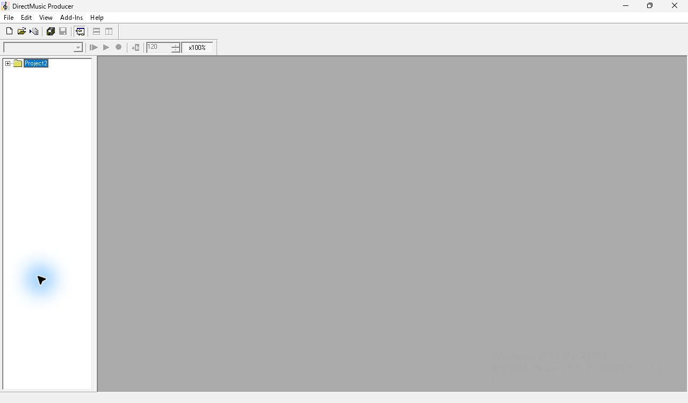
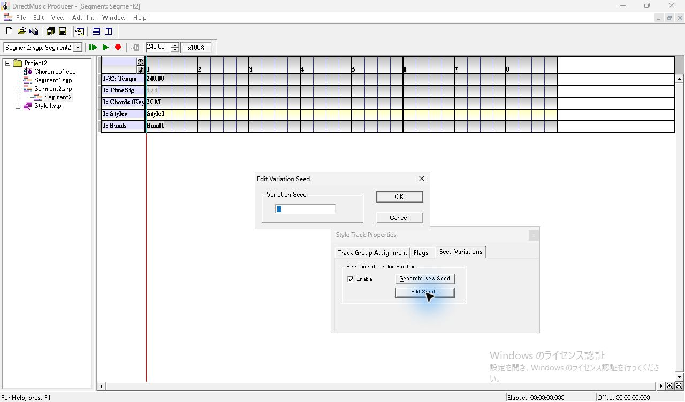

同じプロセス内で **Enable をオフ、オン** と押し直した。**Edit Seed** で1を確認して Cancel で閉じ、再生すると、2回とも再起動前の Seed 1 と一致した。次に Project2 を閉じる際の保存確認で **No**。同じプロセスのまま同じパスの Project2 を再読込すると、画面は Enable オンで値1。再読込直後の2回も異なる列になった。比較した範囲では、保存値の復元と試聴への反映の両方を確認するには、設定画面に加えて再生出力の確認が必要だった。 [再読込に指定したパス](../../../work/original-gui/SEG-14-style-seed/20261111T180835698272Z/captures/158-same-process-project-path.json)

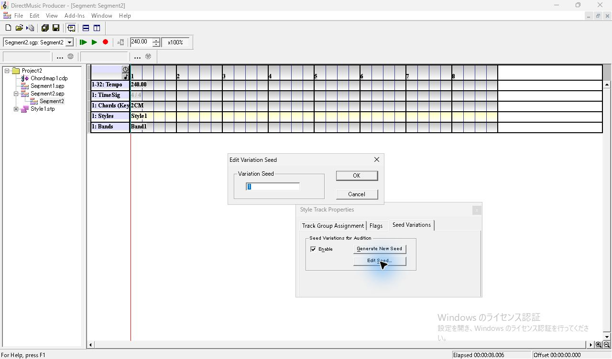

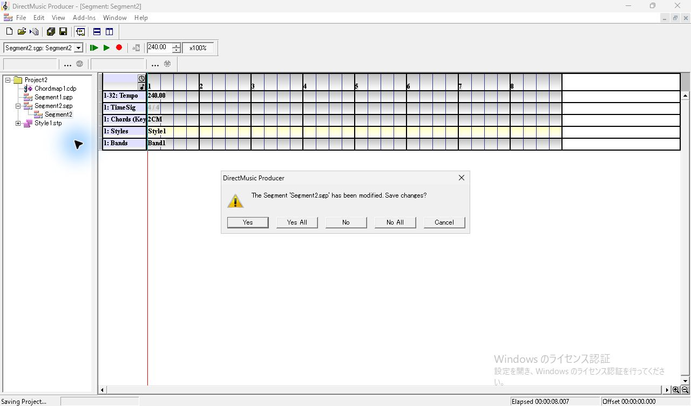
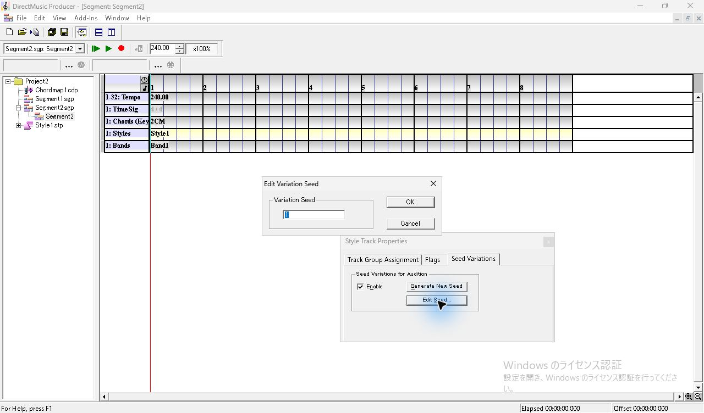

| 再読込後の操作 | 第1〜8小節の MIDI キー | 記録 |
| --- | --- | --- |
| Producer 再起動、設定操作なし・1回目 | 72, 60, 84, 60, 60, 60, 60, 48 | [MIDI](../../../work/original-gui/SEG-14-style-seed/20261111T180835698272Z/captures/131-seed1-new-process.mid) |
| Producer 再起動、設定操作なし・2回目 | 84, 72, 60, 72, 84, 72, 84, 84 | [MIDI](../../../work/original-gui/SEG-14-style-seed/20261111T180835698272Z/captures/138-seed1-new-process-replay.mid) |
| Producer 再起動、設定操作なし・3回目 | 84, 48, 84, 84, 72, 84, 84, 72 | [MIDI](../../../work/original-gui/SEG-14-style-seed/20261111T180835698272Z/captures/139-seed1-new-process-third.mid) |
| 再起動後に Enable をオフ、オン | 72, 84, 84, 60, 72, 60, 48, 84 | [初回](../../../work/original-gui/SEG-14-style-seed/20261111T180835698272Z/captures/149-seed1-after-enable-toggle.mid) · [再生し直し](../../../work/original-gui/SEG-14-style-seed/20261111T180835698272Z/captures/150-seed1-toggle-replay.mid) |
| 同じプロセスで Project を再読込・1回目 | 60, 60, 84, 84, 60, 72, 72, 84 | [MIDI](../../../work/original-gui/SEG-14-style-seed/20261111T180835698272Z/captures/171-seed1-same-process-reload.mid) |
| 同じプロセスで Project を再読込・2回目 | 72, 72, 84, 48, 48, 48, 72, 84 | [MIDI](../../../work/original-gui/SEG-14-style-seed/20261111T180835698272Z/captures/172-seed1-same-process-replay.mid) |

この結果は **Style 1件、Pattern 1件、固定コード、Repeat 0、Play From Start** の試聴に対応する。再読込後に **Edit Seed** の同値を OK で確定する経路、数値の上限、複数 Style を参照する場合、Segment のループ中に Seed が適用される位置は未観測。

## 終了時の状態

自然終了後は MIDI 出力欄が空になり、Transport は再生ボタンに戻った。書き出しツールバーを隠し、Project2 を閉じた。最後の Segment2 は保存した Seed 1 の版と全バイト一致。Producer は1件で、View の Project Tree、Standard Toolbar、Status Bar、Transport Controls がオン。 [終了時のウィンドウ](../../../work/original-gui/SEG-14-style-seed/20261111T180835698272Z/captures/180-final-windows.json)

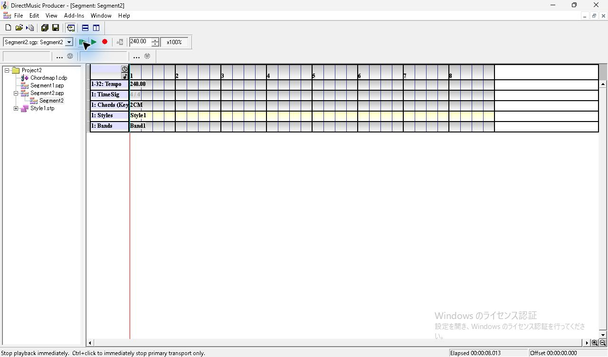
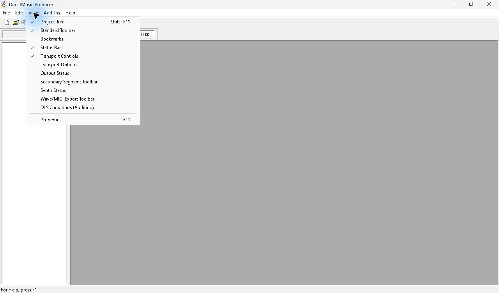
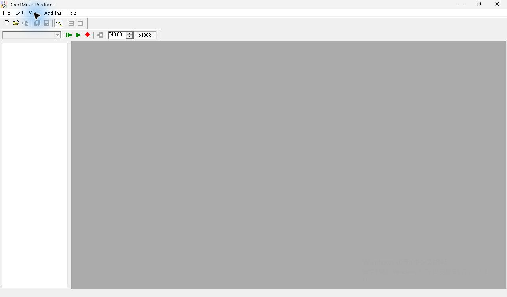

