# SEG-14　Segment Trigger の Align と Start at next marker

2026-11-12。DirectMusic Producer 5.3.0.900 の作業コピーで、Segment Trigger の **Boundary** を一つずつ切り替え、子 Segment の Note On を比較した。1280×752 px の撮影918枚から36枚を掲載。MIDI 23本、対応する親 SGP 23版、子 SGP 2版を照合した。青い光と太い黒矢印は操作ツールの表示。 [前回の同時発音試験](seg-14-trigger-simultaneous.md) · [凍結入力28件と実行ファイル](../../../work/original-gui/SEG-14-trigger-align/20261111T185020956917Z/run.json) · [画像の出典とハッシュ](../../../work/original-gui/SEG-14-trigger-align/20261111T185020956917Z/published-trigger-align-figures.json)

## 親の境界と子の識別音

前回の親と子を専用 Project に複製し、親 **BGDawn** を **4小節・4/4・100 BPM・Repeat 0**、子 **SSBird** を **2小節・4/4** にした。親の Segment Trigger は1件。ラベルは第2小節の第2拍にあり、**Segment/Motif Trigger Properties > Segment** の Start Time は **2:2:300**。`sgih` の所属は **3840**、実時刻は **4140 clocks**。**Secondary**、**Controlling Segment オフ**、**Quick Response** で比較した。

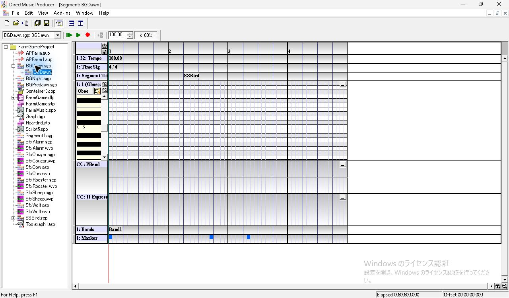
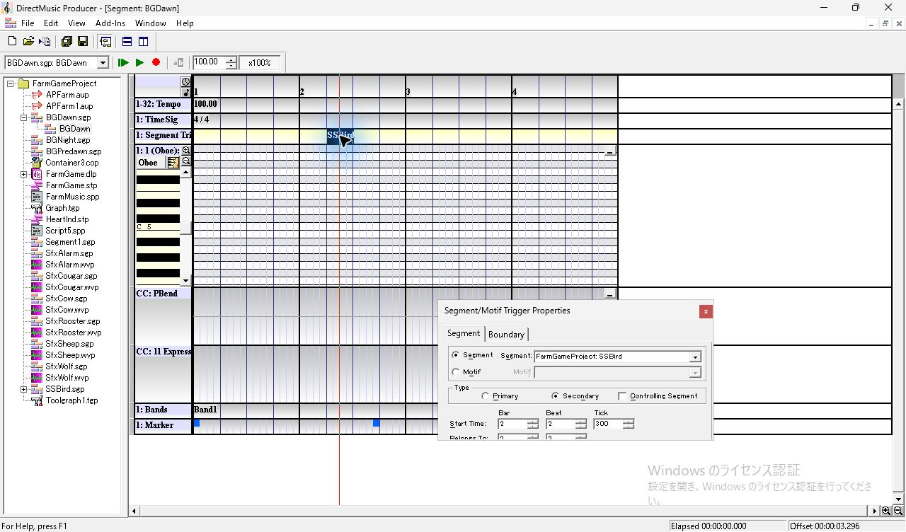
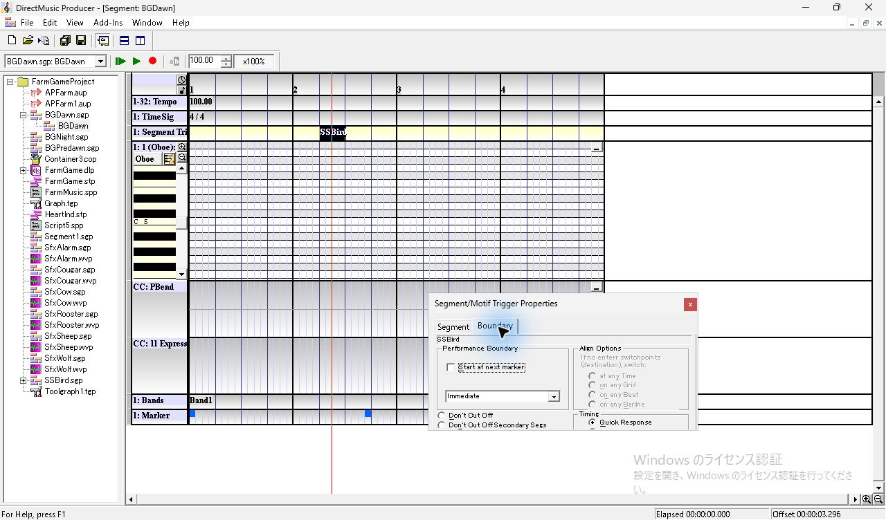
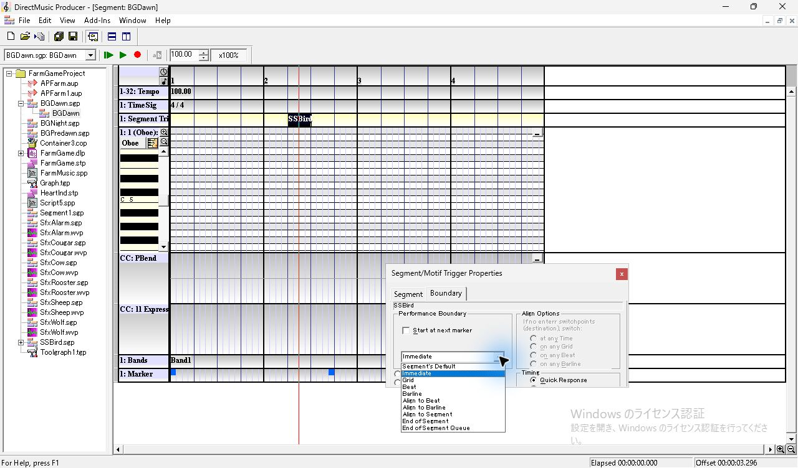

| 親の位置 | clocks |
| --- | ---: |
| 現在の小節先頭、第2小節 | 3072 |
| 現在の拍先頭、第2小節第2拍 | 3840 |
| トリガーの実時刻 | 4140 |
| 次の Grid | 4224 |
| 次の Beat | 4608 |
| 次の Marker | 5184 |
| 次の Barline、第3小節 | 6144 |

親の Marker 行には **0、5184、7104 clocks** の3点。5184は第2小節第3拍の最後のグリッドで、Beat と Barline から離れている。親 Sequence の PChannel 1、キー44を **192、7680 clocks** に置いた。子は PChannel 2、**192 clocks ごとに1音**、ローカル時刻0から5952までの32音。音高は **キー48〜79** で、キーから子のローカル時刻を特定できる。

初回の5条件の後に Project を閉じ、同じ子のコピーに **336 / キー84、1104 / キー85、4176 / キー86** の3音を追加した。各音は、対応する Align の起点を使うと親の **4176 clocks** に置かれる。トリガーの4140と次の Grid の4224の間に出る音で **at any Time** と **on any Grid** を区別する。子は Sequence で、Enter Switch Point を含まない。 [素材作成のスクリプト](../../../work/original-gui/SEG-14-trigger-align/20261111T185020956917Z/prepare-fixture.py) · [32音の子](../../../work/original-gui/SEG-14-trigger-align/20261111T185020956917Z/inputs/FarmGameProject/SSBird.sgp) · [3音を追加した子](../../../work/original-gui/SEG-14-trigger-align/20261111T185020956917Z/inputs/variants/grid-probes-SSBird.sgp)

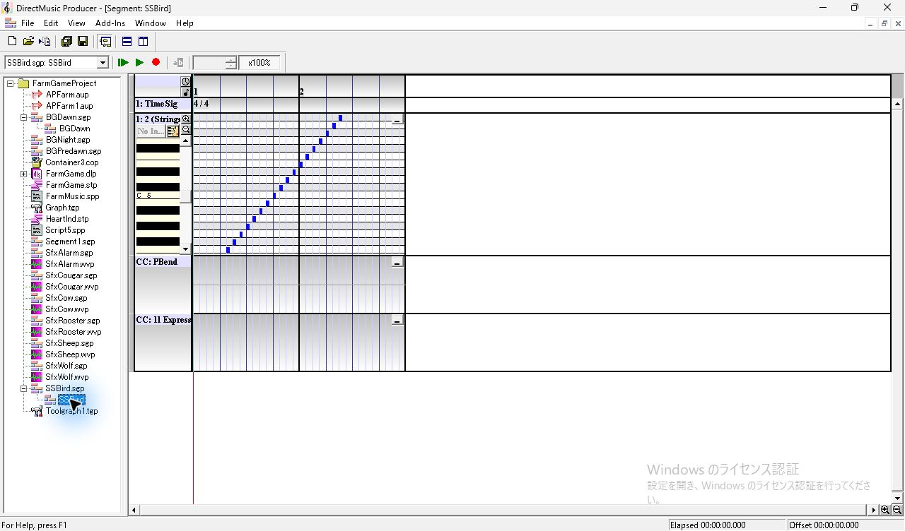
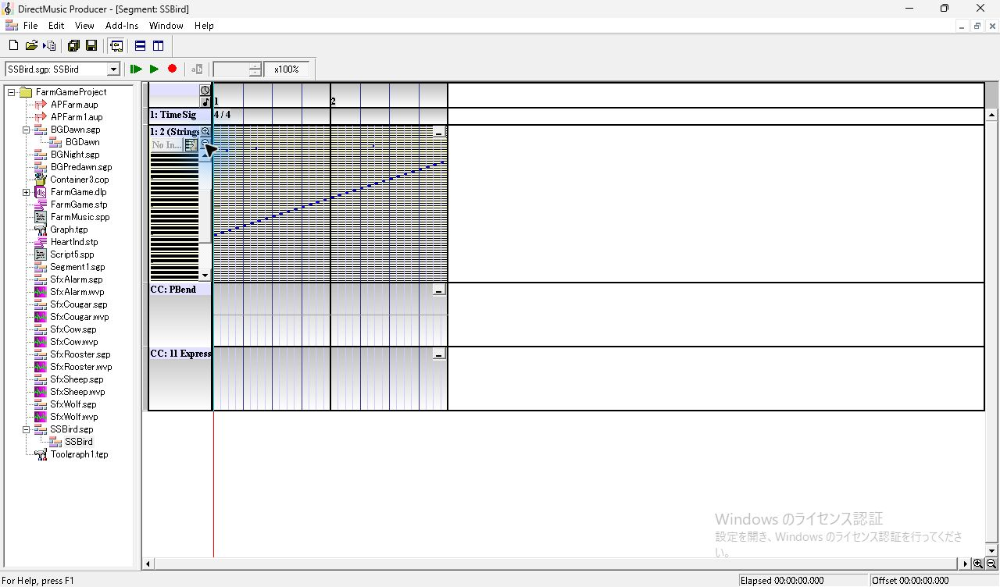
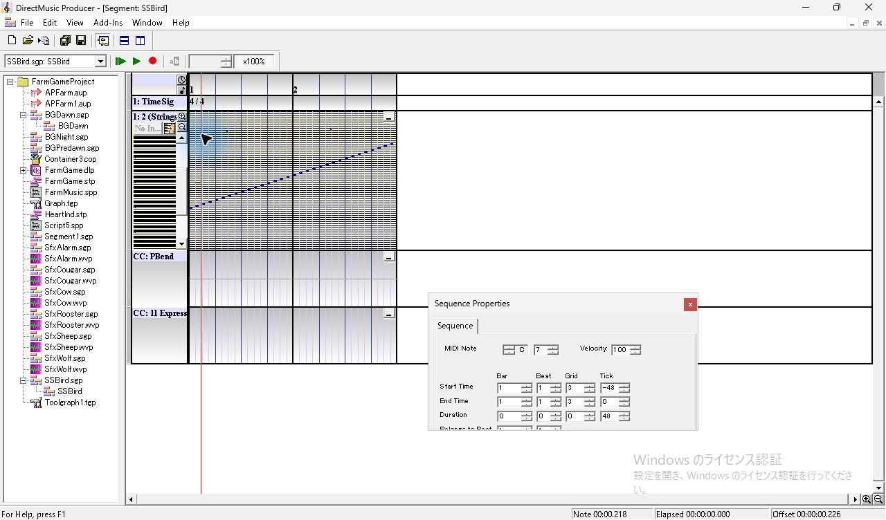

## 通常の Performance Boundary

**View > Wave/MIDI Export Toolbar** を表示し、ファイル名を指定して MIDI 記録を待機。**Play From Start** で BGDawn を自然終了まで再生した。全試行で MIDI は **768 ticks/拍、600,000 µs/拍**、親の2音は Ch. 1 の **192、7680 ticks** で一致。表の時刻と音数は子の Ch. 2 の Note On。子の起点は、各 Note On の時刻からそのキーのローカル時刻を引いて照合した。

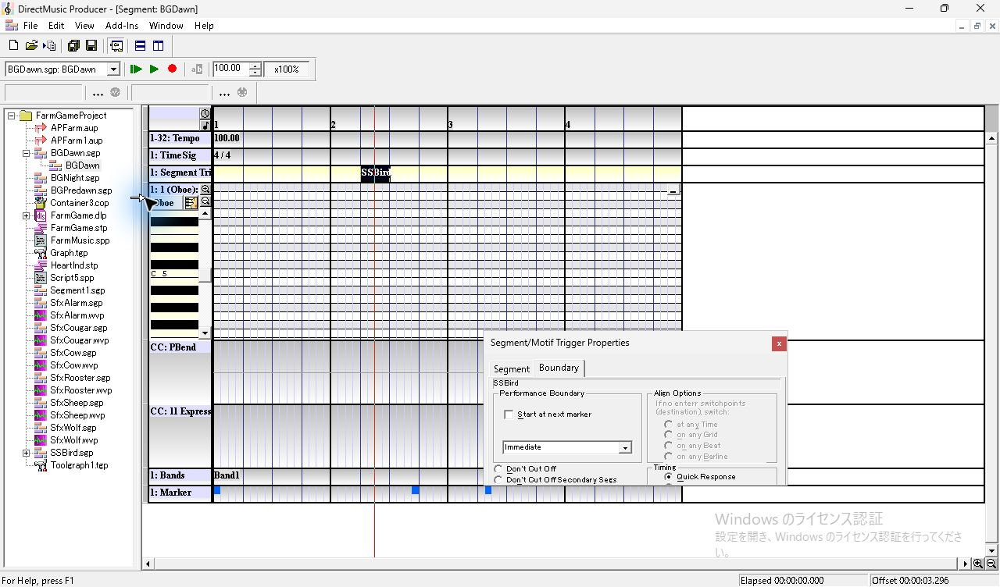
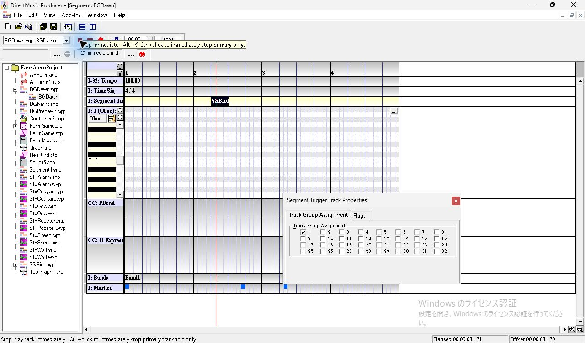

| Performance Boundary | 子の最初の Note On（ticks / キー） | 子の Note On 件数 | 記録 |
| --- | --- | ---: | --- |
| Immediate | 4140 / 48 | 32 | [MIDI](../../../work/original-gui/SEG-14-trigger-align/20261111T185020956917Z/captures/21-immediate.mid) |
| Grid | 4224 / 48 | 32 | [MIDI](../../../work/original-gui/SEG-14-trigger-align/20261111T185020956917Z/captures/22-grid.mid) |
| Beat | 4608 / 48 | 32 | [MIDI](../../../work/original-gui/SEG-14-trigger-align/20261111T185020956917Z/captures/23-beat.mid) |
| Barline | 6144 / 48 | 32 | [MIDI](../../../work/original-gui/SEG-14-trigger-align/20261111T185020956917Z/captures/24-barline.mid) |

いずれもキー48から始まり、子のローカル0を表の親時刻に置いた。トリガーのラベルと Start Time は設定を切り替えても同じだった。

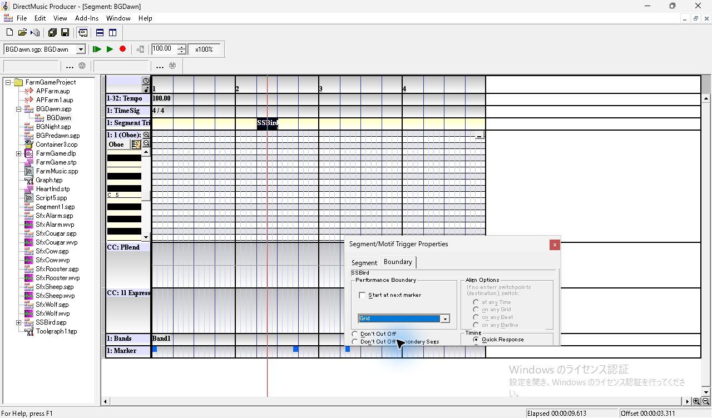

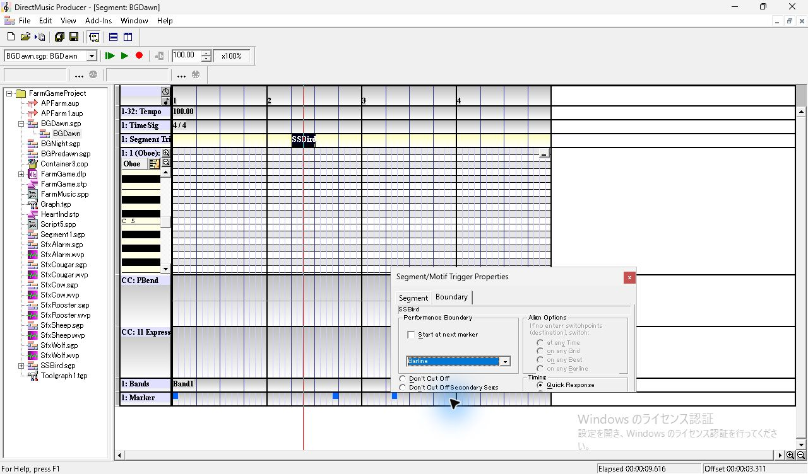

## Align の起点と子の先頭で省かれる音

**Align to Beat、Align to Barline、Align to Segment** を選ぶと、右側の **Align Options** にある **at any Time、on any Grid、on any Beat、on any Barline** が有効になり、**Start at next marker** は灰色になった。右側の説明は **If no enter switchpoints (destination), switch:**。初回に **Align to Beat / on any Grid** を試すと、通常の Grid と同じ4224 ticksで始まり、最初のキーは50、音数は30件。子のローカル0は前の拍先頭3840に対応し、最初の2音が出なかった。この設定は Project を閉じて再読込した後も画面に復元した。 [初回の Align to Beat / on any Grid](../../../work/original-gui/SEG-14-trigger-align/20261111T185020956917Z/captures/25-align-beat-grid.mid) · [同梱ヘルプの Align Options](../../../../../work/analysis/original-manual-session/20261010T031624075Z/help-extracted/htm/alignoptions.htm) · [Performance Boundary](../../../../../work/analysis/original-manual-session/20261010T031624075Z/help-extracted/htm/performanceboundaryoptions.htm)

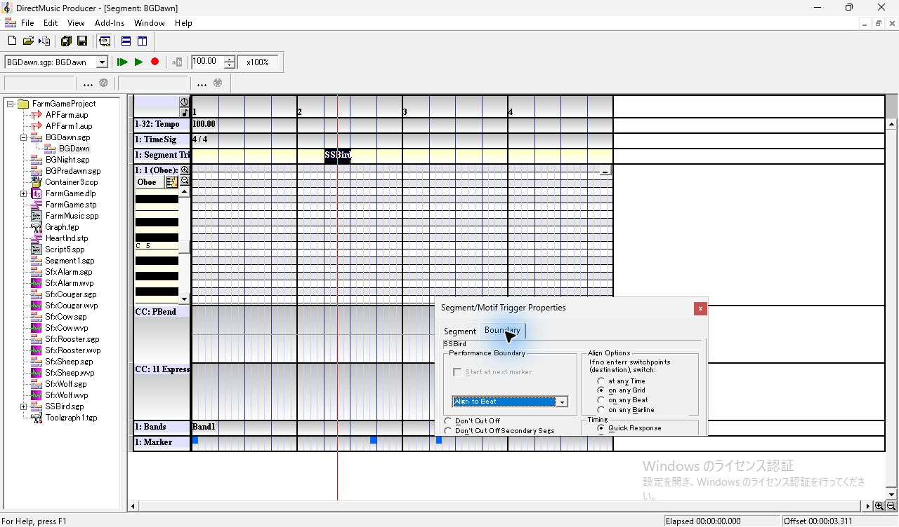

以下はグリッド間の識別音を追加した35音の子を使用。**子の起点** は、MIDI の各音から照合した子のローカル0に対応する親時刻。実際の最初の発音時刻は隣の列に示す。保存値はトリガー項目の `sgih` フラグ。

| Performance Boundary | Align Options | 子の起点 | 最初の Note On（ticks / キー） | 件数 | 保存フラグ | 記録 |
| --- | --- | ---: | --- | ---: | --- | --- |
| Align to Beat | at any Time | 3840 | 4176 / 84 | 33 | `0x00091080` | [MIDI](../../../work/original-gui/SEG-14-trigger-align/20261111T185020956917Z/captures/35-align-beat-any.mid) |
| Align to Beat | on any Grid | 3840 | 4224 / 50 | 32 | `0x00051080` | [MIDI](../../../work/original-gui/SEG-14-trigger-align/20261111T185020956917Z/captures/36-align-beat-grid-probes.mid) |
| Align to Beat | on any Beat | 4608 | 4608 / 48 | 35 | `0x00031080` | [MIDI](../../../work/original-gui/SEG-14-trigger-align/20261111T185020956917Z/captures/37-align-beat-beat.mid) |
| Align to Beat | on any Barline | 4608 | 4608 / 48 | 35 | `0x08011080` | [MIDI](../../../work/original-gui/SEG-14-trigger-align/20261111T185020956917Z/captures/38-align-beat-bar.mid) |
| Align to Barline | at any Time | 3072 | 4176 / 85 | 28 | `0x00092080` | [MIDI](../../../work/original-gui/SEG-14-trigger-align/20261111T185020956917Z/captures/39-align-bar-any.mid) |
| Align to Barline | on any Grid | 3072 | 4224 / 54 | 27 | `0x00052080` | [MIDI](../../../work/original-gui/SEG-14-trigger-align/20261111T185020956917Z/captures/40-align-bar-grid.mid) |
| Align to Barline | on any Beat | 3072 | 4608 / 56 | 25 | `0x00032080` | [MIDI](../../../work/original-gui/SEG-14-trigger-align/20261111T185020956917Z/captures/41-align-bar-beat.mid) |
| Align to Barline | on any Barline | 6144 | 6144 / 48 | 35 | `0x08012080` | [MIDI](../../../work/original-gui/SEG-14-trigger-align/20261111T185020956917Z/captures/42-align-bar-bar.mid) |
| Align to Segment | at any Time | 0 | 4176 / 86 | 11 | `0x00890080` | [MIDI](../../../work/original-gui/SEG-14-trigger-align/20261111T185020956917Z/captures/43-align-segment-any.mid) |
| Align to Segment | on any Grid | 0 | 4224 / 70 | 10 | `0x00850080` | [MIDI](../../../work/original-gui/SEG-14-trigger-align/20261111T185020956917Z/captures/44-align-segment-grid.mid) |
| Align to Segment | on any Beat | 0 | 4608 / 72 | 8 | `0x00830080` | [MIDI](../../../work/original-gui/SEG-14-trigger-align/20261111T185020956917Z/captures/45-align-segment-beat.mid) |
| Align to Segment | on any Barline | — | なし | 0 | `0x08810080` | [MIDI](../../../work/original-gui/SEG-14-trigger-align/20261111T185020956917Z/captures/46-align-segment-bar.mid) |

### Align to Beat

**at any Time** では4176のキー84が出た。**on any Grid** ではこの識別音を飛ばし、4224のキー50から出た。両条件でそれ以降のキーと時刻は一致。**on any Beat** と **on any Barline** は保存フラグが異なり、両方とも次の Beat の4608から先頭のキー48を含む35音が出た。

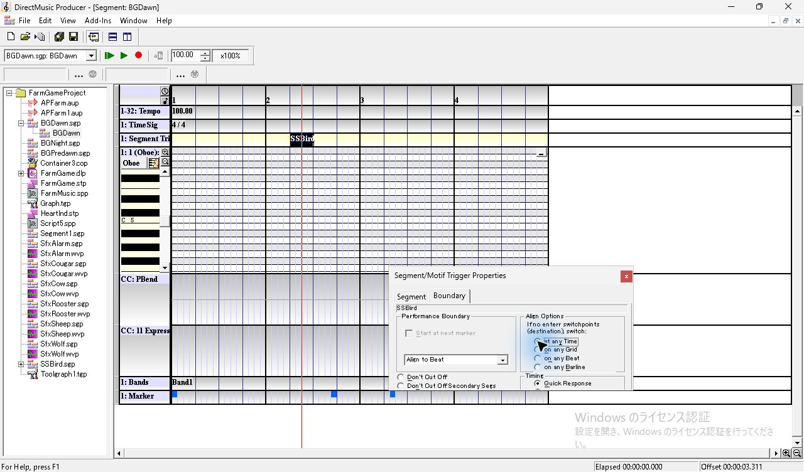

### Align to Barline

**at any Time、on any Grid、on any Beat** はいずれも子の起点が3072で、最初に出る音は4176のキー85、4224のキー54、4608のキー56。**on any Barline** は次の小節先頭6144から子の最初の音が出た。

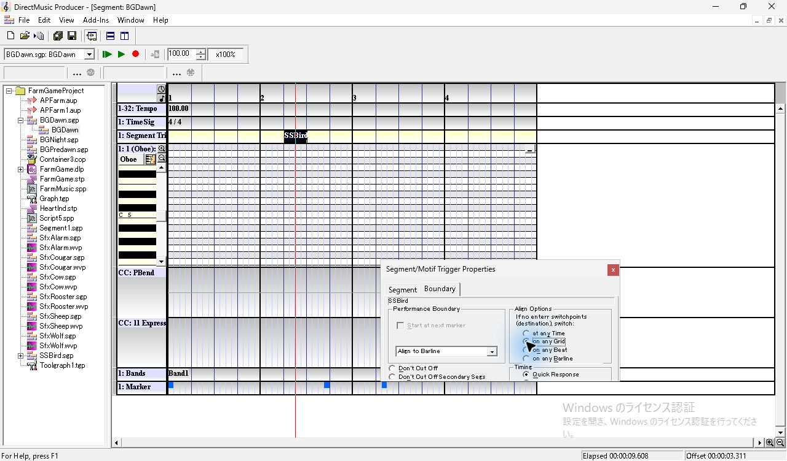

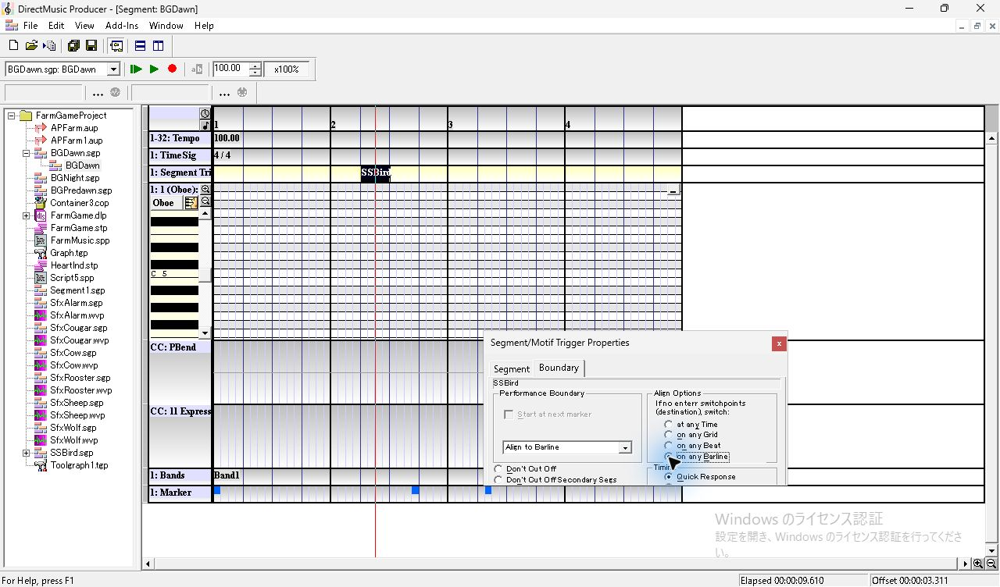

### Align to Segment

最初の3条件は親の0に子のローカル0が対応し、最後のキー79はすべて5952 ticks。**on any Barline** では子の Note On が0件。親の次の小節線は6144で、子を親の0に重ねた場合の終端に当たる。親の2音と自然終了は確認した。子の再生開始通知は未計測。

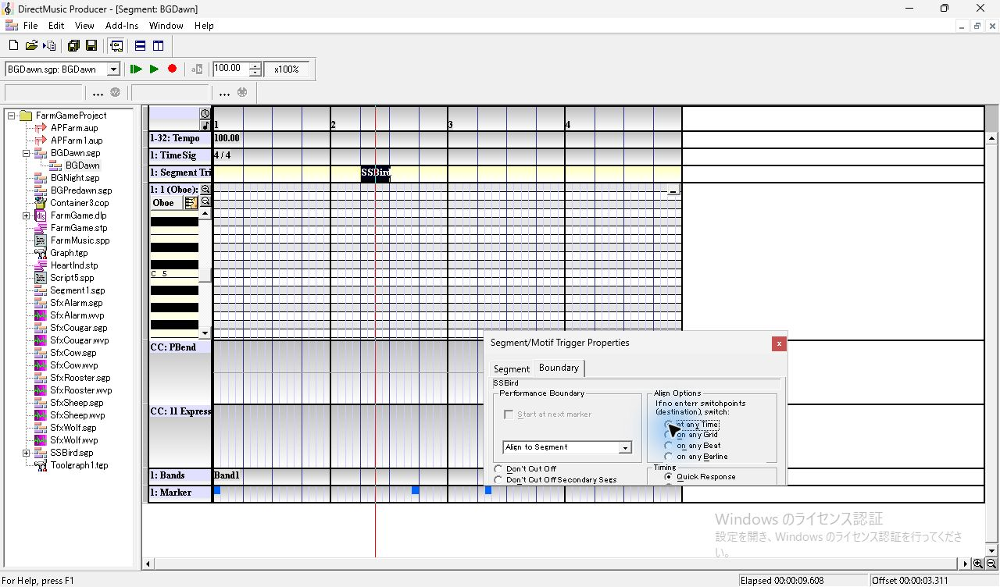
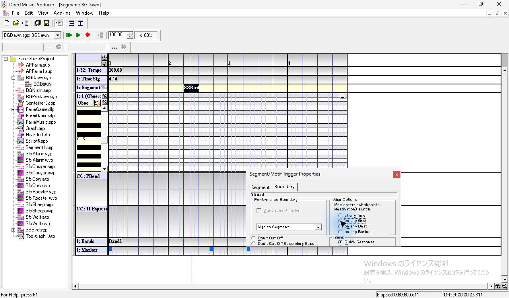

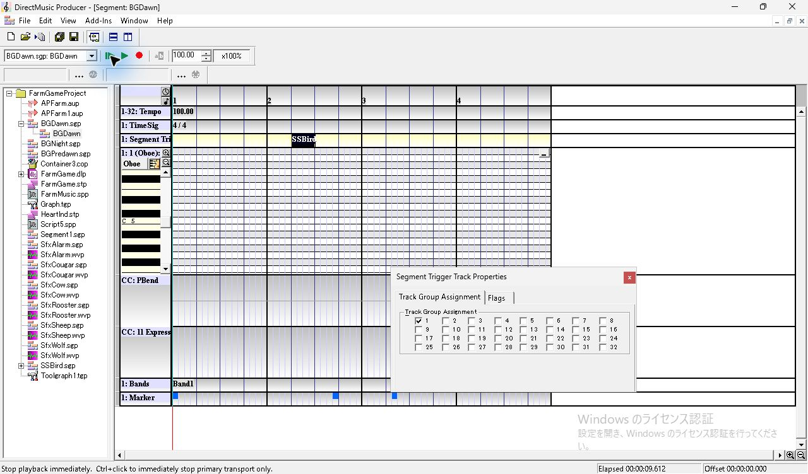

## Start at next marker と代替境界

**Immediate** に戻して **Start at next marker** をオンにすると、一覧の上に **If no markers, start:** が現れた。この状態で **Immediate、Grid、Beat、Barline** を選んだ4回は、いずれも次の Marker **5184** で子のキー48から35音が出た。保存フラグには境界ごとの値に加えて `0x01000000` があった。

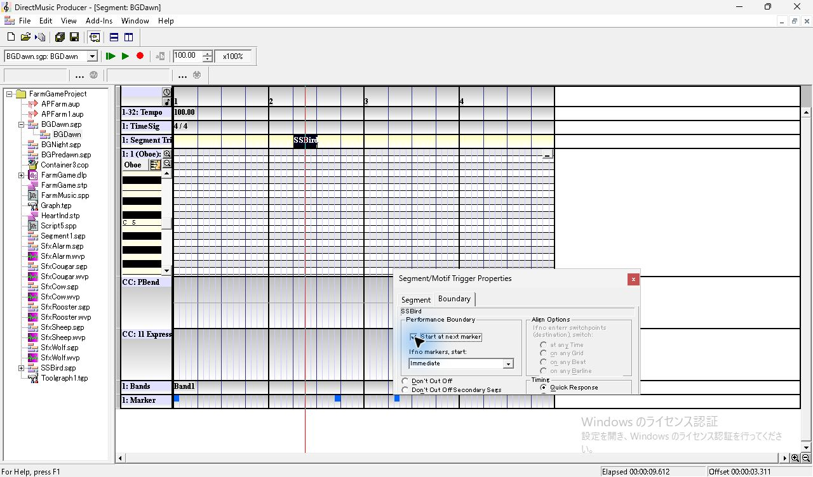

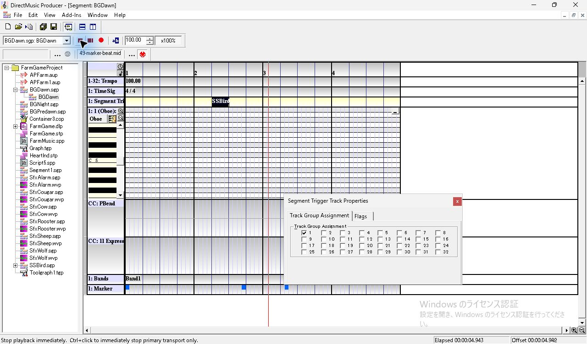

Project を閉じ、**Beat + Marker オン** の保存版の Marker Track だけを差し替え、親の **0** にある Marker を残した。Trigger のバイト列を含む他のトラックは同一。再読込後もチェックと **Beat** が復元された。後続 Marker がない状態で再生すると **4608** から、同じ状態で代替境界を **Barline** に変更すると **6144** から、子の先頭音が出た。 [Marker だけを差し替えるスクリプト](../../../work/original-gui/SEG-14-trigger-align/20261111T185020956917Z/prepare-marker-control.py) · [後続 Marker がない Beat の保存版](../../../work/original-gui/SEG-14-trigger-align/20261111T185020956917Z/captures/55-marker-beat-only-past-BGDawn.sgp) · [後続 Marker がない Barline の保存版](../../../work/original-gui/SEG-14-trigger-align/20261111T185020956917Z/captures/62-marker-barline-only-past-BGDawn.sgp)

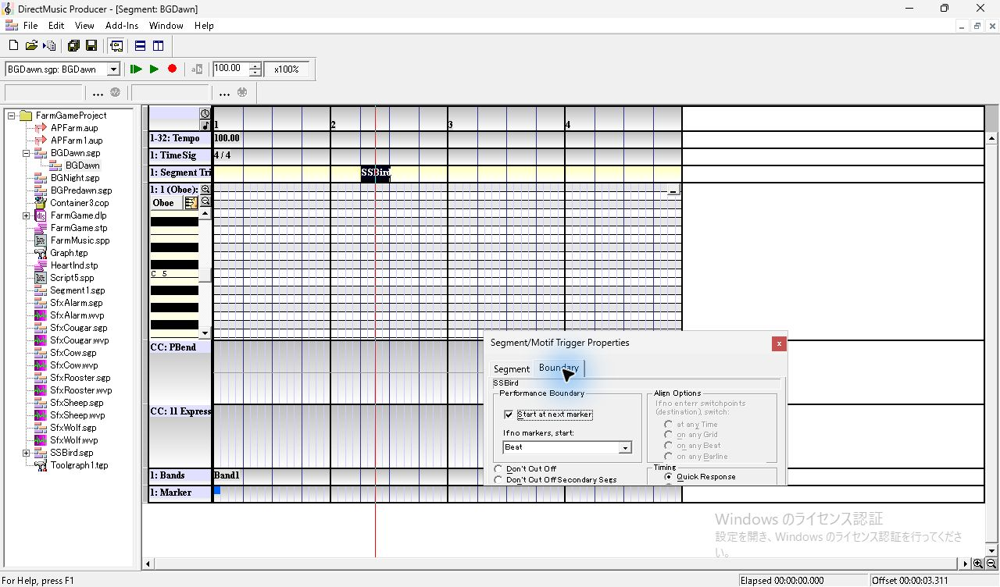

| Marker の位置 | If no markers, start | 最初の Note On（ticks / キー） | 子の件数 | 記録 |
| --- | --- | --- | ---: | --- |
| 後続あり | Immediate | 5184 / 48 | 35 | [MIDI](../../../work/original-gui/SEG-14-trigger-align/20261111T185020956917Z/captures/47-marker-immediate.mid) |
| 後続あり | Grid | 5184 / 48 | 35 | [MIDI](../../../work/original-gui/SEG-14-trigger-align/20261111T185020956917Z/captures/48-marker-grid.mid) |
| 後続あり | Beat | 5184 / 48 | 35 | [MIDI](../../../work/original-gui/SEG-14-trigger-align/20261111T185020956917Z/captures/49-marker-beat.mid) |
| 後続あり | Barline | 5184 / 48 | 35 | [MIDI](../../../work/original-gui/SEG-14-trigger-align/20261111T185020956917Z/captures/50-marker-barline.mid) |
| 先頭のみ | Beat | 4608 / 48 | 35 | [MIDI](../../../work/original-gui/SEG-14-trigger-align/20261111T185020956917Z/captures/61-marker-beat-only-past.mid) |
| 先頭のみ | Barline | 6144 / 48 | 35 | [MIDI](../../../work/original-gui/SEG-14-trigger-align/20261111T185020956917Z/captures/62-marker-barline-only-past.mid) |

全条件の Note On と親 SGP のフラグ、トリガーの実時刻、Marker の位置は監査記録から照合できる。時刻は MIDI イベントに基づく。この試行では音声波形、Primary、Controlling Segment、子の Enter Switch Point を扱っていない。続く試行で子の Marker トラックに Enter Switch Point を置き、代替境界との優先順を照合した。別の試行で Primary、Secondary、Controlling Segment を切り替え、親子の発音と MIDI のテンポを比べた。 [子の Enter Switch Point](seg-14-trigger-enter.md) · [Primary と Controlling Segment](seg-14-trigger-primary-control.md) · [SGP と MIDI の照合](../../../work/original-gui/SEG-14-trigger-align/20261111T185020956917Z/trigger-align-audit.json)

## 終了時の状態

書き出しツールバーを隠し、Project を閉じた。作業コピーに残した親は **後続 Marker なし、Barline** の最終保存版、子は識別音を追加した版。凍結入力は28件ともハッシュが一致した。Producer は開始時と同じ1件、View は Project Tree、Standard Toolbar、Status Bar、Transport Controls の4項目。 [終了時のウィンドウ](../../../work/original-gui/SEG-14-trigger-align/20261111T185020956917Z/captures/81-final-windows.json)

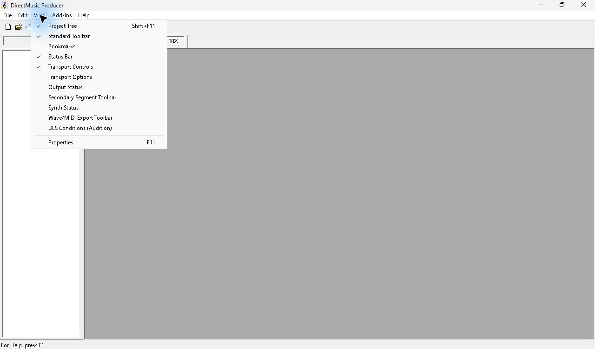
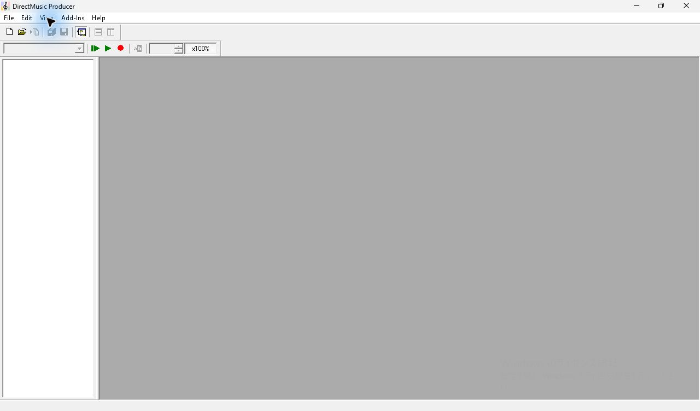

