# SEG-14　Segment Trigger のドラッグ、貼り付け、同じ拍での選択

2026-11-12 に DirectMusic Producer の調査用コピーで確認した。画像は 1280 × 752 の27枚。青い光と太い矢印は操作ツールが描画するポインター位置で、Windows が報告したカーソル形状は別途採取した。

## 比較条件

前回の[元の SSBird と accordion の同時発音](seg-14-trigger-original-audio.md)の凍結 Project を複製した。親は4小節、4/4、100 BPM、Repeat 0 の BGDawn。元の SSBird と Heartlnd の演奏データを使い、親の Segment Trigger 内で Motif の Belongs To と Start Time を **2:2** から **3:2** の拍へ移した。Segment Trigger は Group 1。2件とも **Secondary**、**Immediate**、**Quick Response**、Controlling Segment はオフ。

| ラベル | 参照 | 所属拍 | Start Time（小節:拍:Tick） |
| --- | --- | --- | --- |
| SSBird | Segment の `SSBird.sgp` | 2:2 | 2:2:300 |
| accordion (Heartland) | Style の `Heartlnd.stp` にある `accordion` | 3:2 | 3:2:300 |

両ラベルは所属拍の左端から描かれる。約38 px の1拍に収まりきらない `accordion (Heartland)` は右の拍にもはみ出す。Properties を開くと Start Time に Tick 300 が表示される。 [時刻と所属拍の基礎調査](seg-14-segment-trigger.md) · [比較素材の作成手順](../../../work/original-gui/SEG-14-trigger-drag/20261111T213853601014Z/prepare-fixture.py)

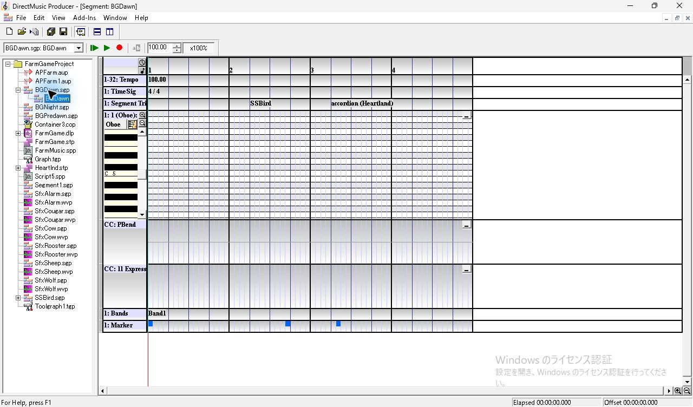

## 左ドラッグの押下位置と解放後の状態

下表の座標は画像の左上を原点とする px。空の **4:3** の解放先は `(808, 191)`。フォーカスのあるストリップは淡い黄色、選択範囲は濃紺になる。

| 押下位置 | 解放位置 | 解放後の表示と選択 |
| --- | --- | --- |
| 未選択の SSBird、`(476, 191)` | 空の4:3 | 2:2 の SSBird が選ばれる。赤い位置線は押下した x へ動く。F11 の Properties は Segment／SSBird／**2:2:300**。 |
| 選択中の SSBird、`(463, 191)` | 空の4:3 | 同じラベルが選択されたまま。位置線は新しい押下位置へ動く。 |
| Motif の所属拍内の先頭文字、`(620, 191)` | 空の4:3 | ラベル全体が濃紺地の白文字になる。Properties は Motif／Heartland 4/4／accordion／**3:2:300**。 |
| Motif が隣の拍にはみ出した文字、`(684, 191)` | 空の4:3 | 押下した隣の拍に濃紺の矩形が出る。文字は矩形との重なり部分だけ反転し、Properties の項目は空欄で無効。 |
| Motif の直前の空セル、`(596, 191)` | 空の4:3 | 押下した空セルが濃紺になる。Properties の項目は空欄で無効。 |
| Motif の先頭文字、`(620, 191)` | SSBird 上の `(479, 191)` | Motif が元の位置で選ばれたまま。SSBird に重なる項目は増えず、文字は両方とも直立。 |
| Motif の先頭文字、`(620, 191)` | 下の Sequence の `(808, 258)` | Sequence が淡い黄色になり、ダイアログは空の **Sequence Properties** に切り替わる。赤い位置線は押下した x に残る。 |

空セルに向けた一連の操作と、既存項目や Sequence まで横断した一連の操作の後でそれぞれ保存した。2つの保存ファイルは同じ SHA-256 で、開始時の2件と照合して所属拍、Start Time、参照が一致した。Sequence の保存データも一致した。 [保存値の一覧](#保存値と証拠)

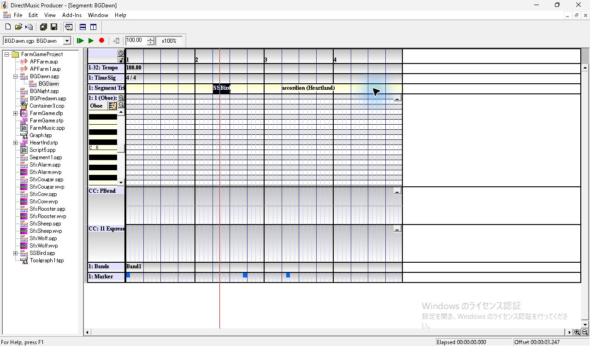
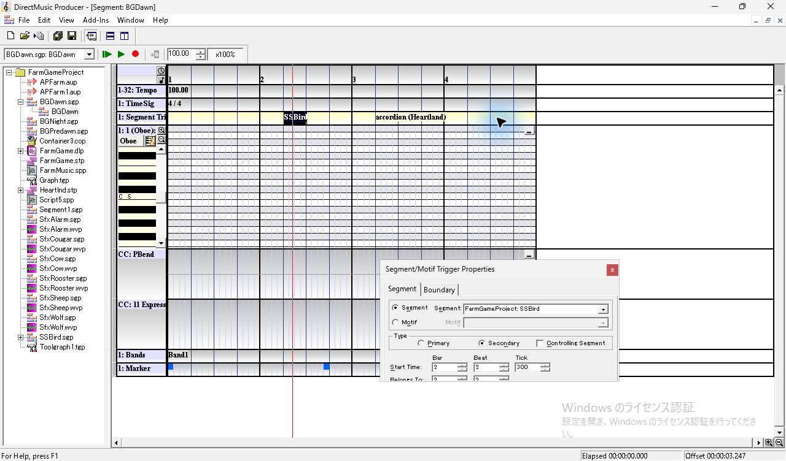
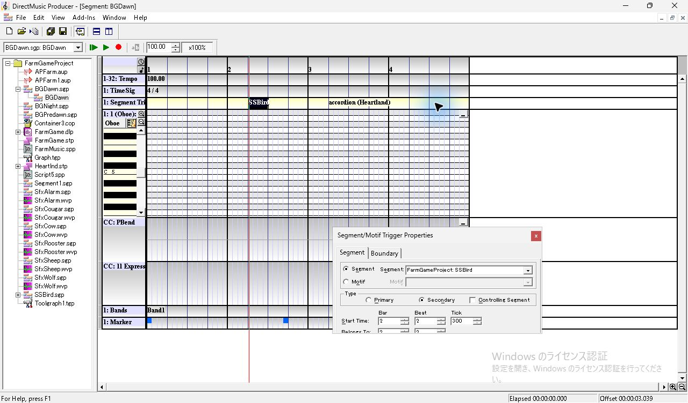
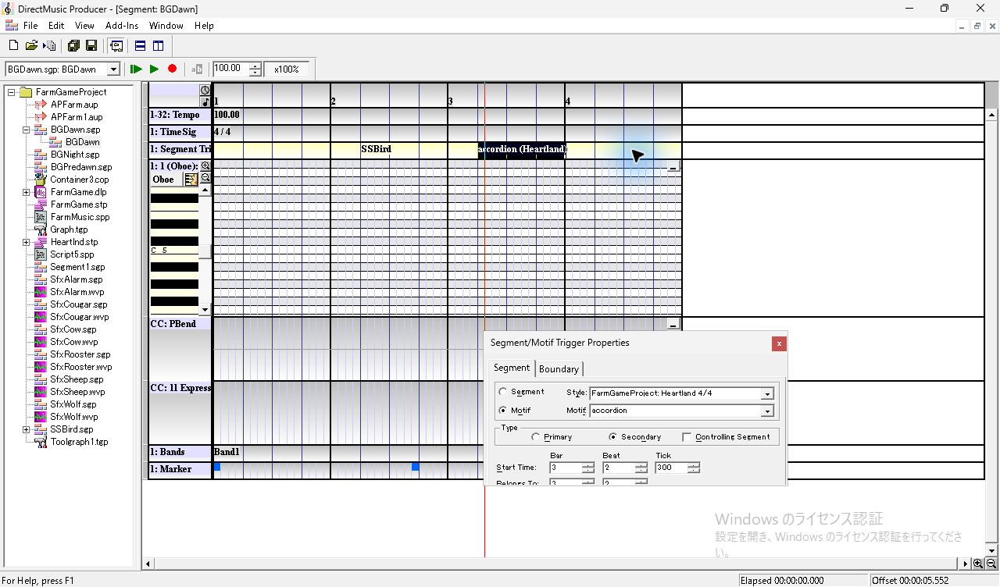

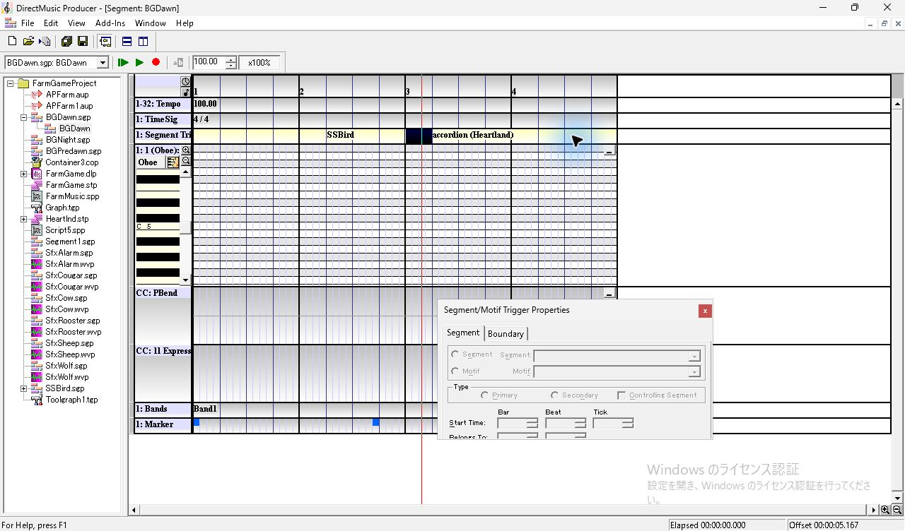
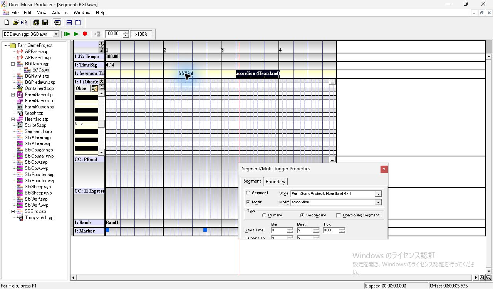
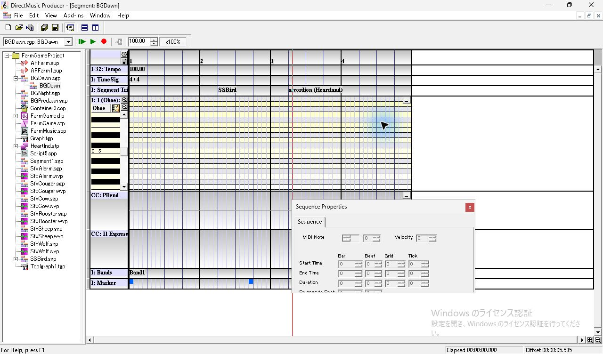

## カーソルと修飾キーの観測範囲

同じ通常ドラッグで、Project Tree 右端の分割線を `(178, 380) → (260, 380)` と動かすと Tree が広がった。幅はその後、元の位置付近に戻した。

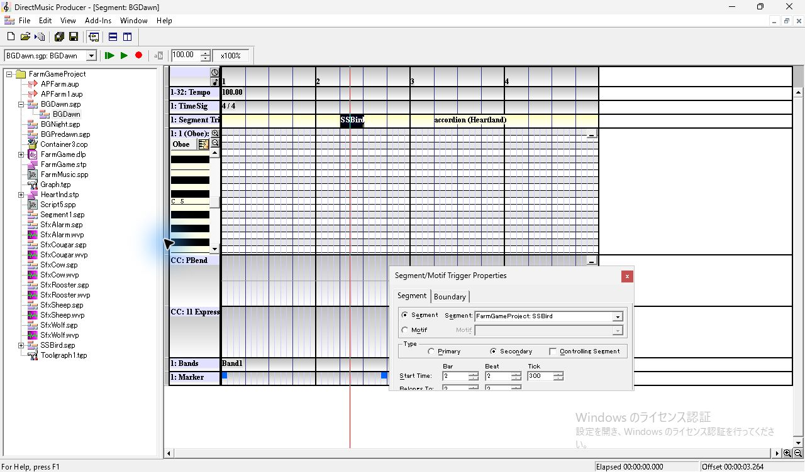

Producer が前面の間、Windows の `GetCursorInfo`、左ボタンと Ctrl・Shift・Alt の状態を約2 ms 間隔で採取した。次のカーソル欄は、座標が押下点に到達した最初の標本から解放点に到達した最初の標本まで。5試行とも左ボタンが押下された標本は0件。分割線では標準矢印以外のハンドルも採取できたが、形状名は識別していない。

| 試行 | 標本数（前後を含む） | 座標移動を含む区間のカーソル |
| --- | ---: | --- |
| SSBird から空の拍 | 1,913 | 標準矢印 |
| Project Tree の分割線を右へ | 1,990 | 標準矢印、別ハンドル |
| Project Tree の分割線を左へ | 1,999 | 別ハンドル |
| Motif から SSBird 上 | 1,945 | 標準矢印 |
| Motif から Sequence | 1,916 | 標準矢印 |

同じ対照操作で並行した Windows のマウスイベント監視にも記録が入らなかった。Computer Use の Windows ドラッグでは開始点と終了点を指定できる。ボタンを押した状態で止める指定と修飾キーの指定は利用できなかった。Windows のマウスキーと固定キーをセッション中に試したが、自動入力では左ボタンの押下状態と Ctrl の保持を確認できなかった。**押下中のカーソルと修飾キー付きドラッグは追試待ち。** [位置・ボタン・カーソルの CSV 一覧とハッシュ](#保存値と証拠) · [座標とカーソルの採取コード](../../../work/original-gui/SEG-14-trigger-drag/20261111T213853601014Z/observe-drag.py) · [マウスイベントの監視コード](../../../work/original-gui/SEG-14-trigger-drag/20261111T213853601014Z/observe-drag-events.py)

## 空の拍へ Copy と Paste

1. **3:2:300** の Motif を所属拍内で選択し、`Ctrl+C`。
2. 第4小節の第3拍 `(810, 191)` をクリック。空の拍が濃紺になり、Properties が無効になる。
3. `Ctrl+V`。コピー元に加え、**4:3:300** に同じ Motif が入り、貼り付け先が選択される。ラベルは第4小節末尾で切れる。拍内の Tick 300、Motif 名、参照する Style を保持した。

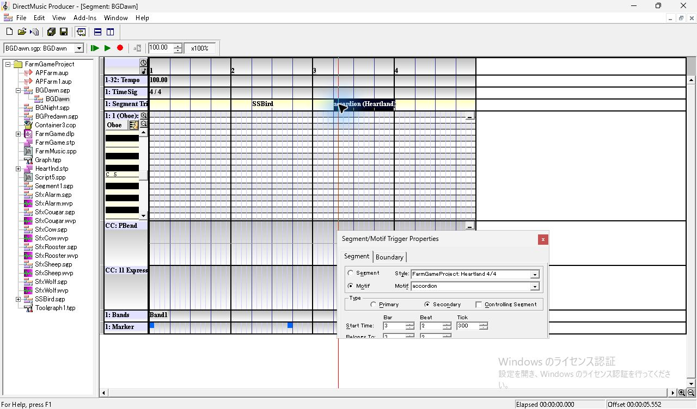
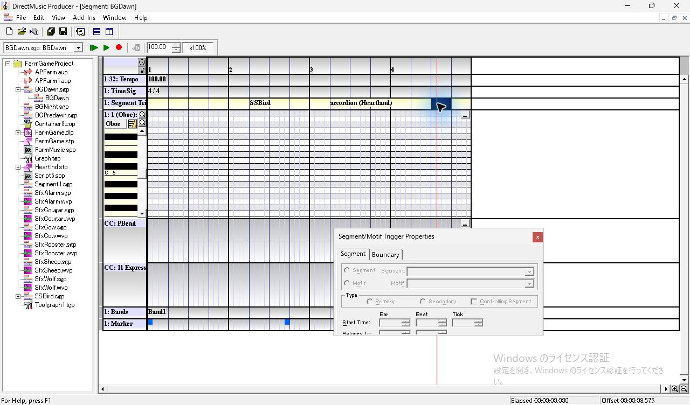
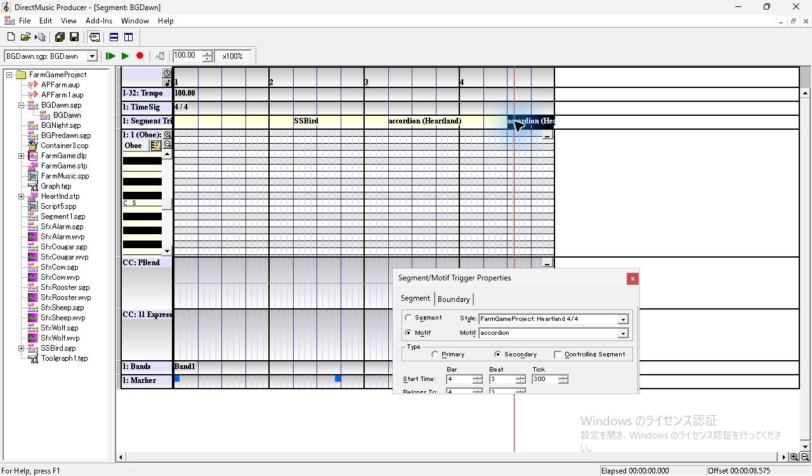

## 項目のある拍へ Paste

### 同じ Tick の Ctrl+V と Merge

**2:2:300** の SSBird を選択して `Ctrl+X`。ラベルが消える。**3:2:300** の Motif の所属拍を選んで `Ctrl+V` すると、SSBird が **3:2:300** に入って Motif は消えた。新しいラベルは直立で、右クリックの **Cycle Items** は無効。右クリックメニューの **Paste** には **Merge** と **Overwrite** がある。

`Ctrl+Z` 1回で直前の貼り付けが戻り、**3:2:300** に Motif が再表示された。2:2 は空のままで、クリップボードには切り取った SSBird が残る。クリップボードを替えず、同じ拍に右クリックメニューの **Paste → Merge** を実行しても、SSBird が Motif を置き換えた。この2つの保存ファイルは同一で、同一 Tick の結果だけでは `Ctrl+V` の貼り付け方式を判別できない。

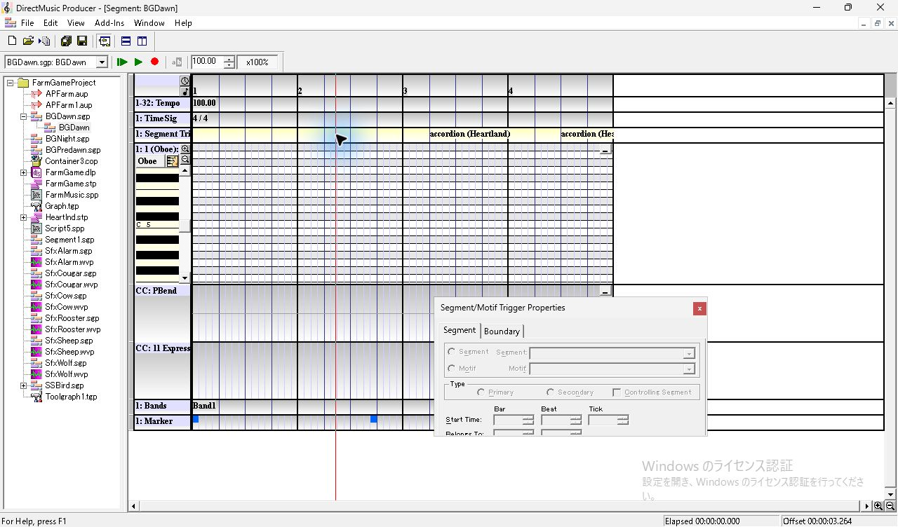
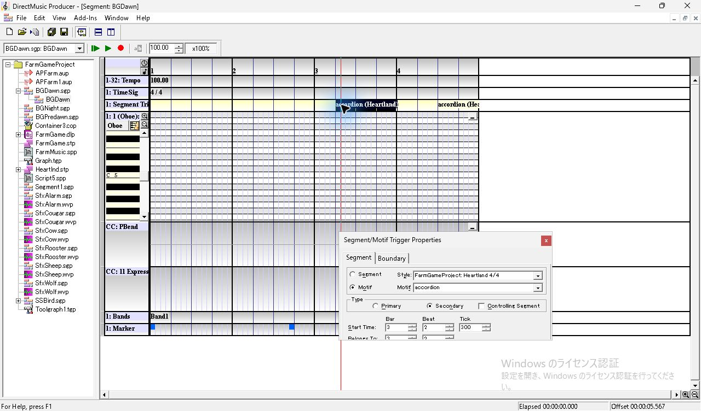
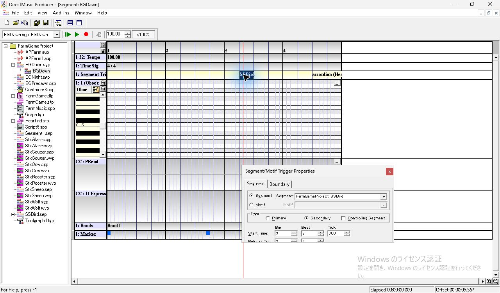
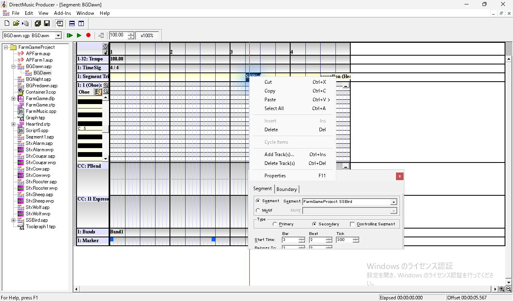
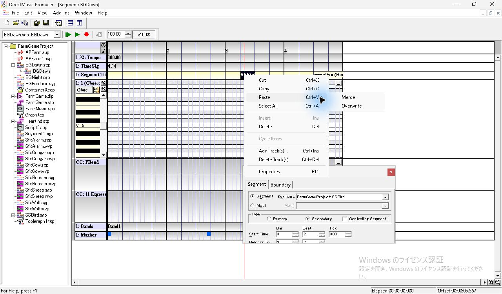
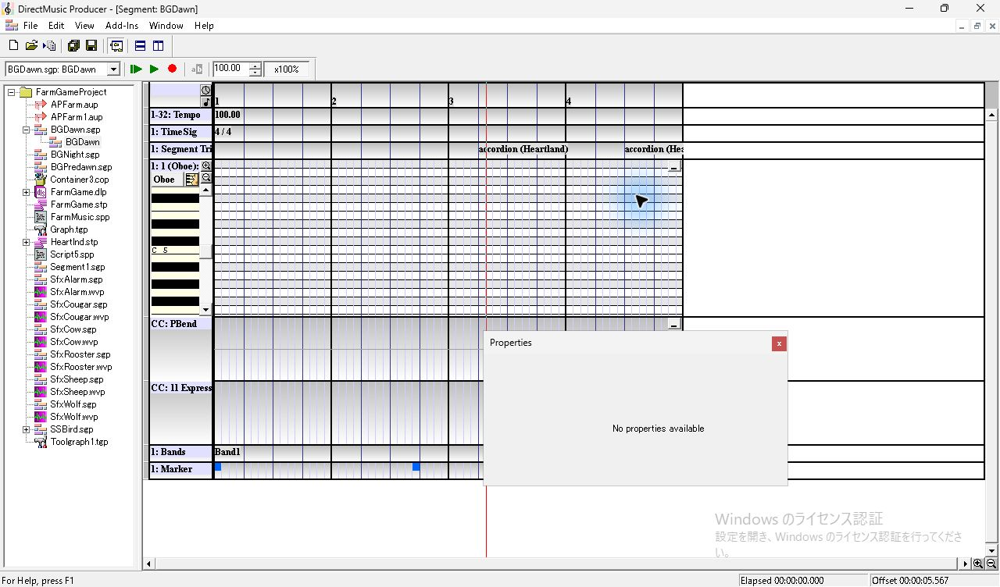

### 同じ拍で Tick が1だけ異なる場合

Merge を取り消し、元の Motif の **Start Time → Tick** の上スピンを1回押す。Motif は **3:2:301** になり、所属拍とラベル左端は同じ。切り取った SSBird の Tick は **300** のまま、同じ拍で貼り付け方式を比べた。

- **Paste → Merge**。同じ拍に SSBird **3:2:300** と Motif **3:2:301** の両方が残った。選択中の SSBird は斜体で表示され、**Cycle Items** が有効になった。1回選ぶと斜体の `accordion (Heartland)` が表示され、Properties は **3:2:301** に切り替わった。
- **Paste → Overwrite**。Merge を取り消してから同じ拍に実行した。SSBird が **3:2:300** に入り、既存の Motif **3:2:301** は消えた。SSBird は直立。別の拍の Motif **4:3:300** は両方式とも残った。

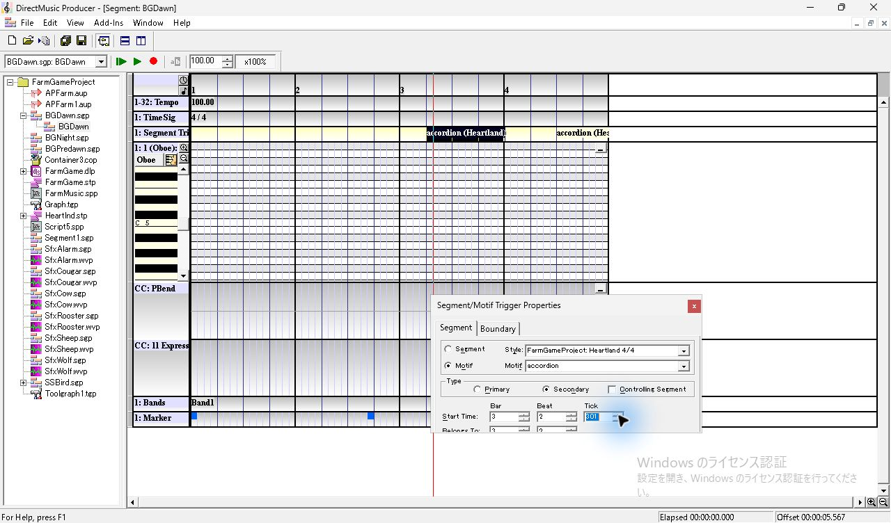
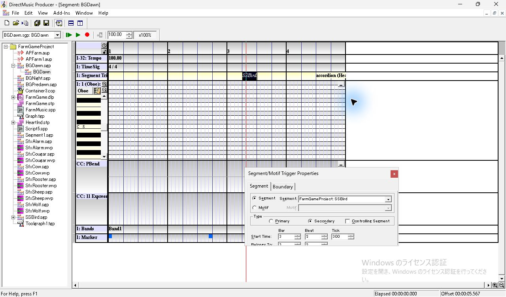

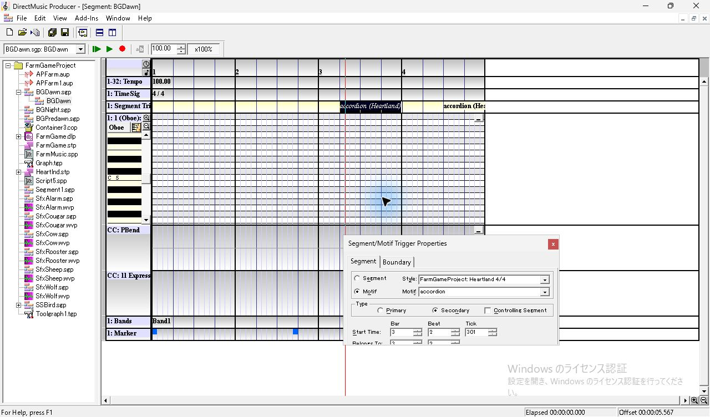
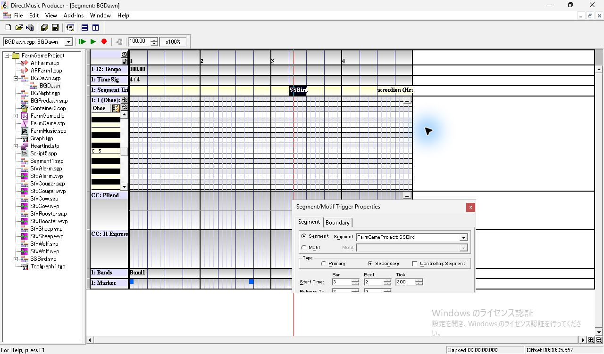

## 保存値と証拠

`BGDawn.sgp` の `sgih` にある Belongs To と Start Time を確認した。1拍は768 clocks。**2:2:300** は **3840 → 4140**、**3:2:300** は **6912 → 7212**、**3:2:301** は **6912 → 7213**、**4:3:300** は **10752 → 11052**。参照 GUID、Segment と Motif の区別、境界フラグも照合した。

| 保存時点 | SSBird | accordion | ファイル |
| --- | --- | --- | --- |
| 比較前 | 2:2:300 | 3:2:300 | [SGP](../../../work/original-gui/SEG-14-trigger-drag/20261111T213853601014Z/captures/07-baseline-BGDawn.sgp) |
| 空の拍への通常ドラッグ | 2:2:300 | 3:2:300 | [SGP](../../../work/original-gui/SEG-14-trigger-drag/20261111T213853601014Z/captures/14-standard-drag-BGDawn.sgp) |
| 既存項目・Sequence への通常ドラッグ | 2:2:300 | 3:2:300 | [SGP](../../../work/original-gui/SEG-14-trigger-drag/20261111T213853601014Z/captures/40-cross-strip-BGDawn.sgp) |
| 空の拍へ Motif をコピー | 2:2:300 | 3:2:300、4:3:300 | [SGP](../../../work/original-gui/SEG-14-trigger-drag/20261111T213853601014Z/captures/46-copy-BGDawn.sgp) |
| 同一 Tick で Ctrl+V | 3:2:300 | 4:3:300 | [SGP](../../../work/original-gui/SEG-14-trigger-drag/20261111T213853601014Z/captures/51-overlap-BGDawn.sgp) |
| 同一 Tick で Merge | 3:2:300 | 4:3:300 | [SGP](../../../work/original-gui/SEG-14-trigger-drag/20261111T213853601014Z/captures/60-same-tick-merge-BGDawn.sgp) |
| 同じ拍の異なる Tick で Merge | 3:2:300 | 3:2:301、4:3:300 | [SGP](../../../work/original-gui/SEG-14-trigger-drag/20261111T213853601014Z/captures/68-different-tick-merge-BGDawn.sgp) |
| 同じ拍の異なる Tick で Overwrite | 3:2:300 | 4:3:300 | [SGP](../../../work/original-gui/SEG-14-trigger-drag/20261111T213853601014Z/captures/76-different-tick-overwrite-BGDawn.sgp) |

作業コピーで更新されたのは `BGDawn.sgp` と `FarmGameProject.pro`。複製元と凍結入力28件は開始時のハッシュと一致した。 [保存値、カーソルの CSV、SHA-256 の照合](../../../work/original-gui/SEG-14-trigger-drag/20261111T213853601014Z/trigger-drag-audit.json) · [照合手順](../../../work/original-gui/SEG-14-trigger-drag/20261111T213853601014Z/analyze-trigger-drag.py) · [掲載画像と元の操作記録の対応](../../../work/original-gui/SEG-14-trigger-drag/20261111T213853601014Z/published-trigger-drag-figures.json)

## 終了時の状態

開始時に稼働していた Producer 1件を使用し、最後は **File → Close Project** で閉じた。終了時も同じ Producer 1件で、View は **Project Tree、Standard Toolbar、Status Bar、Transport Controls** の4項目。Windows のマウスキー、固定キー、切り替えキーの保存設定は開始前と一致し、セッション中に有効にした機能は終了時にオフへ戻した。マウスキーの内部状態フラグ `MKF_MOUSEMODE` はオフに戻した後も立っていた。 [終了時のウィンドウ](../../../work/original-gui/SEG-14-trigger-drag/20261111T213853601014Z/captures/81-final-windows.json) · [終了時の Windows 設定](../../../work/original-gui/SEG-14-trigger-drag/20261111T213853601014Z/captures/81-windows-accessibility-after.json) · [復元直後のセッション状態](../../../work/original-gui/SEG-14-trigger-drag/20261111T213853601014Z/captures/16-runtime-accessibility-restore.json)

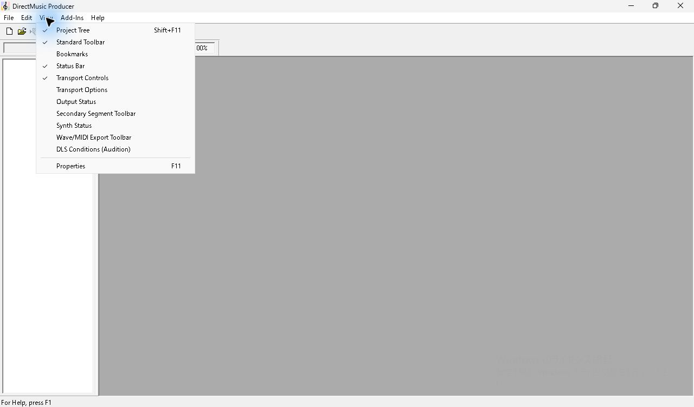
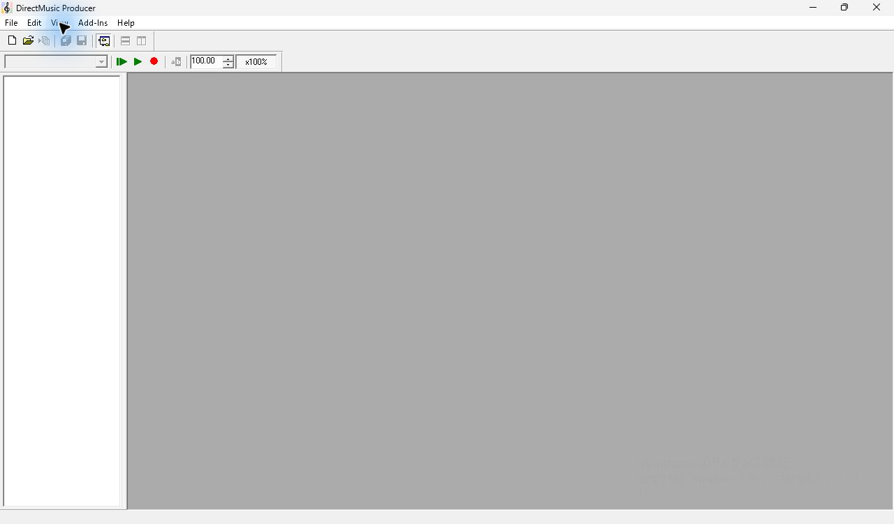
