# SEG-14　子 Segment の Enter Switch Point と Align

2026-11-12。DirectMusic Producer 5.3.0.900 の作業コピーで、子 Segment の **Marker トラック下段**に Enter Switch Point を追加し、親の Segment Trigger が子のどこから発音するかを比較した。1280×752 px の撮影145枚から16枚を掲載し、MIDI 5本と対応する SGP を照合した。青い光と太い黒矢印は操作ツールの表示。 [前回の Align と Start at next marker](seg-14-trigger-alignment.md) · [凍結した比較用 Project](../../../work/original-gui/SEG-14-trigger-enter/20261111T192318866093Z/run.json) · [画像の出典とハッシュ](../../../work/original-gui/SEG-14-trigger-enter/20261111T192318866093Z/published-trigger-enter-figures.json)

## 親の Align と子の識別音

親 **BGDawn** は4小節、4/4、100 BPM、Repeat 0。**Start Time 2:2:300** のトリガー1件で子 **SSBird** を参照し、**Secondary**、**Controlling Segment オフ**、**Quick Response**。前回保存した **Align to Barline / on any Beat** を親の基準にした。トリガー項目は第2小節第2拍の **3840 clocks** に属し、実時刻は **4140 clocks**。Align で子のローカル0が対応する親の小節線は **3072 clocks**。

子は2小節、4/4。前回と同じ35音を PChannel 2 の Sequence に置いた。キー48〜79はローカル0〜5952の各 Grid に1音、キー84〜86は Grid 間に置いた識別音。子の Marker トラックには上段の **Marker** をローカル **1728 clocks** に1点置き、最初は下段を空にした。親の PChannel 1 にはキー44が192と7680 clocksにあり、5回とも MIDI で確認できた。 [Marker の準備スクリプト](../../../work/original-gui/SEG-14-trigger-enter/20261111T192318866093Z/prepare-fixture.py) · [基準の親](../../../work/original-gui/SEG-14-trigger-enter/20261111T192318866093Z/inputs/FarmGameProject/BGDawn.sgp) · [上段だけの子](../../../work/original-gui/SEG-14-trigger-enter/20261111T192318866093Z/inputs/FarmGameProject/SSBird.sgp)

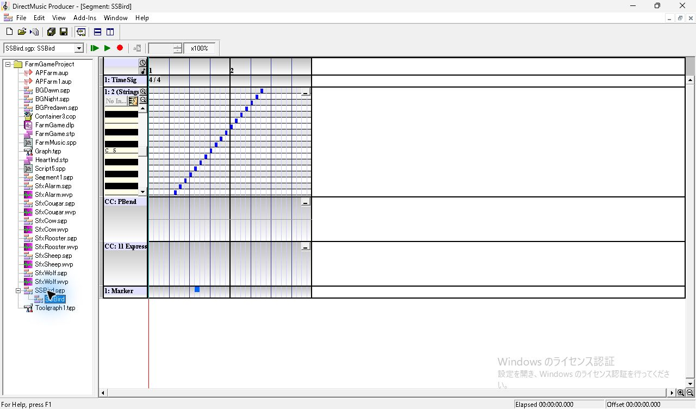
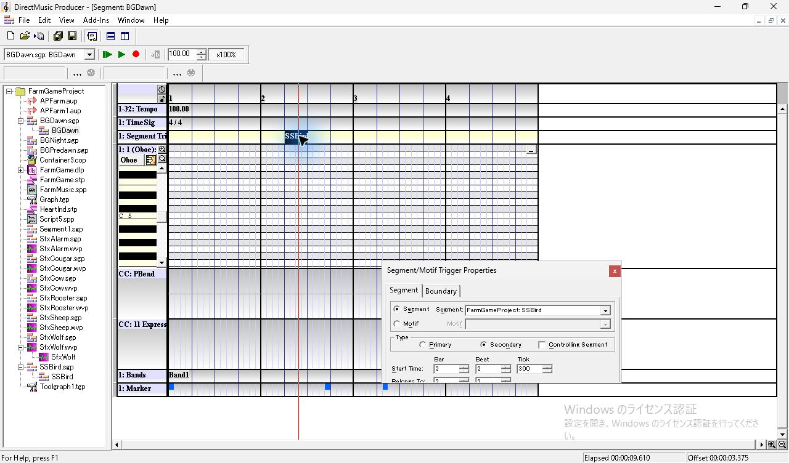
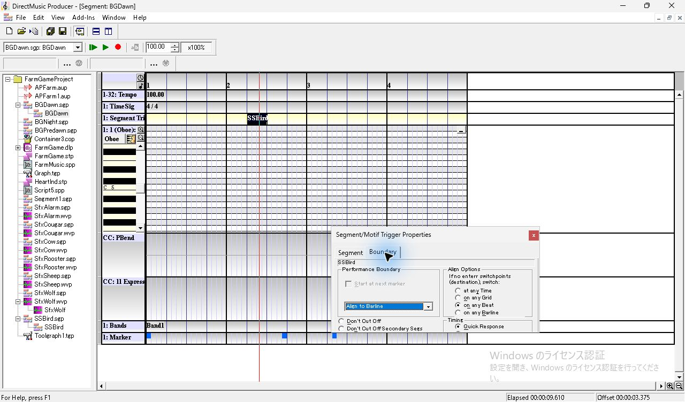

| 子の時刻（clocks） | 子の Measure:Beat:Grid:Tick | 子の起点を3072に合わせた親時刻 | 試験での用途 |
| ---: | --- | ---: | --- |
| 960 | 1:2:2:0 | 4032 | トリガーの前にある Enter |
| 1152 | 1:2:3:0 | 4224 | トリガー直後の Grid。最後に追加した Enter |
| 1536 | 1:3:1:0 | 4608 | 親の次の Beat。初期設定の代替境界 |
| 1728 | 1:3:2:0 | 4800 | 上段 Marker と、同じ位置に後から置いた Enter |
| 3072 | 2:1:1:0 | 6144 | 親の次の Barline。後半の代替境界 |

## 下段を選び、Enter Switch Point を追加

子の Marker 行の下半分をクリックして **Insert** を押すと、同じ位置の下段に小矩形が増え、モデルレスの **Marker/Enter Switch Point Properties** が開いた。**Type** は **Enter Switch Point**、Measure・Beat・Grid・Tick は独立したスピン欄。選択した Enter は赤、別のセルに選択を移した Enter は緑。上段の Marker と下段の Enter は同じ Grid で共存した。

最初はローカル960に追加し、Ctrl+S で保存して親を再生した。次に上段 Marker の真下をクリックすると、位置線はそのセルへ移動し、まだ空の下段のプロパティ欄は空白になった。Insert 後は下段の赤い矩形と **1:3:2:0** が表示された。上段は青のまま残った。 [Marker 行の右クリックメニューと上下段](seg-14-marker-mute.md) · [同梱ヘルプの Marker Track](../../../../../work/analysis/original-manual-session/20261010T031624075Z/help-extracted/htm/markertrack.htm)

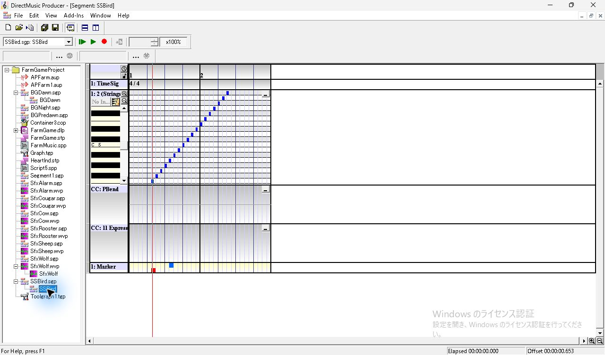
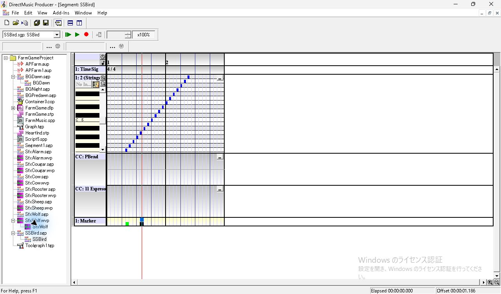
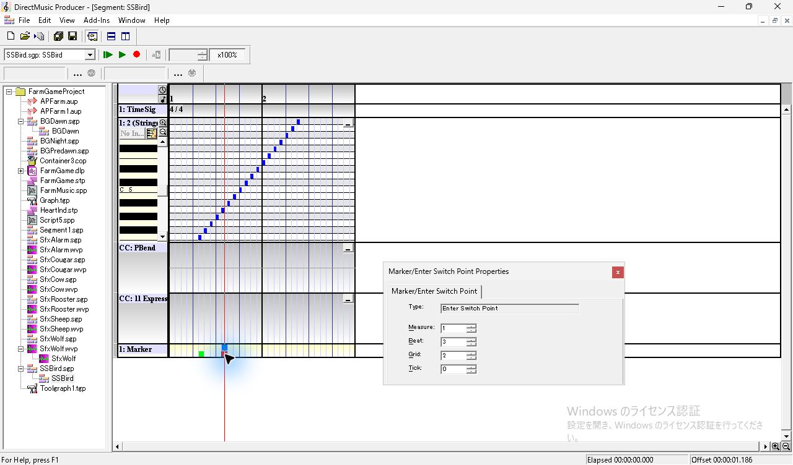

## MIDI で照合した発音開始

**View > Wave/MIDI Export Toolbar** を表示し、MIDI 側の `...` で出力先を指定した。ファイル名欄の右にある記録ボタンを押し、親を **Play From Start** で自然終了まで再生した。記録ボタンのツールチップは **Start or stop export to MIDI file**。出力先の指定だけで再生した初回はファイルが作成されず、記録ボタンを押して基準条件を採り直した。正常な収録後はファイル名欄が空に戻った。

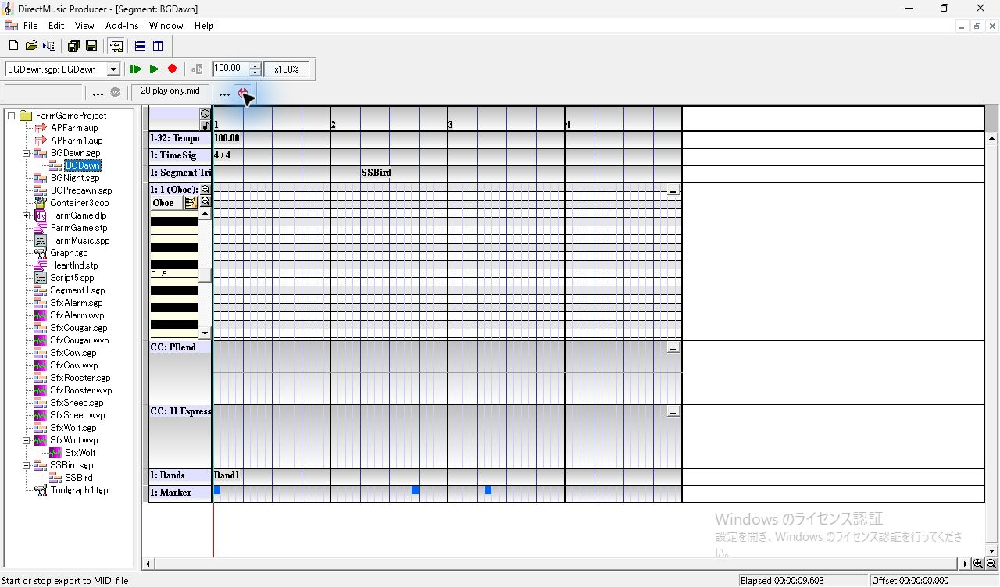

| 子の下段 Enter（ローカル clocks） | Align Options | 最初の子 Note On（親 ticks / キー） | 子の音数 | 記録 |
| --- | --- | --- | ---: | --- |
| なし | on any Beat | 4608 / 56 | 25 | [子 SGP](../../../work/original-gui/SEG-14-trigger-enter/20261111T192318866093Z/inputs/FarmGameProject/SSBird.sgp) · [MIDI](../../../work/original-gui/SEG-14-trigger-enter/20261111T192318866093Z/captures/20-play-only.mid) |
| 960 | on any Beat | 4608 / 56 | 25 | [子 SGP](../../../work/original-gui/SEG-14-trigger-enter/20261111T192318866093Z/captures/24-past-enter-SSBird.sgp) · [MIDI](../../../work/original-gui/SEG-14-trigger-enter/20261111T192318866093Z/captures/27-past-only.mid) |
| 960、1728 | on any Beat | 4800 / 57 | 24 | [子 SGP](../../../work/original-gui/SEG-14-trigger-enter/20261111T192318866093Z/captures/31-future-enter-SSBird.sgp) · [MIDI](../../../work/original-gui/SEG-14-trigger-enter/20261111T192318866093Z/captures/35-future-beat.mid) |
| 960、1728 | on any Barline | 4800 / 57 | 24 | [親 SGP](../../../work/original-gui/SEG-14-trigger-enter/20261111T192318866093Z/captures/39-barline-BGDawn.sgp) · [MIDI](../../../work/original-gui/SEG-14-trigger-enter/20261111T192318866093Z/captures/40-future-barline.mid) |
| 960、1152、1728 | on any Barline | 4224 / 54 | 27 | [子 SGP](../../../work/original-gui/SEG-14-trigger-enter/20261111T192318866093Z/captures/44-two-future-SSBird.sgp) · [MIDI](../../../work/original-gui/SEG-14-trigger-enter/20261111T192318866093Z/captures/46-two-future.mid) |

**上段 Marker だけの回**と**トリガーより前の Enter だけの回**は、子の Note On の時刻と音高が全件一致し、親の次の Beat から発音した。ローカル1728に下段の Enter を追加すると、子の起点は親3072のまま、最初の音が4800のキー57に移った。Align Options を **on any Barline** に変えても子の出力は全件一致した。前回の後続 Enter がない **on any Barline** では、親6144に子の起点を置いてキー48から出ていた。 [前回の MIDI](../../../work/original-gui/SEG-14-trigger-align/20261111T185020956917Z/captures/42-align-bar-bar.mid) · [同梱ヘルプの Align Options](../../../../../work/analysis/original-manual-session/20261010T031624075Z/help-extracted/htm/alignoptions.htm)

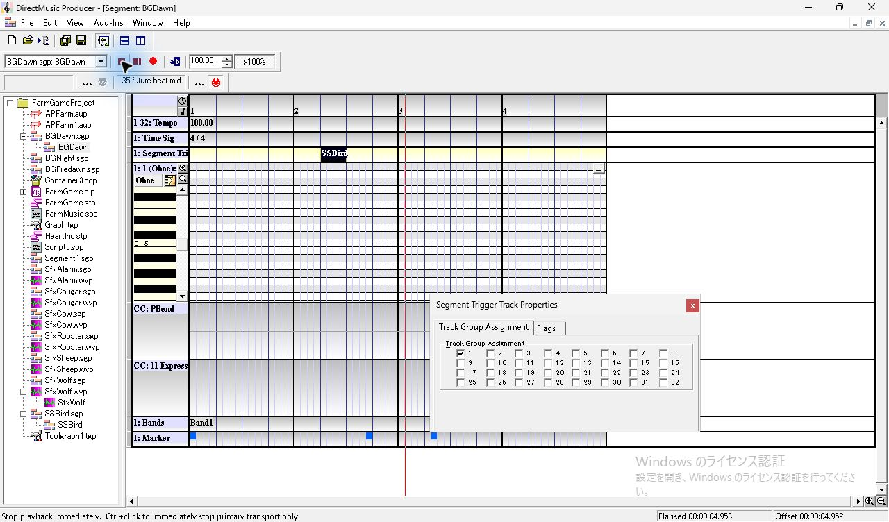
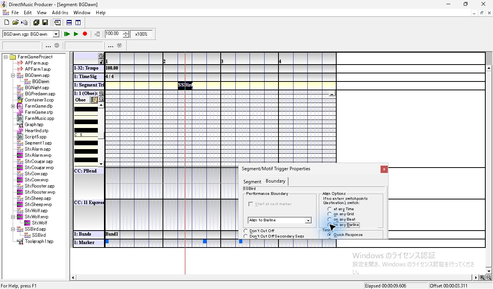

さらにローカル1152の下段を選んで Insert。親のトリガーより後に **4224、4800** の2候補がある状態で、子は先に来る4224から発音した。いずれも Note On の音高とローカル時刻の対応から親3072が子の起点と確認でき、最後の音は親9024 ticksのキー79。4つの子 SGP で Sequence の35音と上段 `play` の1728が一致し、下段の位置は `vals` の時刻列で確認した。親トリガーの `sgih` フラグは on any Beat で `0x00032080`、on any Barline で `0x08012080`。MIDI は768 ticks/拍、600,000 µs/拍。 [SGP と全 Note On の照合](../../../work/original-gui/SEG-14-trigger-enter/20261111T192318866093Z/trigger-enter-audit.json)

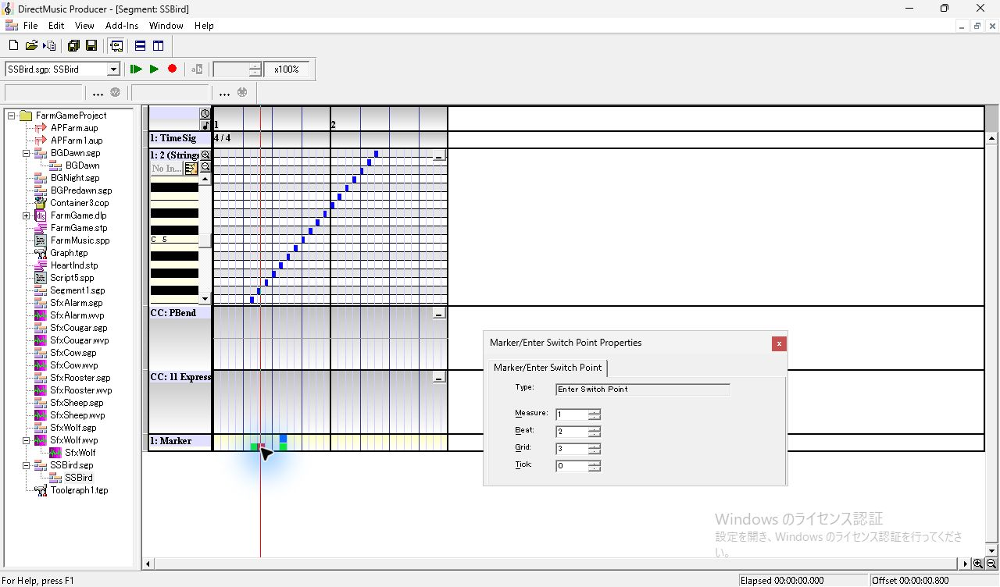

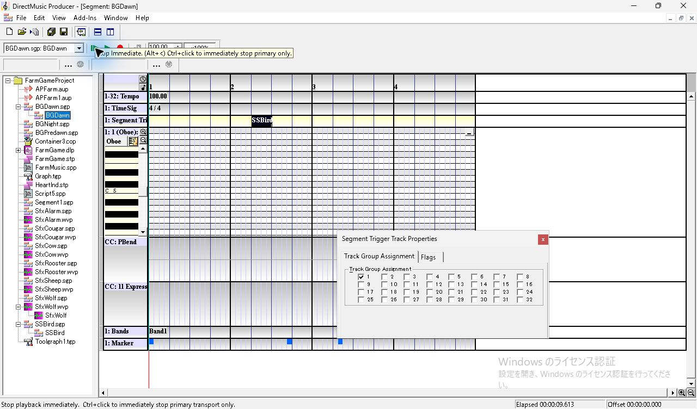

## 終了時の状態と次の比較

書き出しツールバーを非表示にし、Project を閉じた。親は on any Barline、子は下段3点の保存版。凍結入力28件のハッシュは一致した。開始時からの Producer 1件を使用し、終了時は Project Tree、Standard Toolbar、Status Bar、Transport Controls の4項目を表示した。 [終了時のウィンドウ一覧](../../../work/original-gui/SEG-14-trigger-enter/20261111T192318866093Z/captures/56-final-windows.json)

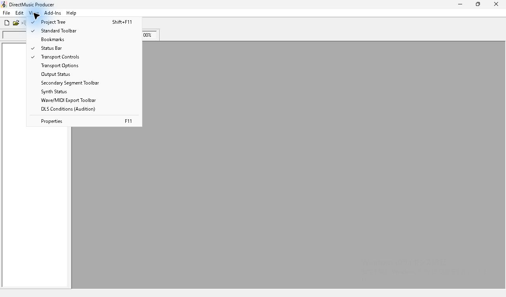
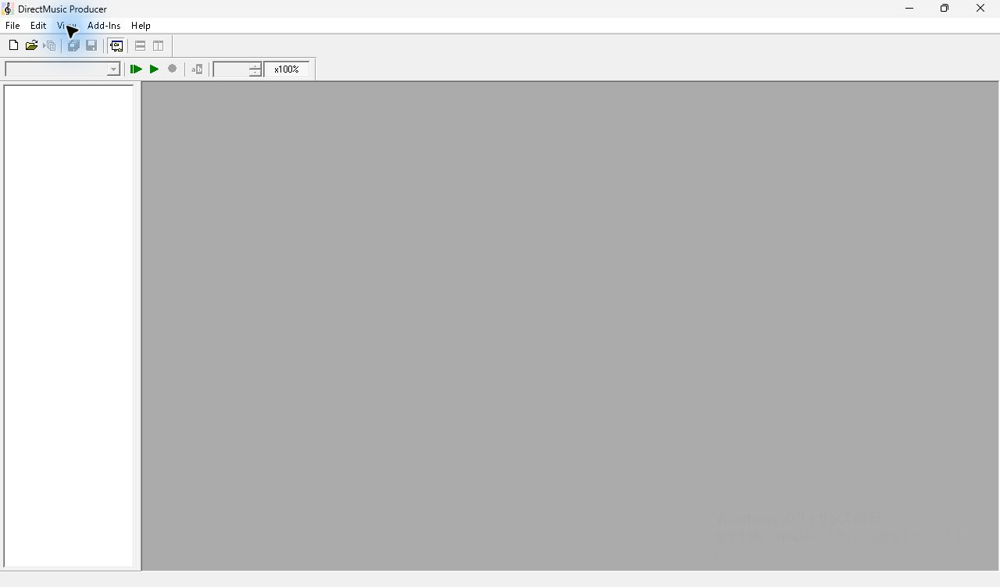

今回の測定は **Marker トラックの Enter Switch Point** が対象。続く試行では同じ親を使い、Marker トラックを省いた子に **Pattern Part の Variation の Enter** を置いた。Enter の前後位置と **Trigger only with Chord Change** を変え、発音開始と選ばれた Variation を照合した。 [Pattern Part の Enter と Align](seg-14-trigger-variation-enter.md) · [Pattern の既存の編集・再生記録](seg-14-variation-playback.md) · [同梱ヘルプの Variation Switch Points](../../../../../work/analysis/original-manual-session/20261010T031624075Z/help-extracted/htm/variationswitchpoints.htm)

