# SEG-14　元の SSBird と accordion の同時発音

2026-11-12。DirectMusic Producer 5.3.0.900 の作業コピーで、同じ Tick に置いた **SSBird** と **accordion (Heartland)** を、元の参照ファイルで再生した。1280×752 px の撮影121枚から22枚を掲載。単独2回、同時2回、トラック無効1回の WAV と MIDI を照合した。太い黒矢印と青い光は操作ツールの表示。 [凍結した Project と環境](../../../work/original-gui/SEG-14-trigger-original-audio/20261111T204557406549Z/run.json) · [保存値・MIDI・音声の照合](../../../work/original-gui/SEG-14-trigger-original-audio/20261111T204557406549Z/trigger-original-audio-audit.json) · [画像の出典とハッシュ](../../../work/original-gui/SEG-14-trigger-original-audio/20261111T204557406549Z/published-trigger-original-audio-figures.json)

## 元の参照と比較用の親

**SSBird.sgp** を開くと、6小節の **1/4・100.00 BPM** と **1: 11 (Ocarina)** が見える。折りたたまれた Part の右端の四角を押すと、青いノート、Variation ボタン、Var Switch Point 行、CC 行の **AT(M), ModWh** が現れる。鳥の音は PChannel 11 の内蔵 Pattern から出る。ファイル内に Wave トラックはなく、Project Tree の **SSBird > Audiopath** に対応する埋め込み AudioPath がある。 [元の SSBird.sgp](../../../work/original-gui/SEG-14-trigger-original-audio/20261111T204557406549Z/inputs/FarmGameProject/SSBird.sgp)

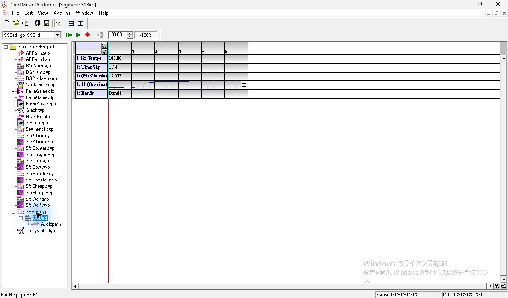
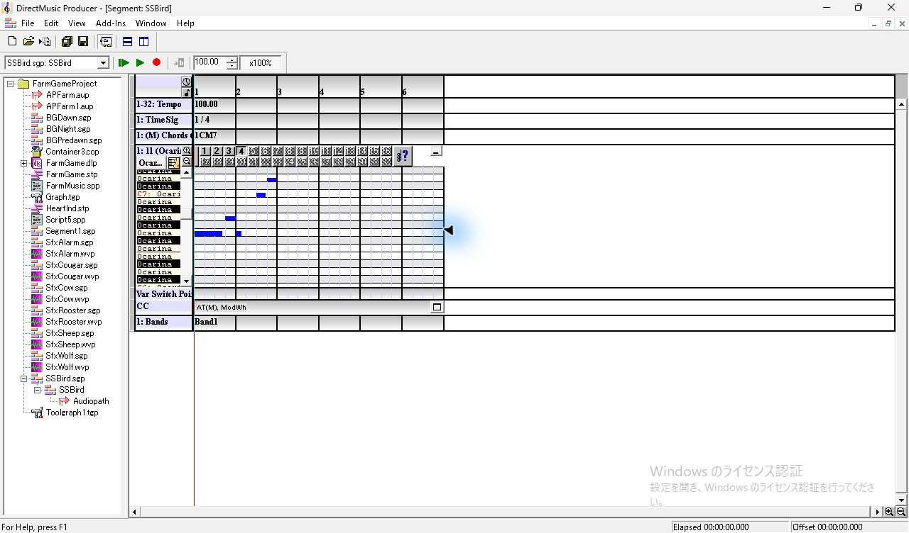

**Heartlnd.stp** の Style 画面で下段の **accordion** をダブルクリックすると、1小節の Motif Editor が開く。Transport に **Heartlnd.stp: accordion** と **112.00**、エディターに **4/4** と **2 (Strings): 2**。右端の四角で Part を開くと、Variation 1–16 と複数の青いノートが見える。元の SSBird と Heartland は入力元・凍結版・使用後の作業コピーでハッシュが一致した。 [元の Heartlnd.stp](../../../work/original-gui/SEG-14-trigger-original-audio/20261111T204557406549Z/inputs/FarmGameProject/Heartlnd.stp)

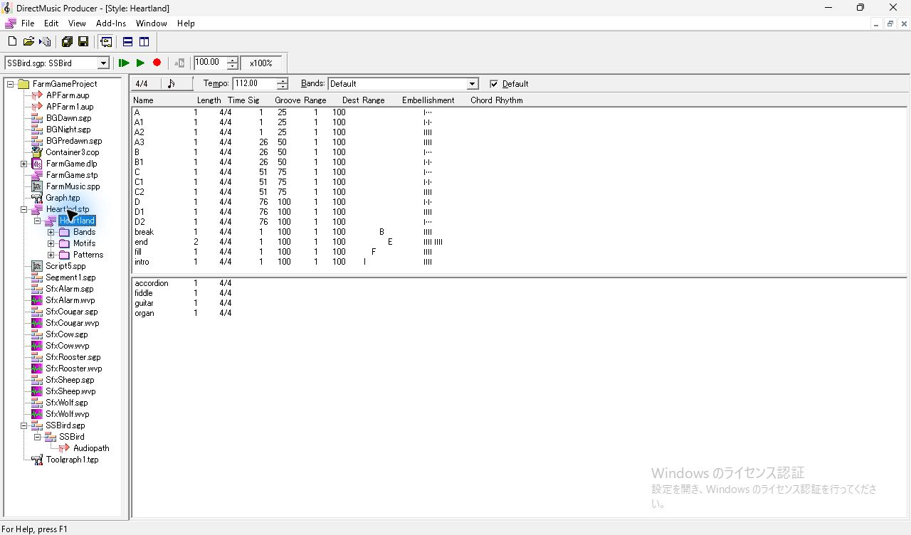
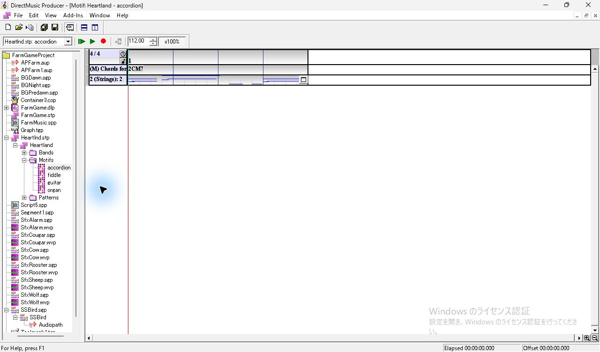
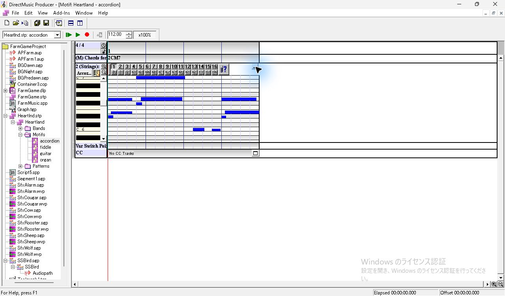

親には [比較用の BGDawn](seg-14-trigger-motif-overlap.md) を使った。**4小節・4/4・100 BPM・Repeat 0** で、PChannel 1 の基準音が 192・7680 clocks にある。Group 1 の Segment Trigger の2件は **Start Time 2:2:300**、**Secondary / Immediate / Quick Response**、**Controlling Segment** はオフ。両方の `sgih` は所属3840・開始4140 clocks。各参照の GUID と Motif 名も保存値で照合した。 [親の凍結ファイル](../../../work/original-gui/SEG-14-trigger-original-audio/20261111T204557406549Z/inputs/FarmGameProject/BGDawn.sgp) · [素材の作成手順](../../../work/original-gui/SEG-14-trigger-original-audio/20261111T204557406549Z/prepare-fixture.py)

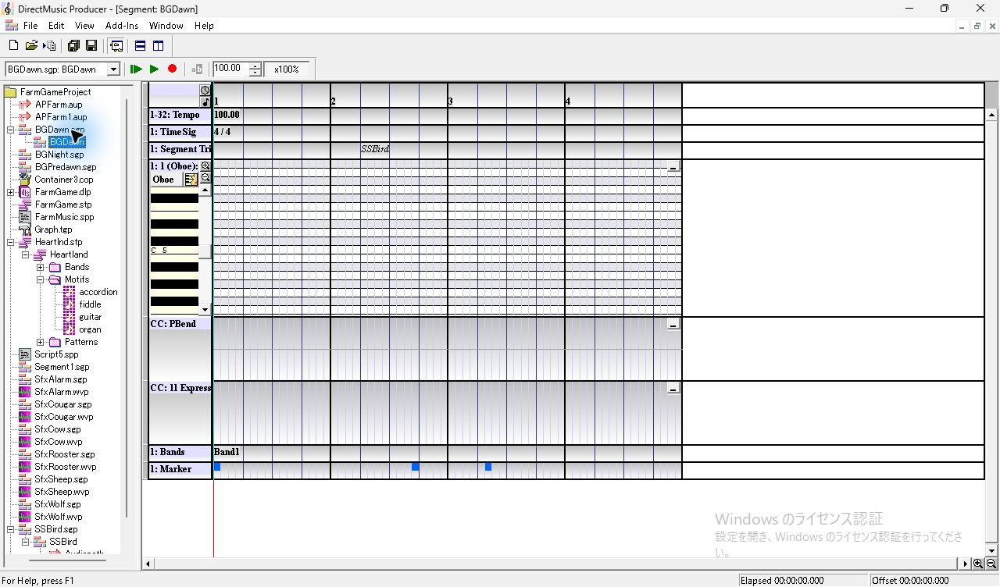

## 単独、同時、トラック無効の状態を作る

各試行で、**View > Wave/MIDI Export Toolbar** の MIDI 側でファイル名を指定し、その右のボタンで記録を待機。ループバック録音の開始を確認し、Transport が **BGDawn.sgp: BGDawn** であることを確かめて **Play From Start** を押した。SSBird や accordion を Tree から直接試聴した場合は、別の Transport 対象になる。今回は各参照の単独試行でも BGDawn を再生した。

1. **SSBird が前面**。最初の混合試行では、斜体の SSBird が見えるまま再生。再生中は親の位置線が第2小節を通過した。
2. **accordion のみ**。セルをクリックして SSBird を選び、**Ctrl+X**。残った accordion のラベルは太字の立体になった。この状態で親を保存・再生した。
3. **SSBird のみ**。残ったラベルをクリックしてストリップにフォーカスを戻し、**Ctrl+Z** で2件に復元。右クリックの **Cycle Items** で accordion を前面にし、**Ctrl+X** で切り取ると、今度は SSBird が太字の立体になった。この状態も保存して再生した。
4. **accordion が前面**。残ったセルから再び **Ctrl+Z** で復元し、**Cycle Items** で斜体の accordion を前面にした。2件が同じ Tick にある状態を保存して再生した。

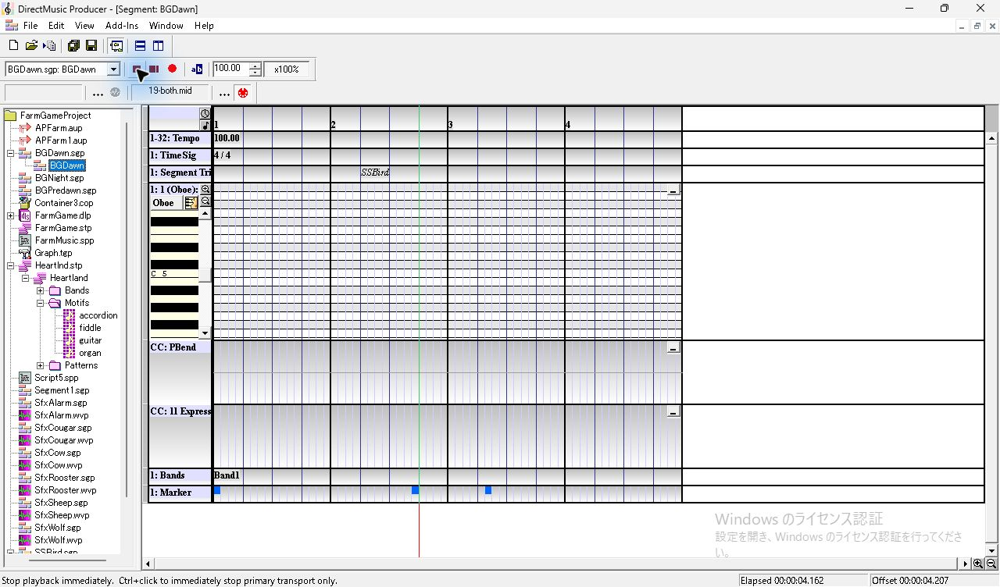
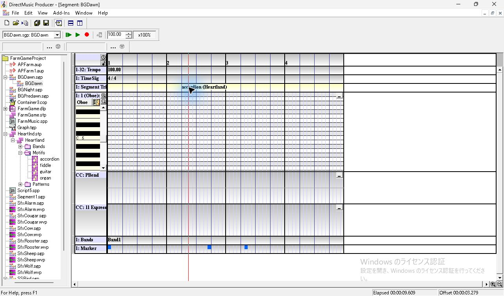
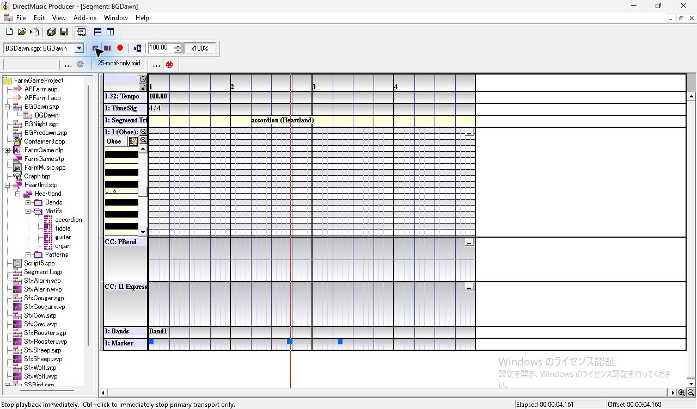
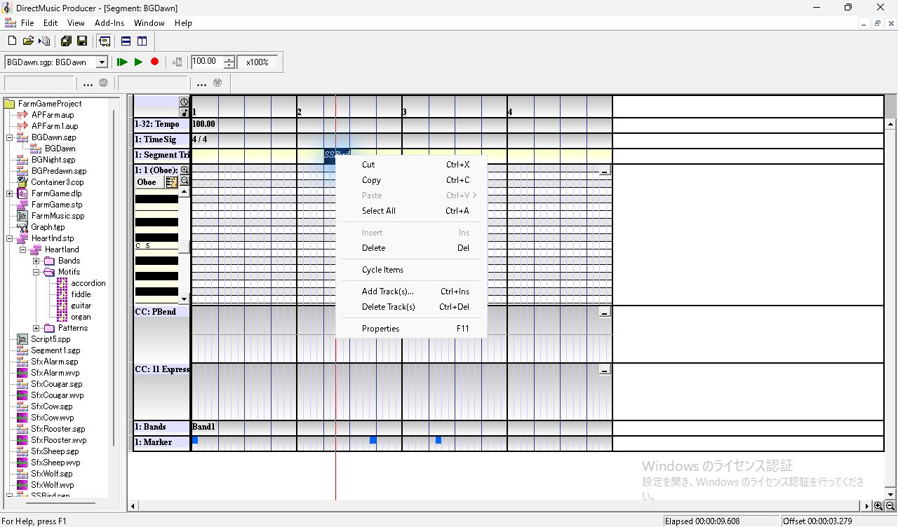
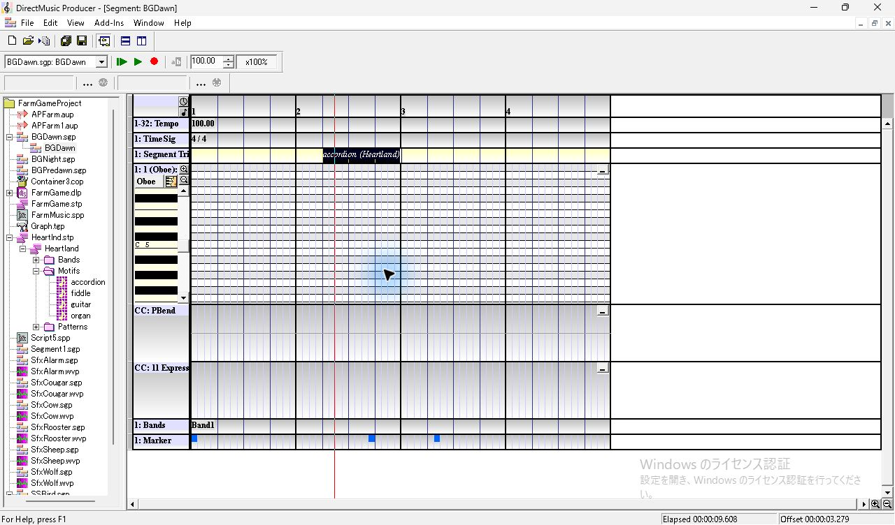
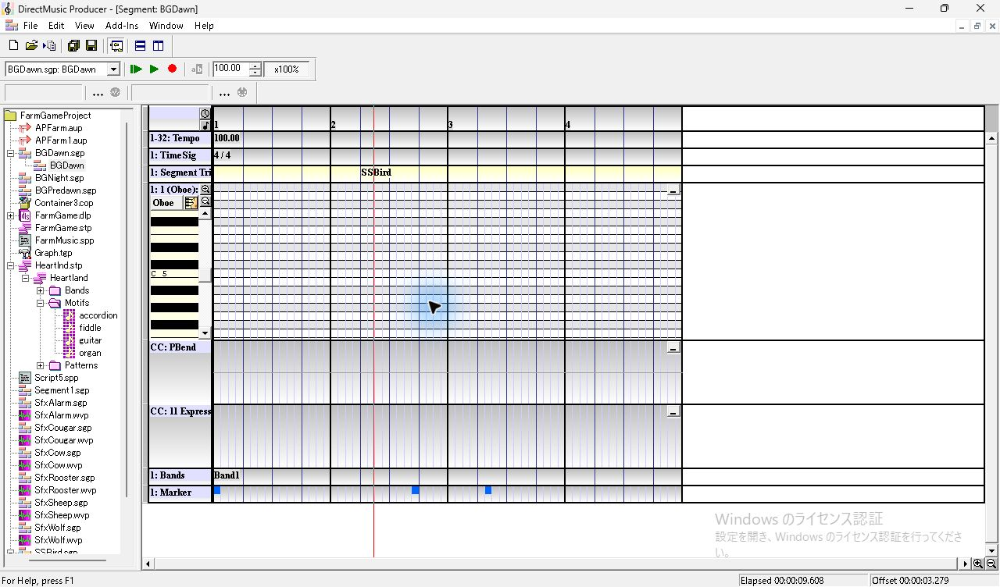
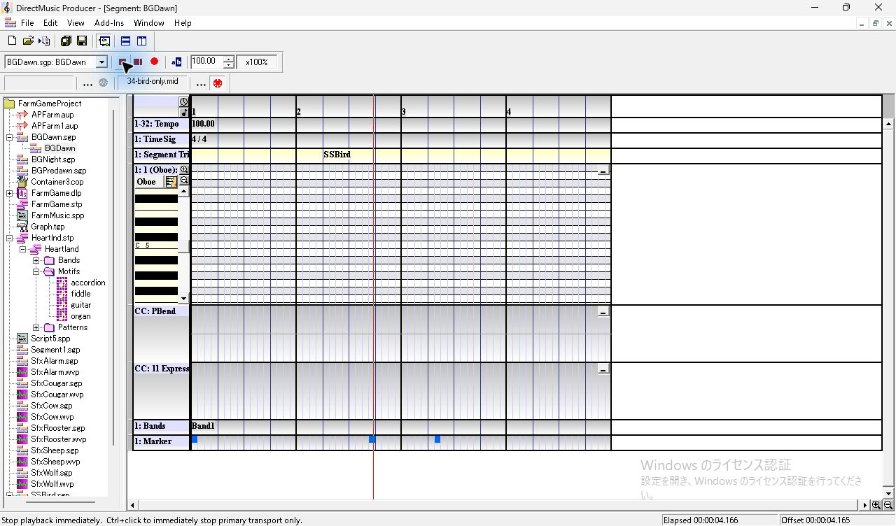
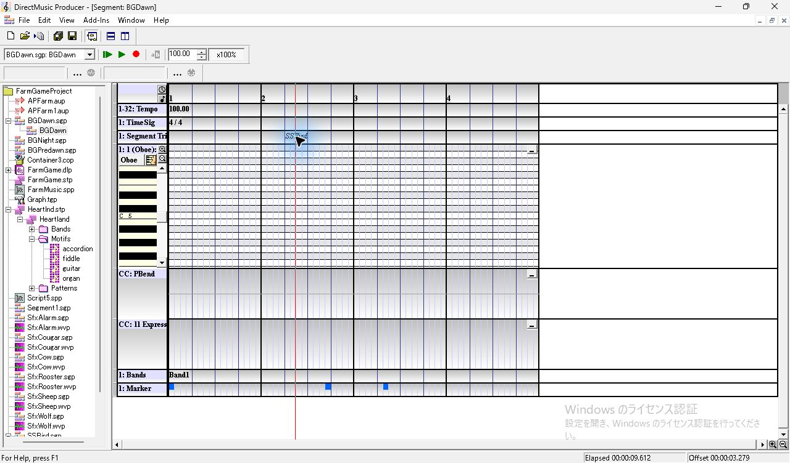
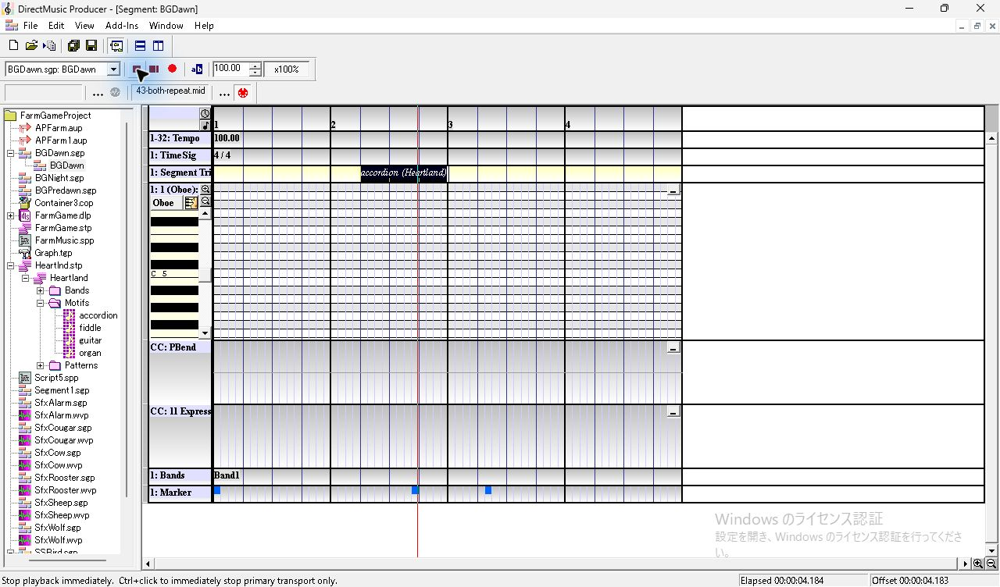

対照試行ではトラックの左見出しをクリックし、**F11 > Flags > Playback > Enable Play** をオフにした。保存値では `trkx` の先頭が **0x10 → 0x00**。2件のトリガーは残り、再生中も斜体の accordion と親の位置線が見えた。

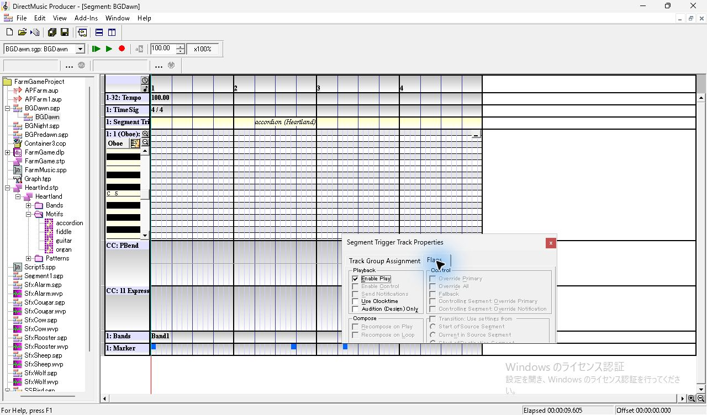
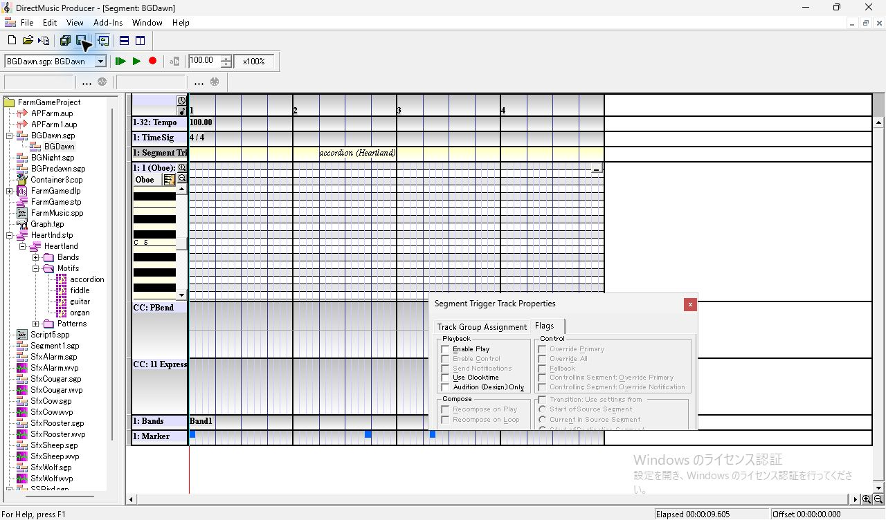
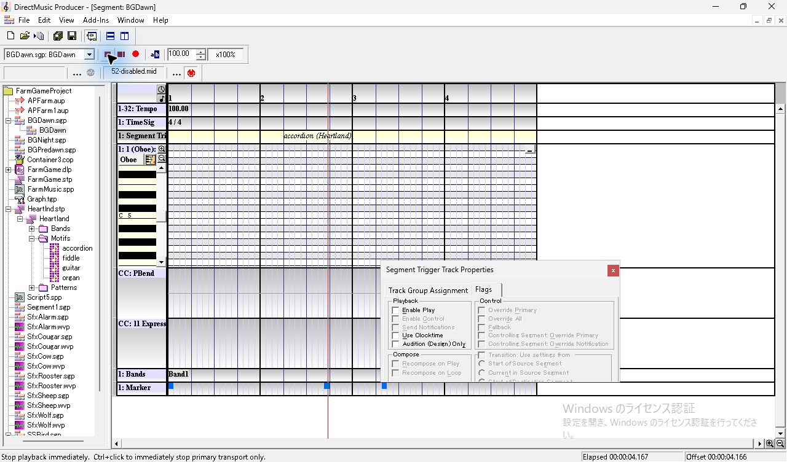

## 各試行の MIDI と音声

MIDI は全試行で **768 ticks/四分音符、100 BPM**。親の Ch. 1 は毎回 **192・7680 ticks** にキー44、ベロシティ100 の2音。元の accordion は **Ch. 2**、SSBird の Ocarina は **Ch. 11** に出た。次の表は **Note On の件数（先頭 tick）**。WAV は既定の再生エンドポイントから各15秒、48 kHz・32-bit float・ステレオで記録した。

| BGDawn の状態 | accordion | SSBird | 保存・収録 |
| --- | ---: | ---: | --- |
| 同時1回目、SSBird が前面 | 9（4140） | 6（4140） | [SGP](../../../work/original-gui/SEG-14-trigger-original-audio/20261111T204557406549Z/captures/19-both-BGDawn.sgp) · [MIDI](../../../work/original-gui/SEG-14-trigger-original-audio/20261111T204557406549Z/captures/19-both.mid) · [WAV](../../../work/original-gui/SEG-14-trigger-original-audio/20261111T204557406549Z/captures/audio-19-both/output.wav) |
| accordion のみ | 11（4138） | 0 | [SGP](../../../work/original-gui/SEG-14-trigger-original-audio/20261111T204557406549Z/captures/25-motif-only-BGDawn.sgp) · [MIDI](../../../work/original-gui/SEG-14-trigger-original-audio/20261111T204557406549Z/captures/25-motif-only.mid) · [WAV](../../../work/original-gui/SEG-14-trigger-original-audio/20261111T204557406549Z/captures/audio-25-motif-only/output.wav) |
| SSBird のみ | 0 | 6（4524） | [SGP](../../../work/original-gui/SEG-14-trigger-original-audio/20261111T204557406549Z/captures/34-bird-only-BGDawn.sgp) · [MIDI](../../../work/original-gui/SEG-14-trigger-original-audio/20261111T204557406549Z/captures/34-bird-only.mid) · [WAV](../../../work/original-gui/SEG-14-trigger-original-audio/20261111T204557406549Z/captures/audio-34-bird-only/output.wav) |
| 同時2回目、accordion が前面 | 9（4139） | 7（4524） | [SGP](../../../work/original-gui/SEG-14-trigger-original-audio/20261111T204557406549Z/captures/43-both-repeat-BGDawn.sgp) · [MIDI](../../../work/original-gui/SEG-14-trigger-original-audio/20261111T204557406549Z/captures/43-both-repeat.mid) · [WAV](../../../work/original-gui/SEG-14-trigger-original-audio/20261111T204557406549Z/captures/audio-43-both-repeat/output.wav) |
| 2件を残して Enable Play オフ | 0 | 0 | [SGP](../../../work/original-gui/SEG-14-trigger-original-audio/20261111T204557406549Z/captures/52-disabled-BGDawn.sgp) · [MIDI](../../../work/original-gui/SEG-14-trigger-original-audio/20261111T204557406549Z/captures/52-disabled.mid) · [WAV](../../../work/original-gui/SEG-14-trigger-original-audio/20261111T204557406549Z/captures/audio-52-disabled/output.wav) |

同時1回目は両方の先頭音が **4140 ticks**。同時2回目の SSBird は **4524 ticks** から鳴り、先頭のキーも **91 → 96** に変わった。2件の保存イベントの中身と順序は同じで、Start Time はどちらも 4140 clocks のまま。各参照の Pattern と Motif は複数の Variation を持つ。この試行では Variation を固定していないため、音列の違いと前面の切り替えの因果関係は判定していない。保存時に Marker トラックの `play` が同じ内容で2つ出力されたが、Marker の時刻は全試行で **0・5184・7104 clocks**。Tempo、TimeSig、基準音の Sequence、Band トラックも一致した。 [保存値と Note On・Note Off](../../../work/original-gui/SEG-14-trigger-original-audio/20261111T204557406549Z/trigger-original-audio-audit.json)

### 2音が実際に重なった区間

録音先頭1秒内で、左右の信号が最初に **5 ms RMS 0.002** を超える窓を親の基準音に対応させた。基準音の MIDI 時刻は 192 ticks（0.150秒）。これを差し引き、親の先頭を0秒にそろえた。WAV の基準音は各録音の0.480〜0.495秒。各録音に開始後20 ms以内のパケット不連続が1件あり、基準音と測定区間より前だった。タイムスタンプエラーは0件。

両方の Note On–Off が重なる区間から40 msの同一窓を試行ごとに1つ選んだ。左右の平均に Hann 窓を掛け、各 MIDI キーに対応する周波数の **±55 cents** を調べた。表の振幅はその範囲の最大値で、フルスケールを1とする。右端は同じ時刻・同じ周波数範囲で測った、該当参照を含まない単独試行の値。

| 試行・窓の開始 | 参照 | MIDI キーと鳴っている区間 | WAV のピーク周波数 | 振幅 | もう一方だけの振幅 |
| --- | --- | --- | ---: | ---: | ---: |
| 同時1回目、3.714秒 | accordion | 76（4273–5277 ticks） | 659.3 Hz | 0.026318 | 0.001178 |
| 同時1回目、3.714秒 | SSBird | 93（4716–4932 ticks） | 1785.6 Hz | 0.002980 | 0.000199 |
| 同時2回目、4.314秒 | accordion | 74（5483–5651 ticks） | 587.3 Hz | 0.019814 | 0.000857 |
| 同時2回目、4.314秒 | SSBird | 101（5484–5680 ticks） | 2818.1 Hz | 0.002505 | 0.000171 |

それぞれの単独試行でも、実際に出たキーに対応するピークを検出した。accordion は **キー79、790.8 Hz**、SSBird は **キー84、1067.9 Hz**。Enable Play オフでは、表の4つの成分の振幅がいずれも **0.000004未満**。親の先頭から3.0〜5.8秒の最大10 ms RMS は、同時試行が **0.144 と 0.128**、Enable Play オフが **約0.000060**。両方の基準音は全試行で検出した。

この親と再生条件では、元の2つの参照が実際のレンダー出力で重なることを確認できた。2つのトリガーの Start Time が一致していても、最初に鳴る音の時刻は参照先が出したノートに依存する。確認範囲は比較用の親、元の2参照、**Secondary / Immediate** と既定の再生エンドポイント。 [音声の照合スクリプト](../../../work/original-gui/SEG-14-trigger-original-audio/20261111T204557406549Z/analyze-original-audio.py) · [以前の混合録音と当時の判定](seg-14-segment-trigger-followup.md#ssbird-と-accordion-の混合音単独試聴)

## 終了時の状態

Wave/MIDI Export Toolbar を非表示に戻して Project を閉じた。Part の展開後、SSBird と Heartland の保存確認が順に出たので **No** を選んだ。Project を開く前と閉じた後で Producer は同じ1件。View の表示は **Project Tree、Standard Toolbar、Status Bar、Transport Controls**。 [終了時のウィンドウ一覧](../../../work/original-gui/SEG-14-trigger-original-audio/20261111T204557406549Z/captures/61-final-windows.json)

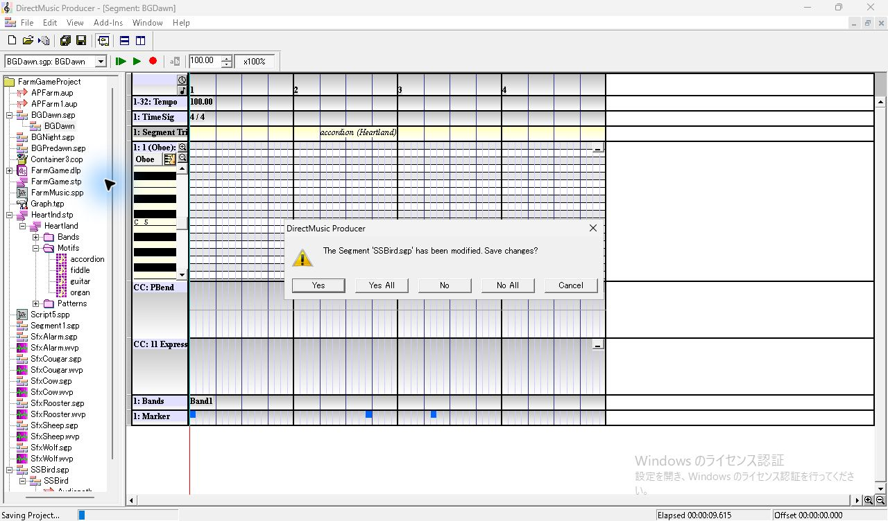
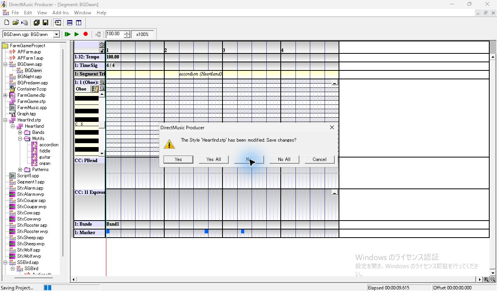
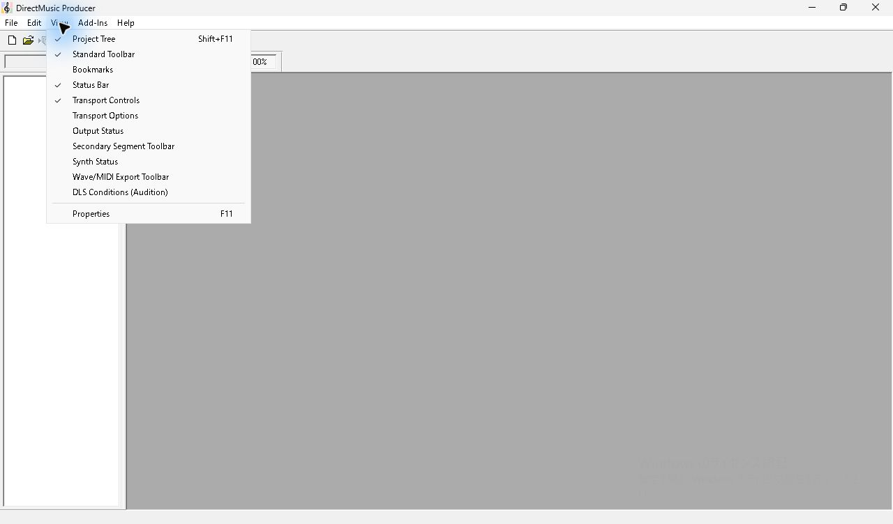
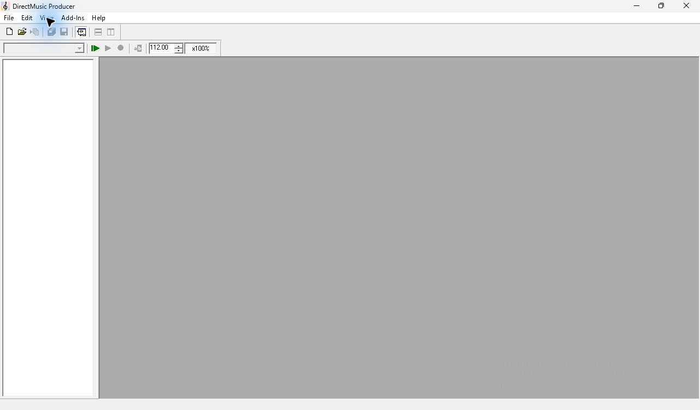
