# SEG-14　Segment Trigger の Primary、Secondary、Controlling Segment

2026-11-12。DirectMusic Producer 5.3.0.900 の作業コピーで、Segment Trigger の **Type** と **Performance Boundary** を変え、親子の Note On とテンポイベントを照合した。1280×752 px の撮影300枚から23枚を掲載。MIDI 9本と対応する親 SGP 9版、共通の子 SGP 1版を保存した。青い光と太い黒矢印は操作ツールの表示。 [凍結した比較用 Project](../../../work/original-gui/SEG-14-trigger-primary-control/20261111T195851708417Z/run.json) · [画像の出典とハッシュ](../../../work/original-gui/SEG-14-trigger-primary-control/20261111T195851708417Z/published-trigger-role-figures.json)

## 親と子を識別する音とテンポ

前回の Sequence 素材から、親 **BGDawn** を4小節、子 **SSBird** を2小節とし、両方とも4/4、Repeat 0。親のトリガーは1件で、**Start Time 2:2:300**、実時刻 **4140 clocks**、所属3840 clocks。**Quick Response** を固定。Marker トラックは **0、5184、7104 clocks**。子に Marker トラックはなく、Note On は PChannel 2 の35音。ローカル0から5952の各 Grid のキー48〜79と、Grid 間の識別音3件を使った。

親の PChannel 1 に次の8音を置いた。トリガー時刻の前後と、子が終わった後に親が続くかを区別できる。Tempo トラックは親が **100 BPM（0）→ 120 BPM（7680）→ 110 BPM（11520）**。子は **150 BPM（ローカル0）→ 125 BPM（ローカル3072）**。 [素材の作成手順](../../../work/original-gui/SEG-14-trigger-primary-control/20261111T195851708417Z/prepare-fixture.py) · [子 SGP](../../../work/original-gui/SEG-14-trigger-primary-control/20261111T195851708417Z/inputs/FarmGameProject/SSBird.sgp) · [識別音の内訳](seg-14-trigger-alignment.md)

| 親の時刻（clocks） | 親のキー | 比較での位置 |
| ---: | ---: | --- |
| 192、3960 | 40、41 | トリガー前 |
| 4416 | 42 | 次の Grid（4224）の後、次の Beat（4608）の前 |
| 4704、4992 | 43、44 | 次の Beat の後、次の Marker（5184）の前 |
| 5376、7680 | 45、46 | 次の Marker の後 |
| 11712 | 47 | 子の終端より後、親の第4小節内 |

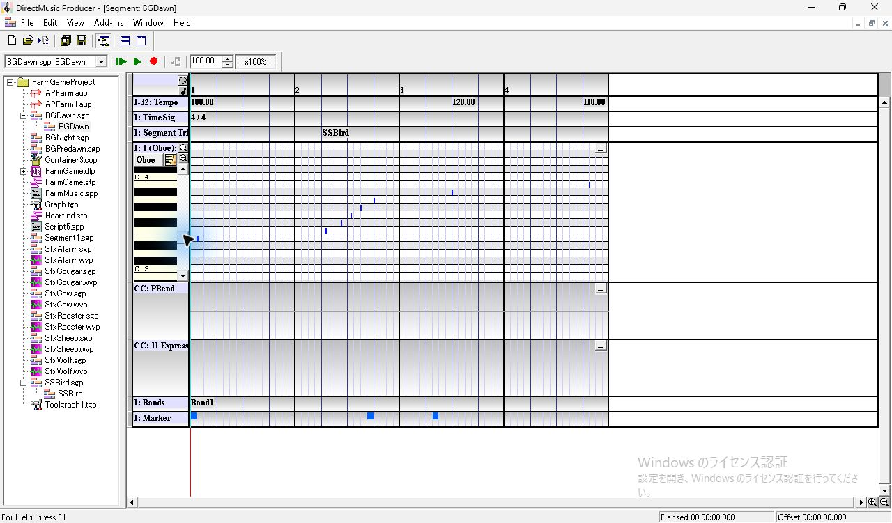
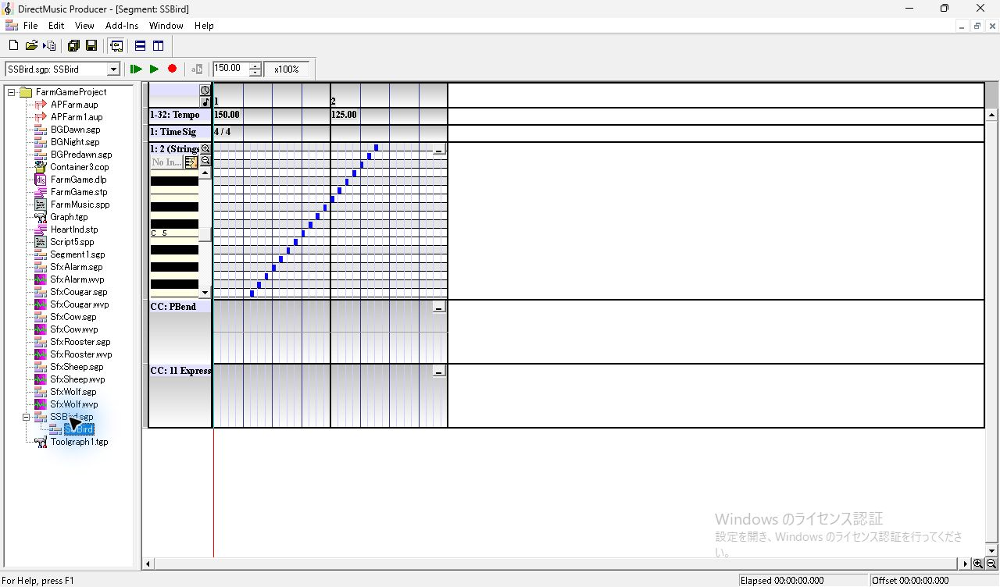

## Type の操作

親の **SSBird** ラベルを選択し、**F11 > Segment/Motif Trigger Properties > Segment** を開いた。Type の **Secondary** を選ぶと **Controlling Segment** を操作できる。チェックを入れたまま **Primary** に切り替えると、欄はチェックが外れて灰色になった。再び **Secondary** を選ぶと操作可能になり、チェックは空だった。保存値では Secondary のビットが `0x80`、Controlling Segment は Secondary に `0x200` を加えた値。設定を変えるたびにタイムライン上のラベルにフォーカスを戻して Ctrl+S で保存した。 [同梱ヘルプの Primary と Secondary](../../../../../work/analysis/original-manual-session/20261010T031624075Z/help-extracted/htm/primaryandsecondarysegments.htm) · [Controlling Segments](../../../../../work/analysis/original-manual-session/20261010T031624075Z/help-extracted/htm/controllingsegments.htm)

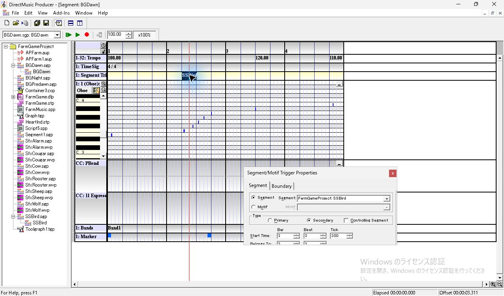
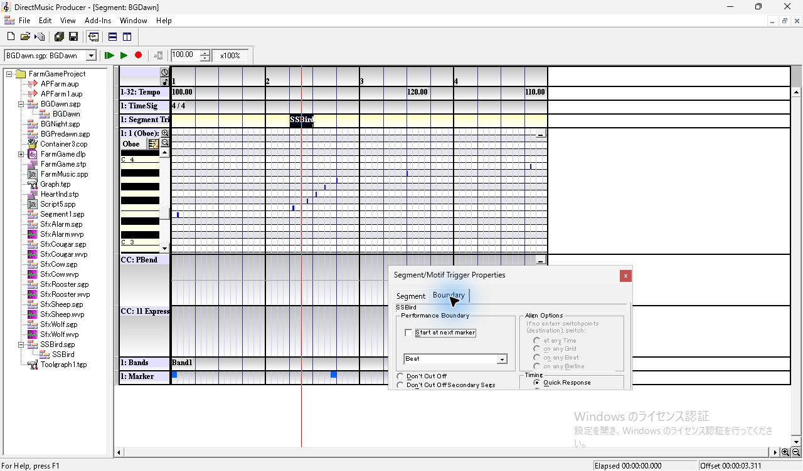
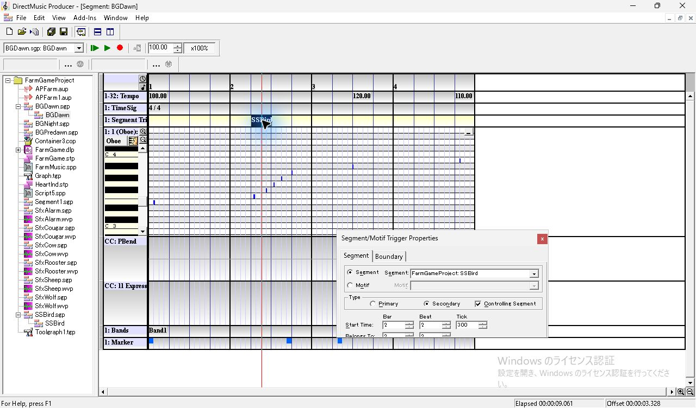
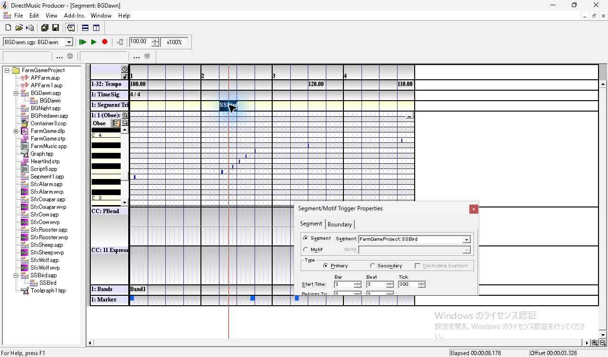

## Beat、Align、Start at next marker

**View > Wave/MIDI Export Toolbar** を一時表示。親を再生対象にし、MIDI 出力先を指定して記録ボタンを有効にした後、**Play From Start** から自然終了まで再生した。MIDI は768 ticks/拍。表の時刻は親の再生先頭を0とする。子の起点は、識別音の MIDI 時刻と子のローカル時刻の差から求めた。

| Boundary | Type | 子の起点 | 子の最初の Note On（ticks / キー） | 親の最後の Note On（ticks / キー） | 親 / 子の音数 | フラグ | 記録 |
| --- | --- | ---: | --- | --- | --- | --- | --- |
| Beat | Secondary、Control オフ | 4608 | 4608 / 48 | 11712 / 47 | 8 / 35 | `0x00001080` | [SGP](../../../work/original-gui/SEG-14-trigger-primary-control/20261111T195851708417Z/inputs/FarmGameProject/BGDawn.sgp) · [MIDI](../../../work/original-gui/SEG-14-trigger-primary-control/20261111T195851708417Z/captures/20-beat-secondary.mid) |
| Beat | Secondary、Control オン | 4608 | 4608 / 48 | 11712 / 47 | 8 / 35 | `0x00001280` | [SGP](../../../work/original-gui/SEG-14-trigger-primary-control/20261111T195851708417Z/captures/25-beat-controlling-BGDawn.sgp) · [MIDI](../../../work/original-gui/SEG-14-trigger-primary-control/20261111T195851708417Z/captures/26-beat-controlling.mid) |
| Beat | Primary | 4608 | 4608 / 48 | 4416 / 42 | 3 / 35 | `0x00001000` | [SGP](../../../work/original-gui/SEG-14-trigger-primary-control/20261111T195851708417Z/captures/30-beat-primary-BGDawn.sgp) · [MIDI](../../../work/original-gui/SEG-14-trigger-primary-control/20261111T195851708417Z/captures/31-beat-primary.mid) |
| Align to Barline、on any Grid | Secondary、Control オフ | 3072 | 4224 / 54 | 11712 / 47 | 8 / 27 | `0x00052080` | [SGP](../../../work/original-gui/SEG-14-trigger-primary-control/20261111T195851708417Z/captures/45-align-secondary-BGDawn.sgp) · [MIDI](../../../work/original-gui/SEG-14-trigger-primary-control/20261111T195851708417Z/captures/46-align-secondary.mid) |
| Align to Barline、on any Grid | Secondary、Control オン | 3072 | 4224 / 54 | 11712 / 47 | 8 / 27 | `0x00052280` | [SGP](../../../work/original-gui/SEG-14-trigger-primary-control/20261111T195851708417Z/captures/50-align-controlling-BGDawn.sgp) · [MIDI](../../../work/original-gui/SEG-14-trigger-primary-control/20261111T195851708417Z/captures/51-align-controlling.mid) |
| Align to Barline、on any Grid | Primary | 3072 | 4224 / 54 | 3960 / 41 | 2 / 27 | `0x00052000` | [SGP](../../../work/original-gui/SEG-14-trigger-primary-control/20261111T195851708417Z/captures/39-align-primary-BGDawn.sgp) · [MIDI](../../../work/original-gui/SEG-14-trigger-primary-control/20261111T195851708417Z/captures/40-align-primary.mid) |
| Start at next marker、代替 Beat | Secondary、Control オフ | 5184 | 5184 / 48 | 11712 / 47 | 8 / 35 | `0x01001080` | [SGP](../../../work/original-gui/SEG-14-trigger-primary-control/20261111T195851708417Z/captures/73-marker-secondary-BGDawn.sgp) · [MIDI](../../../work/original-gui/SEG-14-trigger-primary-control/20261111T195851708417Z/captures/74-marker-secondary.mid) |
| Start at next marker、代替 Beat | Secondary、Control オン | 5184 | 5184 / 48 | 11712 / 47 | 8 / 35 | `0x01001280` | [SGP](../../../work/original-gui/SEG-14-trigger-primary-control/20261111T195851708417Z/captures/58-marker-controlling-BGDawn.sgp) · [MIDI](../../../work/original-gui/SEG-14-trigger-primary-control/20261111T195851708417Z/captures/59-marker-controlling.mid) |
| Start at next marker、代替 Beat | Primary | 5184 | 5184 / 48 | 4992 / 44 | 5 / 35 | `0x01001000` | [SGP](../../../work/original-gui/SEG-14-trigger-primary-control/20261111T195851708417Z/captures/64-marker-primary-BGDawn.sgp) · [MIDI](../../../work/original-gui/SEG-14-trigger-primary-control/20261111T195851708417Z/captures/65-marker-primary.mid) |

**Beat** では、3つの Type で子の Note On が全件一致し、次の拍の4608 ticksから子のローカル0が鳴った。Secondary の2回は親のカーソルが第3小節以降へ進み、親の8音もすべて出た。Primary は親の位置線と **Elapsed** が Beat 境界で止まり、その後の親の音が記録されなかった。子が続く間も Transport の対象欄は **BGDawn** のまま停止ボタンが表示され、子の自然終了後に再生ボタンが戻った。

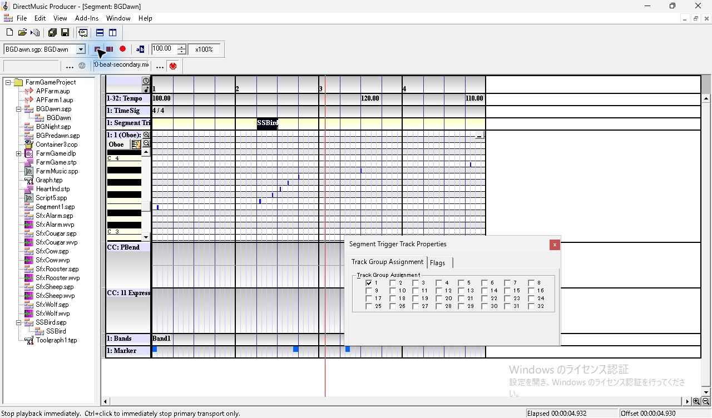
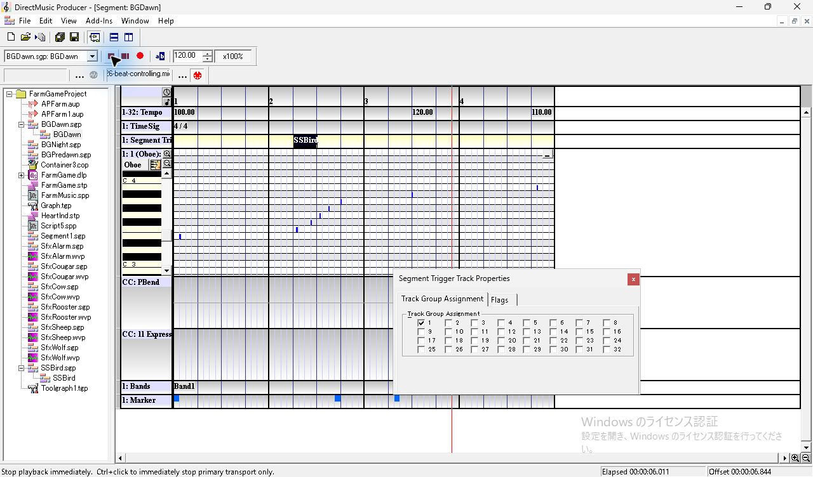

**Align to Barline / on any Grid** は、3つの Type とも子の起点3072、最初の Note On が4224 ticksのキー54。子の先頭側の8音が省かれた。Primary で親が止まる位置は子のローカル0に対応する3072より後、実際の発音境界4224だった。親の Offset 表示は **3.299秒** 付近で止まり、4416のキー42は MIDI に出なかった。Secondary の2条件は同じ子の出力と親の8音を記録した。

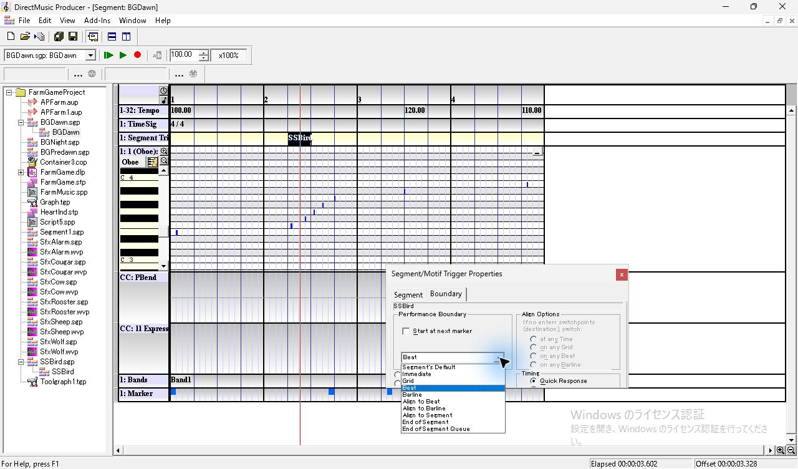
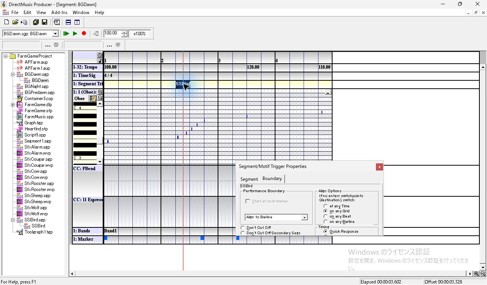

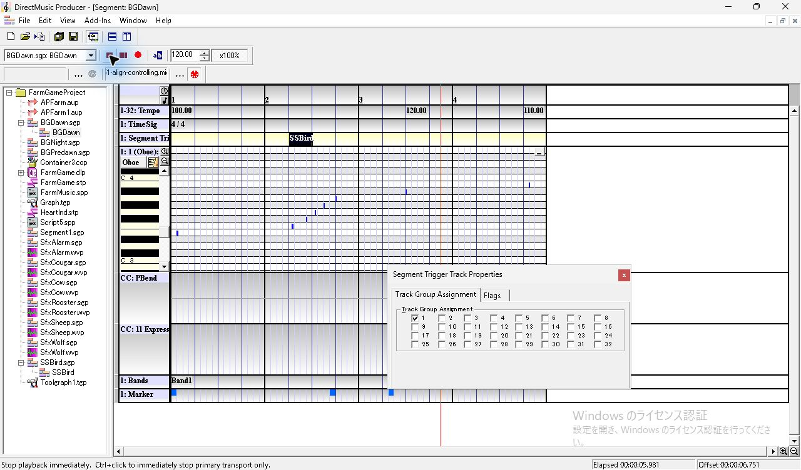

**Start at next marker** は、3つの Type とも親の後続 Marker **5184 ticks** に子のローカル0を置いた。Primary では Beat より後の4704、4992 ticksの親の音も出て、親の位置線が Marker で止まった。最初の Primary / Marker の再生では自然終了後も MIDI ファイル名が残り、ファイルが生成されなかった。同じ設定で MIDI の記録ボタンを押し直して再収録し、子の35音と親の5音が入ったファイルを確認した。

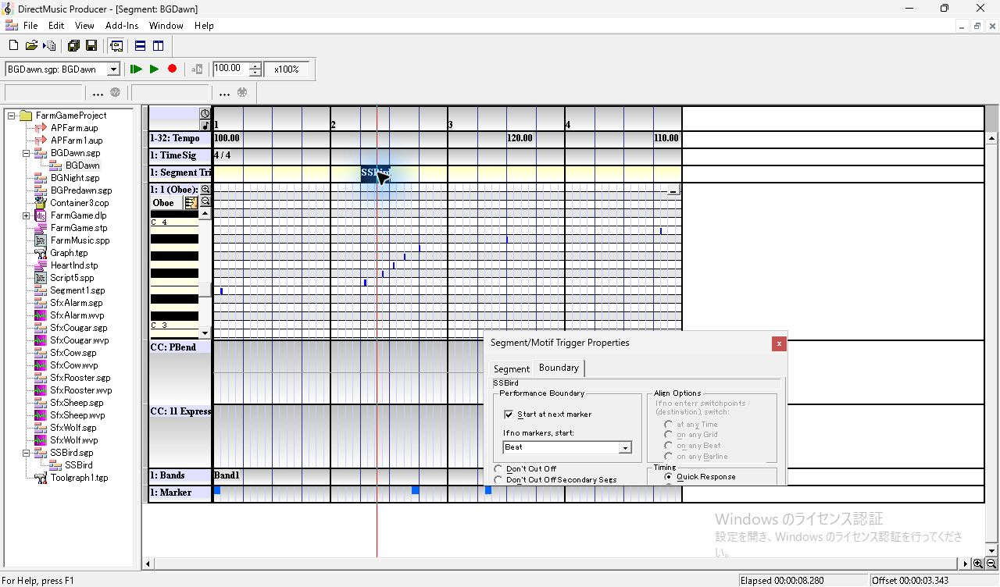

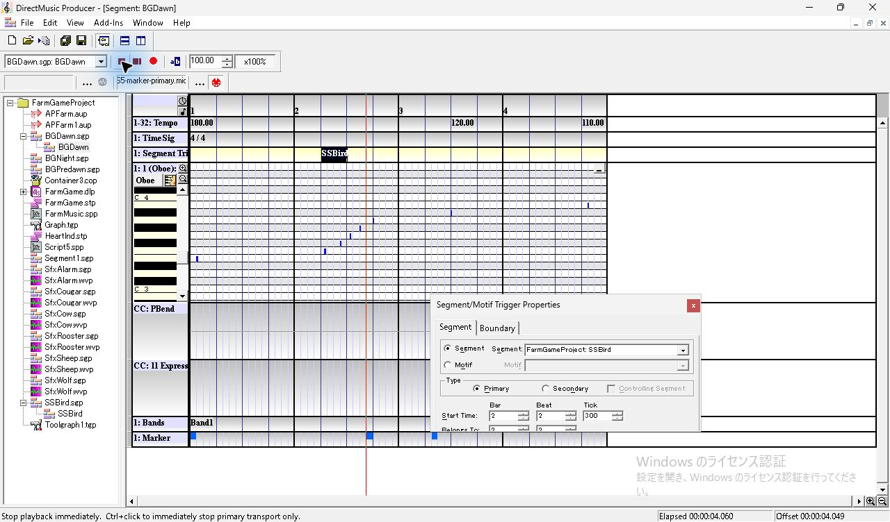

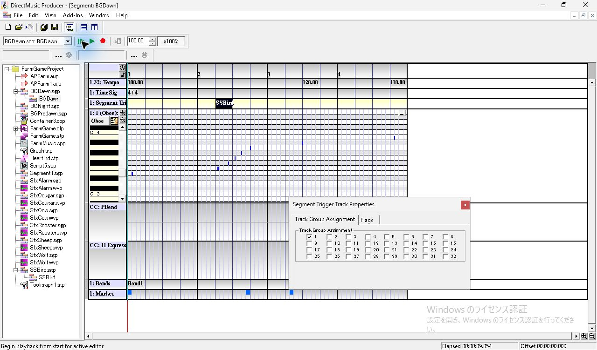

## MIDI に書き出されたテンポ

全条件で冒頭は親の **0 ticks / 100 BPM**。以降のテンポイベントを出現順に示す。MIDI の µs/拍は100 BPMが600000、110が545454、120が500000、125が480000、150が400000だった。

| 境界 | Secondary、Control オフ | Secondary、Control オン | Primary |
| --- | --- | --- | --- |
| Beat | 7680 / 120、11520 / 110 | 4608 / 150、7680 / 120、7680 / 125、11520 / 110 | 4608 / 150、7680 / 125 |
| Align | 7680 / 120、11520 / 110 | 4224 / 150、6144 / 125、7680 / 120、11520 / 110 | 4224 / 150、6144 / 125 |
| Marker | 7680 / 120、11520 / 110 | 5184 / 150、7680 / 120、8256 / 125、11520 / 110 | 5184 / 150、8256 / 125 |

通常 Secondary では親のテンポイベントのみ、Controlling Segment をオンにすると子の2件も MIDI に入った。**Align の150 BPM** は子のローカル0の対応先3072でなく、実際の発音境界4224に出た。**125 BPM** は、子の起点3072から3072進んだ6144に出た。Primary では親の後続のテンポイベントも出なかった。

Controlling Segment の **Beat** では、子が鳴っている7680 ticksに親の120 BPMと子の125 BPMがこの順で並んだ。**Align と Marker** でも、子の発音区間に親の120 BPMのイベントが記録された。この表は Producer が出力した MIDI の値。後続の Beat の試験では、実際の音の間隔で子の125 BPMが続き、子の終了直後から親の120 BPMに戻ることを測った。Align と Marker の実時間は別条件。 [9条件の SGP、全 Note On とテンポイベント](../../../work/original-gui/SEG-14-trigger-primary-control/20261111T195851708417Z/trigger-primary-control-audit.json) · [Controlling Segment のテンポ競合と実際の音の間隔](seg-14-trigger-tempo-audio.md)

## 終了時の状態

Wave/MIDI Export Toolbar を非表示にして Project を閉じた。試行 Project の親は **通常 Secondary、Start at next marker オン、代替 Beat**。凍結入力28件はハッシュが一致し、開始と同じ Producer 1件を使用した。View は Project Tree、Standard Toolbar、Status Bar、Transport Controls の4項目を表示。 [終了時のウィンドウ一覧](../../../work/original-gui/SEG-14-trigger-primary-control/20261111T195851708417Z/captures/83-final-windows.json)

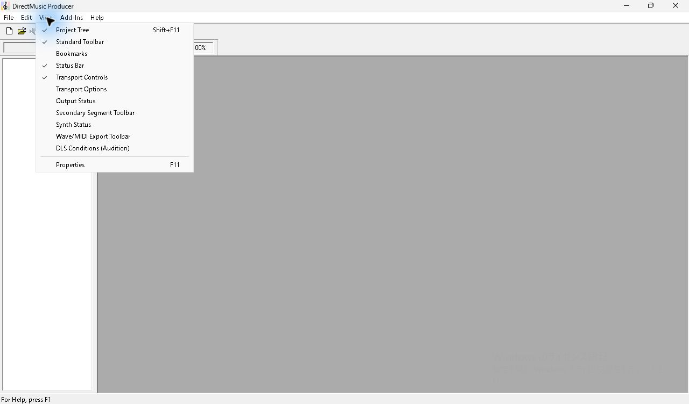
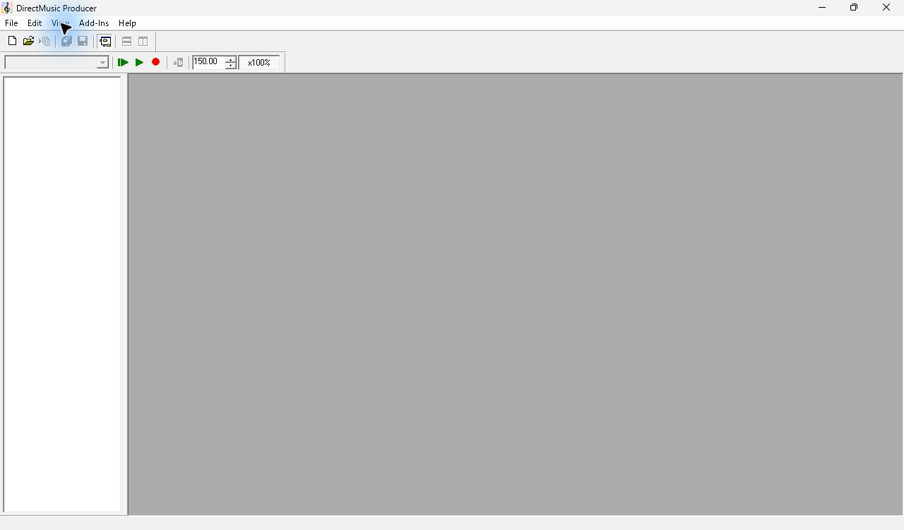

