# SEG-14　Controlling Segment のテンポ競合と実際の音の間隔

2026-11-12。DirectMusic Producer 5.3.0.900 の作業コピーで、Segment Trigger の **Beat** 境界を使い、親と子のテンポが競合した場合の再生速度を測った。1280×752 px の撮影167枚から22枚を掲載。WAV 6本、うち同時に書き出せた MIDI 5本と、対応する保存ファイルを照合した。青い光と太い黒矢印は操作ツールの表示。 [凍結した Project と環境](../../../work/original-gui/SEG-14-trigger-tempo-audio/20261111T212007251552Z/run.json) · [保存値・MIDI・WAV の測定結果](../../../work/original-gui/SEG-14-trigger-tempo-audio/20261111T212007251552Z/trigger-tempo-audio-audit.json) · [画像の出典とハッシュ](../../../work/original-gui/SEG-14-trigger-tempo-audio/20261111T212007251552Z/published-trigger-tempo-figures.json)

## 比較用の親と子

前回の Beat 試験から親子のテンポとトリガーを引き継ぎ、音の間隔を取り出しやすいよう Sequence のノートを差し替えた。親 **BGDawn** は4小節、子 **SSBird** は2小節。いずれも4/4、Repeat 0。親は **PChannel 1、キー57、半拍ごとに31音**。子は **PChannel 2、キー83、先頭とローカル576 clocksから1拍ごとに計9音**。ノートの長さはすべて120 clocks、ベロシティ100。親の Sequence は青い短いノートが同じ高さに並ぶ。 [比較用の親 SGP](../../../work/original-gui/SEG-14-trigger-tempo-audio/20261111T212007251552Z/inputs/FarmGameProject/BGDawn.sgp) · [比較用の子 SGP](../../../work/original-gui/SEG-14-trigger-tempo-audio/20261111T212007251552Z/inputs/FarmGameProject/SSBird.sgp) · [素材の作成手順](../../../work/original-gui/SEG-14-trigger-tempo-audio/20261111T212007251552Z/prepare-fixture.py)

| 位置（親の clocks） | 保存されたイベント |
| ---: | --- |
| 0 | 親 100 BPM |
| 4140 | 親のトリガー Start Time **2:2:300** |
| 4608 | 次の Beat。子がローカル0から始まり、子はここに150 BPMを持つ |
| 7680 | 親120 BPMと子125 BPMが同時。位置をずらす対照では親の120 BPMだけを8448へ移す |
| 10752 | 子の2小節が終了 |
| 11520 | 親の110 BPM |

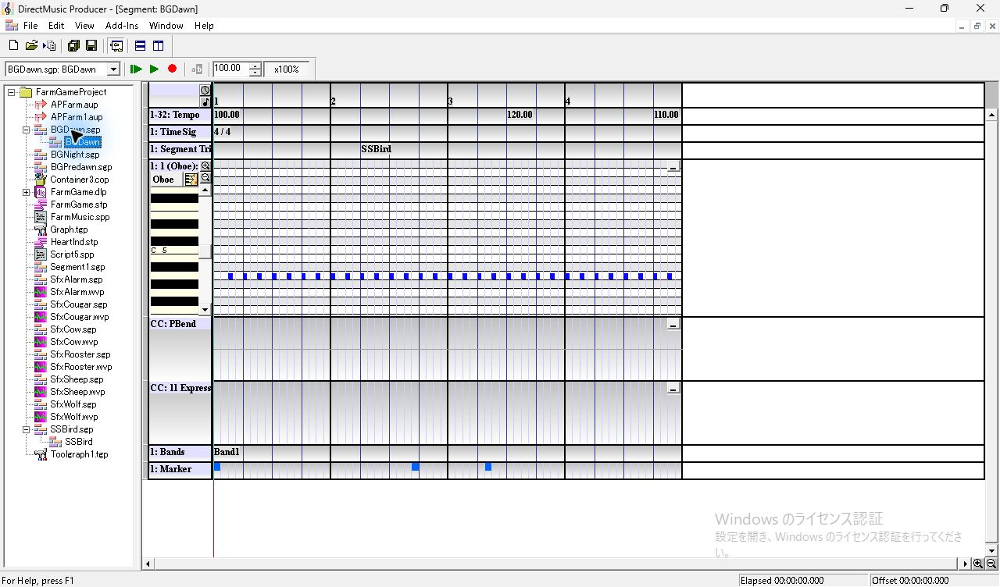
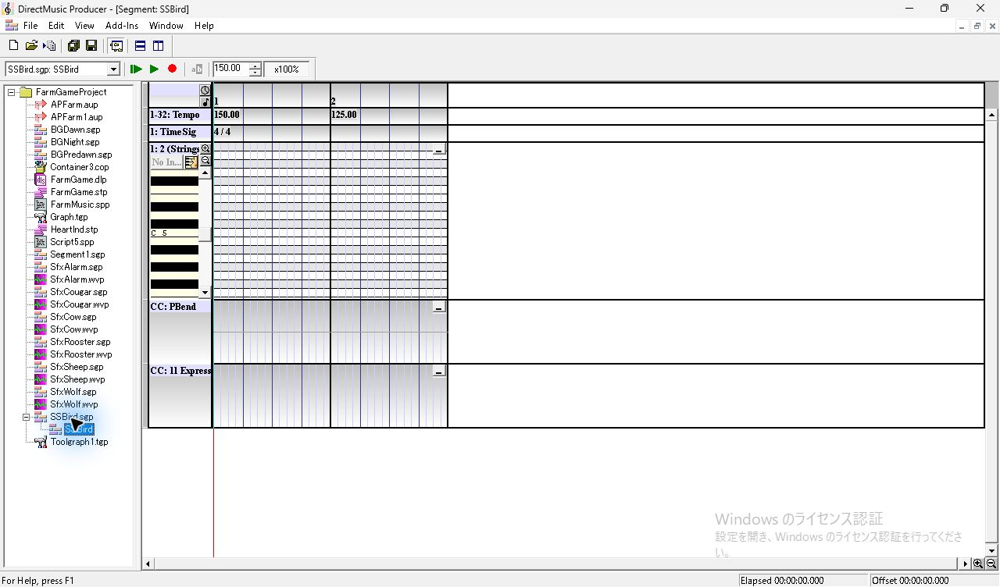

## 再生と記録の操作

親の **SSBird** ラベルをクリックし、**F11 > Segment** で Type を確認。**Boundary** は全試行 **Beat / Quick Response**、**Start at next marker** はオフ。**View > Wave/MIDI Export Toolbar** を一時表示し、MIDI 側の **…** でファイル名を指定する。右隣の MIDI ボタンで記録を待機し、既定の再生エンドポイントのループバック録音が始まってから、親を対象に **Play From Start** を押した。WAV は各15秒、48 kHz、32-bit float、ステレオ。

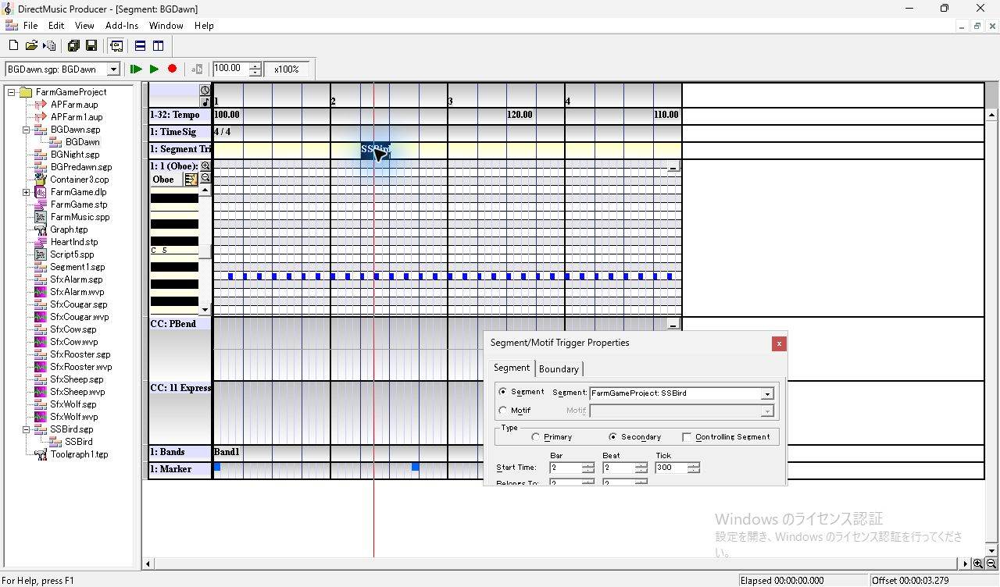
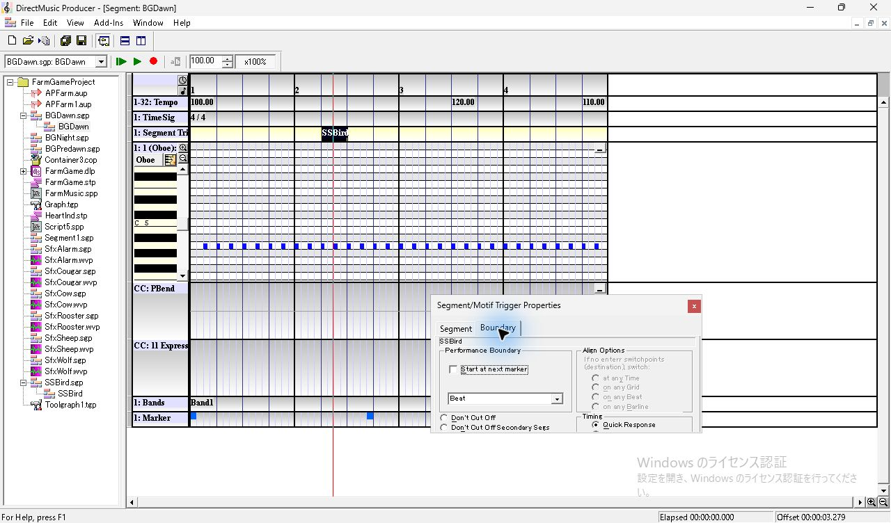
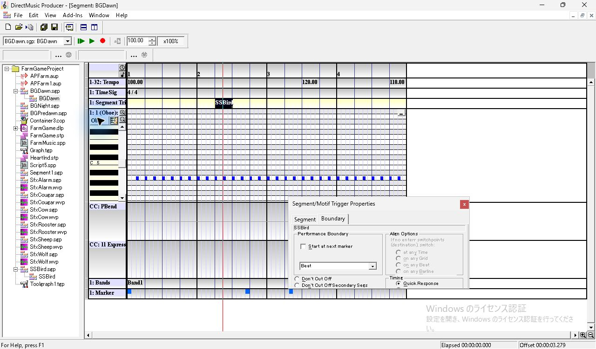
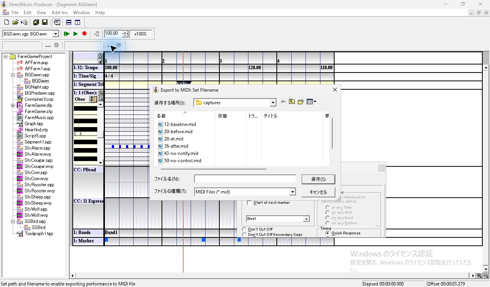

**Secondary** の **Controlling Segment** にチェックを入れて保存し、同じ設定で2回収録した。どちらも親の再生位置線は進み続けた。1回目の再生画面では、子の150 BPMで進んでいる区間でも Transport の欄は **100.00**。親の120 BPMイベントを通過した後は **120.00**、この区間の音の間隔は子の125 BPMだった。終盤は親の110 BPMの拍を通過し、**110.00** が表示された。Transport 欄の表示と実際の間隔はこの条件で別々に記録する必要がある。

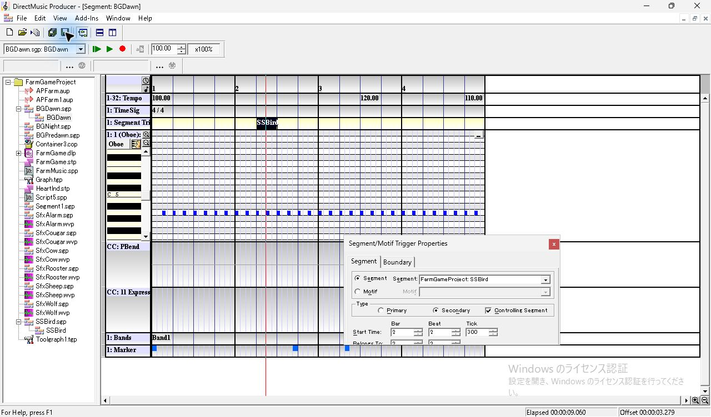
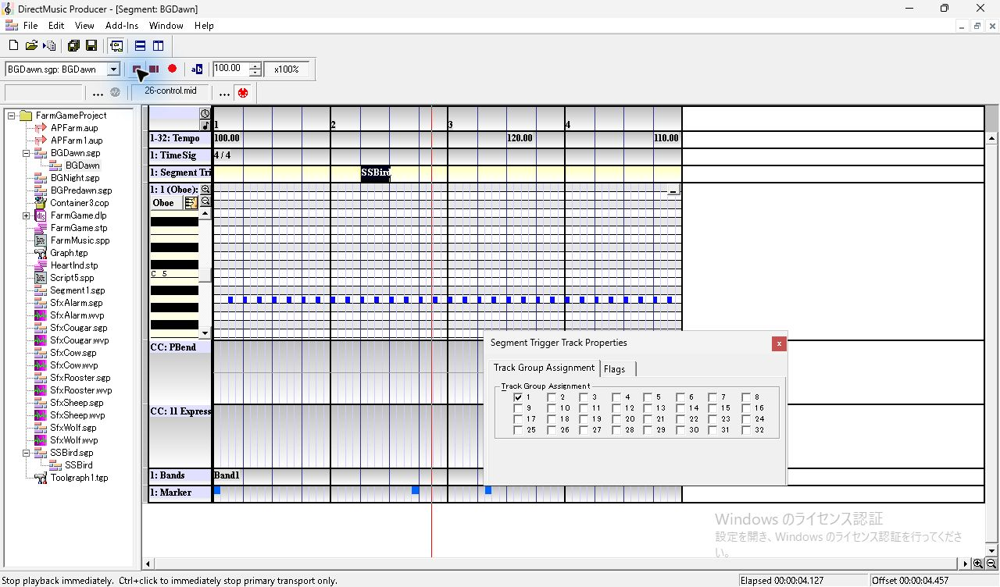

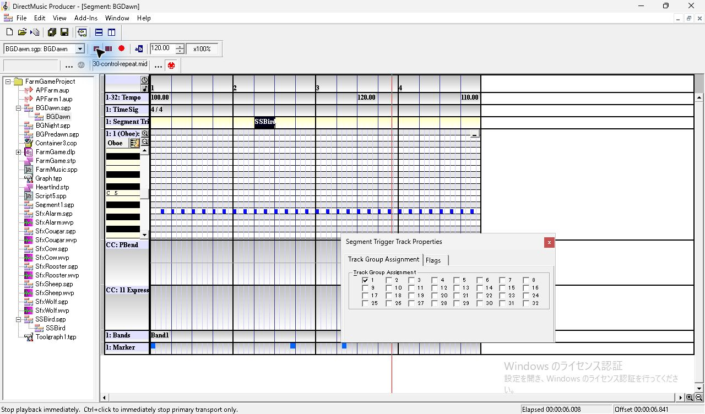

同時刻の競合を解く対照では、親の Tempo 行の **120.00** をクリックした。選択した拍が濃い背景になり、**Tempo Properties** に **Measure 3 / Beat 3 / Tick 0** が出る。Beat の上スピンを1回押すと **Beat 4** になり、選択とラベルが1拍右へ動いた。値は **120.00** のまま。保存後、Controlling Segment をオンのまま収録した。

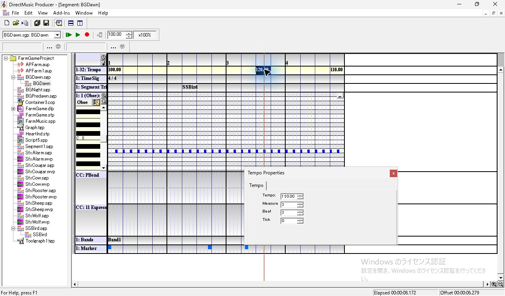
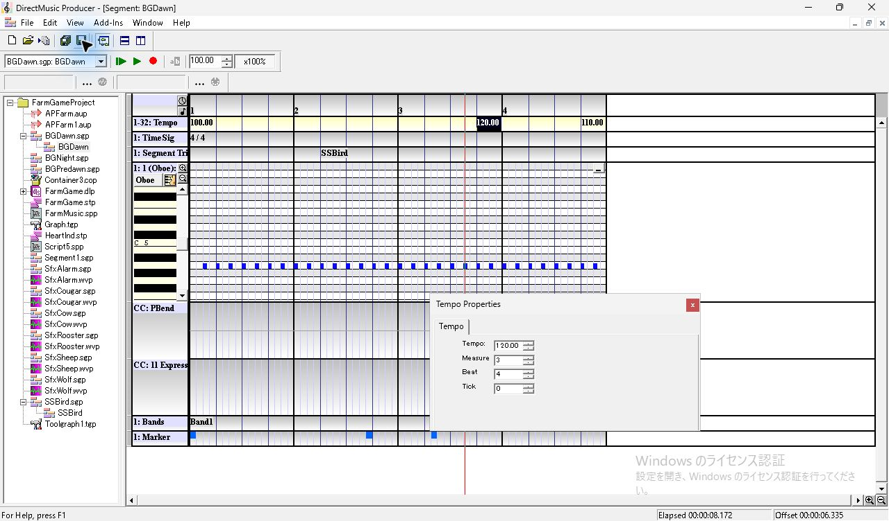
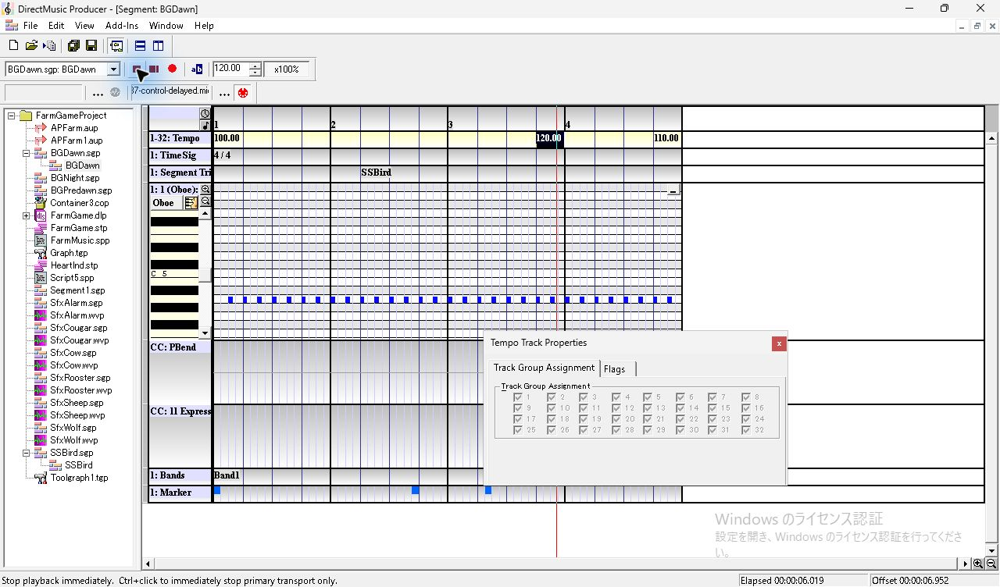

最後にトリガーを **Primary** に変更。Controlling Segment のチェックが外れ、欄は灰色になった。親の位置線と Elapsed は子の開始境界付近で止まり、子が続く間は停止ボタンが表示された。1回目は自然終了後もファイル名が残り、MIDI は生成されなかった。WAV を保全し、MIDI ボタンを押し直して別のファイル名で再収録した。再収録では MIDI と WAV の両方を確認した。

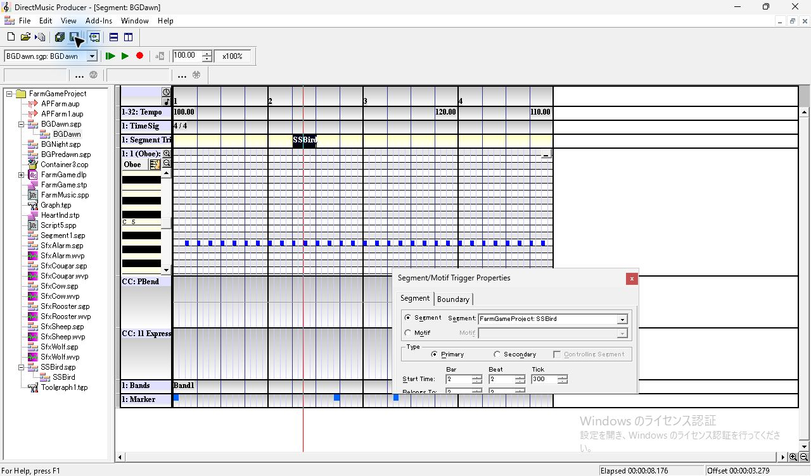

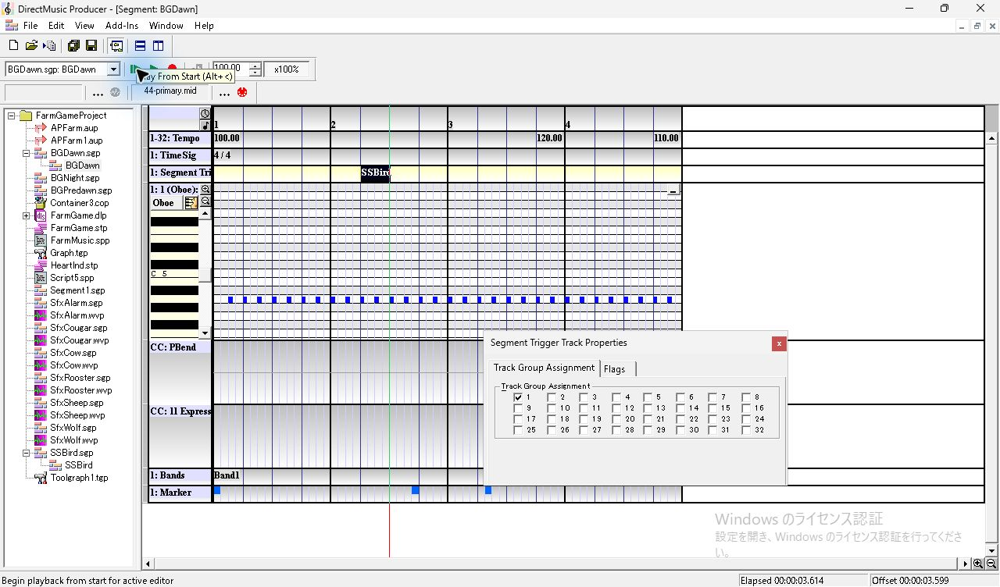

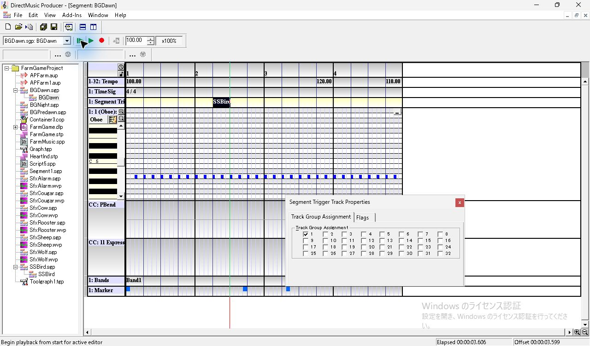

## WAV で測ったテンポ

左右の平均波形に30 msの Hann 窓を掛け、2 msごとに親のキー57（220 Hz）と子のキー83（約987.8 Hz）の振幅を測った。振幅 **0.008** 以上の区間が6窓以上続き、ピークが親 **0.016**、子 **0.030** 以上のものを1音とした。各区間の先頭窓の中心を取り、音の並びを保存ファイルと MIDI の Note On に対応させた。録音開始から最初の音までの時間は試行ごとに異なるため、同じチャンネル内の音の間隔を使った。全録音で開始後約14〜21 msにパケット不連続が1件あり、最初の音より前だった。タイムスタンプエラーは0件。 [測定スクリプト](../../../work/original-gui/SEG-14-trigger-tempo-audio/20261111T212007251552Z/analyze-tempo-audio.py)

表は親の音から求めた **1拍当たりの時間（ms）**。各区間の両端にあるノートの間隔を拍数で割った。110 BPM の列だけ半拍分を2倍している。基準値は **100 BPM = 600 ms、150 = 400 ms、125 = 480 ms、120 = 500 ms、110 ≈ 545 ms**。

| Type | 384→4608 | 4608→7680 子の前半 | 7680→8448 競合直後 | 8448→10752 子の残り | 10752→11520 子の終了直後 | 11520→11904 |
| --- | ---: | ---: | ---: | ---: | ---: | ---: |
| 通常 Secondary | 599.64 | 600.00 | 500.00 | 500.00 | 500.00 | 548.00 |
| Controlling、同時刻1回目 | 599.64 | 399.50 | 480.00 | 480.00 | 502.00 | 544.00 |
| Controlling、同時刻2回目 | 599.64 | 399.50 | 480.00 | 480.00 | 502.00 | 548.00 |
| Controlling、親の120 BPMを1拍遅らせた | 600.00 | 399.00 | 480.00 | 480.67 | 502.00 | 544.00 |

通常 Secondary と Controlling では親31音・子9音を検出した。子自身の音でも、前半の5952→7488と後半の9024→10560を測ると、通常 Secondary は1拍 **600 / 500 ms**、Controlling の3回は **400 / 480 ms**。Primary は親の音が11個で止まり、最後の親の Note On は4224。子は4608から9音が鳴り、両試行で前半約400 ms、後半約480 ms。子の終了後に親の音が再開することはなかった。

## MIDI と実際の再生速度の差

MIDI の分解能は全5本で768 ticks/拍、先頭は100 BPM。次の表は以後のテンポイベントを **tick / BPM** で示す。

| 試行 | MIDI のテンポイベント | 保存・収録 |
| --- | --- | --- |
| 通常 Secondary | 7680 / 120、11520 / 110 | [親 SGP](../../../work/original-gui/SEG-14-trigger-tempo-audio/20261111T212007251552Z/captures/17-secondary-BGDawn.sgp) · [MIDI](../../../work/original-gui/SEG-14-trigger-tempo-audio/20261111T212007251552Z/captures/17-secondary.mid) · [WAV](../../../work/original-gui/SEG-14-trigger-tempo-audio/20261111T212007251552Z/captures/audio-17-secondary/output.wav) |
| Controlling、同時刻1回目 | 4608 / 150、7680 / 120、7680 / 125、11520 / 110 | [親 SGP](../../../work/original-gui/SEG-14-trigger-tempo-audio/20261111T212007251552Z/captures/26-control-BGDawn.sgp) · [MIDI](../../../work/original-gui/SEG-14-trigger-tempo-audio/20261111T212007251552Z/captures/26-control.mid) · [WAV](../../../work/original-gui/SEG-14-trigger-tempo-audio/20261111T212007251552Z/captures/audio-26-control/output.wav) |
| Controlling、同時刻2回目 | 1回目と同じ | [MIDI](../../../work/original-gui/SEG-14-trigger-tempo-audio/20261111T212007251552Z/captures/30-control-repeat.mid) · [WAV](../../../work/original-gui/SEG-14-trigger-tempo-audio/20261111T212007251552Z/captures/audio-30-control-repeat/output.wav) |
| Controlling、親を1拍遅らせた | 4608 / 150、7680 / 125、8448 / 120、11520 / 110 | [親 SGP](../../../work/original-gui/SEG-14-trigger-tempo-audio/20261111T212007251552Z/captures/37-control-delayed-BGDawn.sgp) · [MIDI](../../../work/original-gui/SEG-14-trigger-tempo-audio/20261111T212007251552Z/captures/37-control-delayed.mid) · [WAV](../../../work/original-gui/SEG-14-trigger-tempo-audio/20261111T212007251552Z/captures/audio-37-control-delayed/output.wav) |
| Primary、初回 | ファイル生成なし | [親 SGP](../../../work/original-gui/SEG-14-trigger-tempo-audio/20261111T212007251552Z/captures/44-primary-BGDawn.sgp) · [WAV](../../../work/original-gui/SEG-14-trigger-tempo-audio/20261111T212007251552Z/captures/audio-44-primary/output.wav) |
| Primary、再収録 | 4608 / 150、7680 / 125 | [MIDI](../../../work/original-gui/SEG-14-trigger-tempo-audio/20261111T212007251552Z/captures/50-primary-retry.mid) · [WAV](../../../work/original-gui/SEG-14-trigger-tempo-audio/20261111T212007251552Z/captures/audio-50-primary-retry/output.wav) |

- **同時刻**。2回とも7680からの実測は480 ms/拍で、子の125 BPMと一致。子が終わった10752からの最初の拍は502 msで、親の120 BPMと一致した。この位置の復帰イベントは MIDI にない。MIDI の125 BPMをそのまま11520まで適用すると、この拍を480 msと見積もるため、WAV と **22 ms** ずれる。
- **親を1拍遅らせた場合**。8448の120 BPMは MIDI に出た。WAV はその後も子の125 BPMで進み、10752で120 BPM相当へ戻った。8448からの3拍に MIDI の120 BPMをそのまま適用した値は1.500秒で、WAV の **1.442秒** より58 ms長い。
- **通常 Secondary と Primary**。通常 Secondary は親のテンポで親子が進んだ。Primary は子の開始で親の識別音が止まり、その後は子のテンポで進んだ。

比較範囲はこの親子の **Beat** 境界、1件のトリガー、既定の再生エンドポイント。Align、Start at next marker、複数の Controlling Segment が同時に鳴る構成での実時間は別条件。 [前回の Beat・Align・Marker の MIDI 比較](seg-14-trigger-primary-control.md) · [各音の検出フレームと区間測定](../../../work/original-gui/SEG-14-trigger-tempo-audio/20261111T212007251552Z/trigger-tempo-audio-audit.json)

## 終了時の状態

Wave/MIDI Export Toolbar を非表示に戻して Project を閉じた。Producer は開始時と同じ1件。View のチェックは **Project Tree、Standard Toolbar、Status Bar、Transport Controls** の4項目。凍結入力28件のハッシュを照合した。 [終了時のウィンドウ一覧](../../../work/original-gui/SEG-14-trigger-tempo-audio/20261111T212007251552Z/captures/57-final-windows.json)

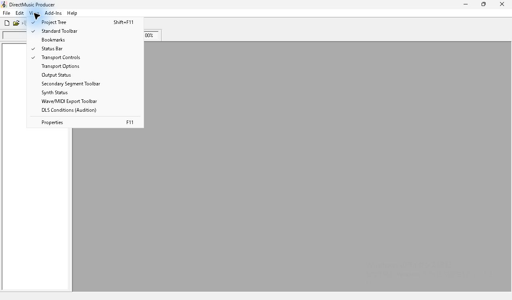
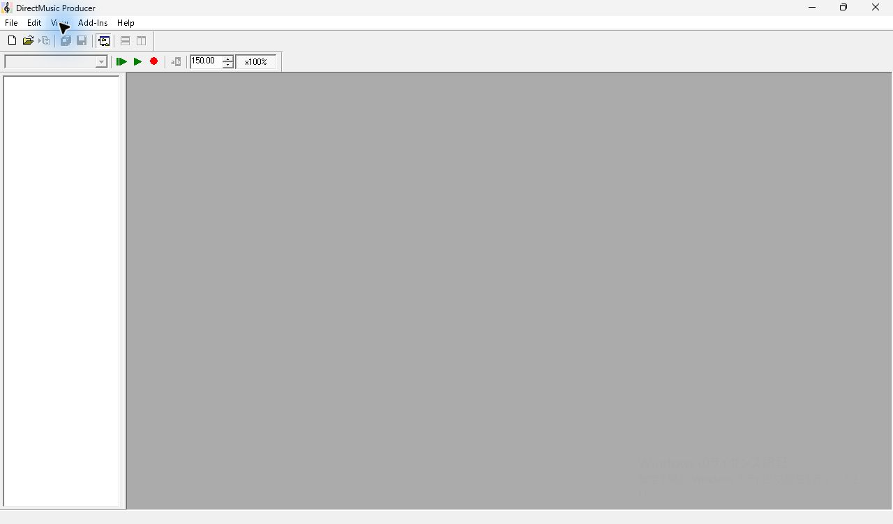
