# SEG-14　Pattern の Reset Variation Order on Play と単独試聴

2026-11-12。DirectMusic Producer 5.3.0.900 の作業コピーで、Segment エディターの **Play From Start** を検証。前回の SSBird の保存版から1 Part・2 Variation の比較素材を作った。画面1280×752 px、最大化。撮影373枚から35枚を掲載。MIDI を収録する間だけ Wave/MIDI Export Toolbar を表示した。太い黒矢印と青い光は操作ツールの表示。 [前回の Var Switch Point](seg-14-variation-playback.md) · [実行ファイルと凍結入力28件](../../../work/original-gui/SEG-14-variation-order/20261111T174715298940Z/run.json) · [画像の出典・寸法・ハッシュ](../../../work/original-gui/SEG-14-variation-order/20261111T174715298940Z/published-variation-order-figures.json)

## 比較用の7小節と2つのノート

前回保存した SSBird の RIFF から PChannel 13 の Part と PartRef を残し、Var Switch Point と CC のイベントを取り除いた。**Segment は7小節、Pattern と Part は1小節、1/4・4グリッド・100 BPM**。第1小節にコード `1CM7`、Band1 と埋め込み AudioPath を残した。2つのノートを第1小節の第2グリッド（192 clocks）に置き、長さを192 clocksにそろえた。Variation 1 と2だけを再生許可し、両方を表示した状態で開く。 [前回の17小節版](../../../work/original-gui/SEG-14-variation-playback/20261111T172518762072Z/captures/ordered-17bars-reset-on-SSBird.sgp) · [素材作成のスクリプト](../../../work/original-gui/SEG-14-variation-order/20261111T174715298940Z/prepare-fixture.py) · [凍結した SSBird](../../../work/original-gui/SEG-14-variation-order/20261111T174715298940Z/inputs/FarmGameProject/SSBird.sgp)

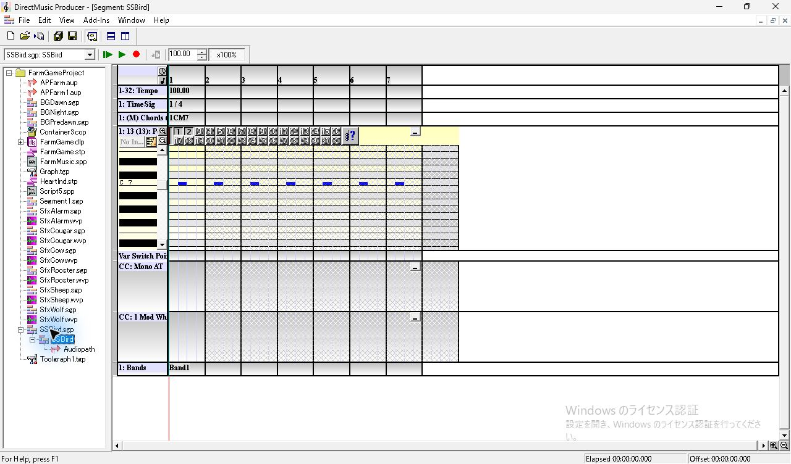

鍵盤横の下側の虫眼鏡を2回押し、後の観察で鍵盤の縦スクロールつまみを上へ11 px ドラッグすると、**C 7** と **C 6** が同じピアノロールに入った。第2小節以降に斜線付きで同じノートが並ぶ。第1小節のノートをクリックして F11 を押すと **Pattern Note Properties**。選択した音高のノートは反復表示も赤くなった。**Variations/Flags** に切り替えると、C 7 は1だけに、C 6 は2だけにチェックがある。同じタブを開いたまま他方のノートを選ぶと表示が切り替わった。単独試聴の MIDI では C 7 がキー84、C 6 がキー72だった。

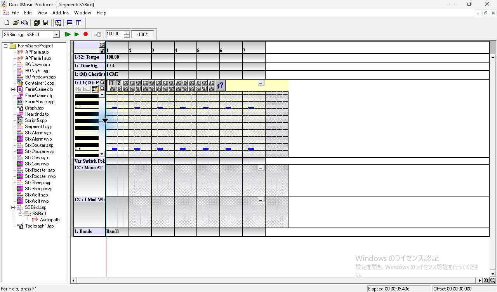
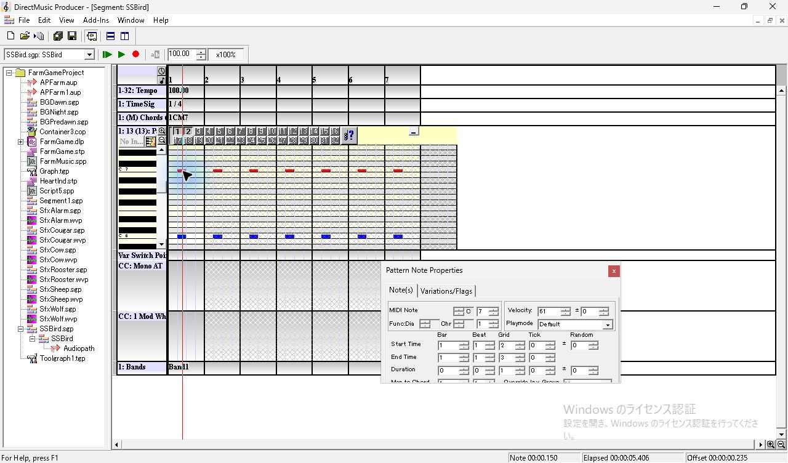
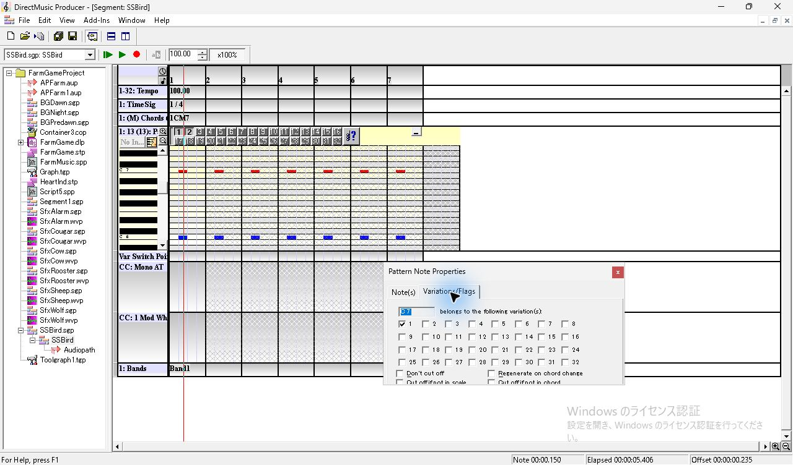
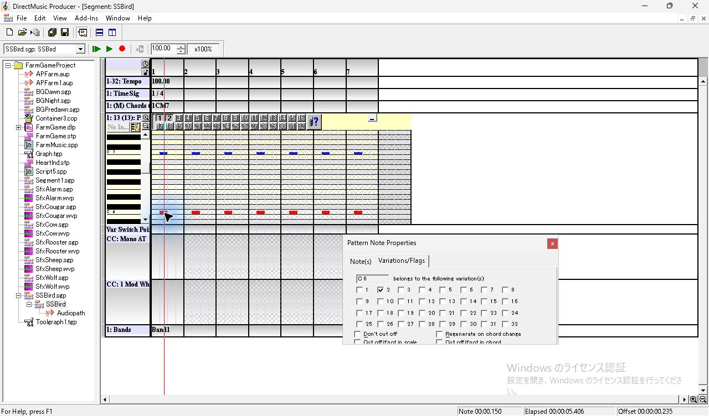

## Segment Loop なしでの連続再生

13のヘッダーを選び、**F11 > Part** で **Variations > Play** が **in order from first**、**Lock ID** が **None**、Length が **1 Bar(s)** と確認。**Pattern** タブで **Reset Variation Order on Play** を確認した。最初の4回は両方を表示し、Reset オンで2回、次にオフで2回、**Play From Start** から自然終了まで MIDI を収録した。各回のチャンネル13は、7小節ともキー72だった。

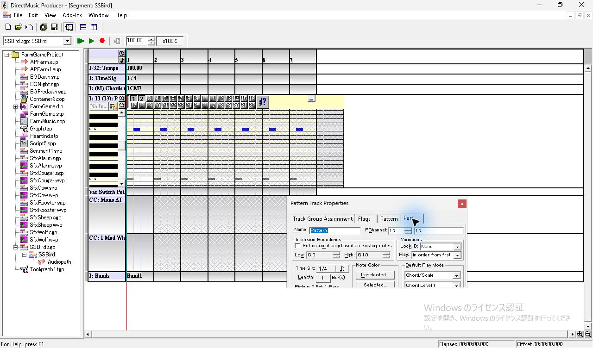
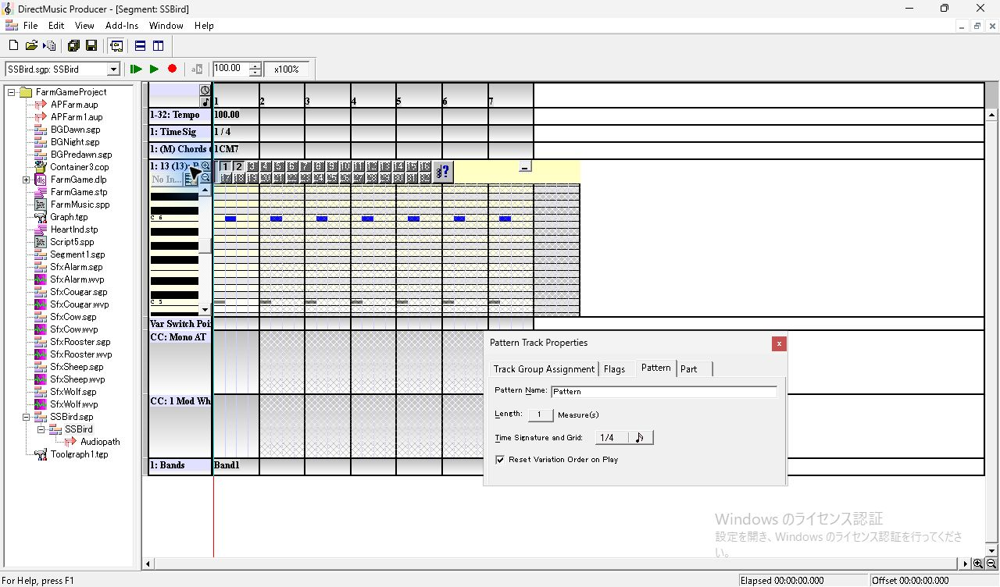
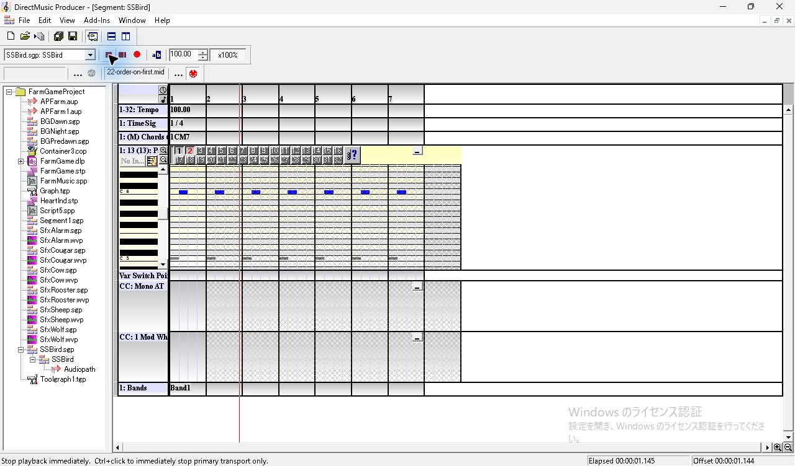
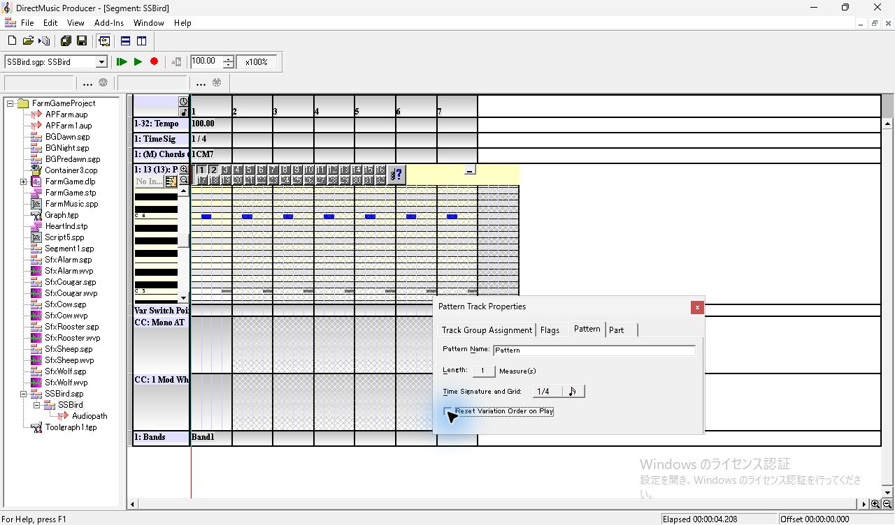

| Repeat | Reset | 再生前の操作 | チャンネル13 | MIDI |
| ---: | --- | --- | --- | --- |
| 0 | オン | 初回、続けて再生 | 両回ともキー72 × 7 | [初回](../../../work/original-gui/SEG-14-variation-order/20261111T174715298940Z/captures/22-order-on-first.mid) · [再開](../../../work/original-gui/SEG-14-variation-order/20261111T174715298940Z/captures/23-order-on-replay.mid) |
| 0 | オフ | 設定を変更、続けて再生 | 両回ともキー72 × 7 | [初回](../../../work/original-gui/SEG-14-variation-order/20261111T174715298940Z/captures/31-order-off-first.mid) · [再開](../../../work/original-gui/SEG-14-variation-order/20261111T174715298940Z/captures/32-order-off-replay.mid) |
| 0 | オフ | 2をクリックして非表示 | キー84 × 7 | [1だけ](../../../work/original-gui/SEG-14-variation-order/20261111T174715298940Z/captures/34-solo-var1.mid) |
| 0 | オフ | 1だけの試聴後、2を再表示 | キー84 × 7 | [1と2](../../../work/original-gui/SEG-14-variation-order/20261111T174715298940Z/captures/36-both-after-var1.mid) |

Reset オフのまま **2** を1回クリックすると、2のノートが青い編集対象から外れた。そのまま再生すると赤い **1** とキー84。停止後に **2** を再度クリックして両方を表示しても、次の再生はキー84のままだった。

## 第1小節を実際に2回ループさせた比較

Project Tree の内側の **SSBird** を右クリックし、**Properties > Loop**。Repeat の上矢印を2回押し、**Repeat 2**、**Loop Start 1:1:1:0**、**Loop End 2:1:1:0**。Loop End の Bar をダブルクリックし、**2** を入力して Tab で確定した。**Clock Time Looping** と **Infinite** はオフ。保存されたループ範囲は **0〜768 clocks**。第1小節が計3回、第2〜7小節が各1回で、再生時間は約5.4秒だった。 [Reset オフ](../../../work/original-gui/SEG-14-variation-order/20261111T174715298940Z/captures/loop-reset-off-SSBird.sgp) · [Reset オン](../../../work/original-gui/SEG-14-variation-order/20261111T174715298940Z/captures/loop-reset-on-SSBird.sgp) · [オフへ戻した保存版](../../../work/original-gui/SEG-14-variation-order/20261111T174715298940Z/captures/loop-reset-off-crosscheck-SSBird.sgp)

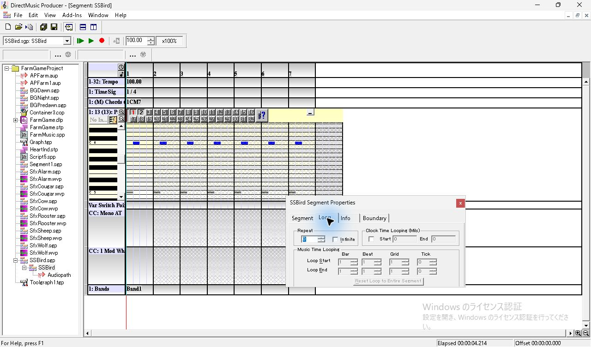
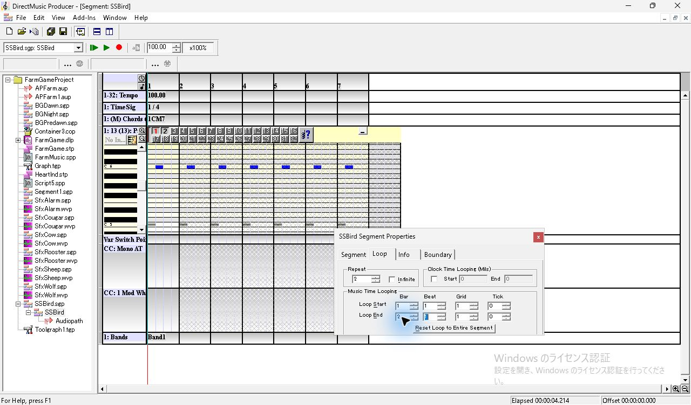
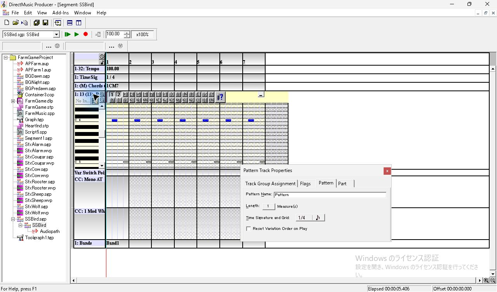

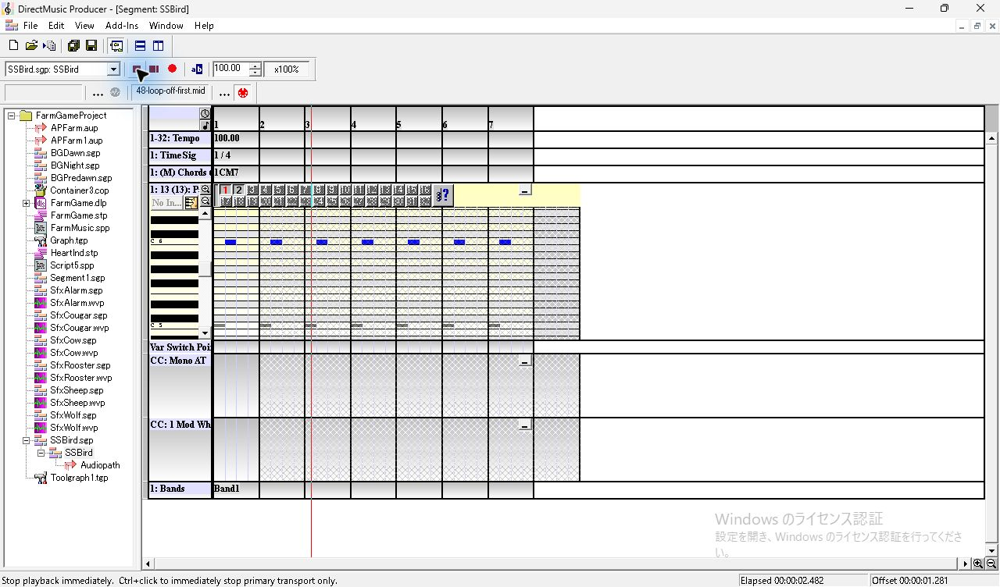
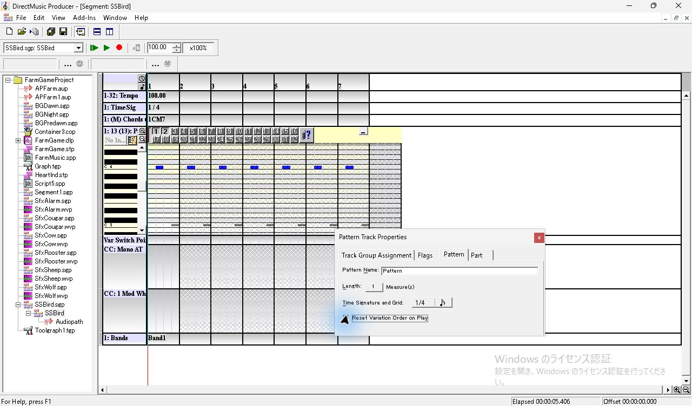

| Reset | 単独試聴直前の表示 | 単独試聴のキー | 単独試聴後に1・2を表示したときのキー | MIDI |
| --- | --- | ---: | ---: | --- |
| オン | 1だけ | 84 | **72** | [1だけ](../../../work/original-gui/SEG-14-variation-order/20261111T174715298940Z/captures/62-loop-on-solo-var1.mid) · [1と2](../../../work/original-gui/SEG-14-variation-order/20261111T174715298940Z/captures/64-loop-on-both-after-var1.mid) |
| オフ | 1だけ | 84 | **84** | [1だけ](../../../work/original-gui/SEG-14-variation-order/20261111T174715298940Z/captures/71-loop-off-solo-var1.mid) · [1と2](../../../work/original-gui/SEG-14-variation-order/20261111T174715298940Z/captures/73-loop-off-both-after-var1.mid) |
| オン | 2だけ | 72 | **72** | [2だけ](../../../work/original-gui/SEG-14-variation-order/20261111T174715298940Z/captures/58-loop-on-solo-var2.mid) · [1と2](../../../work/original-gui/SEG-14-variation-order/20261111T174715298940Z/captures/60-loop-on-both-after-var2.mid) |
| オフ | 2だけ | 72 | **72** | [2だけ](../../../work/original-gui/SEG-14-variation-order/20261111T174715298940Z/captures/75-loop-off-solo-var2.mid) · [1と2](../../../work/original-gui/SEG-14-variation-order/20261111T174715298940Z/captures/77-loop-off-both-after-var2.mid) |

同じループ範囲で **1だけを試聴 → 停止 → 2を再表示 → Play From Start** と操作したとき、Reset オフでは赤い **1** とキー84が続き、オンでは赤い **2** とキー72になった。各回は同じキーで9音、発音位置は **192 + 768 × n ticks（n = 0〜8）**。各折返しの **768、1536 ticks** にテンポイベントも出た。さらに、Reset オフの両表示でキー84だった回の後、単独試聴を挟まず Reset をオンにした最初の回もキー72だった。 [Loop 追加直後](../../../work/original-gui/SEG-14-variation-order/20261111T174715298940Z/captures/48-loop-off-first.mid) · [Reset オフで再開](../../../work/original-gui/SEG-14-variation-order/20261111T174715298940Z/captures/49-loop-off-replay.mid) · [Reset オンへ変更直後](../../../work/original-gui/SEG-14-variation-order/20261111T174715298940Z/captures/56-loop-on-after-var1.mid) · [17本の全イベントと保存値](../../../work/original-gui/SEG-14-variation-order/20261111T174715298940Z/variation-order-audit.json)

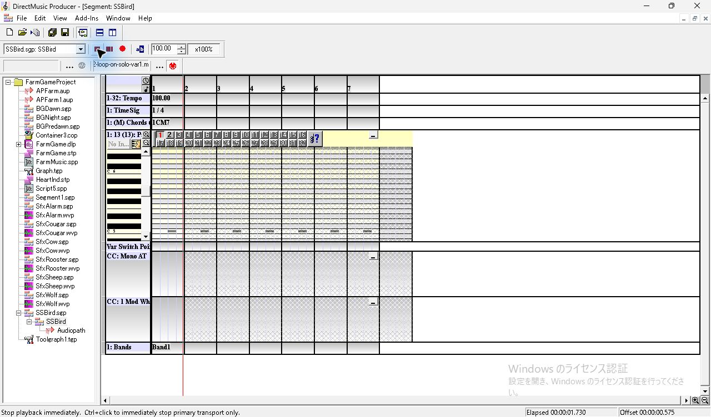
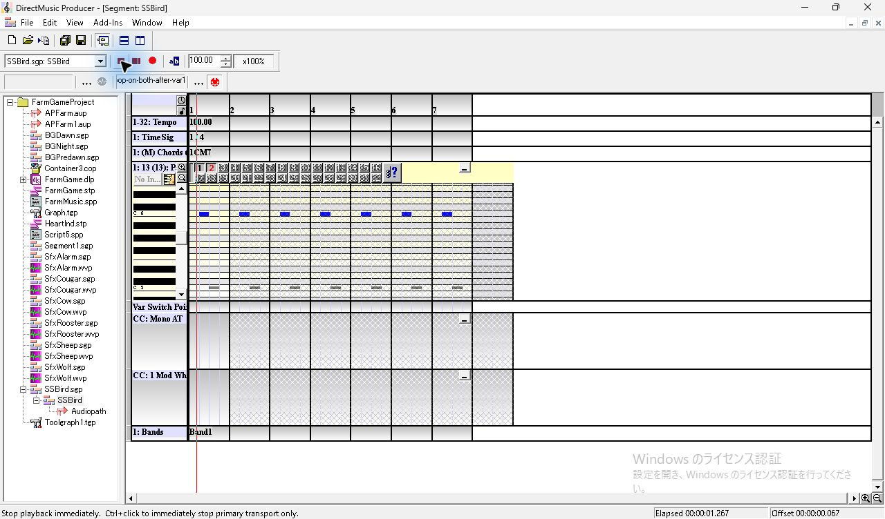

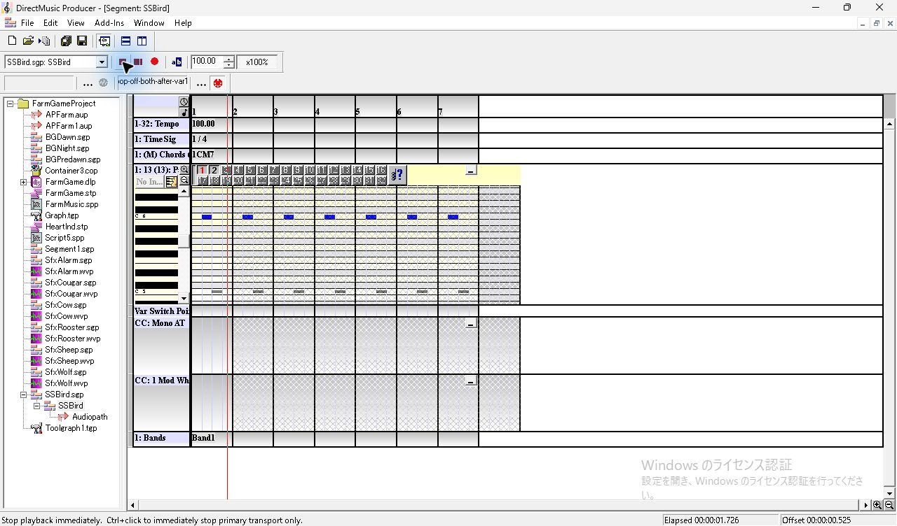
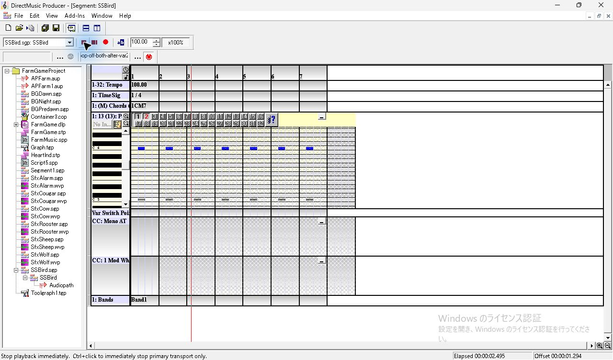

自然終了して Transport が緑の再生ボタンに戻り、MIDI 出力欄が空、Offset 0.000秒となった画像のうち、赤い番号が残っている例と消えている例があった。消灯の時刻は未計測。試聴の停止は Transport と Offset を併せて判定した。

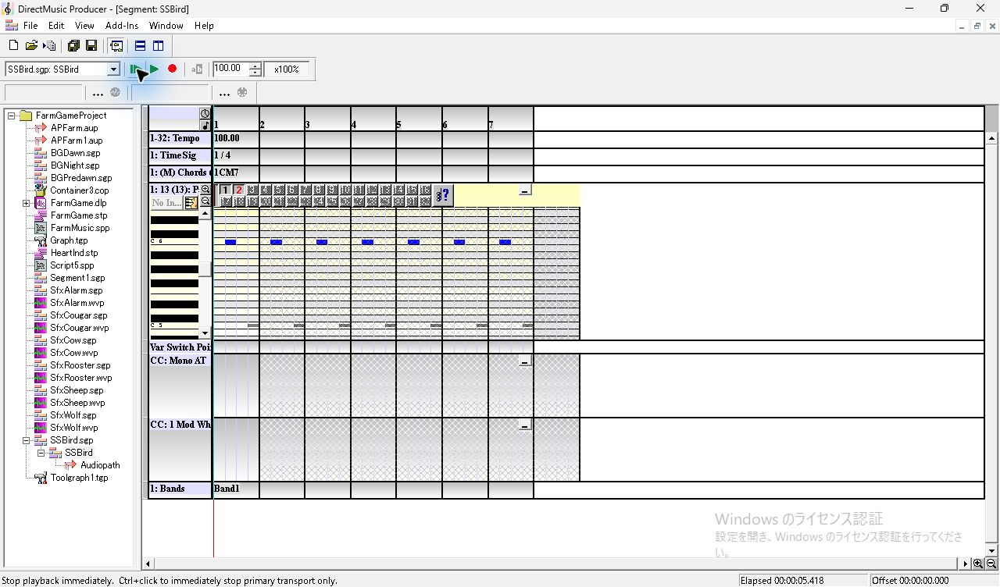

この比較で確認したのは、**in order from first** の内蔵 Pattern、同じコードのまま、マーカーなし、Segment エディターが開いた状態での挙動。実際の折返しを含め、1回の再生内で1と2が交互になる例は観測されなかった。Reset オンで両表示時の開始が2になった理由、残りの Play モード、Style から再生した場合の選択順は追試に残る。同梱ヘルプでは、Part の Play はループ時の選択方式、Pattern の Reset は Segment 再生ごとにサイクル先頭へ戻す指定として説明している。 [Part の Play](../../../../../work/analysis/original-manual-session/20261010T031624075Z/help-extracted/htm/partproperties.htm) · [Pattern の Reset](../../../../../work/analysis/original-manual-session/20261010T031624075Z/help-extracted/htm/patterntrackproperties.htm)

## Variation Choices の表と選択

Part 上部の **音符と疑問符のボタン**を押すと **Variation Choices: SSBird - Pattern (Pattern)** が別の子ウィンドウで開いた。左から1〜32の行番号と細い選択ボタン、**Functions、Root、Type、Dest** の列。比較素材では1・2行目に黒い文字と明るいセル、3〜32行目に網掛け。1行目の選択ボタンを押すと、同じ行のセル全体が赤くなった。右クリックで **Enable、Disable、Copy Row(s)、Paste Row(s)、IMA、DirectMusic、Properties**。DirectMusic にチェックがあり、コピー前の Paste Row(s) と Properties は灰色だった。

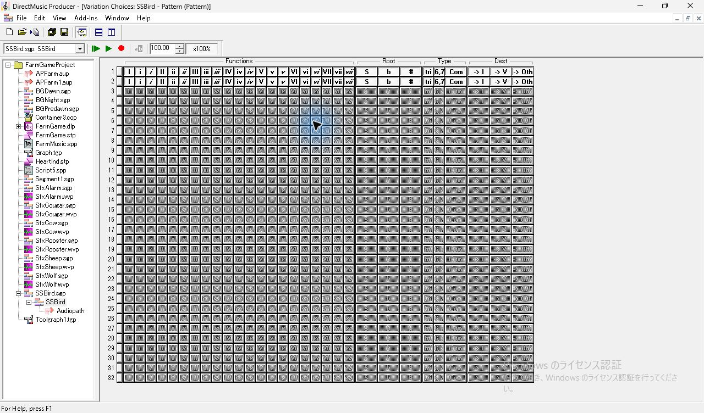
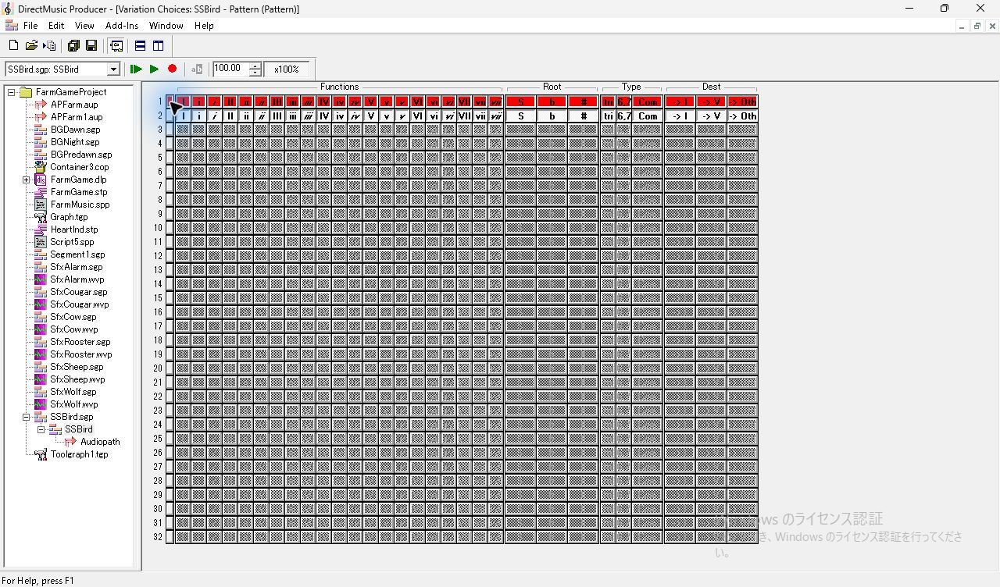
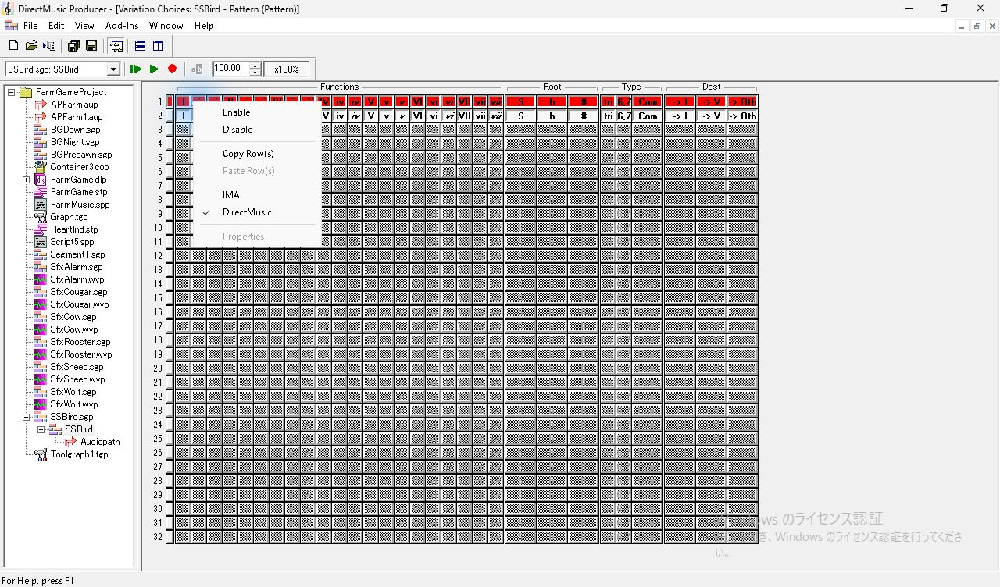

Esc でメニューを閉じ、選択ボタンの1行目から2行目へドラッグした試行では、赤い行が1から2へ移った。2行目の **Functions > I** をクリックすると行選択の赤が消え、そのセルが押し上がった表示になった。再クリックで押し下がった表示へ戻った。子ウィンドウの右上の × で Segment に戻ると、選択していた下のノートが赤いままだった。 [同梱ヘルプ Variation Choices](../../../../../work/analysis/original-manual-session/20261010T031624075Z/help-extracted/htm/variationchoiceswindow.htm)

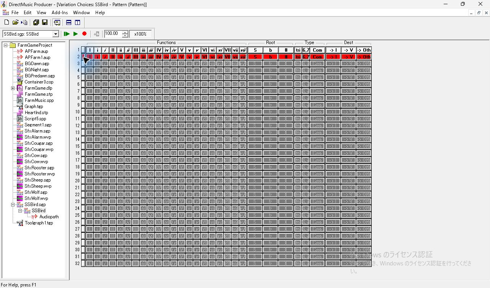

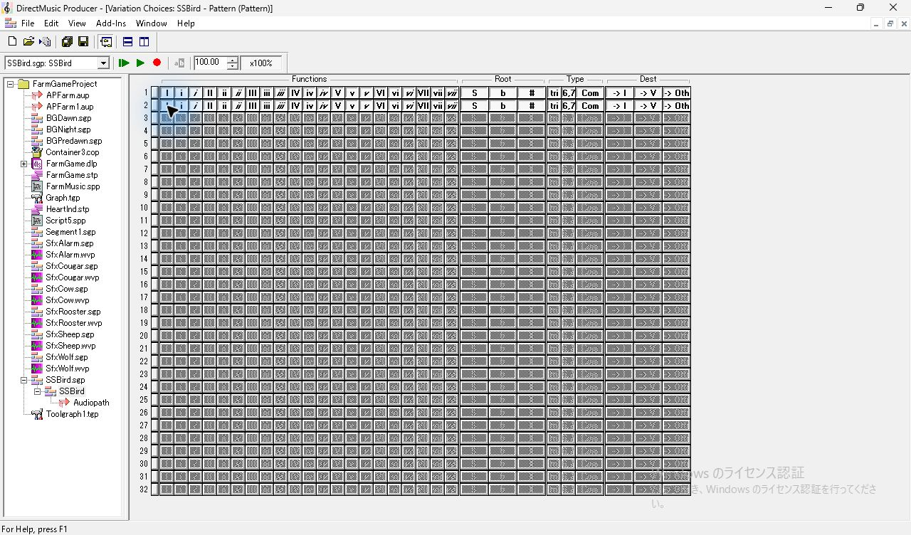
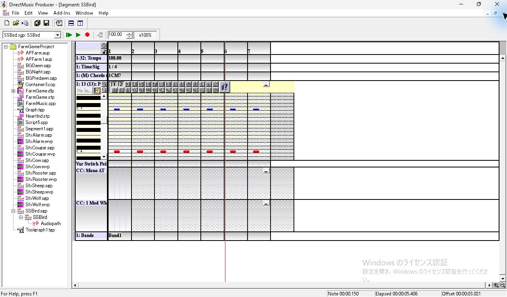

## 終了時の状態

MIDI 収録の終了後に書き出しツールバーを隠した。**File > Close Project FarmGameProject** の確認では **No** を選び、Variation Choices の確認操作後の変更を破棄。ディスク上の SSBird は Reset オフの最終保存版と全バイト一致した。開始時から同じ Producer 1件、Project を閉じた停止状態。View は Project Tree、Standard Toolbar、Status Bar、Transport Controls の4項目。 [開始時](../../../work/original-gui/SEG-14-variation-order/20261111T174715298940Z/captures/01-existing-producer.json) · [終了時](../../../work/original-gui/SEG-14-variation-order/20261111T174715298940Z/captures/108-final-windows.json)

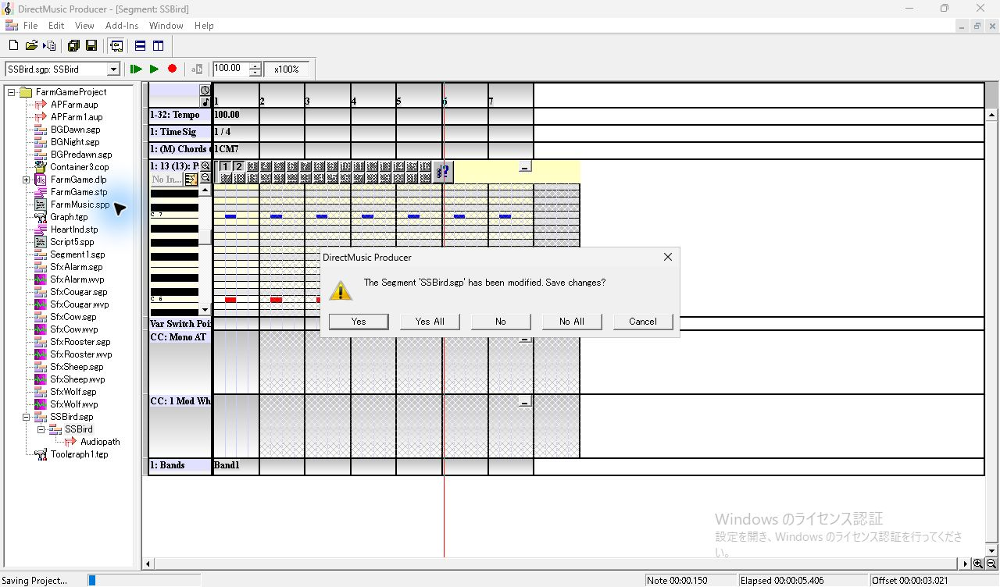
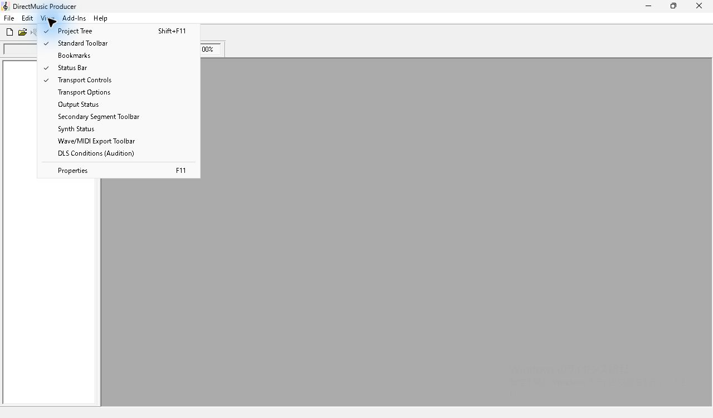
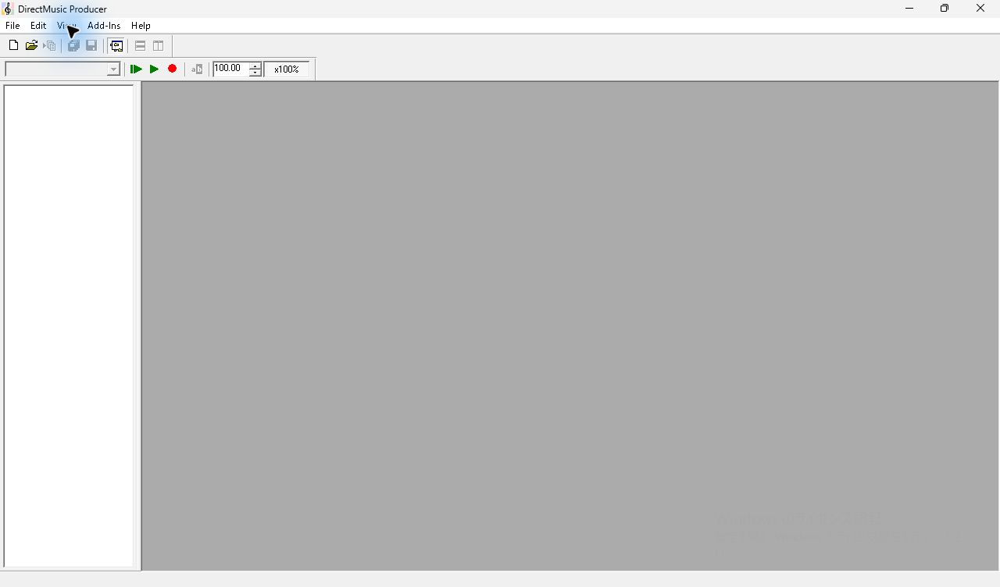

