# SEG-14　Pattern の Variation 再生順と途中切替

2026-11-12。DirectMusic Producer 5.3.0.900 の作業コピーで、FarmGameProject の **SSBird.sgp** を使用。前回のリンク解除後の保存版を凍結入力へ取り込み、別の検証用 Project を開いた。PChannel 13 を観測。1/4、100 BPM、Segment は元の6小節と延長後の17小節、Pattern と Part は8小節。画面1280×752 px。撮影262枚から29枚を掲載。太い黒矢印と青い光は操作ツールの表示。View は標準4項目で、MIDI 収録時に Wave/MIDI Export Toolbar を追加した。 [前回の CC とマーカーの編集](seg-14-pattern-controls.md) · [入力28件と実行ファイル](../../../work/original-gui/SEG-14-variation-playback/20261111T172518762072Z/run.json) · [画像の出典・寸法・ハッシュ](../../../work/original-gui/SEG-14-variation-playback/20261111T172518762072Z/published-variation-playback-figures.json)

## Variation ボタンと再生順の設定

開いた直後の13は Variation **2** のみ表示。縦スクロールを下へ動かし、ピアノロール上の **1** をクリックすると **1 と 2** が両方有効になり、Variation 1 の青いノートと2本の Mod Wheel 曲線、第5小節のマーカーも現れた。再生中は、番号の赤色とタイムラインの赤い縦線を観測した。停止状態では、表示している Variation を切り替えるとノートとマーカーの表示が変わる。

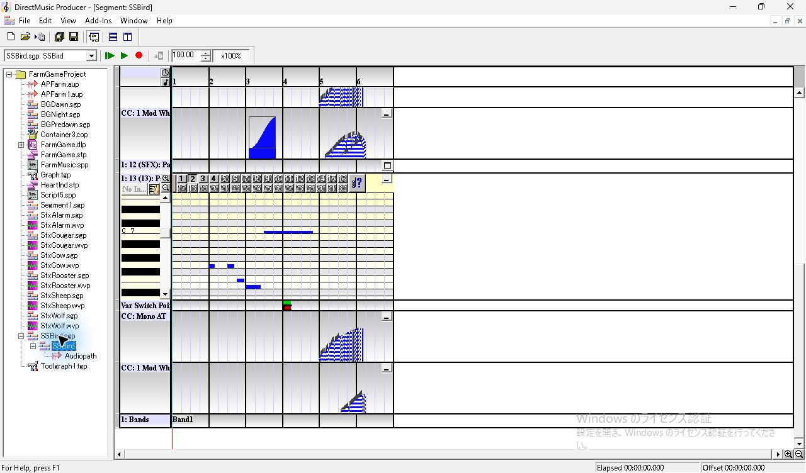
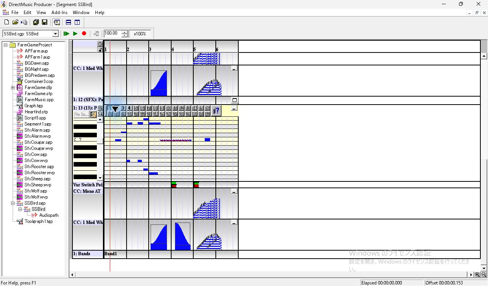

13のヘッダーから **F11 > Part > Variations > Play** を開き、**in random order** から **in order from first** に変更した。**Pattern** タブの **Reset Variation Order on Play** は初期状態でオフ。オフのまま **Play From Start** で2回、オンに変えて1回、各回で第4小節の前後を撮影した。3回とも赤い **2** だった。保存した2版で Play の値と Reset の有無を照合した。 [Reset オフの保存版](../../../work/original-gui/SEG-14-variation-playback/20261111T172518762072Z/captures/ordered-reset-off-SSBird.sgp) · [Reset オンの保存版](../../../work/original-gui/SEG-14-variation-playback/20261111T172518762072Z/captures/ordered-reset-on-SSBird.sgp)

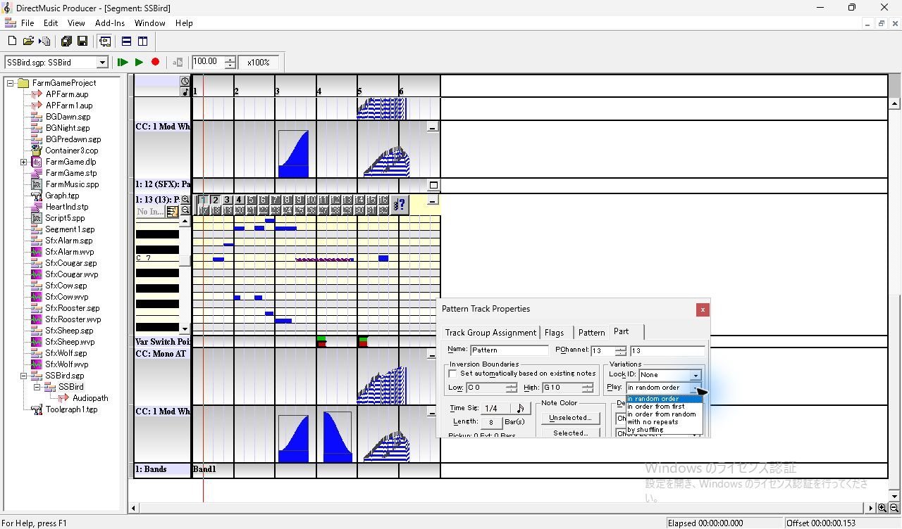

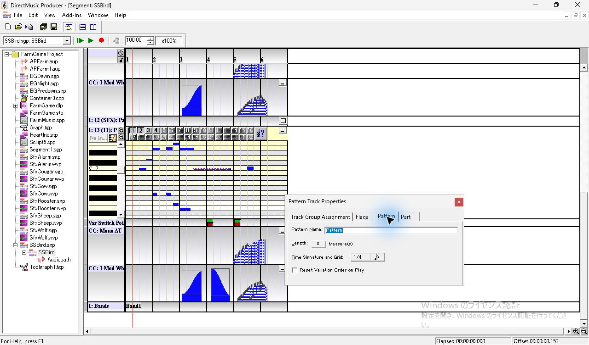
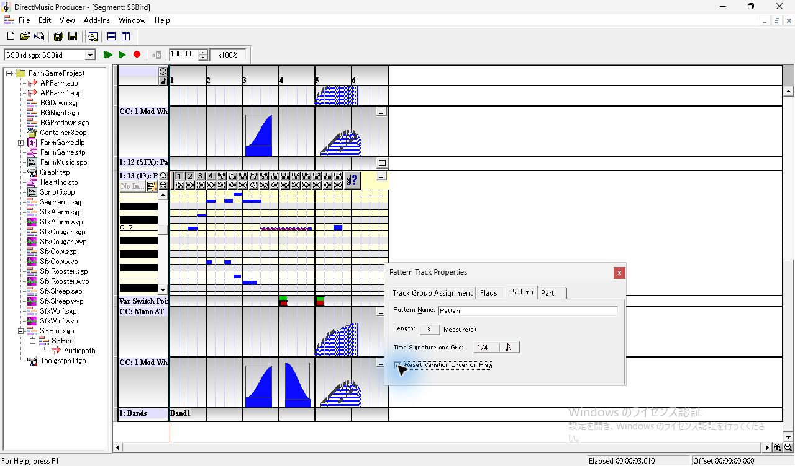

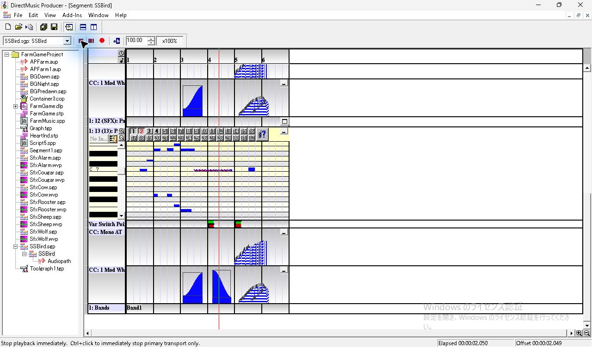

Project Tree の子項目 **SSBird > Properties > Segment > Length** から17小節に延ばした。Measures 欄で Ctrl+A の後に入力した試行は元の6に17が追記されて617になった。Home と Delete で先頭の6を消し、Segment Properties の **17 Bars** を確認してから再生した。第9小節以降のピアノロールと CC の背景に斜線が現れ、8小節の間隔でノート、曲線、マーカーが繰り返し表示された。Reset オンで自然終了まで再生したところ、第1・第2周期と第17小節の採取点すべてで赤い **2**。MIDI チャンネル13も第1・第2周期は Variation 2 と同じ6つの Note On、第17小節は同じ最初の1音だった。マーカーのない1 Part・2 Variation では、単独試聴をそろえて Reset の差を観測した。 [Reset と単独試聴の比較](seg-14-variation-order.md) [17小節版](../../../work/original-gui/SEG-14-variation-playback/20261111T172518762072Z/captures/ordered-17bars-reset-on-SSBird.sgp) · [17小節の MIDI](../../../work/original-gui/SEG-14-variation-playback/20261111T172518762072Z/captures/46-17bars-reset-on.mid)

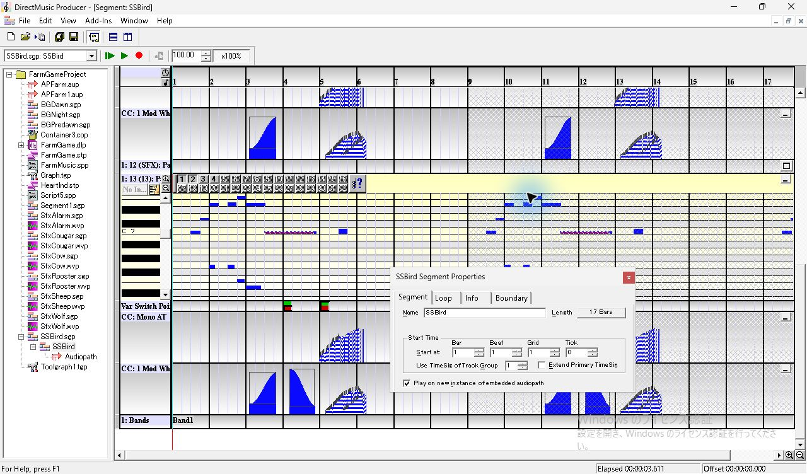
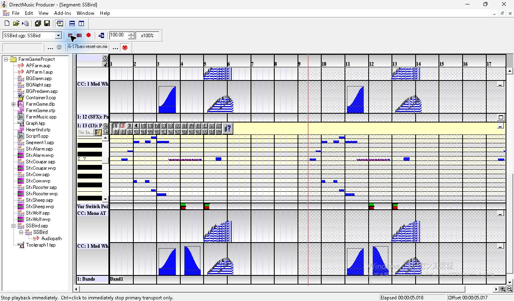

## 同じ位置に Variation 1 の Enter と Variation 2 の Exit を置く

17小節版の PChannel 13 で、第4小節の先頭（1.800秒）のマーカーをクリックし **F11**。初期状態は Variation 1・2 を対象とする Enter と Exit が同じ位置にあり、Exit 側の **Trigger only with Chord Change** だけがオン。Enter と Variation 1 のチェックを外して **Variation 2 の Exit** に絞った。

Properties を閉じ、**2** をクリックして Variation 1 だけを表示。その状態で第4小節先頭を右クリックし、**Insert Switch Point > Enter** を選んだ。**2** を再度クリックして両方を表示すると、同じ小節先頭に緑の Enter と赤の Exit が上下に並ぶ。別々の条件で保存されていることは、選択する Variation を変えて Properties を開く操作と `mrkr` の内容で確認した。

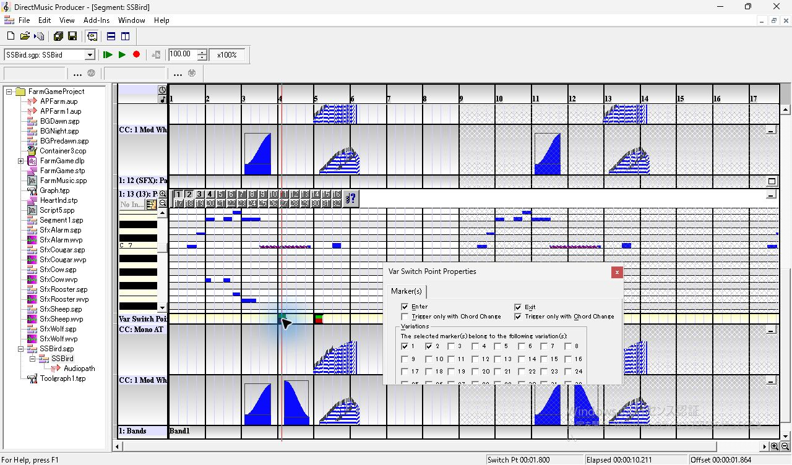
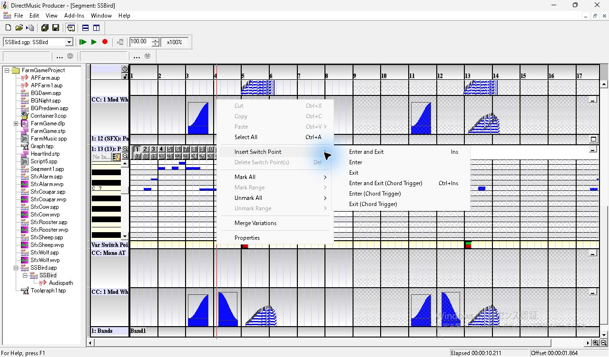
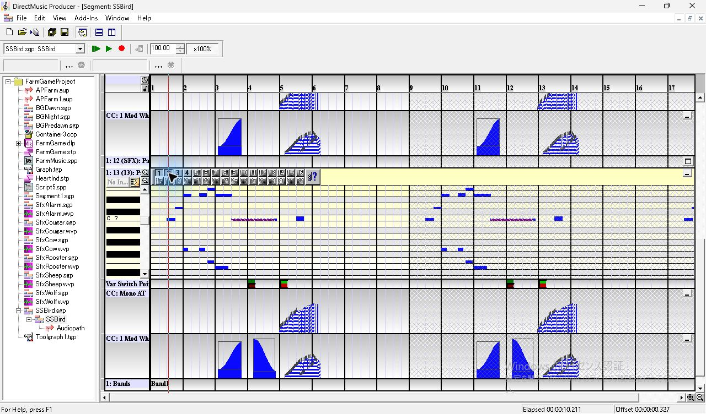
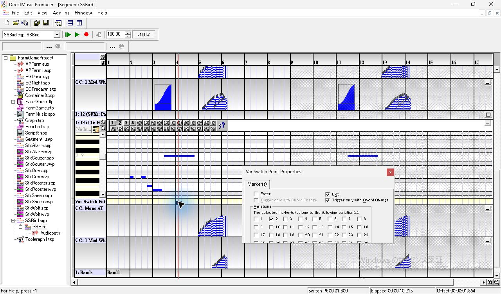
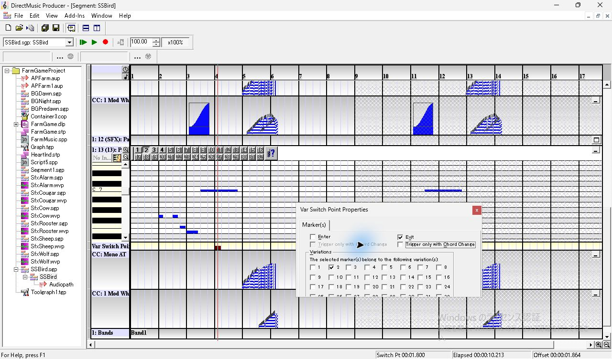

| 第4小節の試験条件 | Grid index 12 の保存レコード（Variation mask, flags） | Chord Track |
| --- | --- | --- |
| 変更前 | `(0x3, 1)`、`(0x3, 6)` | 第1小節の `1CM7` |
| 分離、Exit はコード変更時 | `(0x1, 1)`、`(0x2, 6)` | 第1小節の `1CM7` |
| 分離、Exit は無条件 | `(0x1, 1)`、`(0x2, 2)` | 第1小節の `1CM7` |
| 分離、Exit はコード変更時、変更あり | `(0x1, 1)`、`(0x2, 6)` | 第1小節の `1CM7`、第4小節の `2C#M` |
| 対照試験、Exit を削除 | `(0x1, 1)` | 第1小節の `1CM7`、第4小節の `2C#M` |

フラグは **1** が Enter、**2** が Exit、**6** が Exit と Chord Change。13の第5小節にある Variation 1 の既存マーカーは、各保存版とも Grid index 16、mask `0x1`、flags **5** と **6**。ノートと CC 曲線のレコードは全 Part で件数・値ともに保存版間で一致した。PChannel 13 はマーカーを編集した各保存版で別の Part GUID を参照した。 [保存ファイルの照合](../../../work/original-gui/SEG-14-variation-playback/20261111T172518762072Z/variation-playback-audit.json)

## コード変更の有無と再生結果

**Wave/MIDI Export Toolbar** の出力先を指定して MIDI 記録を待機させ、**Play From Start** から自然終了まで採取。表示を撮る位置は第4小節の前後、第2周期の先頭付近と第4小節相当の位置、第17小節。各写真の再生位置はステータス欄の **Offset** と赤い縦線で確認した。MIDI は 768 ticks/拍、テンポは600,000 µs/拍。第4小節先頭は **2304 ticks**。表は PChannel 13 に対応する MIDI チャンネル13の第1周期。

| 第4小節の条件 | 画面の赤い番号（前 → 後） | 第3小節の CC1（1599〜2176 ticks） | 第4小節の CC1（2438〜2975 ticks） | 第5小節の Note On（3456 ticks） |
| --- | --- | ---: | ---: | --- |
| Exit はコード変更時、変更なし | 2 → 2 | 0件 | 0件 | なし |
| Exit は無条件、コード変更なし | 2 → 1 | 0件 | 32件、114 → 19 | キー84 |
| Exit はコード変更時、変更あり、2だけの試聴を先行 | 1 → 1 | 0件 | 32件、114 → 19 | キー97 |
| Exit を削除、コード変更あり、2だけの試聴を先行 | 2 → 2 | 0件 | 0件 | なし |

[コード変更なし](../../../work/original-gui/SEG-14-variation-playback/20261111T172518762072Z/captures/60-split-chord-exit-no-change.mid) · [無条件の Exit](../../../work/original-gui/SEG-14-variation-playback/20261111T172518762072Z/captures/70-split-unconditional-exit.mid) · [コード変更あり、Exit あり](../../../work/original-gui/SEG-14-variation-playback/20261111T172518762072Z/captures/96-chord-exit-primed-2.mid) · [コード変更あり、Exit なし](../../../work/original-gui/SEG-14-variation-playback/20261111T172518762072Z/captures/105-chord-change-no-exit.mid)

コード変更なしで **Exit の Chord Change がオン** の場合は、第4小節を通過しても赤い **2**。同じ Exit のチェックを外すと第4小節前後の写真で赤い **2 → 1**。第1周期の MIDI はマーカー前が Variation 2 の6音で、マーカー後から Variation 1 の下降曲線と第5小節の音が現れた。第2周期では第9小節の写真から赤い **1** で、第11・12小節相当の MIDI には Variation 1 の上昇と下降が両方含まれた。

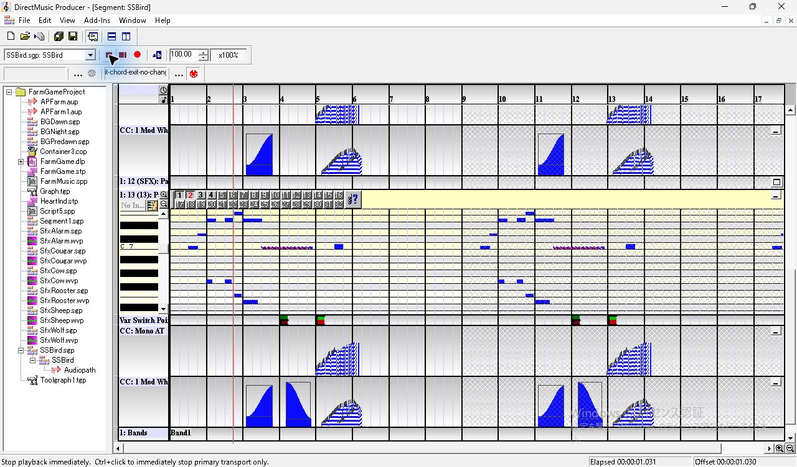
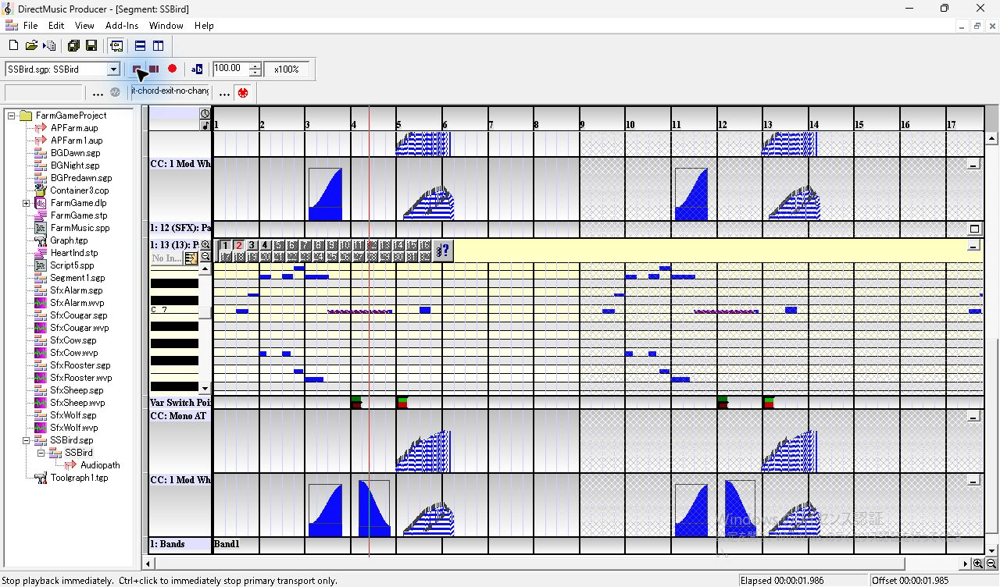

次に Exit の Chord Change をオンに戻した。Chord Track の **Keep Constant > Functionality (F)** を選び、第4小節先頭へ **Insert**。**Chord Properties > Chord/Scale** のルート横の上矢印を1回押して **2C#M** にした。保存ファイルでは第4小節のコードが2304 ticks、ルートの保存値は4レベルとも13。Chord の名前はタイムラインと Properties で確認した。

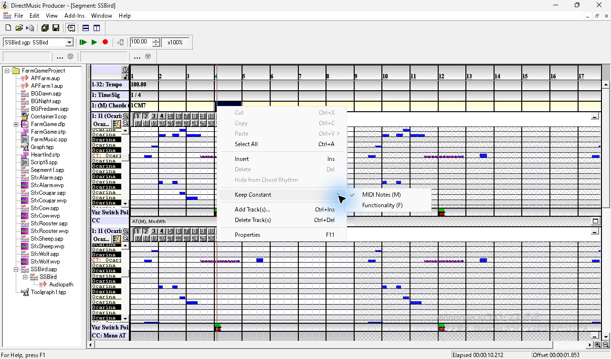
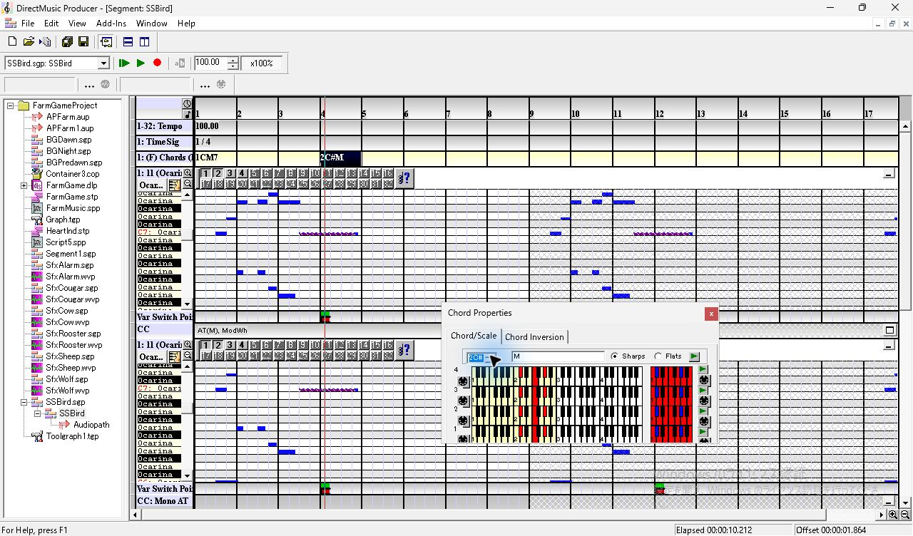

コード追加直後に両方を表示したまま再生した回は、第1周期の冒頭から MIDI が Variation 1 だった。その後、**2 だけ表示して1回再生**し、停止後に **1** を表示へ戻すと、第1周期前半の MIDI は Variation 2、第4小節以降は Variation 1 の出力になった。対照試験も **2 だけの試聴 → 1 を再表示** の手順で開始した。Variation 2 だけを表示したときに13の第4小節の Exit を選んで **Delete** すると、Variation 1 の Enter は保存ファイルに残った。対照の再生では、第4小節のコードが変わっても第5小節の Variation 1 固有のノートと下降曲線は出なかった。 [コード追加直後の MIDI](../../../work/original-gui/SEG-14-variation-playback/20261111T172518762072Z/captures/91-split-chord-exit-with-change.mid) · [Exit ありの保存版](../../../work/original-gui/SEG-14-variation-playback/20261111T172518762072Z/captures/split-chord-exit-with-change-SSBird.sgp) · [Exit 削除後の保存版](../../../work/original-gui/SEG-14-variation-playback/20261111T172518762072Z/captures/chord-change-no-exit-SSBird.sgp)

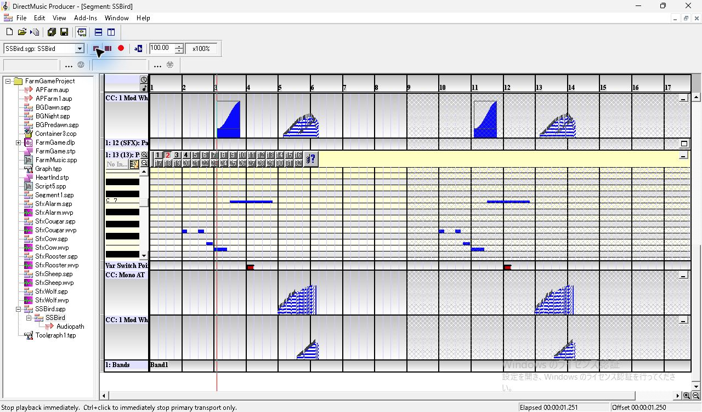

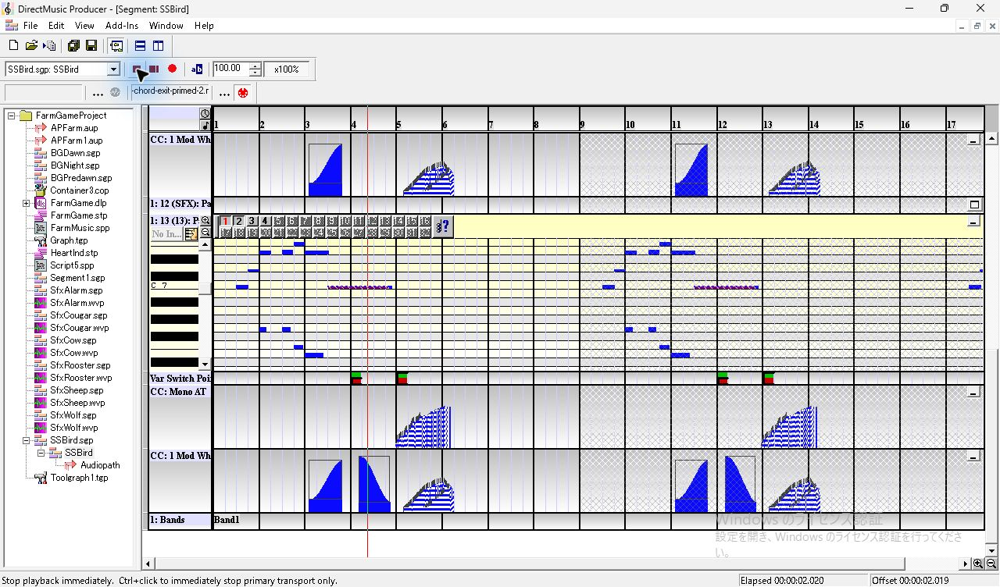

コード変更あり、Exit ありの回では、**Offset 1.273秒** の写真ですでに赤い **1**。この時点でタイムラインのカーソルは第3小節。MIDI では第3小節の上昇曲線がなく、第4小節から下降曲線が出ている。切替位置の照合には、赤い番号、カーソルの位置、ノートと CC の時刻を個別に記録する。Variation 2 が赤くなってから Variation 1 が赤くなるまでの正確な時刻、および先行試聴が開始 Variation に及ぼす条件は未確定。 [1.273秒の撮影記録](../../../work/original-gui/SEG-14-variation-playback/20261111T172518762072Z/captures/96-chord-exit-primed-2-a.json) · [ノート、CC、赤い番号の照合](../../../work/original-gui/SEG-14-variation-playback/20261111T172518762072Z/variation-playback-audit.json)

## 終了時の状態

17小節の自然終了後は赤い番号が消え、MIDI 欄のファイル名も空欄になった。書き出しツールバーを隠し、**File > Close Project FarmGameProject** で検証用 Project を閉じた。開始前から開いていた Producer を再利用し、終了時も同じウィンドウ1件。View では Project Tree、Standard Toolbar、Status Bar、Transport Controls を表示。 [開始時](../../../work/original-gui/SEG-14-variation-playback/20261111T172518762072Z/captures/01-existing-producer.json) · [終了時](../../../work/original-gui/SEG-14-variation-playback/20261111T172518762072Z/captures/113-final-windows.json)

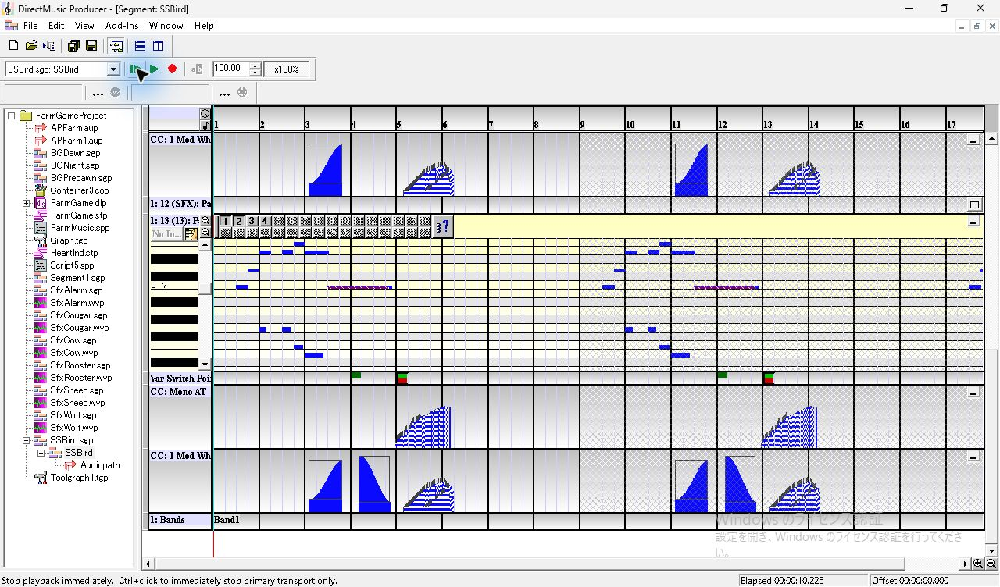
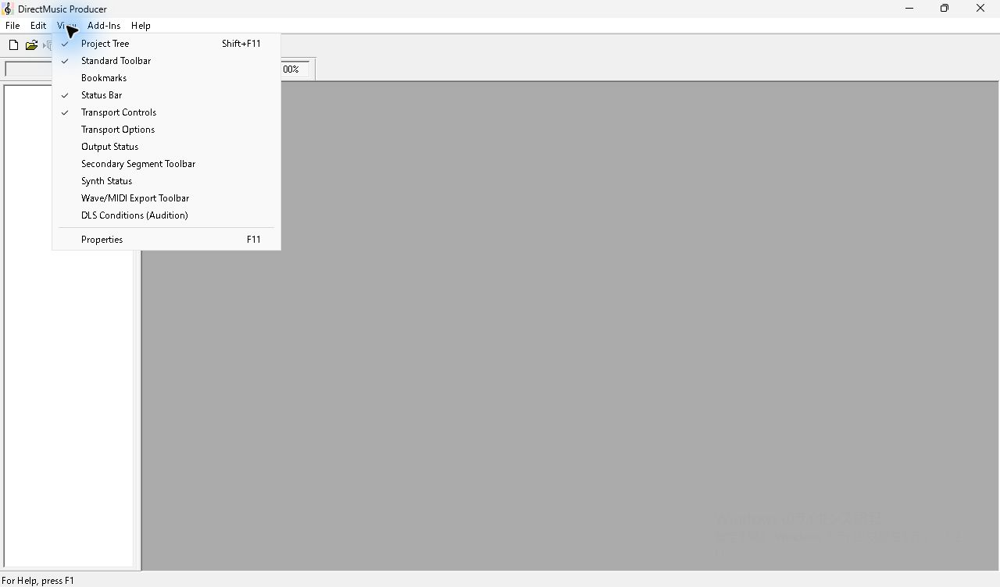
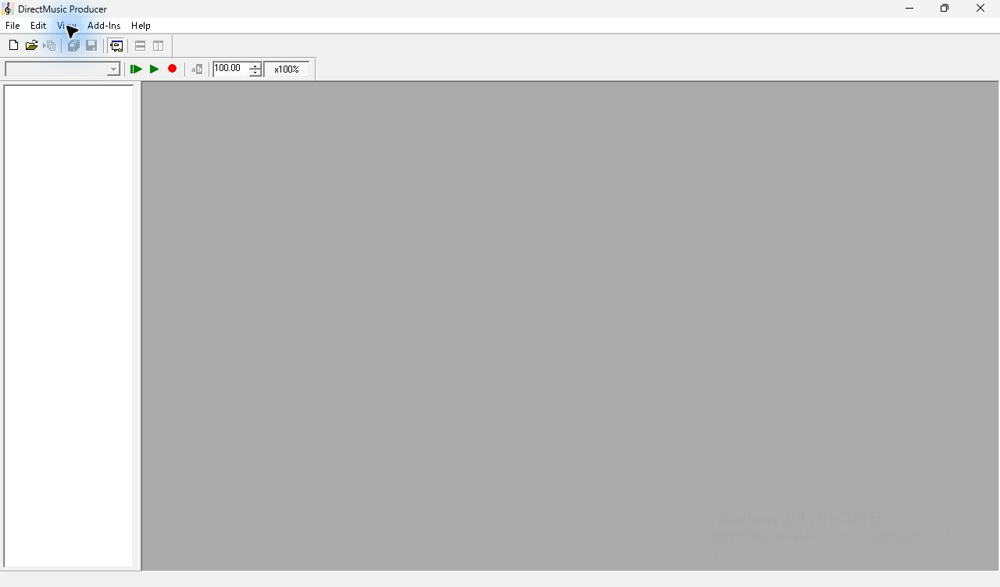

## 次の追試

マーカーなしの最小 Pattern と有限ループで in order from first と Reset を比較した。残りの Play モードと別起動は追試する。 [比較結果](seg-14-variation-order.md)

別の試験では、Segment Trigger の Align で子の途中から入るときに、Pattern Part の Enter の位置と Chord Change を変え、発音開始と初回の Variation を照合した。この資料の再生途中の切替では、Enter と Exit の位置をずらした場合、Enter 側の Chord Change、マーカーを跨ぐ持続音、押下中のポインターが追試に残る。 [Pattern Part の Enter と Align](seg-14-trigger-variation-enter.md)

