# SEG-14　Wave Track の Project Tree ドロップと同一レイヤーの重なり

2026-11-12 に DirectMusic Producer 5.3.0.900 の作業コピーを操作した。1280 × 752 px の全画面を32枚掲載する。座標は画像左上を原点とする。太い矢印と青い光は操作ツールが重ねる位置表示。 [使用した作業コピーと凍結入力](../../../work/original-gui/SEG-14-wave-drop-overlap/20261111T234228669556Z/run.json) · [掲載画像と操作の対応](../../../work/original-gui/SEG-14-wave-drop-overlap/20261111T234228669556Z/published-wave-drop-figures.json)

## 比較条件

前回の Wave 追試で用意した20小節、4/4、音楽時刻の **Segment1.sgp** を複製した。PChannel 1 はレイヤー **a** に SfxCow（Variation 2〜32）、下にスクロールすると **c** に SfxSheep（Variation 1）がある。PChannel 2 は空。起動済みの Producer を1件使用し、View は Project Tree、Standard Toolbar、Status Bar、Transport Controls。 [前回の素材と操作](seg-14-wave-track-followup.md) · [今回の開始時の SGP](../../../work/original-gui/SEG-14-wave-drop-overlap/20261111T234228669556Z/inputs/FarmGameProject/Segment1.sgp)

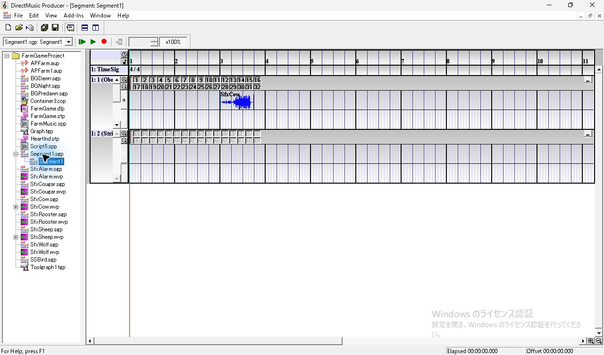

## ファイル行からの追加と Variation

開始直後、全32 Variation が選ばれた PChannel 1 のレイヤー **a** へ、Tree の `SfxAlarm.wvp` のアイコンとファイル名を起点に `(650, 211)` へドラッグした。どちらも新しい波形は現れず、Tree にファイルの選択が残った。次に PChannel 1 の Variation **1** をダブルクリック。1だけが選ばれ、2〜32に属する元の SfxCow は画面から消えた。同じファイル名から同じ座標へドラッグすると、レイヤー **a** に SfxAlarm が追加され、選択色の赤で表示された。

- ラベル左端は解放点より約4 px 左のグリッド線に揃った。Wave Properties の **Start は4:4:3:0**、**End は5:3:3:−56**。表記は **Bar:Beat:Grid:Tick**。
- Wave Properties の **Variations** タブで **1** のみチェック。新規項目のマスクは `0x00000001`。
- 追加直後に Tree が Segment1 へ戻る試行があった。Properties は Tree の選択に合わせて **Segment1 Segment Properties** を表示する場合がある。波形を選んで Wave 項目の Properties を確認した。非表示時は F11 で開いた。

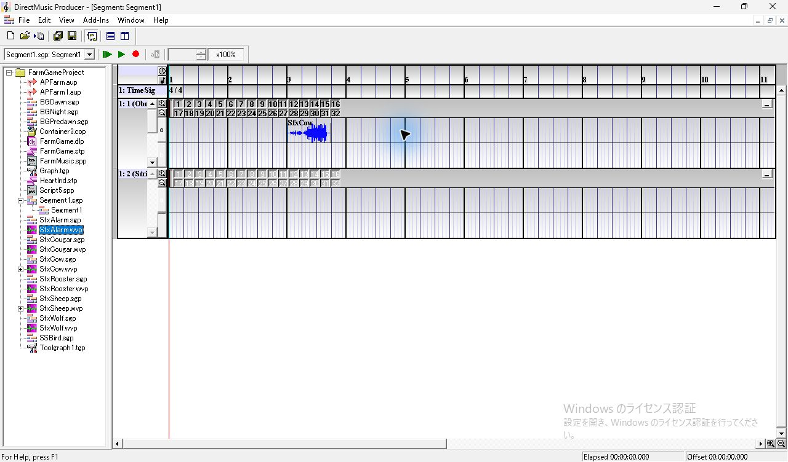
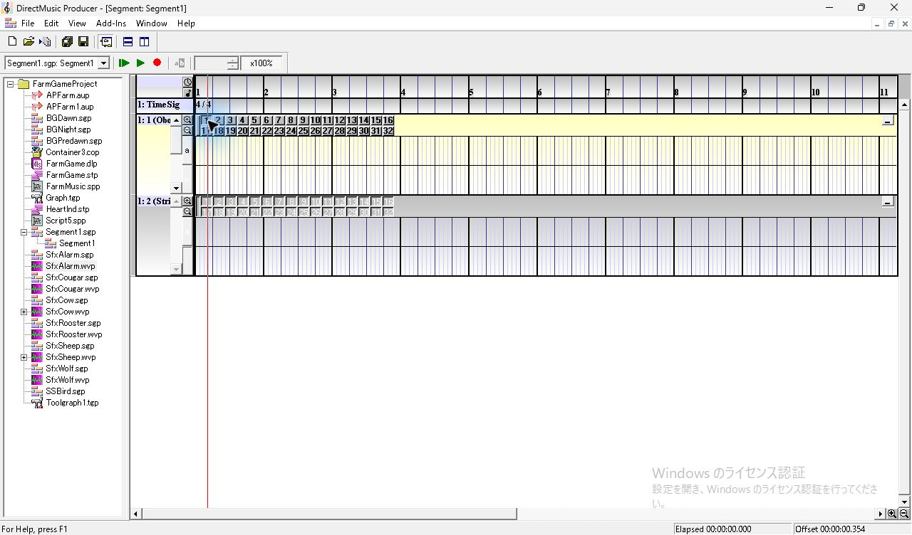
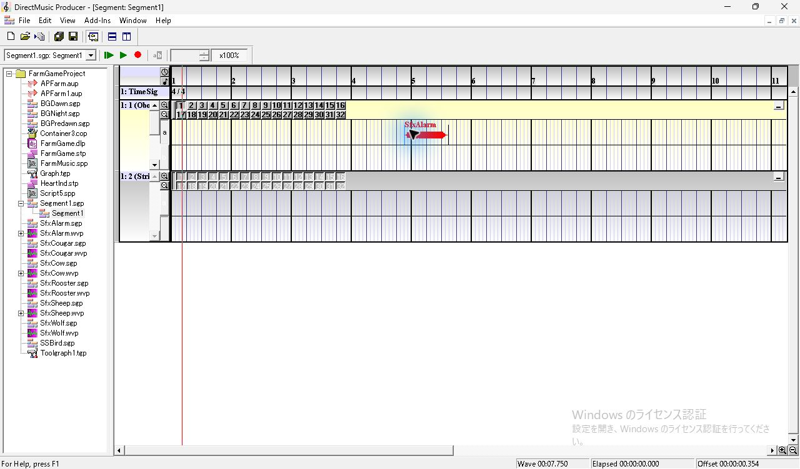
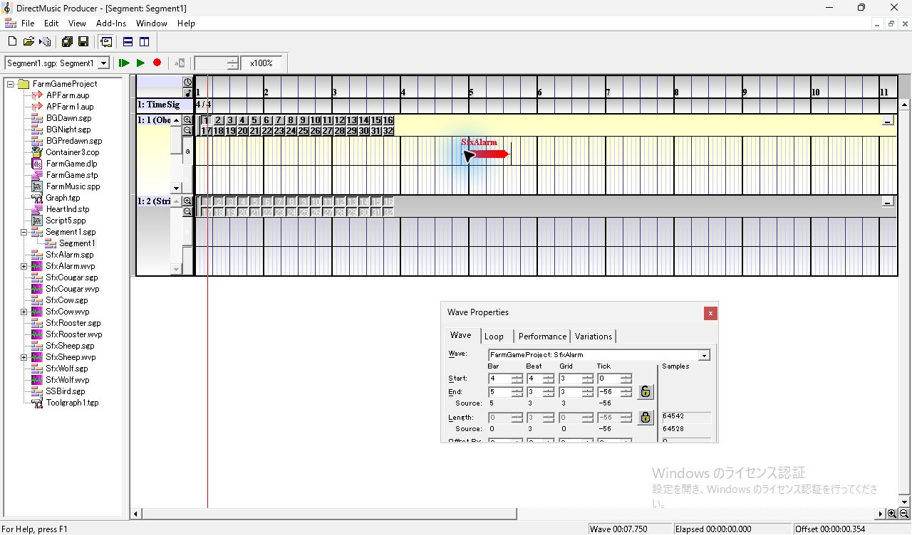
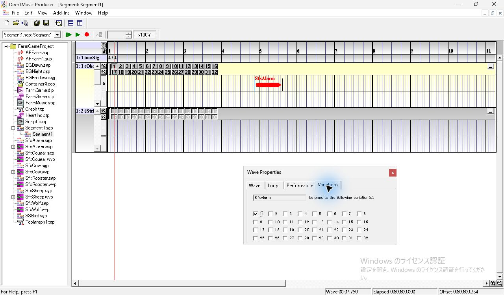

## ファイル行と子ノード

`SfxCow.wvp` を展開して **SfxCow** 子ノードを表示した。Variation 1 だけを選んだ状態で、子ノードから既存の SfxAlarm 上 `(674, 211)` と、時間上も空いていた `(790, 211)` へドラッグした。どちらも追加はなく、Transport が **SfxCow**、Properties が **Wave: SfxCow Properties** に変わった。タイムラインは Segment1 のまま。同じ Wave の **`.wvp` ファイル行**から空きの `(790, 211)` へドラッグすると、**6:2:3:0** に SfxCow が加わり、赤く選択された。SfxAlarm 上 `(674, 211)` をファイル行から試すと、追加はなく、Wave File Properties が開いたままだった。

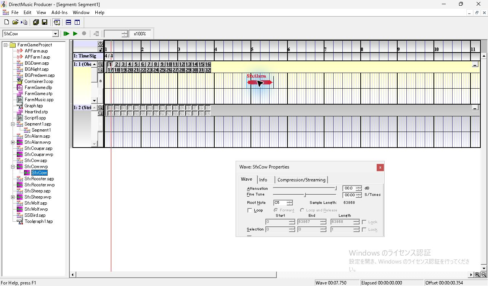
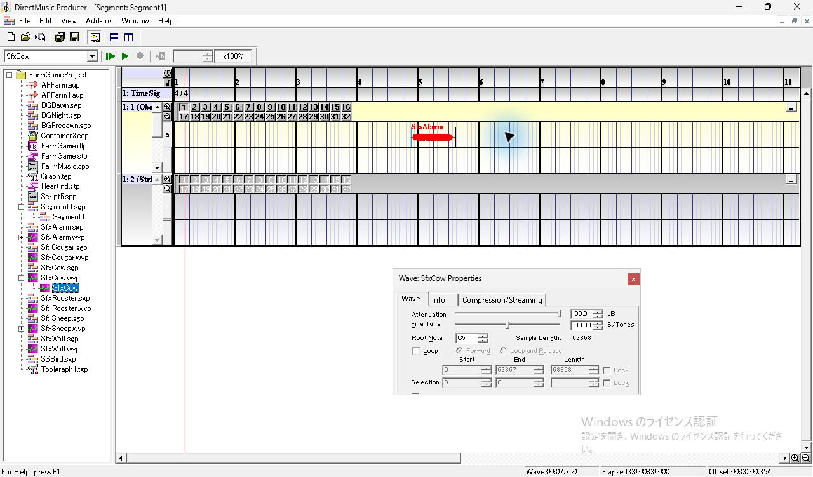
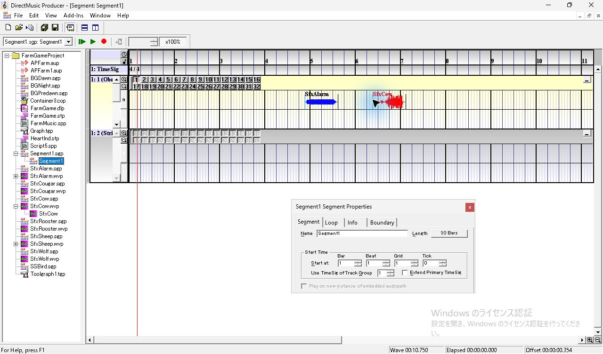
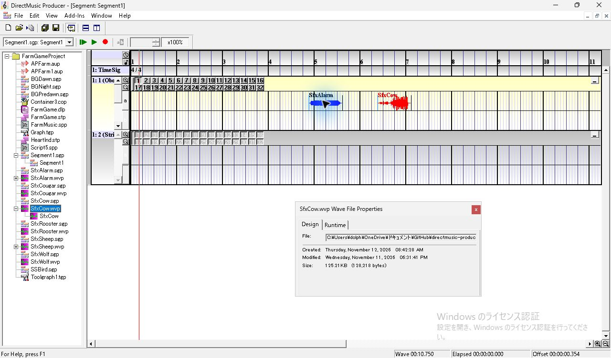

## 既存波形を移動した場合と重なりの選択

1. 追加した SfxCow の名前左端 `(793, 199)` から SfxAlarm 上 `(674, 199)` へドラッグ。SfxCow は **6:2:3:0** に残って選択され、赤い位置線は押下側。
2. 同じ起点から、SfxAlarm の終了より後ろの `(729, 199)` へドラッグ。SfxCow はグリッドに揃い、**5:3:4:0** に移った。Length 表示は **63,882 Samples**。
3. **Wave Properties → Wave → Start → Beat** の下スピンを1回押すと **5:2:4:0**、さらに1回押すと **5:1:4:0**。SfxAlarm と同じ **PChannel 1、レイヤー a、Variation 1** で時間が重なった。波形とラベルが同じ行に描かれ、重なる範囲には黒い点線の枠が見える。Length は **63,882 Samples** を保持。
4. 重なった座標 `(696, 213)` の右クリックと左クリックは、どちらも開始が早い **SfxAlarm** を選んだ。Properties の参照と時刻も SfxAlarm に変わる。右クリックメニューにあるのは Paste、Snap To、Merge Variations など。SfxCow だけが描かれる右側 `(733, 213)` を左クリックすると **SfxCow** が選ばれた。

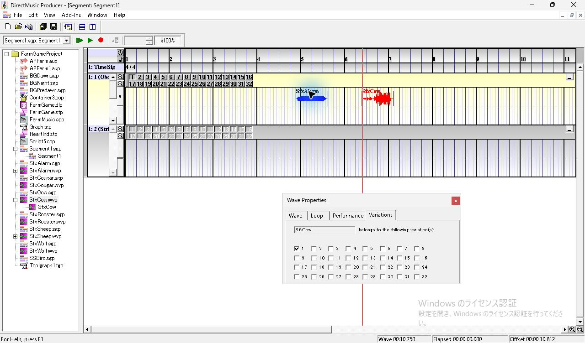
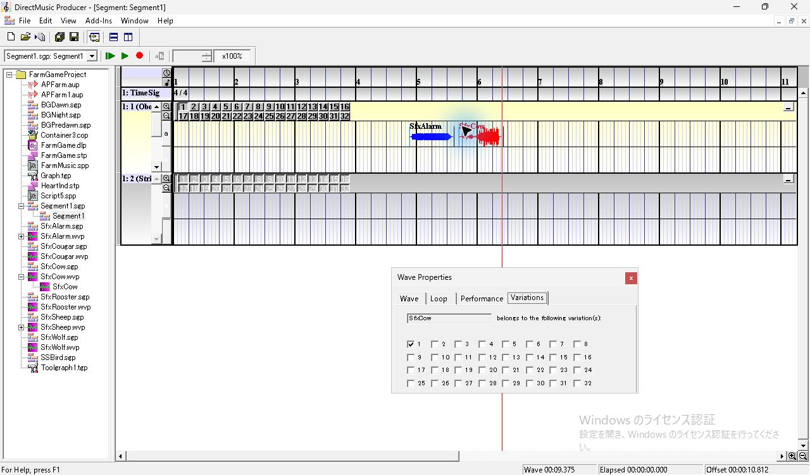
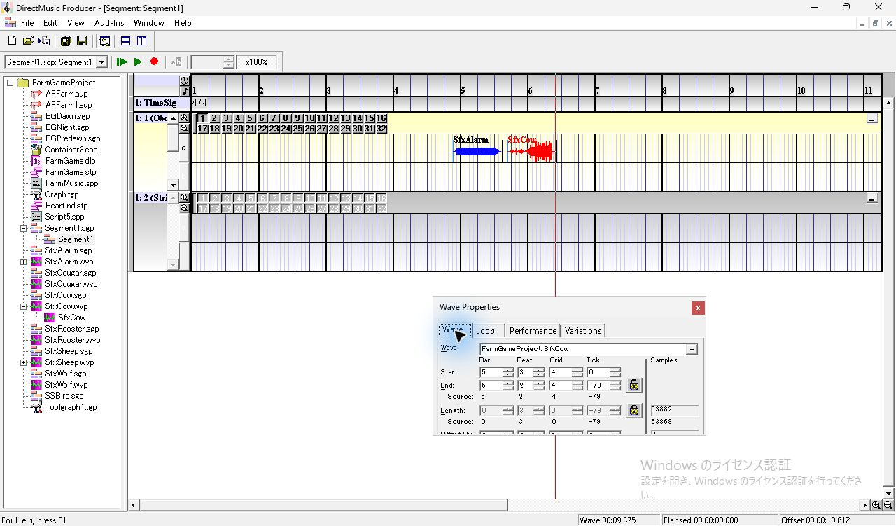

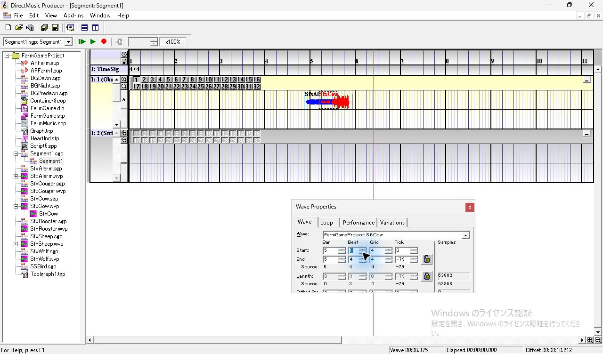
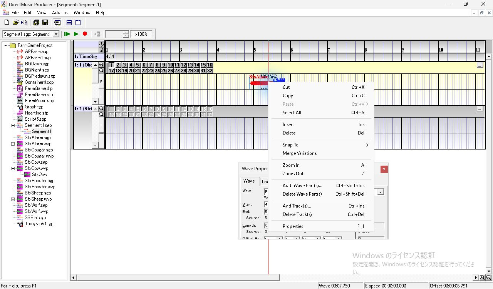
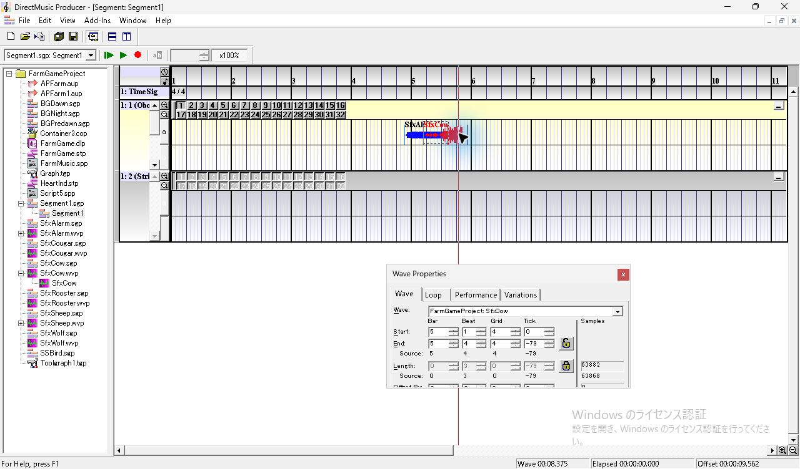

## Variation 未選択、別レイヤー、複数選択

| 解放先と Variation | 試行結果 |
| --- | --- |
| Variation **0件**、レイヤー a の空き `(836, 211)` | すべての波形が非表示。以前に追加できた `SfxCow.wvp` をドロップして保存すると Wave 項目は4件のまま。Part の選択マスクは0。 |
| Variation **2だけ**、同じ `(836, 211)` | `SfxCow.wvp` を先にクリックで選んでからドラッグすると、SfxCow が **6:4:2:0** に追加された。保存値はレイヤー a、マスク `0x00000002`。 |
| Variation **2だけ**、Variation 1 の2件が隠れた `(674, 211)` | 同じファイル行を選んでドラッグした。レイヤー a に新しい波形は現れなかった。 |
| Variation **2だけ**、同じ x の下段 `(674, 250)` | 新しい波形は現れなかった。 |
| Variation **2だけ**、下段の別の空き `(1007, 251)` | SfxCow が **8:3:3:0** に追加され、無名だった下段に **b** が表示された。保存値はレイヤー番号1、マスク `0x00000002`。 |
| Variation **1と2**、レイヤー a の空き | `(556, 211)` の SfxAlarm、`(1111, 211)` と `(970, 205)` の SfxCow はいずれも追加なし。 |
| Variation **2だけ**、レイヤー a の `(556, 211)` | 同じ SfxAlarm ファイルで、Properties を表示した試行では追加なし。Properties を閉じた後の再試行で **3:4:4:0** に追加された。 |
| Variation **2だけ**、Properties を閉じた状態で `(1111, 211)` | 選択済みの SfxCow 子ノードをドラッグしたが追加なし。 |

同梱ヘルプは、Wave の挿入に1つ以上の Variation の選択が必要で、.wvp ファイル行と Wave 子ノードの両方をドラッグできると説明している。今回、ファイル行からの追加は Variation 1 または2を単独で選んだ状態で確認した。同じ選択数でも結果が異なる試行があり、複数選択、子ノード、隠れた波形とドロップの関係は追試に残る。Computer Use のドラッグは開始点と終了点を指定して実行した。押下中の実カーソルとドロップ可否の表示は未取得。 [同梱ヘルプの挿入手順](../../../../../work/analysis/original-manual-session/20261010T031624075Z/help-extracted/htm/insertingwavesinthewavetrack.htm) · [前回のカーソル観測方法と制約](seg-14-trigger-drag.md#カーソルと修飾キーの観測範囲)

追試ではファイル行と子ノードを比較し、単独選択の空き位置でのドロップも成立しなかった。Insert では1・2の両方への所属と、既存波形上での同一レイヤーへの追加を確認した。 [複数 Variation での追試](seg-14-wave-tree-variation-drop.md)

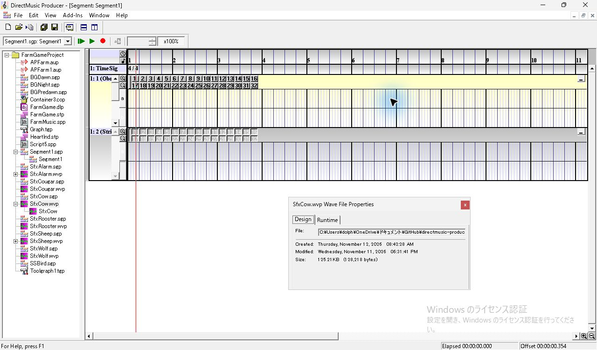
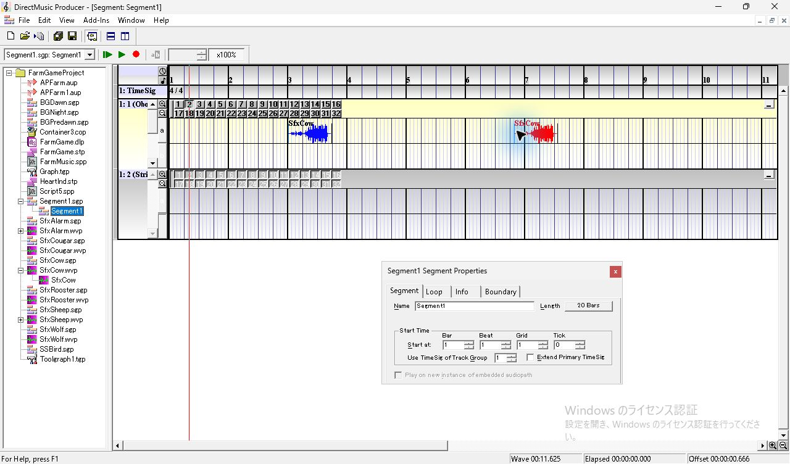
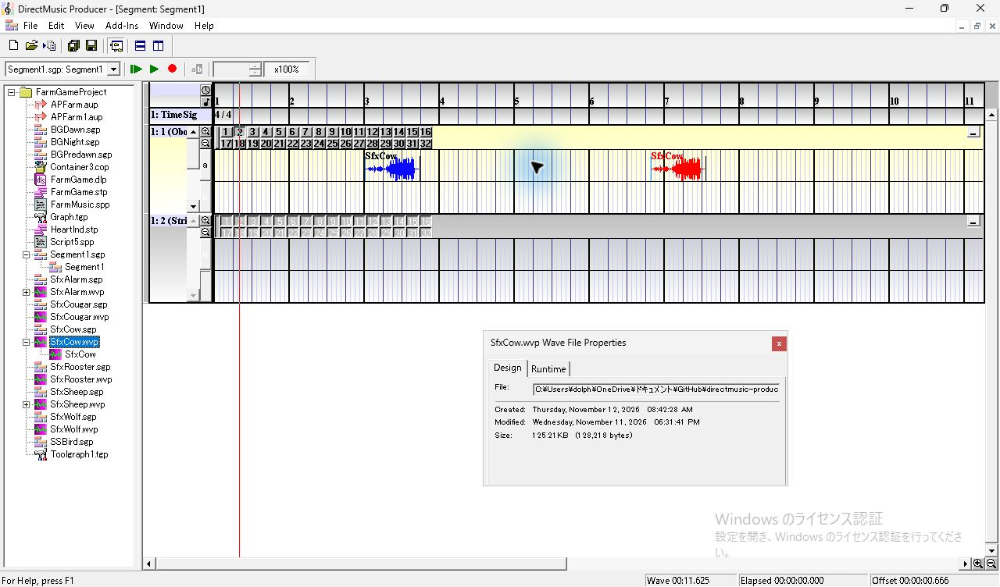
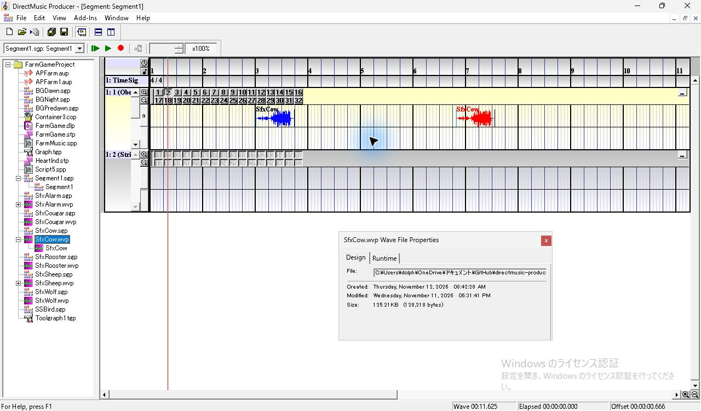
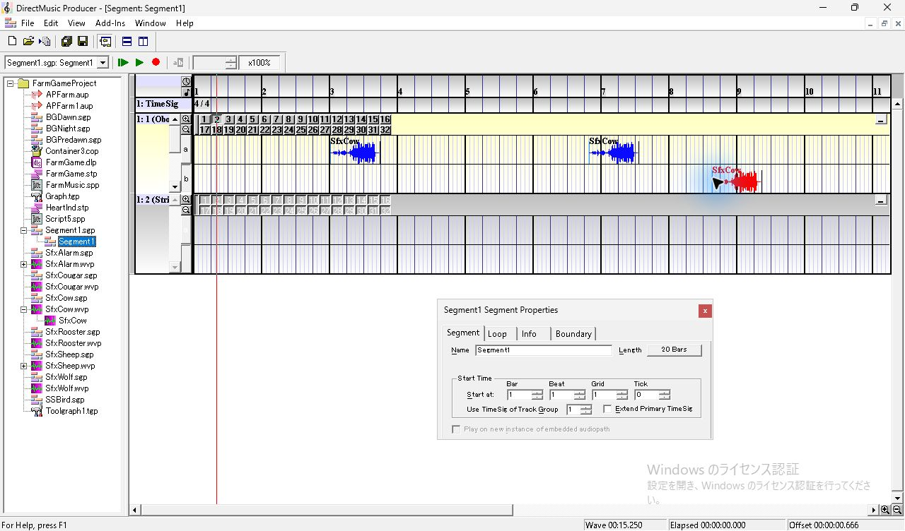
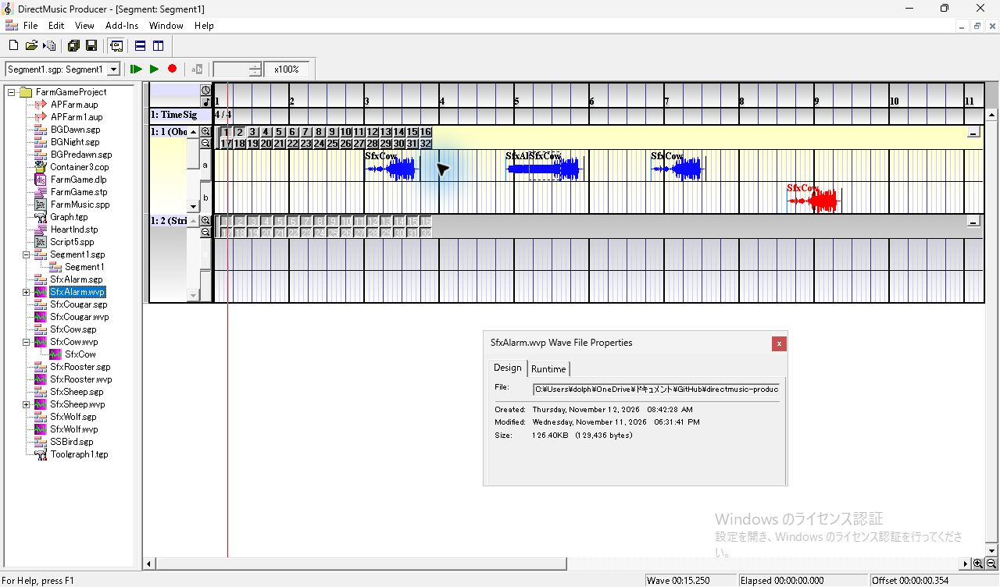
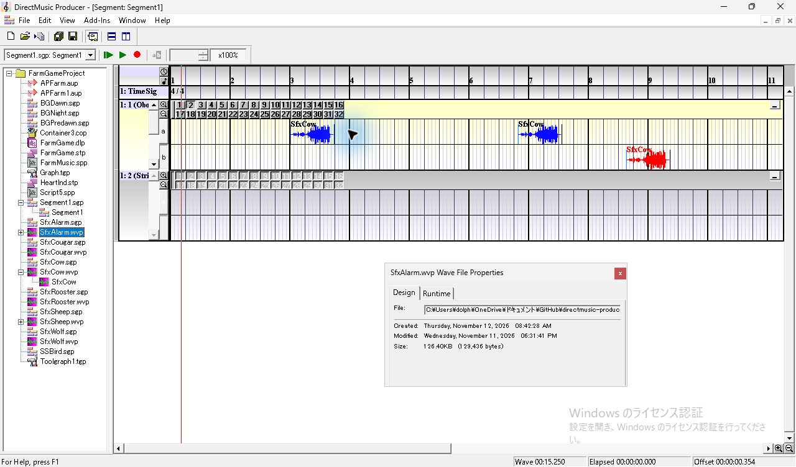
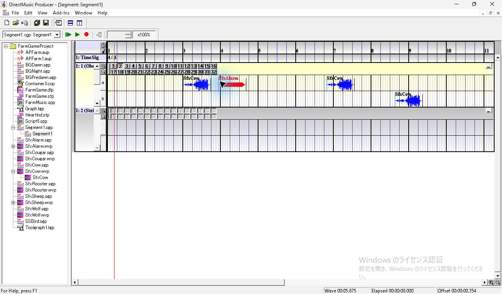
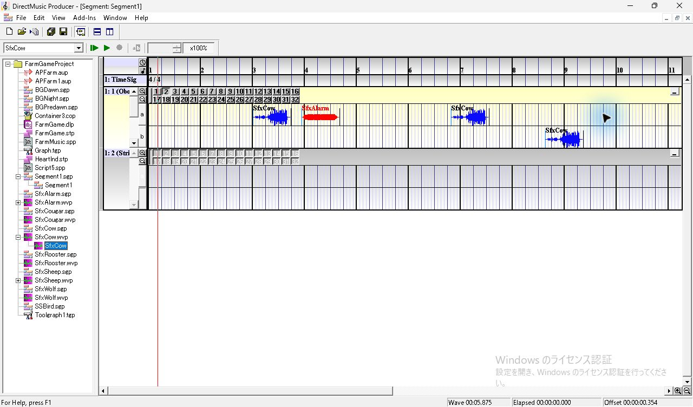
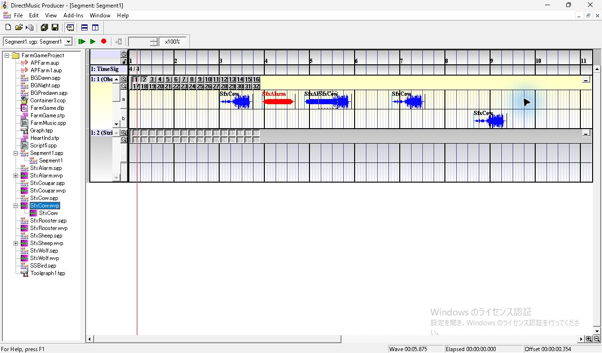

## 保存値と再読込

各回の `waih` から項目の Variation、物理開始、論理開始、長さを読み、`wvcu` からレイヤーを確認した。新規項目の参照 GUID は凍結した .wvp と一致。Part の表示用選択は `wpcu` の先頭、使用可能な Variation は `waph` にある。全試行で使用可能なマスクは `0xFFFFFFFF` を保持した。時刻の単位は音楽クロック。

| 保存時点 | Part 1 の選択マスク | Wave 項目数（Part 1／Part 2） | 保存ファイル |
| --- | --- | --- | --- |
| 開始時 | `0xFFFFFFFF` | 2／0 | [SGP](../../../work/original-gui/SEG-14-wave-drop-overlap/20261111T234228669556Z/inputs/FarmGameProject/Segment1.sgp) |
| SfxAlarm をファイル行から追加 | `0x00000001` | 3／0 | [SGP](../../../work/original-gui/SEG-14-wave-drop-overlap/20261111T234228669556Z/captures/17-file-v1-Segment1.sgp) |
| SfxCow をファイル行から追加 | `0x00000001` | 4／0 | [SGP](../../../work/original-gui/SEG-14-wave-drop-overlap/20261111T234228669556Z/captures/26-two-files-Segment1.sgp) |
| Properties で2件を重ねた | `0x00000001` | 4／0 | [SGP](../../../work/original-gui/SEG-14-wave-drop-overlap/20261111T234228669556Z/captures/36-properties-overlap-Segment1.sgp) |
| Variation 未選択でドロップ | `0x00000000` | 4／0 | [SGP](../../../work/original-gui/SEG-14-wave-drop-overlap/20261111T234228669556Z/captures/40-none-Segment1.sgp) |
| Variation 2 の3件を追加後、表示を1と2にして保存 | `0x00000003` | 7／0 | [SGP](../../../work/original-gui/SEG-14-wave-drop-overlap/20261111T234228669556Z/captures/69-final-Segment1.sgp) |

| 最終ファイルに残った追加項目 | Variation | レイヤー | 物理開始 | 論理開始 | 長さ |
| --- | ---: | --- | ---: | ---: | ---: |
| SfxAlarm（3:4:4:0） | 2 | a | 9,024 | 8,448 | 2,248 |
| SfxAlarm（4:4:3:0） | 1 | a | 11,904 | 11,520 | 2,248 |
| SfxCow（5:1:4:0） | 1 | a | 12,864 | 12,288 | 2,225 |
| SfxCow（6:4:2:0） | 2 | a | 17,856 | 17,664 | 2,225 |
| SfxCow（8:3:3:0） | 2 | b | 23,424 | 23,040 | 2,225 |

レイヤー a の Variation 1 で重なるのは、SfxCow の物理開始 **12,864** から SfxAlarm の物理終端 **14,152** までの1,288クロック。Project を閉じ、同じプロセスで開き直して、Variation 1と2の表示、重なり、b の波形が復元された。重なった座標を左クリックすると再び SfxAlarm が赤く選択された。後続の録音で、同一レイヤーでも両方の音が同時に鳴ることを確認した。保存順を入れ替えた同時刻の組も照合した。 [重なりと同時発音](seg-14-wave-overlap-audio.md) [全保存値とファイルのハッシュ](../../../work/original-gui/SEG-14-wave-drop-overlap/20261111T234228669556Z/wave-drop-overlap-audit.json) · [照合スクリプト](../../../work/original-gui/SEG-14-wave-drop-overlap/20261111T234228669556Z/analyze-wave-drop.py)

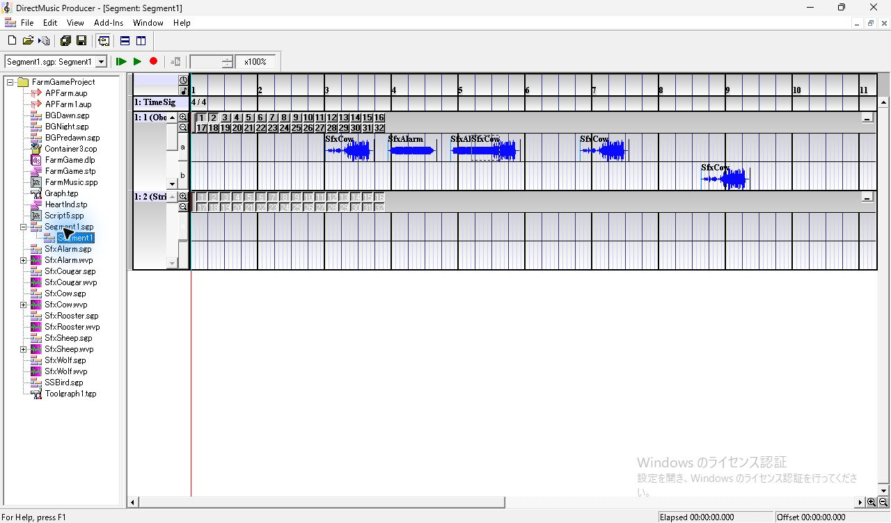
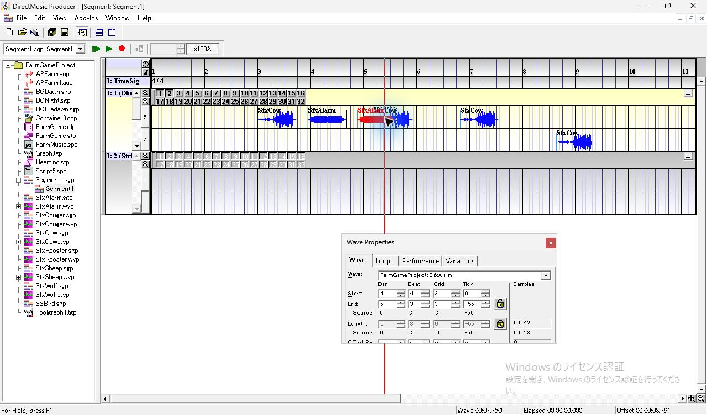

作業コピーで更新されたファイルは `Segment1.sgp` と `FarmGameProject.pro`。複製元と凍結入力28件は開始時のハッシュに一致した。最後は Project を閉じ、開始時と同じ Producer 1件、View の標準4項目を確認した。 [終了時のウィンドウ一覧](../../../work/original-gui/SEG-14-wave-drop-overlap/20261111T234228669556Z/captures/83-final-windows.json)

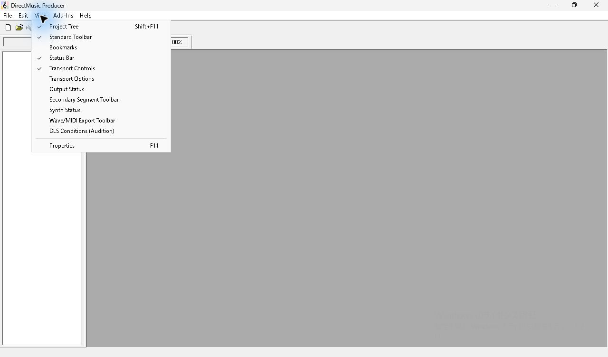
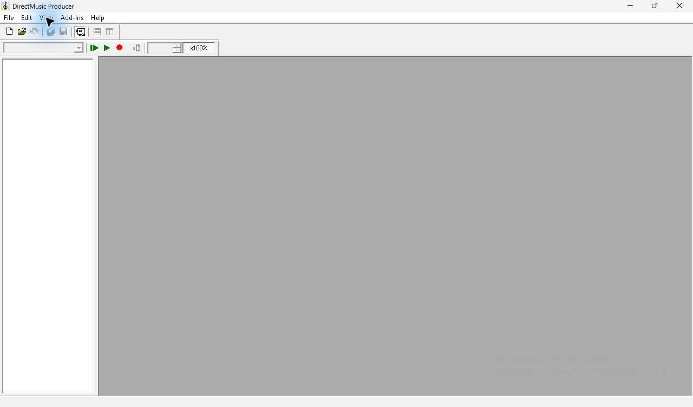
