# SEG-14 Wave エディターのループ方式、長さの固定、終点の検索

DirectMusic Producer 5.3.0.900 の起動済みコピー1件を使い、FarmGameProject の試験コピーで独立した `SfxCow.wvp` を開いた。44.1 kHz、16 bit、Mono、63,868サンプル。ウィンドウは1280 × 752 px。SfxCow の初期倍率は **Zoom 1:64** で、波形面は黒い波形、水平の中心線、緑の始点と青の終点を表示する。太い黒矢印と青い光は操作ツールの位置表示。 [試験素材とハッシュ](../../../work/original-gui/SEG-14-wave-editor-loop-options/20261112T021304844956Z/run.json) · [元の Wave](../../../work/original-gui/SEG-14-wave-editor-loop-options/20261112T021304844956Z/inputs/FarmGameProject/SfxCow.wvp)

## Snap To Zero と範囲選択

**Wave: SfxCow Properties → Wave** の上段は Loop、下段は Selection。どちらも **Start、End、Length、Lock** がある。初期状態は Loop オフ、上段の **Forward、Loop and Release** と数値欄・Lock が灰色。下段は編集可能で、範囲を選ぶと背景が赤くなり、その上に黒い波形が残る。ステータスバーに両端のサンプル番号と時刻が出る。

| 操作 | Selection Start | End | Length |
| --- | ---: | ---: | ---: |
| Snap To Zero オン、`(527, 360) → (699, 360)` | 22,008 | 33,010 | 11,003 |
| メニューで Snap To Zero をオフにした直後 | 22,008 | 33,010 | 11,003 |
| 選択を外し、オフのまま同じ座標をドラッグ | 22,016 | 33,024 | 11,009 |
| 下段の Lock をオンにして Selection Start の上スピンを1回 | 22,017 | 33,025 | 11,009 |
| 下段 Lock を保ち、別の位置を `(741, 360) → (790, 360)` にドラッグ | 38,848 | 38,848 | 1 |

オンで選んだ両端は、それぞれ直前の PCM サンプルとの間で符号が変わった。オフの始点付近は3サンプルとも負で、終点付近には符号の変化があった。選択時に Length は End − Start + 1。下段の Lock をオンにすると Length 欄が灰色になり、スピンで Start を動かしたときは End も同じ量だけ動いた。別の場所からドラッグした試行では、赤い面が消え、解放位置に赤い1本の縦線が残った。

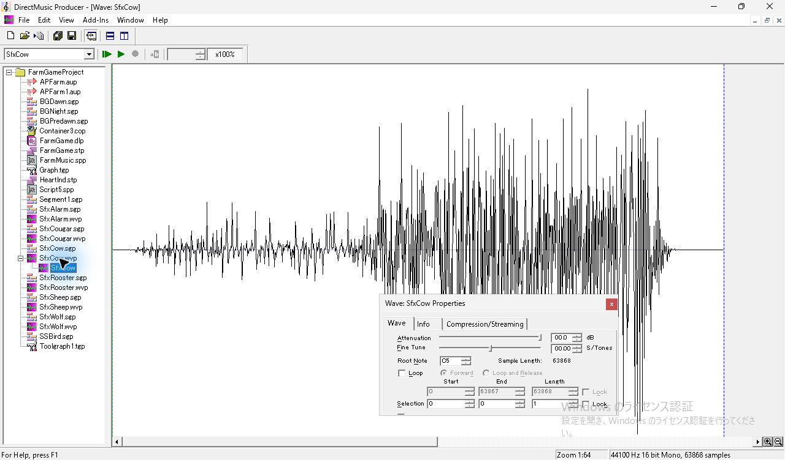
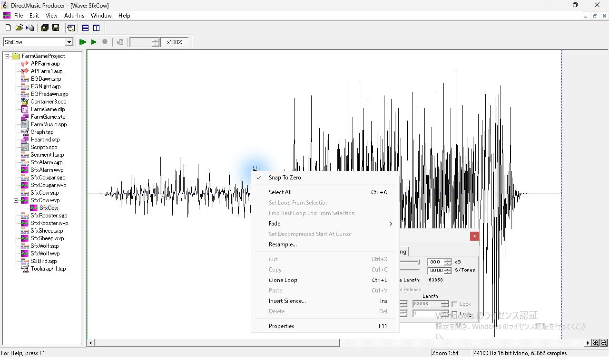
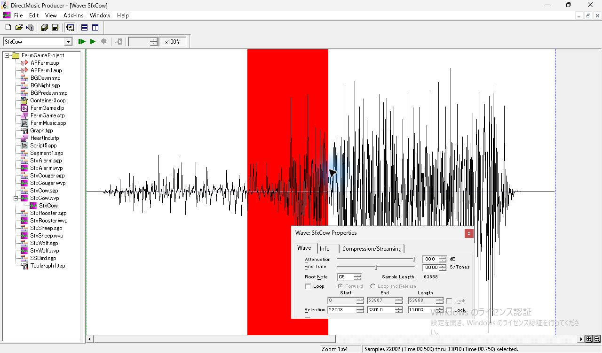

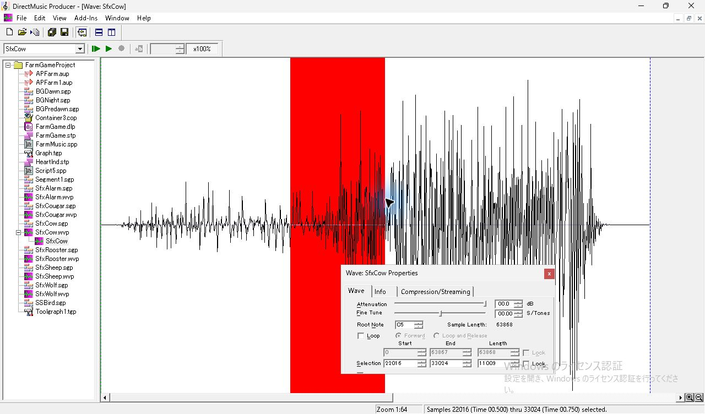
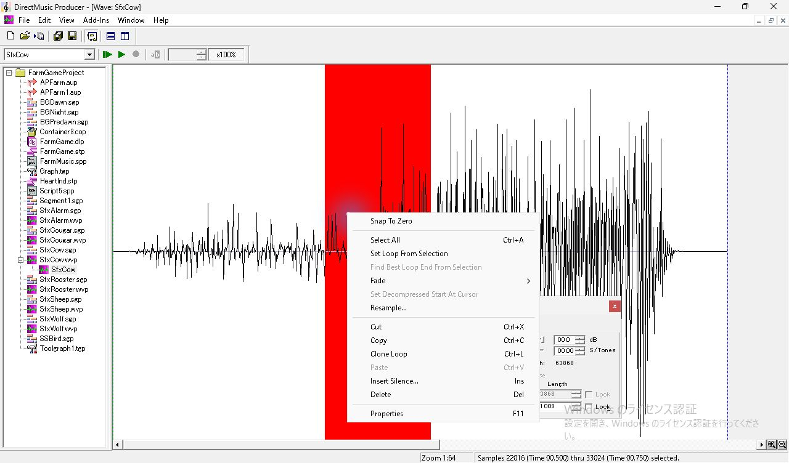

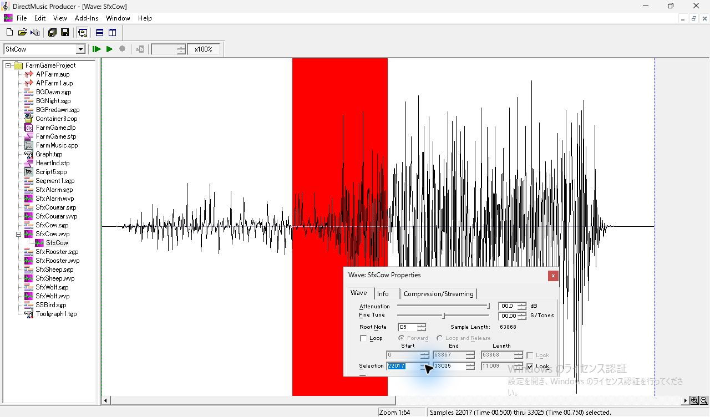
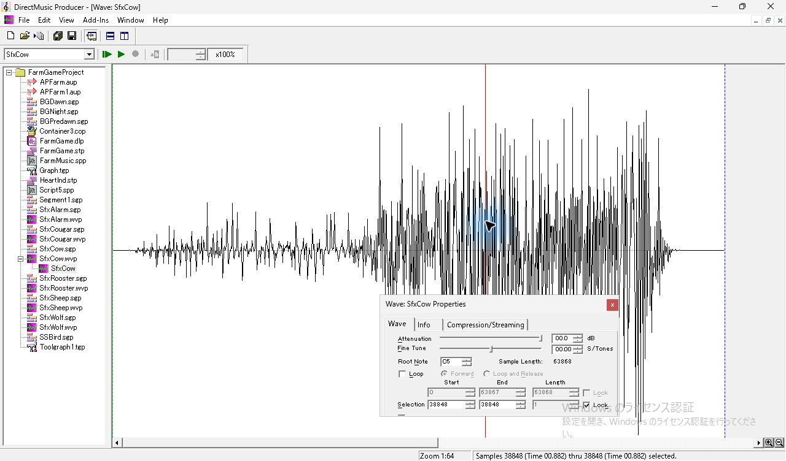

## Loop 側の Lock と端のドラッグ

Selection 側の Lock を外して Snap To Zero をオンに戻し、22,008〜33,010 を再選択した。**Set Loop From Selection** で Loop が有効になり、Forward が選ばれた。選択を外しても、緑と青の実線はループ端に残る。

| 操作 | Loop Start | End | Length |
| --- | ---: | ---: | ---: |
| Set Loop From Selection | 22,008 | 33,010 | 11,003 |
| 上段 Lock をオン、緑の線を `(526, 143) → (458, 143)` | 17,600 | 28,602 | 11,003 |
| 青の線を `(629, 143) → (754, 143)` | 25,541 | 36,543 | 11,003 |
| 保存後に青の線を `(753, 143) → (781, 143)` | 27,269 | 38,271 | 11,003 |
| 保存前に Edit → Undo Modify Loop | 25,541 | 36,543 | 11,003 |

Loop 側の Lock で Length が灰色になり、どちらの線をドラッグしても両端が同じサンプル数だけ動いた。緑・青の線上には、それぞれの色の**左右両矢印カーソル**がドラッグ解放直後に出た。押下を保持した途中は未撮影。Save の直後に Ctrl+Z を2回押しても両端は動かず、Edit メニューで Undo は灰色だった。その後の未保存のドラッグには **Undo Modify Loop** が出て、1回で両端が戻った。 [最初の Forward 保存](../../../work/original-gui/SEG-14-wave-editor-loop-options/20261112T021304844956Z/captures/17-forward-save-SfxCow.wvp) · [Lock 中に両端を移動して保存](../../../work/original-gui/SEG-14-wave-editor-loop-options/20261112T021304844956Z/captures/21-loop-lock-save-SfxCow.wvp)

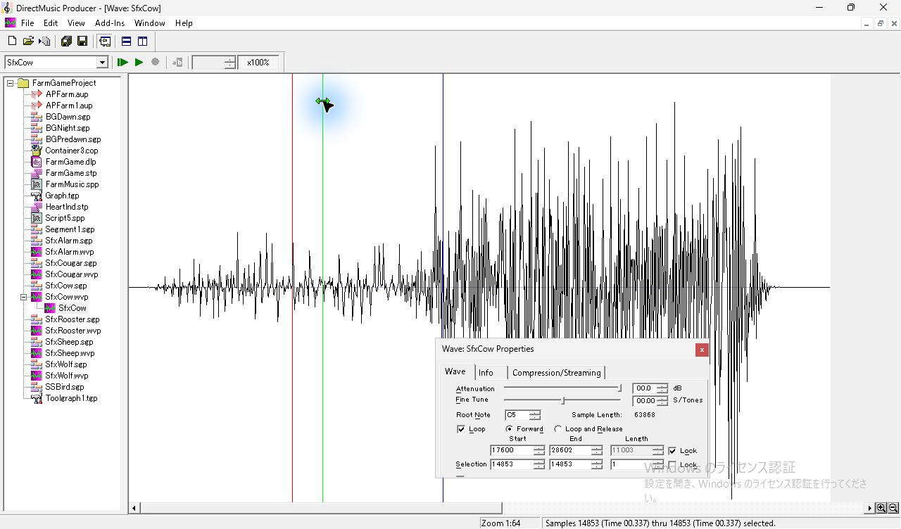
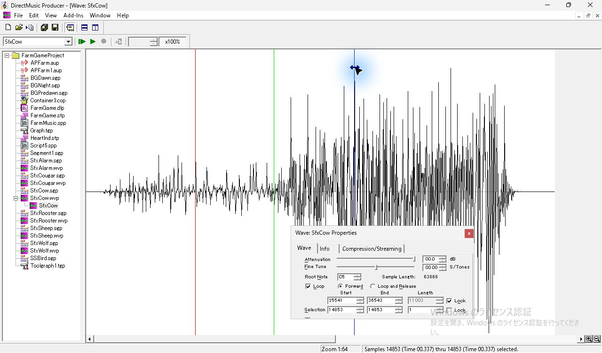
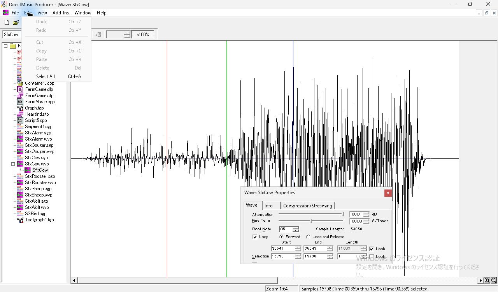

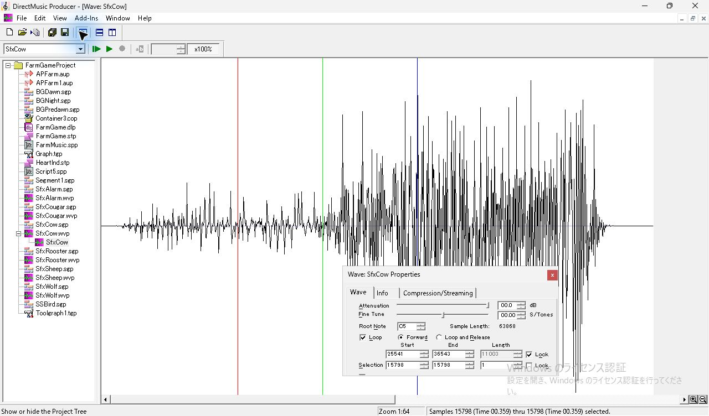

## Find Best Loop End From Selection

Loop オフの初期状態では、赤い範囲を選ぶと **Set Loop From Selection** は有効、**Find Best Loop End From Selection** は灰色だった。Loop を有効にした後は、上段の Lock 中でも **Find Best Loop End From Selection** を実行できた。

| 選択と条件 | 操作前の Loop | 操作後の Loop | 操作後の Length |
| --- | --- | --- | ---: |
| Selection 38,217〜42,922、上段 Lock オン | 25,541〜36,543 | 25,541〜42,921 | 17,381 |
| Undo 後に同じ Selection、上段 Lock オフ | 25,541〜36,543 | 25,541〜42,921 | 17,381 |
| 始点より前の Selection 9,496〜15,970 | 25,541〜42,921 | 25,541〜25,669 | 129 |
| 再読込直後の Selection 0–0、Loop and Release、Snap オフ | 25,541〜42,921 | 25,541〜25,875 | 335 |

同じ候補範囲では、Lock のオン・オフとも緑の始点と赤い選択範囲を保ち、青の終点を選択終端の1サンプル手前へ移動した。Lock がオンのまま Length の値も変わった。**Undo Find Best Loop End** で元の終点に戻り、赤い選択範囲は保たれた。最初の Undo では横スクロール位置も動いた。再実行時には赤い範囲の外を右クリックしたが、保持されていた同じ選択が使われた。

選択が始点より前だけのときもコマンドは有効で、青い線は緑の線から128サンプル後ろへ移った。赤い範囲の外に出たこの状態も保存できた。再読込直後の **0–0** では **Set Loop From Selection** が灰色でも **Find Best Loop End From Selection** が有効で、終点が変わった。Wave 面にフォーカスを戻して Edit メニューの Undo を使うと、終点は42,921に戻った。ここでは候補位置の算出式や下限の全条件までは確定していない。 [候補範囲内の WVP](../../../work/original-gui/SEG-14-wave-editor-loop-options/20261112T021304844956Z/captures/34-best-end-save-SfxCow.wvp) · [始点より前の範囲を使った WVP](../../../work/original-gui/SEG-14-wave-editor-loop-options/20261112T021304844956Z/captures/38-best-before-start-save-SfxCow.wvp) · [同梱ヘルプのループ端操作](../../../../../work/analysis/original-manual-session/20261010T031624075Z/help-extracted/htm/settinglooppoints.htm)

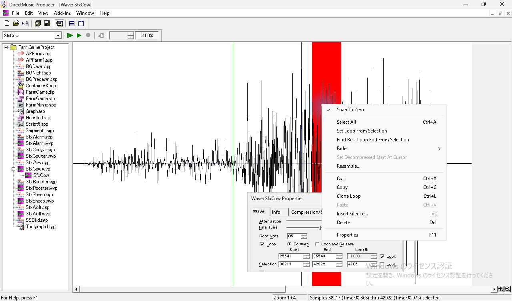
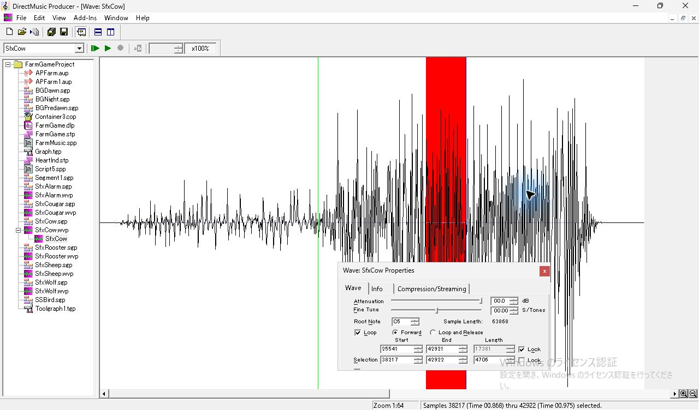
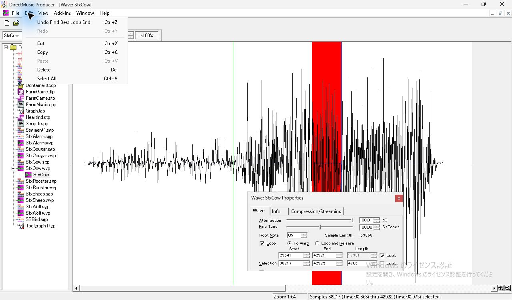
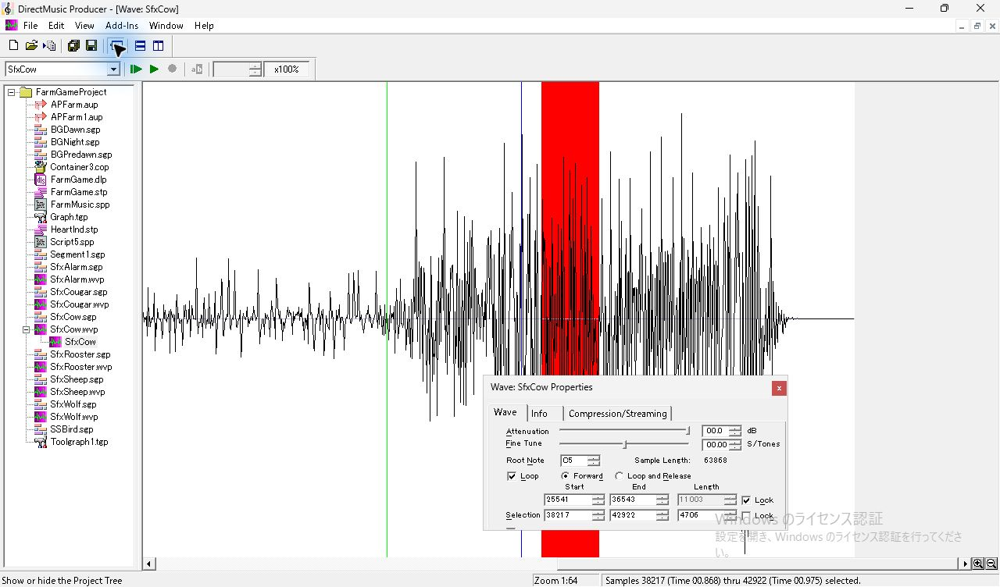
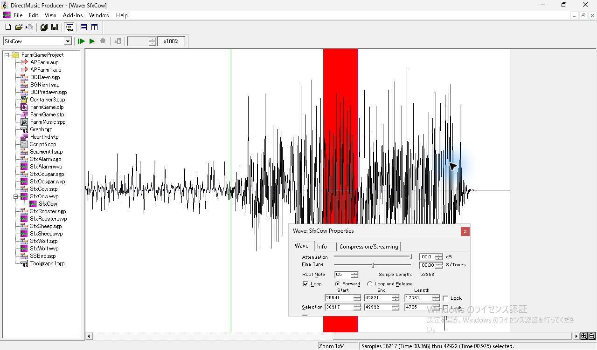
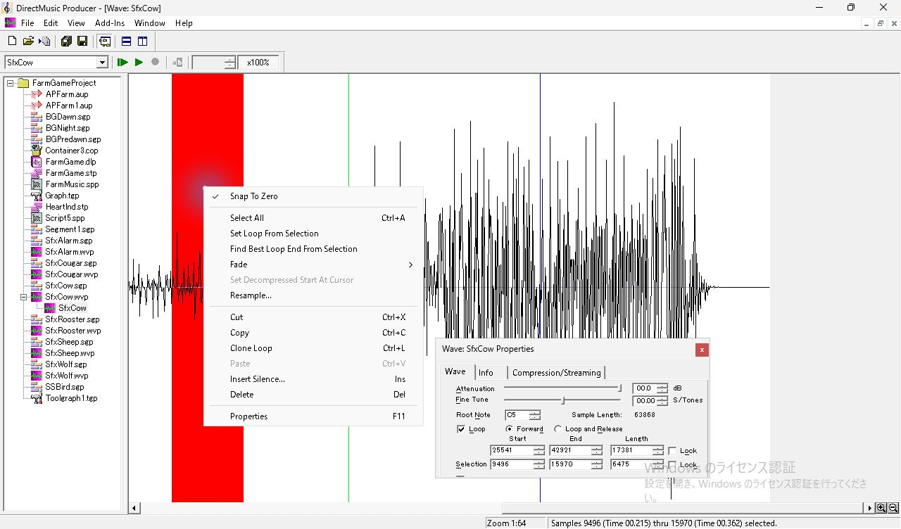
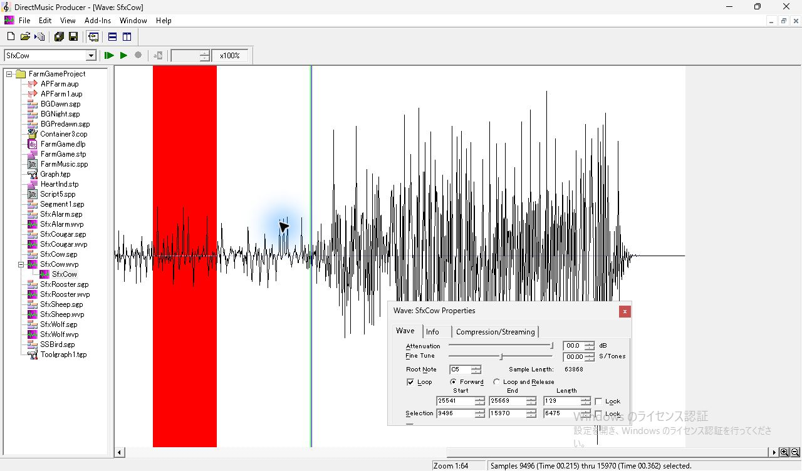
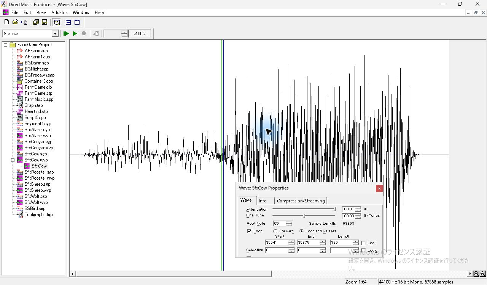
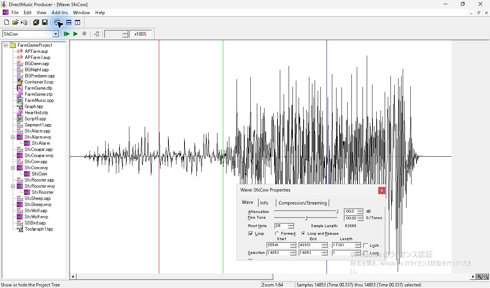

## Loop and Release の保存と単独試聴

上段の **End** 欄は、全桁を選択して入力してもフォーカスが残る間は Length と青線が変わらず、Tab で離れると確定した。今回は Home → Shift+End で全桁を選択した。Ctrl+A を使った試行では既存値を置換できず、確定値が波形末尾の63,867になったため、入力し直した。

**Forward** と **Loop and Release** は排他的な選択肢。切り替えても Start 25,541、End 42,921、Length 17,381 と緑・青の線の位置は同じだった。対応する WVP の `smpl` と `wsmp` では、同じ範囲で種別が **0 → 1** に変わった。元 PCM、形式、GUID は全保存状態で一致した。 [Forward の WVP](../../../work/original-gui/SEG-14-wave-editor-loop-options/20261112T021304844956Z/captures/34-best-end-save-SfxCow.wvp) · [Loop and Release の WVP](../../../work/original-gui/SEG-14-wave-editor-loop-options/20261112T021304844956Z/captures/48-release-same-bounds-save-SfxCow.wvp)

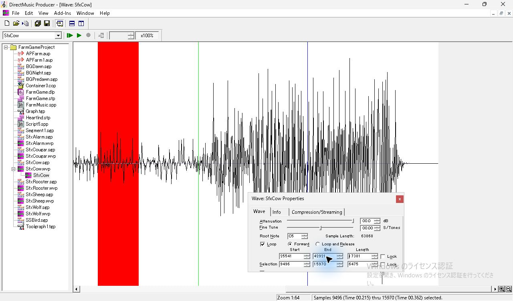
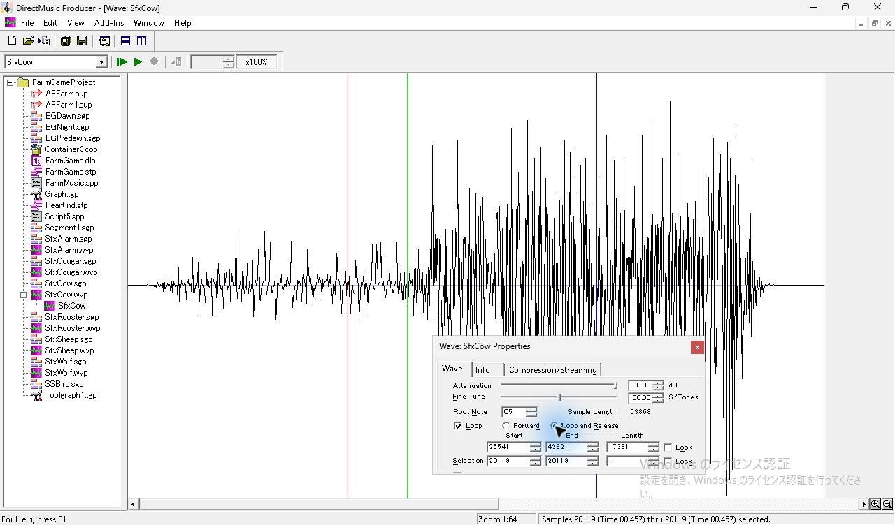

Wave 文書を **Play From Start** で単独試聴し、左の Transport ボタンの **Stop Immediate**、右の **Stop at Boundary** をそれぞれ使った。両方式とも、再生中は黒い位置線がループ区間に表示され、停止後は消えた。既定の Windows 出力を48 kHz、32-bit float、ステレオで録音し、元 PCM の冒頭で各再生の開始を合わせた。録音内の反復は、元 PCM の0.680〜0.760秒を各周で探した。停止前後にはループ外の1.055〜1.135秒の波形を照合した。

| 停止操作 | 方式 | 録音内の再生開始 | 反復周期 | 最終有音区間まで | ループ外の波形との最大相関 |
| --- | --- | ---: | ---: | ---: | ---: |
| Stop Immediate | Forward | 0.704秒 | 394.13〜394.15 ms | 2.691秒 | 0.255 |
| Stop Immediate | Loop and Release | 6.788秒 | 394.13 ms | 2.697秒 | 0.271 |
| Stop at Boundary | Forward | 0.851秒 | 394.10〜394.15 ms | 2.479秒 | 0.239 |
| Stop at Boundary | Loop and Release | 5.676秒 | 394.13〜394.15 ms | 2.474秒 | 0.239 |

全試行で反復波形の相関は0.989以上。周期は17,381サンプルの約394.13 msと一致し、どちらの停止操作でもループ外の照合区間は検出されなかった。有音区間の判定は5 ms窓、RMS 0.0004。Stop at Boundary の操作時刻ログは空だったため、表の停止までの長さは録音内の開始からの計測であり、ボタン入力から停止までの時間は未測定。ここで試したのは Wave エディターの単独試聴。後続の DLS Region の Note Off 試験では、長い2音で Loop and Release のときだけ次のループ終端付近から終端側の PCM を検出した。 [DLS Region の Note Off](seg-14-dls-note-release.md) [Stop Immediate の録音](../../../work/original-gui/SEG-14-wave-editor-loop-options/20261112T021304844956Z/captures/wave-preview-modes/output.wav) · [Stop at Boundary の録音](../../../work/original-gui/SEG-14-wave-editor-loop-options/20261112T021304844956Z/captures/wave-preview-boundary/output.wav) · [同梱ヘルプの Wave タブ](../../../../../work/analysis/original-manual-session/20261010T031624075Z/help-extracted/htm/wavetab.htm)

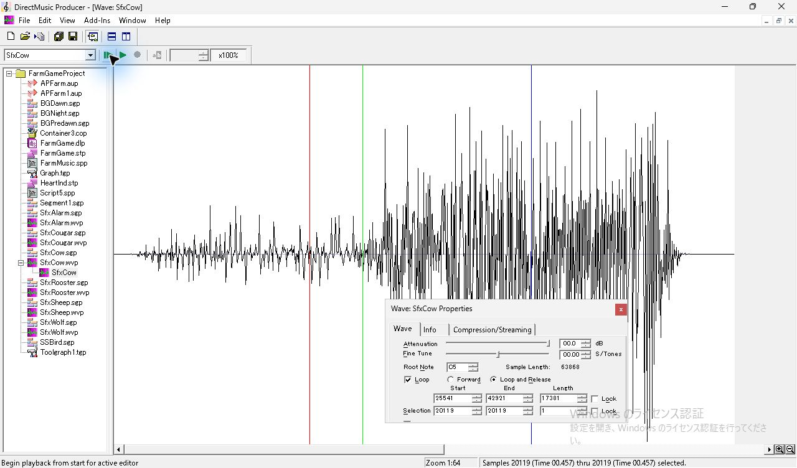
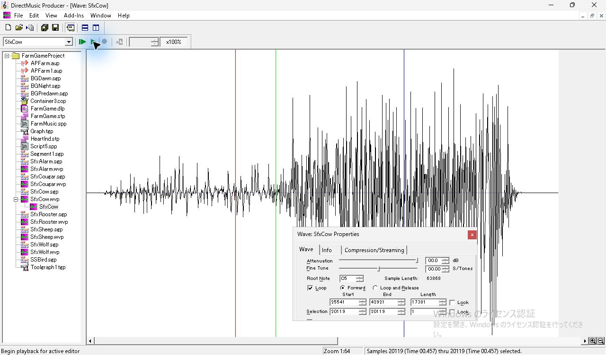

## 保存で復元される値とエディターの状態

Loop and Release のまま上段・下段の Lock をオン、Selection を47,098〜49,997、Snap To Zero をオフにして保存した。Project を閉じる際に Wave の保存確認が出たため **Yes** を選んだ。再読込すると Loop and Release と25,541〜42,921が復元された。2つの Lock はオフ、Selection は0–0、赤い範囲は消えた。両 Lock と Snap の変更前、変更後、閉じる際の Yes で保存した3つの WVP は同じハッシュだった。

再読込した Cow と、その後に初めて開いた Alarm は Snap オフだった。Alarm 側をオンにすると、新しく開いた Rooster はオン、すでに開いていた Cow はオフのままだった。この順序では、切り替えが新しく開く Wave の初期値に反映され、開いている別の Wave のチェックはその場では変わらなかった。最後に Cow も初期のオンへ戻した。後続の別起動では、終了前にオフにした Snap To Zero がオンに戻った。同じドラッグの端点はオフ時の22,016〜33,024から、再起動後は22,008〜33,010になった。 [再起動前後の Snap To Zero](seg-14-wave-tempo-restart.md#snap-to-zero-をオフにして再起動) · [最終 WVP](../../../work/original-gui/SEG-14-wave-editor-loop-options/20261112T021304844956Z/captures/59-close-confirm-save-SfxCow.wvp)

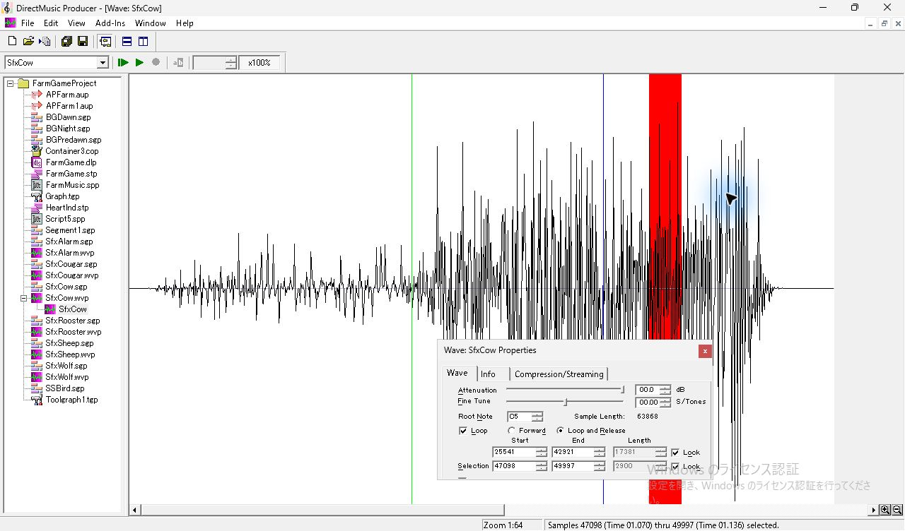
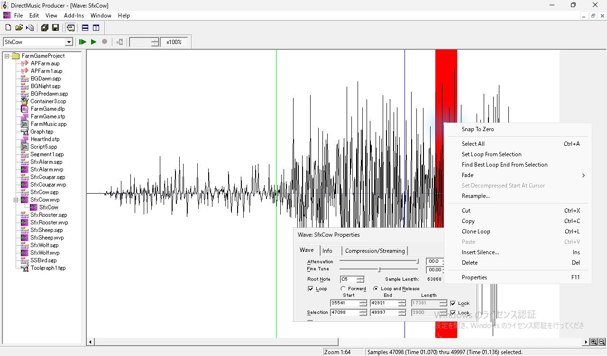
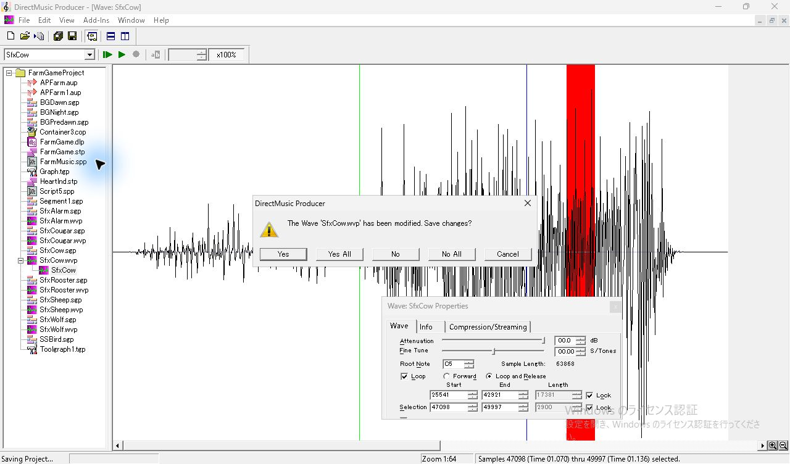
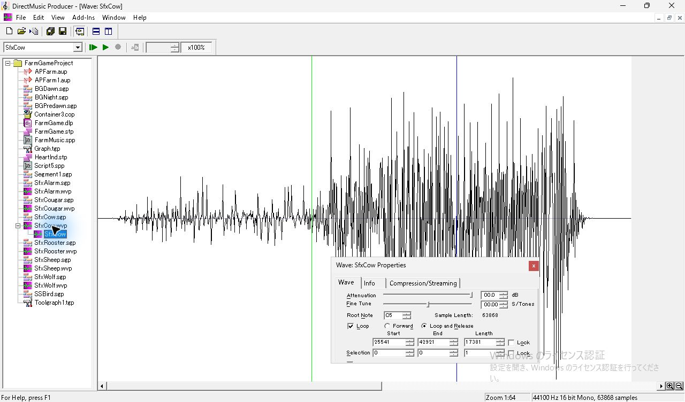
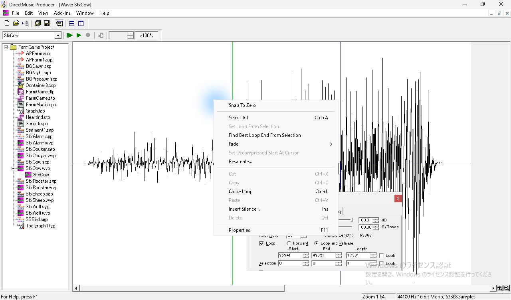
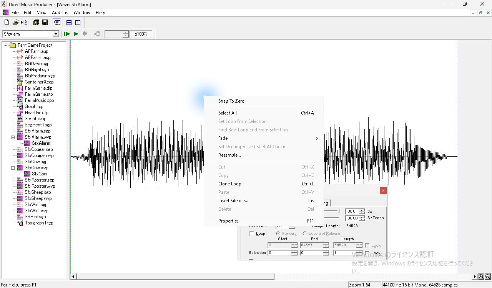
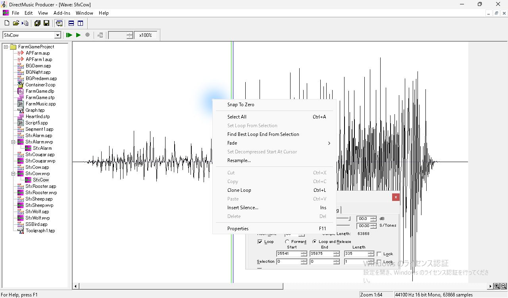
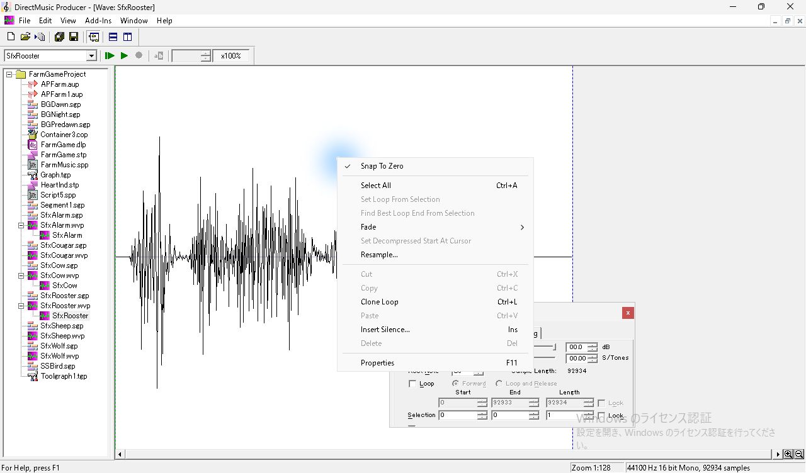
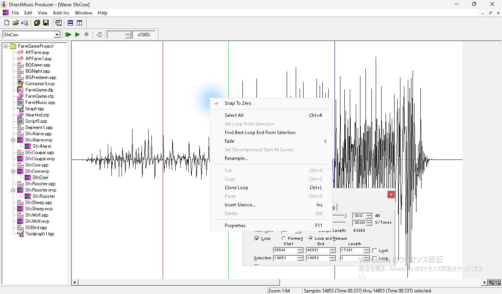

凍結入力28件、開始時と保存時の Wave 8状態、録音2本、掲載画像43枚を照合した。試験コピーで変更されたファイルは `SfxCow.wvp` と `FarmGameProject.pro`。Project を閉じ、開始時と同じ Producer ウィンドウ1件を確認した。 [測定結果と保存値](../../../work/original-gui/SEG-14-wave-editor-loop-options/20261112T021304844956Z/loop-options-audit.json) · [照合スクリプト](../../../work/original-gui/SEG-14-wave-editor-loop-options/20261112T021304844956Z/analyze-loop-options.py) · [画像の寸法とハッシュ](../../../work/original-gui/SEG-14-wave-editor-loop-options/20261112T021304844956Z/published-figures.json) · [終了時のウィンドウ](../../../work/original-gui/SEG-14-wave-editor-loop-options/20261112T021304844956Z/final-windows.json)

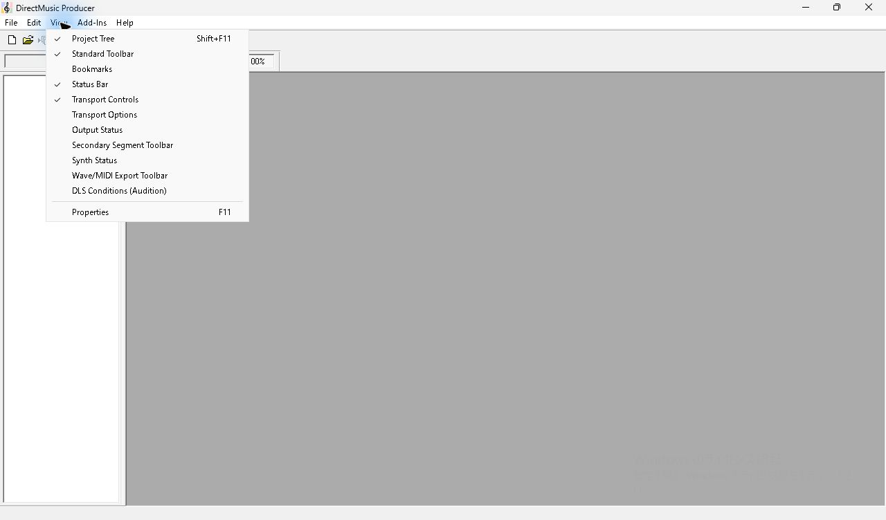
