# SEG-14 Wave Track の再生途中で Variation 1 を外す

DirectMusic Producer 5.3.0.900 の作業コピー1件で、Wave Part の **in order from first** を使った。Variation 1・2 を表示して **Play From Start** を押し、再生中に上段の **1** を1回クリックする。位置線、赤い番号、波形の再描画を Windows 出力の録音と照合した。切り替え7条件と操作なしの対照を採用し、全画面のスクリーンショット30枚を掲載する。 [入力と実行環境](../../../work/original-gui/SEG-14-wave-live-variation-boundary/20261112T030957995875Z/run.json) · [前回の試行](seg-14-wave-variation-audio.md#再生途中で-variation-1-の表示を外す)

## 入力と手順

1. 前回 Producer から保存した `Segment1.sgp` を試験 Project にコピーした。4/4、7小節、Tempo Track なし、**Repeat 1**。Music Time のループは先頭から8小節目の先頭。PChannel 1 のレイヤー a に下表の Wave があり、PChannel 2 は空。個々の Wave のループはオフ。 [前回保存した SGP](../../../work/original-gui/SEG-14-wave-variation-audio/20261112T013800560194Z/captures/23-save-both-loop-Segment1.sgp) · [今回の入力 SGP](../../../work/original-gui/SEG-14-wave-live-variation-boundary/20261112T030957995875Z/inputs/FarmGameProject/Segment1.sgp)
2. **Alternate Tempo x100%** の状態で、冒頭に120.00を置いた無音の `BGDawn.sgp` を自然終了まで再生する。Current Tempo に120.00が表示され、2.003秒で終了した。次に Project Tree から Segment1 を開く。 [120 BPM の入力](../../../work/original-gui/SEG-14-wave-live-variation-boundary/20261112T030957995875Z/inputs/FarmGameProject/BGDawn.sgp) · [素材作成コード](../../../work/original-gui/SEG-14-wave-live-variation-boundary/20261112T030957995875Z/prepare.py)
3. 各試行を Variation 1・2 の両方が表示された状態で開始する。上側の Wave Part の1を1回クリックし、2周目まで自然終了を待つ。次の試行は、停止後に1を再度クリックし、第3小節の波形が復元されたことを確認してから開始する。

| 小節 | 各周の発音開始位置 | Variation 1 | Variation 2 |
| ---: | ---: | --- | --- |
| 1 | 0.250秒 | Alarm | Alarm |
| 2 | 2.250秒 | Cow | Cow |
| 3 | 4.250秒 | Alarm ＋ Cow | 空 |
| 4 | 6.250秒 | 空 | Alarm ＋ Cow |
| 5 | 8.250秒 | Alarm | Cow |
| 6 | 10.250秒 | Cow | Alarm |
| 7 | — | 空 | 空 |

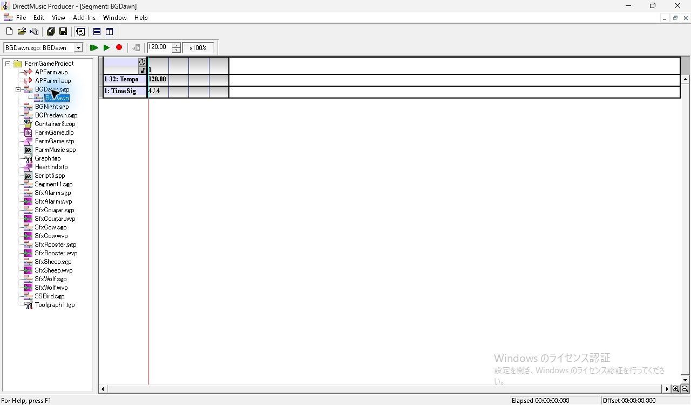
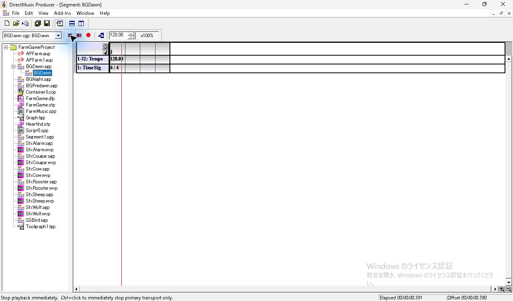
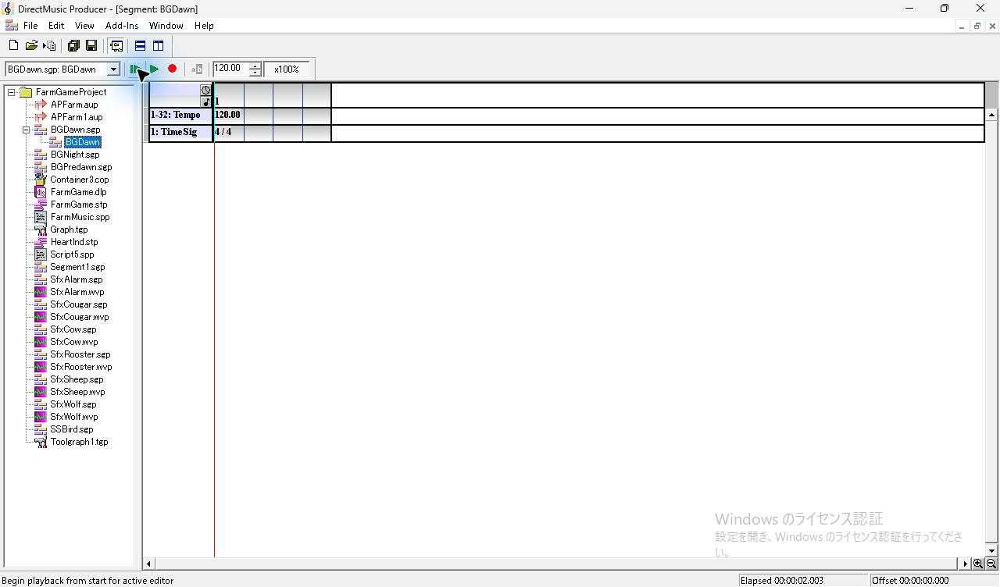
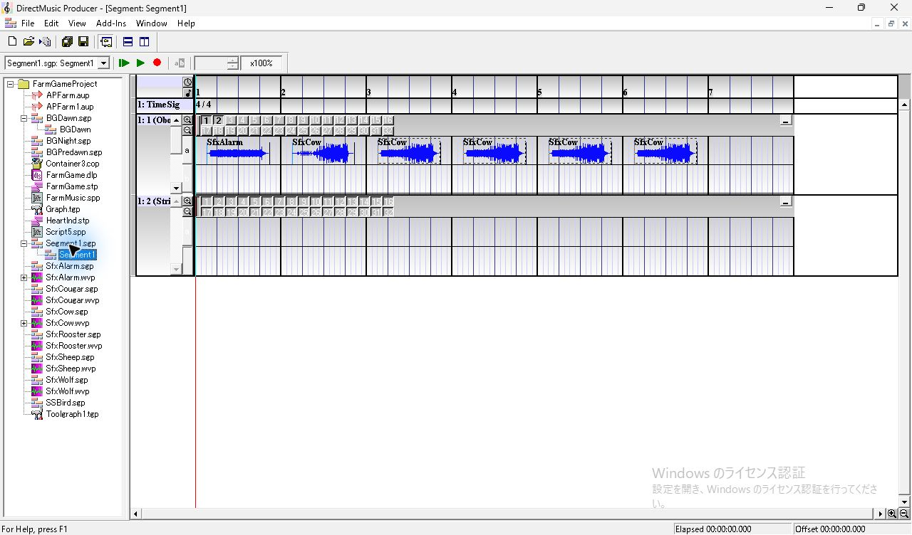

## 録音で判定した発音

第1・2小節は1・2共通の Alarm、Cow。表の各周の欄は **第3 → 第4 → 第5 → 第6小節** の順。**A** は SfxAlarm、**C** は SfxCow、**—** は該当する成分の検出なし。クリックの時刻は第1小節の Alarm の録音開始から250 msを引いて得た先頭を基準とし、操作 API の呼び出し前後で範囲を示す。Elapsed は撮影フレーム時点の画面表示。 [測定結果 JSON](../../../work/original-gui/SEG-14-wave-live-variation-boundary/20261112T030957995875Z/measurements.json) · [測定コード](../../../work/original-gui/SEG-14-wave-live-variation-boundary/20261112T030957995875Z/measure.py)

| 1を外した位置 | クリック区間（秒） | 1周目 第3〜6小節 | 2周目 第3〜6小節 | 録音 |
| --- | ---: | --- | --- | --- |
| 切り替えなし | — | A＋C ／ — ／ A ／ C | — ／ A＋C ／ C ／ A | [WAV](../../../work/original-gui/SEG-14-wave-live-variation-boundary/20261112T030957995875Z/captures/before-three-retry/output.wav) |
| 1周目第3小節の発音中 | 4.946〜5.084 | A＋C ／ — ／ — ／ A | — ／ A＋C ／ C ／ A | [WAV](../../../work/original-gui/SEG-14-wave-live-variation-boundary/20261112T030957995875Z/captures/during-three-retry/output.wav) |
| 第5小節の発音位置の約1.5秒前 | 6.674〜6.811 | A＋C ／ — ／ — ／ A | — ／ A＋C ／ C ／ A | [WAV](../../../work/original-gui/SEG-14-wave-live-variation-boundary/20261112T030957995875Z/captures/earlier-bar5/output.wav) |
| 第5小節の発音位置の約0.5秒前 | 7.731〜7.864 | A＋C ／ — ／ A ／ A | — ／ A＋C ／ C ／ A | [WAV](../../../work/original-gui/SEG-14-wave-live-variation-boundary/20261112T030957995875Z/captures/before-bar5/output.wav) |
| 第5小節の発音中 | 8.793〜8.945 | A＋C ／ — ／ A ／ A | — ／ A＋C ／ C ／ A | [WAV](../../../work/original-gui/SEG-14-wave-live-variation-boundary/20261112T030957995875Z/captures/at-bar5/output.wav) |
| 折り返しの約0.7秒前 | 13.225〜13.362 | A＋C ／ — ／ A ／ C | — ／ A＋C ／ C ／ A | [WAV](../../../work/original-gui/SEG-14-wave-live-variation-boundary/20261112T030957995875Z/captures/during3/output.wav) |
| 折り返しの約0.7〜0.9秒後 | 14.711〜14.865 | A＋C ／ — ／ A ／ C | — ／ A＋C ／ C ／ A | [WAV](../../../work/original-gui/SEG-14-wave-live-variation-boundary/20261112T030957995875Z/captures/after-wrap-near2/output.wav) |
| 折り返しの約4秒後 | 17.915〜18.054 | A＋C ／ — ／ A ／ C | — ／ A ／ C ／ A | [WAV](../../../work/original-gui/SEG-14-wave-live-variation-boundary/20261112T030957995875Z/captures/after-wrap/output.wav) |

### 切り替えなし

1周目は赤い1、2周目は赤い2。両方の波形を表示したまま、録音では1周目の第3小節に2音、第4小節に発音なし。2周目は第3小節に発音なし、第4小節に2音。全試行で2周目の基準 Alarm は1周目の **14.000秒後** に現れた。

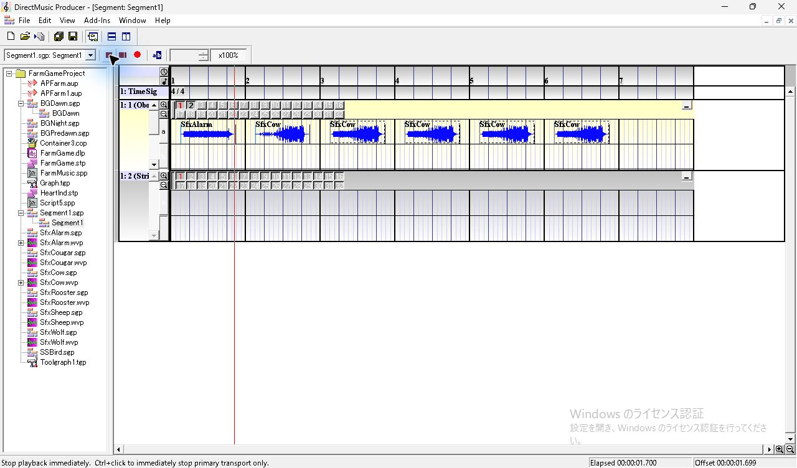

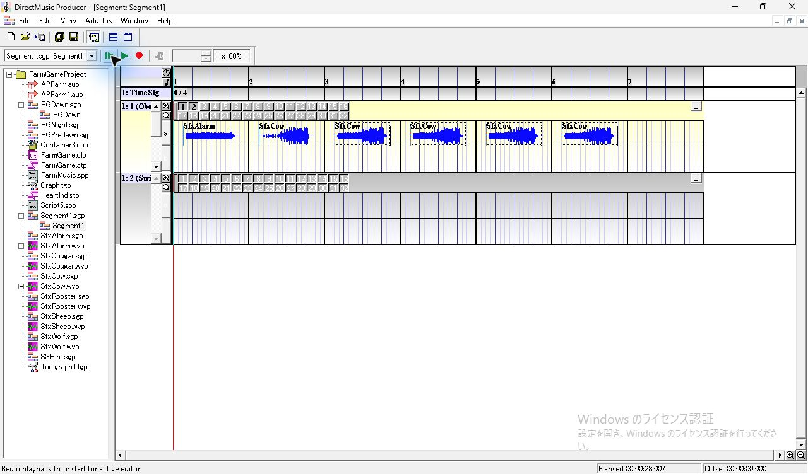

### 第3小節の重なりが鳴っている間

**4.946〜5.084秒** に1を外すと第3小節の波形が消え、赤い2が表示された。鳴っていた Alarm と Cow はクリック後も検出された。続く第4・5小節に発音を検出せず、第6小節は Variation 2 の Alarm が鳴った。2周目の第4小節は Alarm と Cow、第5小節は Cow。

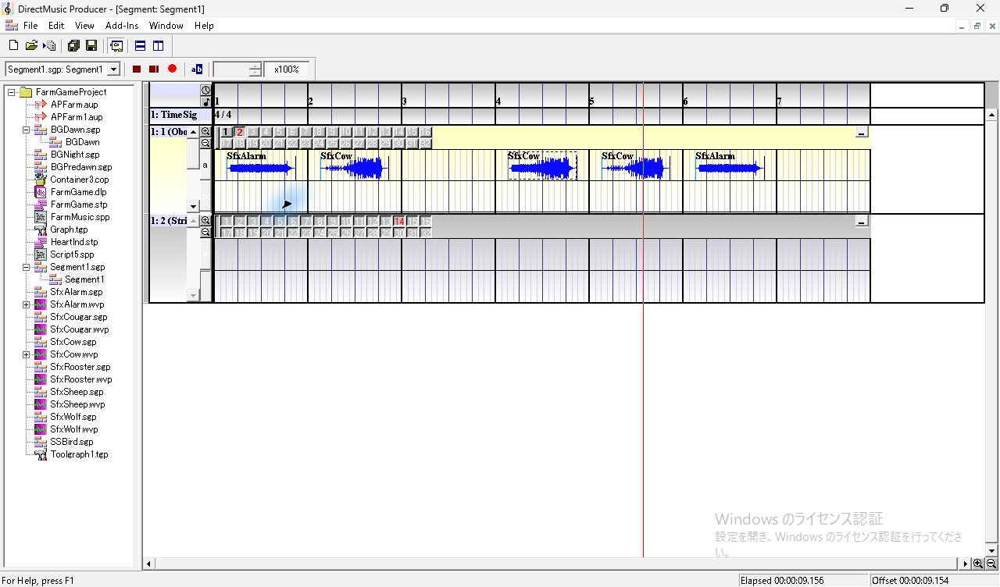

### 第5小節の前と発音中

第5小節の基準の発音位置は **8.250秒**。1を外した後の第5小節は、3試行とも赤い2と Cow の波形が確認できた。録音はクリックの時刻によって変わった。

- **6.674〜6.811秒**。第5小節の発音位置の約1.44〜1.58秒前。1周目の第5小節に発音を検出せず、第6小節で Alarm。
- **7.731〜7.864秒**。第5小節の発音位置の約0.39〜0.52秒前。1周目の第5小節は Alarm、第6小節も Alarm。
- **8.793〜8.945秒**。第5小節の発音開始から約0.54〜0.70秒後。鳴り始めていた Alarm の成分は切り替え後も続いた。第6小節は Alarm。

2周目の第5小節では3試行とも Cow が鳴った。先行資料では、同じ配置でさらに早い **3.010〜3.513秒** のクリックを2回試し、第5小節は1周目から Cow だった。今回の試行点と合わせると、第5小節の1周目は、クリックを遅らせた順に **Cow → 発音の検出なし → Alarm** の3状態を取った。厳密な切り替え時刻の境界は未測定。 [早い時刻の既往試行](seg-14-wave-variation-audio.md#再生途中で-variation-1-の表示を外す)

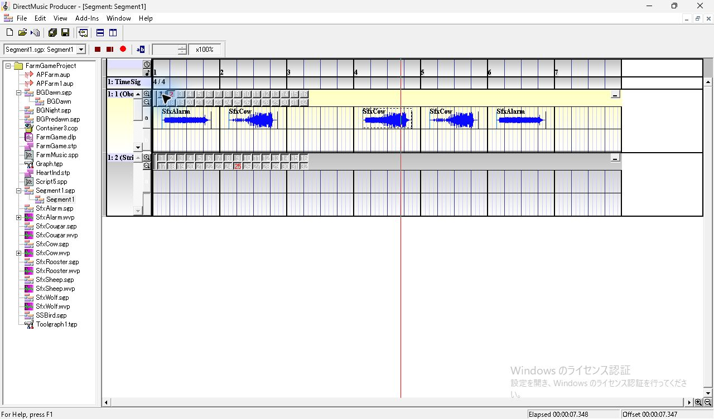
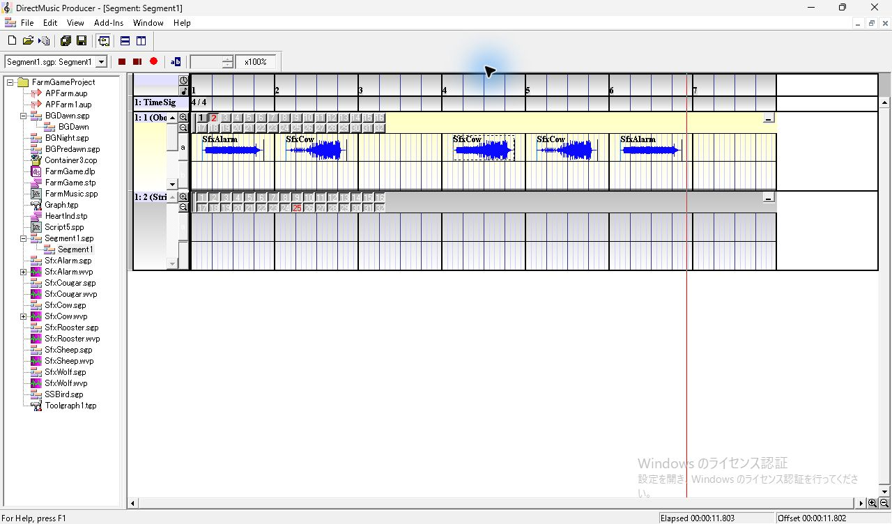

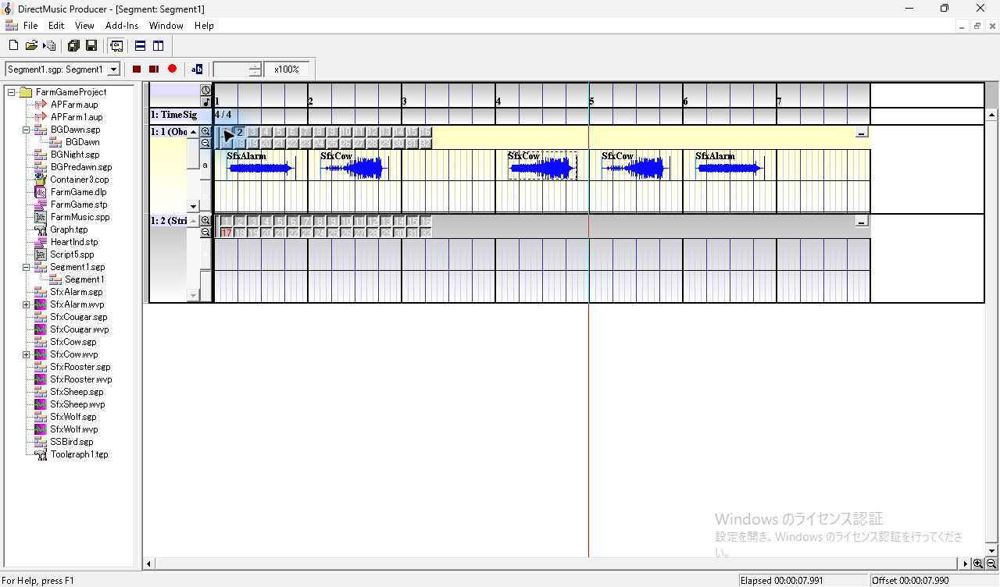

### 折り返しの前後

**13.225〜13.362秒** に1を外すと、1周目の発音は対照と同じ。切り替え後の画面では、2周目に入って Elapsed 14.317秒、Offset 0.316秒、赤い2が見えた。2周目の第4小節では2音が鳴った。

**14.711〜14.865秒** に1を外した条件でも、2周目の第4小節で2音が鳴った。クリック時に鳴っていた共有の Alarm は、その後も検出された。

**17.915〜18.054秒** に1を外した試行では、クリック前から2が赤かった。クリック後も2が赤く、画面から第3小節の波形が消えた。2周目の第4小節では Alarm のみを検出した。その時点より後の画面に表示された第4小節のラベルは **SfxCow** だった。第4小節のラベルは重なった2件のうち前面に見える項目。 [Wave の重なりと選択](seg-14-wave-overlap-audio.md)

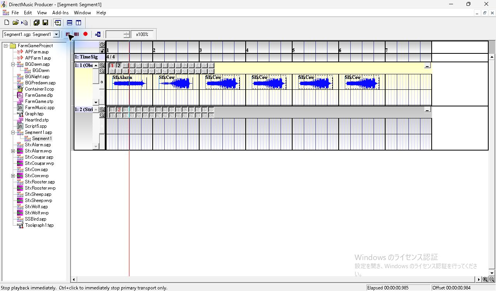
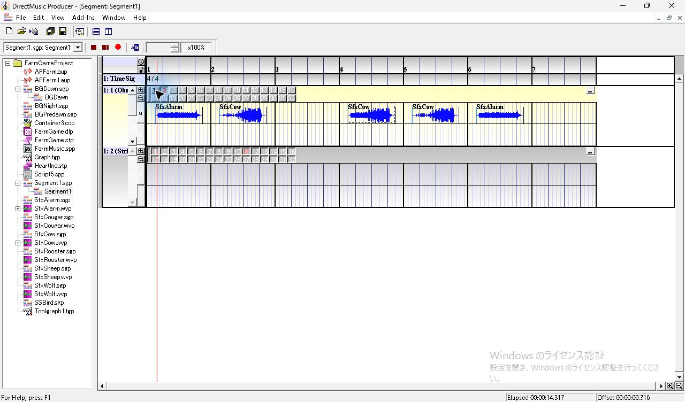

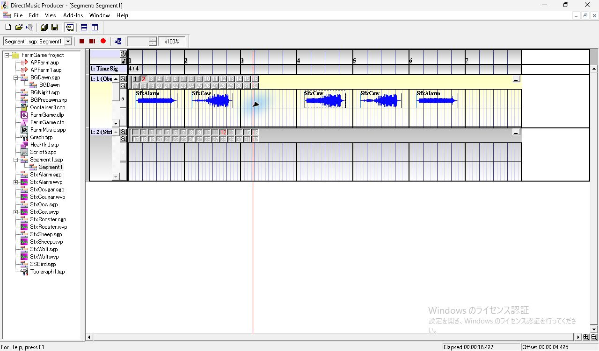

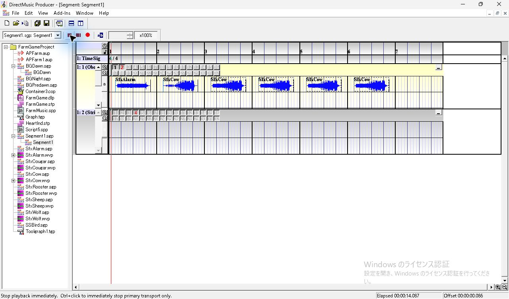
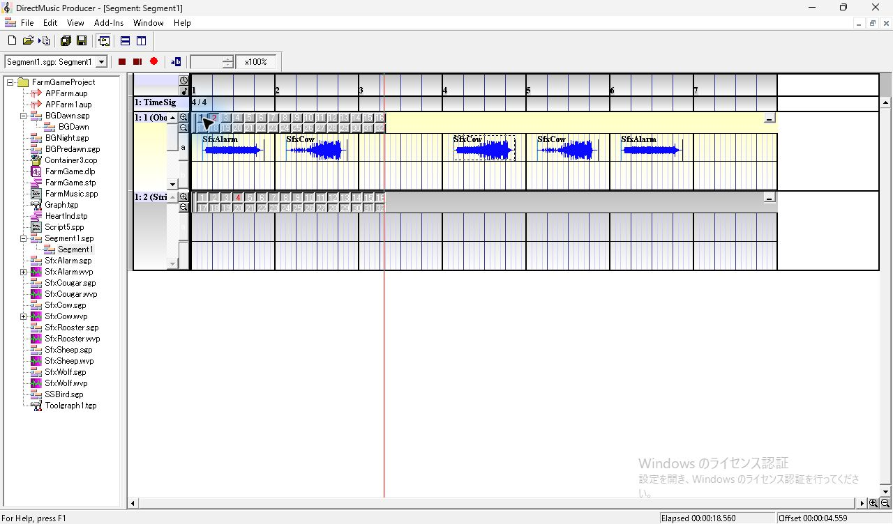
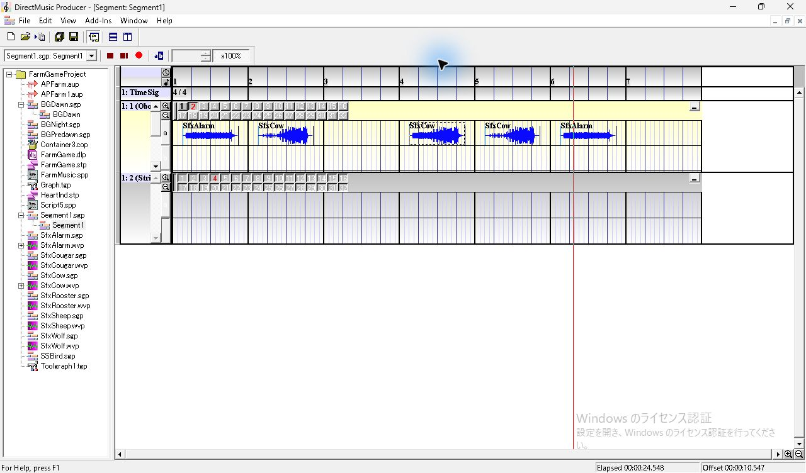
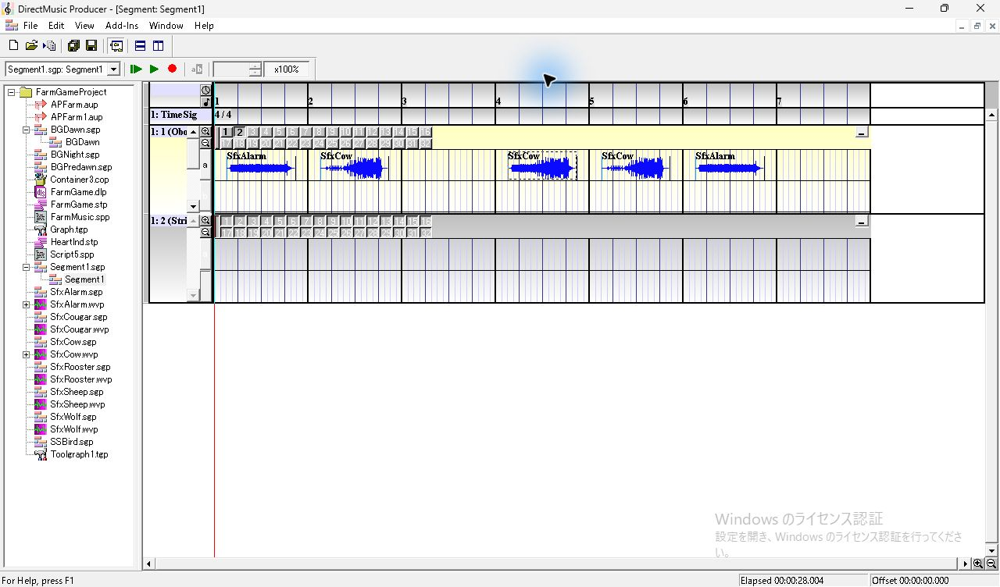

## 計測と保存

既定の Windows 出力の48 kHz・32-bit float・ステレオのループバックを用いた。原 WVP の開始80 ms（Alarm）または125 ms（Cow）からの120 msと各周の共有音を相関させて位置を求め、同じ録音の1周目第1・2小節を Alarm、Cow の参照にした。各発音位置で開始から1.45秒の左右平均波形を2成分に当てはめ、前後5フレームのうち残差の最小の位置を使用した。発音中の条件は同じ位置を50 msずつ調べ、クリック後も成分が続くことを確認した。第5小節の発音を検出しなかった条件は、2秒間の小節全体でもレベルを確認した。第3小節の重なりでは、クリック終了以降の50 ms窓で Alarm の倍率は0.972〜1.000、Cow は0.990〜1.000。第5小節の発音中ではクリック終了以降の Alarm は0.974〜0.998。第5小節で発音を検出しなかった2件の小節全体の RMS は0.000012以下だった。

第4小節は、1を外した直後の撮影では空欄で、同じ周の後の撮影や2周目で再び波形が現れた試行がある。表示が復元されたフレームと発音の切り替え時刻は、この撮影間隔の範囲では特定できない。青い光と黒い矢印は操作ツールの表示。時刻は操作 API の前後と録音、画面の Elapsed をそれぞれ記録した。 [撮影元、寸法とハッシュ](../../../work/original-gui/SEG-14-wave-live-variation-boundary/20261112T030957995875Z/published-figures.json)

先行する2試行では録音プロセスの終了時に WAV が残らなかった。録音の終了まで呼び出し元を維持して再試行した。再生ボタンを押した後に停止状態が続いた1試行も、発音表から除外した。

Project を閉じると `Segment1.sgp` の保存確認が出た。**No** を選択し、試験の表示変更を破棄した。凍結した28ファイルと作業コピーの SGP・WVP の SHA-256 を照合した。Project を閉じ、Producer 1件で **Project Tree、Standard Toolbar、Status Bar、Transport Controls** を表示した。 [入出力と録音の検証](../../../work/original-gui/SEG-14-wave-live-variation-boundary/20261112T030957995875Z/audit.json) · [最終ウィンドウ一覧](../../../work/original-gui/SEG-14-wave-live-variation-boundary/20261112T030957995875Z/captures/final-windows.json)

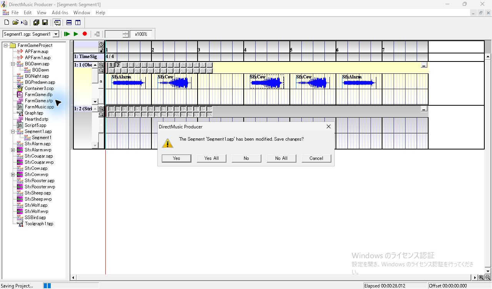
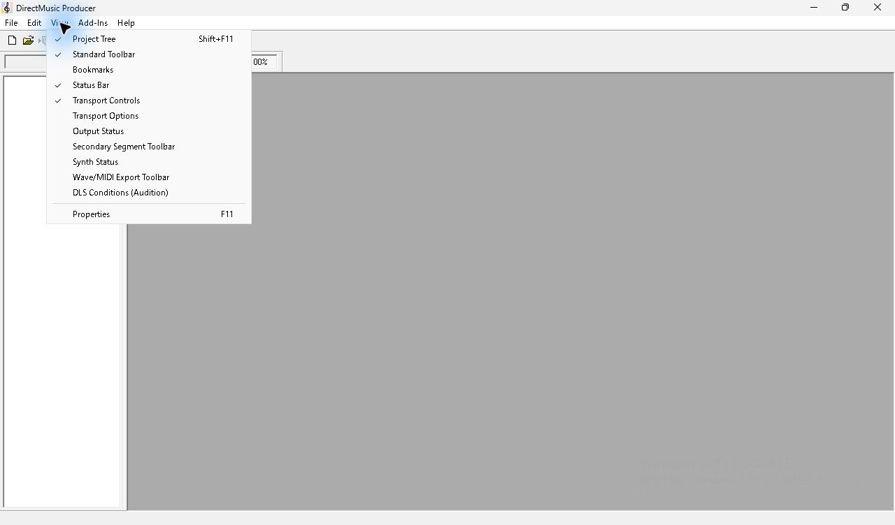
