# SEG-14　Wave Track の重なり、選択順、同時発音

2026-11-12、DirectMusic Producer 5.3.0.900 の調査用コピーで、**SfxAlarm** と **SfxCow** の2項目を比較した。画像22枚、保存前後の SGP、42秒の録音2本を照合した。画像の青い光と太い黒矢印は操作ツールの表示。座標は1280 × 752 px の画像の左上を原点とする。 [試験素材と配置](../../../work/original-gui/SEG-14-wave-overlap-audio/20261112T002521091776Z/run.json) · [画像と操作記録](../../../work/original-gui/SEG-14-wave-overlap-audio/20261112T002521091776Z/published-wave-overlap-figures.json)

## 比較素材と6条件

[前回の Properties による重なり](seg-14-wave-drop-overlap.md#既存波形を移動した場合と重なりの選択)で保存した SGP から、Alarm と Cow の Wave 項目を採った。同じレイヤーで開始をずらした組は元の2レコードをそのまま使った。対照は項目を複製し、開始位置、レイヤー、ファイル内の順序を変えて用意した。いずれも **PChannel 1、Variation 1**、元の WVP を参照し、オフセット0、Loop オフ。PChannel 2 は空。Segment1 は **12小節、4/4**。保存されたトラックは TimeSig と Wave Track の2つ。 [比較素材の作成手順](../../../work/original-gui/SEG-14-wave-overlap-audio/20261112T002521091776Z/prepare-overlap-fixture.py) · [読込前の SGP](../../../work/original-gui/SEG-14-wave-overlap-audio/20261112T002521091776Z/inputs/FarmGameProject/Segment1.sgp)

| 条件 | レイヤー（Alarm / Cow） | 物理開始（Alarm / Cow、音楽クロック） | ファイル内の順序 |
| --- | --- | --- | --- |
| Alarm 単独 | a / — | 384 / — | Alarm |
| Cow 単独 | — / a | — / 7,488 | Cow |
| 同じレイヤー、開始をずらす | a / a | 11,904 / 12,864 | Alarm → Cow |
| 別レイヤー、開始をずらす | a / b | 18,048 / 19,008 | Alarm → Cow |
| 同じレイヤー、同時刻 | a / a | 24,192 / 24,192 | Alarm → Cow |
| 同じレイヤー、同時刻、逆順 | a / a | 30,336 / 30,336 | Cow → Alarm |

長さは全条件で Alarm **2,248**、Cow **2,225** クロック。開始をずらした組の差は **960** クロックで、保存上は **1,288** クロック重なる。論理開始は別の欄にあり、元の組は Alarm **11,520**、Cow **12,288**。保存ファイルで、位置、長さ、同時刻の順序、レイヤー、参照 GUID を照合した。

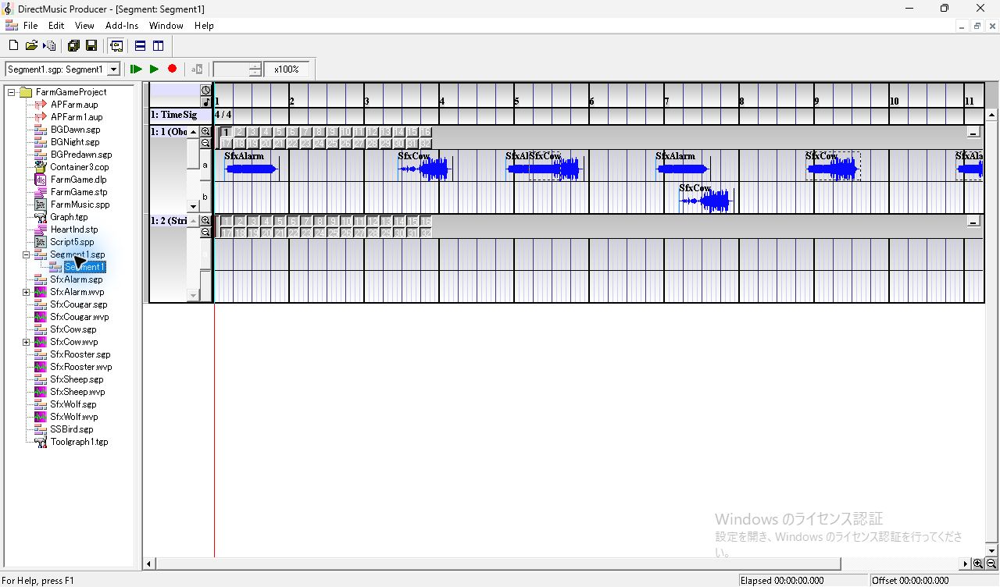
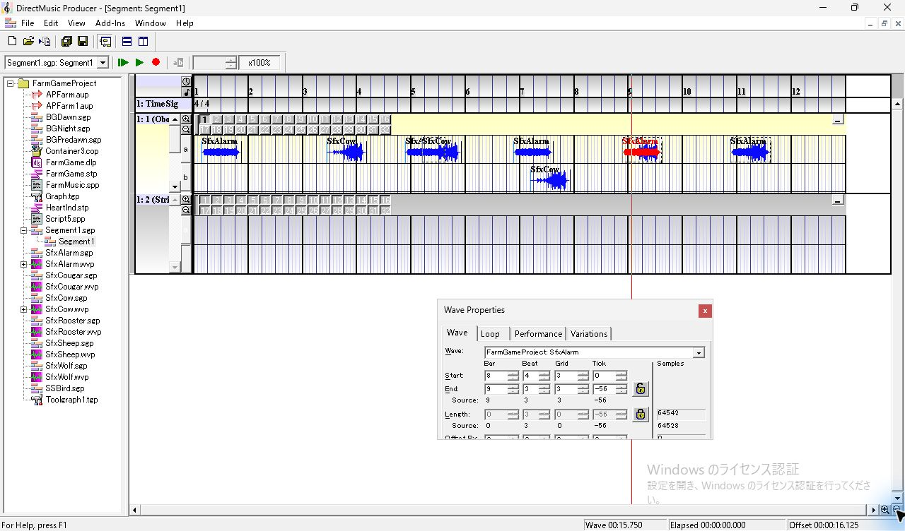

## 重なった位置での表示と選択

- **開始をずらした同じレイヤー**。重なった座標 `(695, 213)` を左クリックすると、先に始まる Alarm が赤くなった。F11 の Wave Properties は **SfxAlarm、Start 4:4:3:0**。区間の重なりに点線が見える。
- **同じレイヤー、同時刻、Alarm → Cow**。未選択時に見えるラベルは **SfxCow**。重なる箇所 `(1050, 213)` をクリックすると **SfxAlarm** が赤くなり、Properties は **8:4:3:0**。右クリックでは Cut、Copy、Snap To、Merge Variations などが表示された。Cycle Items はメニューに現れなかった。
- **同じレイヤー、同時刻、Cow → Alarm**。未選択時に見えるラベルは **SfxAlarm**。タイムラインを1段縮小して `(1052, 213)` をクリックすると **SfxCow** が選ばれ、Properties は **10:4:3:0**。この2組では、ファイルの後ろの項目名が未選択時に見え、重なった位置を押すとファイルの先頭の項目が選ばれた。
- **別レイヤー**。縮小後に下段 `(784, 249)` をクリックすると、b の Cow だけが赤くなった。Properties は **SfxCow、Start 7:1:4:0**。上段の Alarm は青いまま。

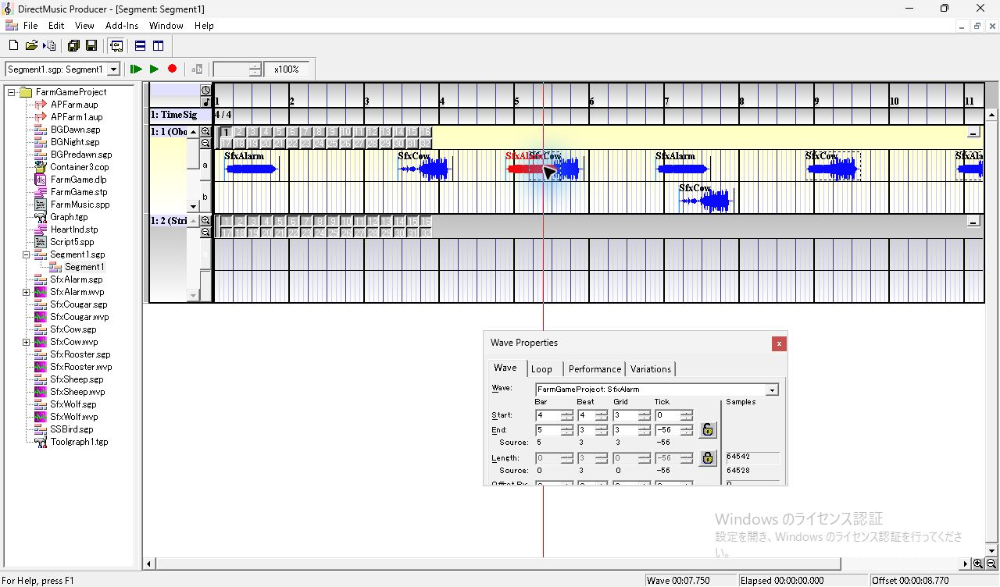
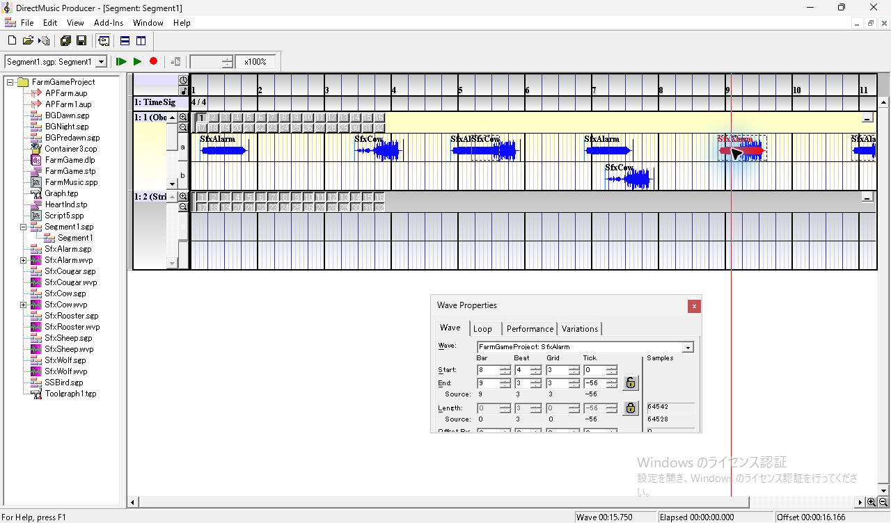
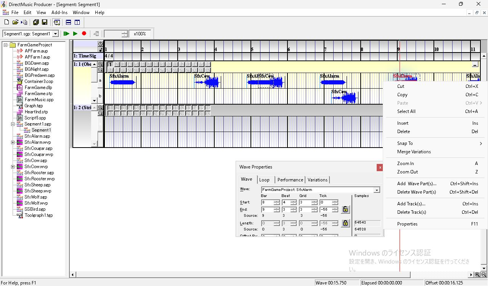
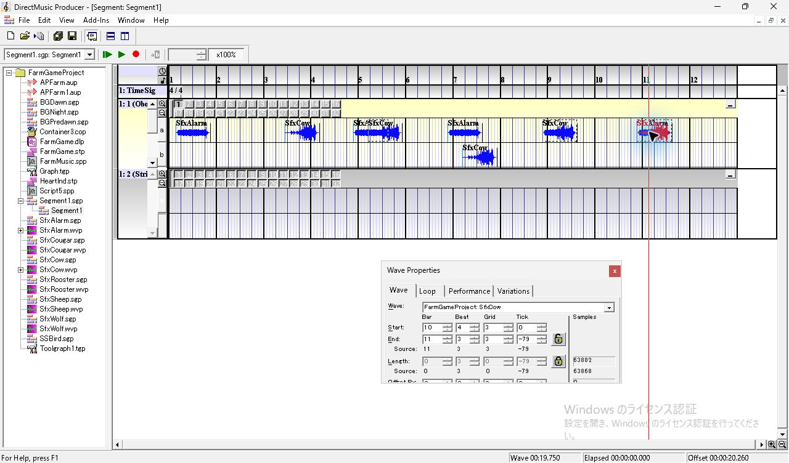
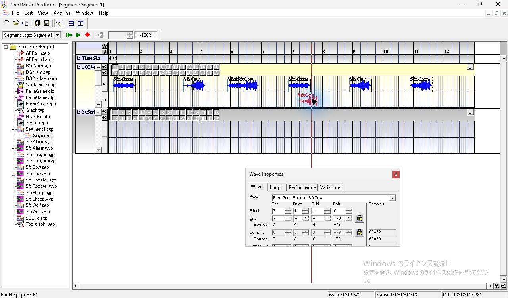

右下の縮小ボタンで12小節を表示して保存した。Project を閉じ、同じ Producer で開き直すと、横ズームと配置、同時刻の組の未選択時のラベルが復元された。SGP の Wave 項目10件はファイル内の順序を含めて保存前と一致した。 [Producer で保存した SGP](../../../work/original-gui/SEG-14-wave-overlap-audio/20261112T002521091776Z/captures/22-saved-Segment1.sgp)

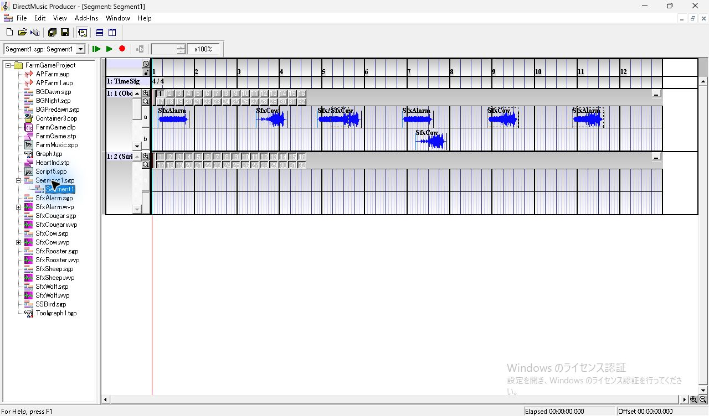
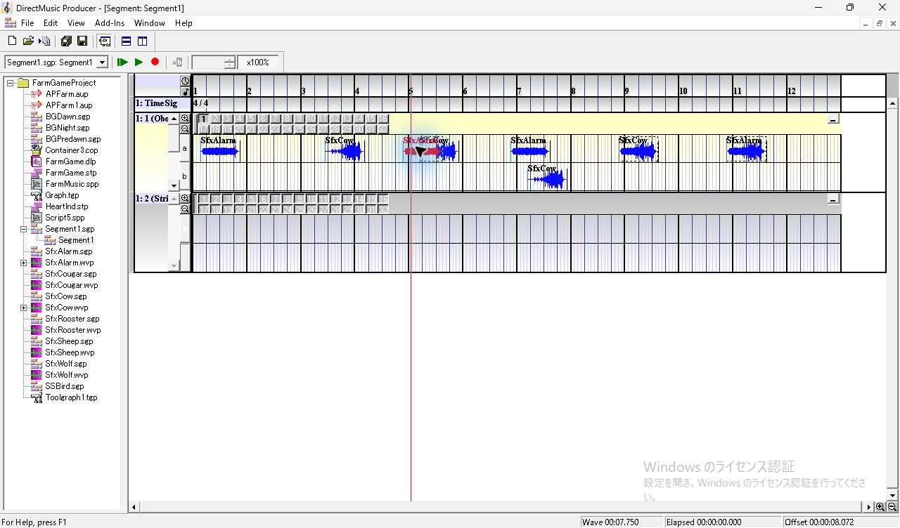

## 単独音と混合音の照合

**Play From Start** で6条件を続けて再生した。1回目は下段の Cow、Project 再読込後の2回目は上段の Alarm を選択した。両回とも PChannel 1 の Variation 1 が再生中に赤くなり、位置線が各区間を通過した。42秒ずつ、既定の Windows 出力を48 kHz、32-bit float、ステレオでループバック収録した。

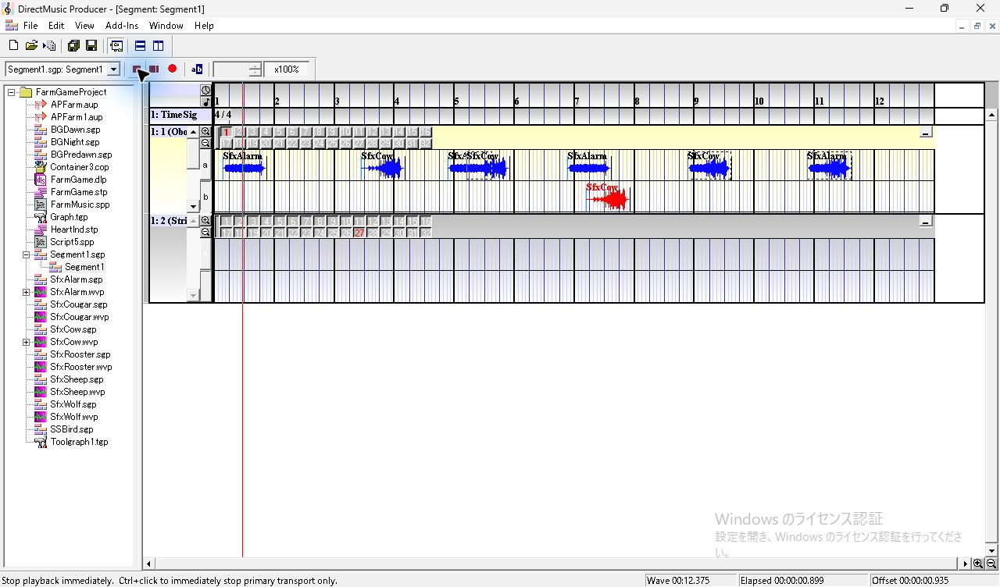

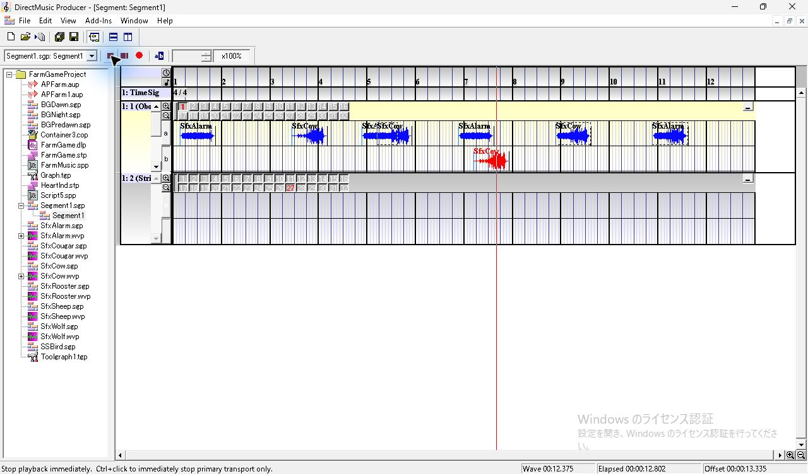

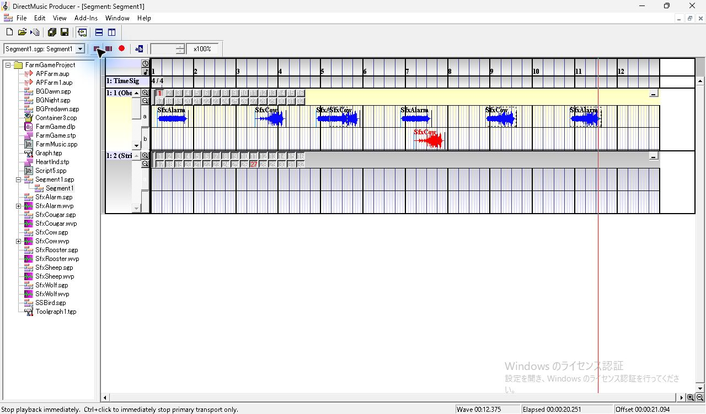

1. 元の WVP 波形で各録音の単独音の開始を特定した。Alarm と Cow の単独開始差は両回とも **4.440秒**。保存された差 **7,104クロック** から、再生速度は **1,600クロック/秒（125 BPM相当）**。混合4区間の波形を別々に照合して、この速度で予測した開始位置と最大1録音フレーム（0.021 ms）の差で一致した。
2. 単独区間から得た2つの録音波形を実測の開始位置に揃え、混合区間でそれぞれの倍率を最小二乗で求めた。分析は左右の平均を使用。重なりの先頭40 msと末尾55 msを除き、両音が持続する区間を比較した。
3. 残差は「観測した波形との差の RMS ÷ 観測波形の RMS」。1音だけで当てはめた場合も、その1音の倍率を最適化した。

| 条件 | 実測の開始差、2回分 | Alarm の倍率 | Cow の倍率 | 両音の残差 | Alarm のみの残差 | Cow のみの残差 |
| --- | --- | --- | --- | --- | --- | --- |
| 同じレイヤー、開始をずらす | 600.000 ms、600.000 ms | 0.980〜0.986 | 0.980〜0.991 | 0.157〜0.199 | 0.631〜0.637 | 0.791〜0.795 |
| 別レイヤー、開始をずらす | 600.000 ms、600.000 ms | 0.979〜0.992 | 0.980〜0.983 | 0.150〜0.205 | 0.625〜0.639 | 0.794〜0.796 |
| 同じレイヤー、同時刻 | 0.021 ms、0.000 ms | 0.984〜0.993 | 0.989〜0.991 | 0.139〜0.149 | 0.841〜0.844 | 0.555〜0.558 |
| 同じレイヤー、同時刻、逆順 | 0.000 ms、0.000 ms | 0.983〜0.994 | 0.989〜0.991 | 0.127〜0.160 | 0.840〜0.844 | 0.555〜0.558 |

**同じレイヤーの重なりでも2音が同時に鳴った。** ファイル内の順序を入れ替えた同時刻の組も両音が含まれた。選択していた Wave を入れ替えた2回目でも同じ傾向。倍率は単独再生時の音量を1としたとき **0.979〜0.994**。保存上の重なり1,288クロックは、今回の再生速度で **805 ms** に相当する。異なる Variation に分けた場合は、後続試験で表示と発音を照合した。AudioPath や PChannel を変えた場合は別条件。 [Variation の発音と途中切り替え](seg-14-wave-variation-audio.md)

タイムラインの Wave 欄で表示された **00:07.750** などの時刻とは別に、録音の開始差から再生速度を求めた。後続の対照試験では、125 BPM の Tempo Track を再生した直後に、Tempo Track のない Wave Segment で125 BPM相当を再現した。この録音の直前にどのテンポが再生されたかは記録から特定できなかった。 [先行テンポを変えた対照](seg-14-wave-tempo-context.md) [1回目の録音](../../../work/original-gui/SEG-14-wave-overlap-audio/20261112T002521091776Z/captures/audio-first-pass/output.wav) · [再読込後の録音](../../../work/original-gui/SEG-14-wave-overlap-audio/20261112T002521091776Z/captures/audio-reopened-pass/output.wav) · [開始フレームと当てはめの測定](../../../work/original-gui/SEG-14-wave-overlap-audio/20261112T002521091776Z/wave-overlap-audio-measurements.json) · [波形照合コード](../../../work/original-gui/SEG-14-wave-overlap-audio/20261112T002521091776Z/measure-overlap.py)

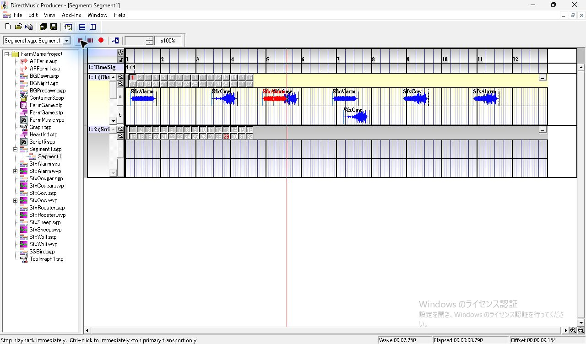

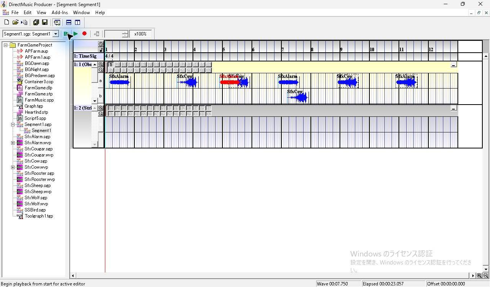

## 終了時の状態

作業コピーの更新は `Segment1.sgp` と `FarmGameProject.pro`。凍結入力28件と複製元のハッシュを照合した。Project を閉じ、開始時と同じ Producer 1件で **Project Tree、Standard Toolbar、Status Bar、Transport Controls** を表示。 [保存値、音声、終了状態の照合](../../../work/original-gui/SEG-14-wave-overlap-audio/20261112T002521091776Z/wave-overlap-audio-audit.json) · [終了時のウィンドウ](../../../work/original-gui/SEG-14-wave-overlap-audio/20261112T002521091776Z/captures/35-final-windows.json)

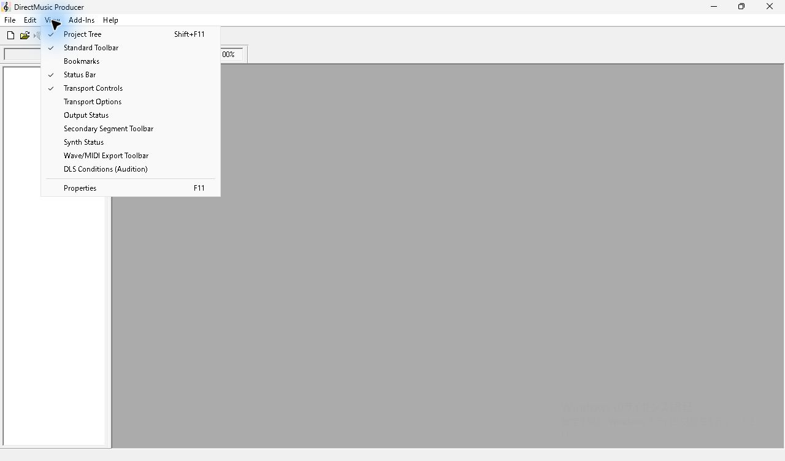
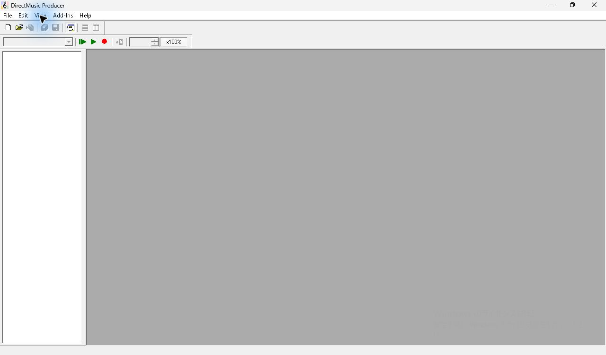
