# SEG-14 Wave Track の灰色の参照元ループ値が更新される条件

DirectMusic Producer 5.3.0.900 の起動済みコピー1件を使った。前回の保存素材から同一の試験 Project を2組用意し、**A は始点のドラッグと保存**、**B は終点の Undo・Redo と数値入力**を比較した。2組とも参照元は `SfxCow.wvp` の Forward ループ **22,008〜33,010**。各試行で2つの Segment を開いてから Wave 文書を開いた。座標は1280 × 752 px の Producer ウィンドウ内。 [前回のループ継承と録音](seg-14-wave-document-loop.md) · [試験条件とファイルの出自](../../../work/original-gui/SEG-14-wave-reference-refresh/20261112T022959704768Z/run.json)

| 選んだ Wave 項目 | 時刻単位と位置 | 項目のループ |
| --- | --- | --- |
| `SfxCow.sgp`、PChannel 12、レイヤー a | Clock Time、先頭 | オン、22,008〜33,010 |
| `Segment1.sgp`、PChannel 1、レイヤー a、Variation 1 | 音楽時刻、192クロック | オン、22,008〜33,010 |

Segment の **Wave Properties → Loop** では、右端の **Samples** 列に白い編集欄と、その直下の灰色の参照元値が並ぶ。開始時は上下とも22,008〜33,010。Clock Time は **Min、Sec、Grid、Ms**、音楽時刻は **Bar、Beat、Grid、Tick** の欄も持つ。波形を選ぶと、タイムラインの項目名と波形が赤くなる。比較中、白い編集欄は両項目とも **22,008〜33,010** を保持した。

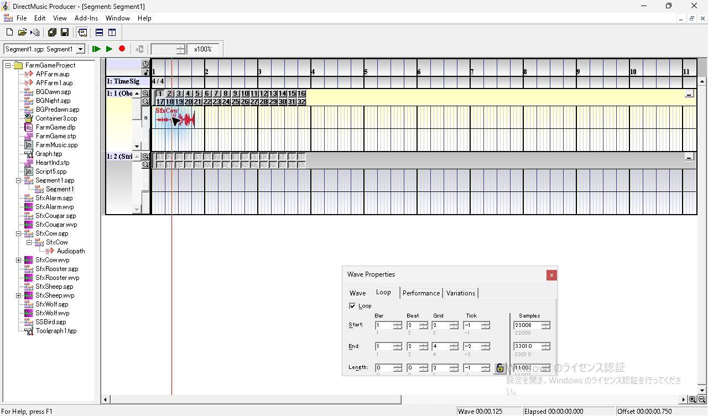

## A　始点のドラッグ、Wave の保存、文書の開き直し

Wave エディターの **Zoom 1:64** で、緑の始点を `(526, 143) → (458, 143)` へドラッグした。Wave 文書は **17,600〜33,010** になり、解放直後は緑の左右両矢印が出た。**Window** メニューで、先に開いておいた Segment に切り替えた。文書一覧はアクティブにした文書が先頭に移るため、番号の横にある `Wave:` と `Segment:`、文書名を見て選んだ。

| 確認した操作 | Wave の状態 | Segment の灰色の Start |
| --- | --- | --- |
| ドラッグ後、保存前に各 Segment に切り替えて項目を再選択 | 画面17,600、ディスク22,008 | 両方22,008 |
| Wave だけを保存し、開いたままの Clock Time 項目を再選択 | 画面・ディスクとも17,600 | 22,008 |
| 開いたままの `Segment1.sgp` で Properties を閉じ、項目を選んで F11 | 同上 | 22,008 |
| `Segment1.sgp` の子ウィンドウを閉じ、Tree の子ノードから開き直す | 同上 | 17,600 |
| 開いたままの `SfxCow.sgp` で Wave タブから Loop タブに戻る | 同上 | 22,008 |
| Wave エディターの子ウィンドウだけを閉じて開き直し、Clock Time 項目に戻る | Wave 文書は17,600を表示 | 22,008 |
| `SfxCow.sgp` の子ウィンドウも閉じて開き直す | 画面・ディスクとも17,600 | 17,600 |
| Project を閉じ、同じ Producer で再読込する | ディスク17,600 | 両方17,600 |

子ウィンドウは、最大化時にメニューバー右端に出る小さい **×** で閉じた。参照側の Segment を開き直したときは、項目の編集欄に22,008、直下の灰色の欄に17,600が並んだ。Clock Time の Start は白い欄で **499 ms**、灰色の欄で **399 ms**。どの確認でも灰色の End は33,010。**Close Project** では `SfxCow.sgp` の保存確認が出たため **No All** を選んだ。両 SGP のハッシュは試験開始時と一致した。 [ドラッグ直後のディスク上の WVP](../../../work/original-gui/SEG-14-wave-reference-refresh/20261112T022959704768Z/captures/08-a-unsaved-SfxCow.wvp) · [Wave 保存後の WVP](../../../work/original-gui/SEG-14-wave-reference-refresh/20261112T022959704768Z/captures/14-a-after-wave-save-SfxCow.wvp)

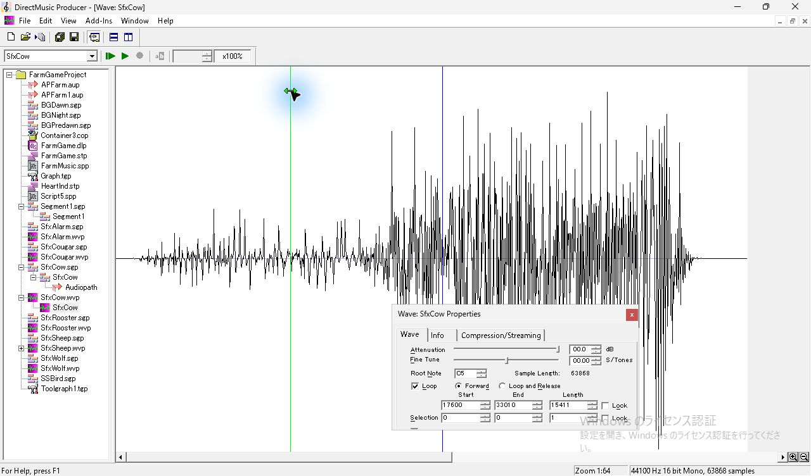
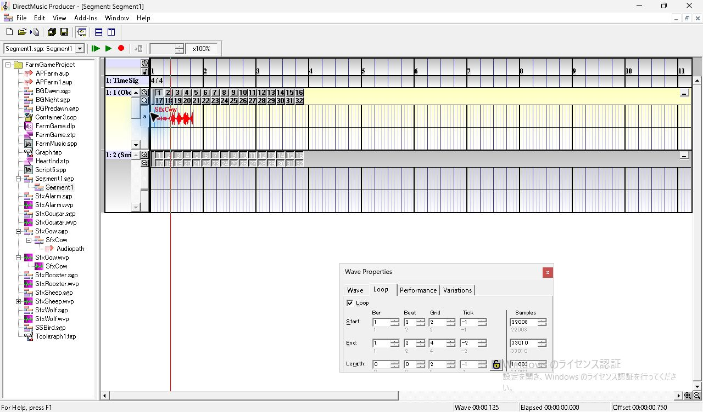

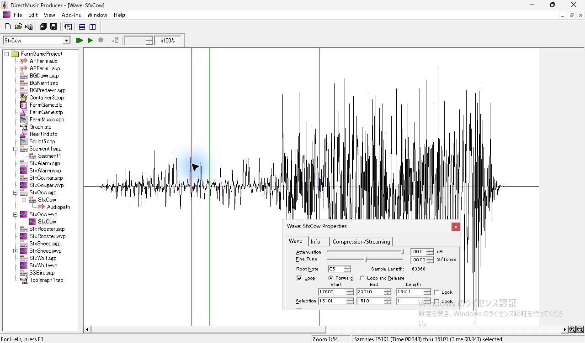

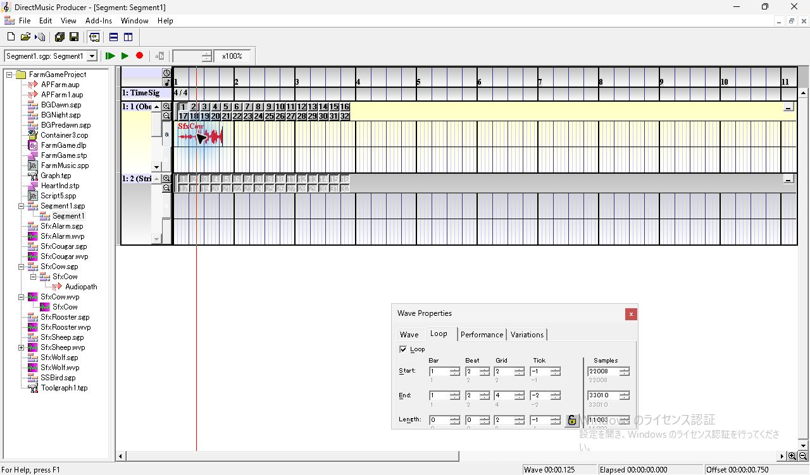
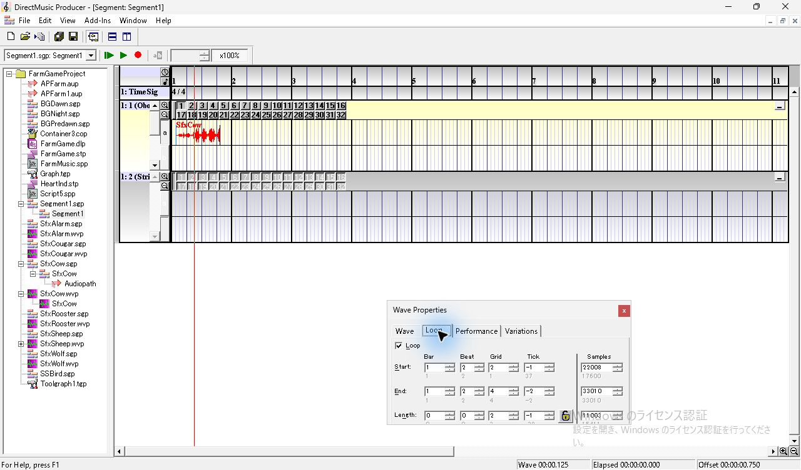
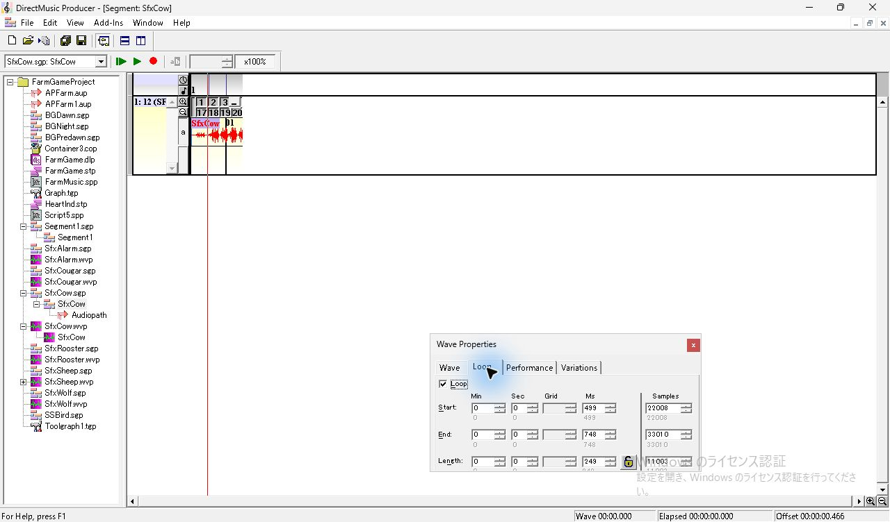

## B　両端のドラッグ、Undo、Redo

同じ開始素材を別 Project で開いた。Wave の始点を A と同じ位置へ動かした後、青の終点を `(698, 143) → (754, 143)` へドラッグした。各操作後に、開いている両 Segment の項目を選び直した。いずれも **Wave 保存前**の比較。

| Wave 文書での操作 | Wave エディターの Start〜End | 両 Segment の灰色の Start〜End |
| --- | --- | --- |
| 始点をドラッグ | 17,600〜33,010 | 22,008〜33,010 |
| 続けて終点をドラッグ | 17,600〜36,543 | 22,008〜33,010 |
| Edit → Undo Modify Loop | 17,600〜33,010 | 17,600〜33,010 |
| Edit → Redo Modify Loop | 17,600〜36,543 | 17,600〜36,543 |

Undo は直前の終点操作だけを取り消した。その直後に Segment へ切り替えると、灰色の **Start** に先に動かした値17,600が表示された。Redo では灰色の **End** も36,543へ進んだ。Undo 直後に控えたディスク上の WVP は、開始時の22,008〜33,010のままだった。最後にもう1回 Undo し、**File → Save SfxCow.wvp** で保存した。その WVP は A の保存結果とバイト単位で一致した。 [Undo 直後のディスク上の WVP](../../../work/original-gui/SEG-14-wave-reference-refresh/20261112T022959704768Z/captures/46-b-undo-unsaved-SfxCow.wvp) · [B の保存結果](../../../work/original-gui/SEG-14-wave-reference-refresh/20261112T022959704768Z/captures/54-b-after-wave-save-SfxCow.wvp)

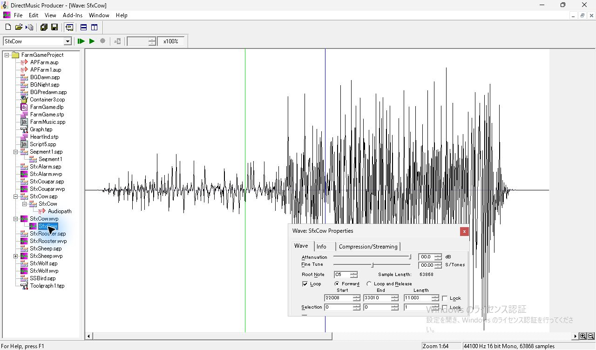

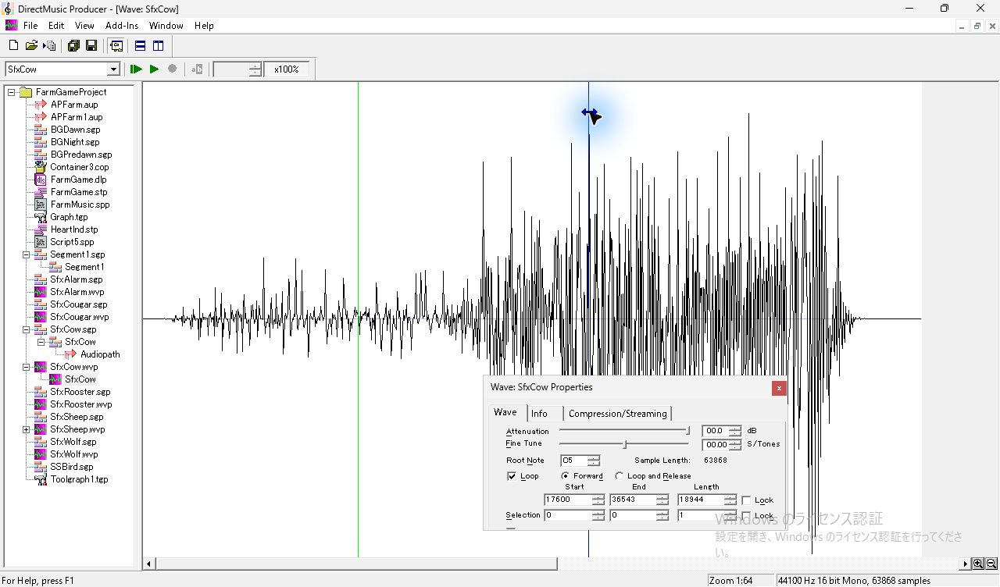
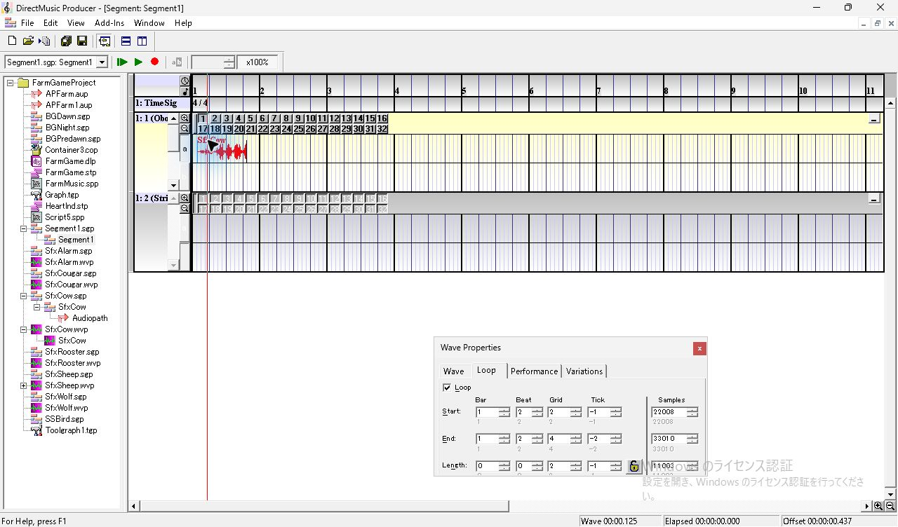

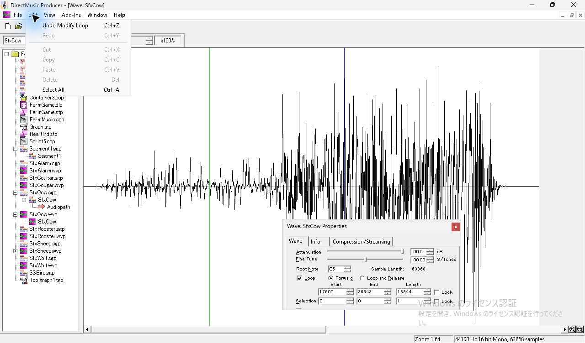
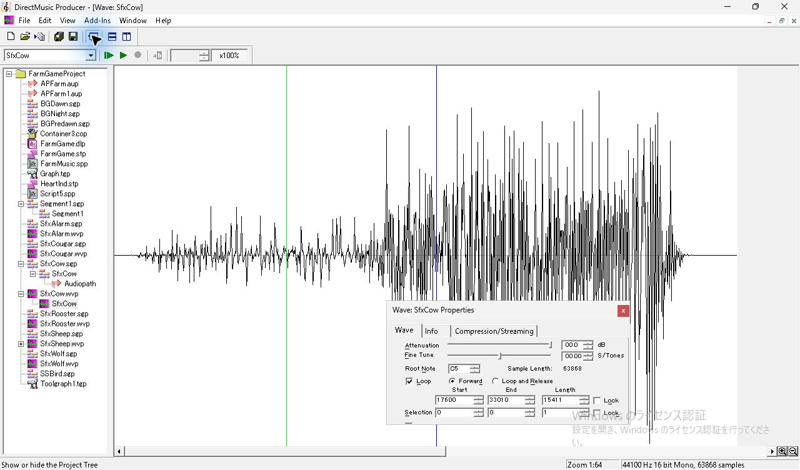

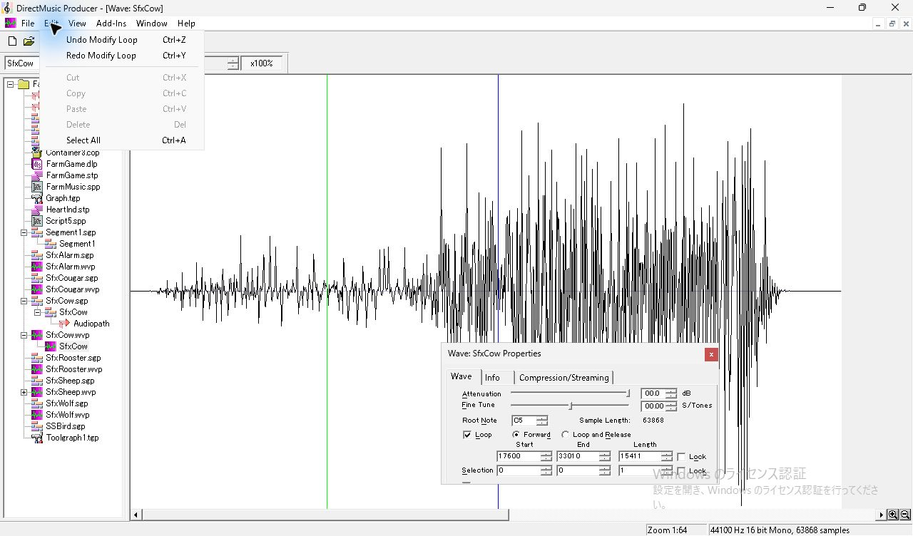
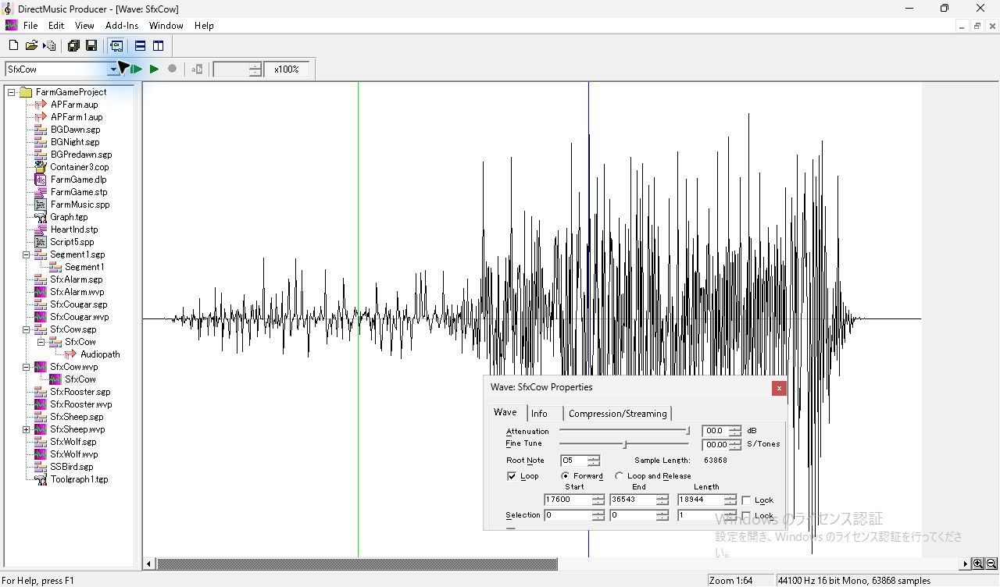

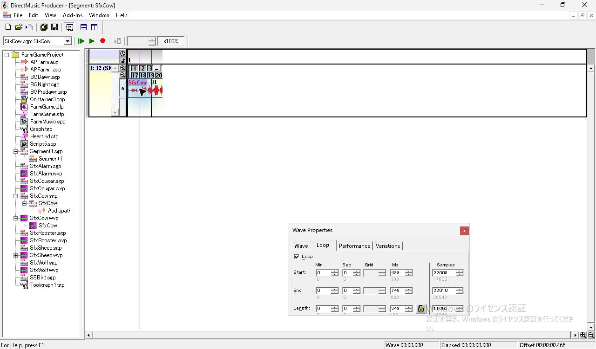
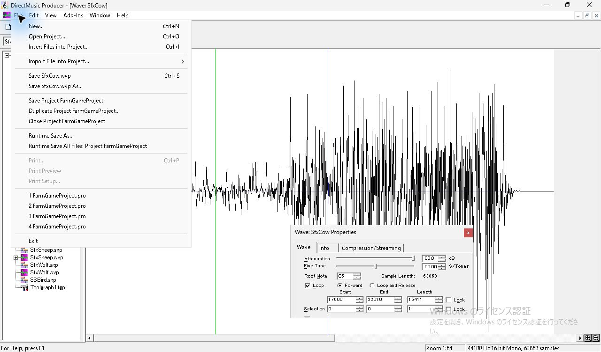

## 数値確定と、未保存 Wave を参照した Segment の開き直し

試験 B の保存後、Wave 文書の上段 **Start** に **20,000** を入力して **Tab** で確定した。両 Segment の灰色の Start は20,000に変わった。次に緑の線を `(495, 143) → (421, 143)` へドラッグすると、Wave 文書の Start は **15,232**。開いたままの `Segment1.sgp` の灰色の Start は20,000を表示した。Wave 文書を開いたまま、`Segment1.sgp` の子ウィンドウだけを閉じて開き直すと、灰色の Start が15,232に変わった。この時点で、まだ開いたままの `SfxCow.sgp` は20,000、ディスク上の WVP は17,600だった。

| B の操作後 | Wave 文書 | `Segment1.sgp` の灰色の Start | `SfxCow.sgp` の灰色の Start | ディスク上の WVP |
| --- | ---: | ---: | ---: | ---: |
| Start に20,000を入力して Tab | 20,000 | 20,000 | 20,000 | 17,600 |
| 始点を再ドラッグ | 15,232 | 20,000 | 開き直し後に確認 | 17,600 |
| Segment1 の子ウィンドウだけを開き直す | 15,232 | 15,232 | 20,000 | 17,600 |
| Close Project で No All、Project を再読込 | Wave エディターは未表示 | 17,600 | 17,600 | 17,600 |

同じ Project 内では、開き直した Segment に未保存の Wave 文書の値が表示された。その後に **Close Project → No All** で未保存の変更を破棄し、Project を再読込すると、両方の灰色の始点はディスクにある17,600になった。再読込前後で白い編集欄の Start は22,008。 [未保存 Wave を参照した時点のディスク上の WVP](../../../work/original-gui/SEG-14-wave-reference-refresh/20261112T022959704768Z/captures/61-b-unsaved-mdi-reopen-SfxCow.wvp) · [破棄・再読込後の WVP](../../../work/original-gui/SEG-14-wave-reference-refresh/20261112T022959704768Z/captures/71-b-after-project-reopen-SfxCow.wvp)

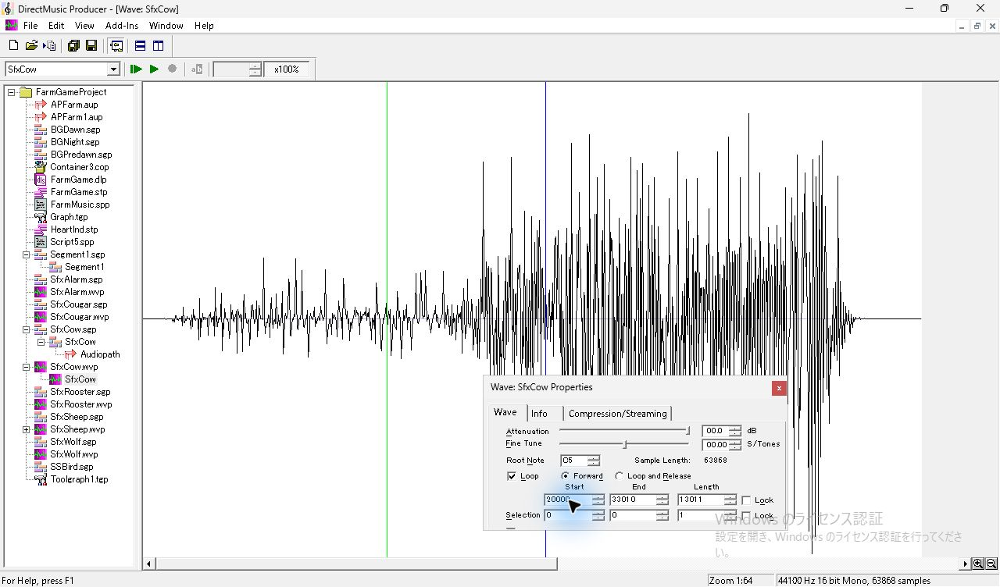

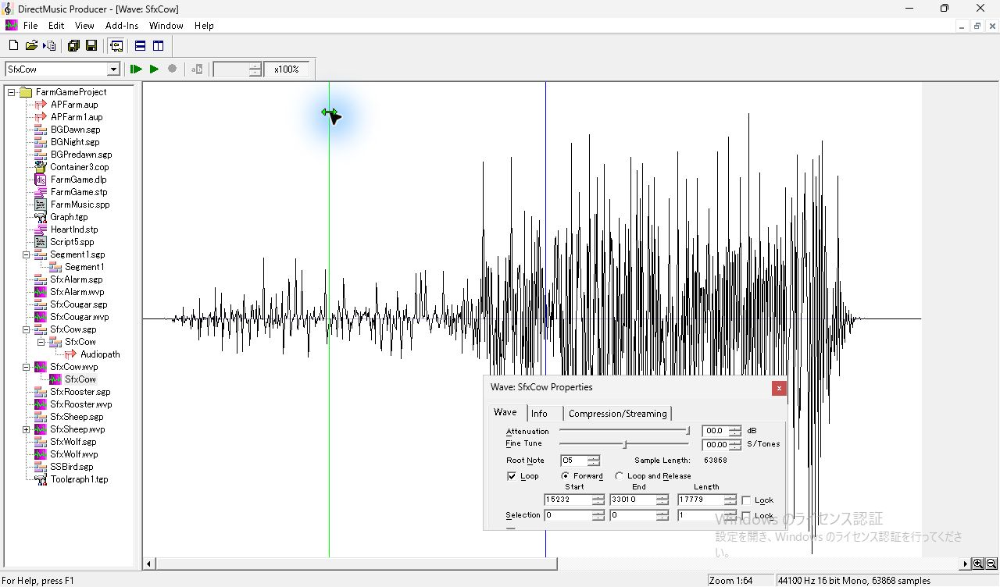

| 音楽時刻、再ドラッグ後 | 音楽時刻、子ウィンドウを開き直した後 |
| --- | --- |
| 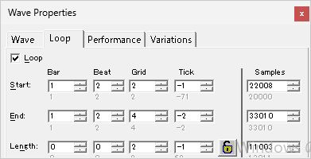 | 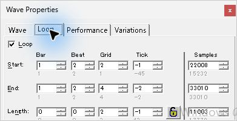 |

| 同時点の開いたままの Clock Time | 未保存編集を破棄して Project を再読込 |
| --- | --- |
| 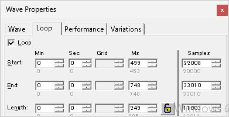 |  |

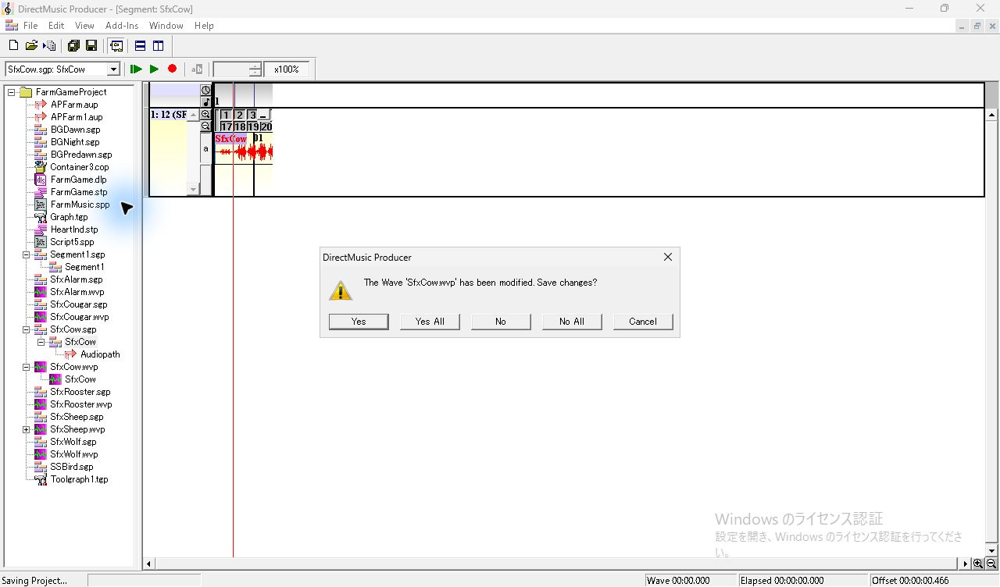
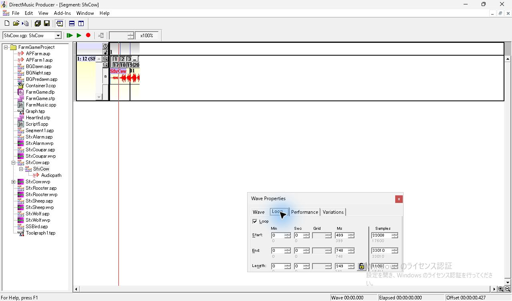

## ファイル照合と終了時の状態

12時点で WVP と2つの SGP のコピーを採った。A・B の最終 WVP は **17,600〜33,010、Length 15,411、Forward**。両 SGP はすべての控えで開始時とバイト単位で一致し、調査した項目の編集用 `wvcu` と再生用 `waih` は **22,008〜33,010** を保持した。この追試は画面と保存値を比較し、発音は収録していない。ループ発音の比較は前回資料にある。開始素材28件のハッシュを検証し、試験 Project で変わったのはそれぞれ `SfxCow.wvp` と `FarmGameProject.pro`。最後に Project を閉じ、同じ Producer 1件と View の標準4項目を確認した。 [12時点のディスク照合](../../../work/original-gui/SEG-14-wave-reference-refresh/20261112T022959704768Z/wave-reference-refresh-audit.json) · [照合スクリプト](../../../work/original-gui/SEG-14-wave-reference-refresh/20261112T022959704768Z/analyze-wave-reference-refresh.py) · [掲載画像48枚と寸法・ハッシュ](../../../work/original-gui/SEG-14-wave-reference-refresh/20261112T022959704768Z/published-figures.json) · [終了時のウィンドウ](../../../work/original-gui/SEG-14-wave-reference-refresh/20261112T022959704768Z/final-windows.json) · [前回の発音の測定](seg-14-wave-document-loop.md#実際の再生音)

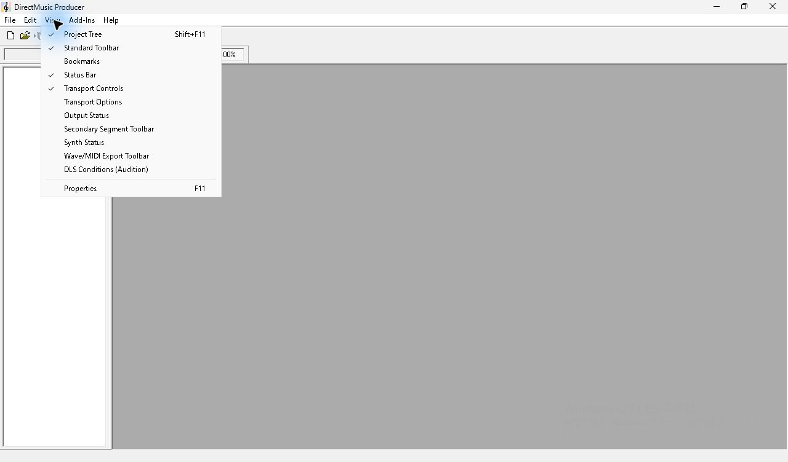
