# SEG-14　Wave Track のドラッグ、端点、ループ音

2026-11-11。DirectMusic Producer 5.3.0.900 の作業コピーで、[前回に保存した Segment1](seg-14-wave-track-editing.md#保存と-producer-の再起動) と **SfxCow.sgp** を使った。Segment1 は4/4の音楽時刻、SfxCow.sgp は Clock Time の単独試聴用 Segment。本体は1280×752 px、View の基準4項目で撮影した。採取173枚から32枚を掲載する。画像の青い光と黒い矢印は操作ツールの表示。 [凍結入力28ファイル](../../../work/original-gui/SEG-14-wave-followup/20261111T143834100488Z/run.json) · [画像の出典、寸法、ハッシュ](../../../work/original-gui/SEG-14-wave-followup/20261111T143834100488Z/published-wave-followup-figures.json)

## 波形のドラッグと選択

Segment1 の PChannel 1 に、レイヤー **a** の SfxCow と、縦スクロールすると現れる **c** の SfxSheep がある。PChannel 2 は空。SfxCow の **Start は3:1:1:0、End は3:4:1:−79、Length は63,882サンプル**。波形を選んで横ズームを1段上げると、画面上の第3小節先頭は x=455 付近、Cow の右端は x=544 付近。座標は撮影画像の左上を原点とする。

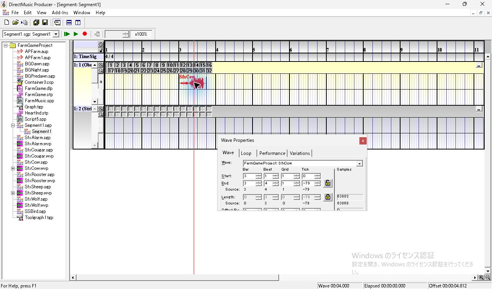

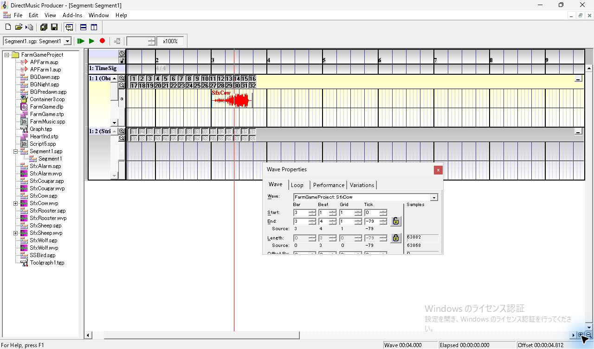

| 押下から解放まで | 解放後の結果 |
| --- | --- |
| 右端付近の (542,214) → (509,214) | Start・End・Length は試行前と同じ |
| 左端の名前付近 (457,199) → (486,199) | 波形全体が1拍移動。Start **3:2:1:0**、End **4:1:1:−79**、Length **63,882** |
| Undo | Start は **3:1:1:0** に戻り、選択解除で波形が青に変わる。Properties に No properties available |
| 右端の内側 (535,199) → (594,199) | 項目を選ぶ効果はあり、時刻と長さは同じ。選択済みでも同じ値 |
| 左端 (457,199) → 下の無名行 (603,247) | 波形はレイヤー a の同じ時刻に残る |
| レイヤー a 下端の左枠 (262,231) → (262,251) | 行高は同じ。波形の選択が外れ、PChannel 1 の Wave Track Properties に切り替わる |
| Part 間の左枠 (222,272) → (222,330) | Part の境界は同じ。下の PChannel 2 がアクティブになり、Wave Part の欄も2に変わる |

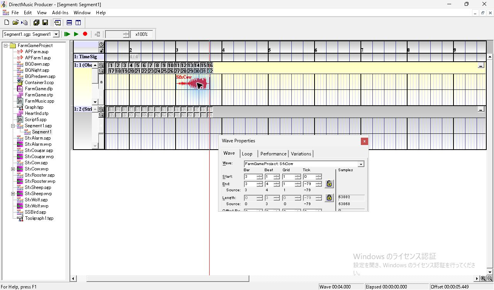

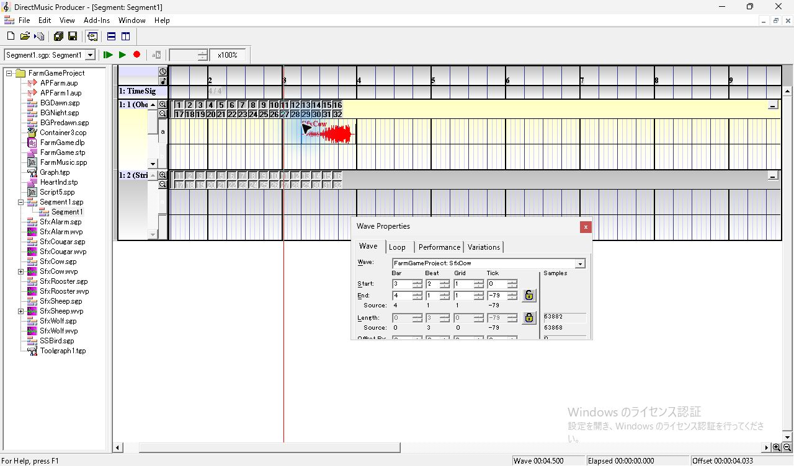

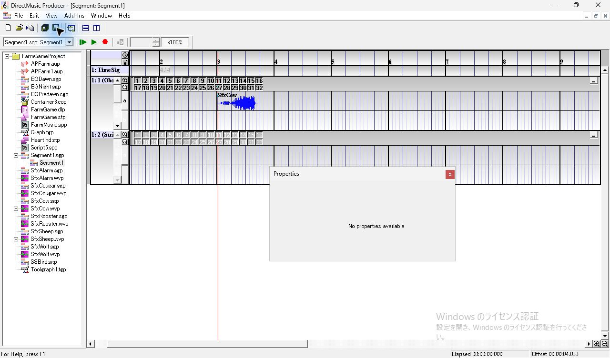

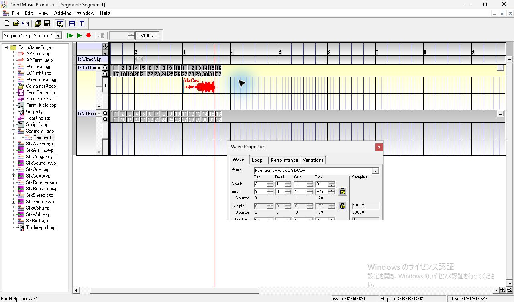

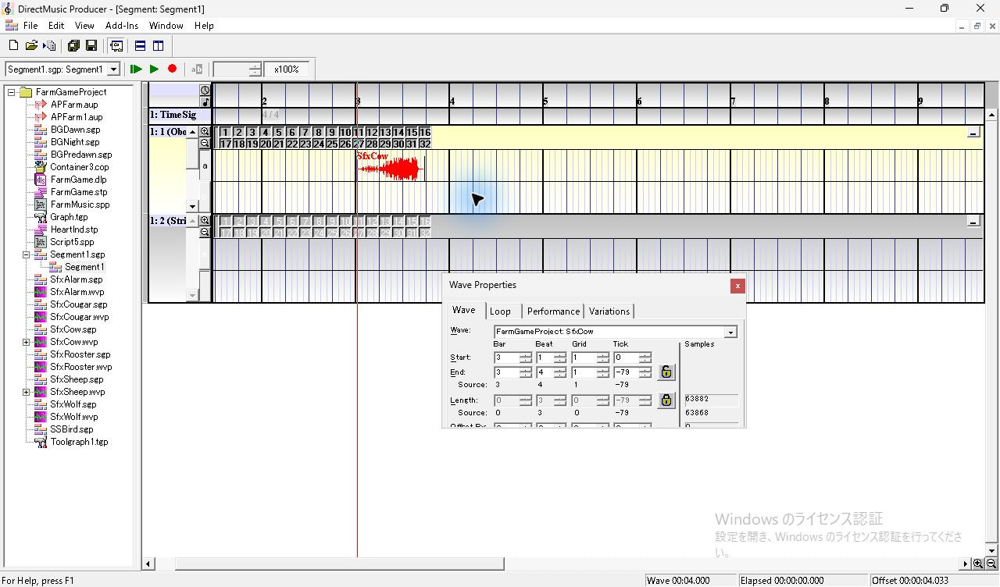

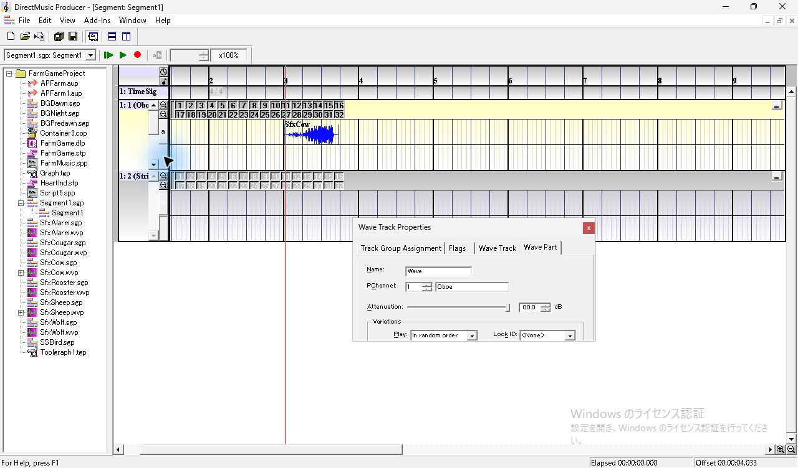

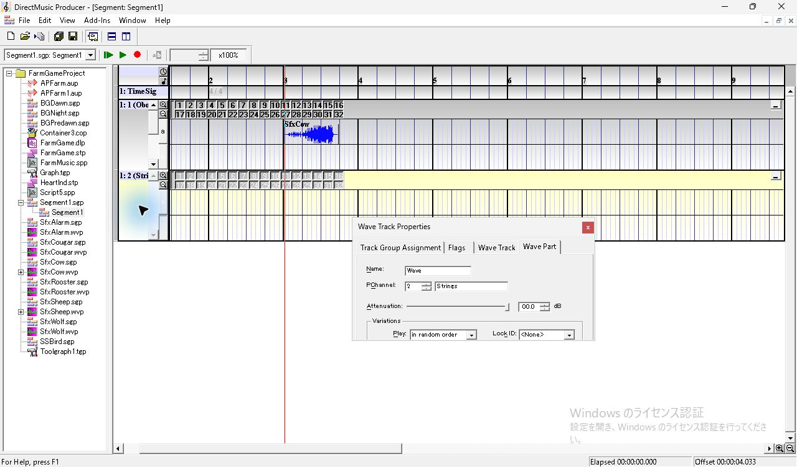

Tree からは **SfxAlarm.wvp ファイル行 → レイヤー a の空き位置**、読み込み済みの **SfxSheep Wave 子ノード → 同じレイヤーの空き位置** を試した。両方で追加項目は出なかった。子ノードを選んだ時点で Transport の対象は SfxSheep に変わり、編集面は Segment1 のままだった。同梱ヘルプには、1つ以上の Variation が選択されていれば .wvp ファイルと子ノードの両方をドラッグできるとある。ドラッグが成立する条件と押下中のネイティブカーソルは追試対象。 [同梱ヘルプの挿入手順](../../../../../work/analysis/original-manual-session/20261010T031624075Z/help-extracted/htm/insertingwavesinthewavetrack.htm)

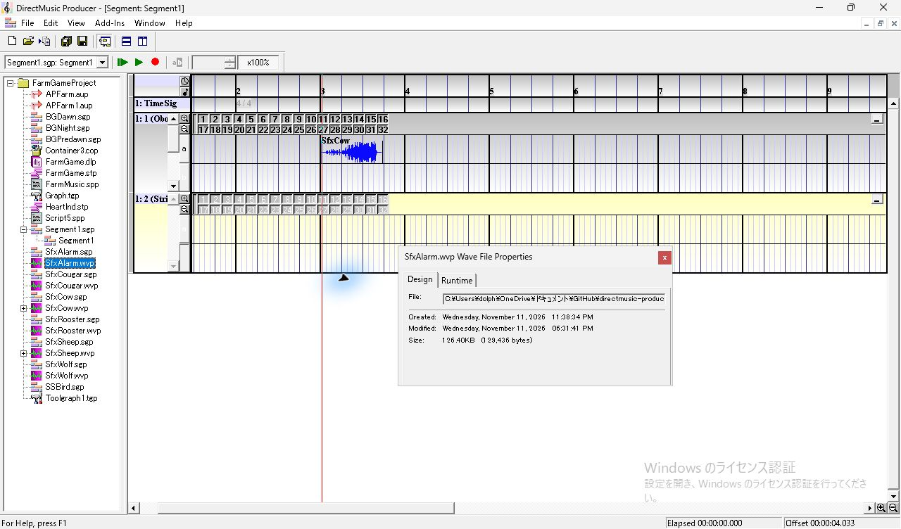

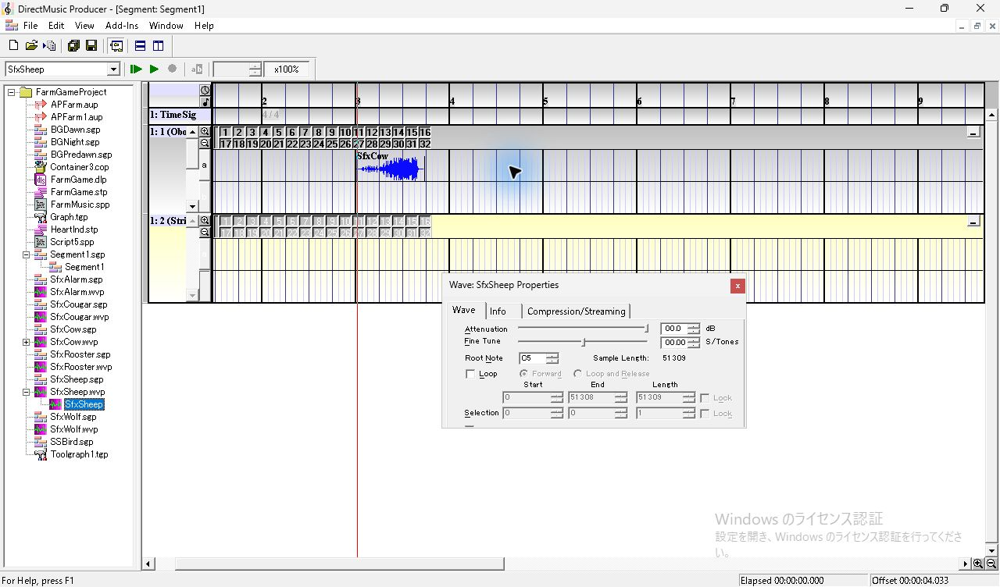

SfxCow を選び、同じ Part で **Ctrl+A** を押すと、Loop タブのチェックが灰色で、時刻と Samples は空欄になった。Wave タブは参照名と時刻が空欄。Part 左側の下矢印でスクロールすると、画面外だったレイヤー **c** の **SfxSheep** も赤く選択されていた。

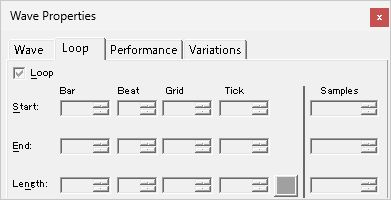

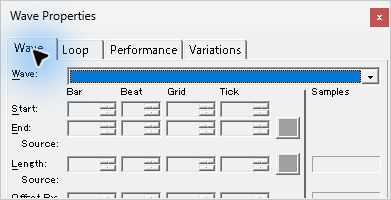

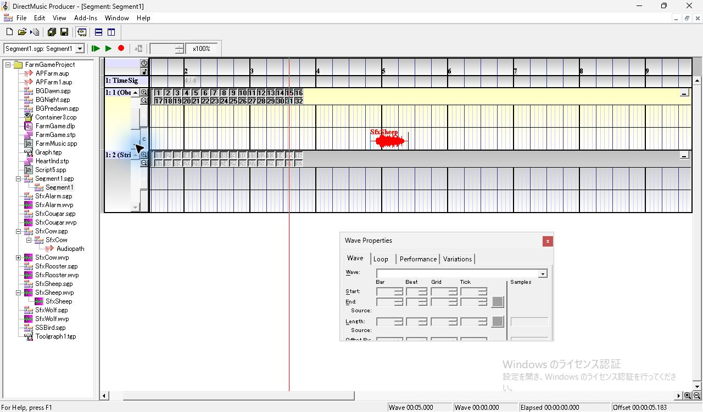

## End、Length、Offset By

**End の鍵**をクリックすると End の欄が灰色になり、Length が編集可能になる。Start の Beat の上矢印を1回押すと **3:1:1:0 → 3:2:1:0**。End **3:4:1:−79** は固定され、波形の左端が右へ移り、長さの表示は **63,882 → 41,832サンプル** になった。Source 終端の表示は **4:1:1:−79** に移った。

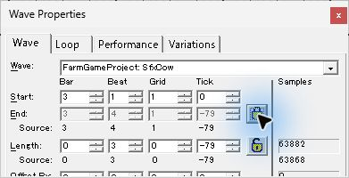

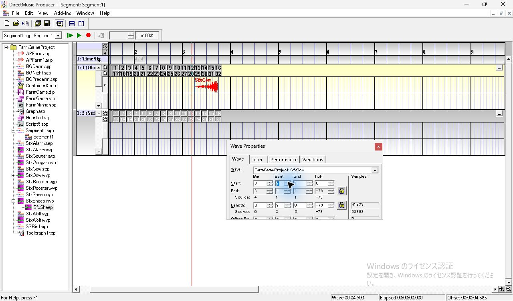

**Length の鍵**をクリックすると Length が灰色になり、End の編集が可能になる。Start をもう1拍進めると **3:3:1:0**、End は **4:1:1:−79**、Length は **41,832サンプル** のまま。波形全体が1拍右へ移った。

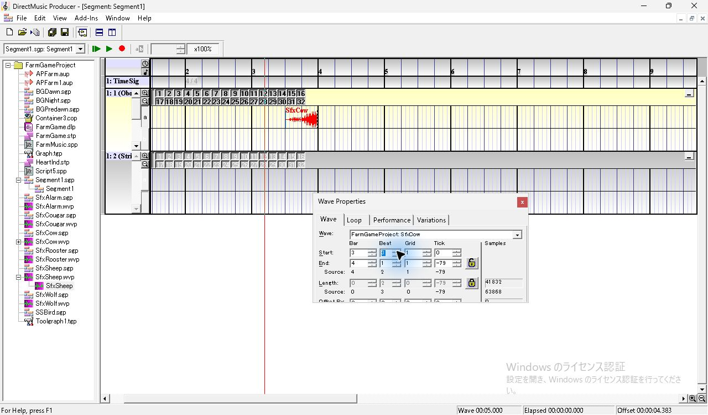

Properties の右下を (952,547) から (1005,621) へドラッグすると、枠は右下へ動いた。大きさは **391×200 px**、Offset By の行は引き続き下端で途切れている。移動後の (748,620) で Offset By の Beat 欄にフォーカスできた。1を入力して Tab で確定すると、取得ツリーで **22,050サンプル**。Start **3:3:1:0** は同じで、表示上の End は **3:4:1:−79**、Length は **19,782サンプル** に変わり、波形の右側が短くなった。別プロセスで開き直した際も同じ表示とサンプル値を取得した。 [入力確定時の操作とツリー](../../../work/original-gui/SEG-14-wave-followup/20261111T143834100488Z/captures/38-offset-beat-committed.json) · [再起動後の操作とツリー](../../../work/original-gui/SEG-14-wave-followup/20261111T143834100488Z/captures/83-restored-offset-wave-tab.json)

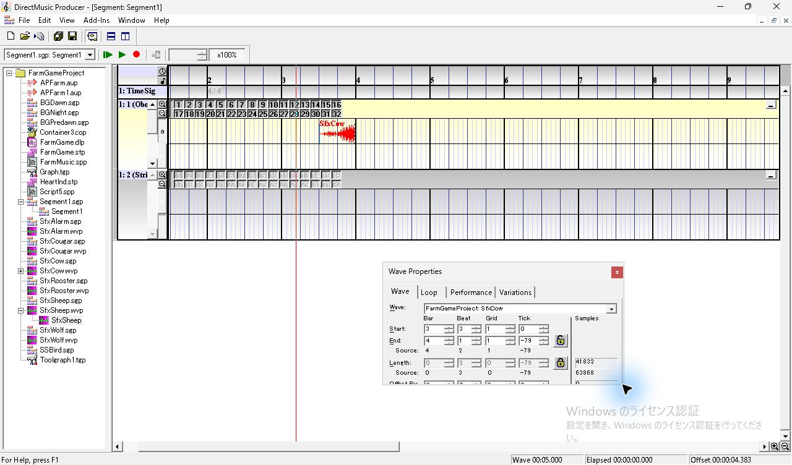

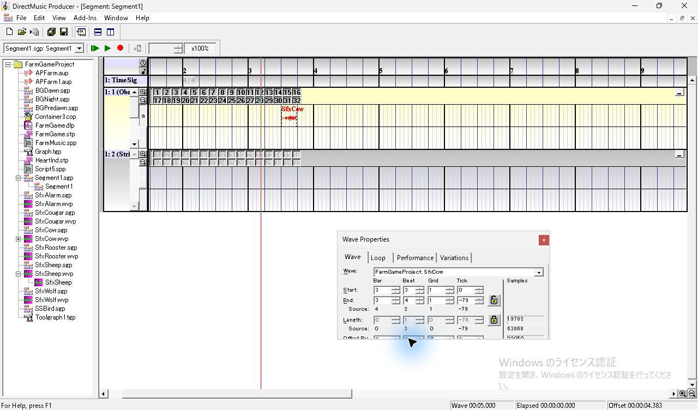

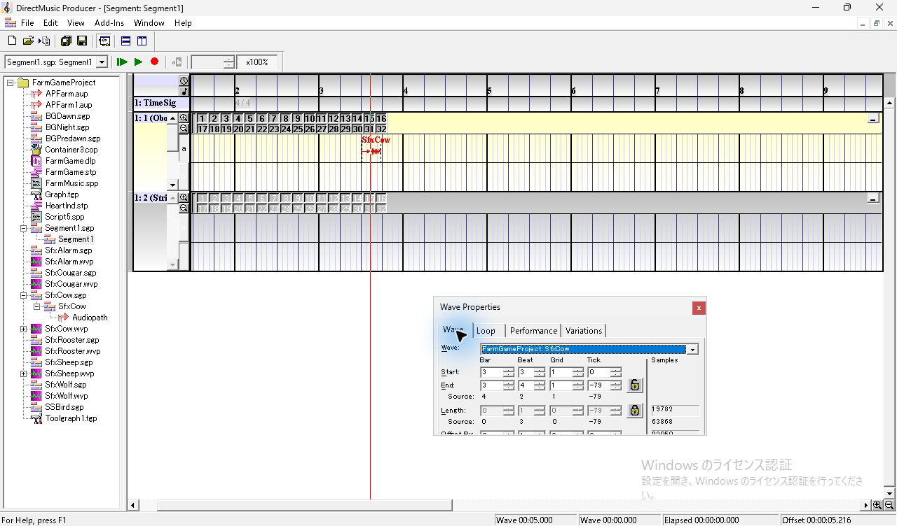

保存した `waih` の値。開始と長さは音楽クロック。Offset By を変えた回では、表示長が短くなり、保存された長さは1457クロックを保持した。 [各段階の保存ファイルと参照 GUID の照合](../../../work/original-gui/SEG-14-wave-followup/20261111T143834100488Z/wave-followup-audit.json)

| SfxCow の操作 | 物理開始 | 論理開始 | 保存された長さ | ソース内の開始オフセット |
| --- | ---: | ---: | ---: | ---: |
| 凍結入力 | 6144 | 6144 | 2225 | 0 |
| 左端の名前付近からドラッグ | 6912 | 6912 | 2225 | 0 |
| Undo 後、End 固定で Start を1拍進める | 6912 | 6912 | 1457 | 0 |
| Length 固定で Start をもう1拍進める | 7680 | 7680 | 1457 | 0 |
| Offset By を1拍 | 7680 | 7680 | 1457 | 0.500秒 |

## Clock Time のループ表示と録音

**SfxCow.sgp** を開き、Wave を選んで **Wave Properties > Loop**。時刻列は **Min、Sec、Grid、Ms**。Grid は灰色。最初は Loop がオフで、Start **0**、End **63,867**、Length **63,868サンプル**。オンにして Samples 欄の **Start 22,050、End 33,074** を確定すると、Length は **11,025サンプル（250 ms）**。波形の後半が短い山の繰り返しに変わる。Wave タブの項目全体の長さは **1秒448 ms**。 [Wave Properties の同梱ヘルプ](../../../../../work/analysis/original-manual-session/20261010T031624075Z/help-extracted/htm/waveproperties.htm)

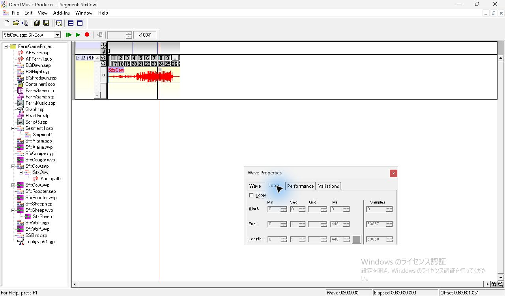

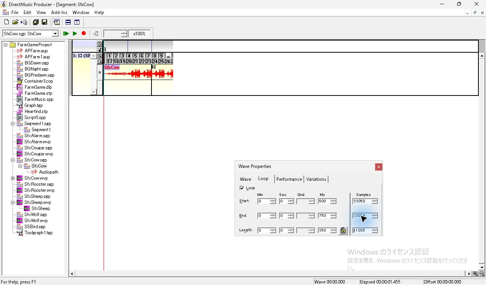

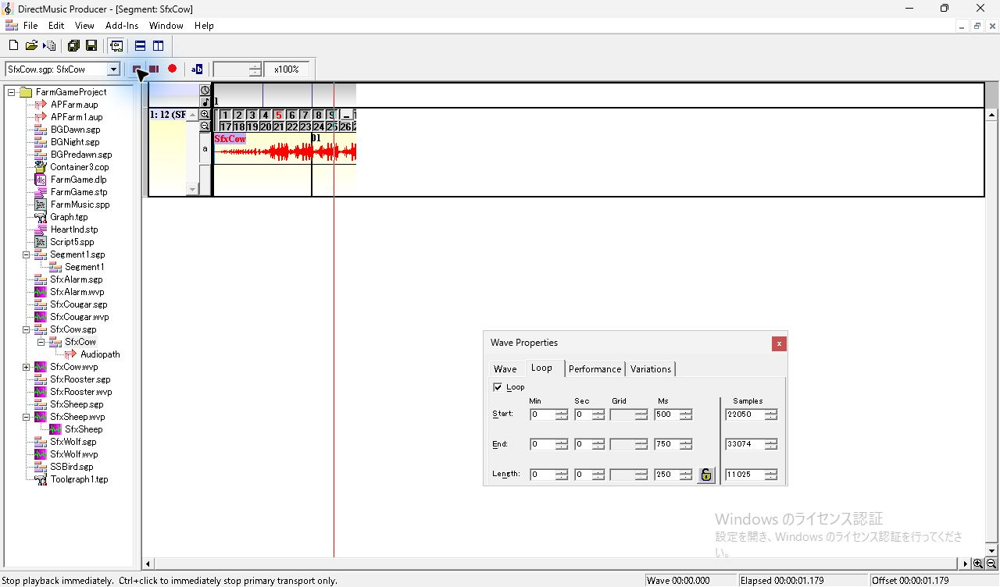

**Play From Start** でオフ2回、オン2回、オフへ戻して1回を録音した。元の **SfxCow.wvp** は44.1 kHz、16-bit PCM、63,868サンプル。既定出力を48 kHz、32-bit浮動小数点、ステレオでループバック録音した。ソース冒頭の一致で各回を揃え、ソースの **0.550〜0.650秒** の波形を各回の **0.550、0.800、1.050、1.300秒** 付近で探した。オンでは同じ波形が250 ms間隔で繰り返され、オフではソース後半の波形が同じ時刻に出た。 [155秒の録音](../../../work/original-gui/SEG-14-wave-followup/20261111T143834100488Z/captures/audio-loop/output.wav) · [照合結果](../../../work/original-gui/SEG-14-wave-followup/20261111T143834100488Z/captures/audio-loop/analysis.json) · [照合コード](../../../work/original-gui/SEG-14-wave-followup/20261111T143834100488Z/measure-loop.py)

| 条件 | 録音内の波形の開始（秒） | 0.800、1.050、1.300秒でのループ断片の正規化相関 | 元の0.985〜1.085秒の後半波形の正規化相関 |
| --- | --- | ---: | ---: |
| オフ2回とオフへの復帰 | 5.066、12.066、113.546 | 0.063〜0.129 | 0.989〜0.997 |
| オン2回 | 77.996、86.447 | 0.992〜1.000 | 0.107〜0.117 |

Loop をオフに戻すと、波形は元の形に戻り、**22,050〜33,074** は灰色で表示された。この表示は同じプロセスでの再生・保存のあとにも残った。保存ファイルの **`wvcu`** には範囲が残り、再生用 **`waih`** のループ範囲は **0 / 0**。オンで保存した版は両方に **22,050 / 33,074** を持つ。項目全体の保存長は全版で **14,483,039 × 100 ns**。元の .wvp のハッシュは一致した。

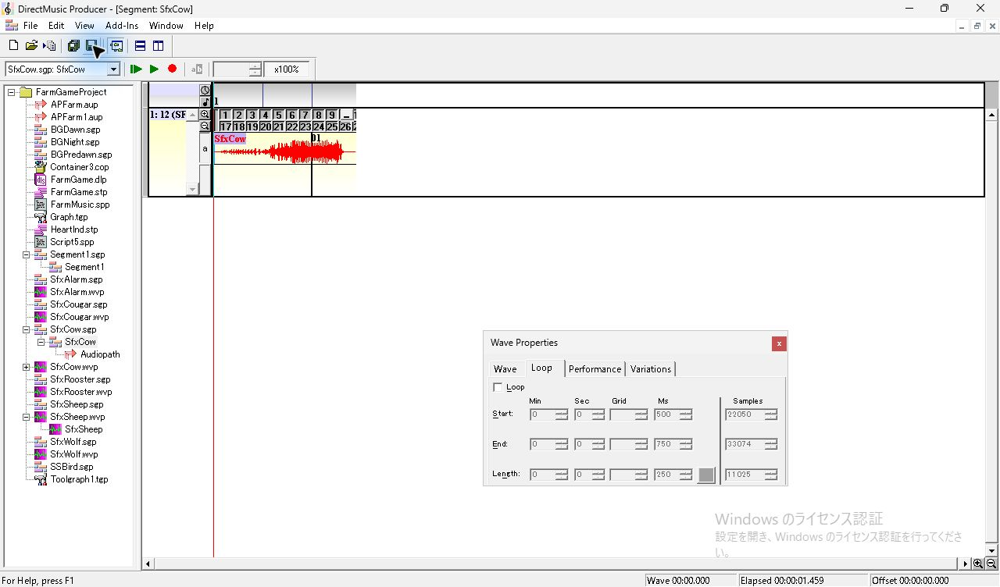

## 別プロセスでの復元とサンプル境界

Producer を通常終了し、プロセスが0件になってから同じ EXE を1件起動した。再起動前後で SfxCow.sgp と Segment1.sgp は保存直後のハッシュと一致した。SfxCow を再び開くと **Loop はオフ**で、灰色の範囲は **0〜63,867** に戻った。その場でオンにしても範囲は **0〜63,867**。ファイルの編集用データに保持されたオフ時の範囲と、別プロセスで再び表示される範囲に差があった。 [再起動時のプロセス確認](../../../work/original-gui/SEG-14-wave-followup/20261111T143834100488Z/captures/67-relaunch.json) · [保存と復元の照合](../../../work/original-gui/SEG-14-wave-followup/20261111T143834100488Z/wave-followup-audit.json)

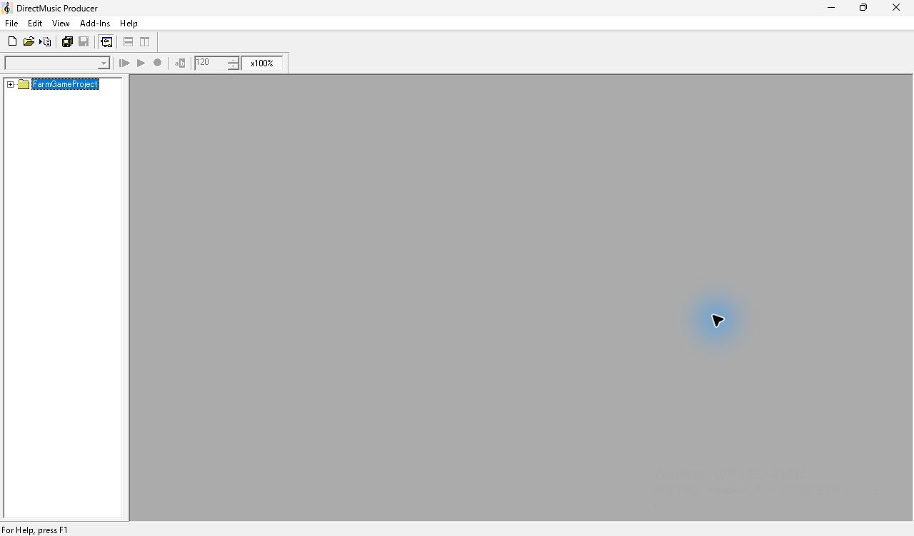

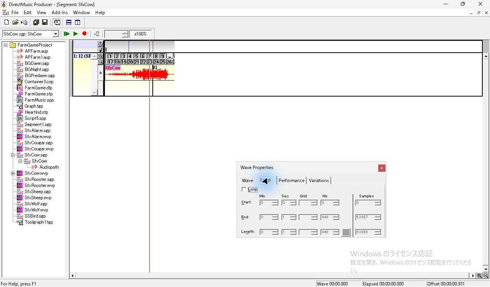

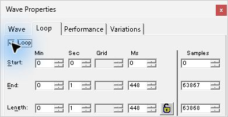

オンのまま **Start に63,868** を入力して Tab で確定すると、**Start 63,862、End 63,867、Length 6**。続けて **End に0** を入力すると、**Start 0、End 5、Length 6**。同じ素材ではどちらの入力でも6サンプルの範囲が確保され、Clock Time の Length は0 ms表示だった。

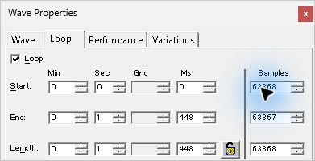

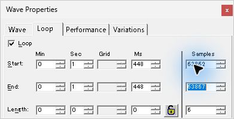

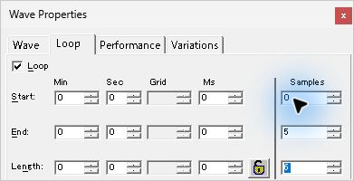

境界の追試値は **Close Project** の保存確認で **No** を選び、直前の保存を保持した。作業コピーで更新されたのは **Segment1.sgp、SfxCow.sgp、FarmGameProject.pro**。凍結入力28件のハッシュは一致した。終了時は Project を閉じた Producer が1件で、View は標準4項目。 [作業コピーと凍結入力の照合](../../../work/original-gui/SEG-14-wave-followup/20261111T143834100488Z/wave-followup-audit.json) · [最終ウィンドウ](../../../work/original-gui/SEG-14-wave-followup/20261111T143834100488Z/captures/90-wave-final-windows.json)

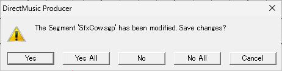

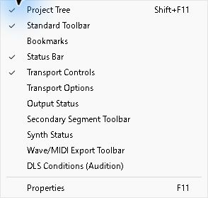

後続の追試で、Tree の .wvp ファイル行から単独 Variation と空きレイヤーへの追加、Properties の Start による同一レイヤー内の重なり、再読込後の選択を確認した。Wave 子ノードと複数 Variation でのドロップ成立条件、押下中のネイティブカーソルは追試に残る。同じレイヤーの重なりは、単独音を対照に2件が同時に鳴ることを確認した。 [ドロップと重なりの実機記録](seg-14-wave-drop-overlap.md) · [同時発音の録音](seg-14-wave-overlap-audio.md)

Wave 文書側の Forward ループは、既存項目のオフ状態、Tree から新規追加した項目、文書側だけを再編集した後の範囲と実際の再生周期を照合した。 [Wave 文書のループ端と継承](seg-14-wave-document-loop.md)
