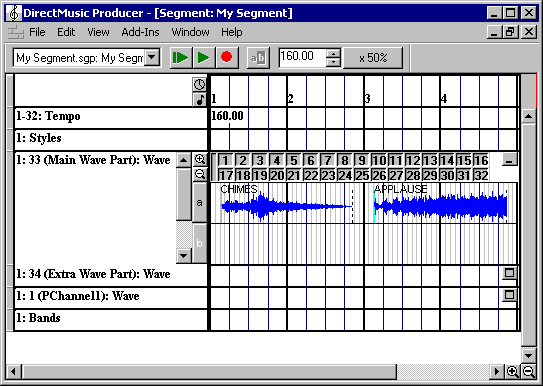
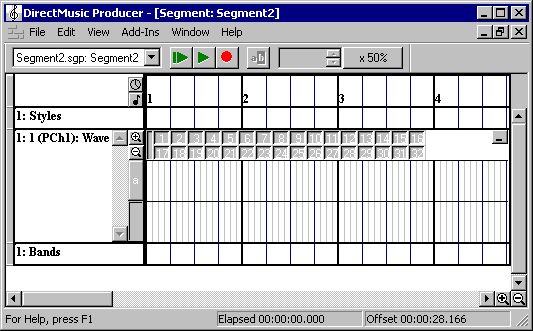
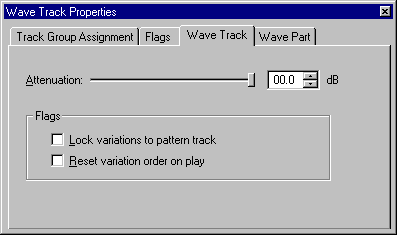
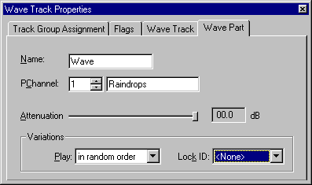
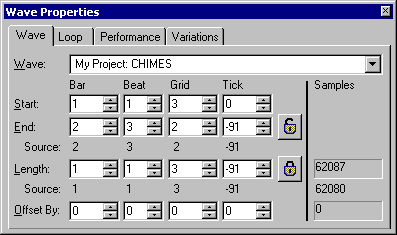
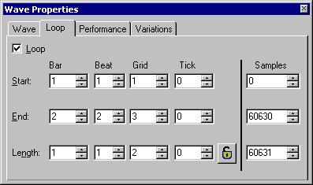
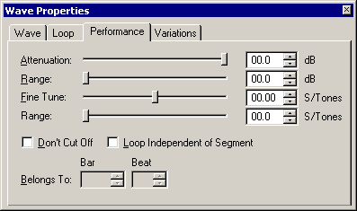
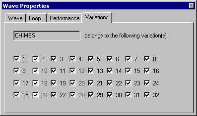
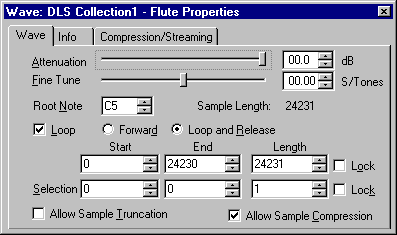
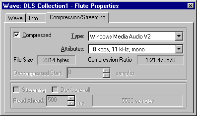

# SEG-14　Wave Track と Wave Properties

[調査計画](README.md) · [原版で観測した Wave エディター](ui-07-dls-wave-instrument.md) · [AudioPath の試験素材](ui-08-audiopath-designer.md)

`Wave Track` は原版の [Add New Tracks](seg-01-creation.md) で確認済み。このページの図は DirectMusic Producer 5.3.0.900 の同梱 HTML Help。実機の波形選択、レイヤー、Variation、ループの保存と復元は [Wave Track の調査記録](seg-14-wave-track-editing.md) に掲載した。 [図の出典と寸法](../../../work/original-gui/SEG-14-wave-audiopath/20261111T081723992826Z/published-help-figures.json) · [FarmGame の Wave 保存値](../../../work/original-gui/SEG-14-wave-audiopath/20261111T081723992826Z/farmgame-wave-audit.json)

## Track、Part、Layer の表示と操作

原版ヘルプでは1つの Wave Track が複数の Part を持ち、Part ごとに PChannel、Variation、独立したストリップがある。展開した Part の上部には1〜32の Variation ボタンが2段。波形の左にはレイヤーのボタンと縦スクロール、ストリップ右端には折りたたみボタンがある。Wave 項目は名前と波形を表示し、選択中は赤く描画されると説明されている。 [Wave Track](../../../../../work/analysis/original-manual-session/20261010T031624075Z/help-extracted/htm/wavetrack.htm)

ヘルプによると新規 Track の初期 Part は PChannel 1。右クリックの `Add Wave Part(s)` で PChannel を指定し、`Create New Part` で追加する。初期のレイヤーは `a` と、その下の無名の空レイヤー。無名の行に Wave を置くと `b` が付き、その下に新しい無名行ができる。レイヤーボタンの `Insert Layer` はその上に新しい行を作り、下の文字を振り直す。 [Parts and Layers](../../../../../work/analysis/original-manual-session/20261010T031624075Z/help-extracted/htm/partsandlayersinthewavetrack.htm)

Wave は Project Tree の `.wvp` ファイルまたは Wave の子ノードからドロップできる。Insert キー・右クリックの Insert を使うと、参照先の Wave を指定する前は `Empty`。追加には Variation を1つ以上選ぶ。DLS Collection の中の Wave と、Project 内に独立した .wvp を置いた状態では選べる候補が異なる。 [Wave の挿入](../../../../../work/analysis/original-manual-session/20261010T031624075Z/help-extracted/htm/insertingwavesinthewavetrack.htm)

## Wave Track と Wave Part の Properties

| タブ | 設定 |
| --- | --- |
| Track Group Assignment、Flags | トラック全体のグループとフラグ |
| Wave Track | 全 Part に適用する Attenuation、`Lock variations to pattern track`、`Reset variation order on play` |
| Wave Part | 選択した Part の Name、PChannel 番号・名前、Attenuation、Play、Lock ID |

Wave Part の Play にはランダム、先頭から順、ランダムな位置から順、重複なし、シャッフルの選択肢がある。Lock ID は Part 間で Variation 番号を揃える設定。Track と Part と項目の Attenuation は累積する。 [Wave Track Properties](../../../../../work/analysis/original-manual-session/20261010T031624075Z/help-extracted/htm/wavetrackproperties.htm)

## Timeline 上の Wave 項目の Properties

| タブ | 操作の確認点 |
| --- | --- |
| Wave | 参照ファイル、Start、End、Length、Offset By と Samples。End の鍵は終了位置を固定し、Length の鍵は長さを保って両端を動かす。End 下の Source は本来の終了位置、Length 下の Source は元 Wave の長さ |
| Loop | Loop の有効・無効と Start、End、Length。時刻と Samples から範囲を編集できる。Length の鍵で両端を連動させる |
| Performance | Attenuation と Fine Tune、そのランダム範囲、Don't Cut Off、Loop Independent of Segment、Belongs To |
| Variations | 1〜32 のチェック欄から、その Wave を含める Variation を指定 |

ヘルプの例では Loop の Samples は Start 0、End 60630、Length 60631。End は最後に含むサンプルとして表示されている。Track 項目のループは Segment 側の設定で、出力ファイルと参照元 Wave を照合できる。 [Wave Properties](../../../../../work/analysis/original-manual-session/20261010T031624075Z/help-extracted/htm/waveproperties.htm)

## Project Tree の Wave 文書と波形エディター

Wave 文書は `.wvp` の子ノードをダブルクリックする入口を持つ。子ノードの F11、または波形面の右クリックから開く Wave Component Properties には Wave、Info、Compression/Streaming の3タブがある。Wave タブでは Root Note、Sample Length、Loop の方式、Start・End・Length、選択範囲を表示する。Compression/Streaming の候補は使用できるコーデックに依存する。 [Wave Component Properties](../../../../../work/analysis/original-manual-session/20261010T031624075Z/help-extracted/htm/wavecomponentproperties.htm) · [Wave タブ](../../../../../work/analysis/original-manual-session/20261010T031624075Z/help-extracted/htm/wavetab.htm) · [Compression/Streaming](../../../../../work/analysis/original-manual-session/20261010T031624075Z/help-extracted/htm/compressionstreamingtab.htm)

波形面をドラッグして範囲を選択し、`Set Loop From Selection` で緑の開始線と青の終了線を範囲端へ動かす。ヘルプはゼロ振幅へのスナップを既定とし、`Find Best Loop End From Selection` は指定範囲内の新しい終端を選ぶ操作として説明している。ループ無効時は両端を破線で表示する。現行アプリの波形、色、初期表示は [Wave: Tone の過去撮影](ui-07-dls-wave-instrument.md) に記録がある。 [Wave Editor](../../../../../work/analysis/original-manual-session/20261010T031624075Z/help-extracted/htm/waveeditor.htm) · [Setting Loop Points](../../../../../work/analysis/original-manual-session/20261010T031624075Z/help-extracted/htm/settinglooppoints.htm)

## 参照と音声がそろった追試用素材

[FarmGame の作業コピー](../../../work/original-gui/SEG-14-pattern-style/20261111T074828536163Z/inputs/farmgame/manifest.json) の6組を照合した。各 Segment は Wave Track 1つ、Part 1つ、Wave 項目1つ。Part の PChannel 格納値は0起点で11、項目の Variation マスクは `0xFFFFFFFF`。項目の開始とオフセットは0で、Clock Time のフラグが立っている。参照先 `.wvp` はファイル名と GUID が一致。項目と Wave 文書のループはいずれも未設定だった。

| Wave | サンプルレート | PCM フレーム数 | Segment 内の項目長 |
| --- | ---: | ---: | ---: |
| SfxAlarm | 44,100 Hz | 64,528 | 14,632,699 |
| SfxCougar | 22,050 Hz | 32,352 | 14,672,608 |
| SfxCow | 44,100 Hz | 63,868 | 14,483,039 |
| SfxRooster | 44,100 Hz | 92,934 | 21,073,969 |
| SfxSheep | 44,100 Hz | 51,309 | 11,635,193 |
| SfxWolf | 44,100 Hz | 91,132 | 20,665,352 |

項目長の単位は100 ns。各行の値は、PCM フレーム数から同じ単位に換算して切り捨てた値より500大きい。6件はすべて16 bit Mono PCM で、音声データが対応する RawElements の .wav と全バイト一致した。 [元 WAV の複製とハッシュ](../../../work/original-gui/SEG-14-wave-audiopath/20261111T081723992826Z/inputs/wave-import/manifest.json)

実機では `SfxCow.sgp` で折りたたみと展開、選択色、4つの項目タブを撮影し、新規 Segment1 で Add Wave Part(s)、Variation、レイヤー、開始位置とループを確認した。次の追試は、Wave の差し替えと Undo、端や境界のカーソル、別の Part への移動、Wave 文書のループ範囲と再生音。 [実機の操作と保存値](seg-14-wave-track-editing.md)
