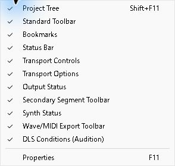
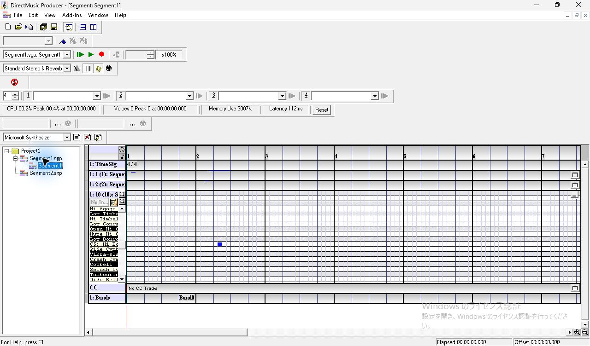
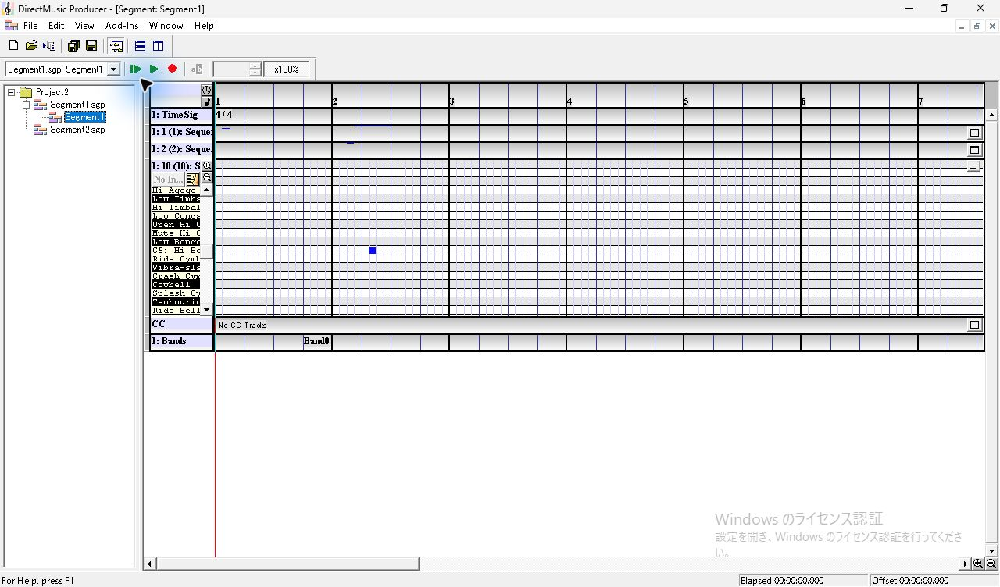
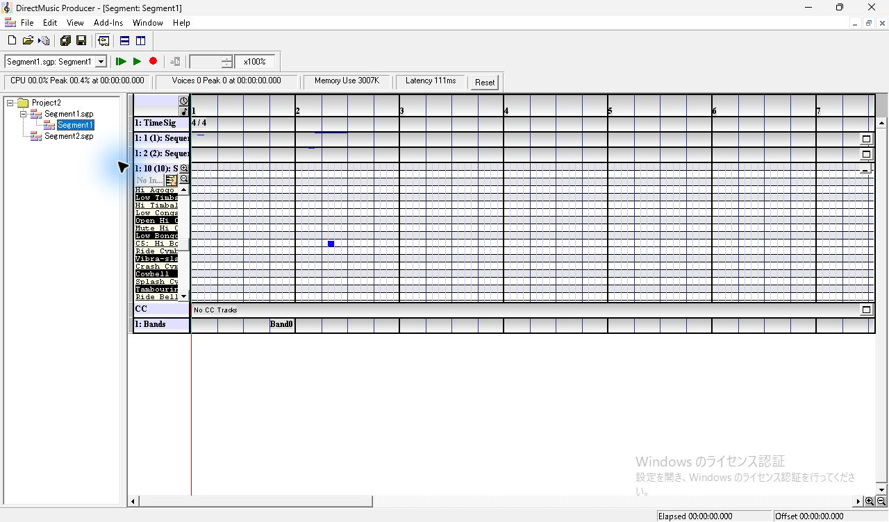
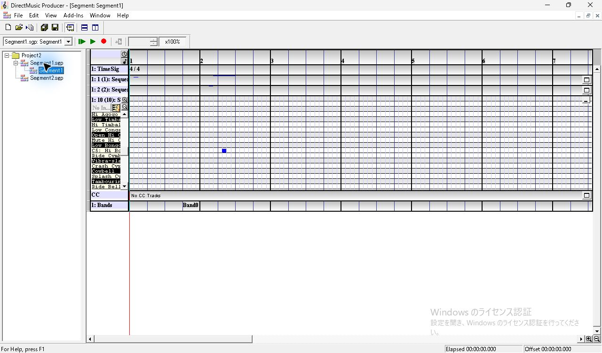
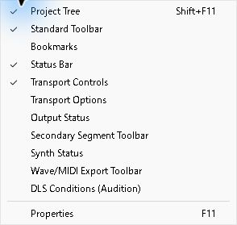

# UI01　View メニューとツールバー表示

[調査計画](README.md) · [実行記録](../../../work/original-gui/UI01-toolbar/20261111T030026645465Z/run.json) · [画像対応表](../../../work/original-gui/UI01-toolbar/20261111T030026645465Z/published-images.json)

2026-11-11。DirectMusic Producer 5.3.0.900 の調査用コピー `DmusGuiToolbar.exe` で、[3パート入りの Segment1](../../../work/original-gui/SEG-06-07/20261111T023012247347Z/inputs/three-parts/manifest.json) を開いた。Windows 11 10.0.26200、ディスプレイは1280×800、96 DPI。親子ウィンドウを最大化した状態の画像は1280×752 px。座標は画像の左上が原点。青い光と黒い矢印は操作ツールの表示。

## Segment の検証で使う表示

`View` メニューで表示中の項目にチェックが付く。項目を選ぶとメニューが閉じ、表示状態がすぐに切り替わる。以下の4項目を通常表示とする。

| View の項目 | 通常の検証で使う機能 |
| --- | --- |
| Project Tree | 調査用の文書を開く |
| Standard Toolbar | 新規作成、開く、保存、子ウィンドウの整列 |
| Transport Controls | 再生対象、再生・停止、テンポ |
| Status Bar | 選択ノートや再生の時刻、Offset |

非表示にした項目は `Bookmarks`、`Transport Options`、`Output Status`、`Secondary Segment Toolbar`、`Synth Status`、`Wave/MIDI Export Toolbar`、`DLS Conditions (Audition)`。これらが観測対象になる試験では該当項目を表示し、撮影時のチェック状態を記録する。

同じウィンドウ寸法で、Timeline の上端は y=315 から y=105 へ移動し、表示領域が縦に210 px増えた。小節境界の横位置、第10パートの展開、ノートと Band0 の配置は前後の画像で一致した。

## 一時表示と再起動

`View > Synth Status` をもう一度選ぶと、Transport Controls の下に CPU、Voices、Memory Use、Latency、Reset の行が戻り、Timeline の上端は y=135 になる。再度選ぶと通常表示に戻る。

通常終了後、同じ EXE とローカル INI を使って別プロセスで起動した。Segment1 を開くと2段のツールバーで表示され、`View` のチェックも終了前と一致した。設定は[終了後のローカル INI](../../../work/original-gui/UI01-toolbar/20261111T030026645465Z/compact.ini) と [実行記録](../../../work/original-gui/UI01-toolbar/20261111T030026645465Z/run.json) に残した。別の調査用コピーでは、そのコピーの View メニューで同じ4項目を確認してから撮影する。

終了と再起動の前後で、試験コピーの2本の SGP は固定素材と同じ SHA-256 だった。試験コピーの `Project2.pro` は終了後に再書き込みされ、開いているエディターの記録とファイル管理情報に差分があった。固定素材3ファイルはハッシュが一致した。

今後の UI01 調査では、フローティングとドッキング、狭いウィンドウでの行送り、ウィンドウ寸法と配置の復元を観測する。
