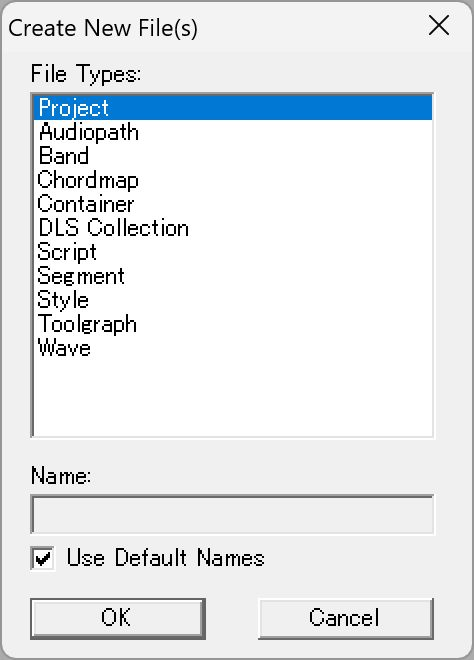
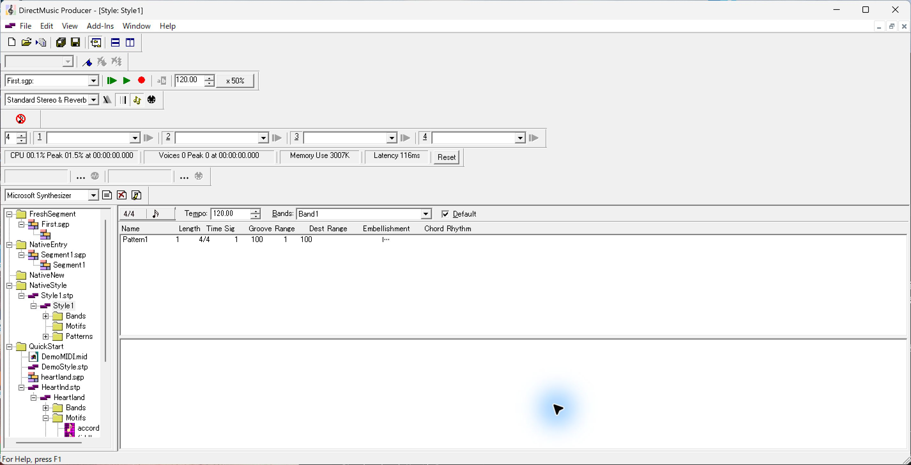
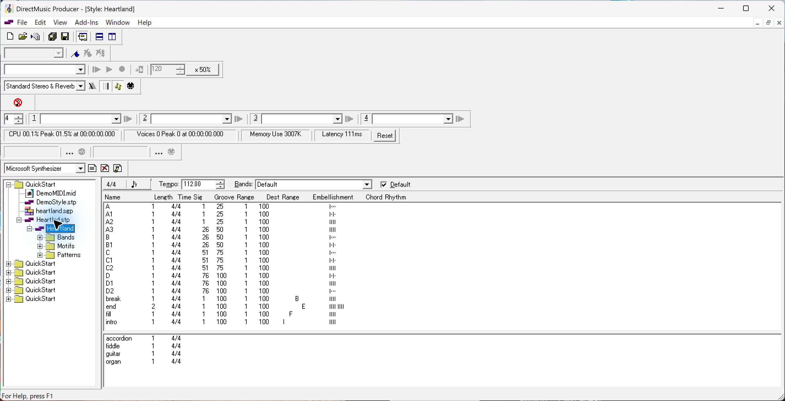
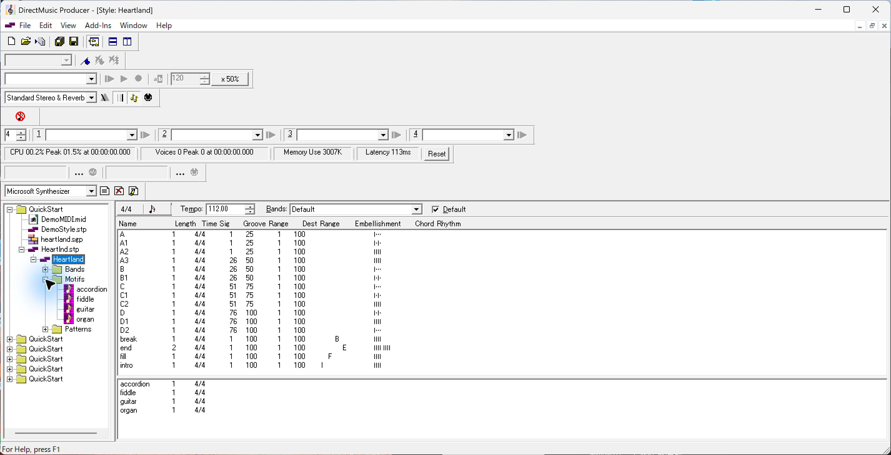
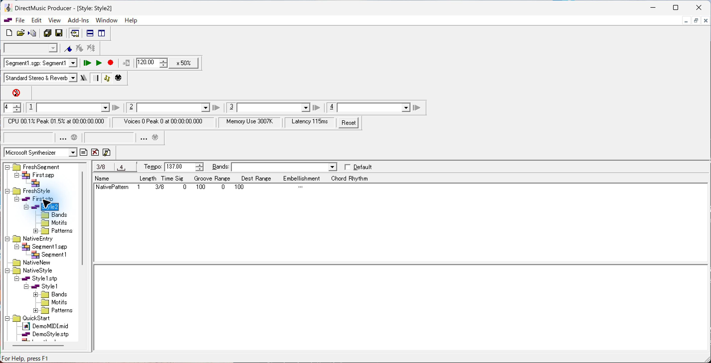
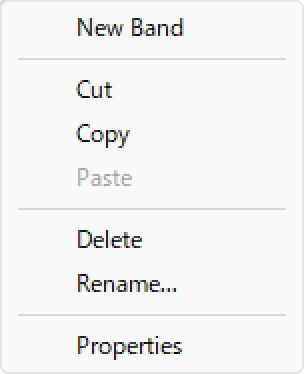
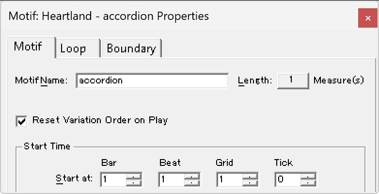
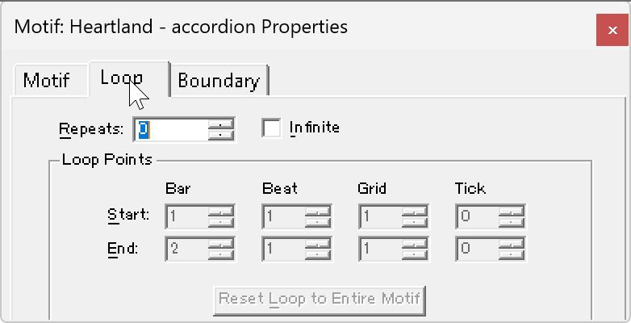
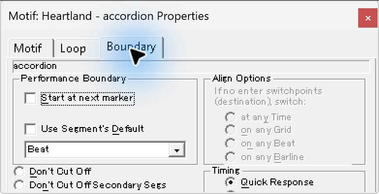

# UI04　Style Designer と Motif のプロパティ

[調査計画](README.md) · [Segment の Pattern Track と Style Track](seg-14-pattern-style.md)

2026-10-03 の原版撮影を使用した。原版は DirectMusic Producer 5.3.0.900、実行ファイル SHA-256 `fad2eec4d5dacd3bfd67694ea63ca169517902b73e30d283998cf7726e41c011`。本体画像は2852×1460 px。撮影時のツールバーは複数段。青い光と黒い矢印は操作ツールの表示。今回の撮影条件は [View とツールバー表示](ui-01-view-toolbars.md) に従い、次回の追試で2段表示を使う。

[画像対応表](../../../work/original-gui/SEG-14-pattern-style/20261111T074828536163Z/published-reference-images.json) · [Style 作成と保存の記録](../../../../../work/analysis/jazp-style-original/20261003T214600Z/original-style-proof.json) · [Motif 観測記録](../../../../../work/analysis/original-motif-settings/20261003T162000Z/observation.json)

## Style 文書の新規作成

`File > New` の `Create New File(s)` で Style を選択できる。記録の初期状態では Project が選ばれ、`Use Default Names` はオン。専用 Project `NativeStyle` に既定名で Style を作成した別の記録では、ツリーに `Style1.stp > Style1` が追加され、子フォルダーは Bands、Motifs、Patterns の順。作成直後のエディターは4/4、Tempo 120.00、Bands の欄は `Band1`、右隣の `Default` はオン。

画面上段の一覧は `Pattern1` 1件。列は Name、Length、Time Sig、Groove Range、Dest Range、Embellishment、Chord Rhythm。Pattern1 の Length は1、Time Sig は4/4、Groove Range と Dest Range はそれぞれ1〜100。水平の境界線より下の Motif 一覧は空だった。Ctrl+S と明示的な Project 保存後、`Style1.stp` が1792 bytes、`NativeStyle.pro` が1710 bytes。保存した Style 名と Project のエントリーを照合した。 [新規作成ダイアログの操作記録](../../../../../work/analysis/original-style-band/20261003T143300Z/observation.json)

## Pattern と Motif がある Style

QuickStart の Heartland を開いた撮影では、Tempo 112.00、拍子4/4、Bands は `Default`。上の Pattern 一覧には A、A1、A2、A3、B、B1、C、C1、C2、D、D1、D2、break、end、fill、intro の16行が並ぶ。A の Groove Range は1〜25、B は26〜50、C は51〜75、D は76〜100。Embellishment 欄には break・end・fill・intro の位置に B・E・F・I、Chord Rhythm 欄には縦線を組み合わせた図が出る。下の Motif 一覧には accordion、fiddle、guitar、organ が並び、ツリーの Motifs フォルダーを展開しても同じ4名を選べる。旧観測では開いていた Heartland の絶対パスが確定していない。今回ハッシュを確認した [QuickStart 素材](../../../work/original-gui/SEG-14-pattern-style/20261111T074828536163Z/inputs/quickstart/manifest.json) を用いて追試する。

独立した読込試験では、外部で作成した Style-only プロジェクトを原版で開いた。表示は `Style2`、拍子3/8、Tempo 137.00、Pattern 一覧に `NativePattern`。Bands 欄は空、Default は未選択。入力ファイルは読込前後で同一だった。 [別入力での原版読込記録](../../../../../work/analysis/jazp-style-original/20261003T214600Z/source-open/open-proof.json)

## accordion のプロパティと選択

1. Heartland の `Motifs` を展開し、ツリー上の `accordion` を右クリック。先頭は `New Band`、続いて Cut・Copy・Paste、Delete・Rename、Properties の順。この状態では Paste が灰色だった。
2. Properties を選ぶと `Motif: Heartland - accordion Properties`。 `Motif`、`Loop`、`Boundary` の3タブ。Motif では名前 accordion、長さ1小節、`Reset Variation Order on Play` がオン。Start Time は Bar・Beat・Grid・Tick の4欄で `1:1:1:0`。
3. Loop タブでは Repeats が0、Infinite はオフ。Loop Points の開始 `1:1:1:0`、終了 `2:1:1:0` が灰色。 `Reset Loop to Entire Motif` も灰色。
4. Boundary タブでは `Start at next marker` と `Use Segment's Default` がオフ、境界選択は Beat。右の Align Options は灰色で、Timing の `Quick Response` はオン。下端の一部はウィンドウ外になるため、Cut Off の最終選択は追試する。

追試対象は2段ツールバーでの撮り直し、Style 本体の Properties、Pattern Editor の開閉、Part と Variation、移動と複製、共有の表示、Band の追加、Motif の新規作成・設定変更・試聴・保存と復元。
