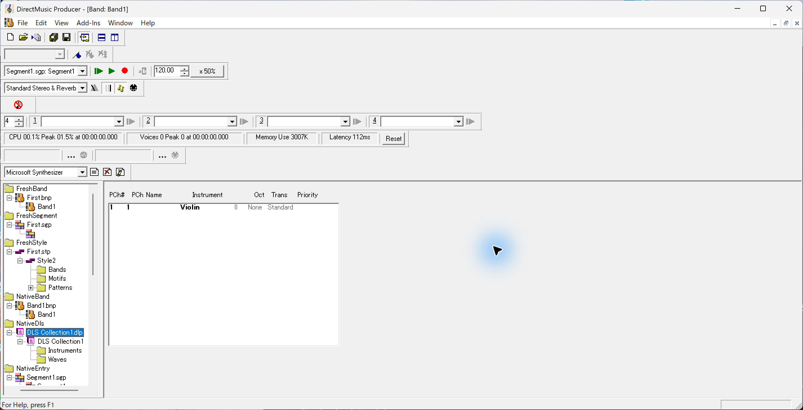
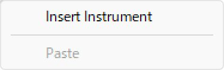
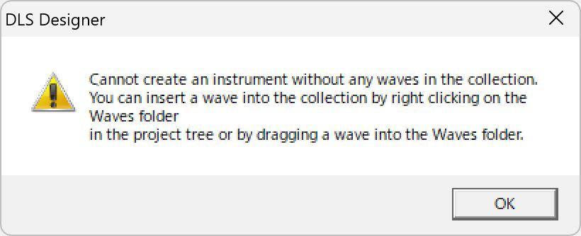
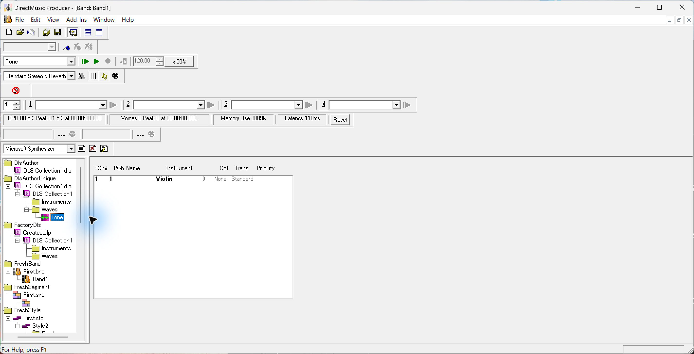
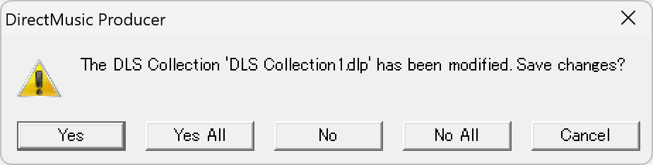
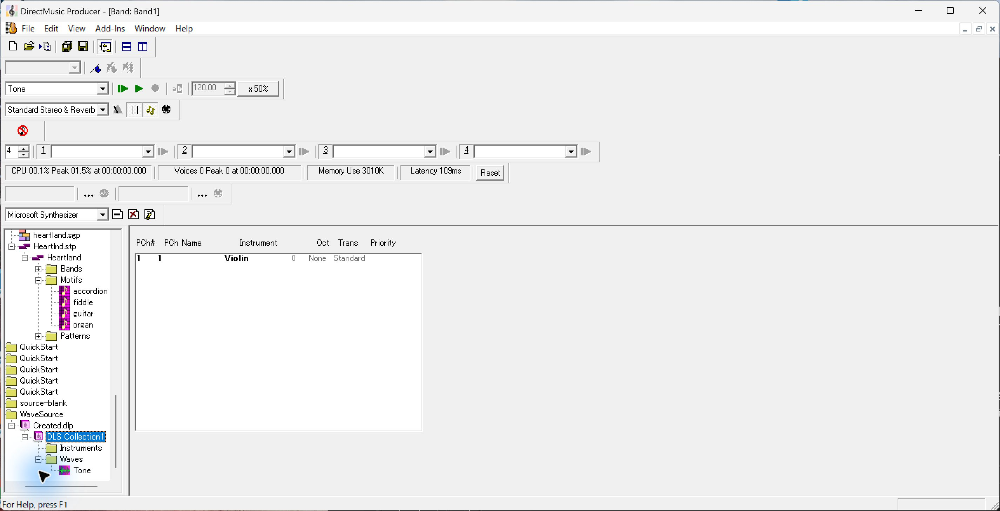
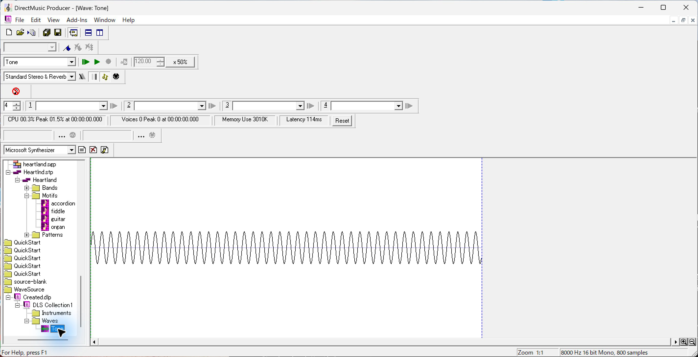
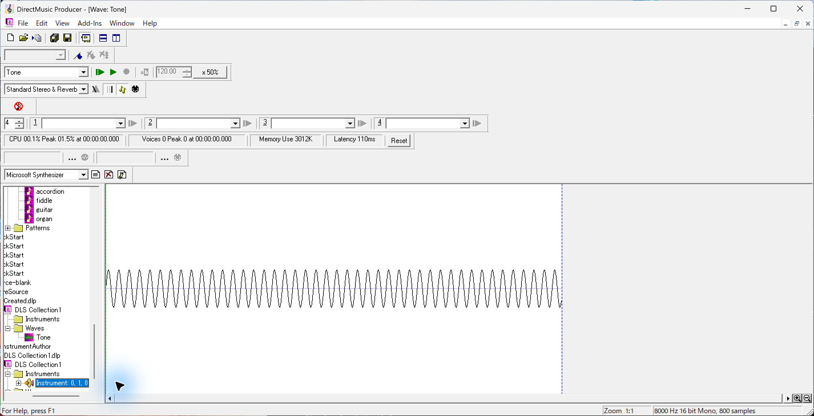
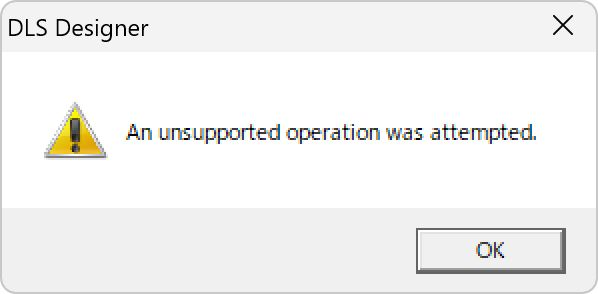
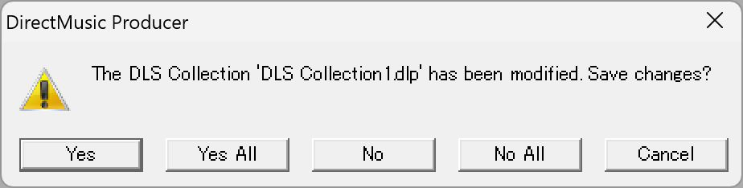

# UI07　DLS Collection、Instrument、Wave エディター

[調査計画](README.md) · [Band エディターの DLS 参照](seg-09-band-editor.md) · [Segment の Wave Track](seg-14-wave-track.md)

2026-10-03〜04 の過去の原版撮影を使用した。DirectMusic Producer 5.3.0.900、調査用 `DMUSProd.exe` の SHA-256 は `fad2eec4d5dacd3bfd67694ea63ca169517902b73e30d283998cf7726e41c011`。本体画像は2852×1460 px。ツールバーが複数段ある当時の状態。青い光と黒い矢印は操作ツールの表示。

[画像対応表](../../../work/original-gui/UI07-14-archive/20261111T080241498238Z/published-images.json) · [波形と保存値の照合](../../../work/original-gui/UI07-14-archive/20261111T080241498238Z/native-audit.json) · [今回の照合記録](../../../work/original-gui/UI07-14-archive/20261111T080241498238Z/run.json)

旧記録に画像ハッシュがあるものは照合し、それ以外は撮影時の状態ログと今回の SHA-256 を画像対応表に記録した。

## 空の DLS Collection と Instrument の依存条件

1. 専用 Project `NativeDls` で File > New の `DLS Collection` を既定名で作成。Project Tree に `DLS Collection1.dlp > DLS Collection1` ができ、その下に `Instruments` と `Waves` の2フォルダーが並ぶ。ファイルノードを選択しても、前面の Band エディターは表示されたままだった。新規 .dlp は180 bytes、明示的な Project 保存後の .pro は1508 bytes。 [DLS 作成と保存の記録](../../../../../work/analysis/jazp-dls-original/20261003T222100Z/original-dls-proof.json)
2. 別の空の Collection で `Instruments` フォルダーを右クリックすると `Insert Instrument` が有効、`Paste` は灰色。Insert Instrument を選ぶと `DLS Designer` が Wave を必要とする警告を表示する。メッセージには `Waves` の右クリックとドロップによる追加が案内され、ボタンは `OK`。この回は OK で戻った。 [Wave 挿入と依存条件の記録](../../../../../work/analysis/dls-author-original/20261003T224300Z/original-wave-proof.json)

## PCM Wave の挿入と保存

1. 専用 Project `DlsAuthorUnique` の `Waves` を右クリックして `Insert Wave...`。試験用の `Tone.wav` を選択する。追加後は `Waves > Tone` が表示され、Wave アイコンと青い選択が付く。Transport の対象名も `Tone` に変わる。前面の Band エディターはそのままだった。
2. File メニューの `Save Project DlsAuthorUnique` を選ぶ。この状態の Ctrl+S は前面 Band の `Save First.bnp`。Project の保存では変更された DLS の名前を含む確認が出て、下に `Yes`、`Yes All`、`No`、`No All`、`Cancel` が並ぶ。試験では対象の DLS に対して Yes を選んだ。
3. 保存した .dlp は2030 bytes。8,000 Hz、16 bit、Mono、800フレームの PCM は入力と完全一致。Wave 側のサンプル設定はルート60でループ件数0。 [挿入に使った Tone.wav の素材](../../../work/original-gui/UI07-14-archive/20261111T080241498238Z/inputs/pcm-import/manifest.json) · [保存記録](../../../../../work/analysis/dls-author-original/20261003T224300Z/original-wave-proof.json)

## Wave エディターの初期表示

外部で作成した PCM 入りの DLS を、別の Project `WaveSource` に置いて原版で開いた。Project Tree を下にスクロールして Project を表示し、`Created.dlp > DLS Collection1 > Waves` を展開する。Wave の `Tone` をダブルクリックすると、前面が `Wave: Tone` に変わる。画面外のツリー項目は、スクロールで表示した後にクリックできた。

白い波形面に黒のサンプル線と水平の中心線があり、左端に緑、波形の終わりに青の縦線が見える。終端より右は灰色。下端に横スクロール、右下に拡大・縮小の虫眼鏡、ステータスバー右側に `Zoom 1:1` と `8000 Hz 16 bit Mono, 800 samples`。入力の Wave のループ件数は0。縦線のドラッグ、選択領域、ズーム変更、再生は追試項目。 [Wave を開いた記録](../../../../../work/analysis/dls-author-original/20261003T224300Z/source-open/open-proof.json) · [Wave エディターの再現素材](../../../work/original-gui/UI07-14-archive/20261111T080241498238Z/inputs/wave-editor/manifest.json)

## Wave を含む Collection の Instrument

1. Tone を1件含む専用 Project `ZZInstrumentAuthor` で `Instruments > Insert Instrument` を実行すると、ツリーに `Instrument: 0, 1, 0` が作成され選択された。
2. 最初の試行では Instrument Editor を開く操作で `DLS Designer` の `An unsupported operation was attempted.` が表示された。OK の後で本体ウィンドウを見失った。入力の .dlp は当時のハッシュと一致しており、この試行は保存前で終わった。 [エラーと終了時の記録](../../../../../work/analysis/dls-instrument-original/20261003T231831Z/editor-failure.json)
3. 別起動では Instrument を挿入してから、エディターを開く前に `Save Project ZZInstrumentAuthor` と対象 DLS の Yes で保存した。.dlp は2260 bytes。1 Instrument、Bank 1、Program 0。Region は1件で鍵域・速度域とも0〜127、Wave Pool の cue 0を参照し、サンプル設定は Wave と同じ。これは保存した一例で、自動番号の割り当て規則は追試する。 [保存した Instrument の RIFF 構造](../../../../../work/analysis/dls-instrument-original/20261003T231831Z/original-tree.json) · [Instrument 入りの追試素材](../../../work/original-gui/UI07-14-archive/20261111T080241498238Z/inputs/instrument-saved/manifest.json)

今後は2段ツールバーで撮り直し、Instrument Editor が開く素材で鍵盤と Region、Envelope、PanVol を調べる。Wave エディターではループ端、範囲選択、ズーム、スクロール、試聴、保存後の復元を追試する。Segment の Wave Track と Wave Editor の連動は、[FarmGame の参照付き Segment](seg-14-wave-track.md) を使って確認する。
