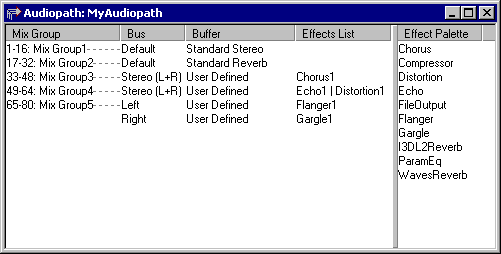
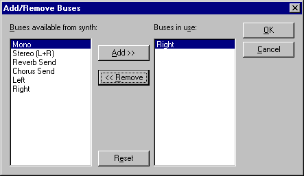
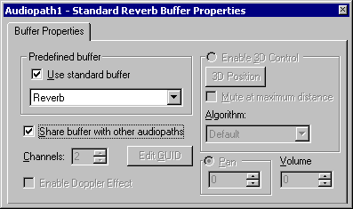
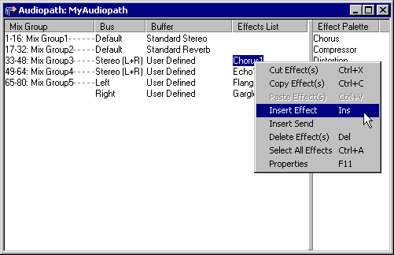
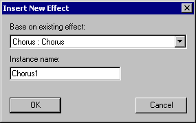
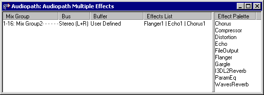
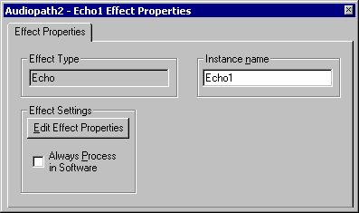
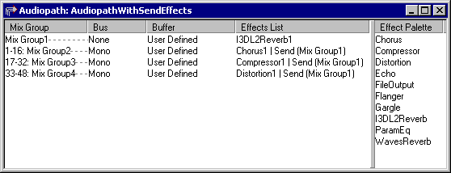

# UI08　AudioPath Designer のバッファとエフェクト

[調査計画](README.md) · [Parameter Control Track の入口](seg-14-control-triggers-script.md)

図は DirectMusic Producer 5.3.0.900 の同梱 HTML Help。現在の実機でのドラッグ、設定変更、保存、音声は追試する。 [図の出典と寸法](../../../work/original-gui/SEG-14-wave-audiopath/20261111T081723992826Z/published-help-figures.json) · [FarmGame の AudioPath 保存値](../../../work/original-gui/SEG-14-control-triggers-script/20261111T081051527595Z/farmgame-script-and-audiopath.json)

## 画面の入口と2つのペイン

Project Tree の AudioPath ファイルを展開し、子ノードをダブルクリックする。左の表は `Mix Group`、`Bus`、`Buffer`、`Effects List`。Mix Group には PChannel の範囲と名前、Effects List には適用順のエフェクト名が縦線で区切られて並ぶ。右の `Effect Palette` は利用可能なエフェクト。左右の境界と列見出しの境界をドラッグして幅を変えられると説明されている。 [AudioPath Designer Window](../../../../../work/analysis/original-manual-session/20261010T031624075Z/help-extracted/htm/audiopathdesignerwindow.htm)

## バス・バッファの選択と Properties

Bus または Buffer 列をクリックして対象を選ぶ。Ctrl を押すと複数の対象を選べる。右クリックから `Add/Remove Buses` を開くと、左はシンセサイザーで使えるバス、右は対象 Buffer が使用中のバス。中央に Add、Remove、下に Reset、右端に OK と Cancel。ヘルプでは使用中のバスが2つになると Add は無効。 [バスとバッファの管理](../../../../../work/analysis/original-manual-session/20261010T031624075Z/help-extracted/htm/managingbusesandbuffers.htm) · [Add/Remove Buses](../../../../../work/analysis/original-manual-session/20261010T031624075Z/help-extracted/htm/addremovebusesdialogbox.htm)

Buffer Properties の図は `Use standard buffer` がオン、種類は Reverb。Channels、Edit GUID、Doppler、3D、Pan、Volume の灰色表示が見える。ヘルプでは User Defined に切り替えると設定対象が増える。Channels は User Defined でバスが1つの場合に変更でき、3D と Pan は同時に使えない。 [Buffer Properties](../../../../../work/analysis/original-manual-session/20261010T031624075Z/help-extracted/htm/bufferproperties.htm)

## エフェクトの挿入、順序、プロパティ

1. 右の Effect Palette から対象を User Defined Buffer の Effects List にドラッグするか、Effects List の右クリックで `Insert Effect`。右クリック図では `Insert Send`、`Delete Effect(s)`、`Select All Effects`、`Properties` も見える。ヘルプによると未選択時のエフェクト編集項目で使えるのは挿入系。
2. `Insert New Effect` には `Base on existing effect` と `Instance name`、OK・Cancel。例ではタイプ Chorus、名前 Chorus1。
3. 同一 Buffer の列では左から右へ処理する。図の例は `Flanger1 | Echo1 | Chorus1`。既存エフェクトを選択した位置に応じて挿入・貼り付け先が変わる。ヘルプには Ctrl で複数選択し、Cut・Copy・Paste で並び替える入口がある。
4. 選択したエフェクトの F11 または右クリックの Properties。図では `Effect Type` に Echo、`Instance name` に Echo1。 `Edit Effect Properties` は種類ごとの設定を開く。 `Always Process in Software` のチェック欄もある。 [エフェクトの管理](../../../../../work/analysis/original-manual-session/20261010T031624075Z/help-extracted/htm/managingeffects.htm) · [Effect Properties](../../../../../work/analysis/original-manual-session/20261010T031624075Z/help-extracted/htm/effectproperties.htm)

## Send の宛先と確認手順

`Insert Send` で出力を他の Buffer へ送る効果を追加する。ヘルプでは初期の宛先は Standard Environmental Reverb。Effect Properties の一覧から適格な Mix Group を指定し、開いていない AudioPath の宛先には Other で Buffer GUID を入力する。宛先には PChannel と Bus がなく、Buffer は1つ。送信元で Send より右のエフェクトは送られる音に含まれない。 [Insert Send](../../../../../work/analysis/original-manual-session/20261010T031624075Z/help-extracted/htm/toinsertasendeffect.htm) · [Send Effects](../../../../../work/analysis/original-manual-session/20261010T031624075Z/help-extracted/htm/sendeffects.htm)

[FarmGame の専用コピー](../../../work/original-gui/SEG-14-pattern-style/20261111T074828536163Z/inputs/farmgame/manifest.json) の `APFarm.aup` に2つの Mix Group と Buffer、先頭 Buffer の `Echo1` が保存されている。この素材で表の選択、Echo のプロパティと設定ダイアログ、変更の取消を調べる。新しい別コピーでは挿入前、候補選択、2効果の順序とドロップ、Send の宛先一覧、Other と Cancel、別起動での復元を撮る。音量と各効果の聴感は、表示・保存の確認後に試聴する。
