# UI08　AudioPath Designer の選択、エフェクト順序、Send

2026-11-11。DirectMusic Producer 5.3.0.900 の調査用コピーで、FarmGameProject の **APFarm.aup** を観測し、原版の新規作成機能で派生した **APFarm1.aup** を編集した。親ウィンドウは1280×752 px。View は Project Tree、Standard Toolbar、Transport Controls、Status Bar を表示。青い光と黒い矢印は操作ツールの表示。 [原版画像47枚の対応表](../../../work/original-gui/SEG-14-pattern-style/20261111T074828536163Z/published-audiopath-live-figures.json) · [実行記録](../../../work/original-gui/SEG-14-pattern-style/20261111T074828536163Z/run.json) · [同梱ヘルプ](ui-08-audiopath-designer.md)

## APFarm の列、ペイン、選択

Project Tree で **APFarm.aup** をダブルクリックすると、ファイルが展開され、子ノード **APFarm** を選んだ状態で AudioPath Designer が開いた。左は **Mix Group、Bus、Buffer、Effects List** の4列。PChannel **11** の Mix Group と **12** の Mix Group1 があり、両方とも Bus は **Stereo (L+R)**、Buffer は **User Defined**。最初の行だけに **Echo1** がある。右の **Effect Palette** に AEC、Chorus、Compressor、Distortion、Echo、FileOutput、Flanger、Gargle、ParamEq、WavesReverb が並ぶ。

Mix Group 列をクリックすると行全体が青く選択される。F11 で出たモデルレスのシートは **APFarm Audiopath Properties** で、Audiopath と Info の2タブ。シートを開いたまま Bus または Buffer を選ぶと2列をまたいで青くなり、**User Defined Buffer Properties** へ切り替わる。APFarm の1行目は Channels 2 が灰色、Pan は Mid、Volume は0。Enable 3D Control と Use standard buffer はオフ。Effects List で Echo1 を選ぶと項目名だけが青くなり、シートは Echo1 Effect Properties になる。

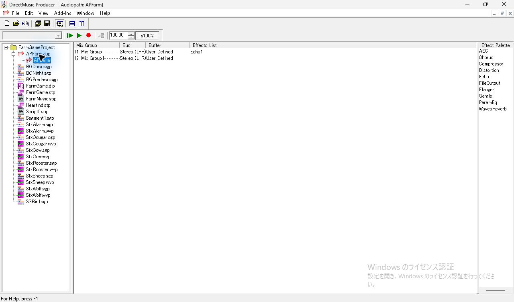
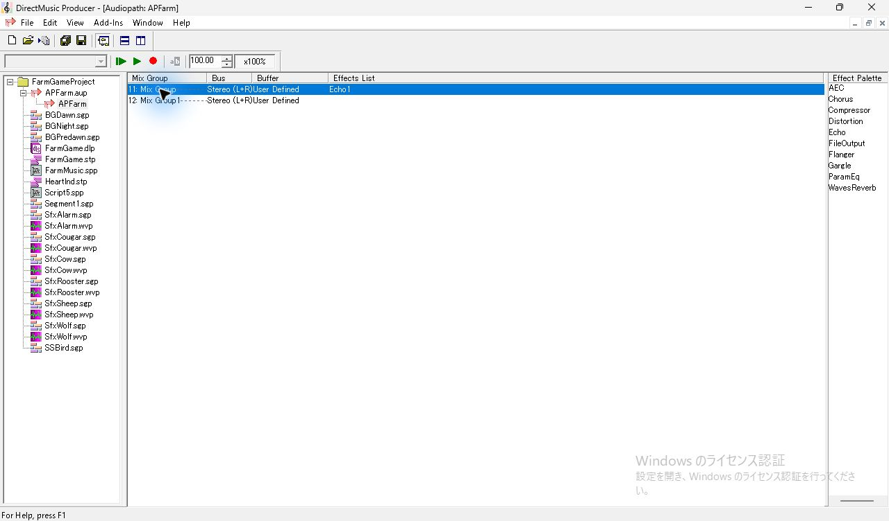
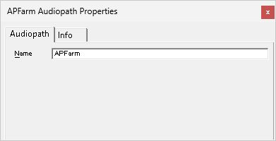
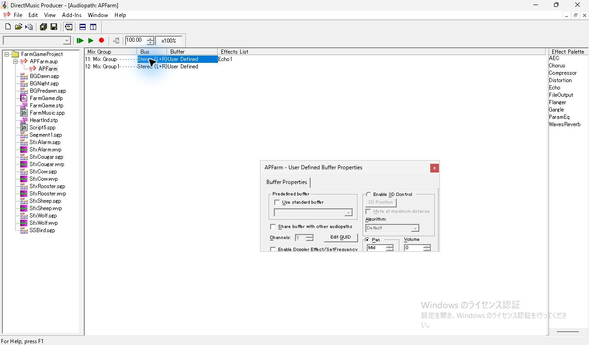
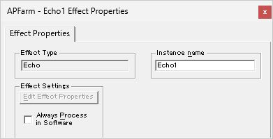

Echo1 の **Edit Effect Properties** は無効で、項目のダブルクリックでも詳細ダイアログは現れなかった。試験文書の再読込後にも同じ無効状態を確認した。Echo のパラメーター編集は追試項目。

左右のペインの境界を左へドラッグすると Effect Palette が広がった。境界上のポインターは左右に矢印のあるサイズ変更形状。Mix Group と Bus の列見出しの境界を右へドラッグすると Mix Group 列が広がり、後続列が右に移る。列見出しのポインターにも横方向のサイズ変更形状が現れた。

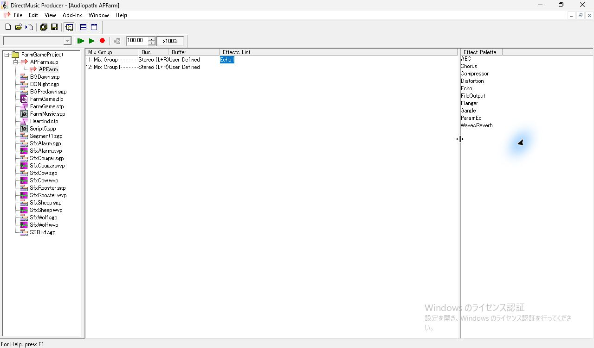
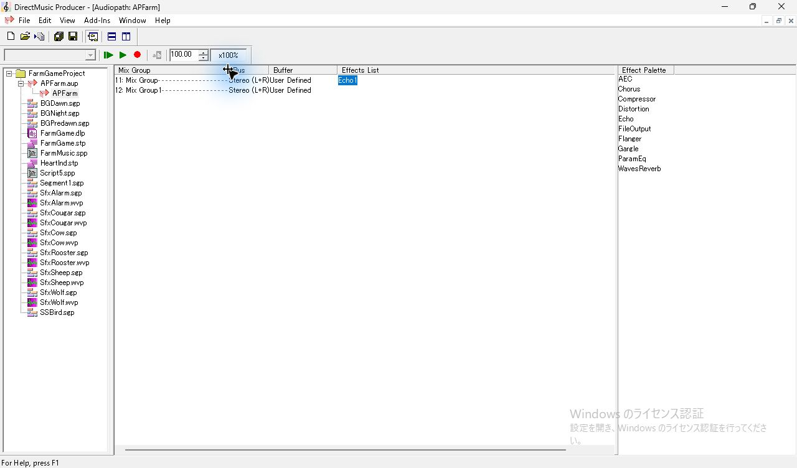

## バスの追加・削除と Cancel

1行目の Bus を右クリックすると **Add/Remove Buses、Insert Buffer、Delete Buffer、Properties** が並ぶ。**Add/Remove Buses** の左には Mono、Stereo (L+R)、Reverb Send、Chorus Send、Left、Right。右の使用中一覧は **Left** と **Right**。使用中が2件のときは Add が灰色。Left を選んで **Remove** を押すと右は Right だけになり、Add が有効になった。**Cancel** で閉じると APFarm の表は **Stereo (L+R)** のままだった。

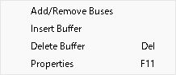
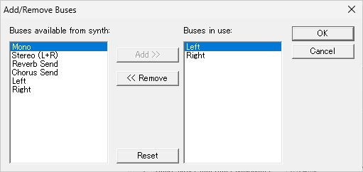
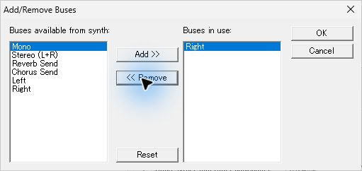
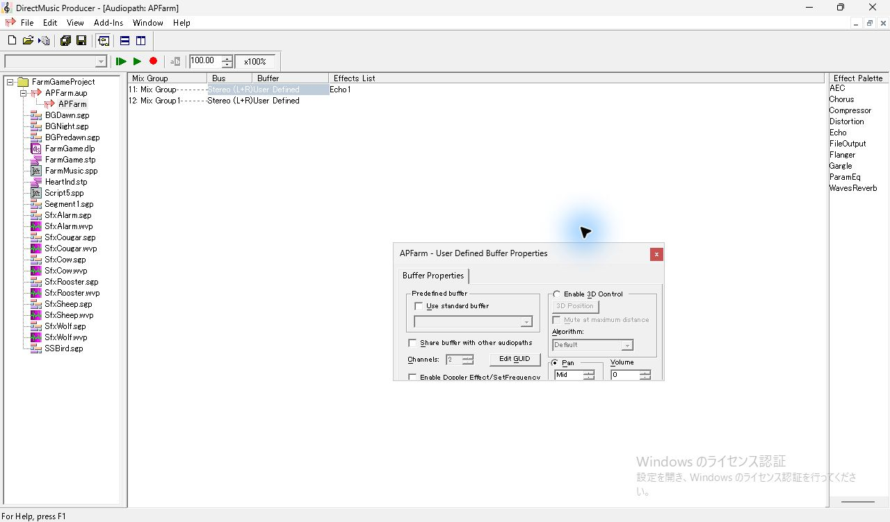

## APFarm1 の作成とエフェクトの順序

**Ctrl+N > Audiopath** の **New Audiopath** は **Create an empty audiopath** が初期選択。**Create a new audiopath based on an existing audiopath** に切り替えると、Standard Stereo & Reverb、Standard 3D (Dry)、Standard Mono、Standard Stereo、APFarm.aup: APFarm が選べる。**APFarm** を選んで確定すると **APFarm1** が開いた。2つの Mix Group と Echo1、および広げた列とペインの配置が引き継がれた。

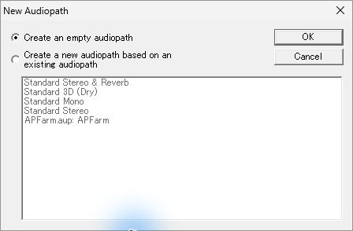
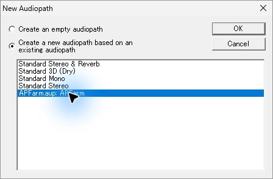
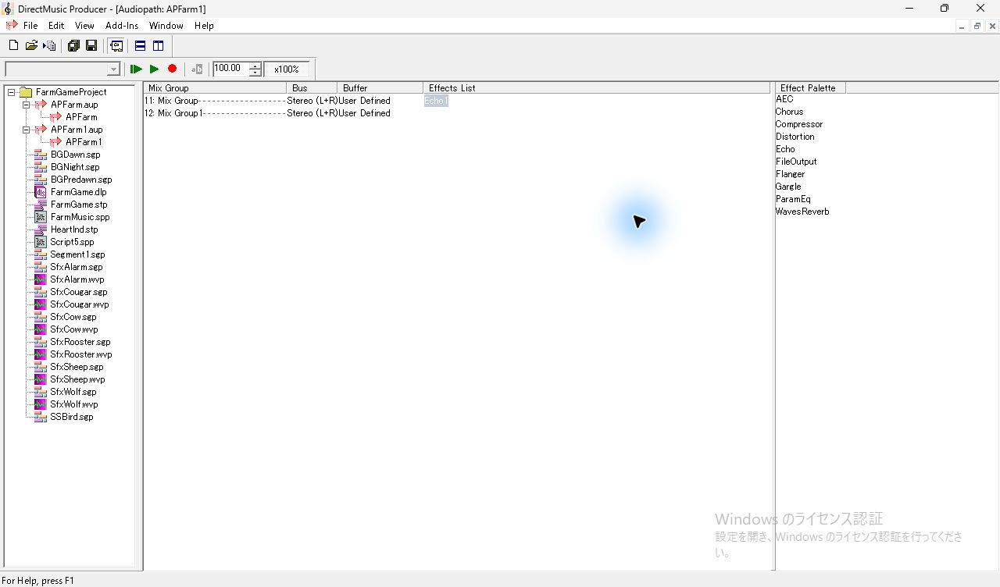

Palette の Chorus を先頭行の Effects List へドラッグした回は、Palette の選択だけが変わった。Echo1 の右の空き部分を右クリックし、**Insert Effect** を選ぶと **Insert New Effect** が開く。**Base on existing effect** の初期選択は **AEC : AEC**。**Chorus : Chorus** を選ぶと Instance name が **Chorus1** に変わった。確定すると **Echo1 | Chorus1** となる。項目名の間には縦線が入り、新規項目は選択済み。

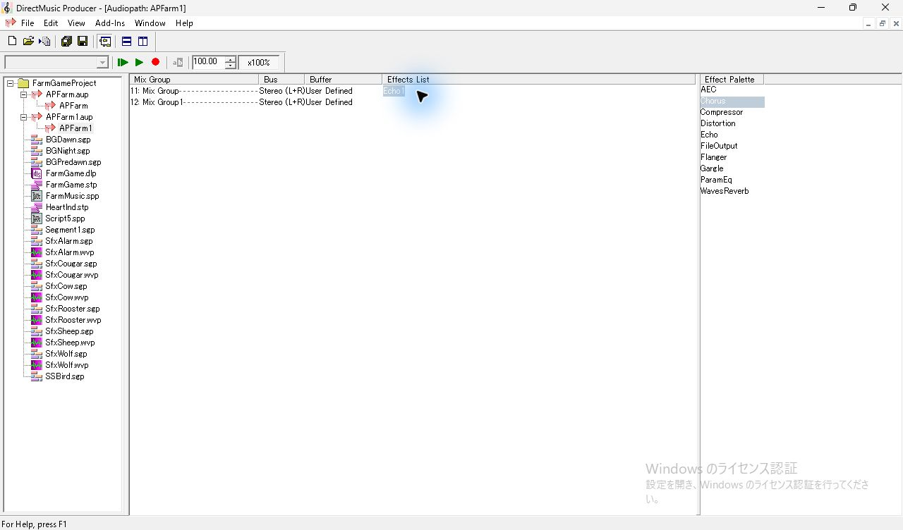
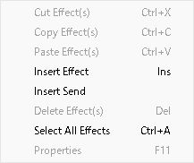
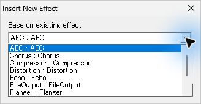
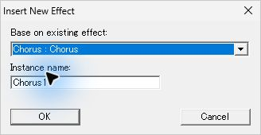
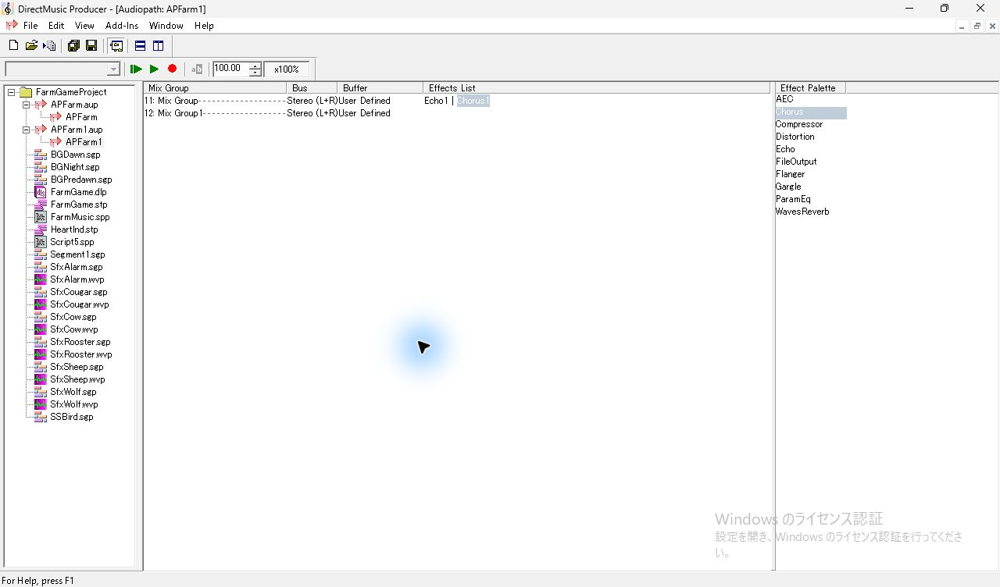

Chorus1 を Echo1 の前へドラッグした回は順序が保たれた。**Ctrl+X** で Chorus1 を切り取り、Echo1 を選択して **Ctrl+V** を押すと Chorus1 は Echo1 の右へ貼り付いた。Effects List にフォーカスがある状態で **Ctrl+A** を押すと2件とも青くなった。Echo1 だけを選び直して切り取り、Chorus1 を選択して貼り付けると、**Chorus1 | Echo1** になった。

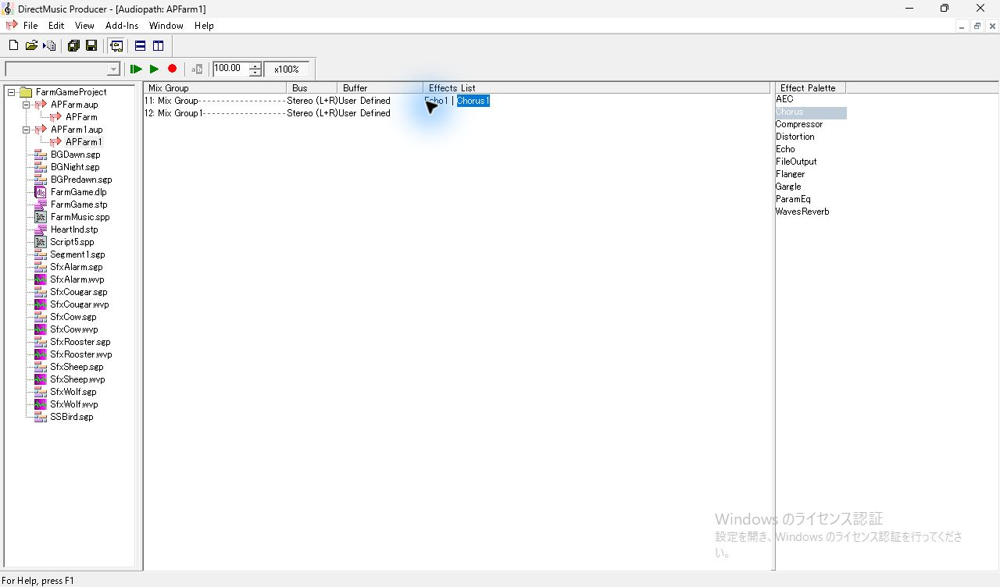
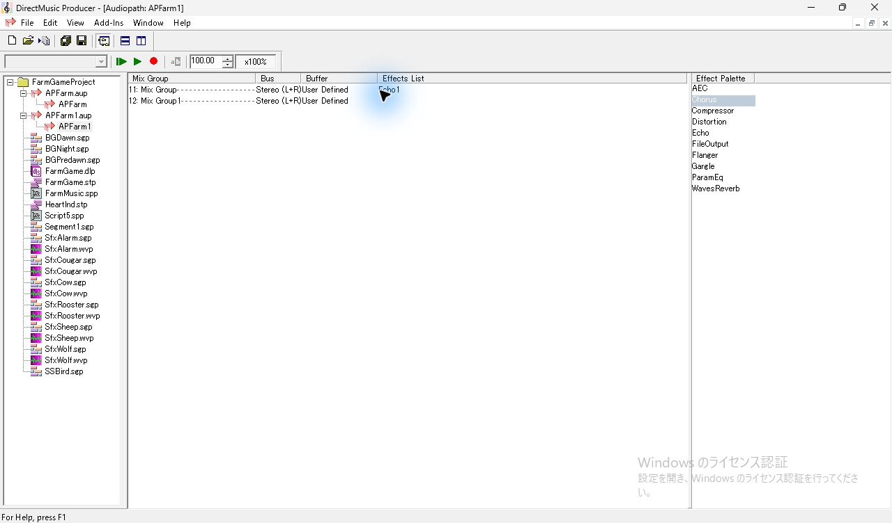

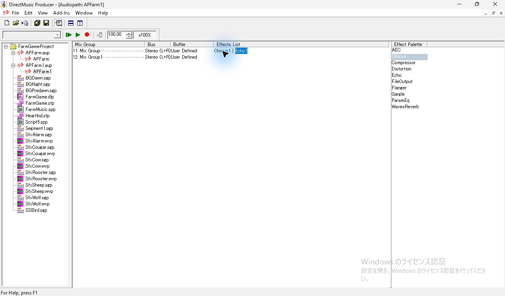

## Send の既定宛先、GUID とレベル

同じ行の Echo1 の右で右クリックし **Insert Send**。**Send (Standard Env. Reverb)** がエフェクト列の末尾に加わった。直後の F11 は文書の Audiopath Properties を開いた。開いたシートを残して Send のラベルをクリックすると **Send1 Effect Properties** に切り替わった。Effect Type は Send。Always Process in Software と宛先の下の Edit GUID は灰色。**Edit Effect Properties** は有効だった。

**Edit Effect Properties** で **Send: Standard Env. Reverb** が開く。**Send volume level** の初期値は0、表示単位は **1/100ths of a dB**。符号と数字を入力し、**-600** を OK で確定した。宛先一覧の初期候補は **Other…** と **Standard Env. Reverb**。Other… を選ぶと既定宛先の GUID を入れた **Edit Guid** がすぐ開き、未編集時の OK は灰色。Cancel すると Standard Env. Reverb に戻った。

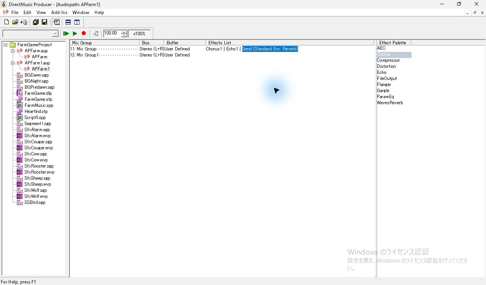

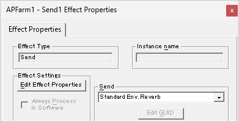
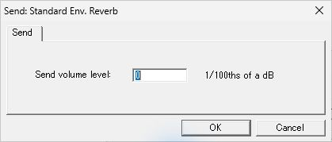
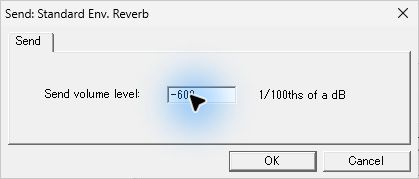

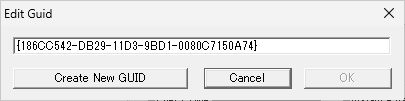
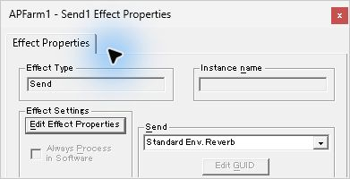

## 受信用 Mix Group と Buffer の値

Mix Group 列の空き部分を右クリックして **Insert Mix Group** を選ぶと **Add/Remove PChannels** が開いた。PChannel 欄の初期値は **1 / Oboe**、右の一覧は空。**Add** で右に **1 - Oboe** が入り、左が **2 / Strings** へ進む。右の1を Remove して空のまま OK を押すと、表の先頭に **Mix Group2** が加わった。行に PChannel 番号は付かず、Bus は **None**、Buffer は **User Defined**。

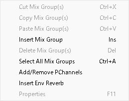
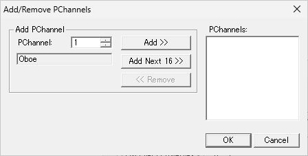
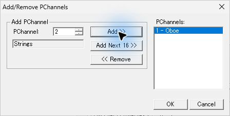
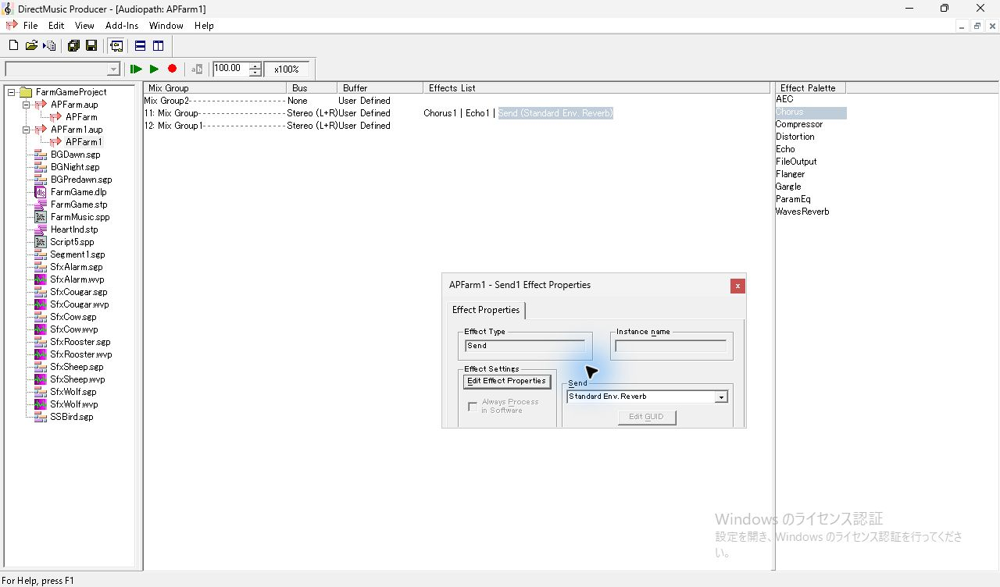

開いていた Send Properties の宛先一覧に **Mix Group2** が加わった。これを選ぶとエフェクト列のラベルが **Send (Mix Group2)** になる。Mix Group2 の Buffer を選ぶと Channels **2**、Pan **Mid**、Volume **0** が表示された。Volume の下矢印を1回押すと **-1** になった。

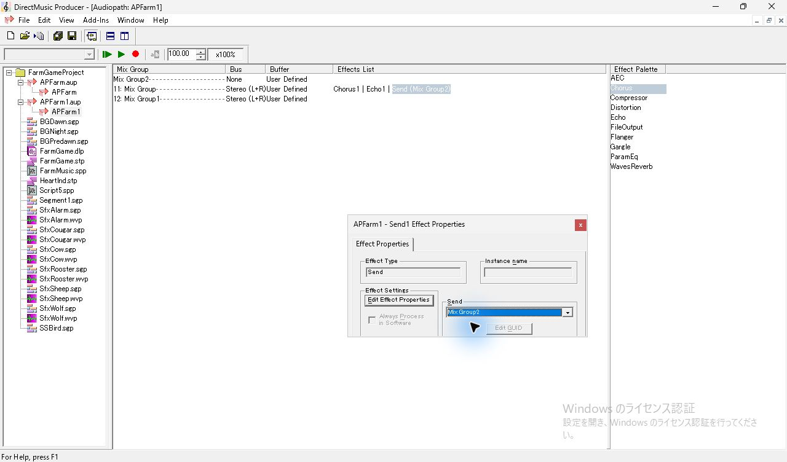
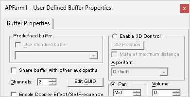
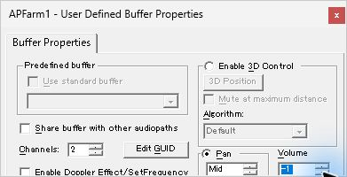

## 保存、再起動、ファイル照合

APFarm1 を **Ctrl+S** で保存し、Project を閉じた。表示操作を行った APFarm.aup に保存確認が出たので **No** を選んだ。Producer を通常終了し、ウィンドウが消えたことを確認してから同じ実行ファイルを1回起動した。起動前後は実行パスとウィンドウで照合した。File の履歴から FarmGameProject を開き直すと、APFarm1 の順序、Mix Group2、Send の宛先、Buffer の Volume **-1** が復元された。

再起動後の Send の詳細ダイアログは **Send: Mix Group2**、レベル **-600**。一時的に0にして **Cancel** を押し、開き直すと **-600** が保たれた。

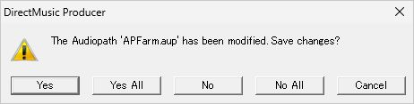
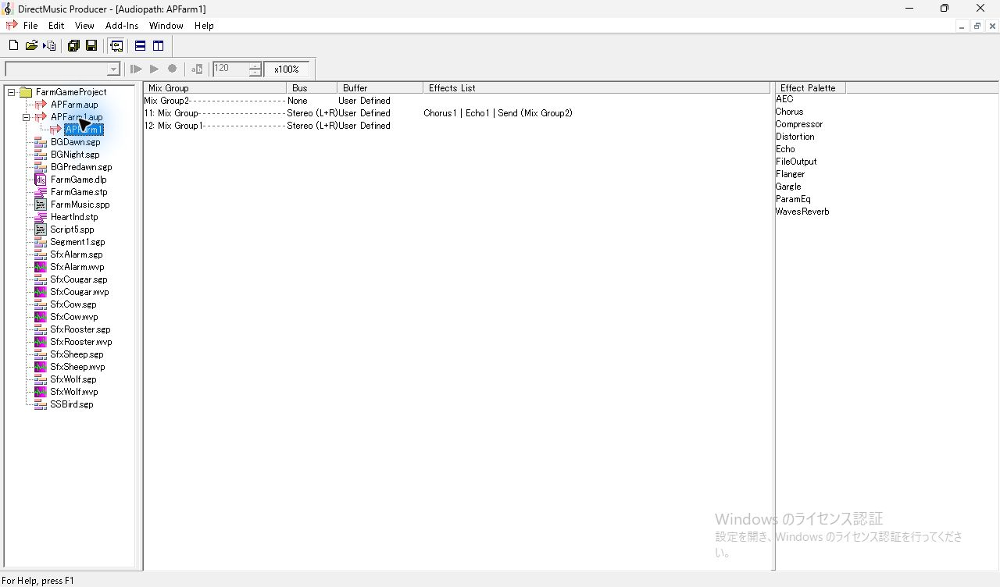

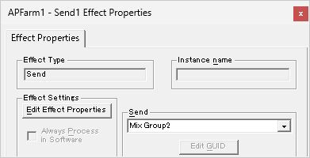

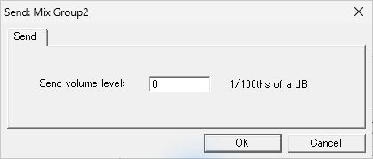
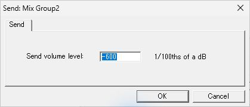

保存直後と再起動後の APFarm1.aup は SHA-256 が一致。PChannel 11 の Buffer に **Chorus1、Echo1、Send1** がこの順で保存され、Send の `fxhr` の宛先 GUID は **Mix Group2** の Buffer と一致した。Send の `data` は符号付き整数 **-600**、宛先の `dsbd` の Volume は **-1**。Echo1 を切り取り・貼り付けしたあとのインスタンス GUID は変わり、パラメーターの `data` は APFarm と APFarm1 の作成直後の値に一致した。作業 Project では APFarm1.aup が増え、FarmGameProject.pro が更新された。APFarm.aup と凍結入力21ファイルはハッシュが一致した。 [保存内容とハッシュの照合](../../../work/original-gui/SEG-14-pattern-style/20261111T074828536163Z/audiopath-audit.json)

追試は、Palette と項目ドラッグが成立する条件、AudioPath のグループ間移動、PChannel の重複や数値の境界、Echo の詳細設定、宛先を追加した状態での実際の出力音。
