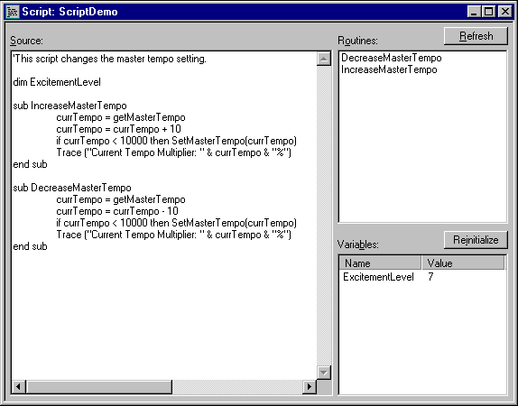
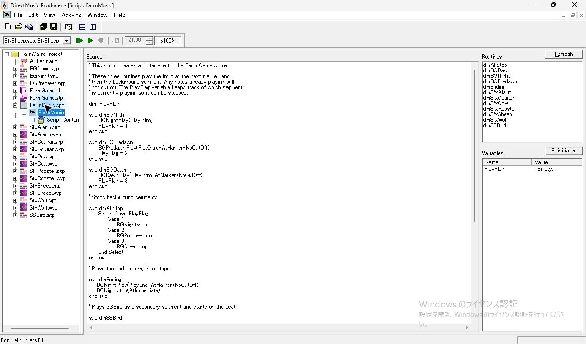
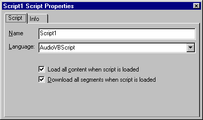
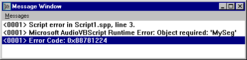
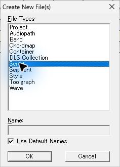
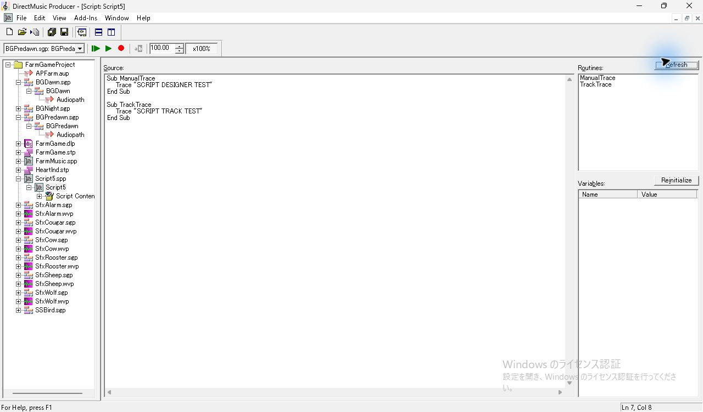
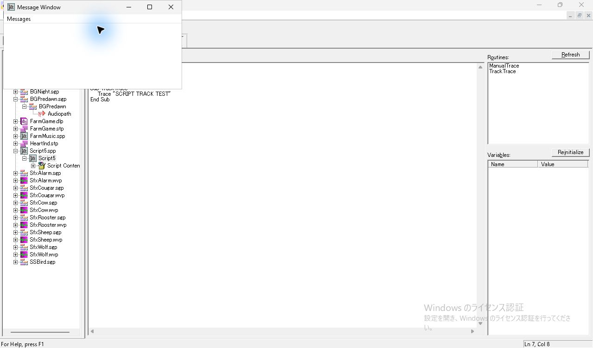
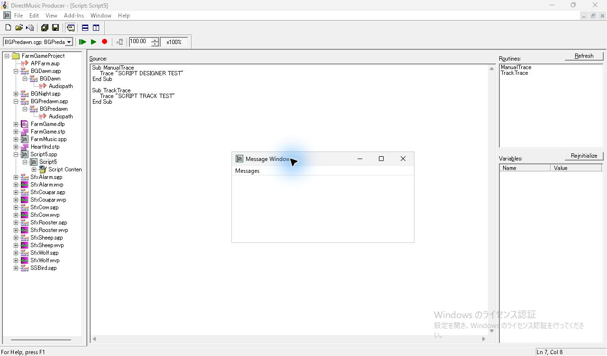
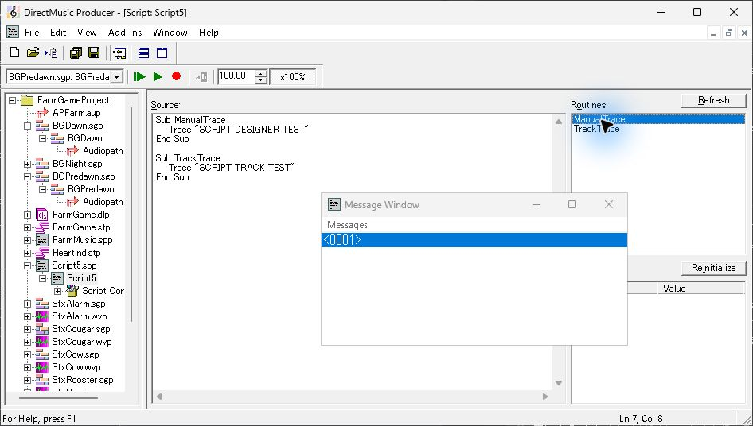

# UI10　Script Designer・Message Window の参照画面

[調査計画](README.md) · [Segment の Script Track](seg-14-script-track.md) · [Script Content の参照と埋め込み](ui-11-container.md) · [HTML Help の入口](ui-14-help.md)

DirectMusic Producer 5.3.0.900 の同梱 HTML Help の図と、FarmGame の作業コピーで FarmMusic を開き、試験用の Script を作成・実行した画面を掲載する。 [ヘルプ図の対応表](../../../work/original-gui/SEG-14-control-triggers-script/20261111T081051527595Z/published-help-figures.json) · [試験素材の保存値](../../../work/original-gui/SEG-14-control-triggers-script/20261111T081051527595Z/farmgame-script-and-audiopath.json)

## Script Designer の3ペイン

原版ヘルプの入口は Script の新規作成、または Project Tree のスクリプトの子ノードをダブルクリック。左の大きい `Source` にコードと横・縦スクロール。右上に `Routines` と Refresh、右下に `Variables` と Reinitialize。Variables の表は Name と Value。 [Script Designer Window](../../../../../work/analysis/original-manual-session/20261010T031624075Z/help-extracted/htm/scriptdesignerwindow.htm)



2026-11-11 に FarmGameProject の作業コピーで `FarmMusic.spp` をダブルクリックすると Script Designer が開いた。左に Source、右上に12件の Routines、右下に値が `<Empty>` の **PlayFlag**。Project Tree では FarmMusic の下に **Script Content** がある。 [原版撮影の対応表](../../../work/original-gui/SEG-14-pattern-style/20261111T074828536163Z/published-parameter-figures.json)



ヘルプでは Refresh がルーチン一覧と参照データを更新する。構文エラー時は一覧が空になり、Message Window にエラーが出る。Routine を実行する入口はダブルクリック、Ctrl+R、右クリックの `Call Routine(s)`。複数選択では一覧順に実行する。変数は値の列をクリックするか Ctrl+E または `Set Variable`。Reinitialize で未初期化状態に戻す。

## Script Properties とメッセージ

Project Tree の Script 文書を対象にする Properties は Script と Info の2タブ。Script ページは Name、Language と2個のチェック欄。図では `AudioVBScript` が表示され、ロード時にコンテンツを読み込む設定と、Segment をダウンロードする設定が両方オン。これは図の状態。 [Script Properties](../../../../../work/analysis/original-manual-session/20261010T031624075Z/help-extracted/htm/scriptproperties.htm)



`Add-Ins > Message Window` から開く。図では Messages の下に行番号を含む Script エラー、ランタイムエラーの説明、エラーコードが3行で並び、選んだ行は青。ヘルプには Script Designer と Script Track からのエラー・Trace の入口があり、再生中の出力には PChannel 1 がある AudioPath を使用する条件が記載されている。 [Message Window](../../../../../work/analysis/original-manual-session/20261010T031624075Z/help-extracted/htm/messagewindow.htm)



同じ位置の Properties で、Script File 行の Design・Runtime と、子の Script 文書の Script・Info が選択に連動して切り替わった。Language 一覧の2項目と Escape 後の状態、言語を変えた際の再生結果は別の試験に掲載した。 [FarmMusic の Properties と再生](seg-14-farmmusic-playback.md#properties-の切り替えと確認範囲)

Language 一覧で下キーを押すと表示と設定が切り替わり、Escape で一覧を閉じても選んだ値が残った。構文差のあるソースでは、言語の切替直後に Message Window にエラーが出て Routine 一覧が空になった。保存と再読込、元の言語へ戻したときの復帰も確認した。 [Script の言語切替](seg-14-script-language-ui.md)

Script ファイル行の **Runtime Save As…** は、文書を開くと有効になった。初期名、既定の出力先を変更する確認、書き出した `.spt` の取込は Segment の後続試験に掲載した。 [Runtime Script の書き出しと取込](seg-14-script-runtime-picker.md)

## Script の作成と Message Window の実測

FarmGameProject の作業コピーで **Ctrl+N** を押し、New Files の **Script** を選んだ。既定名は **Script5**。Source に以下のコードを入力して **Refresh** を押すと、右上の Routines に **ManualTrace** と **TrackTrace** が並び、Variables は空だった。**Ctrl+S** で `Script5.spp` を保存した。 [保存されたソースとハッシュ](../../../work/original-gui/SEG-14-pattern-style/20261111T074828536163Z/script-track-audit.json)

```vb
Sub ManualTrace
    Trace "SCRIPT DESIGNER TEST"
End Sub

Sub TrackTrace
    Trace "SCRIPT TRACK TEST"
End Sub
```




**Add-Ins > Message Window** で独立したウィンドウが開く。初回は画面左上付近に現れ、内部の一覧は空だった。タイトルバーをドラッグすると386×193 px のまま移動した。画面右下へ動かしたあと、Routines の **ManualTrace** をダブルクリックすると **&lt;0001&gt;** が増えた。続けて Script Track のメニューと Segment の再生から1行ずつ増えることを確認した。この環境で見えたのは行番号だけ。最後に Message Window の閉じるボタンを押すと本体の編集を続けられた。 [トラックからの呼出しと再生](seg-14-script-track.md#メニューからの呼出しと再生)






## 観測の来歴と再開条件

- 2026-10-06 の旧調査用コピーでは `ScriptMessagesOriginal.pro` の新規作成までは成功した。同じセッションの `Create New File(s)` は Project のみ、Add-Ins は空だったため Script Designer に到達できなかった。 [旧セッションの観測](../../../../../work/analysis/q3-script-messages/20261006T041300Z/original/observation-summary.json)
- 2026-11-11 の別の原版コピーでは ChordMap 作成時の New Files に Script が表示された。 [New Files の原版撮影](figures/harm-63-new-chordmap-selected.jpg)
- [FarmGame の素材](../../../work/original-gui/SEG-14-pattern-style/20261111T074828536163Z/inputs/farmgame/manifest.json) の `FarmMusic.spp` は `FarmMusic` という Script、`Script Content` という内蔵 Container、12個のルーチン宣言を持つ。Container の10件は `BGDawn.sgp`、`BGPredawn.sgp`、`BGNight.sgp`、`SSBird.sgp` と6件の効果音 Segment。保存された相対ファイル名と対象の GUID は10件すべて一致した。
- 追試は変数の編集と Reinitialize、参照表示、Properties を撮る。構文エラー、Trace の本文、実行エラー、クリアは小さい試験スクリプトで比較し、実行入口と出力行を照合する。Script と Segment の参照を別起動で確認する。
