# UI11　Container の Tree 操作、Embed と Reference の保存

2026-11-11。DirectMusic Producer 5.3.0.900 の調査用コピーで FarmGameProject を使った。親ウィンドウは1280×752 px。View は Project Tree、Standard Toolbar、Transport Controls、Status Bar を表示。青い光と黒い矢印は操作ツールの表示。 [原版画像48枚の対応表](../../../work/original-gui/SEG-14-pattern-style/20261111T074828536163Z/published-container-live-figures.json) · [実行記録](../../../work/original-gui/SEG-14-pattern-style/20261111T074828536163Z/run.json) · [同梱ヘルプ](ui-11-container.md)

## FarmMusic の Script Content

Project Tree の境界を右へドラッグして Tree を広げ、**FarmMusic.spp > FarmMusic > Script Content** を展開した。**Embed Runtime** は空で、**Reference Runtime** には3つの背景 Segment、6つの効果音 Segment、SSBird の10件が並んだ。リンクの行には Segment のアイコンと文書名が出る。

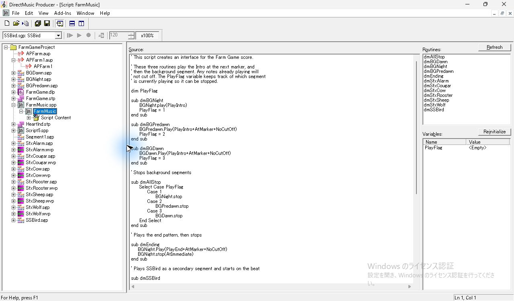
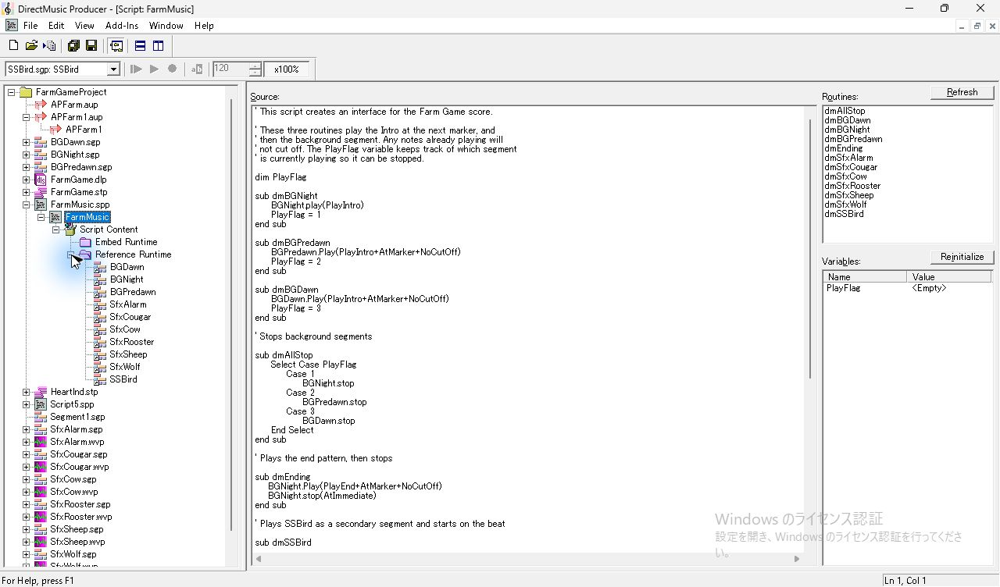

BGDawn の右クリックには **Locate in Tree、Delete、Change Content Identifier…、Properties**。Properties は **Design、Runtime、Cache** の3タブ。Design では設計用ファイルのパス、日時、サイズ4,068バイト。Runtime では設定されていた D: のパスが出て、日時とサイズは **&lt;Unknown&gt;**。Cache の **Keep cached after release of container** は未チェック。**Change Content Identifier…** を選ぶと、同じ Tree 行に入力枠が現れた。Esc で取り消した。

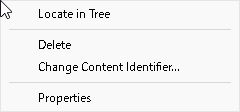
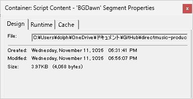
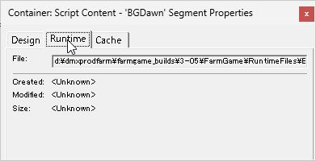
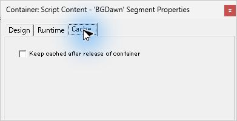
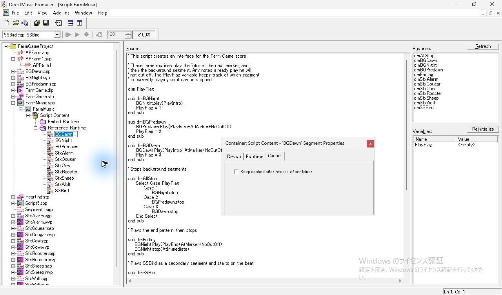

Script Content 自体を選ぶと **Container Properties** に切り替わり、Name は灰色。**Add/Remove Files…** で、中央の Embed は空、右の Reference に10件。右で BGDawn.sgp を選んで **Remove** を押すと左の Available に戻り、その行が選択された。中央側の **Add** で BGDawn を Embed に移せた。**Cancel** で閉じると元の10件が Reference に残った。

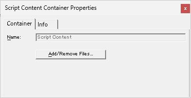
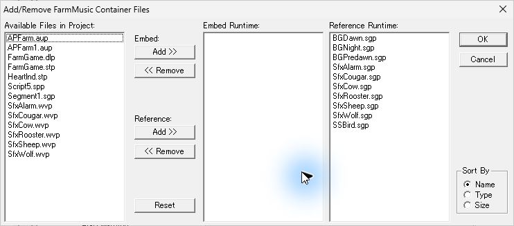
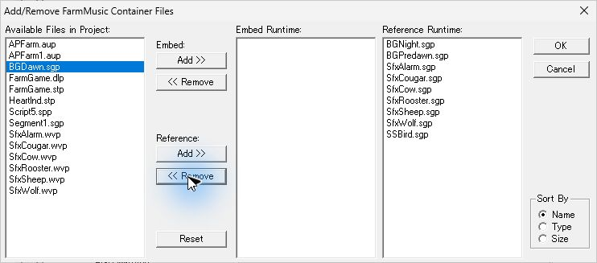
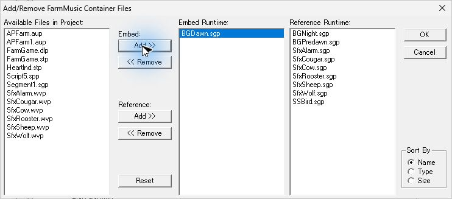
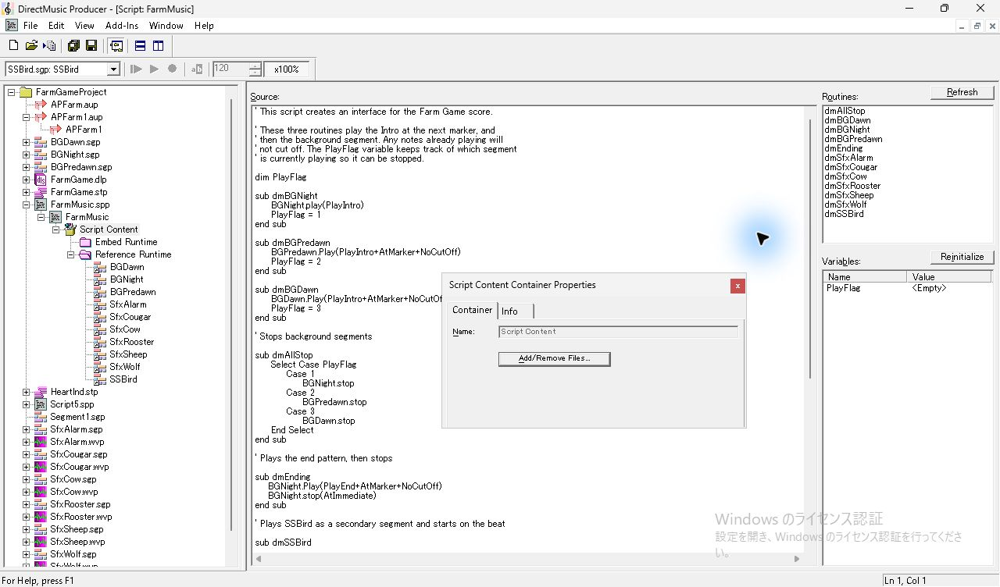

## 独立 Container の作成、Sort、Reset と OK

**Ctrl+N > Container** で既定名 **Container3.cop** ができた。Tree でファイルと文書ノードが展開され、空の Embed Runtime と Reference Runtime が見える。子の **Container3** をダブルクリックした回は、その配下が折りたたまれた。中央は空の作業領域のまま。文書ノードを選び **F11** を押すと **Container** と **Info** の2タブを持つモデルレスのシートが開く。Container の Name は編集可能。Info は Subject、Author、Copyright、Version、Information、Edit GUID を持ち、初期の Version は1.0.0.0。

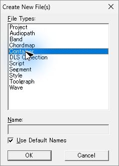
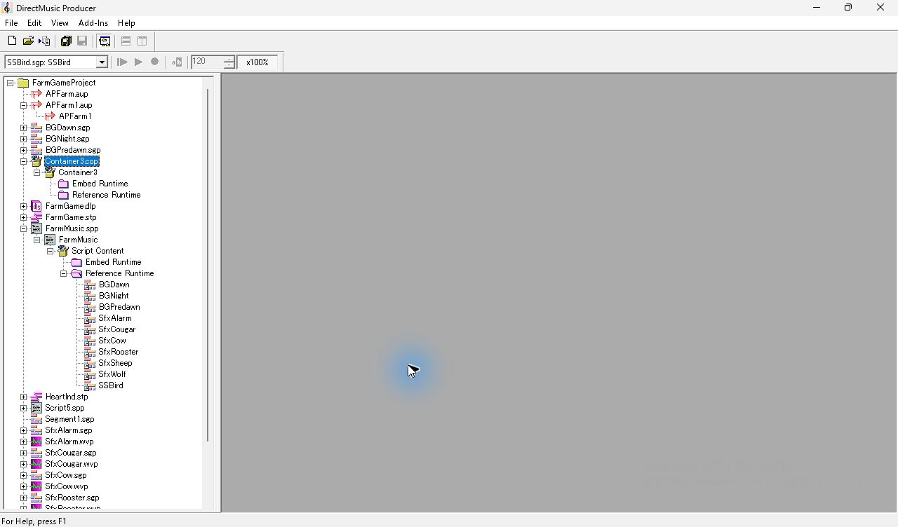
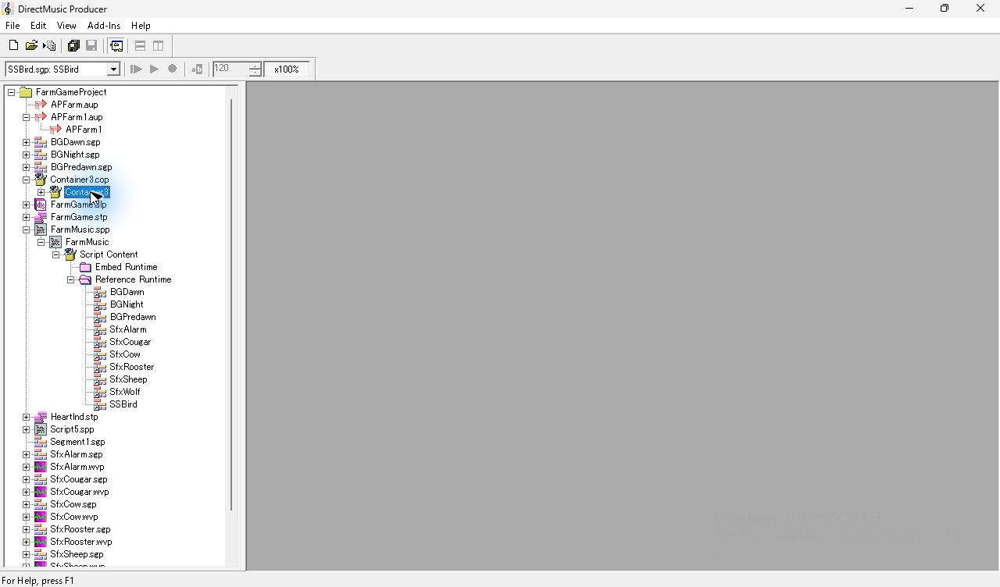
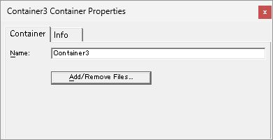
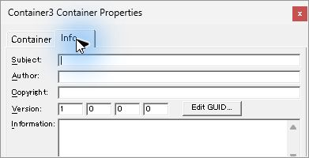

**Add/Remove Files…** は左に **Available Files in Project**、中央に **Embed Runtime**、右に **Reference Runtime**。左の候補は拡張子付きで、初期の **Sort By** は Name。Type と Size を選ぶと、表示順がそれぞれ変わった。Name に戻し、BGNight.sgp を選んで上の Add で中央へ、BGDawn.sgp を選んで下の Add で右へ移した。移した項目は左から消え、追加先で青く選択される。**Reset** で左の一覧に両方が戻り、中央と右は空。もう一度同じ割り当てをして **OK** を押すと Tree が展開され、開いていたシートは BGDawn の参照 Properties になった。

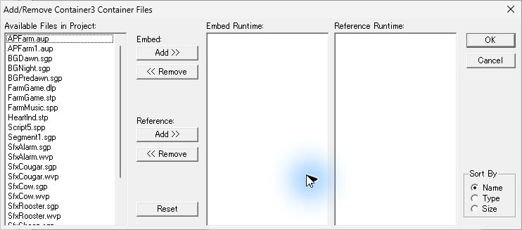
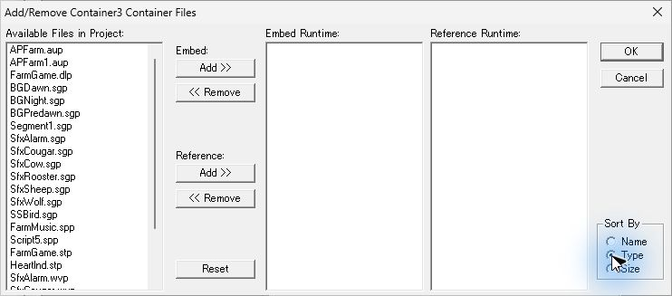
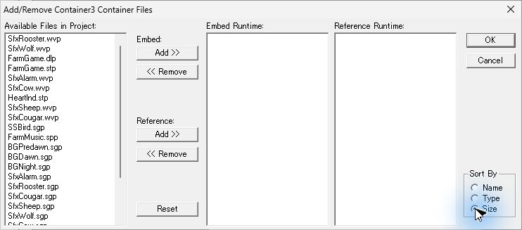
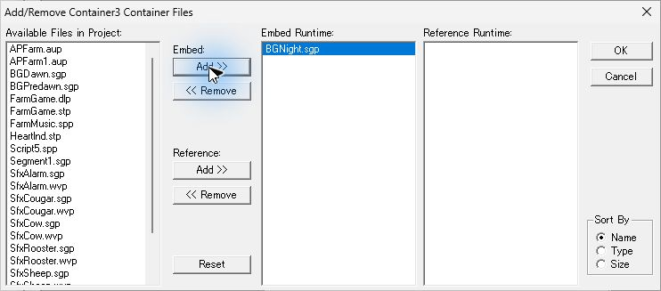
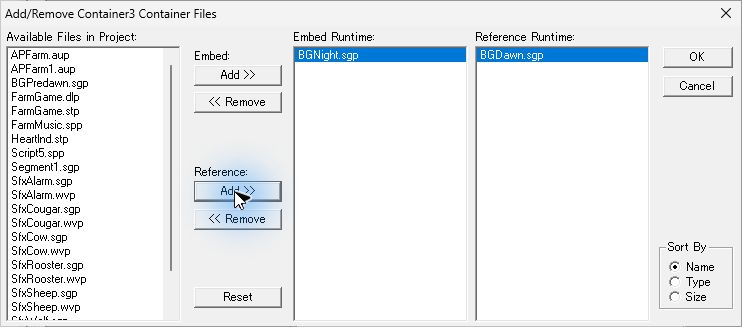
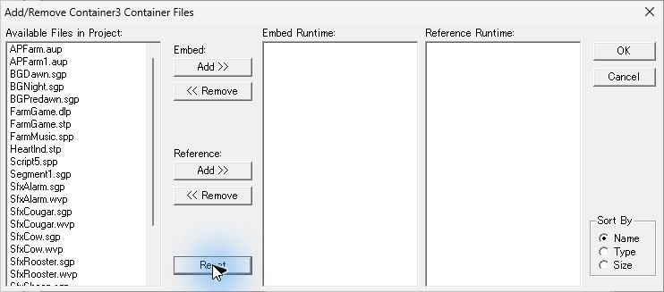
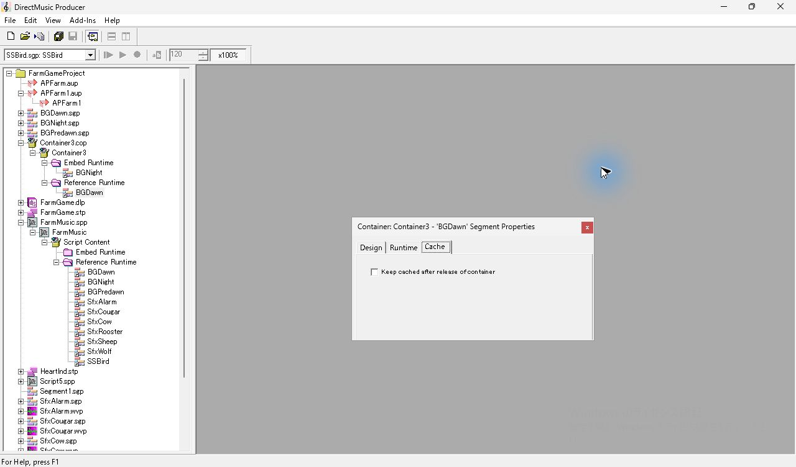

## Tree の Locate、ドラッグ、削除

Container3 の **BGDawn** で Cache の **Keep cached after release of container** をオンにした。Embed 側の **BGNight** に選択を移すと、同じ Cache タブのチェックはオフ。独立 Container のリンクの右クリックでは **Locate in Tree、Delete、Properties** が出た。Locate in Tree を選ぶと、元の **BGDawn.sgp** が展開され、その子の **BGDawn** が選択された。シートは BGDawn Segment Properties、Transport の対象も BGDawn になった。

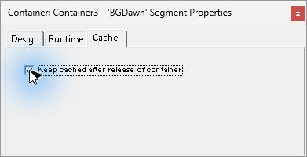
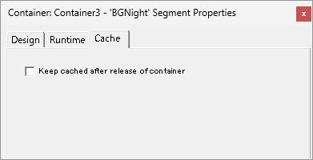
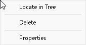
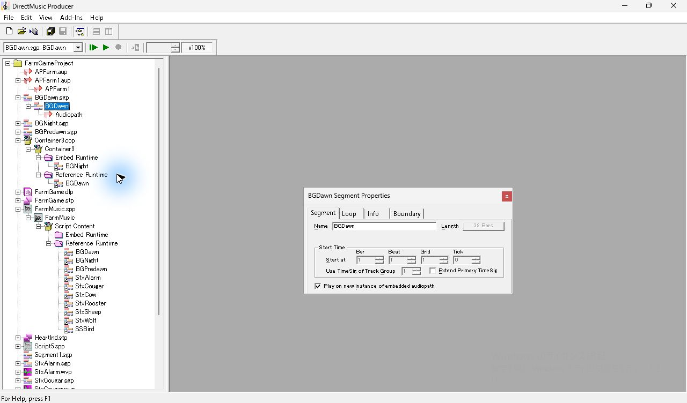

元のファイルノード **BGPredawn.sgp** を Container3 の **Reference Runtime** にドラッグすると、フォルダー内に BGPredawn のリンクが加わり、その行が選択された。そのリンクを **Embed Runtime** へドラッグすると、Embed の BGNight の下に移り、Reference には BGDawn が残った。移動したリンクを選んで **Delete** を押すと、BGPredawn への参照の削除確認が出る。キャンセルでリンクが残り、再度 Delete して **OK** を押すとリンクが消えた。元の BGPredawn.sgp と FarmMusic 内の BGPredawn 参照は Tree に残った。

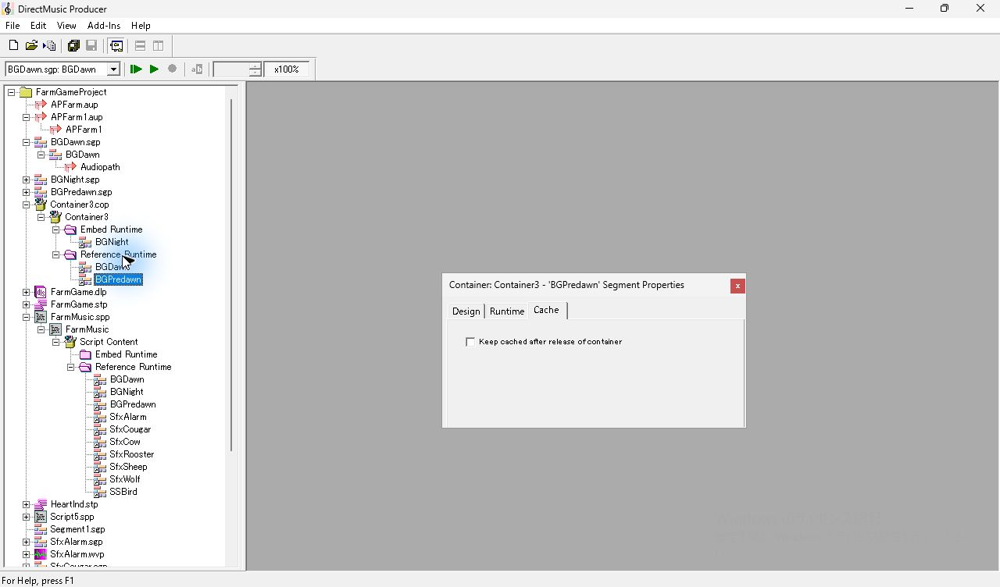
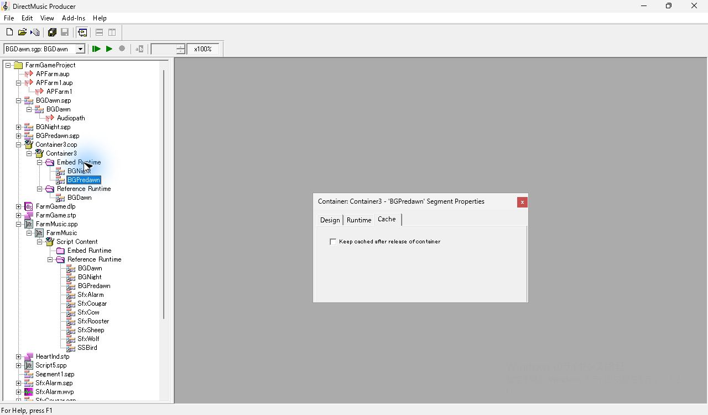
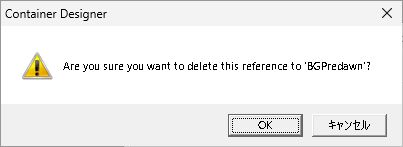
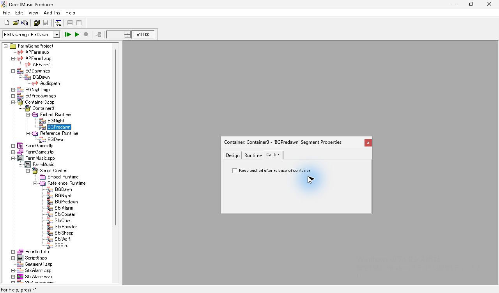
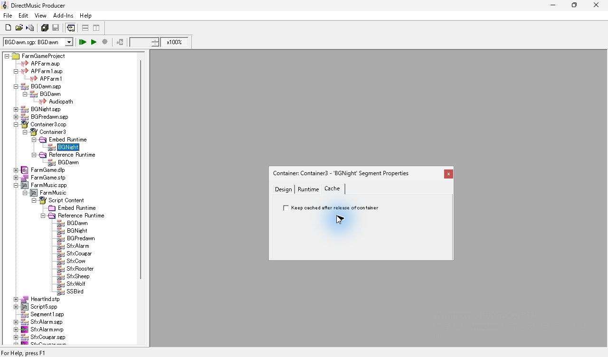

## 設計用と実行用の保存経路

独立 Container の文書ノードを選んだ状態のメイン File メニューにはプロジェクトの保存が表示された。**Container3.cop のファイルノードを右クリック** すると **Save Container3.cop、Save As…、Revert to Saved、Runtime Save As…** が並ぶ。**Save Container3.cop** で設計用を保存し、**Runtime Save As…** で別の **Container3.con** を調査フォルダー内へ書き出した。

Runtime Save As は初期のファイル名が **Container3.con**、ファイルの種類は **Container Files (*.con)**。別の保存先を指定すると **Confirm Runtime Default Destination** が開く。**いいえ** を選ぶと指定先へ出力され、Project の既定先は **RuntimeFiles** のまま。ファイルノードの Design Properties では保存済みのサイズが614バイト。

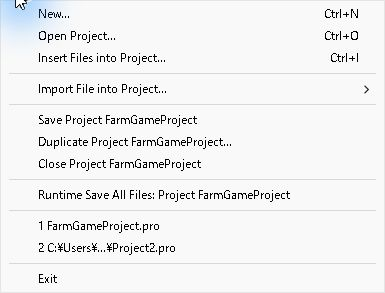
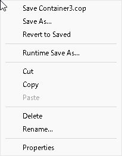
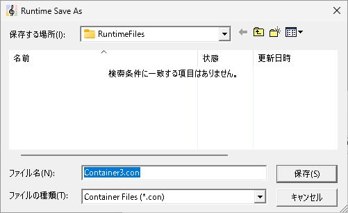
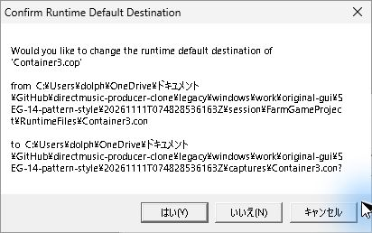
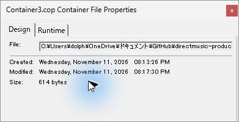

## Segment 内蔵の Container

BGDawn の文書ノードを右クリックし **New > Container** を選ぶと、BGDawn の下に **Container** が加わった。既存の Audiopath も並ぶ。Container を展開すると、Embed Runtime と灰色の Reference Runtime の2行が見える。Properties から **Add/Remove Files…** を開くと、BGNight.sgp を候補として選んだ状態でも、Reference 側のラベルと Add・Remove は無効だった。左の一覧に親の **BGDawn.sgp** は出なかった。この試験では Cancel でダイアログを閉じ、Project の閉鎖時に BGDawn の保存確認で **No** を選んだ。

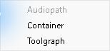
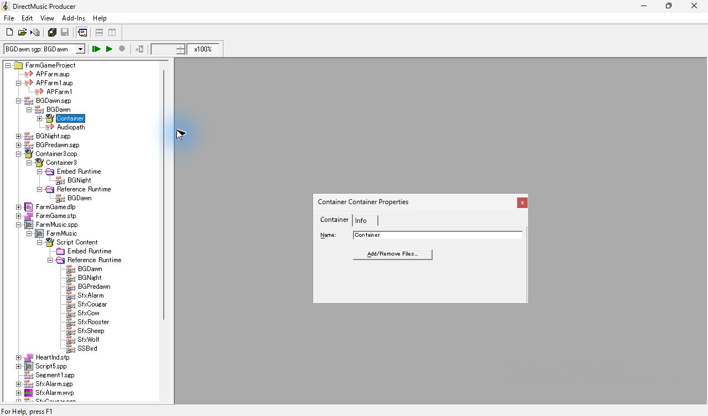
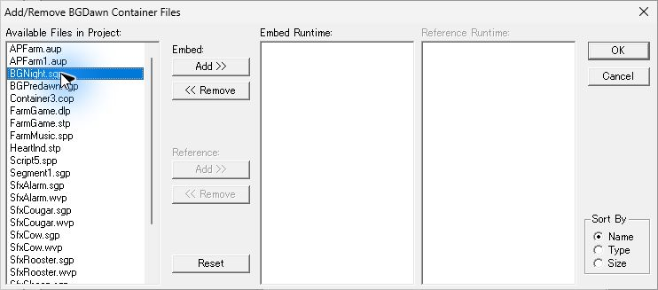
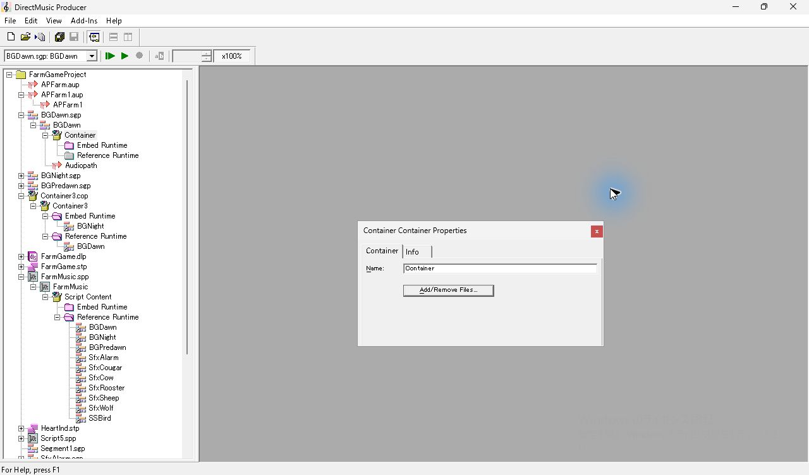
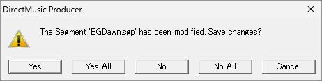

## 再起動と保存内容の照合

Producer を通常終了し、ウィンドウが消えたことを確認して同じ実行ファイルを1回起動した。起動前後は実行パスとウィンドウで照合した。File の履歴から作業 Project を開き、**Container3.cop** の2フォルダーを展開すると、**Embed に BGNight、Reference に BGDawn** が戻った。BGDawn の Cache はオン。Add/Remove Files でも2つの割り当てを確認した。

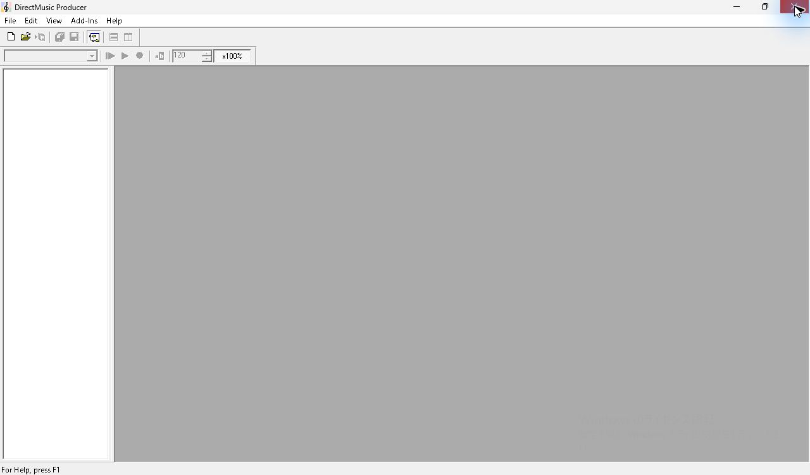
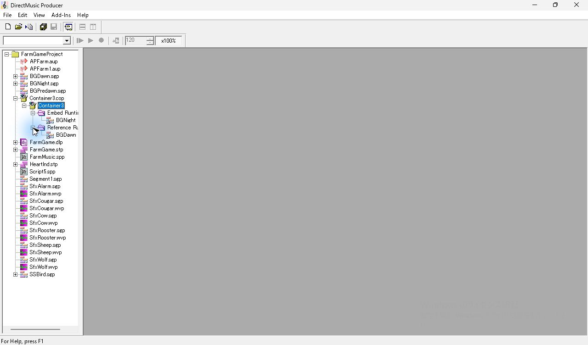
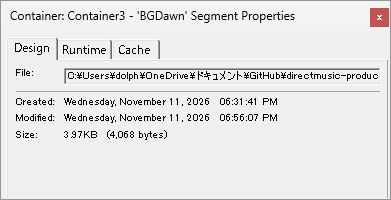
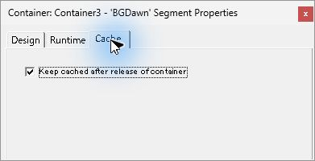
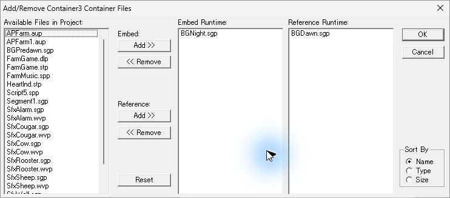

設計用・実行用ともルートは `RIFF DMCN` で Container の GUID は同一。BGNight・BGDawn の GUID は作業 Project の各 Segment と一致した。

| 出力 | Embed の BGNight | Reference の BGDawn |
| --- | --- | --- |
| Container3.cop、614バイト | `LIST DMRF` で BGNight.sgp、`cobu=0`、`cobh` フラグ0 | `LIST DMRF` で BGDawn.sgp、`cobu=1`、`cobh` フラグ1 |
| Container3.con、3,094バイト | `RIFF DMSG` の Segment 本体、`cobh` フラグ0 | `LIST DMRF` で BGDawn.sgt、`cobh` フラグ1 |

実行用では設計用の `cobu` と `jzfr` が省かれた。埋め込まれた BGNight は AudioPath を内包し、FarmGame.sty と FarmGame.dls へのファイル参照を持つ。依存ファイルを揃えた実行時ロードと Cache の解放動作は追試する。 [設計用の採取ファイル](../../../work/original-gui/SEG-14-pattern-style/20261111T074828536163Z/captures/con-saved-Container3.cop) · [実行用の採取ファイル](../../../work/original-gui/SEG-14-pattern-style/20261111T074828536163Z/captures/Container3.con)

保存直後と再起動後の `.cop` は SHA-256 が一致。作業 Project には Container3.cop が追加され、FarmGameProject.pro が更新された。FarmMusic.spp と BGDawn.sgp を含む既存の文書、凍結入力21ファイルは試験前後のハッシュが一致した。 [保存内容とハッシュの照合](../../../work/original-gui/SEG-14-pattern-style/20261111T074828536163Z/container-live-audit.json)
