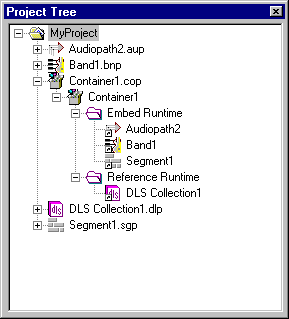
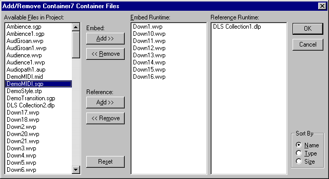
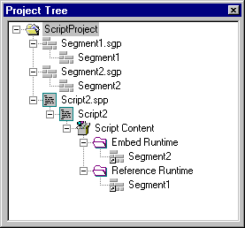

# UI11　Container の参照と埋め込み

[調査計画](README.md) · [Script Designer](ui-10-script-designer.md) · [ToolGraph Designer](ui-12-toolgraph-designer.md)

図は DirectMusic Producer 5.3.0.900 の同梱 HTML Help。現行コピーでのフォルダー操作、保存と別起動は追試する。 [図の出典と寸法](../../../work/original-gui/UI11-12-container-toolgraph/20261111T082559380067Z/published-help-figures.json) · [FarmGame の Container 保存値](../../../work/original-gui/UI11-12-container-toolgraph/20261111T082559380067Z/farmgame-container-audit.json)

## Project Tree の入口

原版の [New Files の撮影](figures/harm-63-new-chordmap-selected.jpg) で `Container` が表示された。ヘルプの例では `Container1.cop > Container1` の下に `Embed Runtime` と `Reference Runtime` が並ぶ。展開したフォルダーにはファイルへのリンクが並び、右クリックの `Locate in Tree` は対応する元ファイルを Project Tree で選ぶ。Segment 内の Container と、Script の `Script Content` にも同じ用途がある。 [Containers](../../../../../work/analysis/original-manual-session/20261010T031624075Z/help-extracted/htm/containers.htm)

ヘルプでは設計用の `.cop` はリンクを保存する。実行用 `.con` を保存する際は、Embed Runtime の対象を実データとして収め、Reference Runtime の対象を参照として保存する。同じフォルダーに同じ参照は重複追加できないと説明されている。 [Containers](../../../../../work/analysis/original-manual-session/20261010T031624075Z/help-extracted/htm/containers.htm)

## Add/Remove Files と参照の Properties

Container の Properties は `Container` と `Info` の2タブ。Container タブは Name と `Add/Remove Files`。ダイアログでは左に `Available Files in Project`、中央に `Embed Runtime`、右に `Reference Runtime` があり、2組の Add・Remove ボタンで左と中央、または左と右の間を移す。右下の Sort By は Name、Type、Size。Reset はダイアログを開いた時点に戻す。OK と Cancel は右上。Project Tree から各フォルダーへドラッグする入口もある。 [Container Properties](../../../../../work/analysis/original-manual-session/20261010T031624075Z/help-extracted/htm/containerproperties.htm) · [Add/Remove Files](../../../../../work/analysis/original-manual-session/20261010T031624075Z/help-extracted/htm/addremovecontainerfilesdialogbox.htm)

フォルダー内の参照から開く Properties は `Design`、`Runtime`、`Cache`。Design と Runtime は各ファイルの読み取り専用情報。Cache に `Keep cached after release of container` がある。Script の参照には `Change Content Identifier` があり、スクリプトから呼ぶ名前を変更できる。ヘルプでは同一コンポーネントを Script の2フォルダーに同時に置けない。 [Container Reference Properties](../../../../../work/analysis/original-manual-session/20261010T031624075Z/help-extracted/htm/containerreferenceproperties.htm) · [Script への埋め込みと参照](../../../../../work/analysis/original-manual-session/20261010T031624075Z/help-extracted/htm/embeddingandreferencingfilesinascript.htm)

## FarmGame の設計用・実行用 Script Content

| 保存ファイル | 同梱 Container | 項目と参照先 |
| --- | --- | --- |
| チュートリアルの `FarmMusic.spp` | `DMSC/DMCN`、`conh` は2 | 10件すべて `LIST DMRF`。参照名は `.sgp`、対象 GUID は10件とも一致。各項目に設計用の `cobu` があり、格納値は1 |
| サンプルの `FarmMusic.spt` | `DMSC/DMCN`、`conh` は2 | 同じ10個の識別名が `LIST DMRF` で `.sgt` を参照。`cobu` は省かれている。対象ファイルは10件とも存在し、参照 GUID とファイル内の GUID は10件とも異なる |

2本の Script は SHA-256 が2026-10-05 の観測と一致した。実行用の参照先 `.sgt` 10本も2026-10-07 の記録と一致した。この組み合わせでの読込結果は実機で確認する。 [設計用 Project の素材](../../../work/original-gui/SEG-14-pattern-style/20261111T074828536163Z/inputs/farmgame/manifest.json) · [実行用ファイル20件の素材](../../../work/original-gui/UI11-12-container-toolgraph/20261111T082559380067Z/inputs/farmgame-runtime/manifest.json)

追試では同じ Project に2本の Segment を置き、空 Container から片方を Embed Runtime、もう片方を Reference Runtime へ追加する。選択・並べ替え・Reset・Cancel・OK、Tree への復帰、Locate in Tree、Design/Runtime/Cache を撮る。設計用保存、別起動、実行用保存を順に行い、各ファイルでどの項目が参照またはデータになったかを照合する。Script Content と Segment 内でも同じ入口を確認する。
