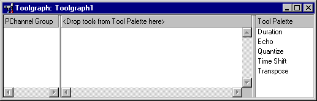
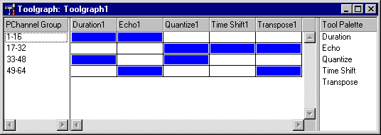

# UI12　ToolGraph Designer と PChannel Group

[調査計画](README.md) · [Container](ui-11-container.md) · [AudioPath Designer](ui-08-audiopath-designer.md) · [Parameter Control Track](seg-14-control-triggers-script.md)

図は DirectMusic Producer 5.3.0.900 の同梱 HTML Help。現在の実機では Designer の初期表示・選択・ドラッグを追試する。 [図の出典と寸法](../../../work/original-gui/UI11-12-container-toolgraph/20261111T082559380067Z/published-help-figures.json) · [登録の読み取り記録](../../../work/original-gui/UI11-12-container-toolgraph/20261111T082559380067Z/toolgraph-dependencies.json)

## ToolGraph を開く入口

原版の [New Files の撮影](figures/harm-63-new-chordmap-selected.jpg) で `Toolgraph` が表示された。ヘルプによると、作成後または Project Tree の ToolGraph をダブルクリックしたときに Designer が開く。Segment の子ノードでは右クリックの `New > Toolgraph`、AudioPath の子ノードでは右クリックの `New Toolgraph` から空の ToolGraph を作成できる。Segment・AudioPath が内蔵できる ToolGraph はそれぞれ1つ。独立文書の Properties は `Graph` と `Info` で、Graph の Name はツリーに表示される。 [Managing Tools](../../../../../work/analysis/original-manual-session/20261010T031624075Z/help-extracted/htm/managingtools.htm) · [Toolgraph Properties](../../../../../work/analysis/original-manual-session/20261010T031624075Z/help-extracted/htm/toolgraphproperties.htm)

## 3つのペインと割り当て

1. 左に `PChannel Group`、中央に各 Tool の列、右に `Tool Palette`。ペインは幅を変更できると説明されている。中央は空のときにドロップ先を表示する。
2. 左の右クリックで `Insert PChannel Group`、既存グループで `Add/Remove PChannels`。右の Palette から中央へドラッグすると Tool の列が作られる。ヘルプでは同じ Tool を複数追加でき、名前には番号が付く。
3. Tool 列と PChannel Group 行が交わるセルをクリックして有効化する。図では有効セルが青。メッセージは有効な Tool を左から右の順に通る。Tool の列見出しと、割り当てを切り替えるセルで操作対象が異なる。Tool 固有の設定は列の右クリックから Properties、`Edit Tool Properties`。
4. Parameter Control Track の `Tools` から、対象の Tool とパラメーターを選ぶ入口がある。 [Toolgraph Designer Window](../../../../../work/analysis/original-manual-session/20261010T031624075Z/help-extracted/htm/toolgraphdesignerwindow.htm) · [Tool Properties](../../../../../work/analysis/original-manual-session/20261010T031624075Z/help-extracted/htm/toolproperties.htm) · [Add Parameter](../../../../../work/analysis/original-manual-session/20261010T031624075Z/help-extracted/htm/toaddaparametertotheparametercontroltrack.htm)

## 現在の登録と追試用の入力

`ToolGraphDesigner.ocx` にある `Software\Microsoft\DirectMusic\Tools` を読み取りで調べた。HKLM・HKCU と32ビット・64ビットの各ビューでキーが存在しなかった。一方、32ビットの Producer の Components 一覧には `Toolgraph Designer` と `Container Designer` がある。ヘルプ図の Duration、Echo、Quantize、Time Shift、Transpose は例示された Palette であり、現行環境での候補一覧は Designer を開いて確認する。 [登録の読み取り記録](../../../work/original-gui/UI11-12-container-toolgraph/20261111T082559380067Z/toolgraph-dependencies.json) · [Toolgraph Designer](../../../../../work/analysis/original-manual-session/20261010T031624075Z/help-extracted/htm/toolgraphdesigner.htm)

最初の試験は空の独立 ToolGraph、Segment 内、AudioPath 内で、入口とツリー表示、ペイン幅、グループの追加・編集・取消、保存と再読込を観測する。クラスが未登録の場合の読込・エラーには、過去の再現実装試験で作成した [Graph.tgp](../../../work/original-gui/UI11-12-container-toolgraph/20261111T082559380067Z/inputs/missing-tool/manifest.json) を使える。この入力には32ビットの COM 登録が見つからない2クラスが入っている。登録済みの Tool が利用できる場合は、Palette からの追加、セルの切替、列の順序、固有 Properties と Parameter Control を追試する。
