# UI12　ToolGraph Designer のペイン、PChannel Group、未登録 Tool

2026-11-11。DirectMusic Producer 5.3.0.900 の調査用コピーで FarmGameProject を開いた。親ウィンドウは1280×752 px。View は Project Tree、Standard Toolbar、Transport Controls、Status Bar を表示。青い光と黒い矢印は操作ツールの表示。 [原版画像42枚の対応表](../../../work/original-gui/SEG-14-pattern-style/20261111T074828536163Z/published-toolgraph-live-figures.json) · [実行記録](../../../work/original-gui/SEG-14-pattern-style/20261111T074828536163Z/run.json) · [同梱ヘルプ](ui-12-toolgraph-designer.md)

## 新規文書と3つのペイン

**Ctrl+N > Toolgraph** で **Toolgraph1.tgp** を作ると、最初に **Toolgraph1 Insert PChannel Group** が出た。左の初期候補は **PChannel 1 / Oboe**、右の PChannels は空。**Cancel** で閉じると Toolgraph1 は Tree と編集領域に残り、グループなしの状態で編集できた。

左は **PChannel Group**、中央は **&lt;Drop tools from Tool Palette here&gt;**、右は **Tool Palette**。このホストでは Palette に行がなかった。左と中央、中央と右の境界をそれぞれ横にドラッグできる。境界のポインターは左右に矢印のあるサイズ変更形状。右境界を左へ動かすと Palette が広がり、左境界を右へ動かすと PChannel Group が広がった。

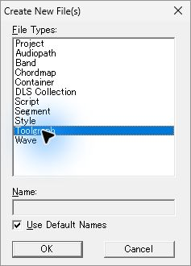
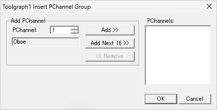
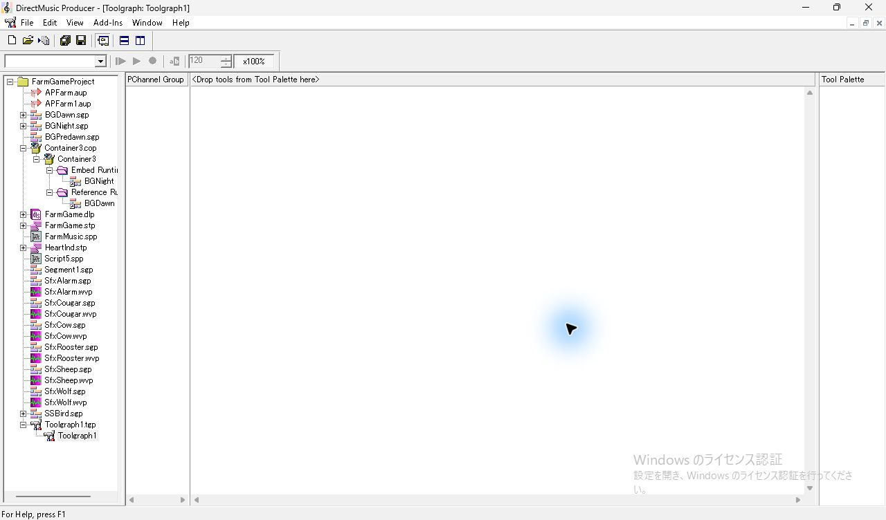
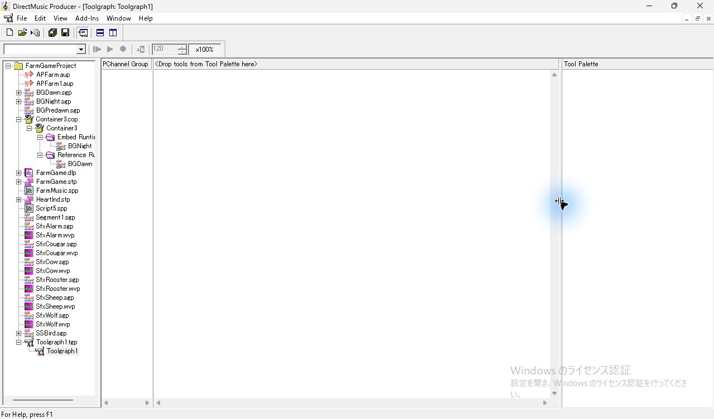
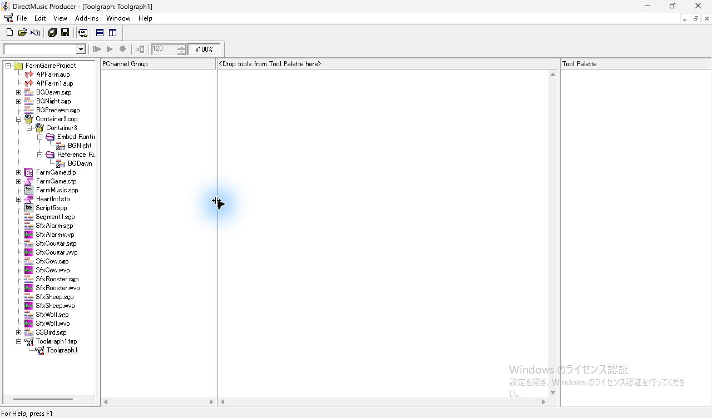

## 連続グループの挿入と変更の Cancel

左ペインの空き部分を右クリックすると **Select All** と **Insert PChannel Group** が有効で、**Add/Remove PChannels** と **Delete PChannel Group(s)** は灰色。**Insert PChannel Group** を選び、初期候補の1で **Add Next 16** を押すと右に1〜16が入る。リストは追加した末尾までスクロールし、**16 - 16** を青く選択。左の候補は17に進んだ。OK のあと、ペインに範囲をまとめた **1-16** が1行で表示された。

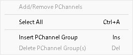
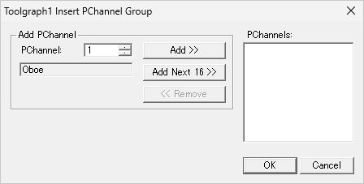
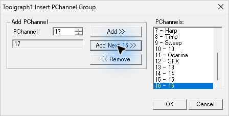
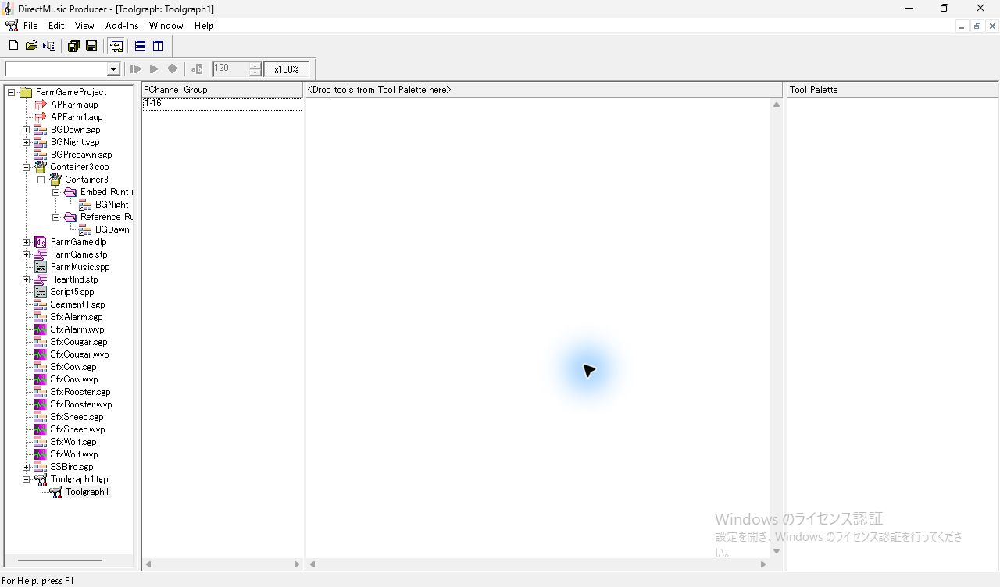

**1-16** の行を右クリックすると **Add/Remove PChannels** と **Delete PChannel Group(s)** が有効になる。Add/Remove の右に **1 - Oboe、2 - Strings、3 - Pizz** などが並び、左の初期候補は17。右の2を選んで **Remove** を押すと一覧から消えた。Cancel で閉じると行の表示は **1-16** のまま。

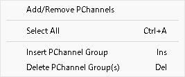
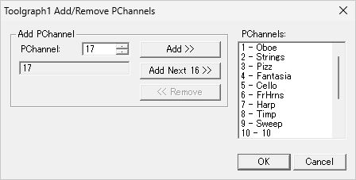
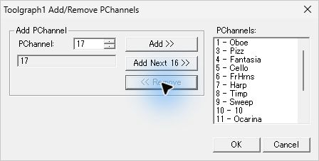
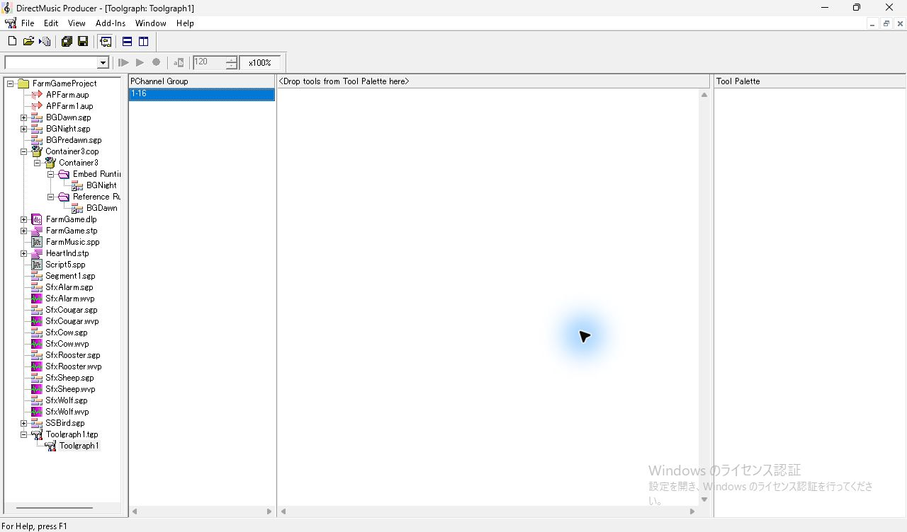

## 飛び番、重複、選択と削除

左ペインで **Insert** キーを押すと、2つ目のグループのダイアログが候補17で開いた。上矢印で18にして **Add** を押すと、右に **18 - 18** が入り、左が19へ進む。さらに上矢印で20にし、Add で右に加えた。使用中の **1** を数値欄へ直接入力すると名称が Oboe に切り替わり、**Add** と **Add Next 16** は灰色。すでに右に入れた18と20はそのまま OK で確定できた。

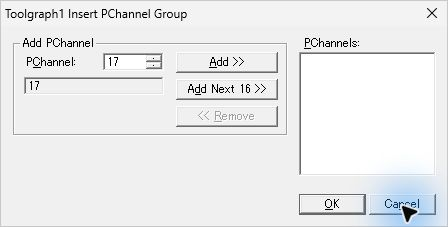
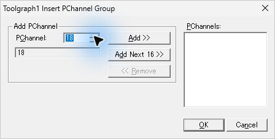
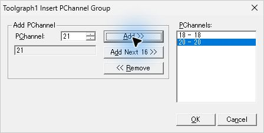
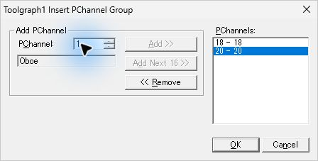

飛び番の行は **18, 20**。左ペインで **Ctrl+A** を押すと両方の行が青くなった。2行の状態を保存してから18, 20だけを選んで **Delete** を押すと、確認ダイアログを介さずその行が消えた。左ペインにフォーカスを置いたまま **Ctrl+Z** を押すと、元の位置に復元された。

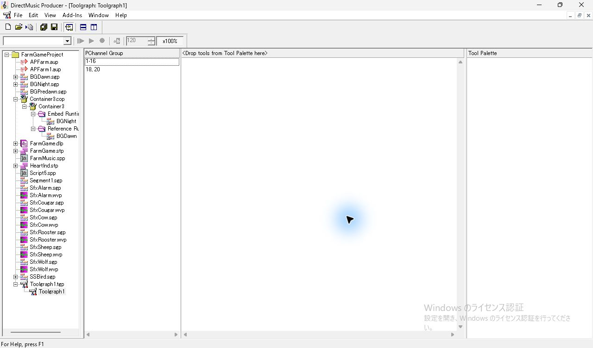
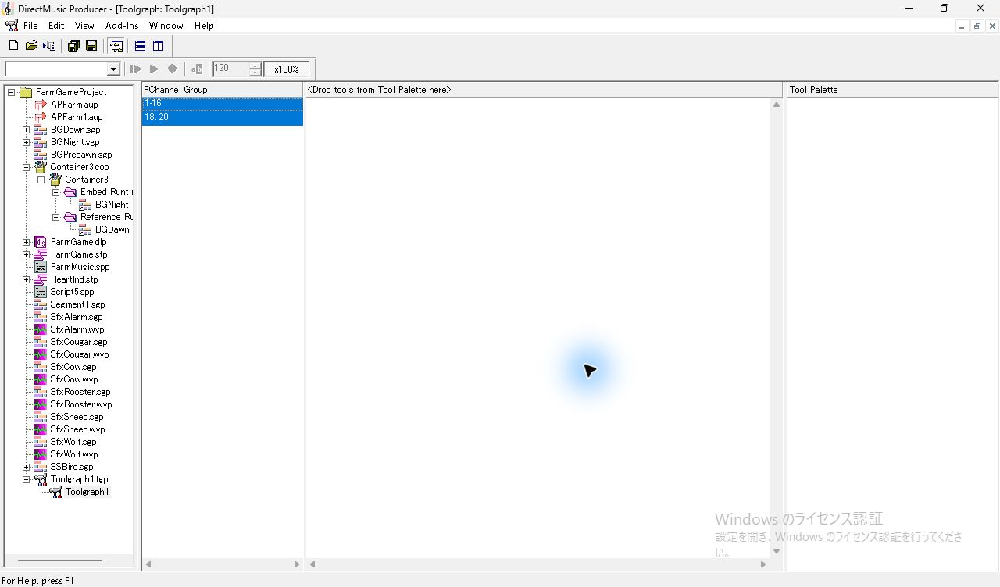

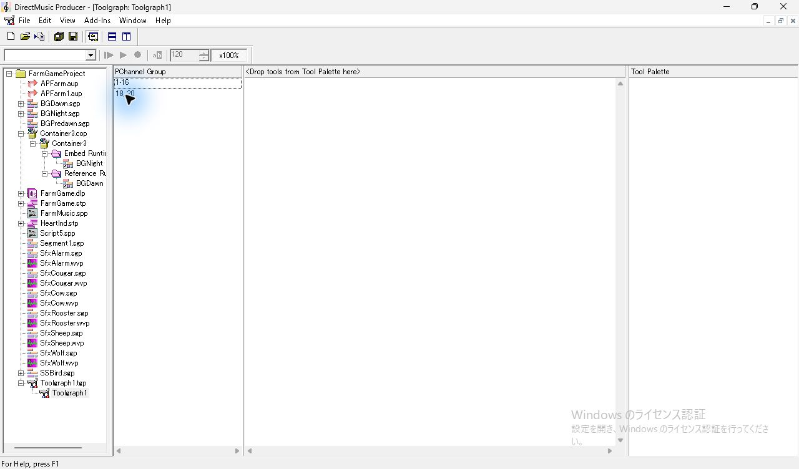

## 文書プロパティと実行用保存

**F11** で **Toolgraph Properties** が開く。**Graph** は Name、**Info** は Subject、Author、Copyright、Version、Information、Edit GUID。Version の初期表示は1.0.0.0だった。設計用は **Ctrl+S** で保存。**File > Runtime Save As…** は初期名 **Toolgraph1.tgr**、種類 **Toolgraph Files (*.tgr)**。調査フォルダーを指定し、既定先を変更する確認では **いいえ** を選んだ。

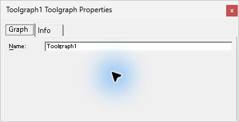
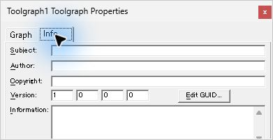
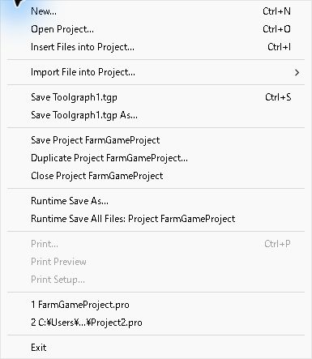
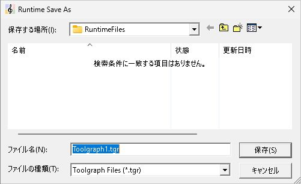
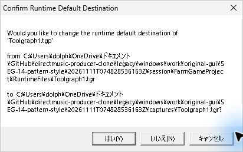

設計用の `.tgp` と実行用の `.tgr` はともに `RIFF DMTG` で、文書名と GUID は一致した。Tool は両方とも0件。この `.tgp` は246バイトで、`tglu` に表示設定と2つの `chcu` がある。PChannel の格納値は0起点で **0〜15** と **17, 19**。`.tgr` は106バイトで、空の `LIST toll` があり、`tglu` と `chcu` は含まれなかった。 [設計用の採取ファイル](../../../work/original-gui/SEG-14-pattern-style/20261111T074828536163Z/captures/tg-saved-Toolgraph1.tgp) · [実行用の採取ファイル](../../../work/original-gui/SEG-14-pattern-style/20261111T074828536163Z/captures/Toolgraph1.tgr)

## Segment と AudioPath の内蔵版

BGDawn の **文書ノード** の右クリックから **New > Toolgraph**。初期のグループ作成を Cancel すると、BGDawn の子に **Toolgraph** が加わり、空の Designer が開いた。既存の Audiopath も同じ親の下に見える。APFarm1 の **文書ノード** では **New Toolgraph** を直接選べた。こちらも初期のグループ作成を Cancel でき、APFarm1 の下に Toolgraph が残った。追加後に APFarm1 の文書ノードを右クリックすると **New Toolgraph** は灰色。

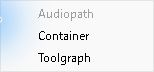
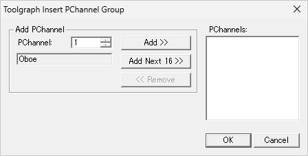
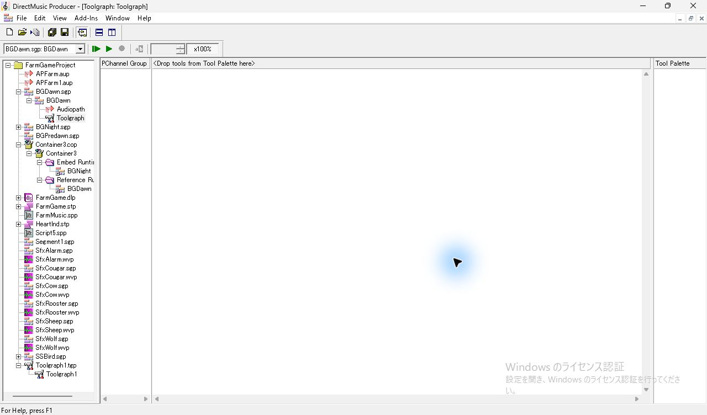
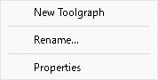

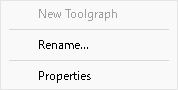

## 未登録 Tool を含む入力の取り込み

試験入力 **Graph.tgp** には **Main graph** という名前と2つの `RIFF DMTL` がある。クラスは `00000002-0000-0000-0000-000000000000` と `00000001-0000-0000-0000-000000000000`。いずれも32ビットの COM クラスの検索では見つからなかった。また HKCU・HKLM の各32ビット・64ビットのビューで DirectMusic の Tools キーは見つからなかった。 [入力の出自](../../../work/original-gui/UI11-12-container-toolgraph/20261111T082559380067Z/inputs/missing-tool/manifest.json) · [登録の読み取りと保存値](../../../work/original-gui/SEG-14-pattern-style/20261111T074828536163Z/toolgraph-live-audit.json)

試験入力の複製を **Ctrl+I > Insert Files into Project** で選ぶと、警告を観測せず **Graph.tgp > Main graph** が加わった。Main graph を開くと初期グループのダイアログが出た。Cancel 後、中央には Tool 列がなく、Palette も空だった。取り込まれたファイルは入力の226バイトから150バイトになり、文書名と GUID を保ったまま2つの `DMTL` と追加チャンク `oddx` がなくなっていた。入力の複製と元の試験ファイルはハッシュが一致した。別の登録状態での挙動は追試する。

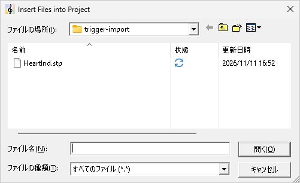
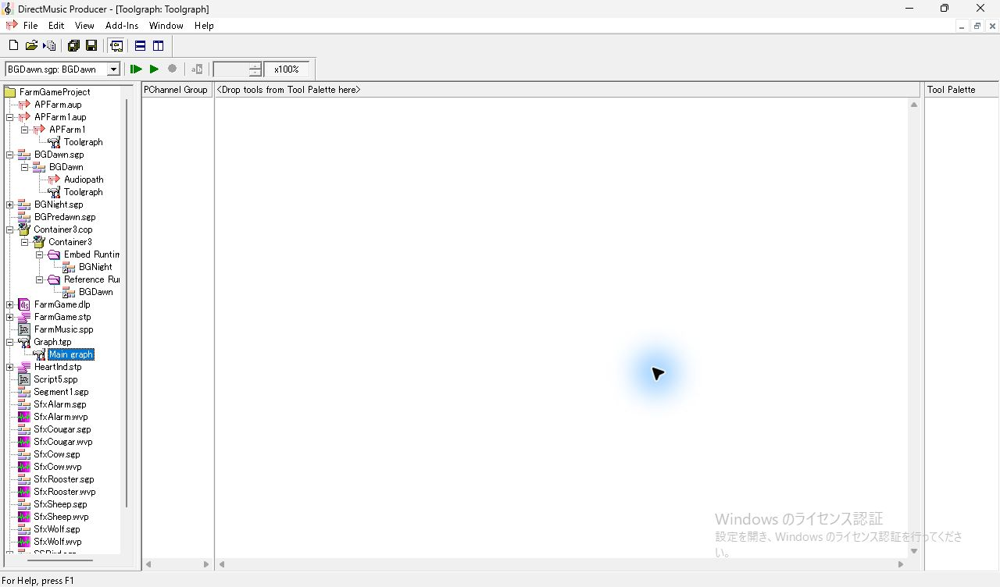

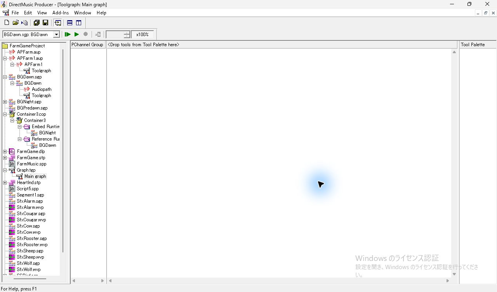

## 再起動と保存ファイルの照合

Project を閉じると **BGDawn.sgp、APFarm1.aup、Toolgraph1.tgp** の順で保存確認が出た。各 **No** を選び、2つの内蔵版の試験変更と、保存後に行った削除・Undo を閉じた。Producer を通常終了し、ウィンドウの消失を確認して同じ実行ファイルを1回起動した。起動前後は実行パスとウィンドウで照合した。File の履歴から FarmGameProject を開くと、**Graph.tgp** と **Toolgraph1.tgp** が Tree にあり、Toolgraph1 を開くと **1-16、18, 20** の2行と調整済みのペイン幅が戻った。

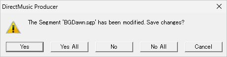
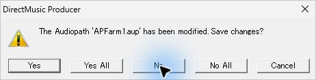
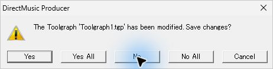
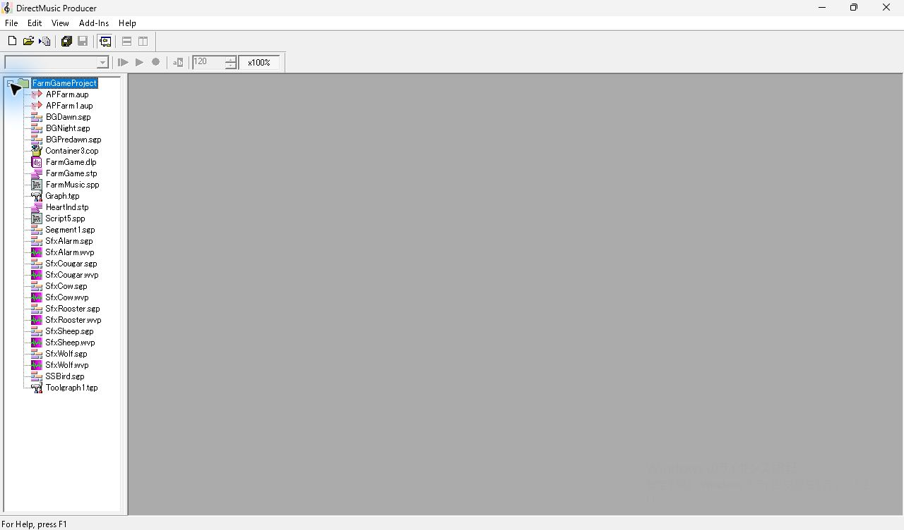
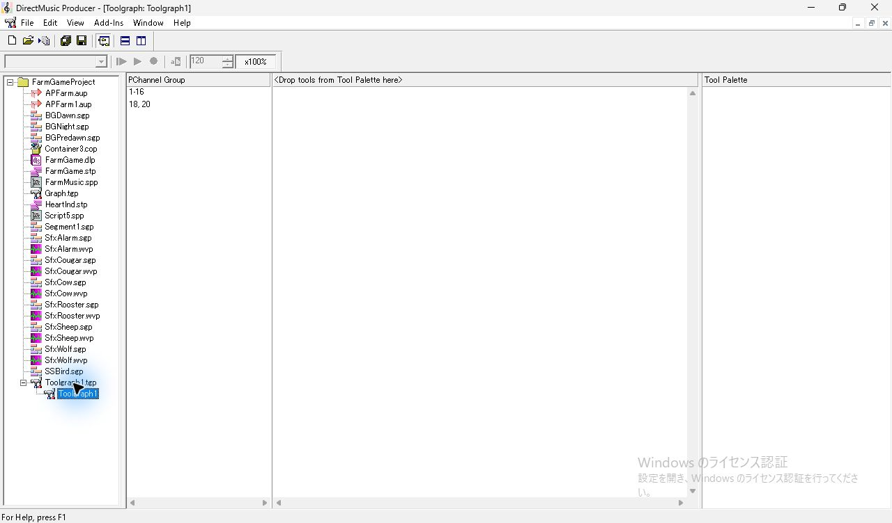

保存直後と再起動後の Toolgraph1.tgp の SHA-256 は一致した。作業 Project は Toolgraph1.tgp と取り込み後の Graph.tgp を持ち、FarmGameProject.pro が更新された。BGDawn.sgp・APFarm1.aup を含む既存文書と凍結入力21ファイルはハッシュが一致した。 [保存内容とハッシュの照合](../../../work/original-gui/SEG-14-pattern-style/20261111T074828536163Z/toolgraph-live-audit.json)

Tool の追加、列のドラッグ、グループ行との交点の切替、固有の Properties、Parameter Control の Tools 側は、利用可能な Tool を用意して追試する。
