# UI13　Secondary Segment と Wave・MIDI 書き出しの実機操作

2026-11-11。Windows 上の原版コピー `DmusGuiPatternStyle.exe` で FarmGame の作業プロジェクトを開いて確認した。親ウィンドウは 1280×752 px。表示の基準は **Project Tree、Standard Toolbar、Transport Controls、Status Bar** の4項目。Secondary と書き出しは別々に表示し、Wave の出力経路を選ぶ間だけ Transport Options も表示した。操作ログ139件、採取画像212枚のうち45枚を掲載する。 [表示と操作の入口](ui-13-transport-export.md) · [作業プロジェクト](../../../work/original-gui/SEG-14-pattern-style/20261111T074828536163Z/session/FarmGameProject-before-open.json) · [実行記録](../../../work/original-gui/SEG-14-pattern-style/20261111T074828536163Z/run.json) · [画像の出典・寸法・ハッシュ](../../../work/original-gui/SEG-14-pattern-style/20261111T074828536163Z/published-transport-export-live-figures.json) · [ファイル照合](../../../work/original-gui/SEG-14-pattern-style/20261111T074828536163Z/transport-export-live-audit.json)

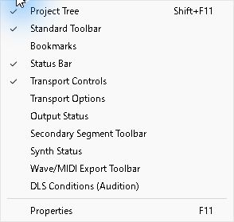

## Secondary の表示、候補、選択

**View > Secondary Segment Toolbar** を選ぶと、Transport Controls の直下に高さ約30 px の行が追加された。初回は4枠。各枠は左から番号、文書のコンボ、開始ボタン。候補の文書を開く前はコンボとボタンが灰色だった。左端スピンの下矢印を2回押すと、番号3と4が消え、1と2の2枠になった。行の高さはこの範囲で一定だった。

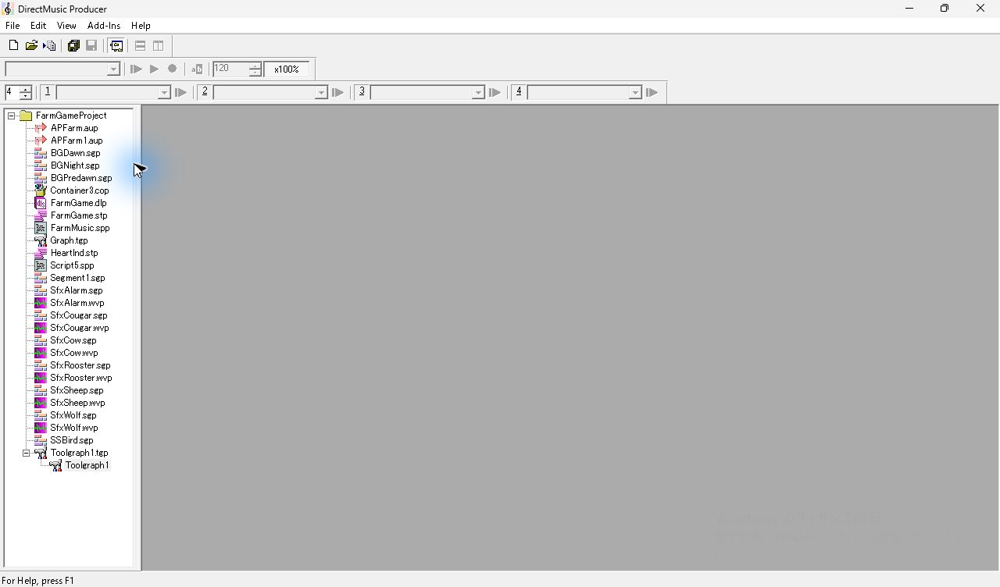

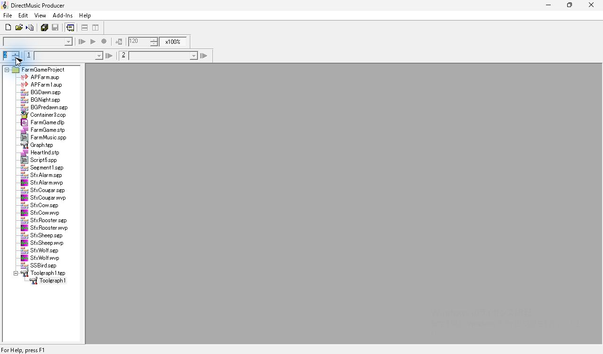

Project Tree で `BGNight.sgp` の Segment を開くと、枠1の候補に `BGNight.sgp: BGNight` が出た。枠1でそれを選び、次に `SSBird.sgp` の Segment を開くと、枠2のコンボには両方が並んだ。候補の表示は `ファイル名: Segment 名`。両枠に割り当てると右端のボタンが緑色になった。Primary は Transport Controls 側の別コンボで選択される。

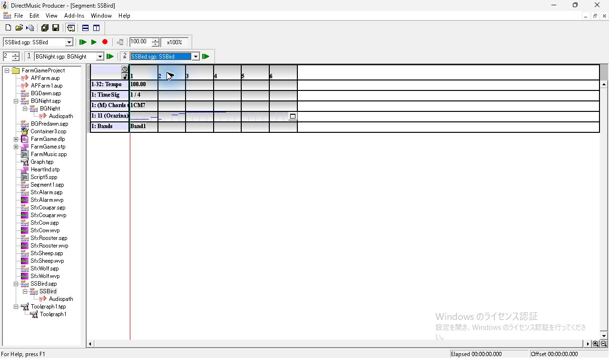

## 枠単位の試聴設定

枠1の開始ボタンを右クリックすると **Secondary Segment Audition Options** が開く。初期値は **Segment's Default**、**Cut Off (Regenerate 2ndary Segs)**、**Quick Response**。**Start at next marker** と **Controlling Segment** はオフ。右上 **Align Options** の4項目は灰色だった。

| 設定箇所 | 実機で確認した内容 |
| --- | --- |
| Performance Boundary | Segment's Default、Immediate、Grid、Beat、Barline、Align to Beat、Align to Barline、Align to Segment、End of Segment、End of Segment Queue の順 |
| Align Options | **Align to Barline** を選ぶと **at any Time**、**on any Grid**、**on any Beat**、**on any Barline** が有効になる。初期選択は **at any Time**。この間 **Start at next marker** は灰色になる |
| Cut Off | **Don't Cut Off**、**Don't Cut Off Secondary Segs**、**Cut Off (Regenerate 2ndary Segs)** のラジオボタン |
| Timing | **Quick Response** と **After Prepare Time** のラジオボタン |
| Cancel / OK | 枠1で **Align to Barline** を選んで **Cancel**。開き直すと **Segment's Default**。枠1だけ **Barline** を選んで **OK** とすると、枠2は **Segment's Default** のまま、枠1は再生後も **Barline** を保持した |

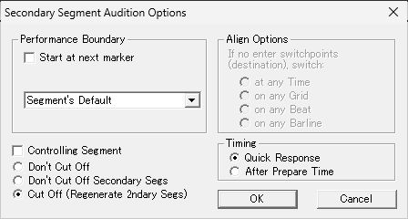

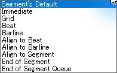

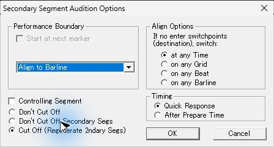

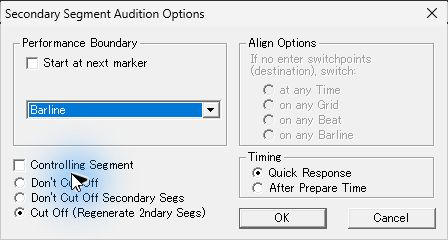

## Primary と Secondary の開始・停止

Primary に作業用の `Segment1.sgp` を選んだ。これは 4/4 の20小節で、3小節目から SfxCow の短い Wave がある。開始・停止の間は Primary の赤い Play Cursor と Status Bar の **Elapsed** を比較した。

| 操作 | 観測した状態 |
| --- | --- |
| Primary を開始して枠1の開始ボタンを押す | Primary は `Segment1` のまま。枠1のコンボが灰色になり、ボタンは緑の再生から暗赤色の停止に変わる。画像の Elapsed は 7.008 秒 |
| 枠2も開始 | 一時的に両方の枠が停止ボタン表示。Primary の Elapsed は 13.733 秒。枠2のツールチップは `Stop. (Ctrl+Alt+2) Right click to set options.`。Status Bar は `Stop secondary segment 2` |
| 枠1の停止ボタンを押す | Elapsed 20.014 秒の画像で、枠1のコンボと緑の開始ボタンが再び有効。ツールチップは `Play. (Ctrl+Alt+1) Right click to set options.`。枠2もこの時点では緑。Primary の停止ボタンは赤いまま、Elapsed は25.585秒まで進んだ。ホバー時の Status Bar は `Trigger secondary segment 1. Right click to set options.` に切り替わった |
| 枠1を再開して Primary の **Stop Immediate** を押す | Primary と枠1がともに開始ボタンに戻った。停止時の Elapsed は 38.916 秒。Primary 停止ボタンには `Ctrl+click to immediately stop primary only` の案内も出る |

停止要求から停止確定までの時間と小節位置は未計測。枠2は開始後に自然終了できる長さのため、枠1の停止が枠2に与える影響は、両枠が長く再生される素材を使って確認する。Ctrl+クリック、Motif の候補、ツールバーの移動・浮動時の配置も追試対象。

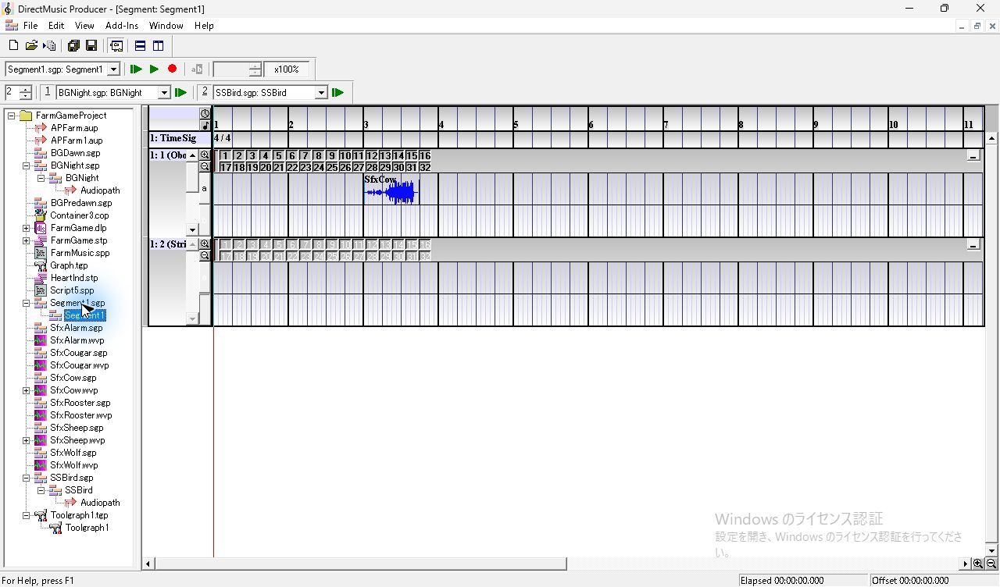

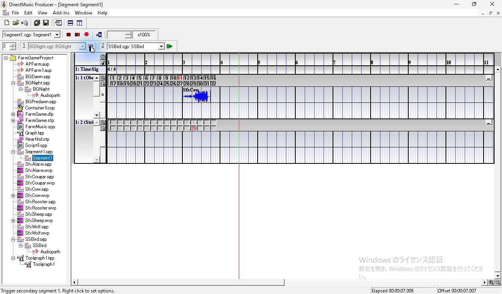

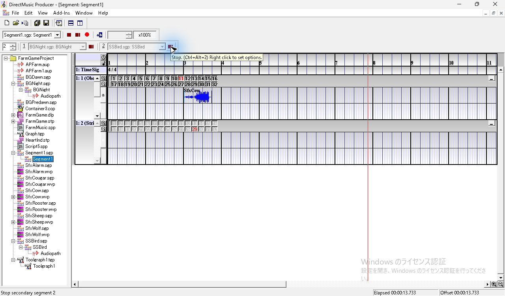

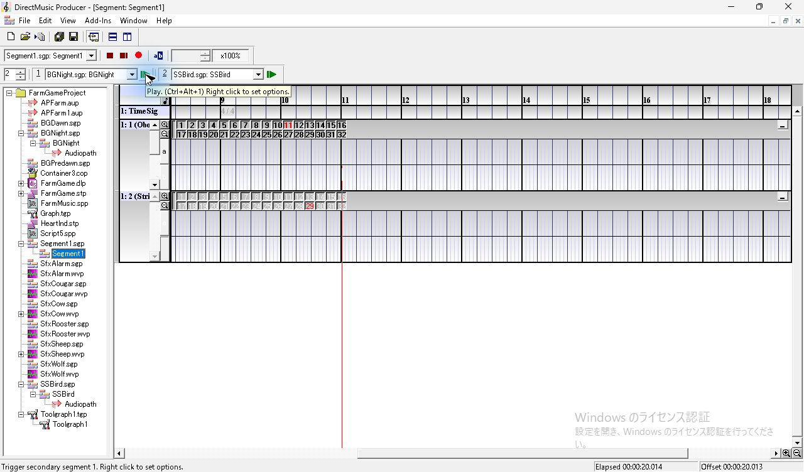

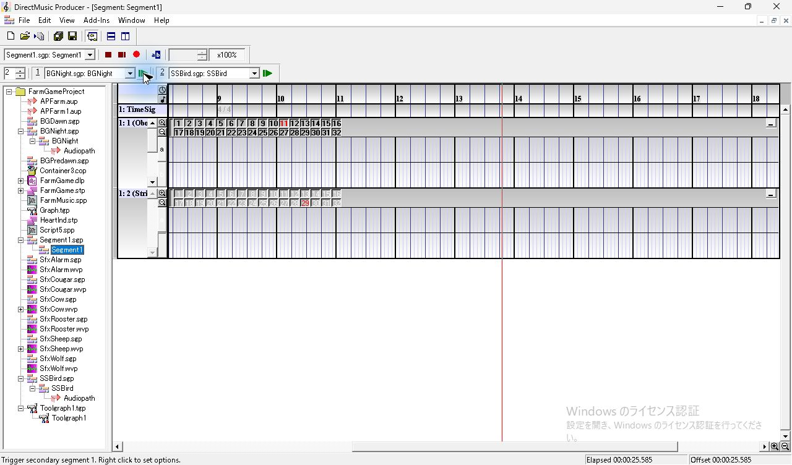

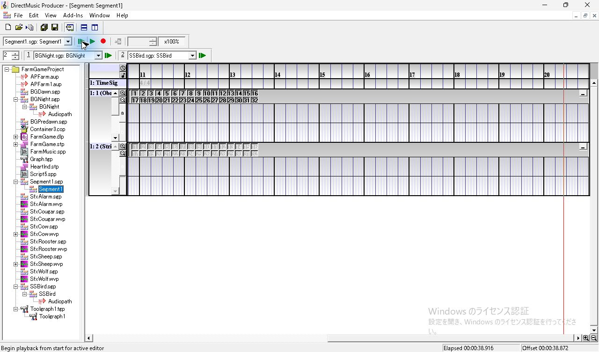

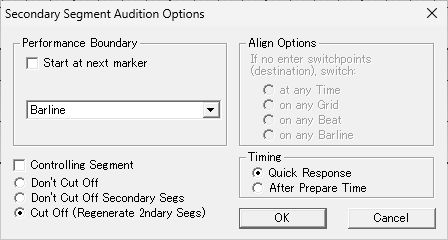

## MIDI の出力先、待機、収録

Secondary を隠して **View > Wave/MIDI Export Toolbar** を選ぶ。Transport Controls の下に Wave（左）と MIDI（右）が並ぶ。各組は、ファイル名欄、`…`、開始・停止ボタンの順。ファイル名が空のとき開始・停止ボタンは灰色。MIDI 側の `…` で **Export to MIDI: Set Filename** が開き、ファイル種別は **MIDI Files (*.mid)**。**Cancel** の後も欄は空だった。保存先を確定すると、欄にファイル名が出て右端が赤くなる。

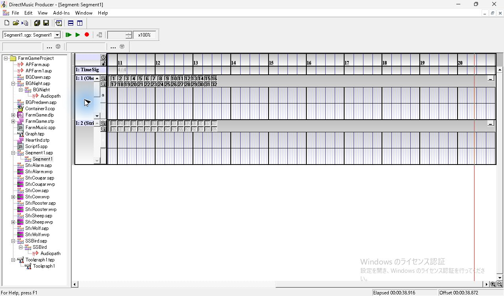

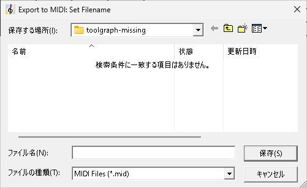

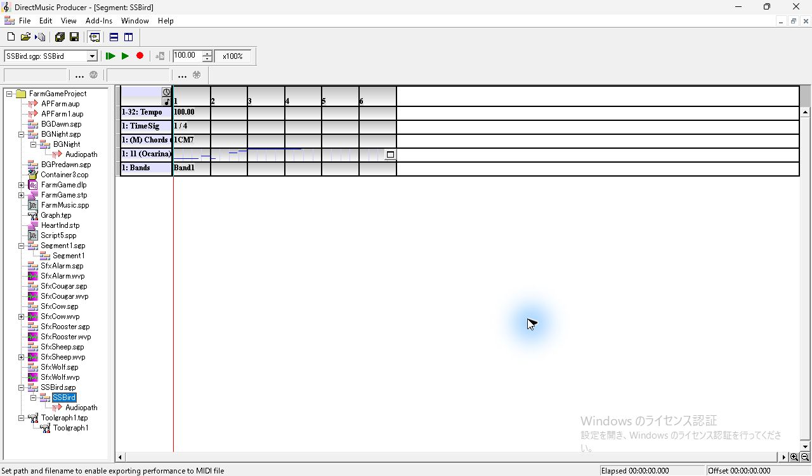

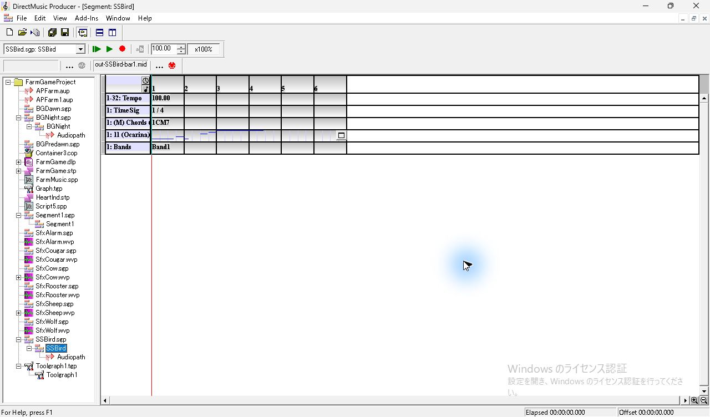

出力名を入れた状態で右端を右クリックすると **Set MIDI Export Start Time** が開く。最初の選択は **Start at bar 1**。**Save lead-in measure** にも切り替えられる。右端を左クリックして待機させた時点では Primary は停止中で、1回目の出力ファイルはまだ存在しなかった。**Play From Start** を押すと Primary の停止ボタンが赤くなり、Play Cursor が進む。自然終了すると別の停止操作をせずに出力名が空になり、MIDI のボタンは灰色に戻った。

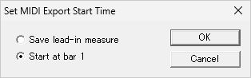

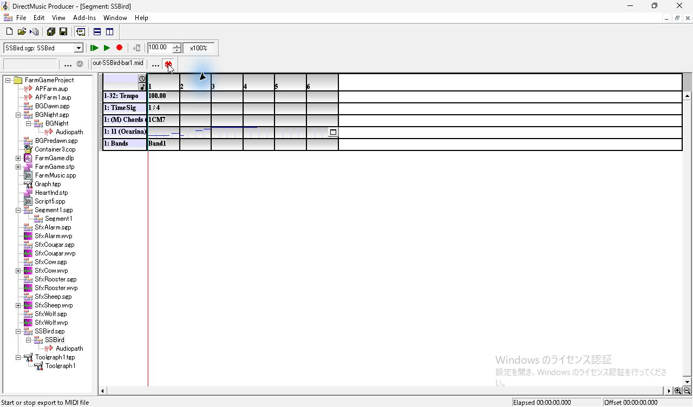

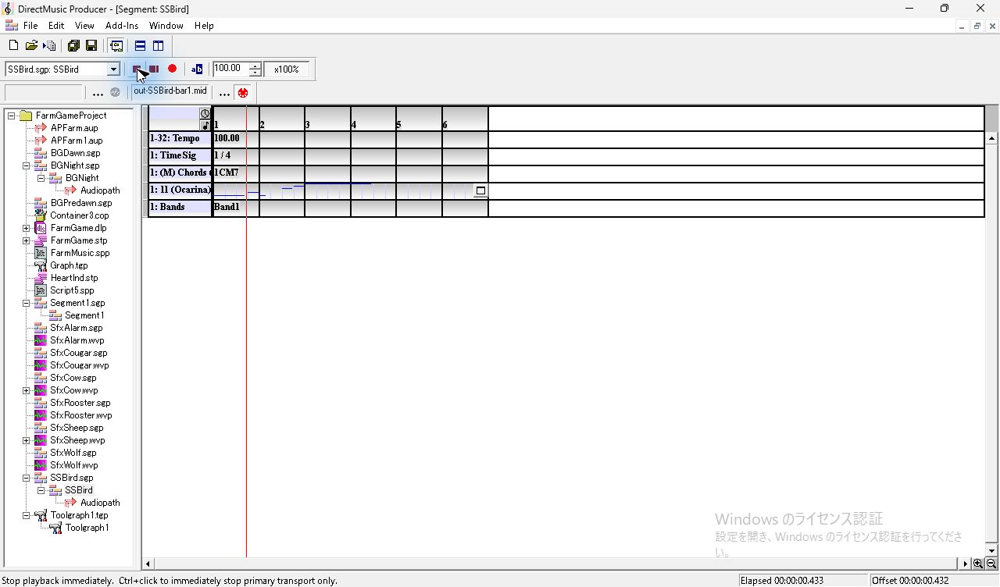

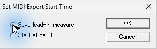

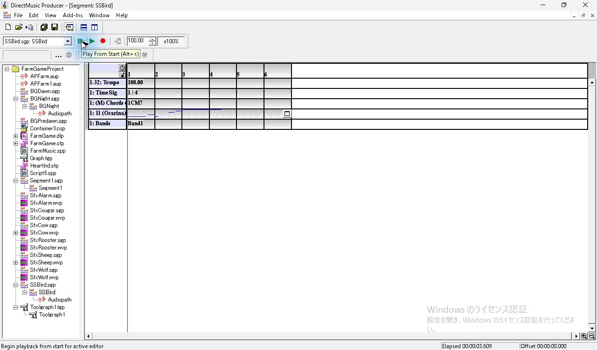

### MIDI ファイルの照合

`SSBird.sgp` は 100 BPM、1/4、6小節で、**1: 11 (Ocarina)** の行に Pattern がある。2ファイルはともに標準 MIDI ファイル Format 1、11トラック、四分音符あたり768 tick。発音の Note On はすべて MIDI チャンネル11。下表の tick はファイル先頭からの絶対時刻。 [Start at bar 1 の MIDI](../../../work/original-gui/SEG-14-pattern-style/20261111T074828536163Z/captures/out-SSBird-bar1.mid) · [Save lead-in measure の MIDI](../../../work/original-gui/SEG-14-pattern-style/20261111T074828536163Z/captures/out-SSBird-leadin.mid)

| 開始設定 | ファイル | 拍子メタイベント | テンポメタイベント | 先頭 Note On / 発音数 |
| --- | --- | --- | --- | --- |
| Start at bar 1 | 872 B | tick 0 で 1/4 が2回 | tick 0 で 600,000 µs/四分音符 | tick 384、音高72、Velocity 86 / 6音 |
| Save lead-in measure | 778 B | tick 0 で 4/4、tick 3072 で 1/4 が2回 | tick 3072 で 600,000 µs/四分音符 | tick 3456、音高84、Velocity 80 / 7音 |

この2回では、**Save lead-in measure** が 4/4 の1小節（3072 tick）を先頭に置いた。先頭発音の時刻差も3072 tick。Program Change はそれぞれ tick 0 と tick 3071 にあった。音符の開始時刻からリードイン分を引き、長さと Velocity を `SSBird.sgp` の Pattern の `note` レコードと照合すると、1回目は Variation 2、2回目は Variation 3 に一致した。開始設定だけを比較する追試には、同じ音符が毎回鳴る Sequence を使う。 [SMF と元の Pattern の照合](../../../work/original-gui/SEG-14-pattern-style/20261111T074828536163Z/transport-export-live-audit.json)

## Wave の出力経路と警告

Wave 側の `…` は **Export to Wave: Set Filename** を開く。ファイル種別は **Wave Files (*.wav)**。名前を確定すると左側の書き出しボタンが赤くなる。最初は SfxCow の埋め込み AudioPath で試した。再生が自然終了し、Status Bar が約1.451秒で止まっても Wave のファイル名と赤いボタンは残った。Wave のボタンをもう一度押すとファイル名と赤表示が消えた。この経路では対象の WAV は生成されず、警告表示も見えなかった。

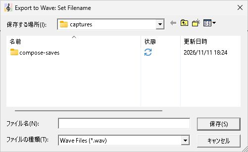

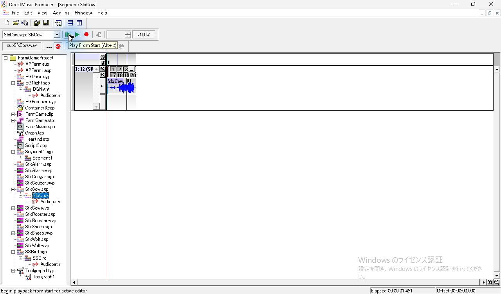

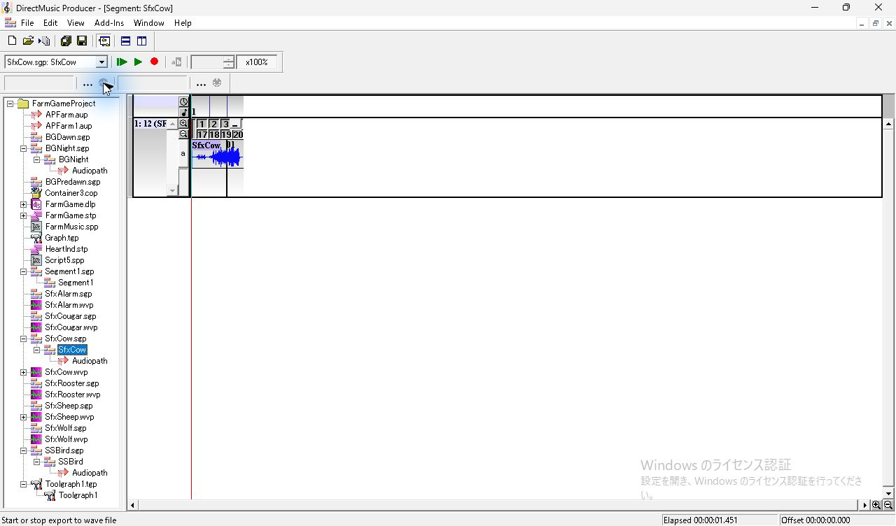

次の試行では、作業用 `APFarm1.aup` の **12: Mix Group1** の空いている **Effects List** を右クリックし、**Insert Effect > FileOutput : FileOutput** で `FileOutput1` を追加した。この行のバスは **Stereo (L+R)**、バッファーは **User Defined**。SfxCow の Wave Track と同じ PChannel 12 を使う。

**View > Transport Options** で表示される行の左端は AudioPath のコンボ。元の **Standard Stereo & Reverb** に加え、このときは **APFarm1.aup: APFarm1**、**No Default Audiopath**、**Standard 3D (Dry)**、**Standard Mono**、**Standard Stereo** が選べた。**APFarm1.aup: APFarm1** を選び、SfxCow の **Segment Properties > Segment** で **Play on new instance of embedded audiopath** をオフにして、この経路で再生した。

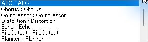

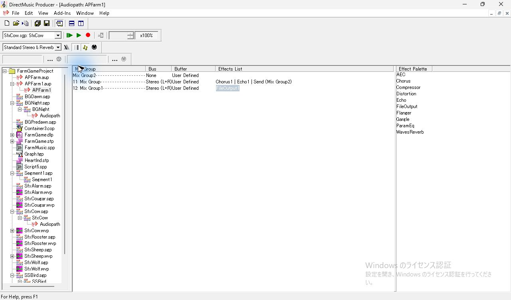

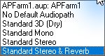

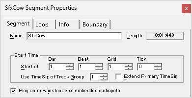

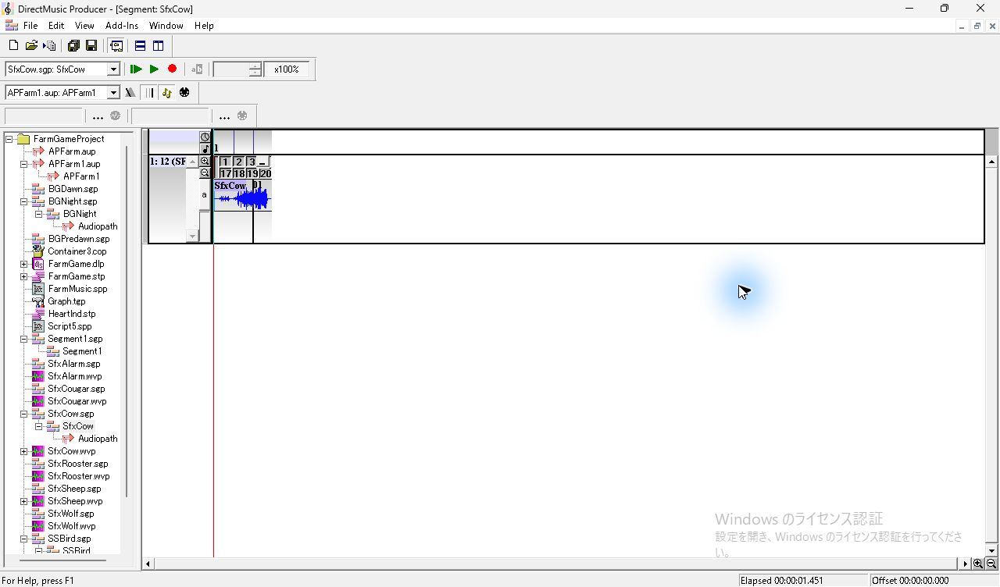

この状態で日本語を含む作業フォルダーへの絶対パスを指定し、Wave の開始ボタンを押すと **Not all FileOutput DMOs were started successfully.** と出た。使用中または読み取り専用の可能性を示す文と、指定したファイルのフルパスが続いた。176文字のパスでも97文字のパスでも発生し、出力ファイルは存在しなかった。警告の **OK** 後、Wave のボタンで失敗した収録の表示を解除できた。

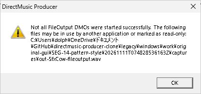

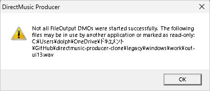

### 収録に成功した経路

同じ `legacy/windows/work` を一時的に ASCII のみの `R:` として参照し、`R:\out-SfxCow-fileoutput.wav` を指定すると、警告なしに収録を開始できた。Wave の開始後に **Play From Start** を押し、SfxCow の自然終了を確認して Wave のボタンで停止した。保存先の表記を変えて収録できたことを確認した。FileOutput 内部で失敗した箇所と、パス長・文字種それぞれの限界は未特定。

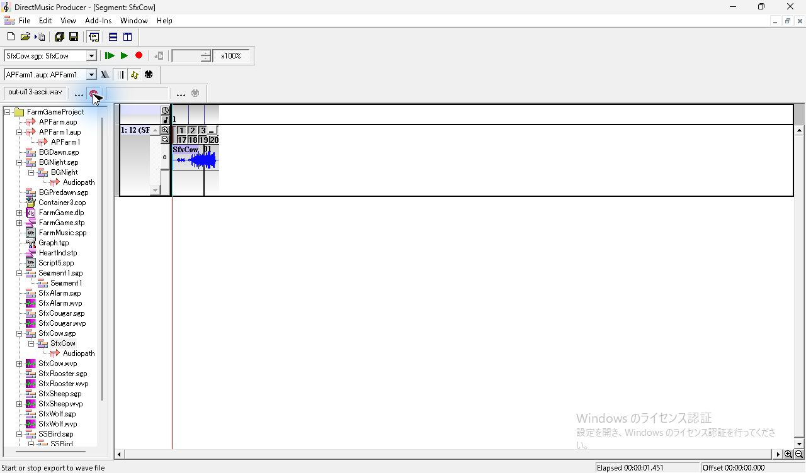

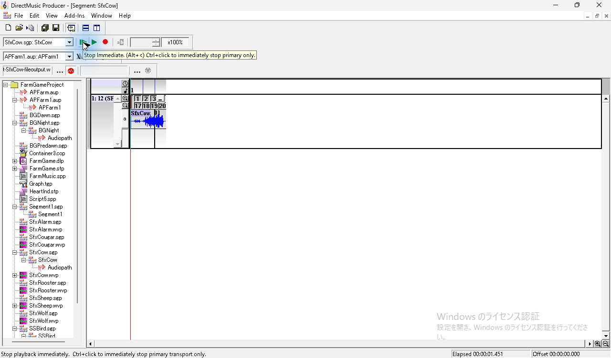

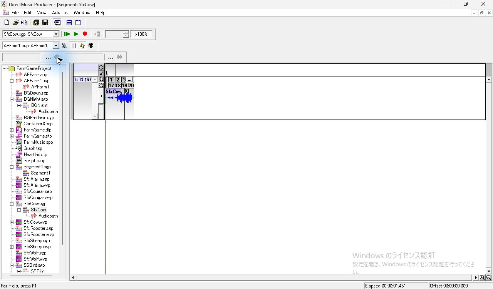

| ファイル | PCM | フレーム数 / 長さ | サンプルの照合 |
| --- | --- | --- | --- |
| 元の SfxCow.wvp | 44,100 Hz、16 bit、モノラル | 63,868 / 1.448 s | 非ゼロの範囲はフレーム1547–59130 |
| SfxCow を再生して収録 | 22,050 Hz、16 bit、ステレオ | 146,169 / 6.629 s | 左右同一。非ゼロの範囲はフレーム55239–84030（約2.505–3.811 s）。最大絶対振幅 14,416 |
| Wave を開始・停止し、Segment を再生しなかった比較用の収録 | 22,050 Hz、16 bit、ステレオ | 173,974 / 7.890 s | 全サンプルがゼロ |

元のモノラル素材を2フレームおきに取り、出力の左チャンネルとの開始位置を合わせたときの正規化相関は 0.99999994。先頭・末尾の無音を含めた出力時間は Wave の開始と停止に依存する。音声の一致はファイル内の PCM で照合した。 [SfxCow の WAV](../../../work/original-gui/SEG-14-pattern-style/20261111T074828536163Z/captures/out-SfxCow-fileoutput.wav) · [無音の比較用 WAV](../../../work/original-gui/SEG-14-pattern-style/20261111T074828536163Z/captures/out-ui13-ascii.wav) · [PCM の照合結果](../../../work/original-gui/SEG-14-pattern-style/20261111T074828536163Z/transport-export-live-audit.json)

## 復元と次の確認

Secondary の枠数は4、枠1は **Segment's Default**、MIDI の開始設定は **Start at bar 1**、既定 AudioPath は **Standard Stereo & Reverb** に戻した。SfxCow と APFarm1 の保存確認はどちらも **No** を選んだ。作業プロジェクトは同じ Producer ウィンドウで開き直した。前回のハッシュと比較すると、作業フォルダーではプロジェクト記述子 `FarmGameProject.pro` が更新され、`SfxCow.sgp` と `APFarm1.aup` を含む各素材は一致した。調査用に保存した原版素材21ファイルのハッシュも一致した。Wave 2ファイルを証跡フォルダーへ移し、`R:` を解除した。最後に Producer のウィンドウは1つ、View のチェックは標準4項目と確認した。

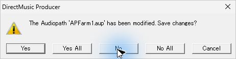

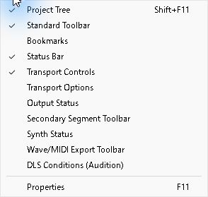

続く試行では **Synth Status** と **Output Status** を一つずつ表示し、複数 PChannel の素材で再生中・停止直後・Reset、ミュート、ソロ、改名を観測した。**Transport Options** の試行では、All Playback のカウントインを入れた MIDI に4/4の2小節分が追加された。入力記録、固定 Sequence でのリードイン、同名保存、複数 FileOutput、対応ポート変更時の書き出しの有効状態が残る。 [Synth Status と Output Status の記録](ui-13-synth-output-status.md) · [カウントインの実機記録](ui-13-transport-options-live.md#2小節のカウントイン)
