# UI13　Transport、Synth Status、Wave・MIDI 書き出し

2026-11-11。基本再生・停止は原版の [SEG-11](seg-11-transport-position.md) と [SEG-12](seg-12-loop-boundary.md) で観測済み。ここでは補助ツールバーの配置、操作の入口、書き出しの条件をまとめる。原版コピーで撮影した2枚と同梱 HTML Help の図9枚を掲載する。Secondary の枠と設定、Primary と同時の再生・停止、MIDI と Wave の収録は、別紙の実機写真とファイル照合を参照する。 [Secondary と書き出しの実機操作](ui-13-transport-export-live.md) · [実行記録](../../../work/original-gui/UI13-14-transport-aux/20261111T083323468666Z/run.json) · [ヘルプ図の出典と寸法](../../../work/original-gui/UI13-14-transport-aux/20261111T083323468666Z/published-help-figures.json)

## Synth Status と表示の切替

通常の4項目を表示した状態から **View > Synth Status** を選ぶ。Transport Controls の下に **CPU、Voices、Memory Use、Latency、Reset** の行が現れた。1280×752 px の親ウィンドウ画像では Timeline 上端が y=105 から y=135 に移動した。同じ項目で隠すと y=105 に戻った。 [View メニューと表示前後](ui-01-view-toolbars.md)

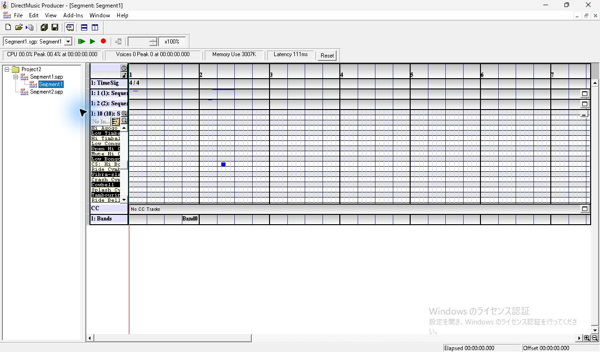

全ツールバー表示の撮影では、CPU と Voices に現在値・ピーク・時刻が並び、Memory Use は 3007K、Latency は 112ms だった。Secondary の4枠はいずれも空で、開始ボタンは灰色。書き出しは Wave と MIDI のファイル名がともに空で、参照用の **…** は見え、開始・終了用ボタンは灰色だった。

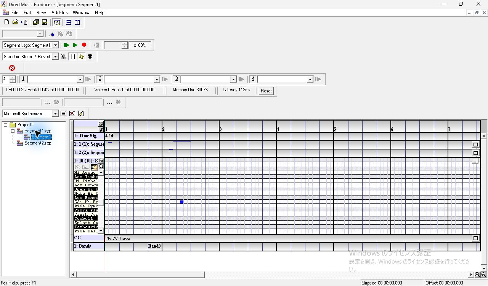

実機で SSBird と BGNight を使い、停止、発音数の増減、停止直後、Reset 直後、浮動・再ドッキングを撮影した。現在値とピーク、Latency の表示値と MIDI/Performance Options の設定値を比較した。 [Synth Status の実機操作](ui-13-synth-output-status.md#synth-status-の表示と値) · [Synthesizer Status](../../../../../work/analysis/original-manual-session/20261010T031624075Z/help-extracted/htm/synthesizerstatuswindow.htm)

**View > Output Status** は PChannel のレベルとミュート用の別ツールバー。演奏中に PChannel が番号順に増え、停止後もボタンを保持した。実機でミュート、ソロと解除、改名が別の Segment の行に反映されること、All Notes Off の右クリックで一覧が消えることを確認した。 [Output Status の実機操作](ui-13-synth-output-status.md#output-status-の一覧とメーター) · [Output Status Toolbar](../../../../../work/analysis/original-manual-session/20261010T031624075Z/help-extracted/htm/outputstatustoolbar.htm)

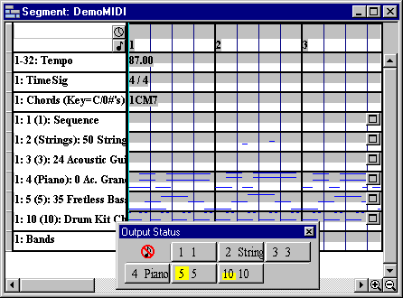

## Transport Options

**View > Transport Options**。左から AudioPath リスト、メトロノーム、Play Cursor、MIDI の切替、MIDI/Performance Options。実機では、カウントイン時の Play Cursor、MIDI と AudioPath を切り替えた場合の再生、レイテンシー、試聴速度を比較した。 [Transport Options の実機操作](ui-13-transport-options-live.md) · [Play Cursor の横追従](seg-11-transport-position.md)

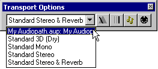

メトロノームのボタンを右クリックすると設定を開く。第1拍と他の拍に Velocity と Note value があり、下段に PChannel と Count-In Bars が並ぶ。図では PChannel 10、Count-In 0、Record Only。ヘルプでは All Playback を選ぶと試聴にもカウントインが入り、その間は演奏本体と Play Cursor が待機する。 [Metronome Options](../../../../../work/analysis/original-manual-session/20261010T031624075Z/help-extracted/htm/metronomeoptionsdialogbox.htm)

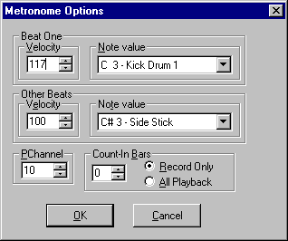

右端の MIDI/Performance Options には MIDI 入力、エコーと出力 PChannel 範囲、レイテンシー、同時発音数、サンプルレート、既定 Synthesizer、GM Set とカスタム DLS の Download Status がある。実機の入力候補は None のみ。既定 AudioPath の切替前後と、Persist の有無によるレイテンシーの保持を撮影した。 [設定の実機操作](ui-13-transport-options-live.md#toggle-midi-と-midiperformance-options) · [MIDI/Performance Options](../../../../../work/analysis/original-manual-session/20261010T031624075Z/help-extracted/htm/midiperformanceoptionsdialogbox.htm)

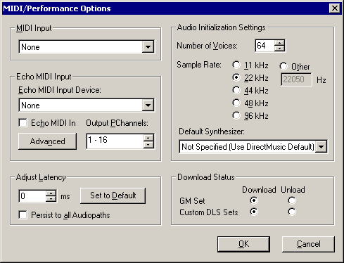

## Primary と Secondary

**View > Secondary Segment Toolbar**。左端のスピンは表示する組数。番号付きの各組に文書のリストと開始ボタンが付く。ヘルプでは最大99組。文書をエディターで開いてから候補に入る場合があり、狭い場合はツールバーを浮かせてサイズを変えられる。Secondary の開始ボタンは再生中に境界停止へ変わり、Primary の停止で Secondary も停止する。 [Secondary Segment Toolbar](../../../../../work/analysis/original-manual-session/20261010T031624075Z/help-extracted/htm/secondarysegmenttoolbar.htm)

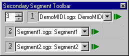

対象の開始ボタンを右クリックして **Secondary Segment Audition Options** を開く。左側に Performance Boundary、Controlling Segment、Cut Off。右側に Align Options と Timing。開始境界の指定は選んだ枠に対する試聴用で、ヘルプ上は保存した Segment の境界を維持し、Bookmark に試聴設定を保存できる。 [Secondary Segment Audition Options](../../../../../work/analysis/original-manual-session/20261010T031624075Z/help-extracted/htm/secondarysegmentauditionoptions.htm)

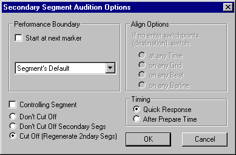

実機では4枠と2枠、BGNight と SSBird を開く前後の候補、設定の Cancel と OK、Primary と同時の再生、停止後を撮影した。追試では Motif の候補、1枠や3枠での配置、開始・停止要求から境界までの時間、停止の影響が別枠へ及ぶ条件、ドッキング中と浮動時の配置を確認する。 [Secondary の操作](ui-13-transport-export-live.md#secondary-の表示候補選択)

## Wave/MIDI Export Toolbar

**View > Wave/MIDI Export Toolbar**。左が Wave、右が MIDI。各組にファイル名表示、参照用の **…**、開始・終了用ボタンがある。元の演奏と出力を照合できるよう、短い Sequence と Wave 項目を含む作業用 Segment を使い、出力先は専用セッションに指定する。 [Capturing a Performance](../../../../../work/analysis/original-manual-session/20261010T031624075Z/help-extracted/htm/capturingaperformance.htm)

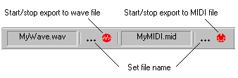

| 状態 | Wave | MIDI |
| --- | --- | --- |
| 出力先を設定 | Wave 側の **…** から名前を指定 | MIDI 側の **…** から名前を指定 |
| 開始操作の直後 | 対応する出力ポートと FileOutput を用意して開始。演奏前に押すと先頭に無音が入り得る | 待機し、演奏を開始した時点で収録が始まる |
| 対象 | Wave 出力をサポートするポート経由の Segment、Pattern、DLS の音 | Segment と Pattern の MIDI メッセージ。Wave 項目の音声は出力対象外 |
| 演奏を停止 | 書き出しボタンを押して収録を終える | 演奏の停止とともに収録が終了 |

ヘルプでは Wave 側は、アクティブな AudioPath に対応する出力ポートがある場合に有効。対応ポートの選定と FileOutput の経路は別々に確認する。右クリックの **Set MIDI Export Start Time** は **Save lead-in measure** と **Start at bar 1** の2択。前者では現在の Transport 対象の拍子で空小節を1つ挿入する。 [Wave Export](../../../../../work/analysis/original-manual-session/20261010T031624075Z/help-extracted/htm/waveexport.htm) · [MIDI Export](../../../../../work/analysis/original-manual-session/20261010T031624075Z/help-extracted/htm/midiexport.htm)

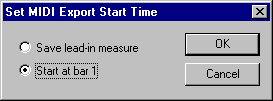

FileOutput は AudioPath の Effects List に入れる DMO。図では PChannels 1–128 の Mix Group が Stereo (L+R) のユーザー定義バッファーを使い、FileOutput1 へ出力する。複数バッファーに FileOutput を入れる場合は、設定名に連番を付けた Wave が作られるとヘルプにある。 [AudioPath の File Output](../../../../../work/analysis/original-manual-session/20261010T031624075Z/help-extracted/htm/fileoutputinanaudiopath.htm) · [AudioPath Designer](ui-08-audiopath-designer.md)

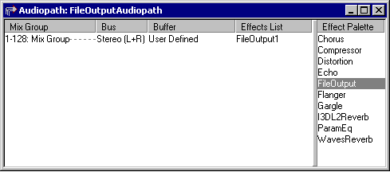

実機では出力名の取消と確定、待機、収録、停止、Wave の出力失敗と再試行を撮影した。MIDI は両方の開始設定で先頭イベントの時刻と拍子を読み、Wave は収録した PCM を元素材と照合した。追試は固定 Sequence でのリードイン、文書なし、出力ポートを替えたときの有効状態、同名ファイル、複数 FileOutput を扱う。MIDI 入力を Sequence や Pattern に記録する操作は、接続した入力デバイスと記録後のイベントを確認する。 [MIDI の出力先、待機、収録](ui-13-transport-export-live.md#midi-の出力先待機収録) · [Wave の出力経路と警告](ui-13-transport-export-live.md#wave-の出力経路と警告)
