# UI13　Transport Options と試聴速度の実機操作

2026-11-11。Windows 上の DirectMusic Producer 5.3.0.900 の調査用コピーで、FarmGame の作業プロジェクトを使用。親ウィンドウは1280×752 px。標準4項目から Transport Options を表示し、書き出しと PChannel 確認の間だけ対応するツールバーを追加した。操作ログ177件、採取画像275枚から63枚を掲載する。青い光と黒い矢印は操作ツールの表示。 [実行記録](../../../work/original-gui/SEG-14-pattern-style/20261111T074828536163Z/run.json) · [画像の出典・寸法・ハッシュ](../../../work/original-gui/SEG-14-pattern-style/20261111T074828536163Z/published-transport-options-live-figures.json) · [時刻とファイルの照合](../../../work/original-gui/SEG-14-pattern-style/20261111T074828536163Z/transport-options-live-audit.json)

## Transport Options の配置と移動

**View > Transport Options** で Transport Controls の下に約30 px の行が加わる。左から AudioPath のコンボ、メトロノーム、Play Cursor、Toggle MIDI、MIDI/Performance Options。初めは **Standard Stereo & Reverb**。行の上端は y=104、Timeline の上端は y=135。右端ボタンの外側の余白を Timeline へドラッグすると **Transport Options** の浮動枠になった。枠は256×60 pxで同じ5つの操作部と閉じるボタンがある。タイトルをダブルクリックすると元の行に戻った。 [Play Cursor の追従と位置](seg-11-transport-position.md)

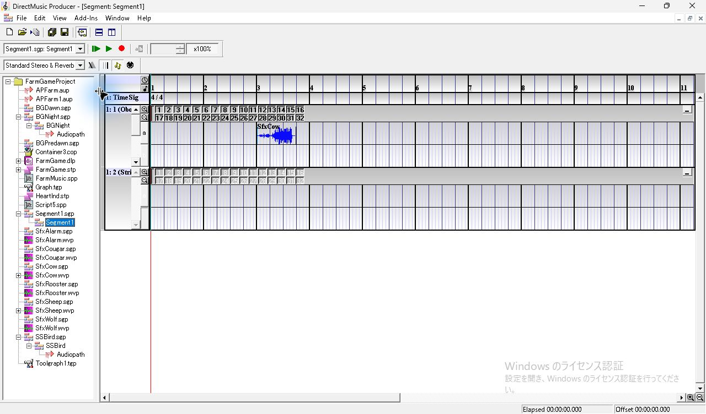

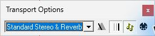

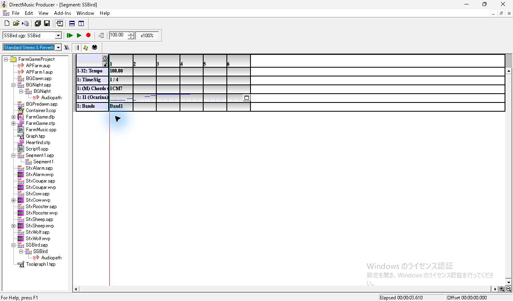

## メトロノームの設定と表示

メトロノームのアイコンを右クリックすると **Metronome Options** が開く。左クリックはオン・オフ。Status Bar の案内は `Enable or disable the metronome. Right click to set options.`。オンのときはボタン枠が沈んで見える。

| 欄 | 初めに表示された値 |
| --- | --- |
| Beat One | Velocity **117**、Note value **C 3 - Kick Drum 1** |
| Other Beats | Velocity **100**、Note value **C# 3 - Side Stick** |
| PChannel | **10** |
| Count-In Bars | **0**、**Record Only** |

Velocity、PChannel、Count-In Bars は数値欄と上下のスピン。Note value のリストには音名と打楽器名が並ぶ。第1拍のリストを開いたときは現在の C 3 が先頭で、その下へ B 2、A# 2、A 2 など低い音が続いた。Esc はリストを閉じ、設定ダイアログは残った。Count-In Bars を2にして **All Playback** を選び **Cancel** すると、開き直した画面は0と **Record Only** に戻った。 [同梱ヘルプの Metronome Options](../../../../../work/analysis/original-manual-session/20261010T031624075Z/help-extracted/htm/metronomeoptionsdialogbox.htm)

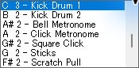

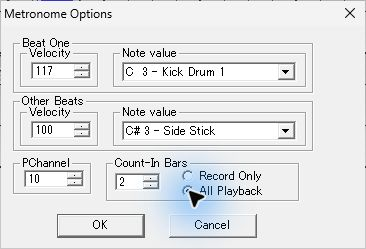

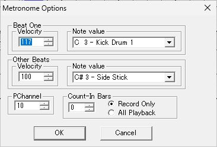

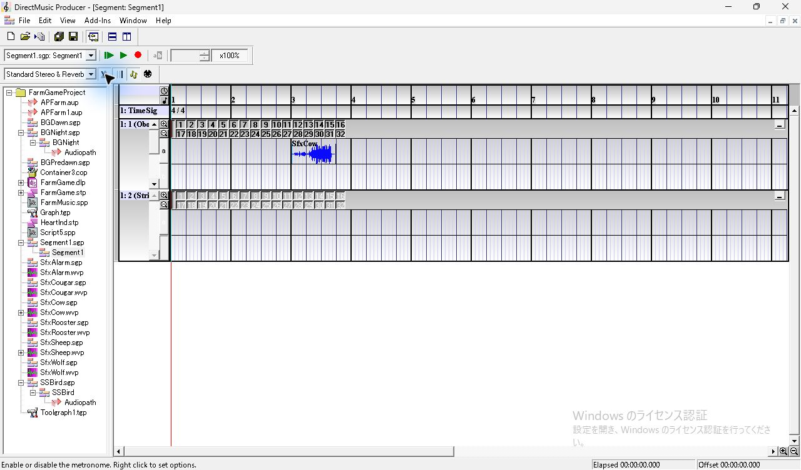

## 2小節のカウントイン

素材は4/4、20小節で Wave Track を2行持つ作業用の `Segment1.sgp`。PChannel 10、音高と Velocity は初期値のまま、Count-In Bars は2にした。通常試聴を **Record Only** と **All Playback** で行い、Wave/MIDI Export を一時表示して MIDI 側を **Start at bar 1** にした。試聴は **Play From Start**、終了は **Stop Immediate**。カウントインの時刻は操作ツールが開始操作を要求してから各画像を要求した時点。表の **Elapsed** と **Offset** は Producer の Status Bar の値。

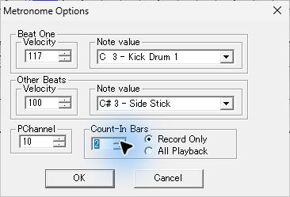

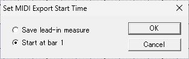

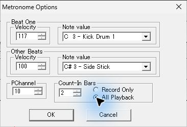

| 条件 | 画像要求時点 | Play Cursor と Status Bar |
| --- | --- | --- |
| Record Only、メトロノーム有効 | 約2.00秒 | 1小節目の途中。Elapsed 1.812秒、Offset 1.509秒 |
| All Playback、メトロノーム有効 | 約1.85秒、3.00秒、4.31秒 | 停止用の赤いボタンを表示。Play Cursor は先頭。Elapsed は直前の演奏の値を保持し、Offset は0 |
| All Playback、メトロノーム有効 | 約5.20秒 | Play Cursor が先頭を離れ、Elapsed 0.242秒、Offset 0.201秒 |
| All Playback、メトロノーム有効 | 約9.21秒 | Play Cursor は2小節目。Elapsed 4.269秒、Offset 3.557秒 |
| All Playback、メトロノーム無効 | 約1.88秒 | 1小節目の途中。Elapsed 1.721秒、Offset 1.434秒 |

All Playback の有効時には、Transport が停止用の表示に切り替わっても、演奏本体のカーソルと時刻は待機した。カウントイン中に Stop Immediate を押すと、カーソルは先頭、Status Bar の Offset は **-1.125秒** になり、予定時刻を過ぎても演奏は始まらなかった。メトロノームをオフにした試行では All Playback と2小節の指定を保持したまま、通常試聴のカーソルがすぐに動いた。

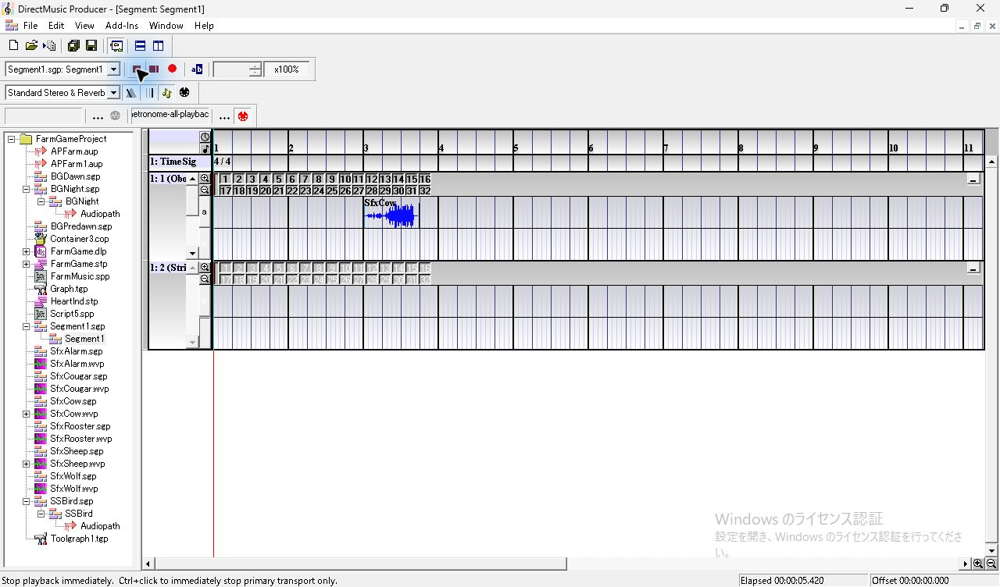

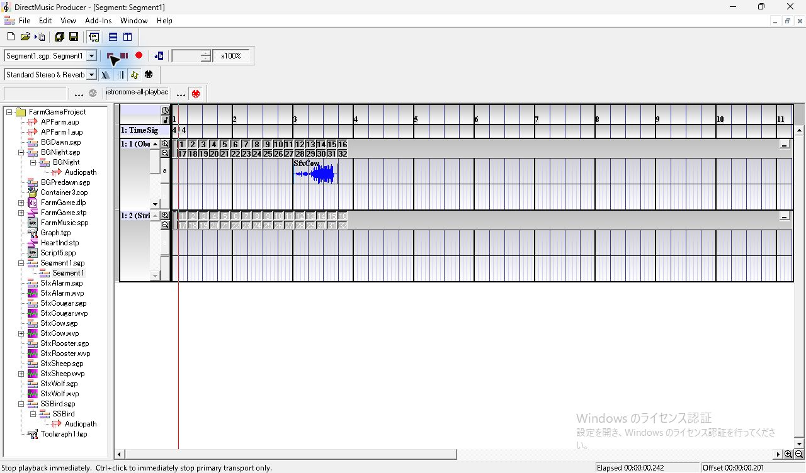

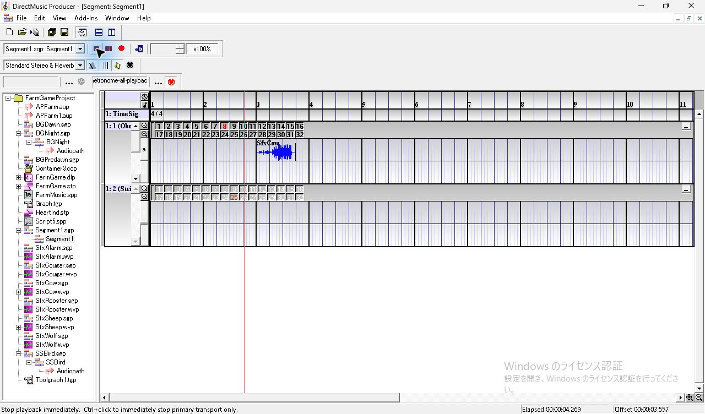

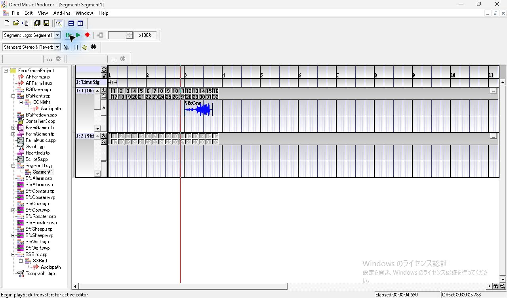

### MIDI と出力表示の照合

2本とも標準 MIDI ファイル Format 1、1トラック、四分音符あたり768 tick。All Playback では4/4の拍子メタイベントが tick 0 と tick 6144 にあり、End of Track も6144。これは4/4の2小節分（8拍）。Record Only では拍子メタイベントと End of Track は tick 0。両ファイルの Note On と Note Off は0件だった。元素材は Wave Track のため、書き出しで発音ノートを得る試験には別素材が必要。 [Record Only の MIDI](../../../work/original-gui/SEG-14-pattern-style/20261111T074828536163Z/captures/opt-metronome-record-only.mid) · [All Playback の MIDI](../../../work/original-gui/SEG-14-pattern-style/20261111T074828536163Z/captures/opt-metronome-all-playback.mid)

書き出しを隠し Output Status の一覧を消去して、All Playback の待機中に複数回撮影した。採取画像に PChannel 10 のボタンは出なかった。この試験ではクリック音を音声収録しておらず、確認できたのはカウントインに伴う Transport、カーソル、SMF の時刻。MIDI 入力を使う **Record Only** の録音開始も未確認。

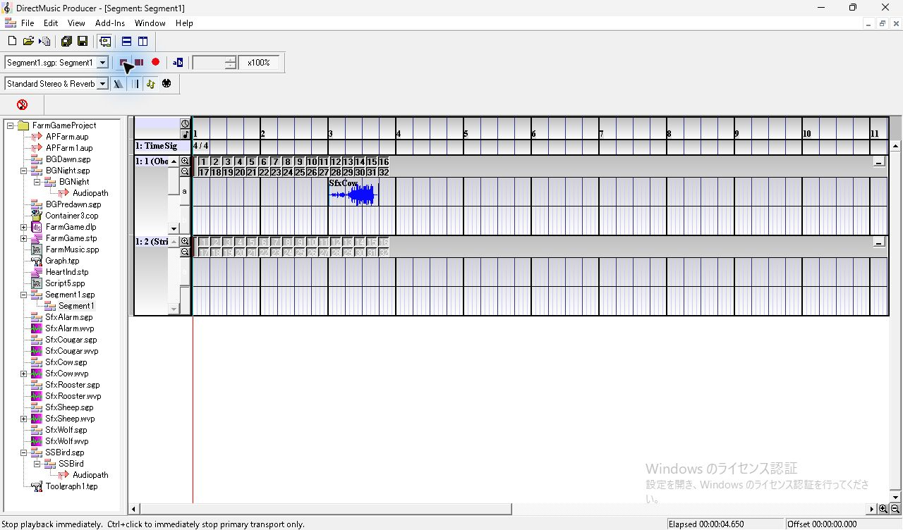

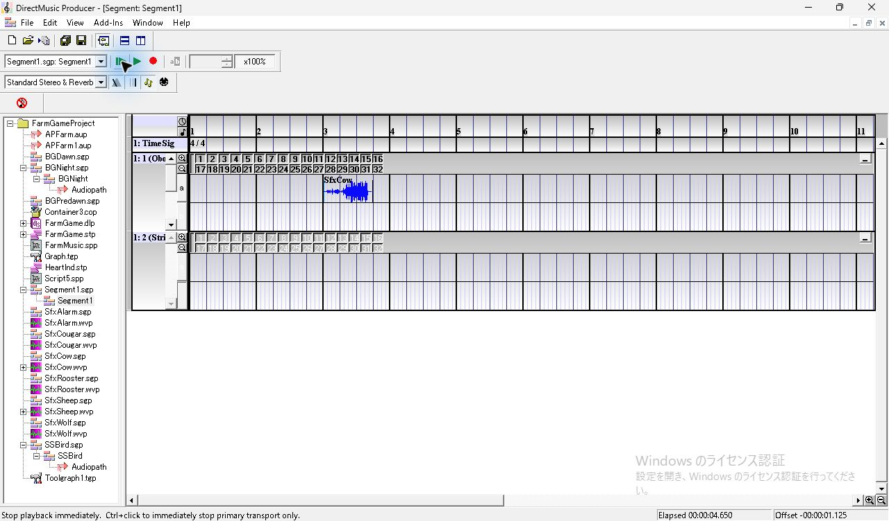

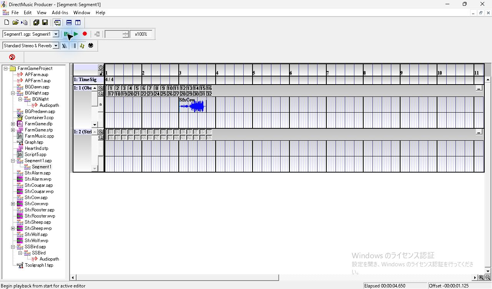

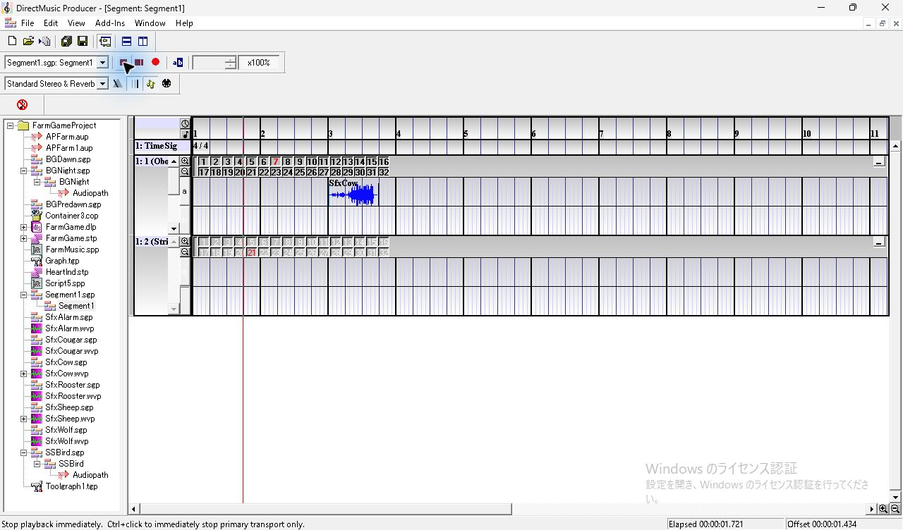

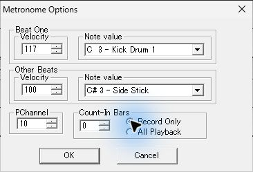

## Toggle MIDI と MIDI/Performance Options

音符の **Toggle MIDI** は左クリックでボタンの押し込み表示が切り替わる。右隣の MIDI/Performance Options は MIDI オフ時にも開いた。ヘルプは MIDI 機器との接続を一時的に切り替える操作として説明している。現環境で **MIDI Input** と **Echo MIDI Input Device** の候補はいずれも **None** だけだった。 [Toggle MIDI のヘルプ](../../../../../work/analysis/original-manual-session/20261010T031624075Z/help-extracted/htm/togglemidibutton.htm)

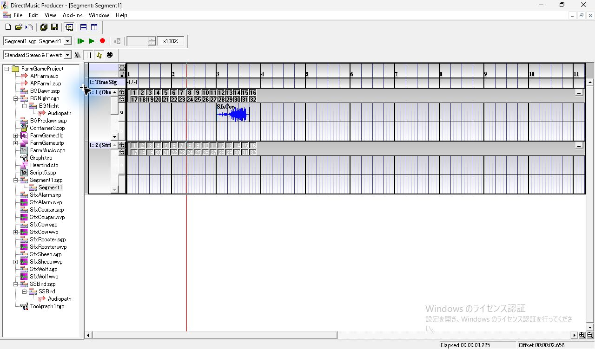

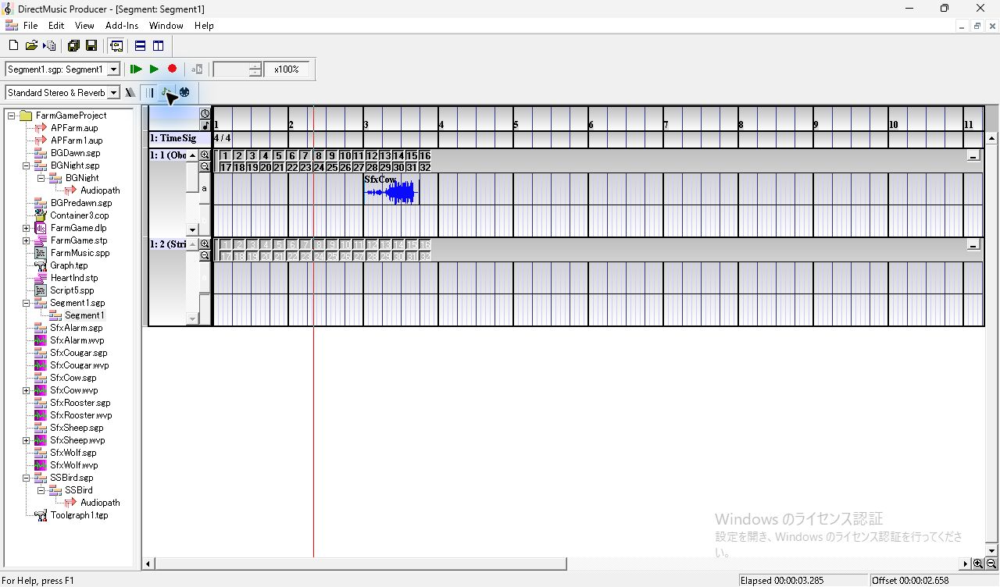

### Echo MIDI Input

デバイスが **None** でも、**Echo MIDI In** のチェックはオンにでき、**Output PChannels** の上スピンで **1–16** を **17–32** に変更できた。**Advanced** を開くと **Echo MIDI Input** が別ダイアログになり、各行にデバイスのコンボと出力範囲のスピンが8組並ぶ。1行目は親で入力した **None / 17–32**、残りは **None / 1–16**。Advanced のデバイスリストの1行目も **None** だけ。2行目の範囲を一時変更し、Advanced を Cancel で閉じた。親画面の変更も Cancel で取り消した。入力機器からの信号、エコー音、録音済みノートの生成は未観測。

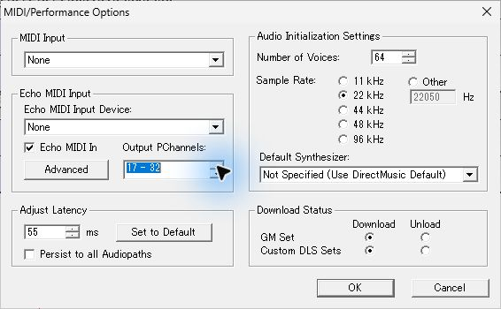

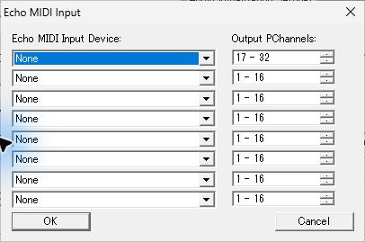

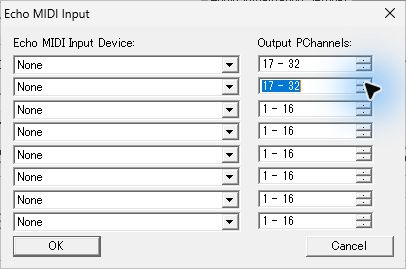

### Audio Initialization Settings

元の **Number of Voices** は **64**。**Sample Rate** は **22 kHz** が選択され、数値欄に灰色で **22050 Hz**。ラジオは **11、22、44、48、96 kHz** と **Other**。Other を選ぶと数値欄が編集でき、数値キーで **32000** を入力できた。Cancel で閉じ、設定変更は確定しなかった。

**Default Synthesizer** の候補は **Not Specified (Use DirectMusic Default)**、**Microsoft GS Wavetable Synth [エミュレート済み]**、**Microsoft MIDI Mapper [エミュレート済み]**、**Microsoft Synthesizer**。GS Wavetable を確定前に選んだ時点では、表示上の Number of Voices、Sample Rate、Adjust Latency は有効なままだった。元の **Download Status** は **GM Set** と **Custom DLS Sets** の両方が **Download**。選択を Cancel すると既定の Synthesizer、22 kHz、Echo オフ、1–16 に戻った。GS Wavetable とその他の Synthesizer の実際の出力は別試験。 [MIDI/Performance Options のヘルプ](../../../../../work/analysis/original-manual-session/20261010T031624075Z/help-extracted/htm/midiperformanceoptionsdialogbox.htm)

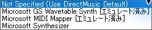

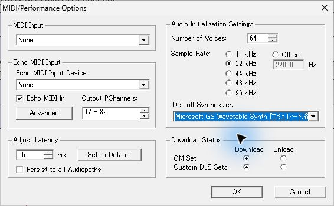

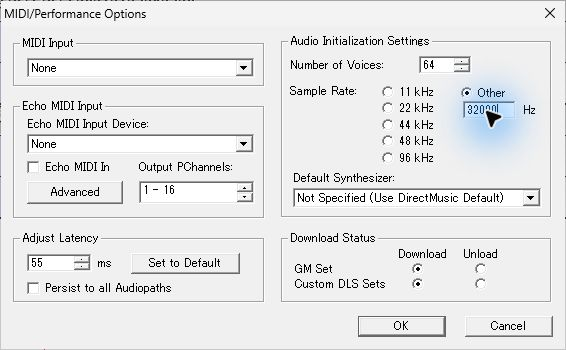

## Adjust Latency と AudioPath の切替

**Adjust Latency** の初期値は **55 ms**、**Persist to all Audiopaths** はオフ。数値を65にした後、**Set to Default** を押すと、ダイアログを閉じずに55へ戻った。次に65を **OK** で確定し、開き直して65であることを確認した。

| 操作 | 結果 |
| --- | --- |
| Persist オフで65 msを確定し、Standard Stereo & Reverb から **Standard Mono** に切替 | 55 msに戻る |
| Standard Mono で65 ms、Persist オンを確定し、**Standard Stereo & Reverb** に切替 | 65 msと Persist オンを保持 |
| Set to Default、Persist オフ、OK | 元の55 msと Persist オフに復元 |
| **No Default Audiopath** を選択して開く | 55 ms。MIDI/Performance Options は開き、欄の表示は維持された |

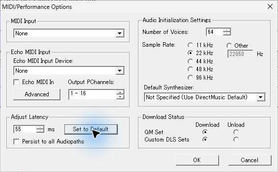

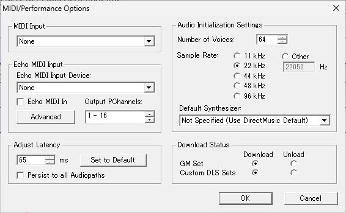

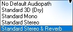

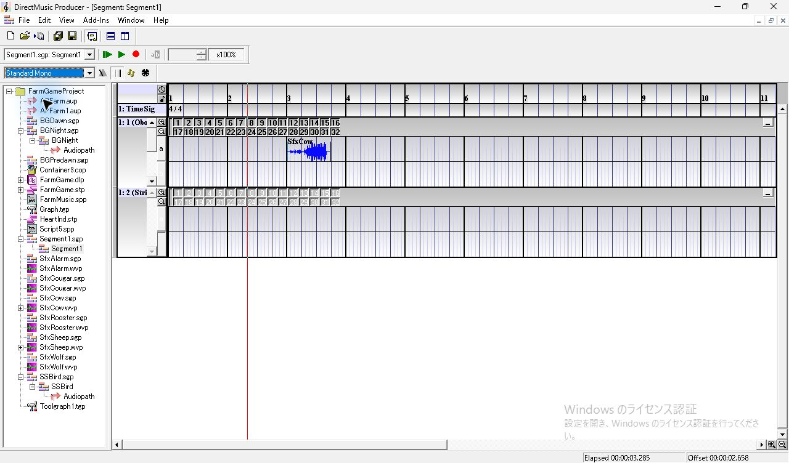

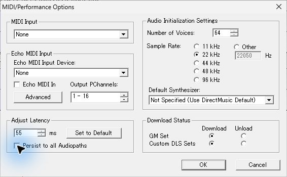

### 既定 AudioPath と再生の組み合わせ

**No Default Audiopath** の状態で Segment1 の **Play From Start** を押すと、カーソルは先頭へ戻り、開始ボタンは緑のままだった。SSBird には **Play on new instance of embedded audiopath** のチェックがある。SSBird で既定 AudioPath と Toggle MIDI を組み合わせた結果は下表の通り。開始しない場合に警告ダイアログは見えなかった。

| 既定 AudioPath | Toggle MIDI オフ | Toggle MIDI オン |
| --- | --- | --- |
| No Default Audiopath | 開始せず、PChannel 一覧は空 | 開始せず、PChannel 一覧は空 |
| Standard Stereo & Reverb | 開始し、PChannel 11 の黄色表示を確認 | 開始し、PChannel 11 の黄色表示を確認 |

ここでの開始判定は Transport ボタン、Play Cursor、Output Status。入力デバイスが None の環境での比較であり、外部 MIDI デバイス接続時の切替を確かめるには別の試行が必要。

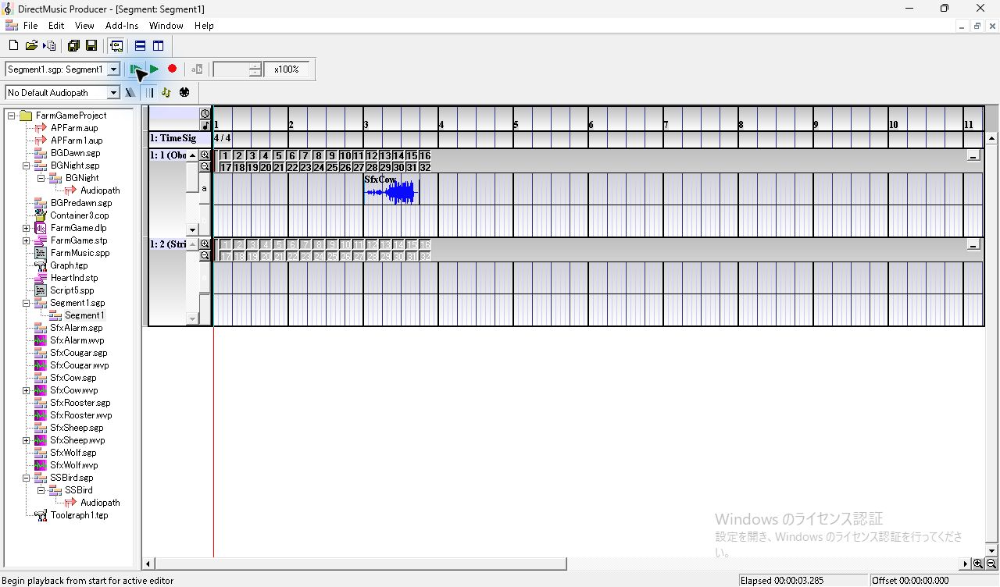

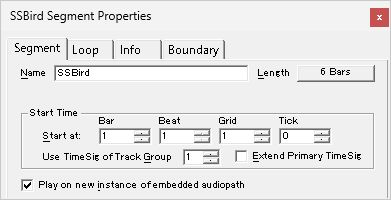

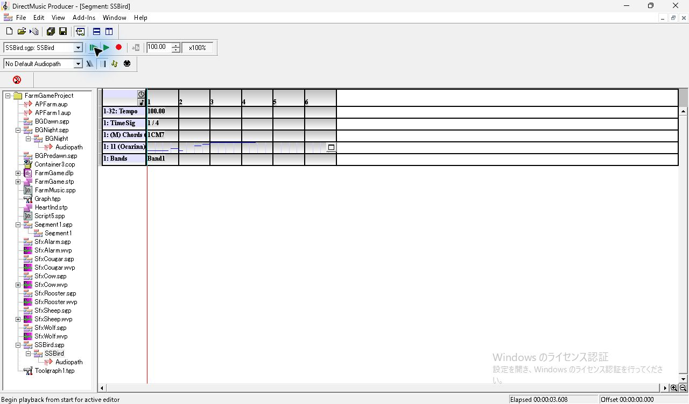

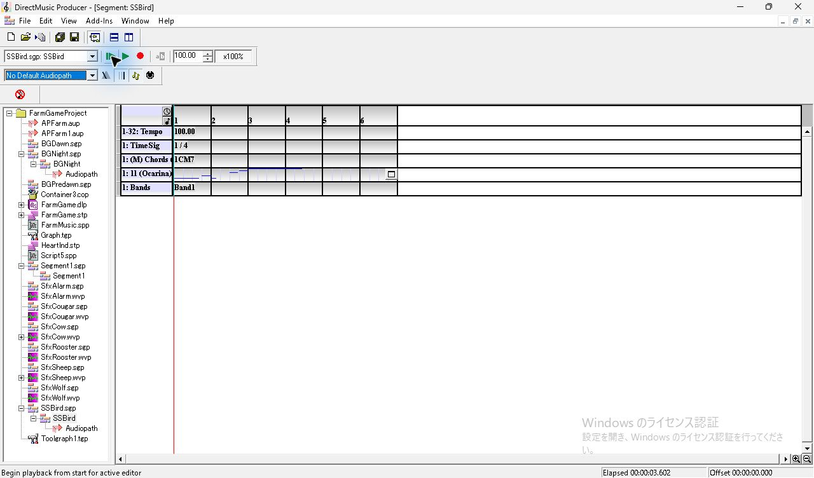

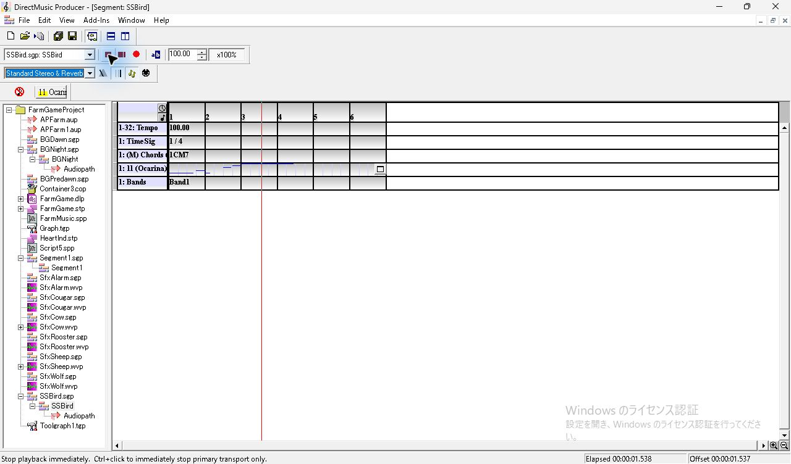

## Tempo Modifier と試聴速度

Transport Controls の右端 **x100%** を右クリックすると **Alternate Tempo** が開く。パーセントの数値欄とスピン、**OK** と **Cancel**。左クリックは補正の有効・無効を切り替える。開始時の x100% は有効表示。SSBird の Tempo 行は100.00 BPM、1/4の6小節。Alternate Tempo を50%にして OK を押すと、ボタンが **x50%** になり、そのまま次の再生に適用された。再生中も Current Tempo と Tempo 行は **100.00**。Status Bar の実時間とオフセットには差が出た。

| 条件 | 自然終了の Elapsed |
| --- | --- |
| 元の x100% | 3.610秒 |
| x50% 有効 | 7.206秒 |
| 左クリックで補正を無効、ラベルは x50% のまま | 3.607秒 |

補正を無効にした状態で境界値を試した。**0** を入力して OK するとダイアログは閉じ、ボタンは **x1%**。**10001** を入力して OK すると **x10000%**。この2例では入力値を範囲内に丸めて適用し、警告は表示されなかった。試験後は **100%** と有効表示に戻した。 [Tempo Modifier のヘルプ](../../../../../work/analysis/original-manual-session/20261010T031624075Z/help-extracted/htm/tempomodifierbutton.htm) · [Alternate Tempo のヘルプ](../../../../../work/analysis/original-manual-session/20261010T031624075Z/help-extracted/htm/alternatetempodialogbox.htm)

x150%のまま Producer を通常終了すると、再起動後もボタンに x150%が表示された。最初に再生した Tempo Track のない Segment は120 BPM相当。その後に90.00の Tempo Track を再生すると、同じ Segment は135 BPM相当になった。 [Producer 再起動後の倍率と発音間隔](seg-14-wave-tempo-restart.md#x150の設定と初回再生)

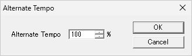

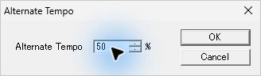

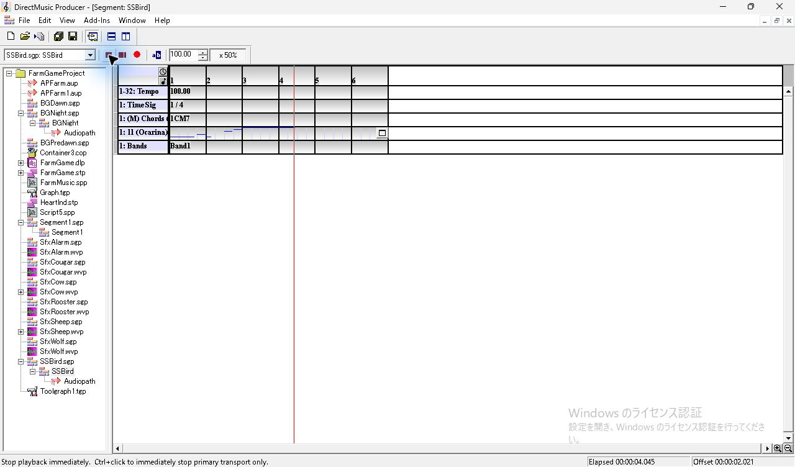

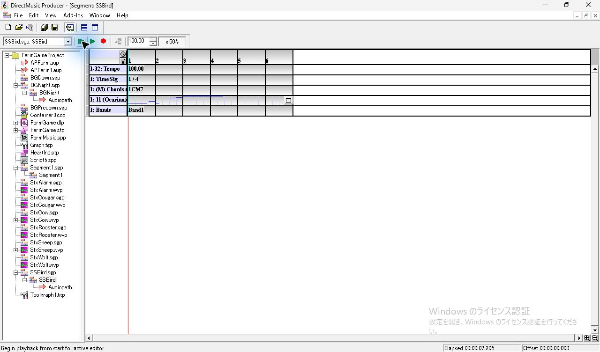

Tempo Track を含まない Wave Segment の追試では、先行文書の Tempo Track を再生した時点の倍率が、次の発音間隔に反映された。先行再生の後で倍率だけを切り替えた試行では、その直後の Wave Segment は先行再生時の速度を保持した。 [倍率を切り替える順序の追試](seg-14-wave-tempo-context.md)

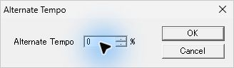

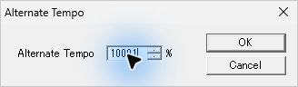

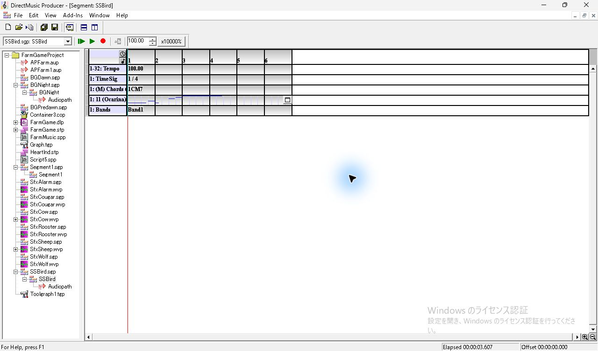

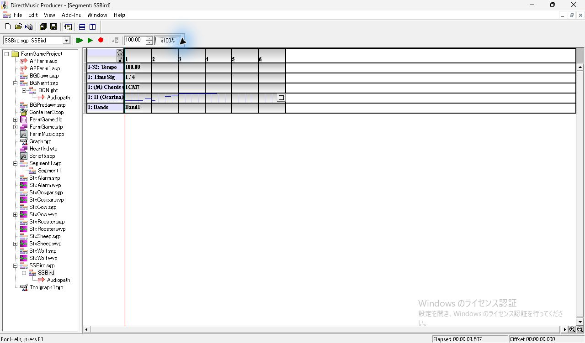

## 復元と次の確認

メトロノームをオフ、0小節・Record Only、MIDI をオン、既定 AudioPath を Standard Stereo & Reverb、Adjust Latency を55 ms・Persist オフ、Tempo Modifier を x100%・有効に戻した。追加表示したツールバーを隠し、Producer は同じ1ウィンドウで SSBird を開いた停止状態。作業プロジェクト28ファイルと凍結した原版素材21ファイルをハッシュで照合した。

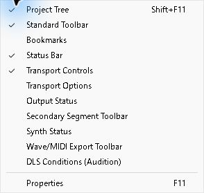

Transport の残りは、入力機器ありでの録音・Echo、カウントインの実音、再生中の Tempo Modifier 切替、別の Synthesizer と出力ポートでの挙動。次の調査は補助アプリの実機操作へ進む。 [補助アプリの素材と操作計画](ui-14-companion-apps.md)
