# UI14　Farm Demo の実機操作と音声

2026-11-11。配布資料の `Farm.exe` と実行用素材20ファイルを調査フォルダーに複製し、元の SHA-256 と照合した。起動時の作業ディレクトリは `session`、素材は `session/res`。素材なしの比較用には同じ EXE を別のディレクトリに置いた。操作ログ47件、採取画像46枚から39枚を掲載する。青い光と黒い矢印は操作ツールの表示。 [実行記録](../../../work/original-gui/UI14-farm-demo/20261111T124550098820Z/run.json) · [画像の出典・寸法・ハッシュ](../../../work/original-gui/UI14-farm-demo/20261111T124550098820Z/published-farm-live-figures.json) · [素材とダイアログリソース](ui-14-companion-apps.md#farm-demo)

## ウィンドウとボタン

タイトルは **DirectMusic Farm Demo**。この環境の枠は464×285 px。灰色のメニューバーは **File** のみ。タイトルバーには最小化、無効な最大化、閉じるが並ぶ。納屋の背景の左に Sound Effects、中央に Backgrounds と Secondary Segment、右下に All Stop がある。

| 領域 | 上からの順序と表示 |
| --- | --- |
| Sound Effects | Cougar、Cow、Rooster、Sheep、Wolf、Alarm。オレンジ、同じ幅 |
| Backgrounds | Night、Predawn、Dawn、End。緑、左列のボタンより幅が広い |
| Secondary Segment | Bird。黄緑、Backgrounds と同じ幅 |
| 停止 | All Stop。赤、Bird と同じ高さで右隣 |

初期状態で各ボタンはクリックできる。クリック後の撮影では、再生中や停止後もボタンが元の色に見えた。19枚の各ボタンの色を画素で比較し、どのボタンもソースに定義された通常色に淡色より近かった。音が続く間に維持される選択マークや進捗表示も見えなかった。同梱ソースには押下中の枠を沈める描画と再生状態用の淡色がある。押下保持中の描画は今回の画像に含まれていない。 [ボタンの色の照合](../../../work/original-gui/UI14-farm-demo/20261111T124550098820Z/captures/button-color-samples.json) · [同梱ソース](../../../../../work/producer/samples/FarmGame/src/FARM.CPP)

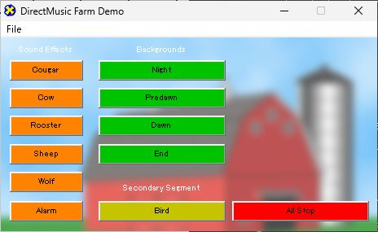

Bird を右クリックした試行ではメニューは出なかった。タイトルバーをドラッグすると、画像の左上が (408,232) から (478,278) へ移動し、寸法は464×285 pxのまま。右端を内側へドラッグしても位置と寸法は変わらなかった。

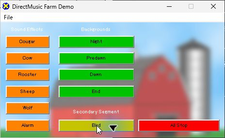

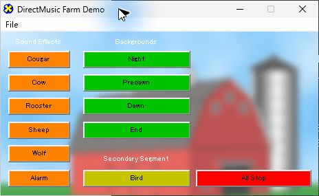

## Tab、Shift+Tab、Space

Tab や Shift+Tab の直後、フォーカス枠は見えず、アクセシビリティのフォーカス表示もダイアログのままだった。Space を押した結果を元 WAV と照合すると、ボタン間を移動していたことが分かった。最初の実行では **All Stop → Tab → Tab → Space** の出力が **Cow** に一致した。

素材ありの実行を開き直して、再現しやすい手順で確認した。各 Space の近傍で、6つの効果音から振幅の大きい180 msの区間を照合した。下表の相関は一致した素材の正規化相関。各回で2位の別素材は0.185未満だった。 [キー操作の録音](../../../work/original-gui/UI14-farm-demo/20261111T124550098820Z/captures/keyboard-end/output.wav) · [照合データ](../../../work/original-gui/UI14-farm-demo/20261111T124550098820Z/captures/keyboard-end/analysis.json)

| All Stop をクリックした後の操作 | 出力で確認したボタン | 相関 |
| --- | --- | --- |
| Tab、Space | Cougar | 0.9969 |
| Tab、Space | Cow | 0.9942 |
| Shift+Tab、Space | Cougar | 0.9970 |

## 6種類の効果音

各ボタンを背景なしで1回ずつ押し、次の効果音まで間隔を取った。録音は WASAPI の既定出力ループバック。48,000 Hz、32 bit 浮動小数点、ステレオで保存した。効果音の元 WAV を録音の周波数に合わせ、先頭130 msをクリック時刻の近くで検索した。全6種で対応する元 WAV が最大の正規化相関を示し、別素材と音高 ±100 cent の対照は0.98未満だった。録音の準備中と All Stop 後の比較区間は左右ともゼロ。 [効果音の録音](../../../work/original-gui/UI14-farm-demo/20261111T124550098820Z/captures/isolated-effects/output.wav) · [照合データ](../../../work/original-gui/UI14-farm-demo/20261111T124550098820Z/captures/isolated-effects/analysis.json)

| ボタン | 対応する素材 | 相関 |
| --- | --- | --- |
| Cougar | SfxCougar.wav | 0.9983 |
| Cow | SfxCow.wav | 0.9954 |
| Rooster | SfxRooster.wav | 0.9939 |
| Sheep | SfxSheep.wav | 0.9873 |
| Wolf | SfxWolf.wav | 0.9902 |
| Alarm | SfxAlarm.wav | 0.9926 |

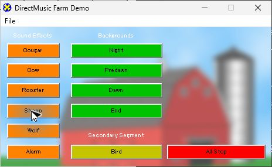

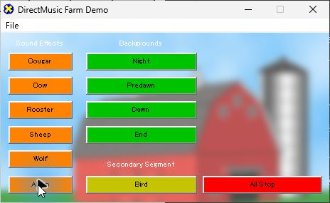

## 背景、Bird、End、All Stop

Bird を単独で押すと、録音に音が入り、次に Night を押す前の0.7秒は左右ともゼロだった。Night の再生中に Cow を押した録音では、Cow の元 WAV の振幅が大きい180 ms（素材の0.78秒から）との相関が **0.9507**。他の効果音と音高対照は最大0.240未満だった。Cow を当てはめた後の残差 RMS は単独時0.0162、Night 中0.0494で、Cow の前後にも音が続いた。この区間で Cow と背景が重なったことを波形で確認した。

Night 中には Bird も押した。その後の録音に音が続き、単独試行と同じ素材で操作できた。混合から Bird の音だけを同定する比較は未達。続けて **Predawn → Dawn → End → Night → All Stop** を操作した。画面のボタン色は操作後も保持され、Predawn、Dawn、End の各区間に音があった。背景切替の正確な小節境界と、音の構成要素の同定は別試験。 [背景と重なりの録音](../../../work/original-gui/UI14-farm-demo/20261111T124550098820Z/captures/background-sequence/output.wav) · [操作時刻と PCM の照合](../../../work/original-gui/UI14-farm-demo/20261111T124550098820Z/captures/background-sequence/analysis.json)

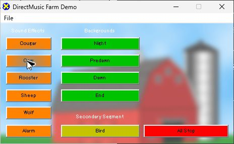

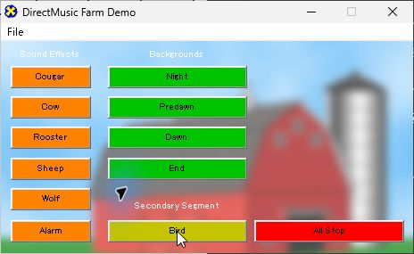

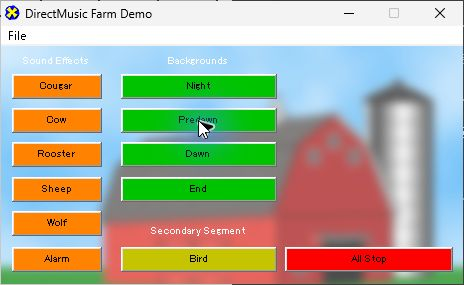

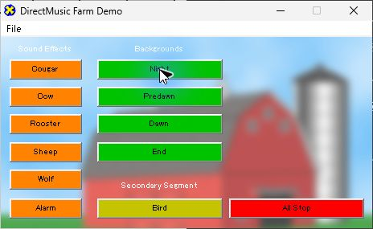

### End と停止後の音

| 条件 | 既定出力の観測 |
| --- | --- |
| 背景なしで End | クリック前は無音。クリック後の約2.15秒の区間に小さな音があった。平均化した左右の RMS は0.00150、ピークは0.0140 |
| Dawn 中に End | 操作後5秒を過ぎた区間にも音が続いた。この試行では約8.8秒後に Night を再開 |
| Night を開始し、約4秒後に End。その後に操作せず録音 | 操作要求から約9.70秒まで、どちらかのチャンネルに絶対振幅0.000001超のサンプルがあった。録音終盤の4秒間は左右ともゼロ |
| Night を再開し、演奏中に All Stop | 操作後の短い余韻を観測。操作の完了時刻から1.8〜4.8秒の区間は左右ともゼロ |

録音時刻は収録器の UTC と QPC を対応させ、各操作の要求と完了の時刻を記録した。3本とも開始直後0.05秒未満に不連続が1件、以降は時刻エラー0、フレーム位置差は最大2フレーム。Windows の既定出力を記録した試験で、スピーカーから出た音は別途計測していない。 [録音器・解析器・時刻対応](../../../work/original-gui/UI14-farm-demo/20261111T124550098820Z/run.json) · [End を待った録音](../../../work/original-gui/UI14-farm-demo/20261111T124550098820Z/captures/keyboard-end/output.wav) · [停止判定の数値](../../../work/original-gui/UI14-farm-demo/20261111T124550098820Z/captures/keyboard-end/analysis.json)

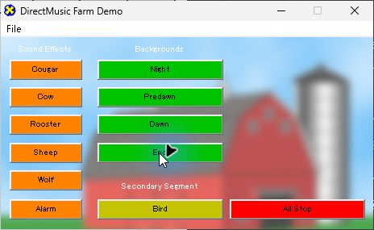

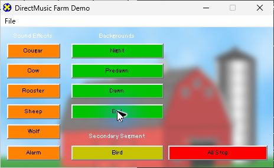

## メニューと終了

File の項目は **Exit** だけ。クリックのほか、**Alt+F** でもメニューが開いた。素材ありの2回とも **File > Exit** でウィンドウが閉じた。素材なしの起動前と再試験の終了後に、素材ありの Farm.exe が残っていないことを確認した。

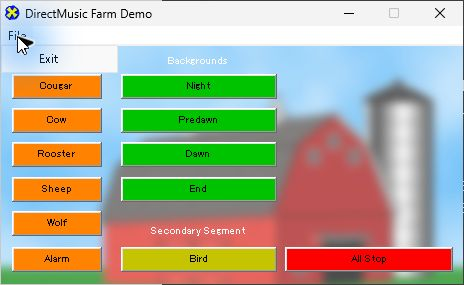

## 素材なしの起動

別の調査用 `Farm.exe` を、作業ディレクトリとその親のどちらにも `res` がない状態で1つだけ起動した。先に **Unexpected error encountered** が開き、`DMUS_E_LOADER_FAILEDOPEN (0x88781182)`、`Calling: CreateScriptFromFile`、ソースの行312を表示した。**OK** の後に同じタイトルとコードの2枚目が開き、`Calling: OnInitDialog`、行144を表示した。

2枚目を閉じると操作ツールのウィンドウ一覧から消えた。素材なしの試験用プロセスはメインウィンドウを持たずに残ったため、パスと PID を確認してこのプロセスだけを終了した。この回に通常の Farm Demo 画面は表示されなかった。 [素材なしの起動記録](../../../work/original-gui/UI14-farm-demo/20261111T124550098820Z/captures/missing-launch.json) · [残ったプロセスの終了記録](../../../work/original-gui/UI14-farm-demo/20261111T124550098820Z/captures/missing-process-exit.json)

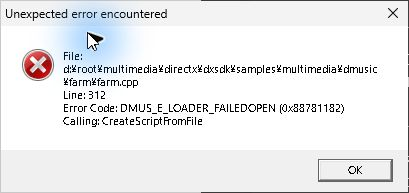

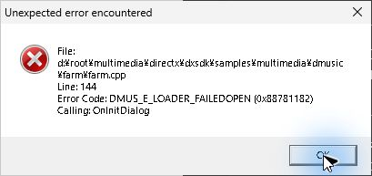

終了時に Farm Demo と録音器のプロセスが0件、Producer は元の1ウィンドウだった。配布版 EXE と20素材のハッシュは試験前後で一致。補助アプリの試聴操作は StylePlayer でも調べた。 [StylePlayer の実機記録](ui-14-styleplayer-live.md)
