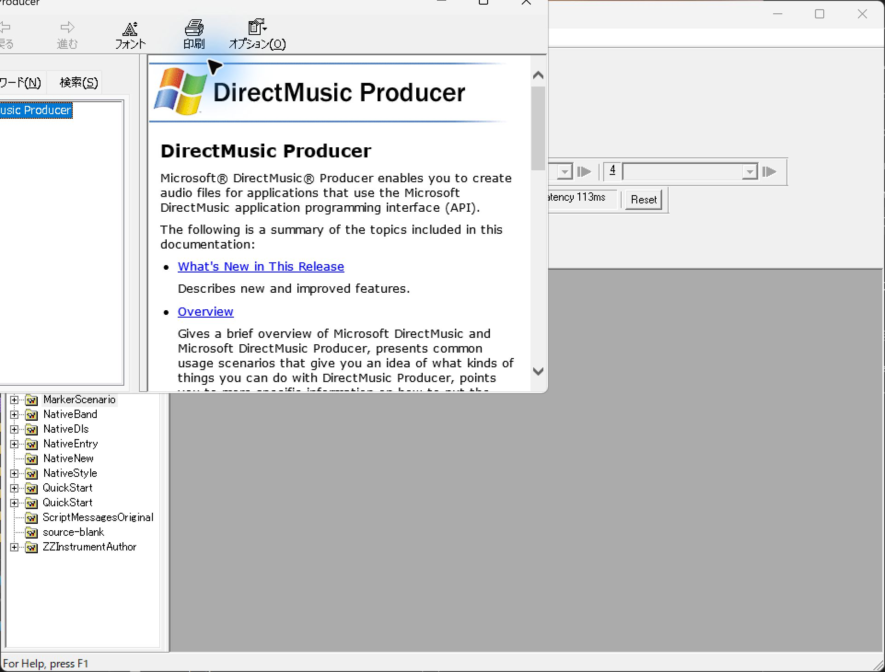
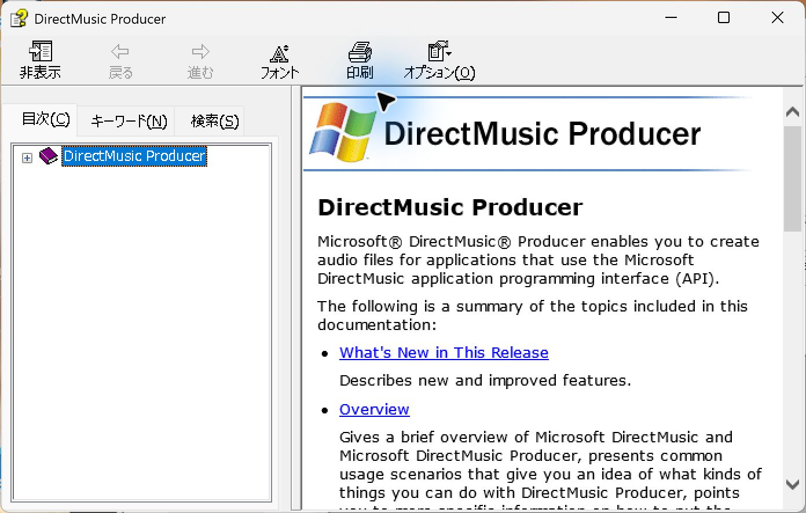
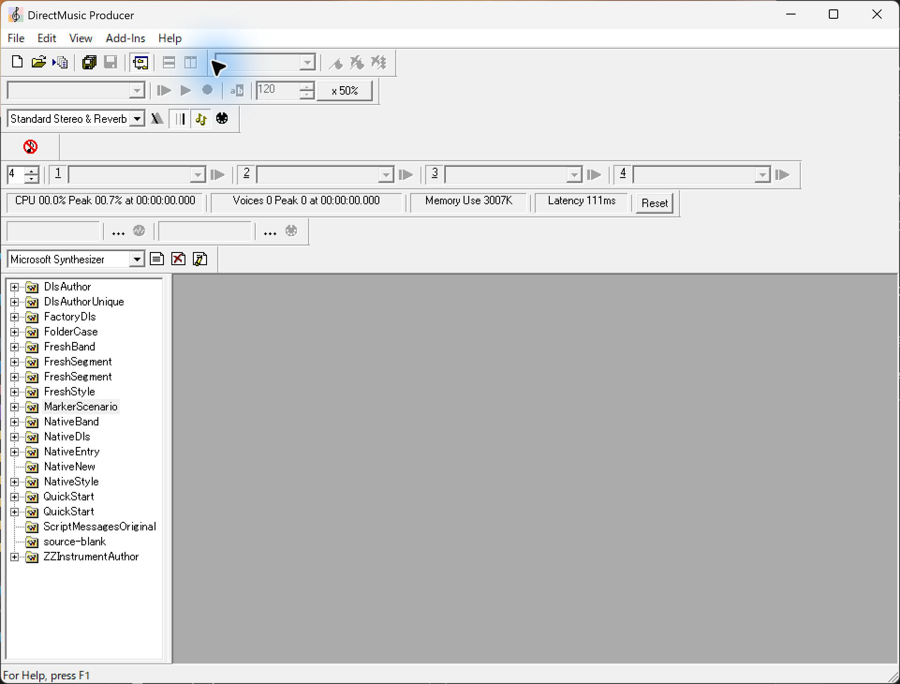

# UI14　Help メニューと HTML Help

[調査計画](README.md) · [View とツールバー表示](ui-01-view-toolbars.md)

2026-10-10 に手動起動済みのインストール版を操作した記録。DirectMusic Producer 5.3.0.900、EXE の SHA-256 は `fad2eec4d5dacd3bfd67694ea63ca169517902b73e30d283998cf7726e41c011`。200% 表示環境。本体画像は1922×1460 px、独立した Help Viewer は1392×886 px。ツールバーは当時の複数段表示。青い光と黒い矢印は操作ツールの表示。 [実行ファイルとプロセスの記録](../../../../../work/analysis/original-manual-session/20261010T031624075Z/process-observation.json) · [操作記録](../../../../../work/analysis/original-manual-session/20261010T031624075Z/session-check.json) · [画像対応表](../../../work/original-gui/UI07-14-archive/20261111T080241498238Z/published-images.json)

## 開く・閉じる操作

1. 本体のメニューバーにある `Help` をクリック。ドロップダウンは `Contents` と `About DirectMusic Producer...` の2項目。最初の UIA 要素指定ではポイントが対象外のウィンドウにあり、前面にして画面を撮り直してから座標指定で開いた。
2. `Contents` を選ぶと、本体の手前に同じタイトルの独立した Help ウィンドウが現れる。左に目次・キーワード・検索の3タブ。初期の目次では紫の本の `DirectMusic Producer` が青く選択され、展開用のプラスが左にある。
3. 右に英語の見出しと Windows ロゴ付きバナー、本文、青い下線付きリンク、縦スクロール。ツールバーは日本語で `非表示`、`戻る`、`進む`、`フォント`、`印刷`、`オプション`。最初のページでは `戻る` と `進む` が灰色。左右のペインの間に縦の境界がある。
4. 独立した Help ウィンドウに対して Alt+F4。Help が閉じ、本体のツリーと作業領域が再び前面に見えた。見えていた Project 名は前後で一致した。

使用した `dmusprod.chm` の SHA-256 は `cc99ff2d87602444c0f9962fe1685e5f0899b49ef3562ba7eae6bae977c13eed`。展開記録は863ファイル、HTML 586、GIF 252。参照画像の欠落は検査で0件。各トラックの操作名と旧画面の参照に使う。 [展開と画像参照の監査](../../../../../work/analysis/original-manual-session/20261010T031624075Z/help-audit.json) · [ヘルプの項目索引](../../../../../work/analysis/original-manual-session/20261010T031624075Z/help-index.json)

追試対象は2段ツールバーの本体から開く操作、About、F1 と現在の選択との連動、目次展開・検索結果・ページ履歴、ペインの表示切替と境界操作。今回の観測では文書の編集・保存・再生は行っていない。
