# UI14　StylePlayer の実機操作と音声

2026-11-11。配布版 `StylePlayer.exe` を作業フォルダーに複製し、同じディレクトリに Style 187件、ChordMap 27件と説明書を置いた。実行ファイルを含む216ファイルの SHA-256 を元資料と照合した。操作・観測ログ94件、採取画像105枚から54枚を掲載する。青い光と黒い矢印は操作ツールの表示。 [実行記録と入力ハッシュ](../../../work/original-gui/UI14-styleplayer/20261111T132150928505Z/run.json) · [画像の出典・寸法・ハッシュ](../../../work/original-gui/UI14-styleplayer/20261111T132150928505Z/published-styleplayer-figures.json) · [配布資料の構成](ui-14-companion-apps.md#styleplayer)

## 起動、自動再生、配置

タイトルは **StylePlayer**、親ウィンドウは247×437 px。この環境では通常のメニューバーはなく、タイトル左端にアイコン、右端に閉じるボタンがある。

| 位置 | 項目と配置 |
| --- | --- |
| Create Segment | Style、ChordMap、Band、Shape の4行。左に項目名、右に同幅のコンボ |
| 同じ枠の中段 | 左に Intro、右に End のチェック。下に Length の数値欄と Measures |
| 同じ枠の下段 | Re-Compose |
| Play Segment & Style Motifs | Play と Stop が横並び。その下に緑の横長の進捗バー、さらに下に2列2行の Motif ボタン |

素材ありの1回目は **Rock I / Boogie / Default**。最初に全面を撮れた時点では Stop は灰色で、進捗は0。起動前からの録音では、Play を操作する前に音が出た。2回目は **Shuffle / Funk parallel / Default**。起動直後に Stop は有効、進捗の取得値は565から3,392へ増え、Play を押さずに再生が進んだ。操作せず待つと Stop が灰色に戻り、進捗は0になった。両回で **Shape は Song、Length は12、Intro と End はオン**。前の実行で最後に選んだ Style、Shape、Length は次の起動に引き継がれなかった。 [1回目の起動音の録音](../../../work/original-gui/UI14-styleplayer/20261111T132150928505Z/captures/audio-initial/output.wav) · [起動時刻と録音の照合](../../../work/original-gui/UI14-styleplayer/20261111T132150928505Z/captures/audio-initial/analysis.json) · [同梱の説明書](../../../../../work/producer/style-library/StylePlayer.txt)

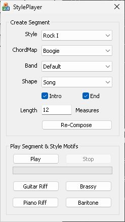

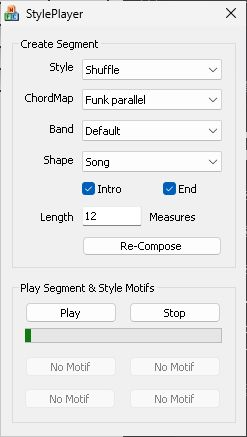

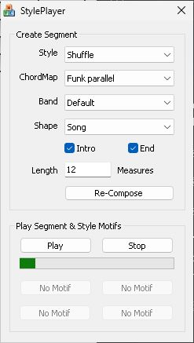

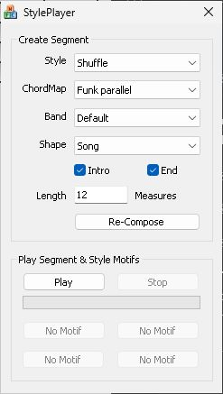

## 選択リストと Style の切替

Style リストには縦スクロールバーが出る。Rock I の位置から開くと Rock I、Rock II、Rock III などが見える。ChordMap は **Boogie** から **tension** まで27候補が1つのポップアップに収まった。Shape の順序は **Falling、Level、Loopable、Loud、Peaking、Quiet、Random、Rising、Song**。矢印をクリックして開き、値を変えずに Esc を押すと、各リストは閉じた。

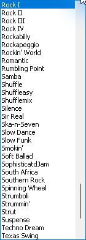

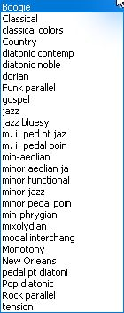

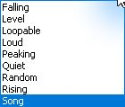

**Rock I** の Band は **Appalachian、Default、Electric Buzz、Gnarley Dude、Honky Tonk、Lounge、Lush、Organ、Synth** の9件。4つの Motif は **Guitar Riff、Brassy、Piano Riff、Baritone**。**Rumbling Point** に変えると、Band は **Custom5** だけ、Motif は4つとも **No Motif** の灰色表示になった。ChordMap は選択していた **Classical** から **minor pedal poin** に変わり、Shape の **Rising**、Length の **32**、Intro と End がオフの状態は残った。Style 変更の後に Stop が有効になり、進捗が増えた。配布素材の旧形式 `AASY` 内の Band も、Rock I が9件、Rumbling Point が1件だった。 [素材の Band 名とチャンクの一覧](../../../work/original-gui/UI14-styleplayer/20261111T132150928505Z/style-inventory.json)

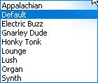

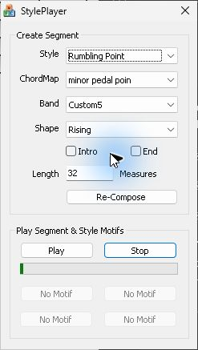

### キーボードで選択した場合

停止した Rumbling Point で Style リストを開き、**Home** を押すと先頭の **20th C. Chorale** がハイライトされた。リストが開いたまま ChordMap は **classical colors**、Band は **Default**、Motif は **Arpeggio、Twinkle、Crash Boom、Melodic** になり、Stop と進捗も動き始めた。Esc で閉じた後も **20th C. Chorale** のまま再生が続いた。キーでリスト内を移動した時点で、依存する項目と演奏が更新される例。

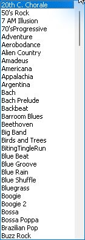

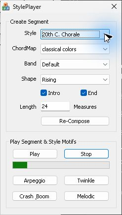

## Length の入力と境界

Length にフォーカスし、Home と Shift+End で値全体を選べた。停止中の Rock I で **12 → 32** と入力した直後の画像では Stop は灰色、進捗0。その後 Tab で離れると Intro に点線のフォーカス枠が付き、Stop が有効になり、進捗が935から18,472へ進んだ。

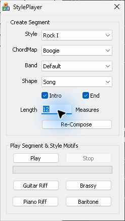

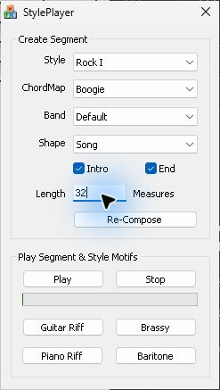

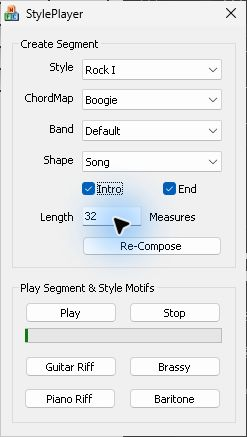

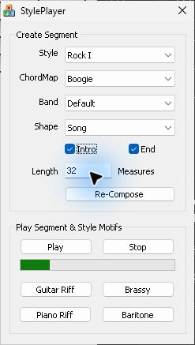

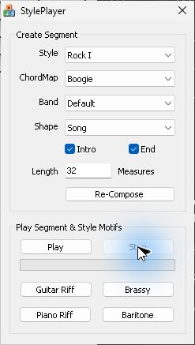

Rumbling Point の停止中に **0** を入力して Tab で離れると、表示は0を保持し、警告は出なかった。自動再生は始まらなかったが、**Play** を押すと0の表示のまま演奏が始まり、進捗は3,581まで増えた。その後 **Re-Compose** を押しても、進捗は21,757から24,395へ進み、先頭へ戻らなかった。この操作で0小節の Segment が生成されたかは確認できていない。**24** に戻して入力欄を離れた後は、進捗が先頭付近から増えた。

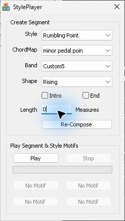

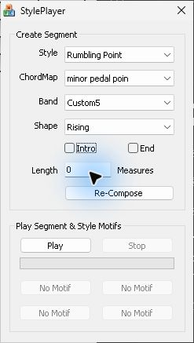

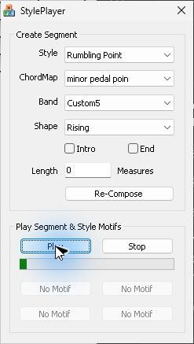

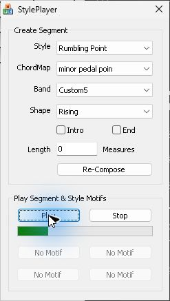

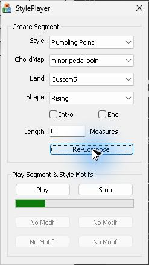

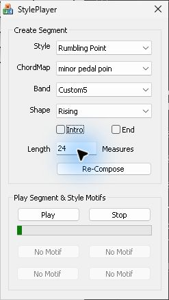

## 設定変更と再生位置

進捗は画面のバーとアクセシビリティの生の値を照合した。下表の数値はツールで取得したコントロールの値。画面に表示される百分率や時刻ではない。変更直後のアクセシビリティ表示に前の状態が残ることがあったため、次の取得も確認した。 [各画像の時刻と進捗値](../../../work/original-gui/UI14-styleplayer/20261111T132150928505Z/run.json)

| 操作 | 変更前 → 変更後 | 観測 |
| --- | --- | --- |
| 再生中に Band を Default から Electric Buzz | 12,652 → 27,573 | リストを開いている間も進捗が進み、選択後も途中から継続 |
| 再生中に Brassy | 32,217 → 33,439 | 主演奏の進捗は前進 |
| 再生中に Shape を Song から Rising | 38,881 → 136 | 先頭付近に戻り、次の撮影では7,805 |
| 停止中に ChordMap を Boogie から Classical | 0 → 4,078 | Stop が有効になり演奏が始まる |
| Rumbling Point の再生中に Intro をオン | 24,490 → 1,129 | 先頭付近から再始動 |
| 続けて End をオン | 14,538 → 1,166 | 先頭付近から再始動 |
| 再生中に Re-Compose | 26,565 → 1,464 | 先頭付近から再始動 |
| 再生中に Play を押し直す | 20,002 → 801 | Play は再生中も有効で、押し直すと先頭付近に戻る |
| 進捗バー右端寄りをクリック | 4,126 → 4,955 | 通常の増加が続き、クリック位置へのジャンプは見えなかった |
| Stop | 値0、バーの色が消える | Stop は灰色に戻り、Play は操作可能 |

### Band、Motif、Shape

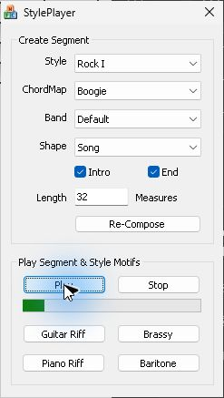

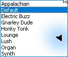

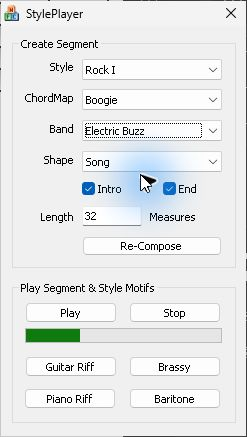

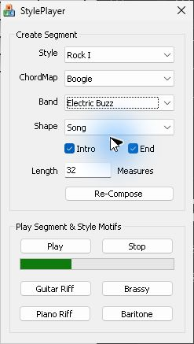

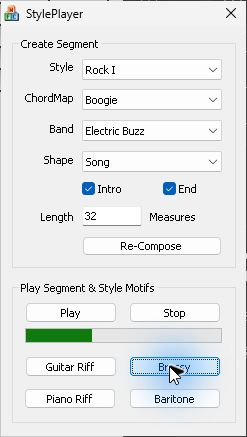

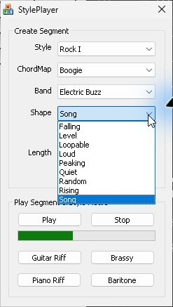

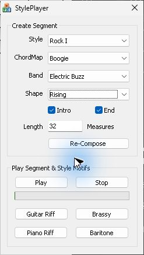

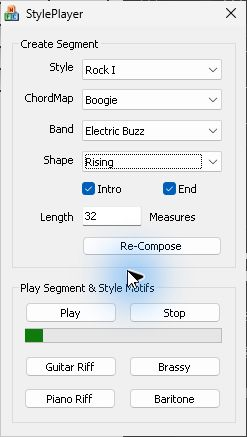

### ChordMap、Intro、End、進捗バー

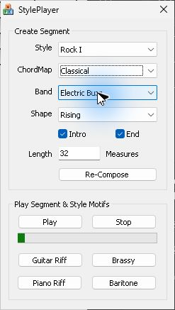

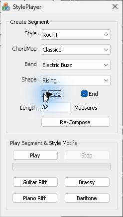

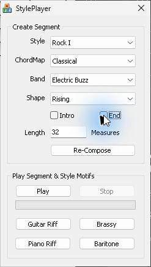

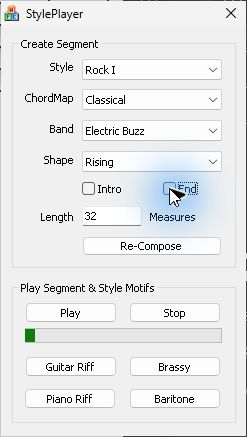

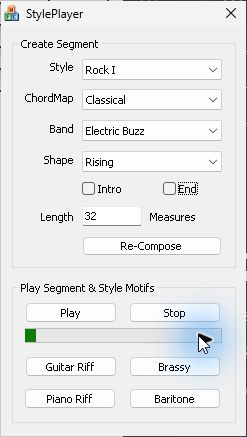

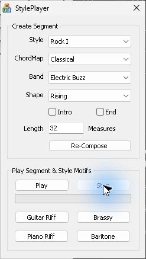

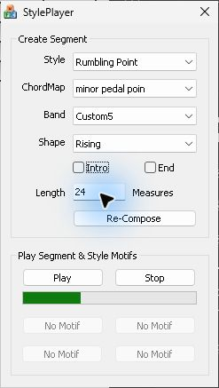

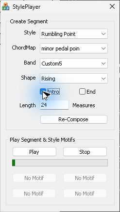

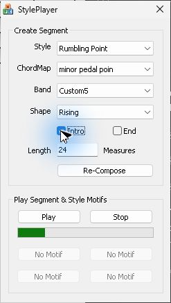

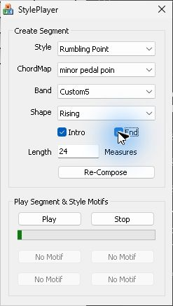

### Re-Compose と Play

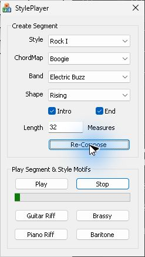

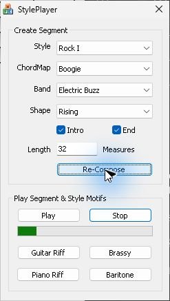

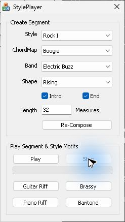

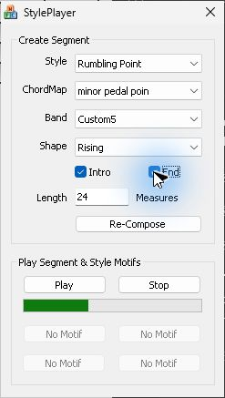

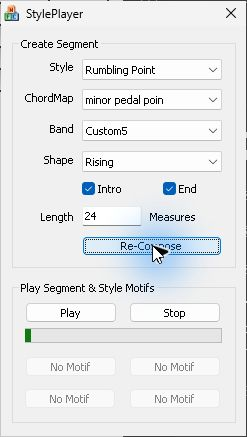

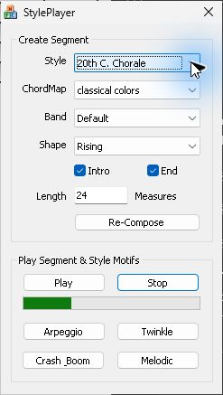

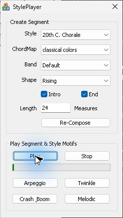

## Motif 単独と録音

Rock I を停止して **Guitar Riff** を押した。進捗は0、Stop は灰色のままだったが、録音ではクリック後に音が出た。Play を押して始める主演奏と、停止状態から押せる Motif は画面上の進捗を共有しない。再生中の **Brassy** は主演奏を止めずに操作できた。混合から Brassy の音だけを同定する比較は残る。 [操作中の録音](../../../work/original-gui/UI14-styleplayer/20261111T132150928505Z/captures/audio-controls/output.wav) · [操作時刻と PCM の照合](../../../work/original-gui/UI14-styleplayer/20261111T132150928505Z/captures/audio-controls/analysis.json)

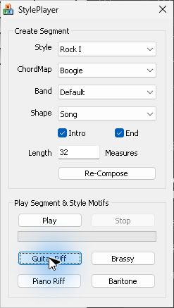

録音2本は Windows 既定出力の WASAPI ループバック、48,000 Hz、32 bit 浮動小数点、ステレオ。左右を平均した RMS は下表の通り。各録音の開始直後0.05秒未満に不連続が1件ずつあり、その後は時刻エラー0、フレーム位置差は最大2フレーム。物理スピーカーでの音圧、Band ごとの音色の同定、Shape の Groove Level の推移、Intro と End のパターン内容は今回の照合範囲外。

| 録音区間 | RMS |
| --- | --- |
| 1回目の起動前 | 0 |
| 起動後0.8〜5.8秒、Play 操作前 | 0.07351 |
| 主演奏停止中の Guitar Riff | 0.07442 |
| Band 変更前 / 変更後 | 0.09438 / 0.08730 |
| 停止中の Re-Compose 後 | 0.02999 |
| Stop 後1.8秒からの比較区間（2回） | 0.00001315 / 0.00001077 |

## About、移動、終了、素材なしの起動

**Alt+Space** のシステムメニューには **移動**、**閉じる**、**About StylePlayer...** がある。About には **StylePlayer Version 1.0** と **Copyright (C) 20002 Microsoft Corp.** が表示され、OK で閉じる。EXE の **New** ダイアログに相当する入口は今回の操作では確認できなかった。 [ダイアログリソースと確認範囲](ui-14-companion-apps.md#styleplayer)

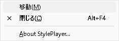

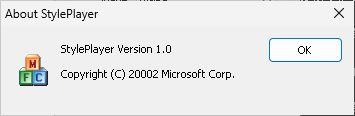

タイトルバーのドラッグで左上が (517,157) から (580,199) へ移動した。247×437 pxの寸法は維持され、右端を内側へドラッグした試行でも変わらなかった。素材ありの1回目はタイトルの閉じる、2回目は Alt+F4 で終了した。次を起動する前に、既存の StylePlayer がないことを確認した。

素材を置いていない別のディレクトリで同じ EXE を起動すると、操作ツールの一覧にウィンドウが現れず、プロセスだけが残った。確認時のメインウィンドウハンドルは0。該当する Application Error イベントは確認できなかった。画面から閉じられないため、パスと PID が一致する素材なし試験のプロセスだけを終了した。 [素材なしの起動](../../../work/original-gui/UI14-styleplayer/20261111T132150928505Z/captures/empty-launch.json) · [試験用プロセスの終了](../../../work/original-gui/UI14-styleplayer/20261111T132150928505Z/captures/empty-process-exit.json)

最後に StylePlayer と録音器が0件、Producer は調査前と同じ1ウィンドウ。配布版 EXE と素材のハッシュも一致した。次は Segment エディターに戻り、Script Track の Timing と複数選択を追試する。 [Script Track の既存調査](seg-14-script-track.md)
